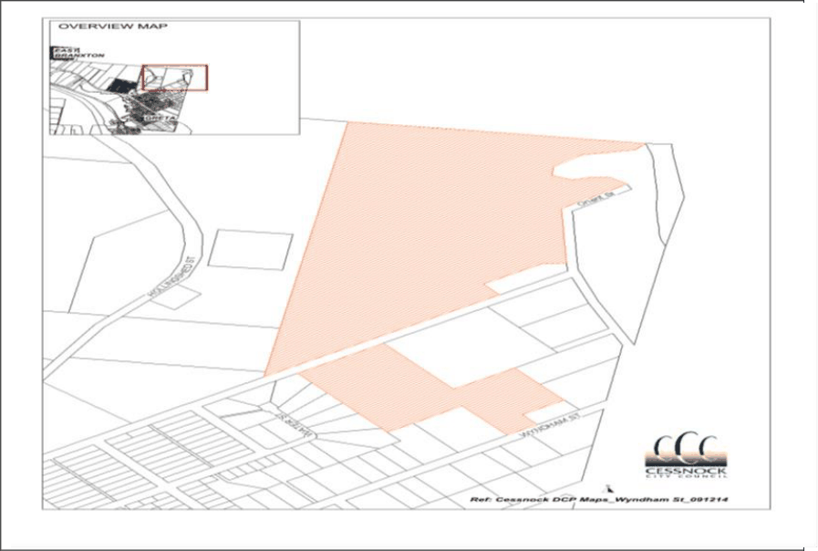

# Cessnock Development Control Plan 2010 - Part F4 West & Wyndham Street, Greta

> This chapter is split into 12 section file(s), one per numbered heading, in the order they appear in the PDF.

Source PDF: [F4-West-and-Wyndham-Street-Greta.pdf](https://planfortomorrow.sharepoint.com/sites/Planfortomorrow/Shared%20Documents/00%20NSW-Planning-Resources/dcp/cessnock-development-control-plan-2010/part-f4-west-wyndham-street-greta/F4-West-and-Wyndham-Street-Greta.pdf)

### F.4 – West & Wyndham Streets Greta

### Urban Release Area

> [Picture on page 1: a picture, saved as a picture (images/part-f4-west-wyndham-street-greta-page-1-3.gif, 150 dpi).]

#### Description

The West and Wyndham Streets Greta Urban Release Area is located in the suburb of Greta and contains approximately 28.5ha of Low Density Residential, 8.51 hectares of Rural Residential Land and 7.7ha of Environmental Conservation land.

The site is surrounded by Large Lot Residential land to the south-east; rural land to the north and east; and residential land to the south-west. The Hunter River Regional Reserve is located to the north east of the site.

The desired future character of the West Street, Greta Urban Release Area is a mix of residential lot sizes that reflect the constraints and opportunities of the site and complement the existing settlement pattern.

On the eastern side of the release area, minimum lot sizes will be 2,000m². On the western side of the release area, there will be a mix of lot sizes ranging from 600m² to 2,000m².

An E2 Environmental Conservation zone is located to the north of the site. The area is ecologically significant and will be managed in perpetuity to maintain and improve its conservation values.

The main access to the release area will be via an extension of West Street.

Through the implementation of the West and Wyndham Streets Urban Release Area, Cessnock City Council wishes to establish controls and guidelines to facilitate successful residential development that is of a high quality and considers the constraints of the area. It is envisaged that development on site will complement the existing suburb structure and have minimal adverse impacts on the natural environment.

Specific development controls are included to ensure that the development has regard for sustainable environmental management principals.

#### Development Requirements

All development applications shall demonstrate consistency with the following requirements.

<!-- sections -->
## Sections

1. [1 Staging Plan](01-staging-plan.md)
2. [2 Transport Movement Hierarchy](02-transport-movement-hierarchy.md)
3. [3 Overall Landscaping Strategy](03-overall-landscaping-strategy.md)
4. [4 Passive and Active Recreational Areas](04-passive-and-active-recreational-areas.md)
5. [5 Stormwater and Water Quality Management Controls](05-stormwater-and-water-quality-management.md)
6. [6 Amelioration of Natural and Environmental Hazards](06-amelioration-of-natural-and.md)
7. [7 Significant Development Sites](07-significant-development-sites.md)
8. [8 Residential Densities](08-residential-densities.md)
9. [9 Neighborhood Commercial and Retail Uses](09-neighborhood-commercial-and-retail-uses.md)
10. [10 Provision of Public Facilities and Services](10-provision-of-public-facilities-and.md)
11. [11 Sewer and Water Reticulation](11-sewer-and-water-reticulation.md)
12. [12 Voluntary Planning Agreements](12-voluntary-planning-agreements.md)
