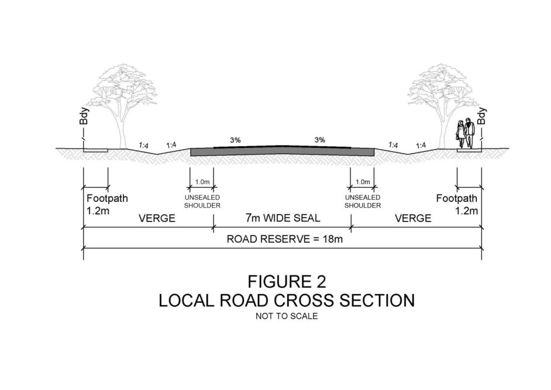

## 2 Transport Movement Hierarchy

Road and Intersection Design

The road layout must be consistent with the Indicative Layout Plan illustrated in Figure 1 above.  Development applications for subdivisions must ensure that road networks connect to other development areas in a logical hierarchy of street function.

A 2m wide off-road footpath/cycleway must be constructed from the site access off Millfield Road to Crawfordville Park, as shown in Figure 1.

A 1.2m wide off-road footpath/cycleway must be constructed within the site as shown in Figure 1 and Figure 2.

A pedestrian crossing and refuge either side of Millfield Road must be provided.

Millfield Road must be widened along the length of the development fronting Millfield Road to accommodate an 11m pavement width in accordance with Council’s Engineering Standards.

All road, footpath/cycleway works must be completed in accordance with Council’s standards.

The internal road design shall be in accordance with Figure 2 below.

> [Picture on page 3: a picture, saved as a picture (images/part-f5-rosehill-millfield-page-3-19.gif, 150 dpi).]

Figure 2: Local Road Cross Section

Movement Hierarchy

The transport movement hierarchy shall generally be in accordance with the circulation route shown on the Indicative Layout Plan.

Suitable transport access and connectivity within the site and to adjoining areas shall be maintained at all times for motor vehicles, pedestrians and cyclists.
