# Cessnock Development Control Plan 2010 - Community Engagement Strategy

Source PDF: [Community-Engagement-Strategy_adopted-19-March-2025_CCC_website-doc.pdf](https://planfortomorrow.sharepoint.com/sites/Planfortomorrow/Shared%20Documents/00%20NSW-Planning-Resources/dcp/cessnock-development-control-plan-2010/supporting-guides/community-engagement-strategy/Community-Engagement-Strategy_adopted-19-March-2025_CCC_website-doc.pdf)

### CESSNOCK LGA

### 2025

### COMMUNITY

### ENGAGEMENT

> [Picture on page 1: a picture, saved as a picture (images/community-engagement-strategy-page-1-5.gif, 150 dpi).]

### STRATEGY

### CESSNOCK CITY COUNCIL

> [Picture on page 2: a picture, saved as a picture (images/community-engagement-strategy-page-2-1.gif, 150 dpi).]

Journey Through Time, created by local school students and artist Steven Campbell.

#### Acknowledgement of Country

Cessnock City Council acknowledges that within its local government area boundaries are the traditional

lands of the Wonnarua people, the Awabakal people and the Darkinjung people. We acknowledge these

Aboriginal peoples as the traditional custodians of the land on which our offices and operations are located,

and pay our respects to Elders past and present. We also acknowledge all other Aboriginal and Torres Strait

Islander people who now live within the Cessnock Local Government Area.

### Contents

| About this strategy | 6 |
|---|---|
| Introduction | 6 |
| What is Community Engagement? | 7 |
| Integrated planning & reporting | 10 |
| The framework | 10 |
| Legislative requirements | 10 |
| What our community told us | 13 |
| Challenges to engagement | 17 |
| Stakeholders | 20 |
| Roles and responsibilities | 23 |
| How we will engage | 26 |
| Levels of engagement | 26 |
| How we listen and get back to you | 28 |
| Evaluation | 29 |
| Action plan | 30 |
| Honest conversations | 31 |
| Relationship building | 32 |
| Insight and learning | 33 |
| Community participation plan | 35 |
| What is the Community Participation Plan? | 36 |
| Where does the CPP apply? | 36 |
| What planning matters are covered by the CPP? | 37 |
| Important things to consider | 38 |
| Minimum exhibition / notification periods and formats |  |
| – Strategic Planning | 42 |
| Minimum exhibition / notification periods and formats |  |
| – Development Assessment | 44 |
| Development Assessment not requiring exhibition | 46 |

### ABOUT

### THIS STRATEGY

### About this strategy

### Introduction

We work with our community in a

meaningful way, making sure they are at

the centre of everything we do. It is our

responsibility to support our community’s

right to access information, be consulted,

and actively take part in Council’s planning

and decisions.

Positive and purposeful communication

and engagement with our community

brings many benefits, like strengthening

relationships, gaining support, and

increasing awareness and participation

in our programs, projects, activities, and

services.

The Community Engagement Strategy

(the Strategy) outlines our commitment

to community engagement and sets a

strategic direction to increase opportunities

for meaningful participation. We want our community to know that we

are here with them, making decisions and

implementing plans for the future of our

community.

This Strategy supports us in undertaking

effective community engagement and

being more responsive to our community.

Our goal is to deliver strategies, services,

projects, and programs that help achieve

our community’s aspirations for the

Cessnock Local Government Area. The Strategy provides a framework to

support the development of our strategies,

including our Community Strategic Plan,

which identifies the community’s main

priorities and aspirations for the future and

identifies ways of achieving these goals. The Strategy incorporates objectives,

actions, and guidelines to ensure continual

improvement of our practices. Informed

by our community, this Strategy reflects

our commitment to communicate and

engage in ways that best suit the diverse

communities that call the Cessnock Local

Government Area home.

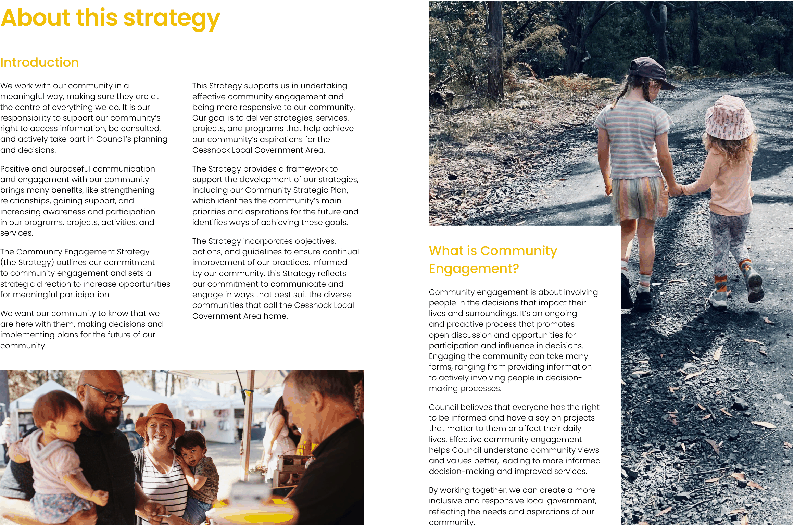

> [Picture on page 4: a picture, saved as a picture (images/community-engagement-strategy-page-4-47.gif, 150 dpi).]
> Words printed on the picture (title and legend, copied from the PDF):
> lives. Effective community engagement
> community.

### What is Community

### Engagement?

Community engagement is about involving

people in the decisions that impact their

lives and surroundings. It’s an ongoing

and proactive process that promotes

open discussion and opportunities for

participation and influence in decisions.

Engaging the community can take many

forms, ranging from providing information

to actively involving people in decision-

making processes.

Council believes that everyone has the right

to be informed and have a say on projects

that matter to them or affect their daily

helps Council understand community views

and values better, leading to more informed

decision-making and improved services.

By working together, we can create a more

inclusive and responsive local government,

reflecting the needs and aspirations of our

### INTEGRATED

### PLANNING &

### REPORTING

### Integrated planning & reporting

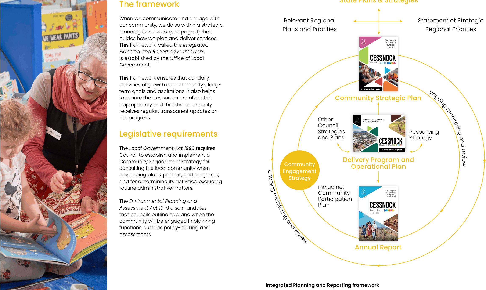

> [Picture on page 6: a picture, saved as a picture (images/community-engagement-strategy-page-6-2.gif, 150 dpi).]

### The framework

When we communicate and engage with

our community, we do so within a strategic

planning framework (see page 11) that

guides how we plan and deliver services.

This framework, called the Integrated

Planning and Reporting Framework,

is established by the Office of Local

Government.

This framework ensures that our daily

activities align with our community’s long-

term goals and aspirations. It also helps

to ensure that resources are allocated

appropriately and that the community

receives regular, transparent updates on

our progress.

### Legislative requirements

The Local Government Act 1993 requires

Council to establish and implement a

Community Engagement Strategy for

consulting the local community when

developing plans, policies, and programs,

and for determining its activities, excluding

routine administrative matters.

The Environmental Planning and

Assessment Act 1979 also mandates

that councils outline how and when the

community will be engaged in planning

functions, such as policy-making and

assessments.

#### State Plans & Strategies

> Words printed on the picture (title and legend, copied from the PDF):
> Planning for our people,
> our place, our future
> DELIVERY PROGRAM 2022-26

#### Relevant Regional

#### Statement of Strategic

#### Plans and Priorities

#### Regional Priorities

#### Community Strategic Plan oi

Delivery Program and

#### Operational Plan

o

#### Community

#### Engagement

ng

#### Strategy

oin

#### Annual Report

#### Integrated Planning and Reporting framework

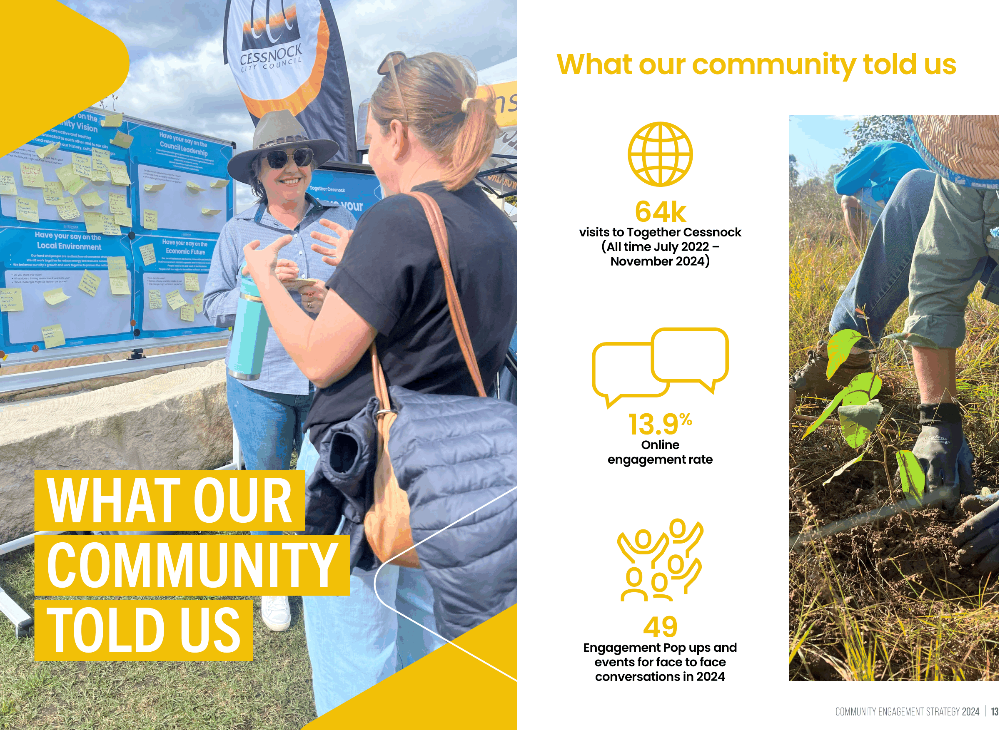

> [Picture on page 7: a picture, saved as a picture (images/community-engagement-strategy-page-7-1.gif, 150 dpi).]

### WHAT OUR

### COMMUNITY

### TOLD US

### What our community told us

### 64k

#### visits to Together Cessnock

#### (All time July 2022 –

#### November 2024)

### 13.9%

#### Online

#### engagement rate

### 49

Engagement Pop ups and

#### events for face to face

#### conversations in 2024

Throughout 2024, Council engaged extensively with the Cessnock community as part of our

work on the Together Cessnock 2035 Community Strategic Plan. During this engagement,

the community shared how they would like Council to involve them in our projects.

I do not feel that the

community concerns

are taken on board.

I think the walk and

talk idea is awesome!

Sometimes it’s hard to

clearly explain what your

concern is. By getting

Council staff out in the

community with residents

it can help explain

challenges better and

means better outcomes

can be achieved.

#### You need to demonstrate

how the community has

influenced the decisions.

#### The opportunities that I have seen offered for community

engagement have been at very short notice.

#### Very good posters and maps.

Improved transparency and a

commitment to truly listening

to residents would go a long

way in building trust and

ensuring that Council actions

reflect the needs and desires

of the community.

#### Unless you are signed

up to this site you don’t

always hear about things.

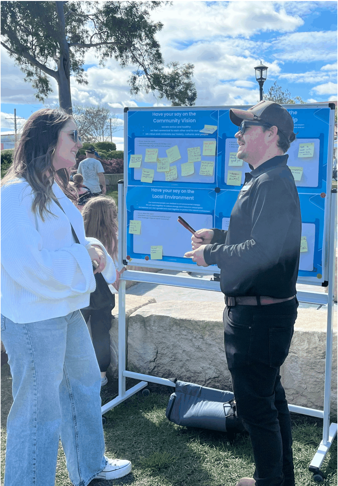

> [Picture on page 8: a picture, saved as a picture (images/community-engagement-strategy-page-8-34.gif, 150 dpi).]

### Challenges to engagement

These challenges came to light through conversations with our community during the

Community Strategic Plan engagement, input from Council staff, and lessons learned from

past projects. They highlight areas we can improve to make engagement more effective and

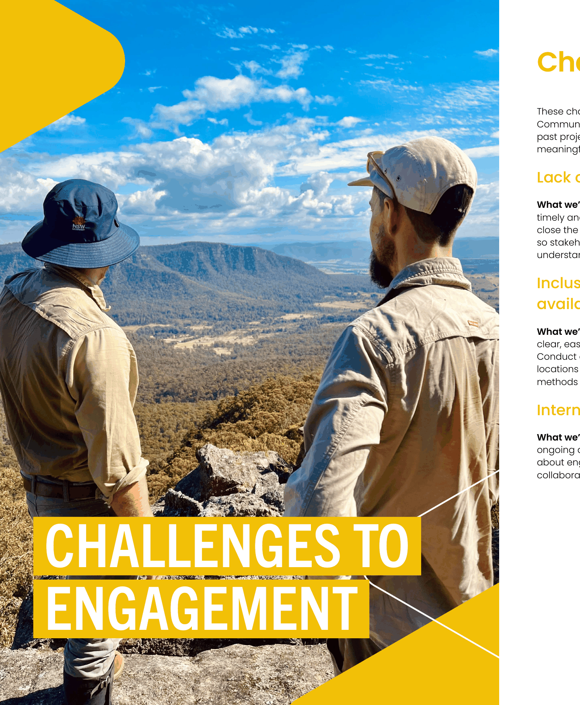

> [Picture on page 9: a picture, saved as a picture (images/community-engagement-strategy-page-9-5.gif, 150 dpi).]

meaningful for everyone.

### Lack of trust

### Engagement fatigue

What we’ll do: Be transparent, provide

timely and accurate information, and

close the loop on engagement projects

so stakeholders know we’re listening and

understand how their input is used.

What we’ll do: Stagger engagement, or

coordinate engagement activities for

projects sharing audiences, where possible,

to reduce the risk of the community and key

stakeholders feeling saturated.

### Inclusive, accessible &

### available

### Setting and meeting

### expectations

What we’ll do: Provide clear context and

scope for engagement activities to help

manage community expectations and

clearly define engagement goals.

What we’ll do: Ensure communication is

clear, easily accessible, and user-friendly.

Conduct engagement in accessible

locations using both online and offline

methods to reach a wider audience.

### Internal engagement

What we’ll do: Initiate early and have

ongoing discussions with Council staff

about engagement opportunities to foster

collaboration and internal support.

### CHALLENGES TO

### ENGAGEMENT

### STAKEHOLDERS

### Stakeholders

In our community engagement process, it is central to identify and understand the key

stakeholders who could be impacted by or have an interest in a decision. These stakeholders

play an essential role in participatory decision-making, shaping the places where we live,

work, play, and create. There are roles for both Council and the community in initiating,

leading, participating in, and delivering engagement activities.

We are committed to ensuring that the voices of Aboriginal and Torres Strait Islander people

are included in our engagement process. Engagement with these communities will be

undertaken in line with our Aboriginal and Torres Strait Islander Community Action Plan and

guided by our Aboriginal and Torres Strait Islander Committee.

### Key stakeholders

#### RESIDENTS AND RATEPAYERS

Individuals who live in and/or pay rates in the

Cessnock  Local Government Area.

#### COUNCILLORS

Elected representatives who serve the Cessnock

community at a local level.

#### LOCAL ABORIGINAL AND TORRES

#### STRAIT ISLANDER COMMUNITIES

Including local Aboriginal land councils, elders,

representative bodies  and Aboriginal and Torres

Strait Islander Organisations.

#### STATE AND FEDERAL MEMBERS

Elected representatives who serve the community at

state and federal levels.

#### GOVERNMENT AGENCIES

Including relevant departments such as

the Department of Planning, Housing and

Infrastructure,Department of  Climate Change,

Energy, the Environment and Water, Transport for NSW,

Department of Communities and Justice, NSW Health,

Office of Local Government, Destination NSW, Create

NSW, and NSW Office of Sport.

Such as youth advisors, access and inclusion panels,

and other groups that provide insights and advice on

community matters.

#### COMMUNITY-CENTERED

#### COMMITTEES AND ADVISORY

#### PANELS

#### LOCAL BUSINESS COMMUNITY

Business owners, Business chambers, associations,

development industry, investors and networks active

in the Cessnock Local Government Area.

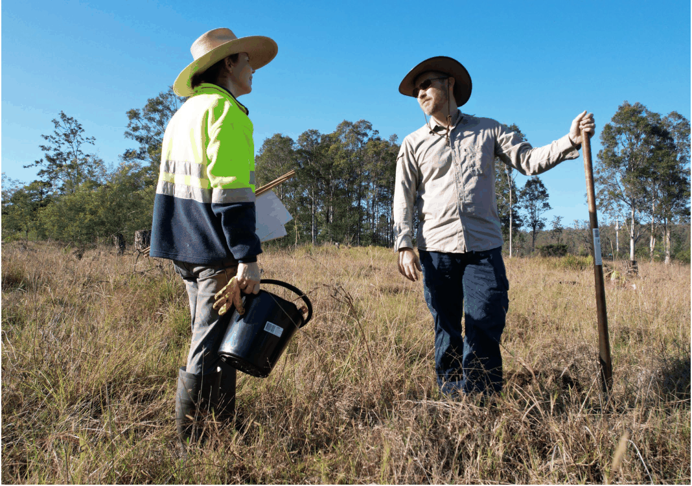

> [Picture on page 11: a picture, saved as a picture (images/community-engagement-strategy-page-11-44.gif, 150 dpi).]

| COMMUNITY, SPORTING, CULTURAL, VOLUNTEER, AND ENVIRONMENTAL GROUPS | Organisations with a specific interest or involvement in local activities and services. |
|---|---|
| SCHOOLS AND EDUCATIONAL SERVICES | Including local schools, TAFE, and other educational institutions. |
| HEALTH AND WELLBEING SERVICES | Organisations providing health and wellbeing services to the community. |
| NEIGHBOURING COUNCILS AND REGIONAL BODIES | Collaboration with neighbouring councils and regional organisations. Individuals and groups who visit the Cessnock Local |
| VISITORS AND TOURISTS |  |
| LOCAL MEDIA | Government Area. Media organisations that report on and inform the community about local issues and events. Council staff who play a critical role in delivering and engaging with the community. |
| OUR EMPLOYEES services |  |

### Roles and responsibilities

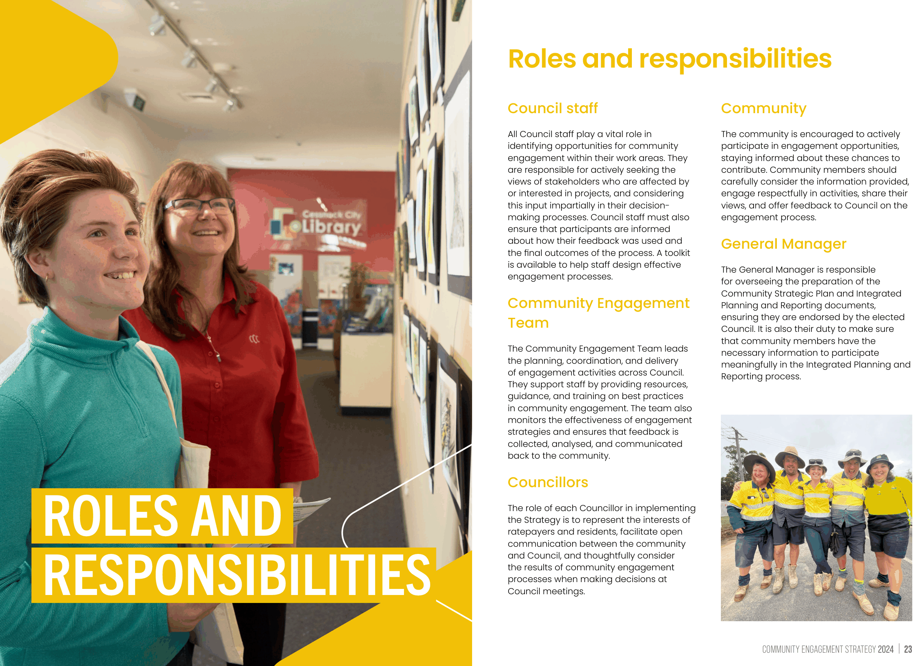

> [Picture on page 12: a picture, saved as a picture (images/community-engagement-strategy-page-12-2.gif, 150 dpi).]

### Council staff

### Community

The community is encouraged to actively

participate in engagement opportunities,

staying informed about these chances to

contribute. Community members should

carefully consider the information provided,

engage respectfully in activities, share their

views, and offer feedback to Council on the

engagement process.

### General Manager

All Council staff play a vital role in

identifying opportunities for community

engagement within their work areas. They

are responsible for actively seeking the

views of stakeholders who are affected by

or interested in projects, and considering

this input impartially in their decision-

making processes. Council staff must also

ensure that participants are informed

about how their feedback was used and

the final outcomes of the process. A toolkit

is available to help staff design effective

engagement processes.

### Community Engagement

### Team

The General Manager is responsible

for overseeing the preparation of the

Community Strategic Plan and Integrated

Planning and Reporting documents,

ensuring they are endorsed by the elected

Council. It is also their duty to make sure

that community members have the

necessary information to participate

meaningfully in the Integrated Planning and

Reporting process.

The Community Engagement Team leads

the planning, coordination, and delivery

of engagement activities across Council.

They support staff by providing resources,

guidance, and training on best practices

in community engagement. The team also

monitors the effectiveness of engagement

strategies and ensures that feedback is

collected, analysed, and communicated

back to the community.

### Councillors

The role of each Councillor in implementing

the Strategy is to represent the interests of

ratepayers and residents, facilitate open

communication between the community

and Council, and thoughtfully consider

the results of community engagement

processes when making decisions at

Council meetings.

### ROLES AND

### RESPONSIBILITIES

### HOW WE WILL

### ENGAGE

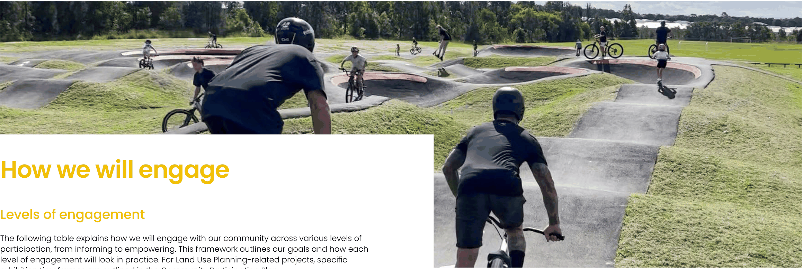

> [Picture on page 14: a picture, saved as a picture (images/community-engagement-strategy-page-14-1.gif, 150 dpi).]

### How we will engage

### Levels of engagement

The following table explains how we will engage with our community across various levels of

participation, from informing to empowering. This framework outlines our goals and how each

level of engagement will look in practice. For Land Use Planning-related projects, specific

exhibition timeframes are outlined in the Community Participation Plan.

| PURPOSE | INFORM | INVOLVE | COLLABORATE | EMPOWER |
|---|---|---|---|---|
| OUR GOAL | We will keep you informed | We will listen to, acknowledge and consider your concerns | We will look to you for advice and innovation and incorporate this in decisions as much as possible | We will implement what you decide |
| COMMUNITY’S ROLE | Keep in touch and seek out information on items of interest | Contribute ideas and feedback based on your experiences and interests | Participate in the engagement process by sharing ideas, concerns and aspirations and collaborating with us to implement agreed decision |  |
| HOW IT LOOKS | • Town Hall Meetings (physical/digital) • Polls • Polls • Letterbox drops • Polls • Surveys • Surveys • Postcards Posters/signage Social • Surveys • Digital Mapping • Digital Mapping • Media Posts • Digital Mapping • Pop up stalls • Pop up stalls • Websites • Pop up stalls • Formal submissions • Formal submissions • Newsletters (physical/digital) • Formal submissions • Workshops • Workshops • Project Updates (physical/digital) • Interviews • Digital Forums • Digital Forums • Project walk and talks • Working groups Advisory committees • Working groups • Call centre hold cue survey • Project Steering Groups |  |  |  |

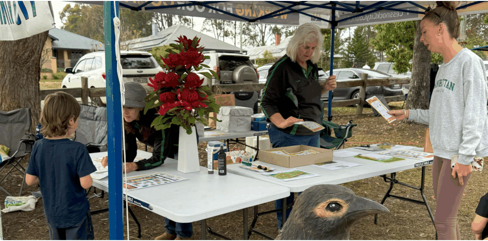

> [Picture on page 15: a picture, saved as a picture (images/community-engagement-strategy-page-15-1.gif, 150 dpi).]

### How we listen and get back to you

After gathering input, our staff carefully consider your feedback and recommend the next

steps or outcomes. To ensure transparency and keep you informed, we’ll take the following

actions to close the loop:

#### Project page updates

We’ll update the project page on the Together

Cessnock website with a summary of the

engagement outcomes and outline the next

steps.

#### Direct communication

If you’ve provided feedback, we’ll send you an

email with the consultation outcomes and a

link to the project page.

#### Reporting back

When a matter has been out for community

consultation or public exhibition and results in

a report to the Council, the report will include

a summary of the community engagement,

detailing the methods used, participation

statistics, and key feedback received. An

attachment summarising submissions and

providing staff responses will also be included.

For strategies, masterplans, and other

projects that are endorsed by the General

Manager rather than being reported to

Council, outcomes and feedback will still

be communicated to the community. This

will be done via updates on the Council

website, emails to participants, newsletters,

or other appropriate channels to ensure

transparency and close the loop with

stakeholders.

#### Outcome notifications

Following a decision being made, we’ll

notify everyone who provided feedback

about the outcome. We’ll also update the

project page and include the results in

our community engagement newsletter,

ensuring you stay informed every step of

the way.

### Evaluation

To ensure that our community engagement efforts are effective and meaningful, we evaluate

them by considering several key factors:

#### Participation levels

We look at how many people took part in

engagement activities, taking into account

the nature and scope of the project.

#### Relevance of feedback

We assess the relevance and depth of

the responses we receive in relation to the

program or project at hand.

#### Appropriateness of methods

We evaluate whether the engagement

methods used were suitable for the

stakeholders involved.

#### Community feedback

We gather verbal and written feedback

from the community on how effective our

engagement activities have been.

#### Achievement of objectives

We measure how well we’ve met the

engagement principles and objectives

outlined in this strategy.

#### Inclusivity

We assess whether our engagement

represented the diversity of our community.

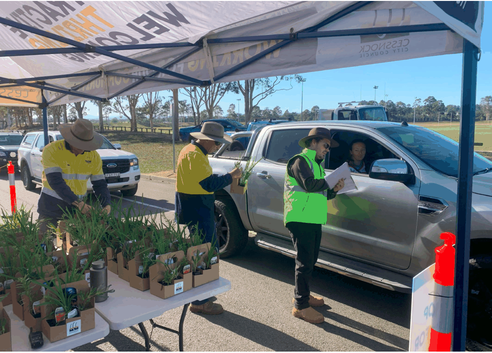

> [Picture on page 15: a picture, saved as a picture (images/community-engagement-strategy-page-15-68.gif, 150 dpi).]

### Action Plan

To continue to improve how we engage with our community, and based on the feedback we

have received, we have set four objectives to guide us.

#### Engagement culture:

Support a culture of community engagement within the Council, emphasising the importance of

community input in decision-making.

• Encourage teams across Council

to plan and budget for community

engagement as part of their activities.

• Provide staff with support and training in

the IAP2 framework, ensuring they have

the skills to engage effectively.

• Implement a system for regularly

collecting feedback from staff and

community members on engagement

activities, and use this feedback to

improve future practices.

• Develop a recognition program to

celebrate staff who demonstrate

excellence in community engagement.

• Embed engagement into the planning

phases of projects to ensure community

input is considered for all projects with

high community impact.

• Ensure senior leadership communicates

the importance of community

engagement and leads by example

through active participation.

• Create and support a message board

for internal staff to share insights

experience, tools, and best practices.

• Develop case studies of successful

engagement projects to share through

internal communications, highlighting

effective strategies and lessons learned.

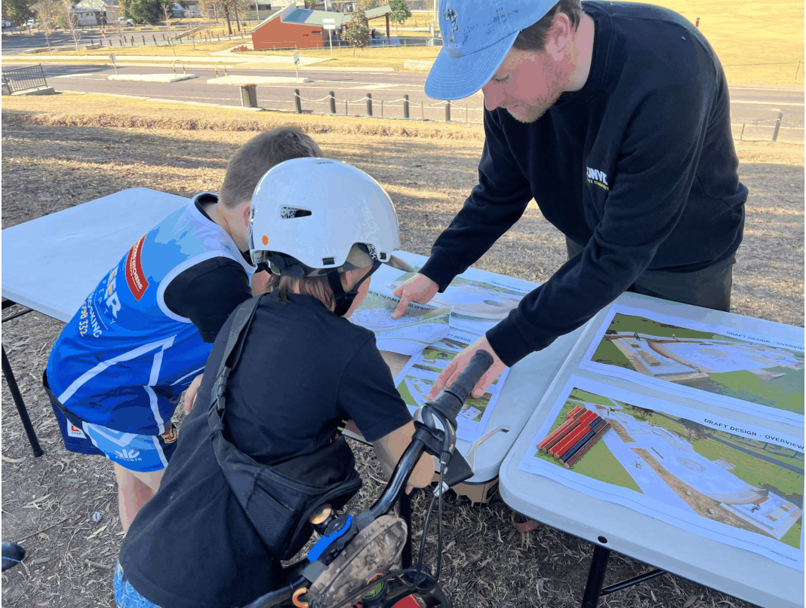

> [Picture on page 16: a picture, saved as a picture (images/community-engagement-strategy-page-16-36.gif, 150 dpi).]

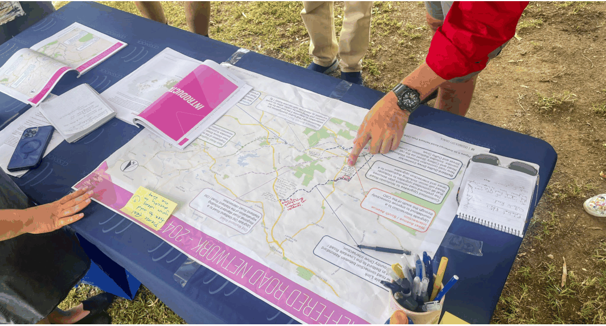

> [Picture on page 16: a picture, saved as a picture (images/community-engagement-strategy-page-16-37.gif, 150 dpi).]

### Honest conversations

Facilitate honest and open conversations with the community, promoting mutual respect

and understanding.

• Develop and maintain transparent

communication channels, such as the

Together Cessnock Platform, where

community members can ask questions

and receive honest, timely responses.

• Publish reports on community

engagement activities, detailing

what the community said, and how it

influenced Council decisions.

• Schedule dedicated engagement

sessions focused on specific issues or

projects, enabling in-depth discussions

and honest feedback.

• Clearly communicate any limitations

or constraints on Council’s actions and

decisions to manage expectations and

build understanding.

• Continue to conduct the customer

satisfaction survey every 2 years

to gather insights on community

perceptions and engagement

effectiveness.

• Regularly communicate the connection

between Council operations and the

Community Strategic Plan, ensuring

community understanding of Council’s

broader objectives.

### Relationship building

Strengthen and build positive relationships with the community, fostering trust and

collaboration.

• Provide easy-to-understand FAQs for

engagement projects, ensuring clarity

and accessibility of information.

• Use a diverse range of engagement

methods, combining digital and face-

to-face interactions where appropriate,

to reach a broader audience.

• Increase the use of video content,

featuring staff explaining projects and

processes in a relatable way.

• Implement a regular customer service

stall at community events to engage

directly with residents and answer

questions.

• Identify projects requiring engagement

in the Operational Plan and ensure they

include community consultation.

• Include community engagement

requirements during the project design

phase to capture public insights early.

• Clearly outline the engagement process

for each project, including defined

timeframes, so participants know what

to expect.

• Work closely with hard-to-reach

communities to ensure engagement

methods are tailored to their needs,

encouraging wider participation.

• Identify and address access barriers

for people with disability, ensuring

engagement is inclusive and accessible

to all.

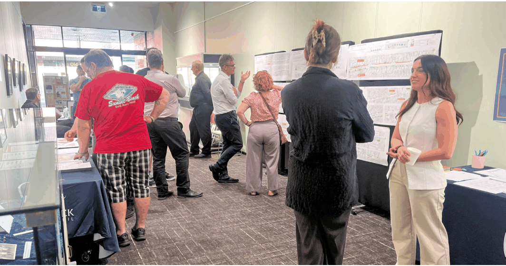

> [Picture on page 17: a picture, saved as a picture (images/community-engagement-strategy-page-17-36.gif, 150 dpi).]

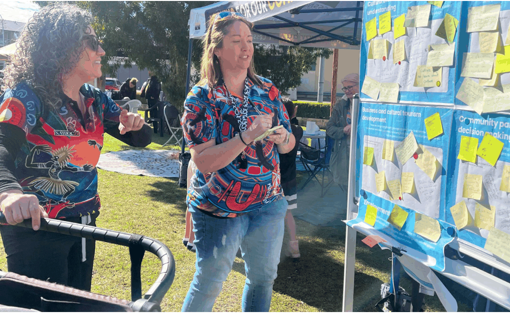

> [Picture on page 17: a picture, saved as a picture (images/community-engagement-strategy-page-17-37.gif, 150 dpi).]

### Insight and learning

Enhance community understanding of Council’s decision-making through clear

communication, and use feedback and data to drive continuous improvement.

• Use social media platforms to regularly

update the community on Council’s

decision-making processes, ensuring

transparency.

• Provide information in plain language

that is easy to understand, making

Council decisions and processes clearer

for all.

• Use visual content (e.g., infographics,

charts, videos) where appropriate to

simplify technical information and make

it more engaging.

• Conduct interactive webinars where

Council members and staff explain

recent decisions, share updates, and

answer community questions.

• Ensure that all information necessary

for understanding decision-making

processes is readily available and

accessible to the community.

• Consider accessibility needs when

planning written communication, and

communicate our ability to provide

alternative formats when requested to

accommodate all residents.

• Develop and share responses to

frequently asked questions on key topics,

ensuring consistent understanding

across the community.

• Continuously gather feedback on the

clarity of Council communications and

use this data to refine engagement

approaches.

• Regularly evaluate engagement

projects, measuring factors such

as participation levels, community

satisfaction, and the impact of feedback

on decision-making. Use these

insights to refine future engagement

approaches and ensure continuous

improvement.

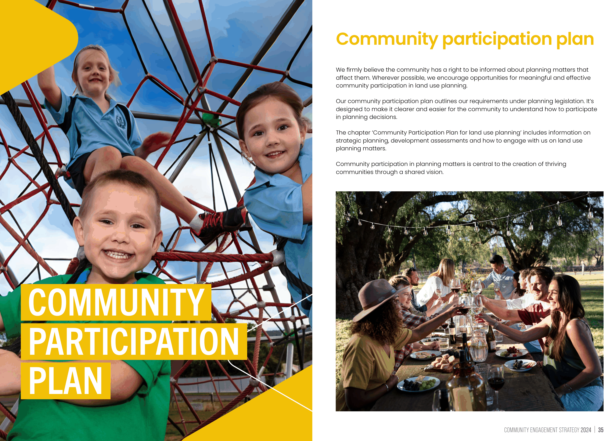

> [Picture on page 18: a picture, saved as a picture (images/community-engagement-strategy-page-18-1.gif, 150 dpi).]
> Words printed on the picture (title and legend, copied from the PDF):
> in planning decisions.
> planning matters.

### Community participation plan

We firmly believe the community has a right to be informed about planning matters that

affect them. Wherever possible, we encourage opportunities for meaningful and effective

community participation in land use planning.

Our community participation plan outlines our requirements under planning legislation. It’s

designed to make it clearer and easier for the community to understand how to participate

The chapter ‘Community Participation Plan for land use planning’ includes information on

strategic planning, development assessments and how to engage with us on land use

Community participation in planning matters is central to the creation of thriving

communities through a shared vision.

### COMMUNITY

### PARTICIPATION

### PLAN

### What is the Community Participation Plan?

The Community Participation Plan (CPP) sets out how and when Cessnock City Council (CCC)

will undertake community participation as part of its planning functions.

The CPP has been developed in accordance with the requirements of the Environmental

Planning and Assessment Act 1979 No 203 (EP&A Act, 1979), the Local Government Act, 1993

(LG Act,1993) and Council’s Community Strategic Plan 2036.

The CPP identifies legislated public exhibition and notification requirements set out in

Schedule 1 Community Participation Plans of the EP&A Act, 1979 and additional requirements

set by Council where planning matters may have a broader community impact. Council may

meet these requirements via:

• Written notice to individual landowners

or occupiers

• Council’s Development Application

Tracker

• Announcement on Council’s Together

Cessnock website

• Availability of information and documents

online or in public places eg Council’s

administration building, library etc

> [Picture on page 19: a picture, saved as a picture (images/community-engagement-strategy-page-19-20.gif, 150 dpi).]

### Where does the CPP apply?

The CPP applies to the whole CCC Local

Government Area and to activities under the

Environmental Planning and Assessment

Act 1979 No 203 that are being assessed by

CCC. All other NSW planning authorities are

required to prepare their own CPP.

The CPP is supported by Council’s Community

Engagement Strategy, which may be used to

enhance the minimum requirements set out

in this Plan.

### What planning matters are covered by the CPP?

The CPP covers planning matters including policy, plan making, planning agreements,

development controls and assessments, as defined below.

Community Particpation Plan (this

document) outlines how and when Council

engages with the community on land use

planning matters.

Complying Development is a combined

planning and construction approval for

straightforward development that meets the

pre-specified requirements and are eligible

for fast-track approval, without the need for a

full development application.

Contributions Plans are prepared by councils

to levy new development to fund additional

or improved local, public services and

infrastructure needed by the development

and used by the whole community.

Council-related development means

development for which the Council is the

applicant developer (whether lodged by or

on behalf of Council), landowner, or has a

commercial interest in the land the subject

of the application, where it will also be the

regulator or consent authority.

Development Application is a formal request

for consent under the EP&A Act, 1979. It is

required to change the use of land, subdivide

land, carry out building, landscaping and

other work unless what is proposed is

considered exempt development.

Development Assessment is the

evaluation of an application proposing

new development in the Cessnock Local

Government Area.

Development Control Plans are guidelines

prepared by councils that describe the

preferred way to undertake development

that is enabled by a Local Environmental Plan

to get good planning and design outcomes

and manage impacts.

Local Environmental Plans are the local

planning laws prepared by councils but

approved by the NSW Government. They

set out what development can take place

where, the maximum height and density of

development, and what places need to be

protected for their heritage value. They are

amended by preparing a Planning Proposal.

Local Strategic Planning Statement sets

a vision for the planning direction of the

Cessnock Local Government Area for 20

years. The planning priorities outlined within

the planning statement reflect future land

use directions based on the themes: liveable,

productive, sustainable and unique.

Planning Agreement  a voluntary legal

agreement between a developer and

a planning authority and is usually

negotiated when a developer is submitting

a development application or planning

proposal.

Planning Proposal is a document and

supporting information that explains

the intended effect and justification of a

proposed Local Environmentl Plan or an

amendment to a Local Environmental Plan.

Strategic Planning includes long term policy

and plan making.

Structure Plans/Place Strategies provide

guidance and principles for the future

development of an area by coordinating

strategic planning objectives, staging

requirements and delivery of essential

infrastructure in line with the vision and goals

of the area.

### Important things to consider

#### Privacy

Council is committed to safeguarding

the privacy of individuals and handling

of personal information in accordance

with the Privacy and Personal Information

Act 1998 (NSW) and Information Privacy

Principles, the Health Records and

Information Privacy Act 2002 (NSW)

and Health Privacy Principles, and any

subordinate legislation.

Submissions are not kept confidential.

Council releases submissions when a

request is made in accordance with the

relevant provisions under the Government

Information (Public Access) Act 2009.

When a submission is released by law,

Council routinely withholds names, contact

numbers, email addresses and signatures. Should you wish for all personal details or

any information that may identify you to

be withheld from the public, this should

be clearly stated in your submission.

The supply of personal information with

your submission is voluntary, however

the submission will not be considered for

Development Assessment purposes. Copies of submissions may be forwarded

to the applicant or proponent seeking

that they address the issues raised in

the submissions, by way of comments or

amendments to the proposed application

or plan. Submission may be shared with

other government agencies associated

with the project. Personal information will be

kept in Council’s Information Management

System in accordance with the relevant

legislation. If making a submission through

Council‘s webpage, your information

will also be held by EngagementHQ and

Council recommends you read their privacy

statement.

The information collected will be used for

the purpose outlined in the notification,

related administrative functions,

compliance and complaint handling,

internal auditing, and in accordance with

Council’s Privacy Management Plan and

Privacy Statement which can be found on

Council’s website. The intended recipients

of the personal information are relevant

Council officers and submission may

be included, with personal information

redacted, in a council report that will be

published in the public domain.

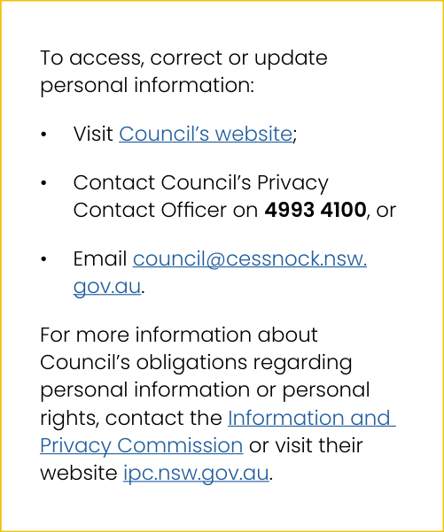

> [Picture on page 20: a picture, saved as a picture (images/community-engagement-strategy-page-20-56.gif, 150 dpi).]
> Words printed on the picture (title and legend, copied from the PDF):
> personal information:
> • Visit Council’s website;
> • Contact Council’s Privacy
> • Email council@cessnock.nsw.
> gov.au.
> For more information about
> Council’s obligations regarding
> personal information or personal
> website ipc.nsw.gov.au.

To access, correct or update

Contact Officer on 4993 4100, or

rights, contact the Information and

Privacy Commission or visit their

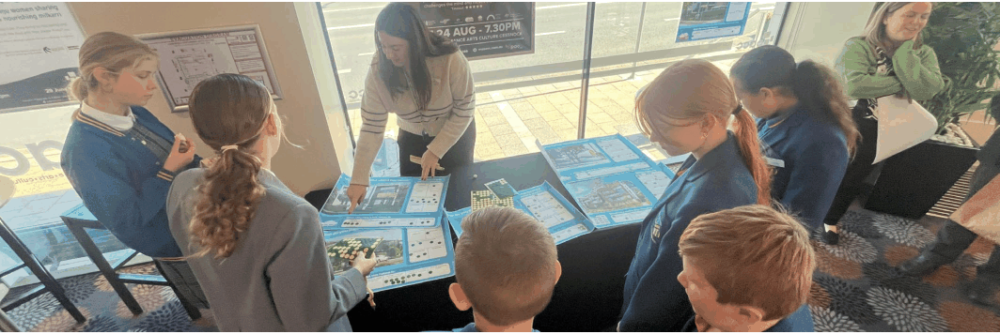

> [Picture on page 20: a picture, saved as a picture (images/community-engagement-strategy-page-20-61.gif, 150 dpi).]

#### Making a submission

Any individual or organisation can make

a submission during the public exhibition

period. Submissions must be made in

writing, include the address or application

number or the name of the exhibited

planning matter and submitted to Council

via:

Mail: PO Box 152, CESSNOCK NSW 2325; or Email: council@cessnock.nsw.gov.au; or

#### Dropped into the Cessnock City Council

Administrative building: 62-78 Vincent

Street, Cessnock NSW 2325; or Have your Say Webpage: https://together.

cessnock.nsw.gov.au/ ; or

#### Via the Application tracker (Development

Applications only): http://datracker.

cessnock.nsw.gov.au/ ; or

Via the NSW Planning Portal: https://www.

planningportal.nsw.gov.au/ The submission must contain the author’s

name and address, and their contact

details, including a return email or postal

address. This will allow acknowledgement

letters to be sent.

If you require asisstance with your

submission, Council’s Customer Service

Team can assist at the front counter.

#### Objections Vs Submissions

There is a difference between a submission

and an objection. However whether

supporting or objecting to a proposal, the

following minimum standards apply to all

submissions:

• It must be received within the

designated public exhibition period, and

• It must include the author’s name and

address.

• Must include clear reasons as to why

the author objects to the proposed

development; or alternatively, must

include clear reasons as to why

the author supports the proposed

development.

#### What is an Objection?

An objection must contain clear reasons as

to why the author objects to the proposed

development or plan. An objection is NOT:

• A submission that only seeks clarification

in respect of a proposal;

• A submission that is in support of a

proposal;

• An anonymous submission; or

• A submission that is indifferent to a

proposal

#### How are Objections counted / considered?

• Multiple submissions from one

household are considered one objection.

• One petition is considered one objection,

notwithstanding the number of

individual signatures contained in the

petition.

• In the event multiple submissions

in the form of pro-forma letters are

lodged, each pro-forma letter is

considered one objection, but only if the

submission clearly addresses the other

requirements prescribed in this section

of the CPP.

#### Petitions

Where a petition is received, the person

who submits the petition to Council will be

acknowledged as the point of contact for

all future correspondence on the progress

of the application/project.

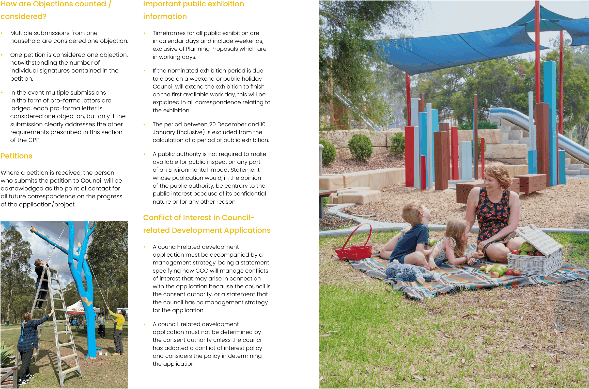

> [Picture on page 21: a picture, saved as a picture (images/community-engagement-strategy-page-21-22.gif, 150 dpi).]

#### Important public exhibition information

• Timeframes for all public exhibition are

in calendar days and include weekends,

exclusive of Planning Proposals which are

in working days.

• If the nominated exhibition period is due

to close on a weekend or public holiday

Council will extend the exhibition to finish

on the first available work day, this will be

explained in all correspondence relating to

the exhibition.

• The period between 20 December and 10

January (inclusive) is excluded from the

calculation of a period of public exhibition.

• A public authority is not required to make

available for public inspection any part

of an Environmental Impact Statement

whose publication would, in the opinion

of the public authority, be contrary to the

public interest because of its confidential

nature or for any other reason.

#### Conflict of Interest in Council- related Development Applications

• A council-related development

application must be accompanied by a

management strategy, being a statement

specifying how CCC will manage conflicts

of interest that may arise in connection

with the application because the council is

the consent authority, or a statement that

the council has no management strategy

for the application.

• A council-related development

application must not be determined by

the consent authority unless the council

has adopted a conflict of interest policy

and considers the policy in determining

the application.

### Minimum exhibition / notification periods and formats –

### Strategic Planning

Table 1 below identifies the minimum timeframes for the public exhibition of Strategic

Planning matters.  The timeframes for matters denoted by an asterix (*) are legislated by the

EP&A Act, 1979. The remaining matters are considered best practice timeframes for public

exhibitions.

Table 1 also outlines how Council will notify the community of the commencement of the

exhibition period.

Table 1: Minimum public exhibition periods for plans

| PLANNING MATTER | PUBLIC EXHIBITION TIMEFRAME | EXHIBITION/NOTIFICATION FORMAT |
|---|---|---|
| Draft Planning Agreements* | 28 days 28 days or a. If a different period of public exhibition is specified in the Gateway determination for the proposal—the period so specified, or | Council’s Have Your Say website - Together Cessnock Council’s Have Your |
| Reclassification of land* | b. If the Gateway determination specifies that no public exhibition is required because of the minor nature of the proposal—no public exhibition. and a public hearing to occur after the conclusion of the public exhibition | Say website - Together Cessnock, NSW Planning Portal |
| Draft policies or guidelines | 28 days | Council’s Have Your Say website - Together Cessnock |
| Public Domain Plans, |  |  |
| Masterplans and similar plans for urban renewal, structure plans, place | 28 days | Council’s Have Your Say website - Together Cessnock |
| strategies |  |  |
| Re-exhibition of any matter | As per the original exhibition | Council’s Have Your Say |
| referred to above | period. | website - Together Cessnock |

| PLANNING MATTER | PUBLIC EXHIBITION TIMEFRAME | EXHIBITION/NOTIFICATION FORMAT |
|---|---|---|
| Draft Community Participation Plans* | 28 days | Council’s Have Your Say website - Together Cessnock |
| Draft Local Strategic Planning Statements* | 28 days | Council’s Have Your Say website - Together Cessnock |
| Planning Proposals* for local environmental plans subject to a Gateway determination | a. If the Gateway determination for the proposal specifies a period of public exhibition—the period so specified, or b. If the Gateway determination for the proposal specifies that no public exhibition is required because of the minor nature of the proposal—no public exhibition, or c. Otherwise—28 days. | Council’s Have Your Say website - Together Cessnock, NSW Planning Portal, in writing to affected and adjoining landowners where practicable |
| Draft Development Control 28 days Council’s Have Your Say Plans* website - Together Cessnock |  |  |
| Draft Contribution Plans* | 28 days | Council’s Have Your Say website - Together Cessnock |

Notwithstanding the timeframes above, Council may choose to extend the public exhibition

period relating to any proposal should the scope of the project be determined to require it, or

should the elected representatives resolve to do so.

Additionally, Council may use other optional exhibitions/notification formats such as

newspaper/written media, hardcopy viewing at other venues, social media, drop in

consultation sessions, workshops and community meetings, advisory panels or refernce

groups or others, determined at the discretion of Council staff and based on the scale of the

planning matter.

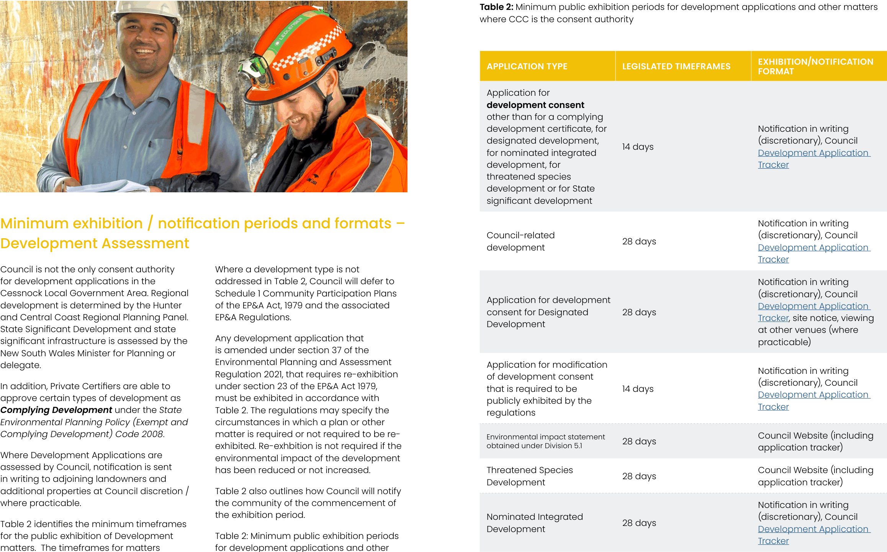

> [Picture on page 23: a picture, saved as a picture (images/community-engagement-strategy-page-23-1.gif, 150 dpi).]

### Minimum exhibition / notification periods and formats –

### Development Assessment

Council is not the only consent authority

for development applications in the

Cessnock Local Government Area. Regional

development is determined by the Hunter

and Central Coast Regional Planning Panel.

State Significant Development and state

significant infrastructure is assessed by the

New South Wales Minister for Planning or

delegate.

In addition, Private Certifiers are able to

approve certain types of development as

Complying Development under the State

Environmental Planning Policy (Exempt and

Complying Development) Code 2008. Where Development Applications are

assessed by Council, notification is sent

in writing to adjoining landowners and

additional properties at Council discretion /

where practicable.

Table 2 identifies the minimum timeframes

for the public exhibition of Development

matters.  The timeframes for matters

denoted by an asterix (*) are legislated by

the EP&A Act, 1979. The remaining matters

are considered best practice timeframes.

Where a development type is not

addressed in Table 2, Council will defer to

Schedule 1 Community Participation Plans

of the EP&A Act, 1979 and the associated

EP&A Regulations.

Any development application that

is amended under section 37 of the

Environmental Planning and Assessment

Regulation 2021, that requires re-exhibition

under section 23 of the EP&A Act 1979,

must be exhibited in accordance with

Table 2. The regulations may specify the

circumstances in which a plan or other

matter is required or not required to be re-

exhibited. Re-exhbition is not required if the

environmental impact of the development

has been reduced or not increased. Table 2 also outlines how Council will notify

the community of the commencement of

the exhibition period.

Table 2: Minimum public exhibition periods

for development applications and other

matters where CCC is the consent authority

Table 2: Minimum public exhibition periods for development applications and other matters

where CCC is the consent authority

> Words printed on the picture (title and legend, copied from the PDF):
> Notification in writing
> Notification in writing
> Tracker, site notice, viewing
> at other venues (where

| APPLICATION TYPE | LEGISLATED TIMEFRAMES | EXHIBITION/NOTIFICATION FORMAT |
|---|---|---|
| Application for |  |  |
| development consent |  |  |
| other than for a complying development certificate, for designated development, for nominated integrated | 14 days | Notification in writing (discretionary), Council Development Application |
| development, for |  | Tracker |
| threatened species |  |  |
| development or for State significant development |  |  |

| Council-related development | 28 days |
|---|---|
| Application for development consent for Designated Development | 28 days |

| Application for modification of development consent that is required to be publicly exhibited by the regulations | 14 days | Notification in writing (discretionary), Council Development Application Tracker |
|---|---|---|
| Environmental impact statement obtained under Division 5.1 | 28 days | Council Website (including application tracker) |
| Threatened Species Development | 28 days | Council Website (including application tracker) |
| Nominated Integrated Development | 28 days | Notification in writing (discretionary), Council Development Application Tracker |

Complying Development

Only where required by relevant provisions in the EP&A

Regulations

### Development Assessment not requiring exhibition

Schedule 1 Community Participation Plans of the EP&A Act, 1979 allows Council to identify

types of development applications that will not require public exhibition. Public exhibition will not be carried out for the following development types, except where the

development application proposes a variation to a development standard under Clause 4.6

of Cessnock Local Environmental Plan 2011 (CLEP), or is for works on a heritage item or in a

heritage conservation area as outlined by the CLEP.

1\.	 The application is for a temporary use

as outlined in clause 2.8 of Cessnock

Local Environment Plan 2011 in cases

where the number of participants and

spectators is less than 2000 people.

2\.	 The application is for subdivision for the

purpose of:

a. Boundary adjustments; or

b. A dual occupancy under Clause 4.1C

of the Cessnock Local Environment

Plan 2011; or

c. A strata subdivision; or

d. A subdivision of no more than two (2)

lots in a residential zone; or

e. A subdivision of no more than five (5)

lots in a employment zone.

3\.	 Development is for a new dwelling

house and additions to a dwelling

house, provided that the development:

a. Is a maximum of two storeys;

b. Is a maximum height of 8.5m from the

existing ground level; and

c. Is setback a minimum of 900mm from

the property boundary.*

4\.	 Ancillary development,** excluding

outbuildings exceeding the height of

the equivalent Complying Development

standard.

5\.	 Development is for a dual occupancy

or secondary dwelling and is located

within the R1 General Residential, R2

Low Density, R3 Medium Density or MU1

Mixed Use zones, provided that the

development:

a. Is a maximum of two storeys;

b. Is a maximum height 8.5m from the

existing ground level; and

c. Is setback 900mm from the

boundary.*

6\.	 Commercial premises and shop-top

housing in employment zones where

the site does not directly adjoin land in a

residential zone.

7\.	 Permissible land-uses in employment

zones where the site does not directly

adjoin land in a residential zone.

8\.	 Development is for extensive

agriculture, or development that is

ancillary to the rural use of the land

including but not limited to farm

buildings, dams etc.

9\.	 Internal works to buildings, where there is

no change to the external configuration

of the building.

10\.	Demolition works.

11\.	 Development for the purpose of

advertising signage.

\* Note 1: Notification / exhibition will not be required when the development has a shared

boundary with a property owned by the applicant, despite having a setback of less than

900mm from that boundary.

\** Note 2: As defined in the State Environmental Planning Policy (Exempt and Complying

Development Codes) 2008.

Note 3: Notwithstanding any other provision of the CPP, Council may elect to notify or exhibit

any proposed development if, in the opinion of Council, it is in the public interest to do so.

> [Picture on page 24: a picture, saved as a picture (images/community-engagement-strategy-page-24-72.gif, 150 dpi).]

62-78 Vincent Street, Cessnock NSW 2325  |  PO Box 152 Cessnock NSW 2325

02 4993 4100  |  council@cessnock.nsw.gov.au  |  www.cessnock.nsw.gov.au
