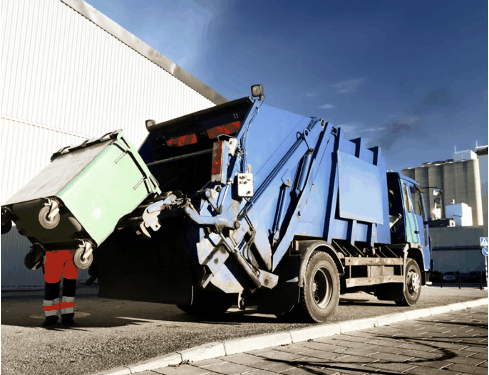
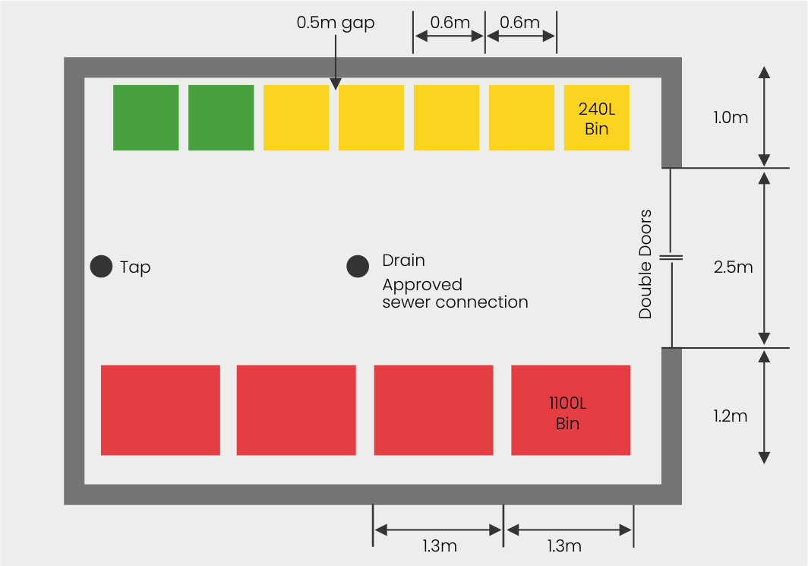

# Cessnock Development Control Plan 2010 - Waste Management Guideline - Commercial Premises Industries and Community Facilities

Source PDF: [Waste-Management-Guideline-Commercial-Premises-Industries-and-Community-Facilities.pdf](Waste-Management-Guideline-Commercial-Premises-Industries-and-Community-Facilities.pdf)

### Cessnock LGA

### 2024

### WASTE MANAGEMENT

> [Picture on page 1: a picture, saved as a picture (images/waste-management-guideline-commercial-premises-ind-page-1-4.gif, 150 dpi).]

### GUIDELINES

### COMMERCIAL, INDUSTRY

### & COMMUNITY FACILITIES

### STRATEGIC PLANNING | WASTE & ENVIRONMENT

> [Picture on page 2: a picture, saved as a picture (images/waste-management-guideline-commercial-premises-ind-page-2-1.gif, 150 dpi).]

Journey Through Time, created by local school students and artist Steven Campbell.

#### Acknowledgement of Country

Cessnock City Council acknowledges that within its local government area boundaries are the traditional

lands of the Wonnarua people, the Awabakal people and the Darkinjung people. We acknowledge these

Aboriginal peoples as the traditional custodians of the land on which our offices and operations are located,

and pay our respects to Elders past and present. We also acknowledge all other Aboriginal and Torres Strait

Islander people who now live within the Cessnock Local Government Area.

### Contents

| 1. | Introduction Waste Management Plan Waste collection service Waste generation | 4 7 7 7 |
|---|---|---|
| 2 | Waste management system Internal waste storage area Childcare facilities Waste storage area Commercial premises Communal waste storage areas | 9 10 10 10 12 12 |
| 3 | Waste collection Waste collection vehicle Waste collection vehicle access Waste collection point Bin transfer | 13 14 14 15 15 |
| 4 | Appendix A. | 16 |

### INTRODUCTION

### Introduction

Waste management practices will vary greatly at premises operated for commercial, industrial

or community-related uses. This variation will be based on the nature of the operation,

materials handled as part of the operation and/or manufacturing processes undertaken.

However, appropriate identification of how waste will be managed and collected on-site will

assist the business or operation to minimise waste products. This guideline provides general guidance to develop a waste management system for the

following landuses.

### a. Commercial premises including business premises, office

### premises and retail premises

This also applies to the following landuses:

•	 Sex service premises

•	 Veterinary hospitals

•	 Wholesale supplies

•	 Amusement centres

•	 Entertainment facilities

•	 Function centres

•	 Highway service centres

•	 Industrial retail outlets

•	 Registered clubs

•	 Restricted premises

•	 Service stations

### b. Industry – general industry, light industry and heavy industry

This also applies to the following landuses:

•	 Vehicle repair stations

•	 Transport depot

•	 Truck depot

•	 Vehicle body repair

workshops

### c. Commercial operations associated with agriculture including

This also applies to the following landuses:

•	 Farm experience premises with function

and conference facilities

•	 Farm gate premises including cellar door

premises and food and drink premises

located on the existing commercial farm

### d. Storage premises including self-storage units and the following

### specific landuses

•	 Depots

•	 Warehouse or

distribution centres

•	 Local distribution

premises

> [Picture on page 6: a picture, saved as a picture (images/waste-management-guideline-commercial-premises-ind-page-6-1.gif, 150 dpi).]

e. Community and recreation related premises including the

### following specific landuses

#### Landuse

•	 Early education and care facility

•	 Community facility

•	 Information and education facilities

•	 Place of public worship

•	 Public administration buildings

#### Type

•	 Centre-based child care facility

•	 Research stations

•	 Respite day care centres

•	 Environmental facilities

•	 Recreation facilities (indoor)

•	 Recreation facilities (outdoor)

•	 School–based child care

### Waste Management Plan

All proposed residential commercial and

industrial premises will be required to submit

a Waste Management Plan (WMP) with a

development application. If the cost of the

proposed development exceeds $5M in

value the WMP is required to be prepared

by a suitably qualified waste management

consultant/practitioner.

The WMP is to be prepared with reference to

this guideline and other relevant standards or

documentation.

### Waste collection service

New commercial and industrial development

is required to provide waste collection services

to the proposed premises by the owner of the

property. The waste management system will

need to be integrated into the overall design

of the proposed development with waste

storage and collection points located on-site.

To ensure waste collection can be undertaken

safely and efficiently the waste collection

vehicle will need to enter and exit the site in a

forward direction.

### Waste generation Recyclable and residual waste

Waste generation rates from commercial and

industrial operations will vary based on the

type of operation. Waste generation rates for

various commercial operations have been

provided in Appendix A of this guideline and

should be used to determine the size and

number of bins required for the proposed

operation. Appendix A has been adapted from:

• Appendix G Better practice guide

for resource recovery in residential

development, NSW EPA, 2019

• Appendix B Better Practice Guidelines for

Waste Management and Recycling in

Commercial and Industrial Facilities, NSW

EPA, 2012.

Premises types not provided in Appendix A will

require supporting documentation providing

estimates of the volume of recyclable and

residual waste streams from the proposed

operation.

### Other Waste Types

Depending on the operations of the

commercial, industrial or community-related

use land types a variety of waste streams

may be generated at the premises. This may

include liquid, hazardous or restricted waste

under the Protection of the Environment

Operations Act (Waste) Regulation 2014. Each waste management plan is required to

submit supporting documentation providing

estimates of the volume of the waste streams

generated as a result of the proposed

operation or facility

### Bin infrastructure

All premises require access to recycling

and residual waste bins and sufficient bin

storage is to be provided to accommodate

the projected volume of waste from the

proposed development. Operations involved

in food production and preparation, or have

a proportion of organic waste in their waste

stream, should provide separate bin storage. A variety of bins are available for the

storing, handling and collection of waste in

commercial and industrial premises. The

selection of bn infrastructure is dependent

on the types of waste material to be handled

and the building from which it is collected. Mobile bins can range in volume and size

and are typically collected by ‘rear-lift ‘waste

collection vehicles. Table 1 provides the

dimensions of mobile bins to enable sizing

of the waste storage area for the proposed

industrial or commercial premises.

Table 1: Mobile waste bin dimensions

| BIN CAPACITY (L) | HEIGHT (MM) | DEPTH (MM) | WIDTH (MM) | FOOTPRINT AREA (M2) |
|---|---|---|---|---|
| 80 | 870 | 530 | 450 | 0.24 |
| 120 | 940 | 560 | 485 | 0.27 |
| 140 | 1065 | 540 | 500 | 0.27 |
| 240 | 1080 | 735 | 580 | 0.43 |
| 360 | 1100 | 885 | 600 | 0.53 |
| 660 | 1250 | 850 | 1370 | 1.16 |
| 770 | 1425 | 1100 | 1370 | 1.5 |
| 1100 | 1470 | 1245 | 1370 | 1.7 |
| 1300 | 1408 | 1250 | 1770 | 1.21 |
| 1700 | 1470 | 1250 | 1770 | 1.27 |

Source: Appendix B Better Practice Guidelines for Waste Management and Recycling in

Commercial and Industrial Facilities, NSW EPA, 2012. Bulk bins are larger than mobile waste bins and are typically serviced by ‘front-lift ‘waste

collection vehicles. Table 2 provides the typical dimensions of bulk bins to enable sizing of the

waste storage area for the proposed industrial or commercial premises.

Table 2: Bulk waste bin dimensions

| BIN CAPACITY (L) | HEIGHT (MM) | DEPTH (MM) | WIDTH (MM) | FOOTPRINT AREA (M2) |
|---|---|---|---|---|
| 1.5 | 1190 | 1080 | 2070 | 2.23 |
| 2 | 865 | 1400 | 1830 | 2.6 |
| 3 | 1225 | 1505 | 1805 | 2.7 |
| 4.5 | 3750 | 1605 | 1805 | 2.9 |

Source: Appendix B Better Practice Guidelines for Waste Management and Recycling in

Commercial and Industrial Facilities, NSW EPA, 2012. Development that includes multiple units or tenants is to provide an appropriate number of bins

to meet the recycling and waste recycling requirements for each tenant. Mobile waste bins may

be provided for each tenant and wheeled to a consolidated or communal waste storage area

within the development.

### WASTE

### MANAGEMENT

### SYSTEM

### Waste management system

### Internal waste storage area

Commercial and industrial premises should

provide appropriate waste systems, including

waste cupboards or identified bins, within the

internal space of the premises to facilitate

separation of recyclable and residual

waste materials by staff. Sufficient space

for the storage of at least one day’s worth

of recycling and residual waste are to be

provided and identified on floor plans. Developments with multiple units or tenancies

are to provide internal waste systems for

each unit/tenancy. If a system is available for

food organics collection, then sufficient space

should also be allocated for separation of

food organic in a separate bin/container.

### Childcare facilities

Childcare facilities can generate high

volumes of nappy waste, recyclable waste

and food waste. While sufficient internal waste

storage space should be provided to hold

a single day’s waste volume internal waste

storage should be appropriately positioned

within the facility for efficient operation and

minimisation for waste stream contamination For design of internal spaces refer to the

Department of Planning, Industry and

Environment’s Child care planning guideline.

### Waste storage area

The design of the commercial or industrial

building needs to incorporate sufficient space

for the selected size and number of bins

required for the volume of waste material

generated between collection periods. The waste storage area is to incorporate the

following:

•	 Sufficient floor space for the required

number of bins with a 0.2m space between

bins to allow maneuvering.

•	 Unobstructed 1.8m clearance zone between

the stored bins and the waste storage area

entrance to permit access and movement.

•	 Located in close proximity to the waste

collection point.

•	 Fully enclosed and walled with through

access to other on-site infrastructure not

permitted.

•	 Compliant with the Building Code of

Australia (BCA) with the floor waterproofed,

non-slip and sealed.

•	 The floor is to be graded to a central

drainage point and connected to the sewer.

•	 Provision of an adequate water supply

through a centralized mixing valve and

hose cock.

•	 Provision of adequate lighting and

ventilation in accordance with the BA.

Flexible design of the waste storage area

should also be considered including:

•	 Additional floor space for extra bins or

containers to capture additional separated

waste streams

•	 Minimising potential obstacles within the

waste storage area that would limit bin size

•	 Increasing width of access or doorways to

allow for potential change in bin size

Some commercial or industrial premises will

also require waste storage area space for

specialized waste streams such as medical,

sharps, chemicals or liquid wastes such as

cooking oils. A suitable sized space must

be allocated to the storage of these waste

streams and be kept secured and accessible

to staff members and specific waste

collection contractors only.

Suitable space is to be provided near the

waste storage area (or near each tenancy)

to store re-usable commercial items such as

crates, pallets, kegs etc so that storage in a

public place is completely avoided.

Figure 1 provides an example of a waste storage room with various sized bins

> [Picture on page 11: a map, saved as a picture (images/waste-management-guideline-commercial-premises-ind-page-11-2.gif, 150 dpi); the street names and other small labels are on the picture.]
> Words printed on the picture (title and legend, copied from the PDF):
> 0.5m gap 0.6m 0.6m

Figure : Example of waste storage area with a number of different sized bins.

Source: Better practice guide for resource recovery in residential development, NSW EPA, 2019

> [Picture on page 12: a picture, saved as a picture (images/waste-management-guideline-commercial-premises-ind-page-12-1.gif, 150 dpi).]

### Commercial premises

•	 Retail premises with high volumes of

cardboard should consider allocation of

space within the waste storage area for a

cardboard compactor or volume reduction

equipment.

•	 If the retail premises includes more than

2000m2 of retail space and area for a

cardboard compactor/baler is to be

provided in close proximity to the waste

storage area.

Additional space within the waste storage

area for handling/storage of plastic wrapping

should be allocated.

### Communal waste storage

### areas

Developments with multiple tenancies may

require communal waste storage facilities in

the following circumstances

•	 Where the development design cannot

allow for all tenancies to have ready access

to a waste collection point

•	 Where site characteristics restrict entry of

vehicles to each collection point

Flexible design of the waste storage area

should also be considered including:

•	 Additional floor space for extra bins or

containers to capture additional separated

waste streams

•	 Minimising potential obstacles within the

waste storage area that would limit bin size

•	 Increasing width of access or doorways to

allow for potential change in bin size

The communal waste storage area is to be

designed to enable each separate tenancy

to be provided with designated and clearly

identified space for the housing of containers

for the quantity of waste and recyclable

material generated.

Buildings containing more than three storey’s

should be provided with a method for

transporting waste from each level to the

waste storage area. This may include a goods

lift or waste chute system.

### WASTE

### COLLECTION

### Waste management system

### Waste collection vehicle

The selection of waste collection vehicle will

be dependent on the type of bin infrastructure

utilised for the proposed development.

Waste collection vehicle specifications are

outlined in Appendix C of the NSW EPA’s ‘Better

Practice Guidelines for Waste Management

and Recycling in Commercial and Industrial

Facilities’ and Appendix B of the NSW EPA’s

‘Better practice guide for resource recovery in

residential developments.

These waste collection vehicle specifications

are to be used to determine access to the

waste collection point within the building.

### Waste collection vehicle access

The waste collection vehicle must be able

to safely and efficiently access the site

and nominated on-site waste collection

point. Access and egress to and from the

proposed development to public roads is to

be supported by swept path models for the

largest waste collection vehicle that could

service the building. Swept path models for

waste collection vehicles are outlined in:

•	 Appendix D of the NSW EPA’s ‘Better Practice

Guidelines for Waste Management and

Recycling in Commercial and Industrial

Facilities’

•	 Section 5 of AS/NZS 2890.2 Parking facilities,

Part 2:Off-street commercial vehicle

facilities.

The access/egress point from the site is to be

designed with ther following requirements:

•	 The waste collection vehicle must enter and

exit the site in a forward direction

•	 A 0.5m unobstructed clearance either side

of the waste collection vehicle

•	 Grades of entry/exit ramps must not exceed

the capabilities of the waste collection

vehicle in accordance with Australian

Standard AS2890.2 Parking Facilities: Off-

Street Commercial Vehicle Facilities

•	 Height clearance must be sufficient for the

entry of the waste collection vehicle, with a

general minimum clearance of 3.8m.

The WMP submitted with a development

application is to include a structural

engineer’s report confirming the following:

•	 The design of the access driveway, or ramp,

to the site is of sufficient strength to support

the weight of the waste collection vehicle

•	 The route of waste collection vehicle

travel (or circulation roadway), including

pavement, are of sufficient strength to

support the weight of the waste collection

vehicle

•	 The waste collection point (or service area)

is of sufficient strength for movement

and maneuvering of the waste collection

vehicle.

Note: When assessing pavement strength,

the area/pavement will need to support the

waste collection vehicle ‘gross weight’.

### Waste collection point

The waste collection point for the proposed

commercial or industrial premises is to be

appropriately located to allow easy collection.

The waste collection point is to be located:

•	 Away from intersections, roundabouts or

slow-points such as pedestrian crossings

•	 Away from busy roads or narrow lanes

•	 Free from obstructions such as awnings,

trees or overhead structures, wires or

services

•	 Away from public areas

•	 Away from driveways, loading areas or

parking bays

•	 Where normal operations of the premises

will not be blocked or impeded

•	 Where there is clear vision of traffic as

the collection vehicle leaves the waste

collection point.

The nominated on-site waste collection point

must have sufficient area for maneuvering

of the waste collection vehicle with minimal

need for reversing. The waste collection point

is to be provided on the Site or Floor Plans

and include swept path models for a waste

collection vehicles as outlined in Appendix D

of the NSW EPA’s ‘Better Practice Guidelines

for Waste Management and Recycling in

Commercial and Industrial Facilities’.

For rear loaded waste collection vehicles and

unobstructed 2m loading zone is required

behind the vehicle for loading of bins. A 0.5m

side clearance is also required on either side

of the vehicle.

### Bin transfer

If the waste storage area and waste

collection point are in separate locations

bins will be required to be moved between

the locations. The bin carting route between

the two locations for bins smaller then 660L

is to be designed with consideration of the

following:

•	 Free of stairs or kerbs along the route

•	 Grades along the route should not exceed

1:14

•	 The route distance should not exceed 75m.

Bins between 660L and 1.5m3 should not be

moved more then 5m between the waste

storage area and waste collection point while

movement of bins greater then 1.5m3 should

be avoided.

### APPENDIX A

### Appendix A.

All development applications to be submitted with accompanying ‘Plan of Operations’, outlining

proposed; Bin Infrastructure Sizes, Collection Frequency, Waste Collection Vehicle Dimensions,

#### Hours of Collection and Access to Waste Collection Room.

Appendix A: Waste generation rates from commercial premises

| TYPE OF PREMISES FOOD PREMISES | RESIDUAL WASTE (L PER 100M2 FLOOR SPACE/DAY) | RECYCLING (L PER 100M2 FLOOR SPACE/DAY) | COMMENT |
|---|---|---|---|
| Bakeries | 300 | 150 |  |
| Butcher | 313 | 63 |  |
| Cafes | 100 | 120 |  |
| Greengrocer | 675 | 75 | If separate organics collection then residual waste reduced |
| Grocery and convenience stores | 120 | 240 |  |
| Hotels/pubs (without meals/ food service) | 50 | 50 | Calculate restaurant separately Calculate any accommodation separately |
| Restaurants | 400 | 280 |  |
| Retail- Food (Large/medium retailer) | 520 | 410 |  |
| Retail – Food (small retail) | 150 | 100 |  |
| Seafood retail | 313 | 62 |  |
| Takeaway (with sit-down area) | 625 | 300 |  |
| Takeaway (food preparation only) | 150 | 75 |  |

> [Picture on page 17: a picture, saved as a picture (images/waste-management-guideline-commercial-premises-ind-page-17-7.gif, 150 dpi).]

| TYPE OF PREMISES COMMERCIAL & COMMUNITY FACILITIES | RESIDUAL WASTE (L PER 100M2 FLOOR SPACE/DAY) | RECYCLING (L PER 100M2 FLOOR SPACE/DAY) | COMMENT |
|---|---|---|---|
| Book and audio-visual shops | 38 | 116 |  |
| Chemist | 20 | 45 |  |
| Childcare centre | 5 | 5 | Per child |
| Cultural and recreational services (museums, theatres, cinemas | 5 | 10 | Based on floor space for patrons (seating areas for theatre) |
| Dry cleaners | 19 | 6 |  |
| General services | 108 | 20 |  |
| Gymnasiums | 20 | 15 |  |
| Hair and Beauty | 63 | 50 |  |
| Licensed clubs (with gaming) | 50 | 50 | Calculate restaurant separately Calculate any accommodation separately |
| Motels | 10 | 5 | Per guest room |
| Newsagents and stationary shops | 20 | 120 |  |
| Office-based retail eg travel agents | 30 | 40 |  |
| Offices | 10 | 15 |  |
| Pre-school | 10 | 15 | Per student/child |
| Retail – chain stores, clothing, Manchester etc | 5 | 20 |  |
| Retail – non-food | 50 | 100 |  |
| Retail – homewares and kitchenware | 20 | 120 |  |
| Retail – variety gift stores | 20 | 120 |  |
| Shopping centres (common floor space areas) | 20 | 18 |  |
| Showrooms | 10 | 25 |  |
| Supermarkets | 240 | 300 |  |
| Variety gift shop | 19 | 73 |  |
| Wholesale trade | 100 | 50 |  |

62-78 Vincent Street, Cessnock NSW 2325  |  PO Box 152 Cessnock NSW 2325

02 4993 4100  |  council@cessnock.nsw.gov.au  |  www.cessnock.nsw.gov.au
