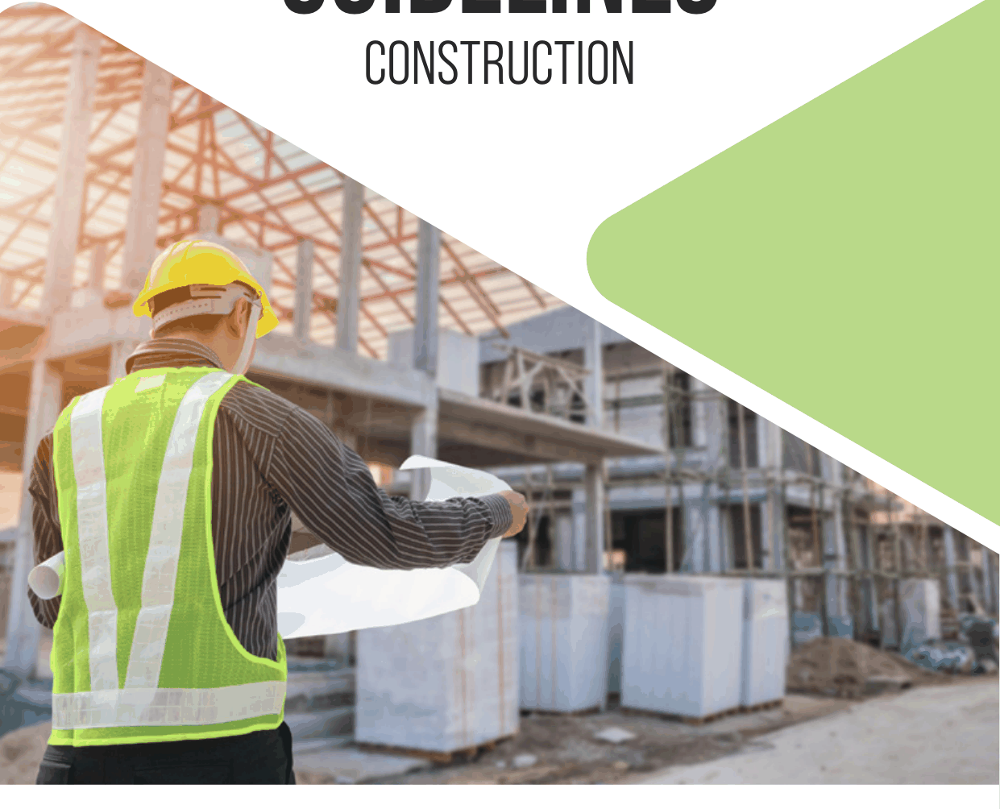
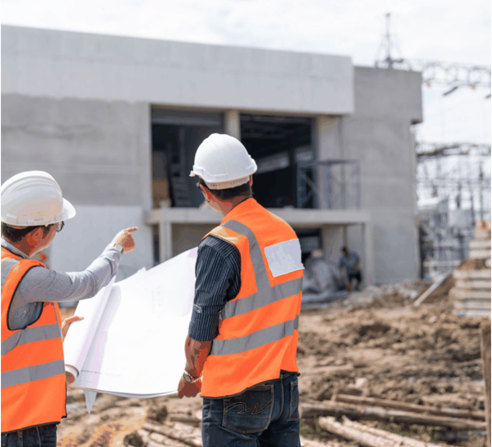
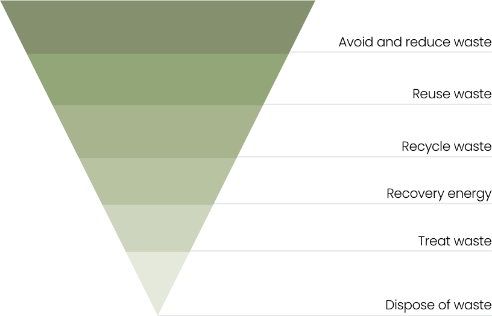
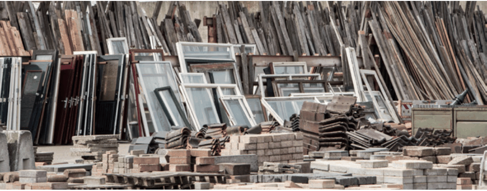
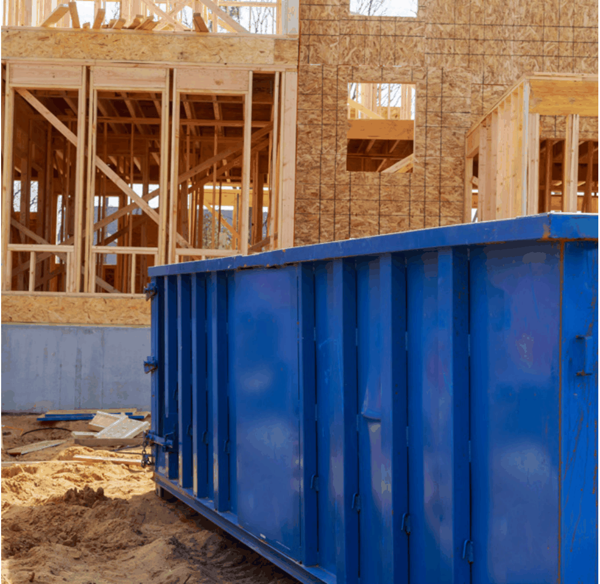

# Cessnock Development Control Plan 2010 - Waste Management Guideline - Construction

Source PDF: [Waste-Management-Guideline-Construction.pdf](Waste-Management-Guideline-Construction.pdf)

### Cessnock LGA

### 2024

### WASTE MANAGEMENT

> [Picture on page 1: a picture, saved as a picture (images/waste-management-guideline-construction-page-1-4.gif, 150 dpi).]

### GUIDELINES

### CONSTRUCTION

### STRATEGIC PLANNING | WASTE & ENVIRONMENT

> [Picture on page 2: a picture, saved as a picture (images/waste-management-guideline-construction-page-2-1.gif, 150 dpi).]

Journey Through Time, created by local school students and artist Steven Campbell.

#### Acknowledgement of Country

Cessnock City Council acknowledges that within its local government area boundaries are the traditional

lands of the Wonnarua people, the Awabakal people and the Darkinjung people. We acknowledge these

Aboriginal peoples as the traditional custodians of the land on which our offices and operations are located,

and pay our respects to Elders past and present. We also acknowledge all other Aboriginal and Torres Strait

Islander people who now live within the Cessnock Local Government Area.

### Contents

| 1. | Introduction | 4 |
|---|---|---|
| 2 | Waste minimisation Waste Management Plan Construction waste storage area Construction waste collection point | 6 7 8 8 |
| 3 | Useful resources | 9 |
| 4 | Appendix A Template Waste Management Plan – Construction | 11 12 |

### INTRODUCTION

### Introduction

Waste from construction activities may be minimised by both planning and on-site management

practices. This can result in more efficient waste management and costs savings for the

construction project. Major sources of waste generation during construction include:

•	 Damaged or

non-reusable

parts, tools and

equipment.

•	 Construction

material

packaging,

including plastic

film and cardboard

•	 Material offcuts,

spare or excess

materials or

over-ordered

construction items

•	 Waste from

workers at the site,

including food

packaging

This guideline has been developed to assist with the completion of a Waste Management Plan

(WMP) for construction projects and assist with meeting the requirements for waste management

under Council’s Development Control Plan (DCP).  A template WMP for construction has been

provided in Appendix A of this guideline to assist in preparing for a construction project.

> [Picture on page 5: a picture, saved as a picture (images/waste-management-guideline-construction-page-5-27.gif, 150 dpi).]

### WASTE

### MINIMISATION

### Waste Management Plan

In preparing a WMP for a construction project consideration of the waste hierarchy under the Waste

Avoidance and Resource Recovery Act 2001 is to be undertaken (Figure 1).

#### Most preferable

> [Picture on page 7: a picture, saved as a picture (images/waste-management-guideline-construction-page-7-5.gif, 150 dpi).]
> Words printed on the picture (title and legend, copied from the PDF):
> Avoid and reduce waste
> Reuse waste
> Recycle waste
> Recovery energy
> Treat waste
> Dispose of waste

#### Least preferable

Figure 1: Waste hierarchy – Waste Avoidance and Resource Recovery Act 2001.

### Avoiding construction waste

Measures to minimise waste during construction can include

•	 Source separation of

offcuts to facilitate reuse

or recycling

•	 A purchasing policy to

facilitate appropriate

quantities of materials for

the project

•	 Appropriate landscape

planning to reduce

maintenance/generation

of green waste materials.

•	 Prefabrication of materials

•	 Bulk purchasing to reduce

individual packaging

•	 Reuse of formwork from

other projects

•	 Co-ordination and

sequencing of trades/

construction to avoid

generation of additional

waste.

•	 Modular design to reduce

offcuts/excess

•	 Limiting excavation

•	 Appropriate storage

of materials with

expiration times to avoid

spoiling   and limit waste.

Preparation of these

materials should be

batched to avoid spoiling

or excess wastage.

### Construction reuse and recycling

Alternatives to the use of new construction materials may include:

•	 Reuse of existing materials from the site or

from other projects.

•	 Purchasing second-hand materials or

materials with recycled content

Recycling of construction materials can include:

•	 Use of spare timber for formwork

•	 Setting aside full tiles, bricks and pavers as

spares for use in other projects

•	 Keeping residual paint for future occupants to

conduct colour-matching in repairs

•	 Establish a return or buy-back arrangement

with suppliers or arrange for materials to be

sent to architectural salvage or used material

outlets

•	 Use of broken bricks or tiles as drainage

aggregate

•	 Return of pallets to suppliers.

### Construction waste storage areas

The waste storage area at the construction site is to be a minimum of 3.5m2 with a screening

height of 1.2m. A number of bin locations may be required depending on the size of the project.

Any bins are to have tight fitting lids to prevent litter/waste escaping from the waste storage area.

### Construction waste collection point

The waste collection point for construction waste material is to be located within the site and

safely accessible by the waste collection vehicle. The waste collection vehicle should be able to

access and leave the site in a forward direction.

The construction waste collection point is to be identified on the submitted Site Plan.

> [Picture on page 8: a picture, saved as a picture (images/waste-management-guideline-construction-page-8-29.gif, 150 dpi).]

### USEFUL

### RESOURCES

### Useful resources

Green Cross Australia, Green Building Guide

http://www.builditbackgreen.org/bushfires/interactive-green-building-guide.aspx

National Institute of Building Services 2024, Whole Building Design Guide – Construction waste

Management

https://www.wbdg.org/resources/construction-waste-management

NSW EPA, Household building and renovation

https://www.epa.nsw.gov.au/your-environment/household-building-and-renovation

Planet Ark 2023,  Business Recycling Directory

https://businessrecycling.com.au/

> [Picture on page 10: a picture, saved as a picture (images/waste-management-guideline-construction-page-10-11.gif, 150 dpi).]

### APPENDIX A

### Appendix A

Click here to download a council built template for your waste management plan:

https://www.cessnock.nsw.gov.au/files/assets/public/v/1/hptrim/website-forms-do-not-change/

waste-management-guidelines-_construction_-fillable-form.docx

62-78 Vincent Street, Cessnock NSW 2325  |  PO Box 152 Cessnock NSW 2325

02 4993 4100  |  council@cessnock.nsw.gov.au  |  www.cessnock.nsw.gov.au
