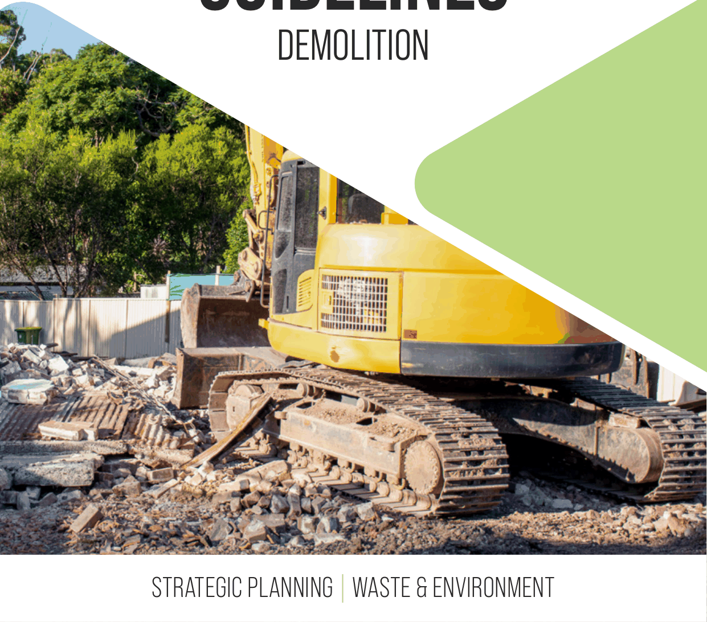
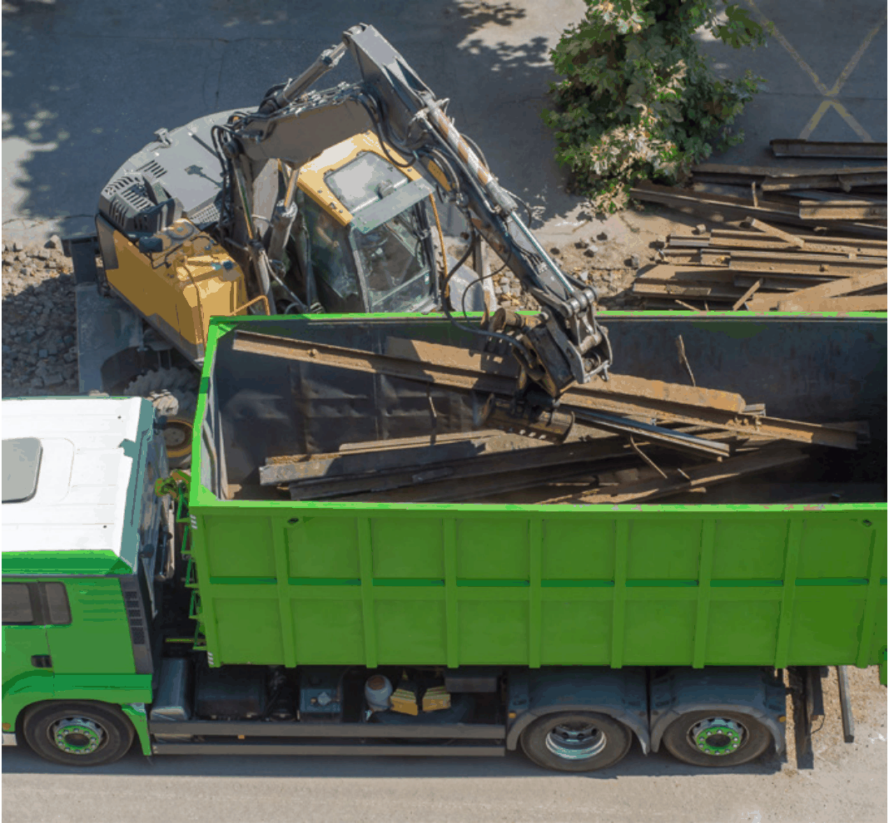
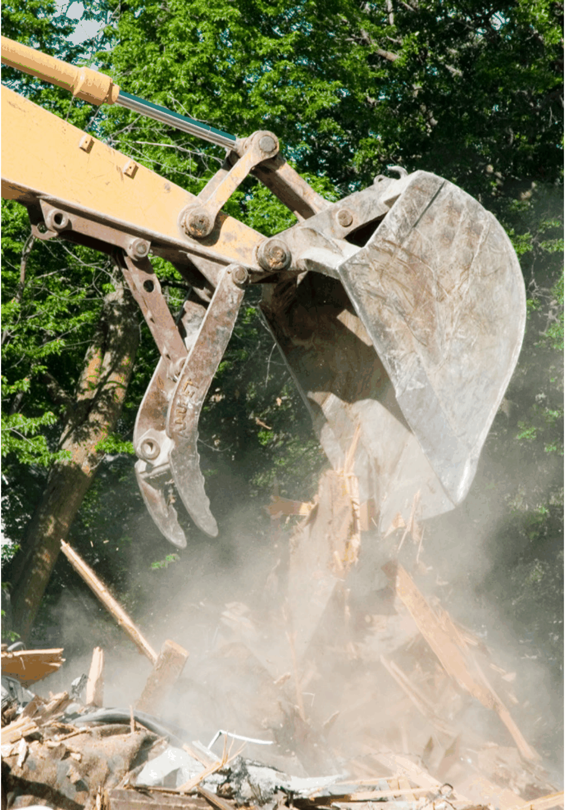
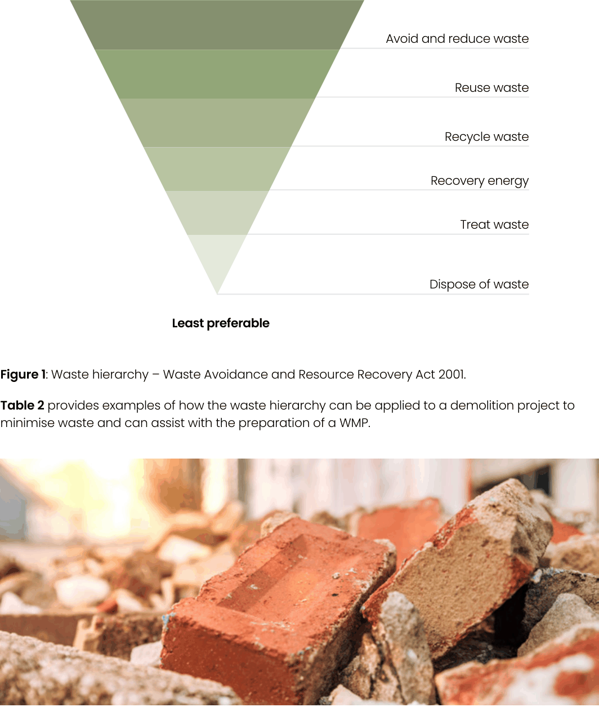
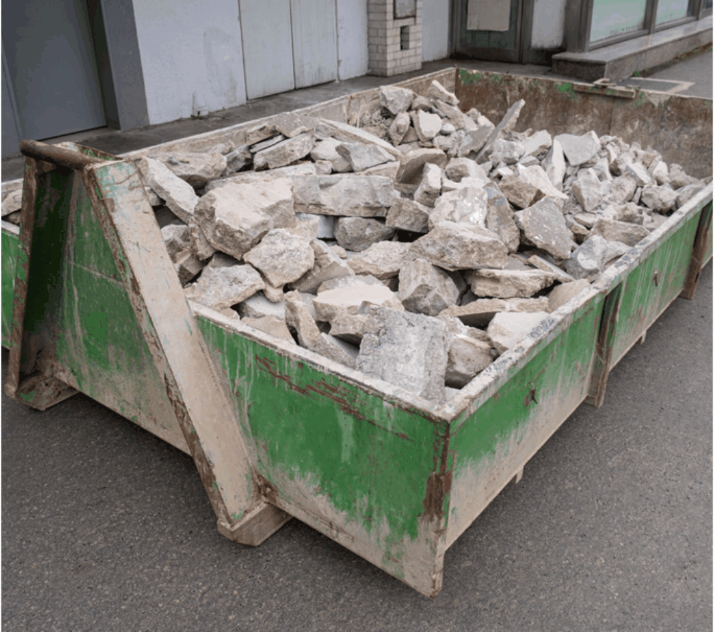
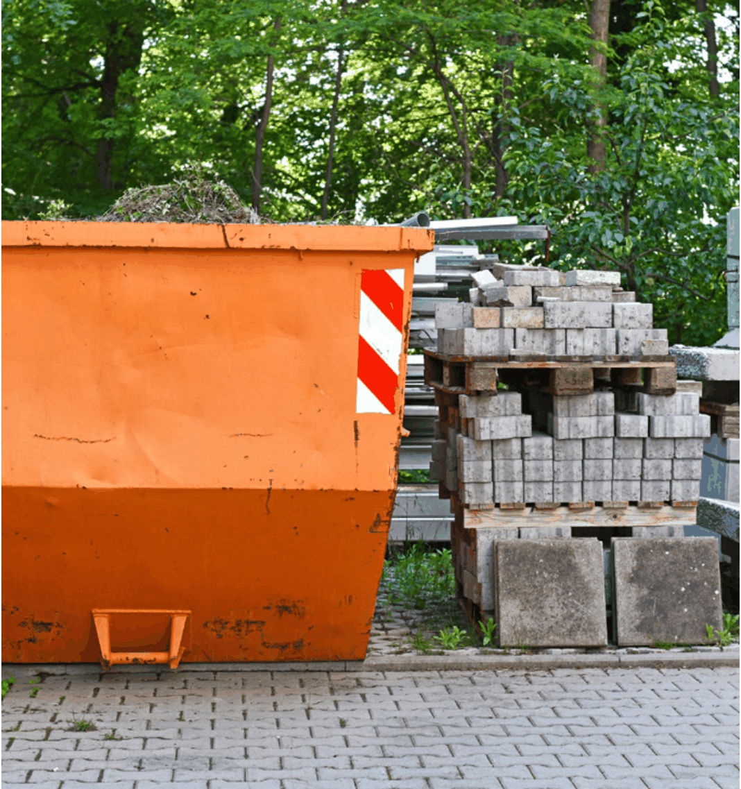

# Cessnock Development Control Plan 2010 - Waste Management Guideline - Demolition

Source PDF: [Waste-Management-Guideline-Demolition.pdf](Waste-Management-Guideline-Demolition.pdf)

### Cessnock LGA

### 2024

### WASTE MANAGEMENT

> [Picture on page 1: a picture, saved as a picture (images/waste-management-guideline-demolition-page-1-4.gif, 150 dpi).]

### GUIDELINES

### DEMOLITION

### STRATEGIC PLANNING | WASTE & ENVIRONMENT

> [Picture on page 2: a picture, saved as a picture (images/waste-management-guideline-demolition-page-2-1.gif, 150 dpi).]

Journey Through Time, created by local school students and artist Steven Campbell.

#### Acknowledgement of Country

Cessnock City Council acknowledges that within its local government area boundaries are the traditional

lands of the Wonnarua people, the Awabakal people and the Darkinjung people. We acknowledge these

Aboriginal peoples as the traditional custodians of the land on which our offices and operations are located,

and pay our respects to Elders past and present. We also acknowledge all other Aboriginal and Torres Strait

Islander people who now live within the Cessnock Local Government Area.

### Contents

| 1. | Introduction Waste types from demolition | 4 6 |
|---|---|---|
| 2 | Waste Minimisation Waste Management Plan | 8 9 |
| 3 | Demolition waste storage areas Demolition waste collection point | 12 13 |
| 5 | Useful resources | 14 |
| 6 | Appendix A Template Waste Management Plan – Demolition | 16 17 |

### INTRODUCTION

### Introduction

Waste minimisation from demolition of structures can be undertaken through management

practices such as reuse, re-sale or reprocessing of materials. Waste minimisation practices can

provide benefits to a project including:

•	 Income from

sale of recycled

or salvaged

materials

•	 Reduced waste

transport and

disposal costs

•	 Conserving

landfill space

•	 Reduced

consumption of

new materials

and resources

This guideline has been developed to assist with the completion of a Waste Management Plan

(WMP) for demolition projects and assist with meeting the requirements for waste management

under Council’s Development Control Plan (DCP). A template WMP for demolition activities has

been provided in Appendix A of this guideline to assist in preparing for a demolition project.

> [Picture on page 5: a picture, saved as a picture (images/waste-management-guideline-demolition-page-5-22.gif, 150 dpi).]

### Waste types from demolition

Planning for waste minimisation from demolition should consider the types of waste produced by the

project and how they may be re-used, recovered or recycled. Types of waste may include

•	 reusable parts of the structure or the whole

structure/building

•	 fittings and furnishings (including doors,

windows, cabinetry, sinks, basins etc)

•	 services (including fire safety systems,

electrical components, air-conditioning etc)

•	 structural materials (including roof, floor,

columns, framing etc)

•	 internal or secondary materials (including

ceilings, wall panels and floor coverings)

•	 outbuildings, sheds, carports, garages

•	 fencing, pathways, letterboxes, landscape

edging

The volume of waste from demolition will vary based on the size of the project/structures. Table 1

below shows the typical composition of waste materials from the demolition of different housing.

Table 1: Typical waste material composition from housing demolition

| MATERIAL | HOUSING TYPE |  |  |  |
|---|---|---|---|---|
|  | FULL BRICK (T) | BRICK VENEER (T) | WEATHERBOARD (T) | ASBESTOS FIBRO (T) |
| Fittings | 1.5 | 1.5 | 1 | 1 |
| Roof tiles | 8 | 12 | 5 | 5 |
| Plasterboard | 1 | 2.5 | 2 | 2 |
| Timber | 6.9 | 9.6 | 7.2 | 5.3 |
| Concrete, bricks, footings | 180 | 120 | 50 | 20 |
| Asbestos | - | - | - | 1.8 |
| Total | 197 | 146 | 65 | 35 |

Source: House deconstruction: Information booklet (Department of Environment, Climate Change

and Water NSW, July 2010).

> [Picture on page 7: a picture, saved as a picture (images/waste-management-guideline-demolition-page-7-1.gif, 150 dpi).]

### WASTE

### MINIMISATION

### Waste Management Plan

All demolition should be planned and undertaken safely in accordance with Australian Standard AS

2601 – 2001 The demolition of structures. In preparing a WMP for a demolition project consideration of

the waste hierarchy under the Waste Avoidance and Resource Recovery Act 2001 is to be undertaken

(Figure 1).

#### Most preferable

> [Picture on page 9: a picture, saved as a picture (images/waste-management-guideline-demolition-page-9-7.gif, 150 dpi).]
> Words printed on the picture (title and legend, copied from the PDF):
> Avoid and reduce waste
> Reuse waste
> Recycle waste
> Recovery energy
> Treat waste
> Dispose of waste

#### Least preferable

Figure 1: Waste hierarchy – Waste Avoidance and Resource Recovery Act 2001. Table 2 provides examples of how the waste hierarchy can be applied to a demolition project to

minimise waste and can assist with the preparation of a WMP.

| (eg Synthetic carpet underlay) and recycled rubber project Protect and cover for use in be Good reused condition material can | Plumbing products where Retain appropriate existing plumbing good Sell pipes Reuse condition plumbing in new sinks products project taps, tubs, if in PVC | Plasterboard | Cabinets Sell replace Reuse good suitable condition doors cabinets cabinetry or | Doors, windows materials use as Sell if in new project Use as second-hand good condition architectural building or feature in | flooring) Timber (lumber, timber, Leave in place or re-clad Sell on-site Use suitable as architectural timber feature | Roof tiles colour Consider Retain treatment cleaning existing roof and/or Sell tiles if in good condition | Bricks fences Retain existing walls, buildings, Sell order Reuse bricks on-site bricks in good that order are in good | Concrete paths, Retain footings, existing slabs driveways, | MATERIAL AVOID REUSE | Table 2: Potential waste minimisation management for demolition projects |
|---|---|---|---|---|---|---|---|---|---|---|
| commercial Reprocessed facility off site at | recycler Metal pipes, taps etc to metal | commercial Reprocessed facility off-site at | Untreated or unpainted wood | Glass not fit Unpainted metal Metal to recycler for reuse or recycler. frames, untreated screens to wood | wood Unpainted not fit for and reuse untreated | facility Reprocessed at commercial | facility Reprocessed at commercial | roadbase commercial Reprocessed or levelling facility off-site for at material | RECYCLE |  |
| for Stained reuse. or soiled material unfit | unfit PVC for and reuse. other plastic piping | plasterboard Contaminated or rotten | wood. Unusable painted or treated | wood. Unusable painted or treated | waste. timber Painted, disposed treated as or residual rotting |  |  |  | DISPOSE |  |

### Reuse of demolition material

Where a suitable benefit to the project can be identified the reuse of material on-site should be

considered. Materials and fittings that may be suitable for reuse include

•	 Timber – hardwood flooring, weatherboard,

laminated beams, truss joints, framing,

posts

•	 Thermal insulation – fiberglass, wool and

polyester insulation, polystyrene sheets

•	 Plumbing fixtures – baths, sinks, toilets,

service equipment

•	 Electrical fittings – light fittings, switches

•	 Linings and finishings – architraves, skirtings,

wood paneling, joinery

•	 Doors and windows – metal and timber

doors, mechanical closures, aluminum

windows, steel windows, sealed glass units,

store fronts, skylights

However, on-site use must comply with environmental and health legislation including

•	 Protection of the Environment Operations Act

1997: Does not result in pollution of the land

•	 Contaminated Land Management Act 1997:

Does not result in contamination of the land

•	 The main exceptions to reuse and recycling

of materials are

•	 Asbestos products

### Reuse or recycle off-site

•	 Fire damaged building materials

(contaminated by burnt chemical residues)

•	 Timber components treated with Copper

Chrome Arsenate (CCA)

•	 Lead paint

•	 Poly-chlorinated Biphenyls (PCBs)

If the project requires existing buildings and infrastructure to be removed then careful on-site

separation of materials can assist in waste minimisation. A number of color coded or labelled

bins, or an ordered retrieval program, can assist with reducing waste disposal to landfill. Materials that can be recycled from demolition projects include

•	 Asphalt paving

•	 Concrete

•	 Masonry – concrete blocks, paving stones,

bricks and terracotta tiles

•	 Metals – structural steel, steel roofing, metal

flashing, reinforcing steel, copper pipes and

wiring

•	 Wool carpet

•	 Plastic – high-density polyethylene water

pipes, PVC, polystyrene.

To maximise the value of the recyclable material, consult with the recycler to identify potential

contaminants and minimise issues in the waste resource stream.

### DEMOLITION

### WASTE

### STORAGE AREAS

### Demolition waste storage areas

The size of the waste storage area at the

demolition site will be dependent on the size

of the project and volume of materials. The

waste storage area is to be a minimum of

3.5m2 with a screening height of 1.2m. The

number of bins within the waste storage

will be dependent on the number of waste

streams to be separated and collected. Any

bins are to have tight fitting lids to prevent

litter/waste escaping from the waste storage

area.

A number of waste storage areas may be

required depending on the waste streams to

be collected and site access.

### Demolition waste collection

### point

The waste collection point for demolition

material is to be located within the site and

safely accessible by the waste collection

vehicle. The waste collection vehicle should

be able to access and leave the site in a

forward direction.

The nominated demolition waste collection

point is to be identified on the submitted Site

Plan.

> [Picture on page 13: a picture, saved as a picture (images/waste-management-guideline-demolition-page-13-27.gif, 150 dpi).]

### USEFUL

### RESOURCES

### Useful resources

Better Buildings Partnership 2024, BBP Stripout Waste Guidelines,

https://www.betterbuildingspartnership.com.au/resource/stripout-waste-guidelines-

procurement-systems-and-reporting/

NSW EPA , Household building and renovation,

https://www.epa.nsw.gov.au/your-environment/household-building-and-renovation

Planet Ark 2023,  Business Recycling Directory,

https://businessrecycling.com.au/

> [Picture on page 15: a picture, saved as a picture (images/waste-management-guideline-demolition-page-15-9.gif, 150 dpi).]

### APPENDIX A

### Appendix A

Click here to download a council built template for your waste management plan:

https://www.cessnock.nsw.gov.au/files/assets/public/v/1/hptrim/website-forms-do-not-change/

waste-management-guidelines-_demolition-_-fillable-form.docx

62-78 Vincent Street, Cessnock NSW 2325  |  PO Box 152 Cessnock NSW 2325

02 4993 4100  |  council@cessnock.nsw.gov.au  |  www.cessnock.nsw.gov.au
