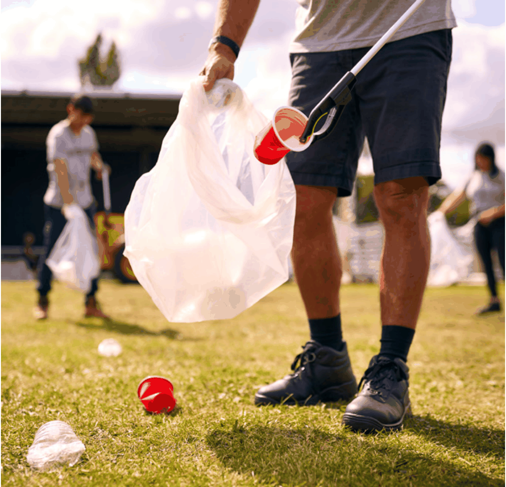
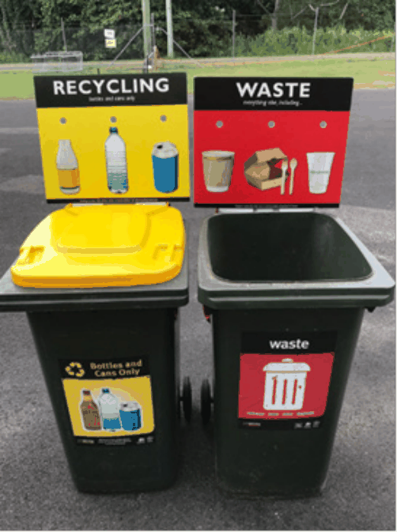
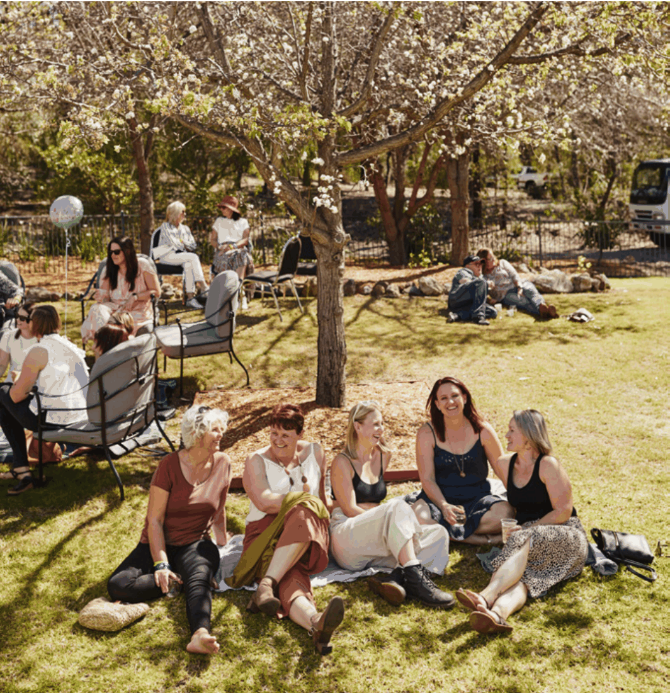

# Cessnock Development Control Plan 2010 - Waste Management Guideline - Events

Source PDF: [Waste-Management-Guideline-Events.pdf](https://planfortomorrow.sharepoint.com/sites/Planfortomorrow/Shared%20Documents/00%20NSW-Planning-Resources/dcp/cessnock-development-control-plan-2010/supporting-guides/waste-management-guideline-events/Waste-Management-Guideline-Events.pdf)

### Cessnock LGA

### 2024

### WASTE MANAGEMENT

> [Picture on page 1: a picture, saved as a picture (images/waste-management-guideline-events-page-1-4.gif, 150 dpi).]

### GUIDELINES

### EVENTS

### STRATEGIC PLANNING | WASTE & ENVIRONMENT

> [Picture on page 2: a picture, saved as a picture (images/waste-management-guideline-events-page-2-1.gif, 150 dpi).]

Journey Through Time, created by local school students and artist Steven Campbell.

#### Acknowledgement of Country

Cessnock City Council acknowledges that within its local government area boundaries are the traditional

lands of the Wonnarua people, the Awabakal people and the Darkinjung people. We acknowledge these

Aboriginal peoples as the traditional custodians of the land on which our offices and operations are located,

and pay our respects to Elders past and present. We also acknowledge all other Aboriginal and Torres Strait

Islander people who now live within the Cessnock Local Government Area.

### Contents

| 1. | Introduction | 4 |
|---|---|---|
| 2 | Waste planning for your event Waste goals and vendor selection Waste collection service | 6 7 7 |
| 3 | Bin locations Waste storage areas Waste collection points and transfer routes Site plan | 8 9 9 9 |
| 5 | Useful resources | 10 |
| 6 | Appendix A. | 12 |

### INTRODUCTION

### Introduction

The volume of waste generated by an event can be linked to event attendance. Waste

generated by attendees includes items bought to the event and disposed of while in attendance

along with food, packaging and other items from vendors, stall operators and event staff. The management of waste at events can be undertaken through setting achievable sustainability

goals for the event and selection of vendors and stallholders that commit to waste minimisation

goals. Careful planning and organisation of a waste management system that accounts for

appropriate bin placement and collection will assist in meeting the event’s waste goals. This

guideline has been developed to assist with the completion of a Waste Management Plan (WMP)

for events and meeting the requirements for waste management under Council’s Development

Control Plan (DCP). A template WMP for events has been provided in Appendix A of this guideline

to assist in preparing for a public event.

> [Picture on page 5: a picture, saved as a picture (images/waste-management-guideline-events-page-5-13.gif, 150 dpi).]

### WASTE PLANNING

### FOR YOUR EVENT

### Waste collection service

### Waste goals and vendor

### selection

Collection of event recycling and residual

waste materials can be arranged for

1\. Public land owned or managed by

Council – through Council Event Bin

application from https://www.cessnock.

nsw.gov.au/Residents/Waste/Waste-

collection/Waste-forms

Management of waste can vary at different

types of events due to the requirements for the

staging of the event and variety of stallholders/

vendors involved in the event. However, setting

a waste goal, such as no waste to landfill or

compost all food/green waste, highlights the

event’s intention to waste management and

sustainability.

2\. Private land or other government

managed land – through a private

waste contractor

In planning an event select stallholders/

vendors that will collaborate in meeting

the event’s waste goals or offer terms and

conditions for participating in the event. Discuss

with the event stallholders/vendors or service

providers about the role the event can play in

reducing waste.

> [Picture on page 7: a picture, saved as a picture (images/waste-management-guideline-events-page-7-29.gif, 150 dpi).]

Waste materials generated by stallholders,

including packaging, food wastes, containers

etc should be ordinarily managed and

removed by stallholders rather then left at the

event site for removal. Event managers may opt to coordinate

management of all, or a portion of back of

house waste.

### BIN

### LOCATIONS

### Bin locations

Waste collection points and

### transfer routes

Bins for recycling, and residual waste should

be co-located together at locations across the

event area to facilitate separation of waste. When planning the number of bins for an

event order an equal number of recycling and

residual waste bins to facilitate bin stations.

Bin stations should be located in areas where

waste is most likely to be disposed while not

reducing pedestrian movement. Site exits and

food eating areas are high waste locations.

The event should identify dedicated waste

collection points for access for collection

vehicles. The nominated waste collection point

should consider distances, gradient and ease

of moving bins over different ground surfaces.

If distances or slope are an issue larger carting

equipment or small waste transport vehicles

may be required to transport bins to the waste

collection point. Manual bin carting for wheeled

bins over 360L in size should not exceed 10m.

### Site Plan

Bin stations should include clear signage to

inform attendees regarding separation of

waste. Alternatively, bin monitors/volunteers

could be stationed at each bin location to

assist with attendees to separate waste.

The Site Plan for the event should provide

locations for the following

### Waste storage areas

Each stallholder or vendor should have a

secure waste storage area near their allocated

event site for separation of materials. Bins or

containers for recyclables, and residual waste

should be sufficiently sized to hold a day’s

volume of material for each stallholder/vendor.

•	 Bin delivery points at event set up/’bump in’

•	 Bin storage areas

•	 Public bin areas

•	 Waste storage areas for stallholders/

vendors or communal waste storage areas

•	 Waste collection points where bins will be

placed for emptying

•	 Bin aggregation areas and removal points

at the end of the event/’bump out’.

Dedicated communal waste storage areas

should be considered so individual stallholders/

vendors can transfer waste for collection.

Communal waste storage areas should be

appropriately screened and identified to allow

access by event stallholders/vendors only. The

communal waste storage area should contain

sufficiently sized waste bins to consolidate

materials from the event for collection.

### USEFUL

### RESOURCES

### Useful Resources

City of Sydney 2020, Sustainable Event Guidelines, Sustainable event guidelines - City of Sydney,

https://www.cityofsydney.nsw.gov.au/guides/sustainable-event-guidelines Department of Environment and Conservation NSW 2007, Waste Wise Events Guide,

https://www.cessnock.nsw.gov.au/files/assets/public/v/1/hptrim/website-community-information-

do-not-change/wastewise-events-guide-decc.pdf Department of Environment and Conservation NSW 2005, Better Practice Guide for public Place

Recycling, Managing waste for public places and events,

https://www.epa.nsw.gov.au/your-environment/recycling-and-reuse/business-government-

recycling/waste-wise-events/public-places-and-events

> [Picture on page 11: a picture, saved as a picture (images/waste-management-guideline-events-page-11-11.gif, 150 dpi).]

### APPENDIX A

### Appendix A

Click here to download a council built template for your waste management plan:

https://www.cessnock.nsw.gov.au/files/assets/public/v/1/hptrim/website-forms-do-not-change/

waste-management-guidelines-_events_-fillable-forms.docx

62-78 Vincent Street, Cessnock NSW 2325  |  PO Box 152 Cessnock NSW 2325

02 4993 4100  |  council@cessnock.nsw.gov.au  |  www.cessnock.nsw.gov.au
