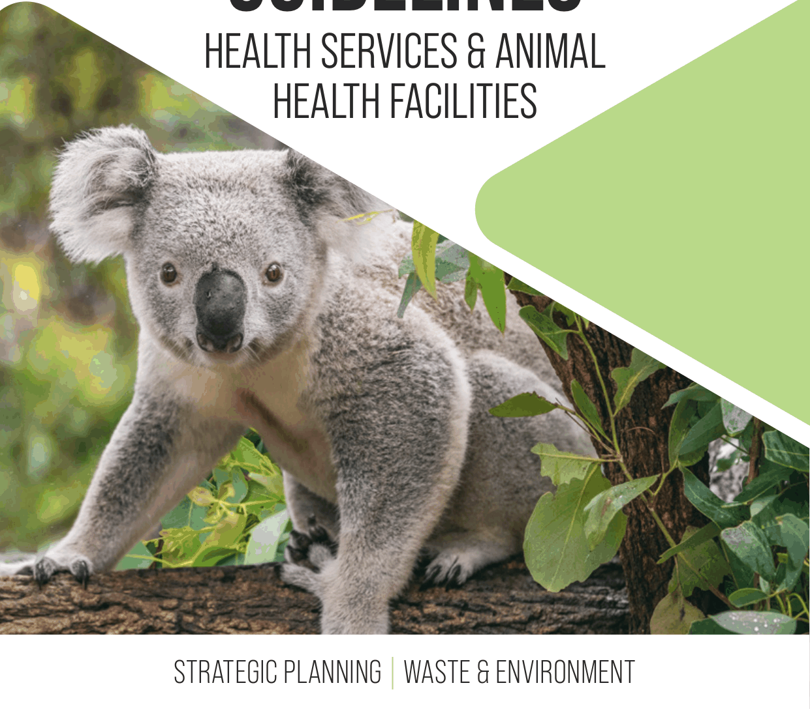
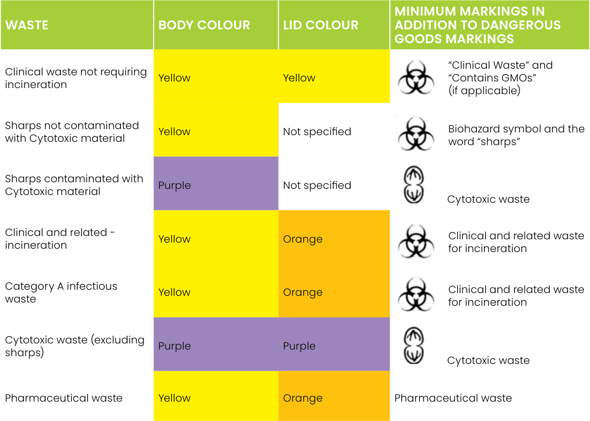
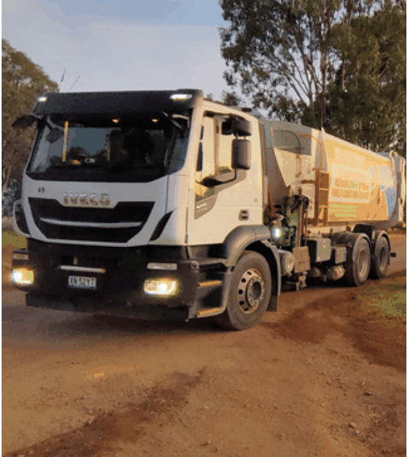
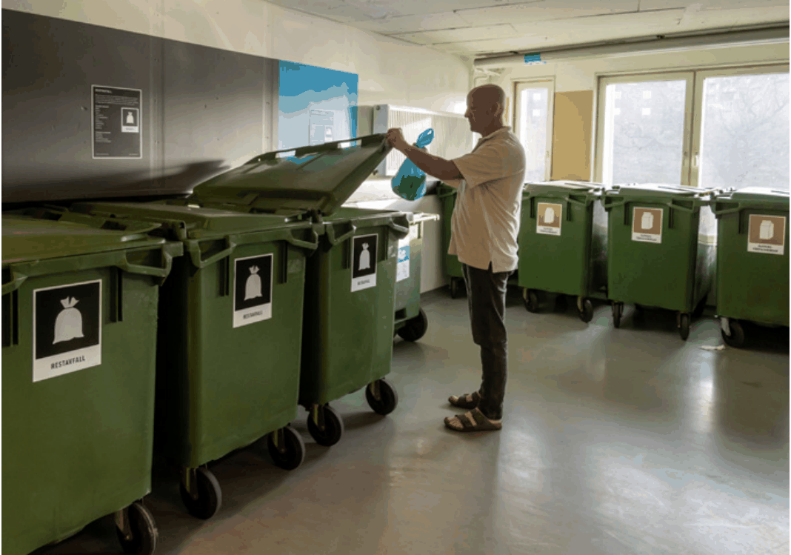
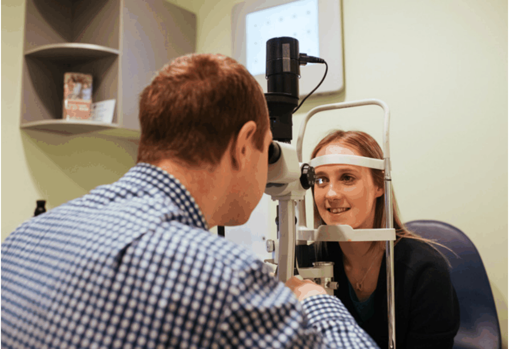

# Cessnock Development Control Plan 2010 - Waste Management Guideline - Health Services and Animal Management Facilities

Source PDF: [Waste-Management-Guideline-Health-Services-and-Animal-Management-Facilities.pdf](https://planfortomorrow.sharepoint.com/sites/Planfortomorrow/Shared%20Documents/00%20NSW-Planning-Resources/dcp/cessnock-development-control-plan-2010/supporting-guides/waste-management-guideline-health-services-and-ani/Waste-Management-Guideline-Health-Services-and-Animal-Management-Facilities.pdf)

### Cessnock LGA

### 2024

### WASTE MANAGEMENT

> [Picture on page 1: a picture, saved as a picture (images/waste-management-guideline-health-services-and-ani-page-1-4.gif, 150 dpi).]

### GUIDELINES

### HEALTH SERVICES & ANIMAL

### HEALTH FACILITIES

### STRATEGIC PLANNING | WASTE & ENVIRONMENT

> [Picture on page 2: a picture, saved as a picture (images/waste-management-guideline-health-services-and-ani-page-2-1.gif, 150 dpi).]

Journey Through Time, created by local school students and artist Steven Campbell.

#### Acknowledgement of Country

Cessnock City Council acknowledges that within its local government area boundaries are the traditional

lands of the Wonnarua people, the Awabakal people and the Darkinjung people. We acknowledge these

Aboriginal peoples as the traditional custodians of the land on which our offices and operations are located,

and pay our respects to Elders past and present. We also acknowledge all other Aboriginal and Torres Strait

Islander people who now live within the Cessnock Local Government Area.

### Contents

| 1. | Introduction Waste Management Plan Waste collection services | 4 5 5 |
|---|---|---|
| 2 | Waste generation Recyclable and residual waste Special waste and radioactive waste | 6 7 7 |
| 3 | Bin infrastructure Recyclable and residual waste Special waste and radioactive waste | 8 9 10 |
| 4 | Waste management system Recyclable and residual waste Special waste and radioactive waste | 11 12 12 |
| 5 | Waste storage area Special waste and radioactive waste | 13 14 |
| 6 | Waste collection Waste collection vehicle Waste collection vehicle access Waste collection point | 15 16 16 17 |
| 7 | Useful resources | 18 |

### INTRODUCTION

### Introduction

Facilities providing health services require a multi-layered waste management system to assist

with the variety of waste streams that result from the operation of these premises. In addition to

standard recyclable and residual waste streams health service facilities are required to manage,

dependant on the scope of services within the facility,

•	 Clinical waste

•	 Sharps waste

•	 Cytotoxic waste

•	 Pharmaceutical waste

•	 Radioactive waste

These waste streams require appropriate storage and collection to prevent transfer of pathogens

or infectious substances or manage other health-related impacts. These waste streams are also

associated with facilities that undertake health animal health management. This guideline provides general guidance to develop a waste management system for the

following health service facilities

d. Medical centre

a. Community health service facilities

e. Patient transport facilities

b. Health consulting rooms

c. Hospital The guideline also applies for waste management systems for residential care facilities listed

within the seniors housing landuse. Guidance is also provided to develop a waste management system for landuses associated with

animal health management including

a. Animal boarding or training establishments b. Veterinary hospitals

### Waste collection service

### Waste Management Plan

All proposed health service facilities and

animal health management facilities will be

required to submit a Waste Management

#### Plan (WMP) with a development application.

#### If the cost of the proposed development

exceeds $5M in value the WMP is required

to be prepared by a suitably qualified waste

management consultant/practitioner.

Waste collection services for new

health service facilities or animal health

management facilities are required to be

provided by the owner or operator of the

premises. The proposed waste management

system is required to be integrated into the

overall design of the development with waste

storage and collection points located on-site.

To ensure waste collection can be undertaken

safely and efficiently the waste collection

vehicle will need to enter and exit the site in a

forward direction.

The WMP is to be prepared with reference to

this guideline and other relevant standards

or documentation. Section 10 of AS 3816: 2018

Management of clinical and related wastes

provides guidance on the preparation of waste

management plans for various waste streams

associated with the facilities outlined in this

guideline.

### WASTE

### GENERATION

### Recyclable and residual waste

Waste generation rates from health service facilities and animal health management facilities will

vary based on the size of the facility and the types or service provided within the development. Average recyclable and residual waste generation has been provided to Table 1 and each

proposed facility should account for waste generation from each area of the development. Table 1: Recyclable and residual waste generation rates from health service and animal health

management facilities

| PART OF FACILITY | RECYCLING (L/100M2/DAY) | RESIDUAL (L/100M2/DAY) | COMMENT |
|---|---|---|---|
| Medical rooms | 20 | 10 | Rate is per consulting room |
| Offices | 10 | 15 |  |
| Optical | 18.8 | 31.3 |  |

Source: Appendix G Better practice guide for resource recovery in residential development, NSW EPA,

2019

Waste generation rates from Table 1 should be used to determine the size and number of bins

required for recyclable and residual waste for the proposed facility. If the premises type is not

provided in Table 1 supporting documentation providing estimates of the volume of waste streams

from the proposed operation is to be provided in the submitted WMP.

### Special waste and radioactive waste

Health service facilities and animal health management facilities may generate wastes classified

as special waste under the Protection of the Environment Operations Act (Waste) Regulation 2014.

Special waste includes clinical and related waste that involves

•	 Clinical waste including pathology and

anatomical waste

•	 Pharmaceutical, drug and medicine waste

•	 Cytotoxic waste

•	 Clinical sharps waste

Health service facilities and animal health management facilities may also generate waste

classified as containing radioactive material through services provided at the site. Each waste management plan is required to submit supporting documentation providing estimates

of the volume of the waste streams for special waste and radioactive waste generated as a result

of the proposed facility.

### BIN

### INFRASTRUCTURE

### Recyclable and residual waste

All health service facilities and animal health management facilities require access to recycling

and residual waste bins and sufficient bin storage is to be provided to accommodate the projected

volume of waste from the proposed development. Facilities that include food production and

preparation, such as hospitals, should provide separate bin storage for organic/food waste. A variety of bins are available for the storing, handling and collection of recyclable and residual

waste streams in health service facilities and animal health management facilities. The selection of

bin infrastructure is dependent on the types of materials to be handled and the building design. Mobile bins can range in volume and size and are typically collected by ‘rear-lift ‘waste collection

vehicles. Table 2 provides the dimensions of mobile bins to enable sizing of the waste storage area

for the proposed health service facility or animal health management facility.

Table 2: Mobile waste bin dimensions

| BIN CAPACITY (L) | HEIGHT (MM) | DEPTH (MM) | WIDTH (MM) | FOOTPRINT AREA (M2) |
|---|---|---|---|---|
| 80 | 870 | 530 | 450 | 0.24 |
| 120 | 940 | 560 | 485 | 0.27 |
| 140 | 1065 | 540 | 500 | 0.27 |
| 240 | 1080 | 735 | 580 | 0.43 |
| 360 | 1100 | 885 | 600 | 0.53 |
| 660 | 1250 | 850 | 1370 | 1.16 |
| 770 | 1425 | 1100 | 1370 | 1.5 |
| 1100 | 1470 | 1245 | 1370 | 1.7 |
| 1300 | 1408 | 1250 | 1770 | 1.21 |
| 1700 | 1470 | 1250 | 1770 | 1.27 |

Source: Appendix B Better Practice Guidelines for Waste Management and Recycling in Commercial

and Industrial Facilities, NSW EPA, 2012.

Bulk bins are larger than mobile waste bins and are typically serviced by ‘front-lift ‘waste

collection vehicles. Table 3 provides the typical dimensions of bulk bins to enable sizing of the

waste storage area for the proposed health service facility or animal health management facility.

Table 3: Bulk waste bin dimensions

| BIN CAPACITY (M3) | HEIGHT (MM) | DEPTH (MM) | WIDTH (MM) | FOOTPRINT AREA (M2) |
|---|---|---|---|---|
| 1.5 | 1190 | 1080 | 2070 | 2.23 |
| 2 | 865 | 1400 | 1830 | 2.6 |
| 3 | 1225 | 1505 | 1805 | 2.7 |
| 4.5 | 3750 | 1605 | 1805 | 2.9 |

Source: Appendix B Better Practice Guidelines for Waste Management and Recycling in Commercial

and Industrial Facilities, NSW EPA, 2012.

### Special waste and radioactive waste

Special wastes and radioactive wastes are required to be separated into distinct containers or bins

for collection as required by the Protection of the Environment Operations Act (Waste) Regulation

2014\. Waste bins or receptacles are to be clearly labelled and colour coded for each identified

waste stream as required by Australian Standard AS 3816 2018: Management of clinical and related

waste. The submitted waste management plan is to provide the size and number of bins/receptacles for

each waste stream applicable for the proposed facility. Table 2 provides sizing of bins/receptacles

to enable sizing of areas for storage of these waste streams. Supporting documentation can also

be provided for alternative bins/receptacles for these waste streams if not provided in Table 2.

### WASTE

### MANAGEMENT

### SYSTEM

### Waste storage area

### Internal Waste Storage Area Recyclable and residual waste Special waste and radioactive

### waste

Waste storage areas are to be identified on a

Site Plan and located:

Internal storage of special waste or radioactive

waste must be incorporated into the design of

the building as required by Australian Standard

AS 3816 2018: Management of clinical and

related waste. Any internal storage receptacle/

bin must be marked, labelled and placarded

as required by the Australian Dangerous

Goods Code and Table 2 of AS 3816 2018:

Management of clinical and related waste.

All health service facilities and animal

health management facilities are to provide

appropriate waste systems, including waste

cupboards or identified bins, within the internal

space of the premises to facilitate separation

of recyclable and residual waste materials by

staff. Sufficient space for the storage of at least

one day’s worth of recycling and residual waste

are to be provided and identified on floor plans. If a system is available for food organics

collection, then sufficient space should also be

allocated for separation of food organic in a

separate bin/container.

> [Picture on page 12: a map, saved as a picture (images/waste-management-guideline-health-services-and-ani-page-12-29.gif, 150 dpi); the street names and other small labels are on the picture.]
> Words printed on the picture (title and legend, copied from the PDF):
> Clinical waste not requiring
> “Clinical Waste” and
> Sharps not contaminated
> with Cytotoxic material
> Biohazard symbol and the
> Sharps contaminated with
> Clinical and related -
> Clinical and related waste
> Category A infectious
> Clinical and related waste
> Cytotoxic waste (excluding
> Pharmaceutical waste Yellow

#### WASTE

#### BODY COLOUR LID COLOUR

#### MINIMUM MARKINGS IN

#### ADDITION TO DANGEROUS

#### GOODS MARKINGS

Table 2: Rigid receptacle colours and markings

### WASTE

### STORAGE

### AREA

#### COMMERCIAL, INDUSTRY & COMMUNITY FACILITIES 2024  |  13

### Waste storage area

The design of the health service facility or animal health management facility needs to incorporate

sufficient space for the selected size and number of bins required for the volume of waste material

generated between collection periods. The waste storage area is to incorporate the following

•	 Sufficient floor space for the required

number of bins with a 0.2m space between

bins to allow maneuvering.

•	 Provision of an adequate water supply

through a centralized mixing valve and

hose cock.

•	 Provision of adequate lighting and

ventilation in accordance with the BA.

•	 Flexible design of the waste storage area

should also be considered including

•	 Unobstructed 1.8m clearance zone between

the stored bins and the waste storage area

entrance to permit access and movement.

•	 Located in close proximity to the waste

collection point.

•	 Additional floor space for extra bins or

containers to capture additional separated

waste streams

•	 Fully enclosed and walled with through

access to other on-site infrastructure not

permitted.

•	 Minimising potential obstacles within the

waste storage area that would limit bin size

•	 Compliant with the Building Code of

Australia (BCA) with the floor waterproofed,

non-slip and sealed.

•	 Increasing width of access or doorways to

allow for potential change in bin size

•	 The floor is to be graded to a central

drainage point and connected to the sewer.

### Special waste and radioactive waste

The waste storage area for special waste and radioactive waste can be combined with the above

waste storage area or separated within the design of the building. The waste storage area must

meet the requirements as above with the following additional requirements in accordance with

Australian Standard AS 3816 2018: Management of clinical and related waste

•	 The waste storage area must be enclosed

with a lockable door. Access is to be limited

to authroised personnel

•	 All individual waste streams, whether types

of special waste or radioactive waste, are

to have dedicated areas with appropriate

signage to avoid mixing of waste streams.

Waste pharmaceuticals are to be contained within a separate storage area to the waste storage

area within the building. The storage area is to be enclosed and lockable with the same level of

security for pharmaceuticals, drugs or medicines that are in use.

### WASTE

### COLLECTION

### Waste collection vehicle

vehicle in accordance with Australian

Standard AS2890.2 Parking Facilities: Off-

Street Commercial Vehicle Facilities.

•	 Height clearance must be sufficient for the

entry of the waste collection vehicle, with a

general minimum clearance of 3.8m.

•	 The WMP submitted with a development

application is to include a structural

engineer’s report confirming the following

The selection of waste collection vehicle will

be dependent on the type of bin infrastructure

utilised for the proposed development.

Waste collection vehicle specifications are

outlined in Appendix C of the NSW EPA’s ‘Better

Practice Guidelines for Waste Management

and Recycling in Commercial and Industrial

Facilities’ and Appendix B of the NSW EPA’s

‘Better practice guide for resource recovery in

residential developments.

•	 The design of the access driveway, or ramp,

to the site is of sufficient strength to support

the weight of the waste collection vehicle

These waste collection vehicle specifications

are to be used to determine access to the

waste collection point within the site.

### Waste collection vehicle access

•	 The route of waste collection vehicle

travel (or circulation roadway), including

pavement, are of sufficient strength to

support the weight of the waste collection

vehicle

•	 The waste collection point (or service area)

is of sufficient strength for movement and

maneuvering of the waste collection vehicle

The waste collection vehicle must be able

to safely and efficiently access the site

and nominated on-site waste collection

point. Access and egress to and from the

proposed development to public roads is to

be supported by swept path models for the

largest waste collection vehicle that could

service the building. Swept path models for

waste collection vehicles are outlined in

Note: When assessing pavement strength,

the area/pavement will need to support the

waste collection vehicle ‘gross weight’.

> [Picture on page 16: a picture, saved as a picture (images/waste-management-guideline-health-services-and-ani-page-16-48.gif, 150 dpi).]

•	 Appendix D of the NSW EPA’s ‘Better Practice

Guidelines for Waste Management and

Recycling in Commercial and Industrial

Facilities’.

•	 Section 5 of AS/NZS 2890.2 Parking facilities,

Part 2:Off-street commercial vehicle

facilities

The access/egress point from the site is to be

designed with the following requirements:

•	 The waste collection vehicle must enter and

exit the site in a forward direction

•	 A 0.5m unobstructed clearance either side

of the waste collection vehicle

•	 Grades of entry/exit ramps must not exceed

the capabilities of the waste collection

> [Picture on page 17: a picture, saved as a picture (images/waste-management-guideline-health-services-and-ani-page-17-1.gif, 150 dpi).]

### Waste collection point

The waste collection point for the proposed facility is to be appropriately located to allow easy

collection. The waste collection point is to be located

•	 Away from intersections, roundabouts or

slow-points such as pedestrian crossings

•	 Away from driveways, loading areas or

parking bays

•	 Where normal operations of the premises

will not be blocked or impeded

•	 Away from busy roads or narrow lanes

Free from obstructions such as awnings,

trees or overhead structures, wires or

services

•	 Away from public areas

•	 Where there is clear vision of traffic as

the collection vehicle leaves the waste

collection point.

The nominated on-site waste collection point must have sufficient area for maneuvering of the

waste collection vehicle with minimal need for reversing. The waste collection point is to be provided

on the Site or Floor Plans and include swept path models for a waste collection vehicle as outlined

in Appendix D of the NSW EPA’s ‘Better Practice Guidelines for Waste Management and Recycling in

Commercial and Industrial Facilities’. For rear loaded waste collection vehicles an unobstructed 2m loading zone is required behind the

vehicle for loading of bins. A 0.5m side clearance is also required on either side of the vehicle.

### USEFUL

### RESOURCES

### Useful resources

Animal Heal Australia 2021, AUSVETPLAN Operational Manuals, Informing EAD Responses –

AUSVETPLAN - Animal Health Australia Government Architect of NSW 2023, Design Guide for Health,

https://www.planning.nsw.gov.au/government-architect-nsw/design-guidance/design-guide-

for-health NSW Planning and Environment 2023, Seniors Housing Design Guide,

https://www.planning.nsw.gov.au/policy-and-legislation/housing/housing-sepp/seniors-housing NSW EPA 2012, Better Practice Guidelines for Waste Management and Recycling in Commercial

and Industrial Facilities,

Resources for local council waste and recycling operations (nsw.gov.au) NSW EPA 2019, Better practice guide for resource recovery in residential developments,

Resources for local council waste and recycling operations (nsw.gov.au) NSW Health 2020, Clinical and Related Waste Management for Health Services,

Clinical waste management (nsw.gov.au) Safework NSW 2017, Cytotoxic Drugs and related Waste – Risk Management,

https://www.safework.nsw.gov.au/__data/assets/pdf_file/0005/287042/SW08559-Cytotoxic-

drugs-and-related-risk-management-guide.pdf

> [Picture on page 19: a picture, saved as a picture (images/waste-management-guideline-health-services-and-ani-page-19-19.gif, 150 dpi).]

62-78 Vincent Street, Cessnock NSW 2325  |  PO Box 152 Cessnock NSW 2325

02 4993 4100  |  council@cessnock.nsw.gov.au  |  www.cessnock.nsw.gov.au
