# Cessnock Development Control Plan 2010 - Waste Management Guideline - Multiple Dwellings and Service Managed Residential Accommodation

Source PDF: [Waste-Management-Guideline-Multiple-Dwellings-and-Service-Managed-Residential-Accommodation.pdf](Waste-Management-Guideline-Multiple-Dwellings-and-Service-Managed-Residential-Accommodation.pdf)

### Cessnock LGA

### 2024

### WASTE MANAGEMENT

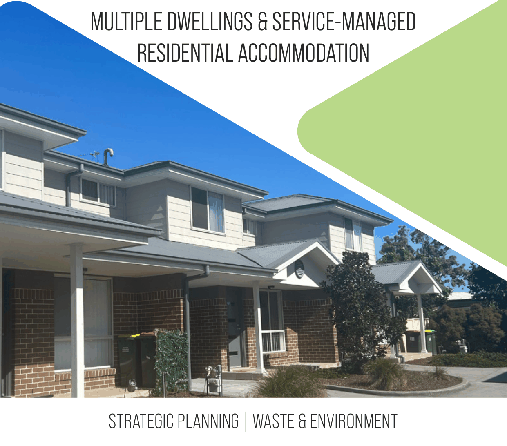

> [Picture on page 1: a picture, saved as a picture (images/waste-management-guideline-multiple-dwellings-and-page-1-4.gif, 150 dpi).]

### GUIDELINES

### MULTIPLE DWELLINGS & SERVICE-MANAGED

### RESIDENTIAL ACCOMMODATION

### STRATEGIC PLANNING | WASTE & ENVIRONMENT

> [Picture on page 2: a picture, saved as a picture (images/waste-management-guideline-multiple-dwellings-and-page-2-1.gif, 150 dpi).]

Journey Through Time, created by local school students and artist Steven Campbell.

#### Acknowledgement of Country

Cessnock City Council acknowledges that within its local government area boundaries are the traditional

lands of the Wonnarua people, the Awabakal people and the Darkinjung people. We acknowledge these

Aboriginal peoples as the traditional custodians of the land on which our offices and operations are located,

and pay our respects to Elders past and present. We also acknowledge all other Aboriginal and Torres Strait

Islander people who now live within the Cessnock Local Government Area.

### Contents

| 1. | Introduction | 4 |
|---|---|---|
| 2 | Waste collection services Residential waste collection service by Council | 7 7 |
| 3 | Waste generation Manor houses and multi-dwelling housing Boarding houses, co-living housing, group homes and hostels Seniors housing- Independent living units | 9 10 10 11 |
| 4 | Waste & recycling storage area Individual waste storage area Waste storage area – communal Seniors housing- Independent living units | 12 13 15 17 |
| 5 | Waste collection point Kerbside waste collection by Council On-site waste collection | 18 19 19 |
| 6 | Internal waste storage | 22 |
| 7 | Useful resources | 23 |

### INTRODUCTION

### Introduction

Residential development with multiple dwellings or tenancies can take a variety of forms based

on building design, number of levels and the overall number of individual residential spaces.

These residential developments also include properties that are managed by an external

service, or on-site manager, as affordable housing accommodation or for people who may

be socially disadvantaged. A waste management system is required to be designed that is

responsive to the usage of the development and to enable residents to appropriately minimise

and reduce waste while maintaining amenity of the residential space. This guideline will assist with developing a waste management system for the following residential

accommodation types involving multiple dwellings/tenancies

a. Manor houses

b. Multi-dwelling housing

The guideline will also assist with the development of a waste management system for residential

accommodation types that may include the provision of managed services on-site. This includes

a. Boarding houses

c. Group homes

e. Groups of independent living

b. Co-living housing

d. Hostels

units provided as seniors

housing

### WASTE

### COLLECTION

### SERVICE

### Waste collection service

The collection of waste from multiple dwelling developments or service-managed residential

accommodation requires appropriate consideration and design. The design will need to be

responsive to the equipment used by the waste collection service for the site, either Council or a

private waste collection service provider.

### Residential waste collection service by Council

Each residential rated property is charged a domestic waste management charge under the Local

Government Act 1993. Council’s residential waste collection service is primarily from the kerbside of

public roads. Where feasible,  subject to accessibility design and indemnity from damage, Council

may provide on-site collection in accordance with the Waste Management Policy adopted by

Council. Standard bin allocations for rated residential development comprises the following:

•	 A single 240L mobile

garbage bin for organics/

food waste

> [Picture on page 7: a picture, saved as a picture (images/waste-management-guideline-multiple-dwellings-and-page-7-16.gif, 150 dpi).]

•	 A single 240L mobile

garbage bin for residual

waste

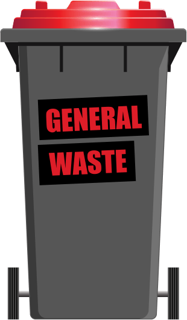

> [Picture on page 7: a picture, saved as a picture (images/waste-management-guideline-multiple-dwellings-and-page-7-20.gif, 150 dpi).]

•	 A single 240L mobile

garbage bin for recycling

waste

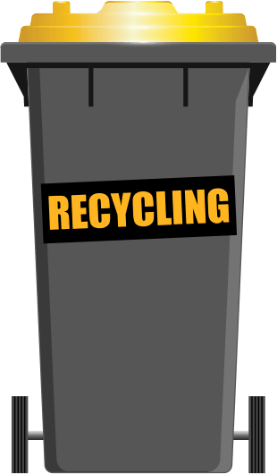

> [Picture on page 7: a picture, saved as a picture (images/waste-management-guideline-multiple-dwellings-and-page-7-24.gif, 150 dpi).]

### GENERAL

### GARDEN

### WASTE

### ORGANICS

### RECYCLING

Each week comprises the collection of 2 x 240L bins for each residential rated development.

Standard bin sizes are provided in Table 1 below to enable the design for a kerbside waste

collection point.

Table 1: Dimensions of standard 240L mobile bin

| BIN CAPACITY (L) | HEIGHT (MM) | DEPTH (MM) | WIDTH (MM) |
|---|---|---|---|
| 240L | 1060 | 730 | 585 |

Kerbside waste collection points are to accommodate 2x 240l bins for each dwelling with a

minimum dimension of 2670mm wide by 1000mm deep. This dimension includes a 500mm gap

between each bin and 500mm clearance each side of the bins. The kerbside waste collection

point dimension is required for each residential dwelling. Waste collection points are to be located with the following

•	 2000mm clearance from the base/trunk of

any street tree

•	 500mm clearance from any driveway or

accessway to the property.

### WASTE

### GENERATION

### Manor houses and multi-dwelling housing

An average household within a development with multiple dwellings generates waste volumes

outlined in Table 2 below:

Table 2: Waste generation from multi-dwelling housing with smaller or reduced outdoor space/

garden.

| HEIGHT (MM) | DEPTH (MM) | WIDTH (MM) |
|---|---|---|
| Recycling | 120 | 240 |
| Green waste (Garden and food) | 50-120 | 100-240 |
| Residual | 120 | 240 |

Source: Better practice guide for resource recovery in residential developments, NSW EPA, April 2019

and City of Sydney, Guidelines for Waste Management in New Developments.

### Boarding houses, co-living housing, group homes and hostels

Waste generation from service-managed residential accommodation can vary depending on

stay duration, occupant waste separation knowledge and facilities provided (shared or individual

kitchen, bathroom, laundry). The management of these residential accommodation types is

required to provide access to waste services including recycling, organics and residual waste bins.

Table 3 provides waste generation rates from these service-managed developments and bin

capacity is to be designed to accommodate these waste volumes.

Table 3: Waste generation volume from service-managed residential accommodation

| 3A. SERVICE MANAGED ROOM - INDIVIDUAL KITCHEN, BATHROOM AND LAUNDRY |  |  |
|---|---|---|
| WASTE TYPE | VOLUME/WEEK (L) | VOLUME/FORTNIGHT (L) |
| Recycling | 60 | 120 |
| Organic | 40 (plus landscaping) | 80 (plus landscaping) |
| Residual | 40 | 80 |

| 3B. SERVICE MANAGED ROOM – SHARED KITCHEN, BATHROOM, LAUNDRY FACILITIES |  |  |
|---|---|---|
| WASTE TYPE | VOLUME/WEEK (L) | VOLUME/FORTNIGHT (L) |
| Recycling | 40 | 80 |
| Organic | 30 (plus landscaping) | 60 (plus landscaping) |
| Residual | 30 | 60 |

Source: Development Control Guidelines -Operational Waste Management for Multiple Dwelling

Developments, Lake Macquarie City Council

### Seniors housing- Independent living units

Independent living units provided as seniors housing may be provided in a variety of forms. This

guideline relates to independent living units for both low and medium density as identified in the

Seniors Housing Design Guide prepared by NSW Planning and Environment dated November 2023. Waste generation rates from independent living units are based on the number of bedrooms

contained within each unit and are outlined in Table 4.

Table 4: Waste generation volume from independent living units

|  | UNIT |  |  |
|---|---|---|---|
| BIN CAPACITY (L) | 1 bedroom | 2 bedroom | 3 bedroom or greater |
| Recycling | 80 | 100 | 120 |
| Organic | 25 | 25 | 50 |
| Residual | 80 | 100 | 120 |

### WASTE &

### RECYCLING

### STORAGE AREA

### Individual waste storage area

Waste storage areas are to be identified on a Site Plan and located:

•	 At the rear of the residential dwelling

•	 A screened area to the side or front yard of the building. If the waste storage area is located at

the front of the property the waste storage must be suitably screened or incorporated into the

building design for visual amenity.

•	 With appropriate width to ensure bins can be moved to the waste collection point.

Figure 1 below provides an example of the dimensions for a waste storage area

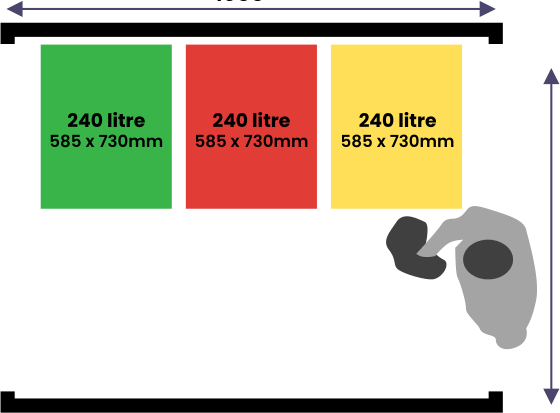

> [Picture on page 13: a picture, saved as a picture (images/waste-management-guideline-multiple-dwellings-and-page-13-9.gif, 150 dpi).]
> Words printed on the picture (title and legend, copied from the PDF):
> 240 litre
> 585 x 730mm
> 240 litre
> 585 x 730mm
> 240 litre
> 585 x 730mm

#### 1955

#### 1610

#### Storage for 1 set of 240 litre bins

#### 2390

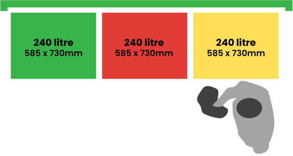

> [Picture on page 13: a picture, saved as a picture (images/waste-management-guideline-multiple-dwellings-and-page-13-14.gif, 150 dpi).]
> Words printed on the picture (title and legend, copied from the PDF):
> 240 litre
> 585 x 730mm
> 240 litre
> 585 x 730mm
> 240 litre
> 585 x 730mm

#### 1465

#### Storage for 1 set of 240 litre bins (sideways)

Figure 1: Waste storage area design for residential dwelling.

The waste storage area does not form part of the private open space requirements for the

development. All attached multi-dwelling housing must have access between their waste storage area and

the waste collection point that does not involve carting bins through the habitable part of the

dwelling. If bins are stored behind the dwelling the waste route must be around the side of the

building or through the garage/courtyard. Figures 1 and 2 provide representation of how waste

storage areas may be designed for attached dwellings to facilitate carting of bins to a kerbside

collection point.

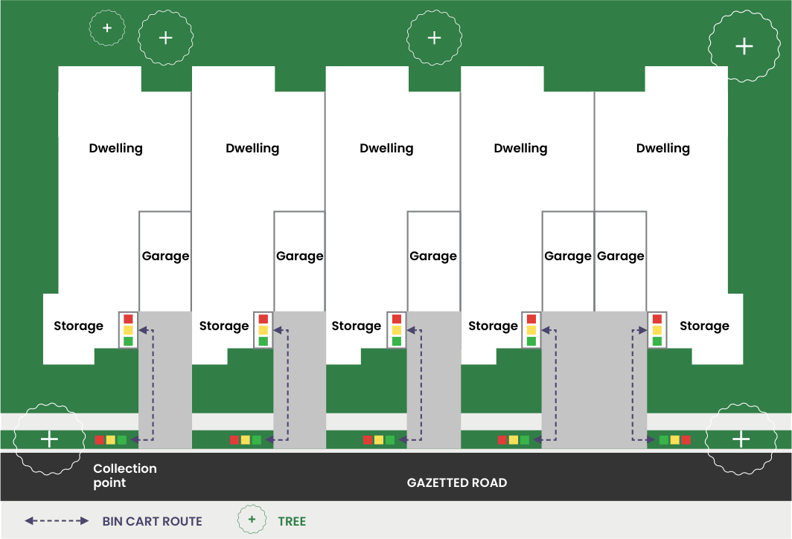

> [Picture on page 14: a map, saved as a picture (images/waste-management-guideline-multiple-dwellings-and-page-14-9.gif, 150 dpi); the street names and other small labels are on the picture.]
> Words printed on the picture (title and legend, copied from the PDF):
> BIN CART ROUTE

Figure 1: Waste storage area and kerbside waste collection point for multi-dwelling housing.

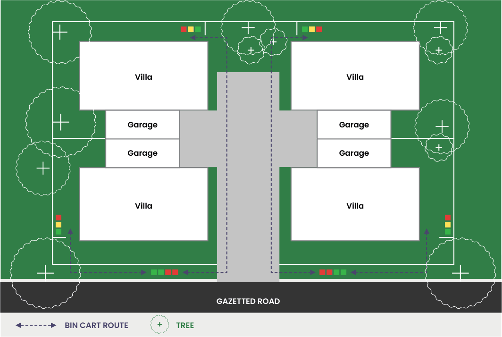

> [Picture on page 15: a picture, saved as a picture (images/waste-management-guideline-multiple-dwellings-and-page-15-1.gif, 150 dpi).]
> Words printed on the picture (title and legend, copied from the PDF):
> Villa
> Villa
> Garage
> Garage
> Garage
> Garage
> Villa
> Villa
> GAZETTED ROAD
> BIN CART ROUTE
> TREE

Figure 2: Waste storage area and kerbside waste collection point for multi-dwelling housing

### Waste storage area – communal

Larger multi-dwelling residential developments or complexes, including independent living

units, may benefit from or require communal waste storage areas to enable appropriate waste

management to all dwellings or buildings. Communal waste storage areas may be provided in the following circumstances

•	 Development where the

number of bins would not

fit on the street frontage

•	 Where site characteristics

make access to the street

difficult for individual

dwelling occupants

•	 Where status of the road

(eg heavy traffic) requires

on-site waste collection

access

The communal area should be capable of accommodating Council’s required number of

standard waste bins and for the development as a whole. In determining the layout and size of

the waste storage area consideration should be given be given to whether bins are required

to be rotated. If bins are to be rotated, additional area will be required along with aisle width to

manoeuvre bins.

Any communal waste storage area is to be:

•	 Located less then 30m

from all residential units

•	 Designed as a free-

standing structure with or

without a roof enclosure

•	 Unobstructed access to

the waste storage area is

required with a minimum

access width of 1.2m

•	 Floor is to be non-slip

•	 Located to ensure the

carting route to the waste

collection point is safe and

convenient with no steps

or steep gradients.

•	 Effectively integrated

into the built form of

the development and

landscape design

Figure 3 shows an example of how a manor house multi-residential building may utilise a

communal waste storage area and kerbside collection.

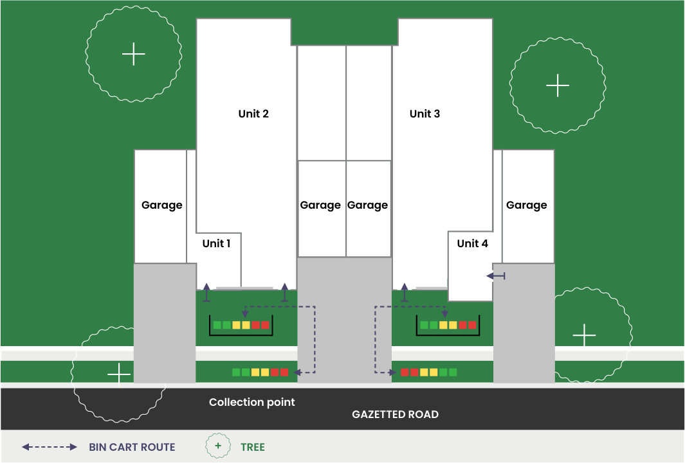

> [Picture on page 16: a picture, saved as a picture (images/waste-management-guideline-multiple-dwellings-and-page-16-23.gif, 150 dpi).]
> Words printed on the picture (title and legend, copied from the PDF):
> Unit 2
> Unit 3
> Garage
> Garage Garage
> Garage
> Unit 1
> Unit 4
> Collection point
> GAZETTED ROAD
> BIN CART ROUTE
> TREE

Figure 3: Communal waste storage area for a manor house.

### Seniors housing- Independent living units

Where communal waste storage areas are proposed for independent living units provided as

seniors housing the waste storage area is to be designed with the following requirements, in

addition to the aforementioned,

•	 Screened with an easily accessible

entrance and covered.

•	 Accessible by a continuous path of travel

from the entrance of each independent

living unit it is servicing

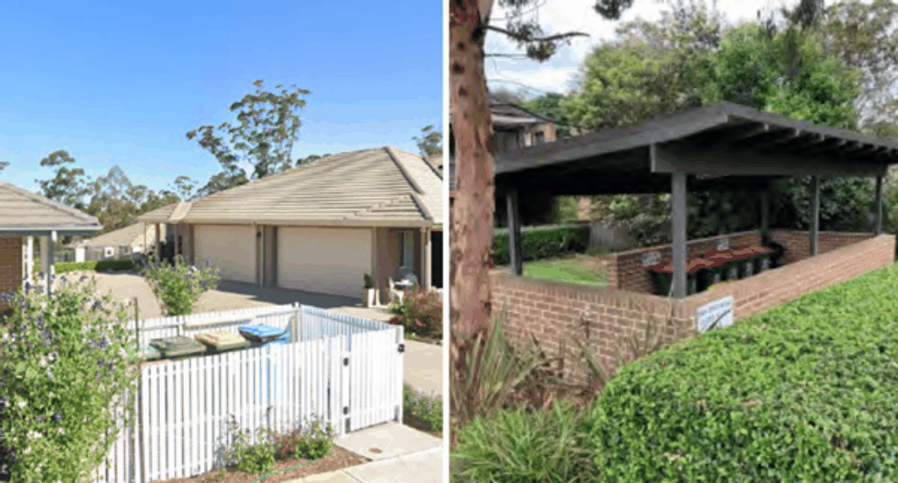

> [Picture on page 17: a picture, saved as a picture (images/waste-management-guideline-multiple-dwellings-and-page-17-10.gif, 150 dpi).]

Figure 4: Example of communal waste storage area as part of independent living unit complex

(Seniors Housing Design Guide, NSW Planning and Environment)

### WASTE

### COLLECTION

### POINT

### Waste collection point

Each multi-dwelling and serviced-managed residential accommodation development will

need to consider whether waste collection can be undertaken from the kerbside or on-site.

Consideration of the location of waste collection points will depend on

1\. Volume of waste from the development –

whether the number of bins is too great for

the street frontage for Council’s kerbside

collection

2\. Size of the proposed development –

bin cartage distances are too great for

occupants and require consolidated

storage on site.

### Kerbside waste collection by Council

Mobile garbage bins are to be placed on the kerb of the public road at the front of the property.

All kerbside bin presentation areas are to accommodate 2x 240l bins for each residential dwelling

with bins spaced 500mm apart. See Figure 5 below.

| NUMBER OF BINS | KERBSIDE WIDTH REQUIRED (WITHOUT DRIVEWAY/OBSTRUCTIONS) (MM) |
|---|---|
| 2 | 2670 |
| 4 | 4840 |
| 6 | 7010 |
| 8 | 9180 |
| 10 | 11350 |
| 12 | 13520 |

Figure 5: Kerbside width required for residential bin collection

All kerbside waste collection points must not be obstructed by driveway access or street trees.

Waste collection points are to be located with the following

•	 2000mm clearance from the base/trunk of

any street tree

•	 500mm clearance from any driveway or

accessway to the property.

Figure 6 provides a diagram of the clearance zone required for waste collection by Council’s

waste collection vehicle

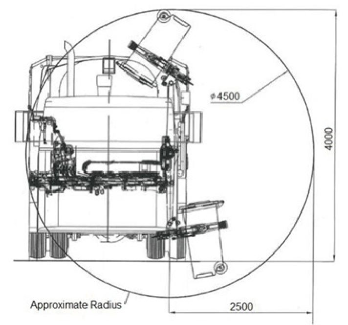

> [Picture on page 20: a picture, saved as a picture (images/waste-management-guideline-multiple-dwellings-and-page-20-1.gif, 150 dpi).]

Figure 6: Clearance required for collection arm of waste collection vehicle.

### On-site waste collection

Where on-site waste collection is deemed appropriate all internal access or private roads are to

be designed to accommodate the nominated waste collection vehicle. The internal access route

and turning circles are to be designed in accordance with Australian Standard AS 2890.2:2018 Off-

street Commercial Vehicle Facilities. The on-site waste collection point is to be designed with the following

•	 A minimum horizontal distance of 1m is to

be provided behind the waste collection

point to enable collection

•	 Enable the waste collection vehicle to enter

and exit the waste collection point in a

forward direction.

•	 Provided on level ground and separated

from other trafficable areas

•	 Pavement and gutters are to be designed

to carry the weight of the waste collection

vehicle.

Figure 7 shows an example of how a multi-dwelling residential development may provide an on-

site waste collection point for a communal waste and recycling storage area.

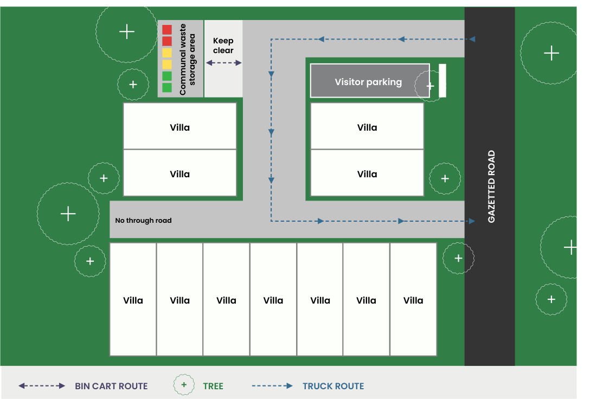

> [Picture on page 21: a map, saved as a picture (images/waste-management-guideline-multiple-dwellings-and-page-21-1.gif, 150 dpi); the street names and other small labels are on the picture.]
> Words printed on the picture (title and legend, copied from the PDF):
> No through road
> Villa Villa Villa Villa Villa Villa Villa
> BIN CART ROUTE

Figure 6: On-site waste collection point from a communal waste and recycling storage area.

### INTERNAL

### WASTE

### STORAGE

### Internal waste storage

The source of most waste in households is the kitchen area. The kitchen of each residential

dwelling is to have a waste cupboard of sufficient size to hold two day’s generation of waste and

recycling. The waste cupboard should have at least 3 separated containers for co-mingled recyclables

(glass, plastic containers, paper), food waste and residual waste. Figure 7 provides examples of a waste cupboard with separated containers

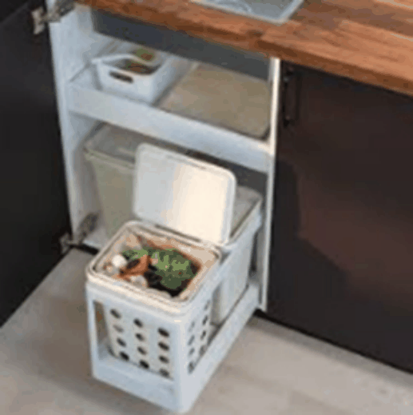

> [Picture on page 23: a picture, saved as a picture (images/waste-management-guideline-multiple-dwellings-and-page-23-8.gif, 150 dpi).]

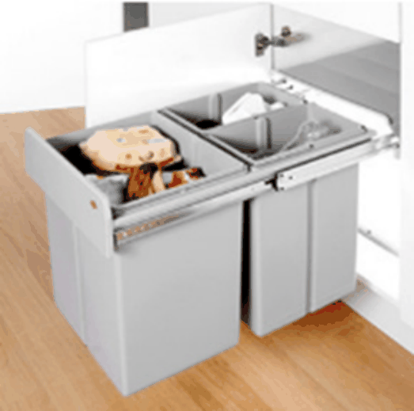

> [Picture on page 23: a picture, saved as a picture (images/waste-management-guideline-multiple-dwellings-and-page-23-9.gif, 150 dpi).]

Figure 7: Waste cupboard with separate containers for waste streams.

### USEFUL

### RESOURCES

### Useful resources

Department of Planning, Industry and Environment 2020, Low Rise Housing Diversity Design Guide,

https://www.planning.nsw.gov.au/policy-and-legislation/housing/low-rise-housing-diversity-

code/design-guides-for-low-rise-housing-diversity NSW EPA 2019, Better practice guide for resource recovery in residential developments,

https://www.epa.nsw.gov.au/your-environment/waste/local-council-operations/resources-for-

local-councils NSW Planning and Environment 2023, Seniors Housing Design Guide,

https://www.planning.nsw.gov.au/policy-and-legislation/housing/housing-sepp/seniors-housing

62-78 Vincent Street, Cessnock NSW 2325  |  PO Box 152 Cessnock NSW 2325

02 4993 4100  |  council@cessnock.nsw.gov.au  |  www.cessnock.nsw.gov.au
