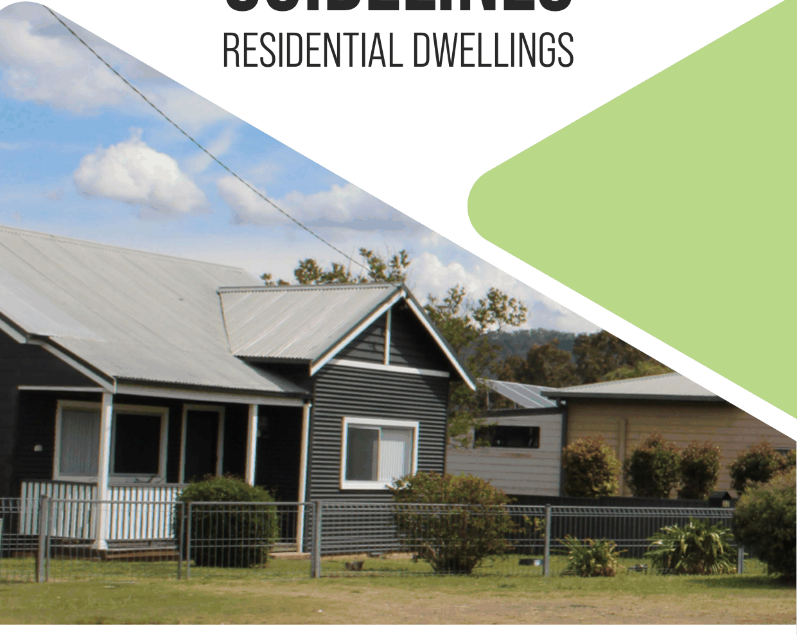
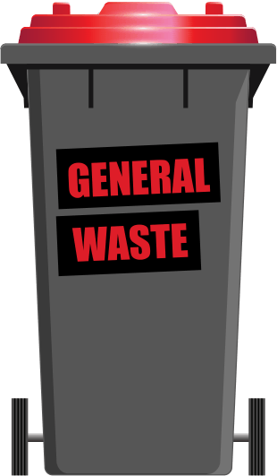
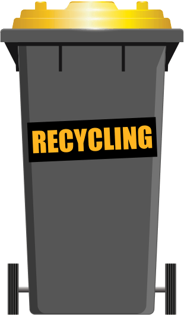
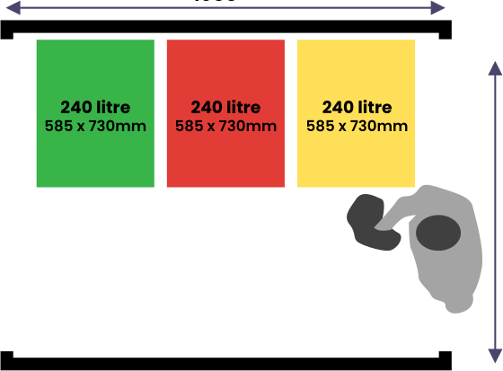
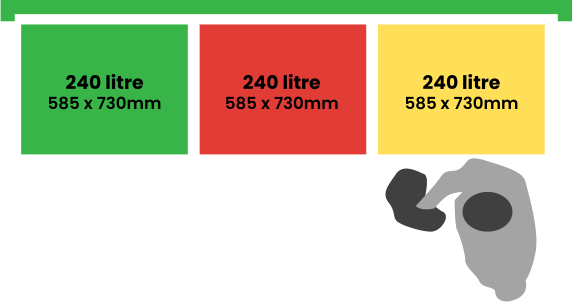
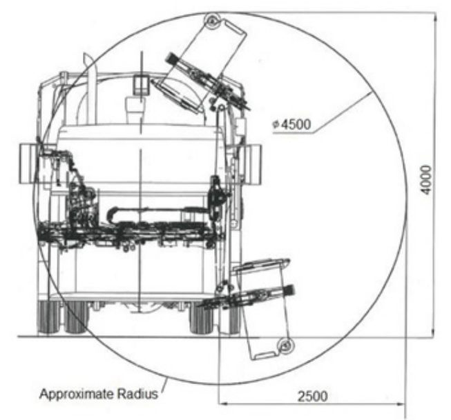
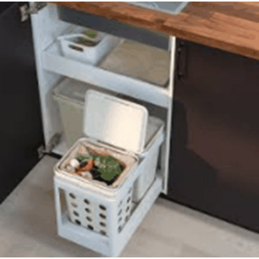
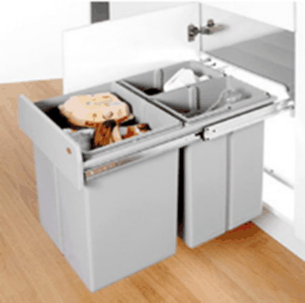

# Cessnock Development Control Plan 2010 - Waste Management Guideline - Residential Dwellings

Source PDF: [Waste-Management-Guideline-Residential-Dwellings.pdf](https://planfortomorrow.sharepoint.com/sites/Planfortomorrow/Shared%20Documents/00%20NSW-Planning-Resources/dcp/cessnock-development-control-plan-2010/supporting-guides/waste-management-guideline-residential-dwellings/Waste-Management-Guideline-Residential-Dwellings.pdf)

### Cessnock LGA

### 2024

### WASTE MANAGEMENT

> [Picture on page 1: a picture, saved as a picture (images/waste-management-guideline-residential-dwellings-page-1-4.gif, 150 dpi).]

### GUIDELINES

### RESIDENTIAL DWELLINGS

### STRATEGIC PLANNING | WASTE & ENVIRONMENT

> [Picture on page 2: a picture, saved as a picture (images/waste-management-guideline-residential-dwellings-page-2-1.gif, 150 dpi).]

Journey Through Time, created by local school students and artist Steven Campbell.

#### Acknowledgement of Country

Cessnock City Council acknowledges that within its local government area boundaries are the traditional

lands of the Wonnarua people, the Awabakal people and the Darkinjung people. We acknowledge these

Aboriginal peoples as the traditional custodians of the land on which our offices and operations are located,

and pay our respects to Elders past and present. We also acknowledge all other Aboriginal and Torres Strait

Islander people who now live within the Cessnock Local Government Area.

### Contents

| 1. | Introduction Residential waste collection service Residential waste generation | 4 5 6 |
|---|---|---|
| 2 | Waste storage & collection Waste storage area Waste collection point Access from waste storage area to collection point Internal waste storage | 7 8 9 10 10 |

### INTRODUCTION

### Introduction

Residential dwellings require a waste management system that is responsive to the individual

site and can be adequately serviced by Council’s waste collection service. This guideline

will assist with developing a waste management system for the following residential

accommodation types:

a) Attached b) Dwelling c) Dual

d) Secondary e) Semi-detached

dwellings

houses

occupancy dwellings

dwellings

### Residential waste collection service

Residential dwellings are serviced by Council’s kerbside collection service. Residential dwellings

are to be provided with recycling, organics and residual waste bins. This will require residents to

wheel mobile garbage bins to a waste collection point for kerbside collection.

Standard bin allocations for residential development comprises the following:

•	 A single 240L mobile

garbage bin for

organics/food waste

> [Picture on page 5: a picture, saved as a picture (images/waste-management-guideline-residential-dwellings-page-5-20.gif, 150 dpi).]

•	 A single 240L mobile

garbage bin for

residual waste

> [Picture on page 5: a picture, saved as a picture (images/waste-management-guideline-residential-dwellings-page-5-24.gif, 150 dpi).]

•	 A single 240L mobile

garbage bin for recycling

waste

> [Picture on page 5: a picture, saved as a picture (images/waste-management-guideline-residential-dwellings-page-5-28.gif, 150 dpi).]

### GENERAL

### GARDEN

### WASTE

### ORGANICS

### RECYCLING

Each week comprises the collection of 2 x 240L bins for each residential dwelling. Standard bin

sizes are provided below to enable the design for a kerbside waste collection point.

| BIN CAPACITY (L) | HEIGHT (MM) | DEPTH (MM) | WIDTH (MM) |
|---|---|---|---|
| 240L | 1060 | 730 | 585 |

Kerbside waste collection points are to accommodate 2x 240l bins with a minimum dimension of

2670mm wide by 1000mm deep. This dimension includes a500mm gap between each bin and

500mm clearance each side of the bins. The kerbside waste collection point dimension is required

for each residential dwelling.

Waste collection points are to be located with the following:

•	 2000mm clearance from the base/trunk of

any street tree

•	 500mm clearance from any driveway or

accessway to the property.

### Residential waste generation

Average households in residential dwellings generate estimated volumes of waste outlined in

Table 1 below.

Table 1: Waste generation from single residential dwelling with outdoor space/garden.

| WASTE TYPE | VOLUME (L/WEEK) | VOLUME (L/FORTNIGHT) |
|---|---|---|
| Recycling | 120-180 | 240-360 |
| Green waste (Garden and food) | 240 | 480 |
| Residual | 120 | 240 |

Note: Waste generation rates are dependent on the number of residents within the dwelling

### WASTE STORAGE

### & COLLECTION

### Waste storage area

Each residential dwelling is to be provided with a waste and recycling storage area capable of storing

3 standard mobile waste bins. Standard bin dimensions are provided in Table 1. Waste storage areas are to be identified on a Site Plan and located

•	 Preferably at the rear of the residential

dwelling or a screened area to the side of

the building

•	 With appropriate width to ensure bins can

be moved to the kerbside waste collection

point.

Figure 1 below provides an example of the dimensions for a waste storage area

> [Picture on page 8: a picture, saved as a picture (images/waste-management-guideline-residential-dwellings-page-8-12.gif, 150 dpi).]
> Words printed on the picture (title and legend, copied from the PDF):
> 240 litre
> 585 x 730mm
> 240 litre
> 585 x 730mm
> 240 litre
> 585 x 730mm

#### 1955

#### 1610

#### Storage for 1 set of 240 litre bins

#### 2390

> [Picture on page 8: a picture, saved as a picture (images/waste-management-guideline-residential-dwellings-page-8-17.gif, 150 dpi).]
> Words printed on the picture (title and legend, copied from the PDF):
> 240 litre
> 585 x 730mm
> 240 litre
> 585 x 730mm
> 240 litre
> 585 x 730mm

#### 1465

#### Storage for 1 set of 240 litre bins (sideways)

Figure 1: Waste storage area design for residential dwelling.

### Waste collection point

Mobile garbage bins are to be placed on the kerb of the public road at the front of the property. All

kerbside bin presentation areas are to accommodate 2x 240l bins for each residential dwelling with

bins spaced 500mm apart. See Figure 2 below:

#### DRIVEWAY

| NUMBER OF BINS | KERBSIDE WIDTH REQUIRED (WITHOUT DRIVEWAY/OBSTRUCTIONS) (MM) |
|---|---|
| 2 | 2670 |
| 4 | 4840 |
| 6 | 7010 |

Figure 2: Kerbside width required for residential bin collection

> [Picture on page 9: a picture, saved as a picture (images/waste-management-guideline-residential-dwellings-page-9-8.gif, 150 dpi).]

All kerbside waste collection points

must not be obstructed by driveway

access or street trees. Waste

collection points are to be located

with the following

•	 2000mm clearance from the

base/trunk of any street tree

•	 500mm clearance from any

driveway or accessway to the

property.

Figure 3: Clearance required for collection arm of waste collection vehicle.

### Access from waste storage area to collection point

Access from the waste storage area to the collection point is to be unobstructed. This includes

•	 Gates or accessways are

to be appropriately sized

to allow a bin to pass.

•	 The bin carting route

should not pass through

habitable areas of the

residential dwelling

•	 The bin carting route

should not include steps

or pass over doorway

thresholds

### Internal waste storage

The source of most waste in the household is in the kitchen. Each kitchen of a residential dwelling is to

have a waste cupboard of sufficient size to hold two day’s waste in separated bins or caddies. The waste cupboard should have at least 3 separated containers for co-mingled recyclables (glass,

plastic containers, paper), food waste and residual waste. Figure 4 provides examples of a waste

> [Picture on page 10: a picture, saved as a picture (images/waste-management-guideline-residential-dwellings-page-10-19.gif, 150 dpi).]

cupboard with separated containers

> [Picture on page 10: a picture, saved as a picture (images/waste-management-guideline-residential-dwellings-page-10-21.gif, 150 dpi).]

Figure 4: Waste cupboard with separate containers for waste streams.

62-78 Vincent Street, Cessnock NSW 2325  |  PO Box 152 Cessnock NSW 2325

02 4993 4100  |  council@cessnock.nsw.gov.au  |  www.cessnock.nsw.gov.au
