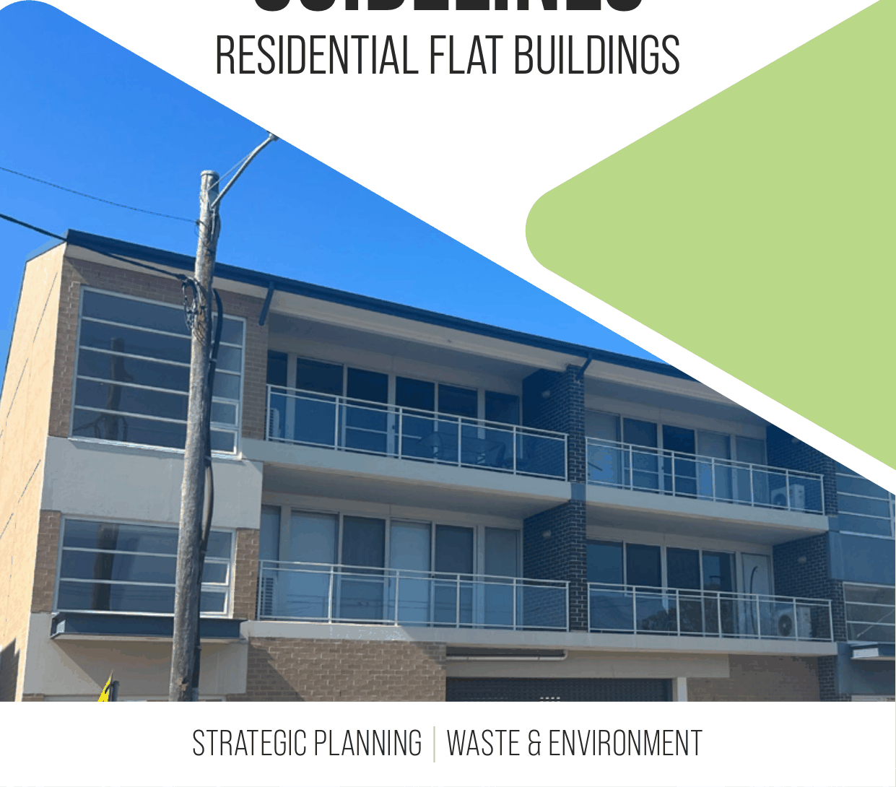
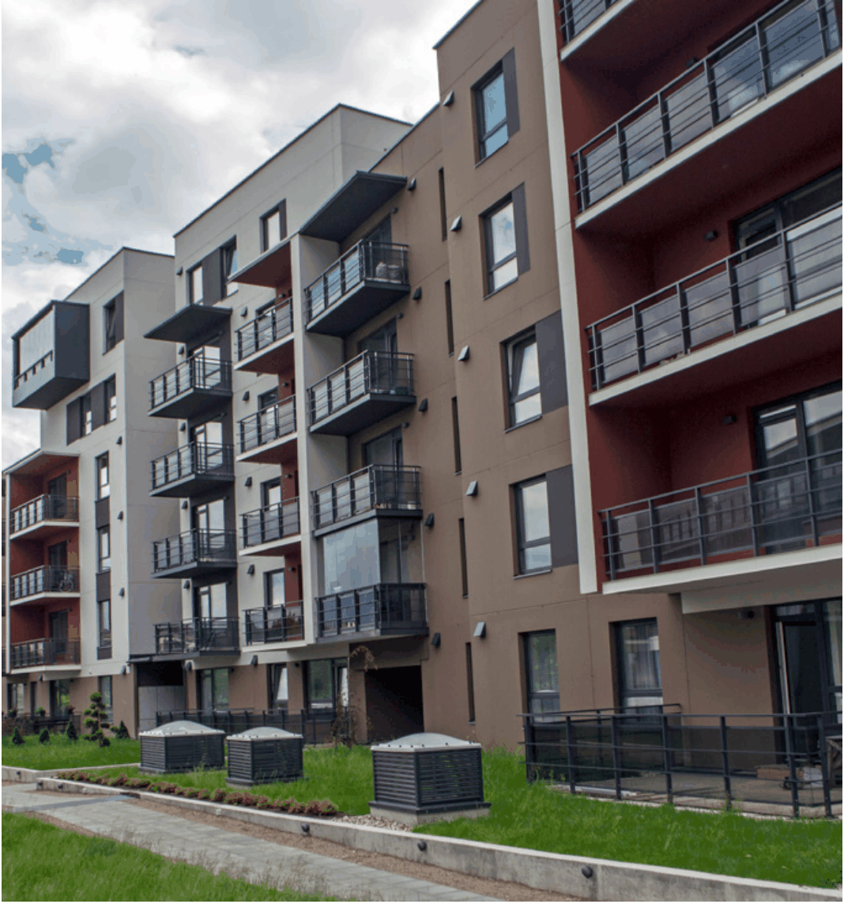
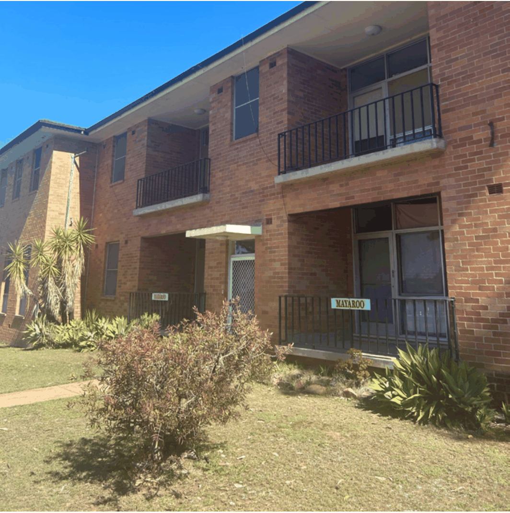
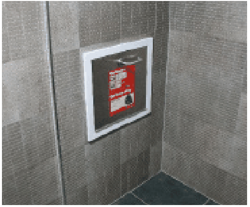
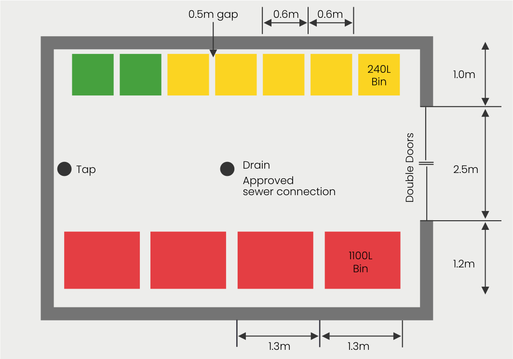
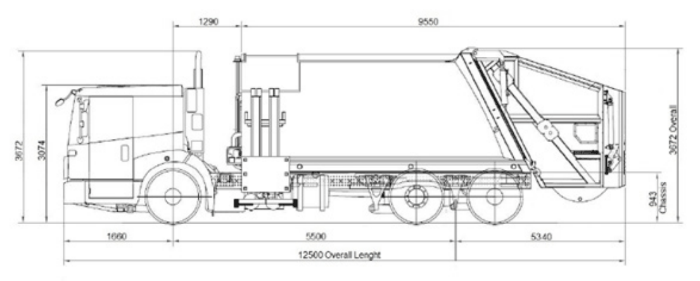

# Cessnock Development Control Plan 2010 - Waste Management Guideline - Residential Flat Buildings

Source PDF: [Waste-Management-Guideline-Residential-Flat-Buildings_1.pdf](Waste-Management-Guideline-Residential-Flat-Buildings_1.pdf)

### Cessnock LGA

### 2024

### WASTE MANAGEMENT

> [Picture on page 1: a picture, saved as a picture (images/waste-management-guideline-residential-flat-buildi-page-1-4.gif, 150 dpi).]

### GUIDELINES

### RESIDENTIAL FLAT BUILDINGS

### STRATEGIC PLANNING | WASTE & ENVIRONMENT

> [Picture on page 2: a picture, saved as a picture (images/waste-management-guideline-residential-flat-buildi-page-2-1.gif, 150 dpi).]

Journey Through Time, created by local school students and artist Steven Campbell.

#### Acknowledgement of Country

Cessnock City Council acknowledges that within its local government area boundaries are the traditional

lands of the Wonnarua people, the Awabakal people and the Darkinjung people. We acknowledge these

Aboriginal peoples as the traditional custodians of the land on which our offices and operations are located,

and pay our respects to Elders past and present. We also acknowledge all other Aboriginal and Torres Strait

Islander people who now live within the Cessnock Local Government Area.

### Contents

| 1. | Introduction | 4 |
|---|---|---|
| 2. | Waste management plan Waste collection service Residential waste collection service by Council Waste collection service by private contractor Waste Generation | 6 7 8 8 9 |
| 3. | Waste transfer & collection infrastructure Waste chutes Waste chute collection room Waste storage area Bulky waste storage area | 10 11 12 13 14 |
| 4. | Waste collection Waste collection vehicle Waste collection vehicle access Waste collection point | 15 16 16 16 |
| 5. | Useful resources | 17 |
| 6. | Appendix A | 17 |

### INTRODUCTION

### Introduction

Residential flat buildings comprise three or more residential dwellings/units within a multi-storey

building on the one Lot. The complexities of the number of occupants within the building and

multiple residential levels requires a responsive approach to building design to facilitate an

efficient and sustainable waste management system. This guideline will assist with developing a waste management system within residential flat

buildings and includes design guidance to facilitate waste transfer and collection within the

building.

> [Picture on page 5: a picture, saved as a picture (images/waste-management-guideline-residential-flat-buildi-page-5-9.gif, 150 dpi).]

### WASTE

### MANAGEMENT

### PLAN

### Waste Management Plan

All proposed residential flat buildings will be

required to submit a Waste Management

Plan (WMP) with a development application.

If the cost of the proposed development

exceeds $5M in value the WMP is required to

be prepared by a suitably qualified waste

management consultant/practitioner.

The WMP is to be prepared with reference to

this guideline and other relevant standards or

documentation.

### Waste collection service

All residential flat building developments are

required to provide on-site waste collection.

Each residential flat building will be required

to have a nominated on-site waste collection

point and loading space. Design will be

based on the equipment used by the waste

collection service for the site, either Council or

a private waste collection service provider.

> [Picture on page 7: a picture, saved as a picture (images/waste-management-guideline-residential-flat-buildi-page-7-21.gif, 150 dpi).]

### Residential waste collection service by Council

Each residential rated property is charged a domestic waste management charge under the

Local Government Act 1993. Council waste collection vehicles are limited to the collection of 240L

mobile garbage bins or 360L bins for recyclables.

Standard bin sizes are provided below to enable design for waste storage areas and waste

collection points.

Table 1: 240L and 360L bin dimensions

| BIN CAPACITY (L) | HEIGHT (MM) | DEPTH (MM) | WIDTH (MM) |
|---|---|---|---|
| 240L | 1060 | 730 | 585 |
| 360L | 1100 | 770 | 680 |

Specifications for Council’s waste collection vehicle (12.5m heavy rigid side loading vehicle) are

provided in Appendix A and are required to be considered if the proponent elects for a Council

waste collection service for a proposed residential flat building.

An agreement with Council providing authority to enter the site for the purpose of waste services

will be required. This agreement will include an indemnity agreement against any future claims for

damage or loss.

### Waste collection service by private contractor

Residential flat buildings require access to recycling and residual waste bins and sufficient bin

storage is to be provided to accommodate the projected volume of waste from the building.

Private waste services may provide a variety of waste bin sizes. Mobile waste bins can range in

volume and size and are typically collected by ‘rear-lift ‘waste collection vehicles. Table 1 provides

the dimensions of mobile bins to enable sizing of the waste storage area for the proposed

residential flat building.

Table 1: Mobile waste bin dimensions

| BIN CAPACITY (L) | HEIGHT (MM) | DEPTH (MM) | WIDTH (MM) | FOOTPRINT AREA (M2) |
|---|---|---|---|---|
| 80 | 870 | 530 | 450 | 0.24 |
| 120 | 940 | 560 | 485 | 0.27 |
| 140 | 1065 | 540 | 500 | 0.27 |
| 240 | 1080 | 735 | 580 | 0.43 |

| BIN CAPACITY (L) | HEIGHT (MM) | DEPTH (MM) | WIDTH (MM) | FOOTPRINT AREA (M2) |
|---|---|---|---|---|
| 360 | 1100 | 885 | 600 | 0.53 |
| 660 | 1250 | 850 | 1370 | 1.16 |
| 770 | 1425 | 1100 | 1370 | 1.5 |
| 1100 | 1470 | 1245 | 1370 | 1.7 |
| 1300 | 1408 | 1250 | 1770 | 1.21 |
| 1700 | 1470 | 1250 | 1770 | 1.27 |

Source: Appendix B Better Practice Guidelines for Waste Management and Recycling in

Commercial and Industrial Facilities, NSW EPA, 2012 and Appendix G Better practice guide for

resource recovery in residential development, NSW EPA, 2019.

### Waste Generation

Average households in residential flat buildings generate estimated volumes of waste outlined in

Table 1 below. The rates are a general guide based on the size of the residential dwelling/unit, but may

be used to calculate overall waste generation for bin infrastructure sizing.

Table 1: Waste generation from residential dwellings in residential flat buildings

| RESIDENTIAL DWELLING SIZE | RECYCLING (L/WEEK) | GREEN WASTE (GARDEN AND FOOD) (L/WEEK) | RESIDUAL WASTE (L/WEEK) |
|---|---|---|---|
| 1 bedroom or studio | 80 | 25 | 80 |
| 2 bedroom apartment | 100 | 25 | 100 |
| 3 bedroom apartment or greater | 120 | 50 | 120 |

Note: Waste generation rates are dependent on the number of residents within the dwelling

Source: Better practice guide for resource recovery in residential developments, NSW EPA, 2019

### WASTE TRANSFER

### & COLLECTION

### INFRASTRUCTURE

### Waste chutes

Residential flat buildings are required to install

dual chute systems for recyclable and residual

waste streams. Access to the chute system is

required to be provided on each residential

level of the building. Each residential level

should also include a room or waste cupboard

next to the chute access for the storage of

a 240L recycling bin for the placement of

recyclable items that are irregular shape or

cannot fit in the chute.

> [Picture on page 11: a picture, saved as a picture (images/waste-management-guideline-residential-flat-buildi-page-11-12.gif, 150 dpi).]

Figure 1: Example of waste chute inlet in a

residential flat building

Source: Better practice guide for resource

recovery in residential developments, NSW

EPA, 2019

Waste chute design is to include:

•	 Chutes must not open onto any habitable

or public space and doors must have an

effective self-sealing system

•	 Chutes are to be completely enclosed in a

fire rated shaft constructed of an approved

material and fitted with sprinklers and must

comply with the Building Code of Australia

(BCA)

•	 Chutes, service openings and inlets are to

be constructed of smooth, impervious and

non-corrosive material that is capable of

being cleaned.

•	 Inlets must be accessible to anyone with a

disability and comply with AS1428 Design for

access and mobility

•	 Clear signage is required on how to use

the system and which materials are

acceptable in the chutes

•	 Chute discharge outlet must have

restricted access to prevent damage to

equipment or injuries

•	 During collection empty bins must be

placed at the base of the chute to allow

residents access to the system at all times.

### Waste chute collection room

Each chute will deposit waste materials to a collection bin or container in a dedicated room within the

residential flat building. The waste chute collection room will incorporate the following:

•	 A linear or circular carousal system under

each chute

•	 Minimum 0.9m clearance around the

linear or circular carousal system for bin

manoeuvrability and system maintenance.

•	 1.8m unobstructed clearance zone between the

system and the access entrance to the room

•	 Floor space to accommodate two

additional service bins for each chute

•	 The room is to be fully enclosed, walled and

not permit through access to other on-site

infrastructure

•	 Compliant with the BCA with the floor

waterproofed, non-slip and sealed.

•	 The floor is to be graded to a central

drainage point and connected to the sewer.

•	 Provision of an adequate water supply

through a centralized mixing valve and

hose cock.

•	 Provision of adequate lighting and

ventilation in accordance with the BCA.

The waste chute collection room will need to accommodate the permanent storage of 2 service

bins per chute to allow residents access to collection of all waste streams.

### Waste storage area

The residential flat building is to incorporate sufficient space for a waste storage area to

accommodate the nominated number and sizes of bins required for the volume of waste material

generated between collection periods. The waste storage area may also be designed to be utilised in

connection with the waste chute collection room.

The waste storage area is to incorporate the following:

•	 Sufficient floor space for the required

number of bins with a 0.2m space between

bins to allow maneuvering.

•	 Unobstructed 1.8m clearance zone between

the stored bins and the waste storage area

entrance to permit access and movement.

•	 Located in close proximity to the waste

collection point.

•	 Fully enclosed and walled with through

access to other on-site infrastructure not

permitted.

•	 Compliant with the Building Code of

Australia (BCA) with the floor waterproofed,

non-slip and sealed.

•	 The floor is to be graded to a central

drainage point and connected to the sewer.

•	 Provision of an adequate water supply

through a centralized mixing valve and

hose cock.

•	 Provision of adequate lighting and

ventilation in accordance with the BA.

•	 Flexible design of the waste storage area

should also be considered including

•	 Additional floor space for extra bins or

containers to capture additional separated

waste streams

•	 Minimising potential obstacles within the

waste storage area that would limit bin size

•	 Increasing width of access or doorways to

allow for potential change in bin size

Figure 2 provides an example of a waste storage room with various sized bins

> [Picture on page 14: a map, saved as a picture (images/waste-management-guideline-residential-flat-buildi-page-14-2.gif, 150 dpi); the street names and other small labels are on the picture.]
> Words printed on the picture (title and legend, copied from the PDF):
> 0.5m gap 0.6m 0.6m

Figure 2: Example of waste storage area with a number of different sized bins.

Source: Better practice guide for resource recovery in residential development, NSW EPA, 2019

### Bulky waste storage area

The residential flat building is to provide a storage area for bulky waste items that are not collected

within the normal waste service including mattresses and furniture. The bulky waste storage area

must be allocated as 0.5m2 for each dwelling, and may be included as individual storage areas/

cages or in a communal bulk waste storage location.

If a communal waste storage area is provided within the residential flat building the area is to

incorporate the following:

•	 Compliant with the Building Code of

Australia (BCA) with the floor waterproofed,

non-slip and sealed.

•	 The area is to be readily accessible to all

residents with a suitable dual door access

with minimum width of 1.5m to allow easy

movement of large items.

•	 Provision of adequate lighting and

ventilation in accordance with the BCA.

•	 Located within close proximity to the waste

collection point

•	 Located at ground level or in a basement

### WASTE

### COLLECTION

### Waste collection vehicle

The selection of waste collection vehicle will

be dependent on the type of bin infrastructure

utilised for the proposed development. If the

applicant elects to use the Council waste

collection service bins will be collected by

Council’s 12.5m heavy rigid side loading vehicle.

Specifications for this vehicle are provided in

Appendix A.

If the applicant elects a private waste collection

service for the building waste collection vehicle

specifications are outlined in Appendix C of the

NSW EPA’s ‘Better Practice Guidelines for Waste

Management and Recycling in Commercial

and Industrial Facilities’ and Appendix B of the

NSW EPA’s ‘Better practice guide for resource

recovery in residential developments’.

These waste collection vehicle specifications

are to be used to determine access to the

waste collection point within the building.

### Waste collection vehicle access

The waste collection vehicle must be able

to safely and efficiently access the site and

nominated on-site waste collection point.

Access and egress to and from the building

to public roads is to be supported by swept

path models for the largest waste collection

vehicle that could service the building. Swept

path models for waste collection vehicles are

outlined in Appendix D of the NSW EPA’s ‘Better

Practice Guidelines for Waste Management

and Recycling in Commercial and Industrial

Facilities’ and AS 2890.2 Parking Facilities: Off-

Street Commercial Vehicle Facilities.  Access

and egress from the building by the waste

collection vehicles must be in a forward

direction with a 0.5m unobstructed clearance

either side of the vehicle.

The access, route of travel and waste collection

point design is to be supported by a structural

engineers report as part of the submitted Waste

Management Plan. The report is to confirm all

infrastructure, including pavement strength,

can support the waste collection vehicles ‘gross

weight’.

The route of travel to the waste collection point

must include clearance for heavy rigid waste

collection vehicle and meet the requirements

of AS2890.2 Parking Facilities: Off-Street

Commercial Vehicle Facilities. The route of travel

is to be adequately paved and of sufficient

strength to support the waste collection vehicle.

The grades of entry and exit ramps must not

exceed the capabilities of the waste collection

vehicle in accordance with AS2890.2 Parking

Facilities: Off-Street Commercial Vehicle

Facilities.

### Waste collection point

The nominated on-site waste collection point

must have sufficient area for maneuvering

of the waste collection vehicle with minimal

need for reversing. The waste collection point

is to be provided on the Site or Floor Plans and

include swept path models for the nominated

waste collection vehicle as outlined in Appendix

D of the NSW EPA’s ‘Better Practice Guidelines

for Waste Management and Recycling in

Commercial and Industrial Facilities’.

For rear loaded waste collection vehicles an

unobstructed 2m loading zone is required

behind the vehicle for loading of bins. A 0.5m

side clearance is also required on either side of

the vehicle.

### USEFUL

### RESOURCES

### Useful resources

NSW Department of Planning and Environment 2015, Apartment Design Guide,

Apartment Design Guide | Planning (nsw.gov.au) NSW EPA 2012, Better Practice Guidelines for Waste Management and Recycling in Commercial

and Industrial Facilities,

Resources for local council waste and recycling operations (nsw.gov.au) NSW EPA 2019, Better practice guide for resource recovery in residential developments,

Resources for local council waste and recycling operations (nsw.gov.au)

### APPENDIX A

### Council Waste Collection Vehicle Specification

The following specification is provided from AS 2890.2 Parking Facilities: Off-Street Commercial

Vehicle Facilities for a 12.5m heavy rigid side loading waste collection vehicle.

| VEHICLE SPECIFICATION | DIMENSIONS |
|---|---|
| Overall length (m) | 12.5 |
| Design Width (m) | 2.8 |
| Design Height (m) | 3.7 |
| Swept Circle (m) | 22.5 |
| Clearance (travel height) (m) | 4.5 |
| Roadway/ramp grade (max) | 1:6.5 (15.4%) |
| Rate of change of grade (max) | 1:16 (6.25%) in 7m of travel |
| Gross weight (max tonnes) | 28 |
| Capacity (m3) | 24 |
| Front chassis clearance | 13o |
| Rear chassis clearance | 16o |

> [Picture on page 20: a picture, saved as a picture (images/waste-management-guideline-residential-flat-buildi-page-20-5.gif, 150 dpi).]

62-78 Vincent Street, Cessnock NSW 2325  |  PO Box 152 Cessnock NSW 2325

02 4993 4100  |  council@cessnock.nsw.gov.au  |  www.cessnock.nsw.gov.au
