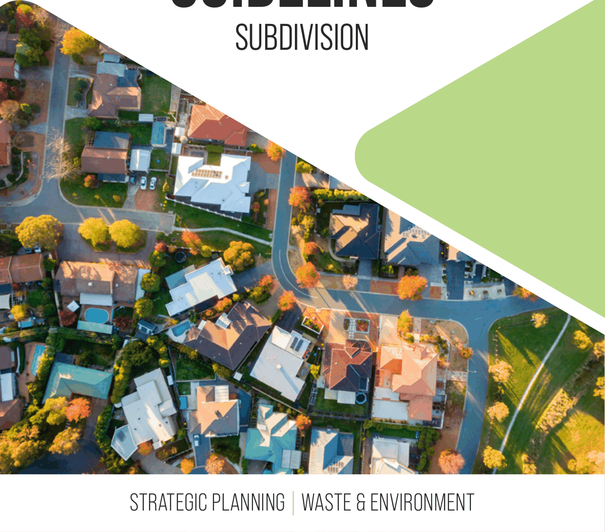
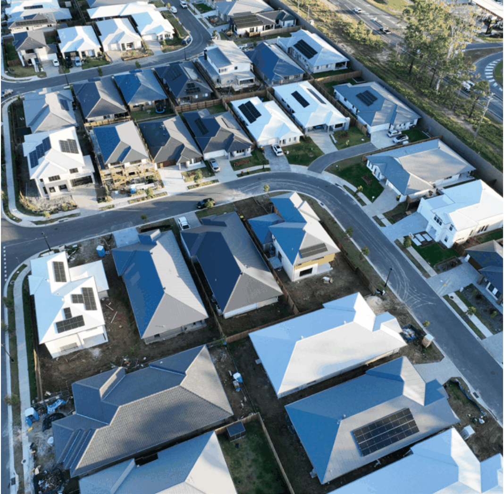
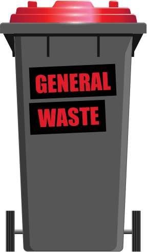
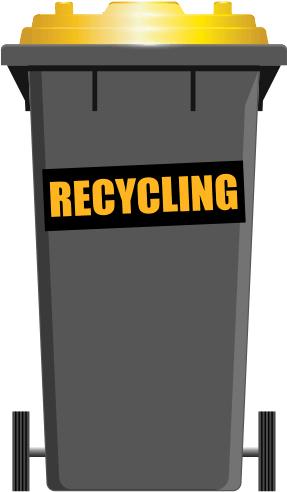
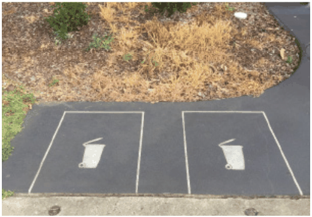
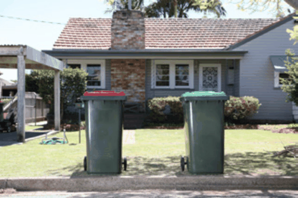
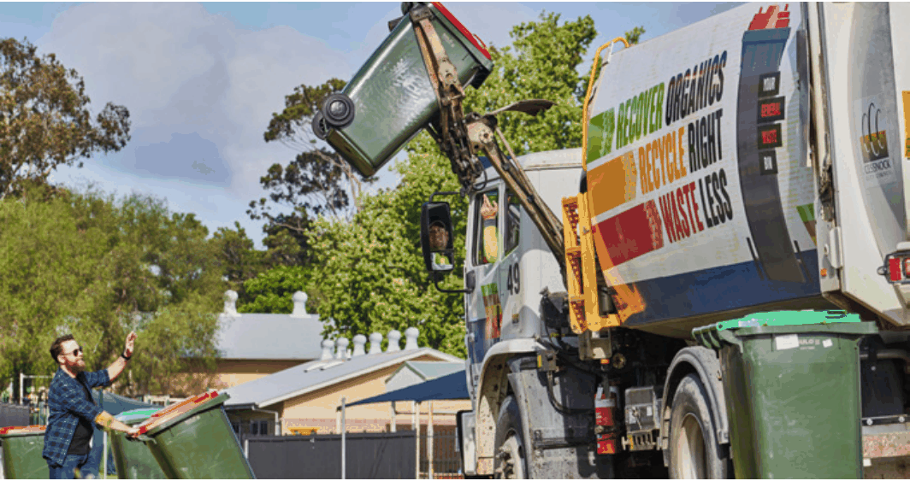
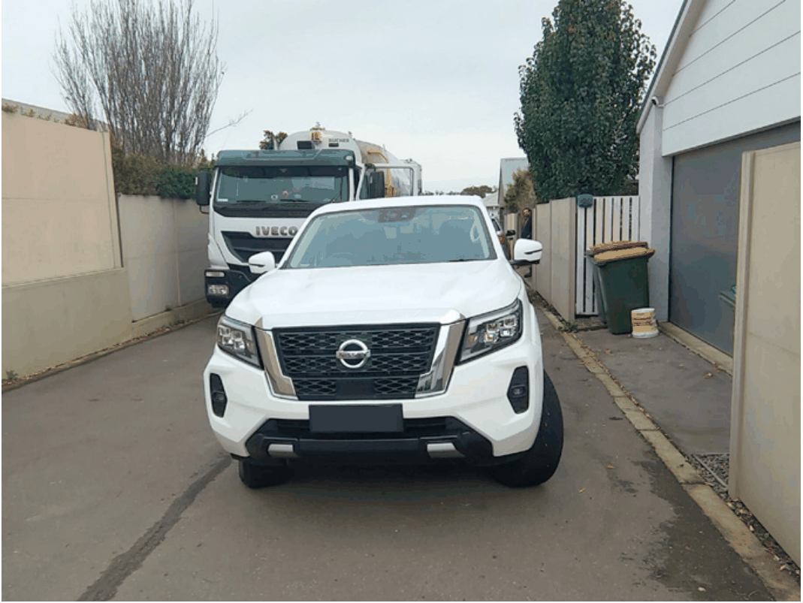
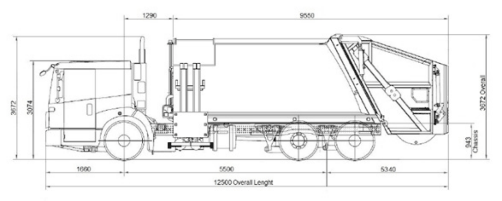
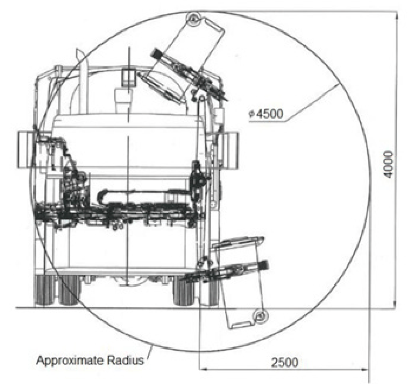

# Cessnock Development Control Plan 2010 - Waste Management Guideline - Subdivision

Source PDF: [Waste-Management-Guideline-Subdivision.pdf](https://planfortomorrow.sharepoint.com/sites/Planfortomorrow/Shared%20Documents/00%20NSW-Planning-Resources/dcp/cessnock-development-control-plan-2010/supporting-guides/waste-management-guideline-subdivision/Waste-Management-Guideline-Subdivision.pdf)

### Cessnock LGA

### 2024

### WASTE MANAGEMENT

> [Picture on page 1: a picture, saved as a picture (images/waste-management-guideline-subdivision-page-1-4.gif, 150 dpi).]

### GUIDELINES

### SUBDIVISION

### STRATEGIC PLANNING | WASTE & ENVIRONMENT

> [Picture on page 2: a picture, saved as a picture (images/waste-management-guideline-subdivision-page-2-1.gif, 150 dpi).]

Journey Through Time, created by local school students and artist Steven Campbell.

#### Acknowledgement of Country

Cessnock City Council acknowledges that within its local government area boundaries are the traditional

lands of the Wonnarua people, the Awabakal people and the Darkinjung people. We acknowledge these

Aboriginal peoples as the traditional custodians of the land on which our offices and operations are located,

and pay our respects to Elders past and present. We also acknowledge all other Aboriginal and Torres Strait

Islander people who now live within the Cessnock Local Government Area.

### Contents

| 1. | Introduction | 4 |
|---|---|---|
| 2 | Residential subdivision Residential waste collection by Council Kerbside waste collection points Designing residential subdivisions for waste collection Waste collection vehicle access Waste collection vehicle turning areas Laneway waste collection service | 6 7 8 8 9 9 10 |
| 3 | Appendix A. Council Waste Collection Vehicle Specification | 12 |
| 5 | Appendix B. |  |
|  | Waste Collection Vehicle Clearance Zone | 14 |

### INTRODUCTION

### Introduction

The efficient collection of waste from new or redesigned urban areas requires appropriate

planning to ensure future development is not left with inadequate waste storage or waste

collection options. Subdivision layouts should be designed to optimise waste management

systems within the proposed development with consideration of waste collection servicing,

including efficient waste collection routes and access to waste collection points for each

allotment. This guideline has been developed to assist with designing a waste management system for

subdivisions and to meet requirements for waste management under Council’s Development

Control Plan (DCP). Guidance is also provided regarding the completion of a Waste Collection

Route Design Plan for subdivisions.

> [Picture on page 5: a picture, saved as a picture (images/waste-management-guideline-subdivision-page-5-12.gif, 150 dpi).]

### RESIDENTIAL

### SUBDIVISION

### Residential waste collection by Council

Waste collection from residential properties is undertaken by Council under the Local Government Act

1993\. Waste collection is undertaken at kerbside and requires residents to wheel mobile garbage bins

to a kerbside waste collection point. Standard bin allocations for residential development comprises the following

•	 A single 240L mobile

garbage bin for residual

waste

> [Picture on page 7: a picture, saved as a picture (images/waste-management-guideline-subdivision-page-7-9.gif, 150 dpi).]

•	 A single 240L mobile

garbage bin for organics/

food waste

> [Picture on page 7: a picture, saved as a picture (images/waste-management-guideline-subdivision-page-7-13.gif, 150 dpi).]

•	 A single 240L mobile

garbage bin for recycling

waste

> [Picture on page 7: a picture, saved as a picture (images/waste-management-guideline-subdivision-page-7-17.gif, 150 dpi).]

### GENERAL

### GARDEN

### WASTE

### ORGANICS

### RECYCLING

Figure 1: Cessnock City Council current bin service

### Kerbside waste collection points

All kerbside waste collection points are to accommodate 2 x 240L bins with 50cm gap between .

Standard bin sizes are provided in Table 1 below to enable the design for kerbside waste collection

points. The minimum dimension for a single dwelling waste collection point is 2670mm wide by

1000mm deep.

Table 1: 240L bin dimensions

| BIN CAPACITY (L) | HEIGHT (MM) | DEPTH (MM) | WIDTH (MM) |
|---|---|---|---|
| 240L | 1060 | 730 | 585 |

### Kerbside waste collection points

collection starts with the street layout design

of the subdivision. The design outcomes are

to be included in a Waste Collection Route

Design Plan and should consider:

All kerbside waste collection points must not be

obstructed by driveway entry  , street trees or

on-street parking.

a. The entrance to a subdivision (route start)

Where battle-axe blocks are proposed the lot is

to include

should be a higher elevation to allow

collection from the left side of the street in

a downhill direction.

b. Design streets to minimise the waste

•	 An access handle of sufficient size for a

kerbside waste collection point of 2 x 240L

bins with 50cm gap between or

•	 An appropriately marked concrete waste

collection pad to the side of the battle-axe

access handle within the road reserve. An

example is provided in Figure 1.

> [Picture on page 8: a picture, saved as a picture (images/waste-management-guideline-subdivision-page-8-23.gif, 150 dpi).]

collection vehicle having to traverse the

street more than once (or once in each

direction). Kerbside collection is on the

left of the waste collection vehicle so

an optimal route is in an anti-clockwise

direction with mostly left-hand turns.

c. For multiple block subdivisions long runs

down the length of each street as this

minimises waste collection vehicle turning.

d. Minimise bin collection on higher traffic

streets as there is increased disruption

to traffic flow. This includes mimimising

stopping and turning into off-street

collection points from heavily trafficked

roads.

Figure 1: Stenciled bin pads.

e. Avoid or minimise dead end streets unless

there is a sufficient turning loop at the end.

### Designing residential

### subdivisions for waste collection f. Avoid kerbside waste collection points

in cul-de-sacs as collection can require

additional turning for the waste collection

vehicle.

> [Picture on page 8: a picture, saved as a picture (images/waste-management-guideline-subdivision-page-8-47.gif, 150 dpi).]

Residential subdivisions are to be designed to

enable servicing for waste collection and to

ensure future residents can access Council’s

waste service. To enable residential waste

collection to be undertaken in an effective

and efficient manner subdivisions are to

consider:

Subdivision design, lot layout and road

design for waste collection servicing and

provision of safe and appropriate waste

collection points

2\.	Residential amenity and user safety

The most efficient servicing of waste

> [Picture on page 9: a picture, saved as a picture (images/waste-management-guideline-subdivision-page-9-1.gif, 150 dpi).]

### Waste collection vehicle access Waste collection vehicle turning

### areas

Access for Council waste collection vehicles

are to be demonstrated by the following in

any development application for residential

subdivision

1\.	Road widths are to be designed with a

minimum width of 8.5m kerb to kerb for

local roads in accordance with Council’s

Engineering Guidelines for Design and

Construction.

1\.	Staged subdivisions are to provide

temporary turning facilities where the full

length of the road will not be completed as

part of the initial stages. Temporary turning

facilities are to have a stabilised surface

and large enough to accommodate

Council’s 12.5m heavy rigid waste collection

vehicle. Temporary turning facilities are to

be 24m in diameter and removed prior to

the completion of the subdivision.

2\.	Cul-de-sacs within residential subdivisions

are not generally permitted by Council.

Where other turning facilities are deemed

unviable by Council and a cul-de-sac is

proposed:

2\.	Swept path models for Council’s 12.5m

heavy rigid waste collection vehicle are

to be undertaken for all turning points

or maneuvering areas. Models are to be

undertaken in the Waste Collection Route

Design Plan.  Specifications for Council’s

waste collection vehicle are provided in

Appendix A.

a.	The cul-de-sac is to be supported by swept

path model for Council’s 12.5m heavy rigid

waste collection vehicle.

b.	The cul-de-sac kerb to kerb diameter is a

minimum of 24m.

3\.	Minimum 0.5m clearance zone is required

for collection by side loading waste

collection vehicle. The clearance zone is to

be free of all external obstructions to enable

loading of waste into the collection vehicle

from the waste collection point. Appendix

B provides guidance on the required waste

collection clearance zone.

### Laneway waste collection

Subdivisions that incorporate laneways for

waste collection servicing are to provide the

following in a development application

1\.	Laneways are to be a minimum width of 7m

kerb to kerb.

4\.	All lots serviced by laneway waste

collection are to have waste collection

points to accommodate 2 x 240L bins. The

minimum dimension for a single dwelling

waste collection point is 2060mm wide by

1000mm deep.

5\.	The length of the laneway is to be designed

to allow appropriate sight distances for

waste collection vehicles.

2\.	Swept path models for Council’s 12.5m

heavy rigid waste collection vehicle are to

be undertaken for all turning points into the

laneway.

6\.	The laneway is to have unobstructed

overhead height clearances for the waste

collection vehicle.

7\.	The laneway is to include No Stopping

signage to permit unobstructed waste

collection vehicle access.

3\.	Minimum 0.5m clearance zone is required

for collection by side loading waste

collection vehicle.

> [Picture on page 10: a picture, saved as a picture (images/waste-management-guideline-subdivision-page-10-29.gif, 150 dpi).]

Figure 2: Example of waste collection being unable to be undertaken in laneway

### APPENDIX A

### Council Waste Collection Vehicle Specification

The following specification is provided from AS 2890.2 Parking Facilities: Off-Street Commercial

Vehicle Facilities for a 12.5m heavy rigid side loading waste collection vehicle.

| VEHICLE SPECIFICATION | DIMENSIONS |
|---|---|
| Overall length (m) | 12.5 |
| Design Width (m) | 2.8 |
| Design Height (m) | 3.7 |
| Swept Circle (m) | 22.5 |
| Clearance (travel height) (m) | 4.5 |
| Roadway/ramp grade (max) | 1:6.5 (15.4%) |
| Rate of change of grade (max) | 1:16 (6.25%) in 7m of travel |
| Gross weight (max tonnes) | 28 |
| Capacity (m3) | 24 |
| Front chassis clearance | 13o |
| Rear chassis clearance | 16o |

> [Picture on page 12: a picture, saved as a picture (images/waste-management-guideline-subdivision-page-12-5.gif, 150 dpi).]

### APPENDIX B

### Waste Collection Vehicle Clearance Zone

The following diagram provides the operational clearance zone required for Council’s heavy rigid

vehicle waste collection vehicle to load waste into the vehicle

> [Picture on page 14: a picture, saved as a picture (images/waste-management-guideline-subdivision-page-14-4.gif, 150 dpi).]

62-78 Vincent Street, Cessnock NSW 2325  |  PO Box 152 Cessnock NSW 2325

02 4993 4100  |  council@cessnock.nsw.gov.au  |  www.cessnock.nsw.gov.au
