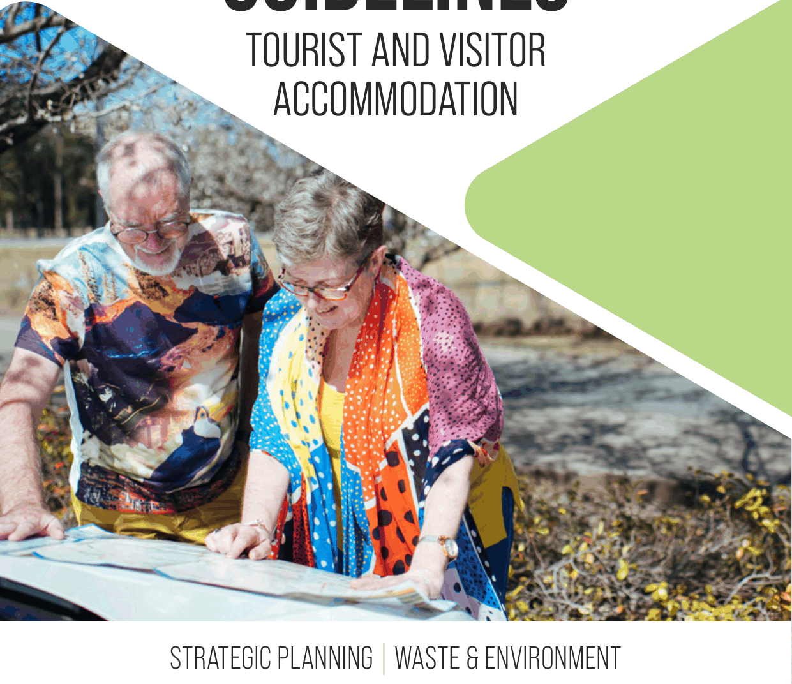
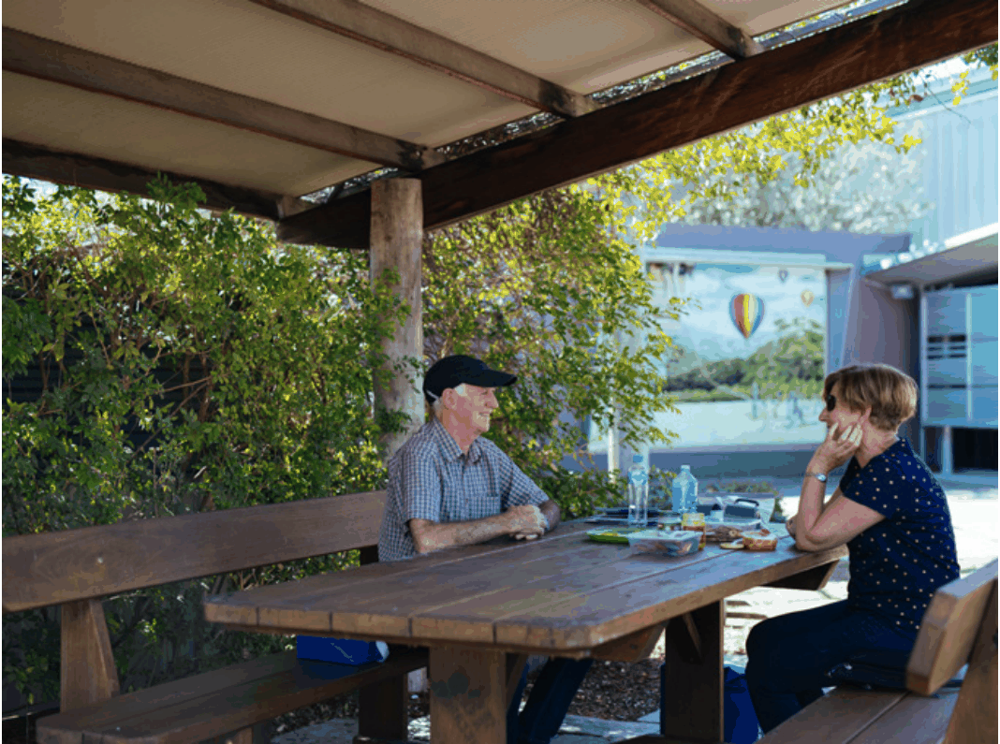
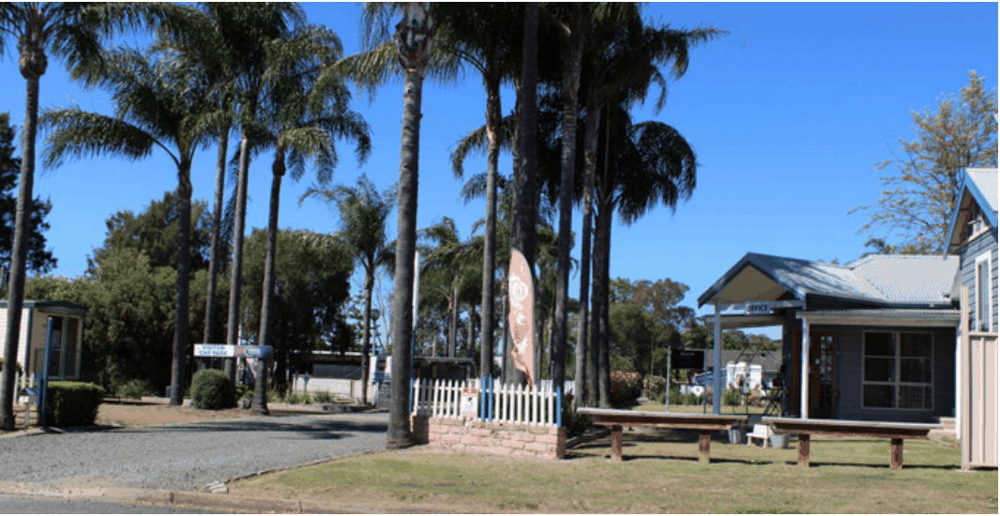
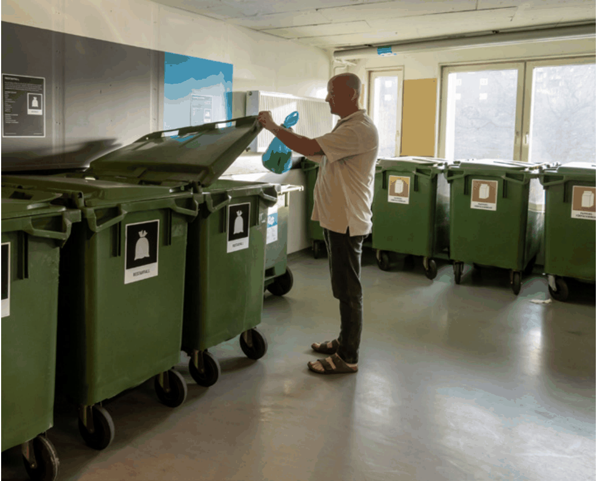
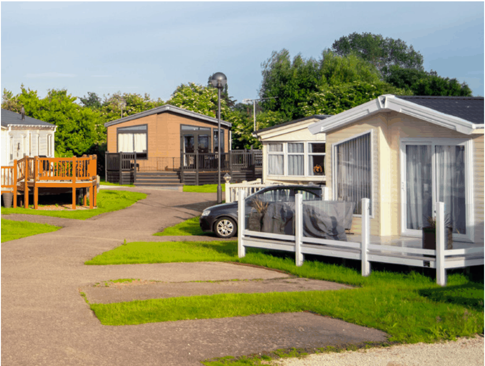
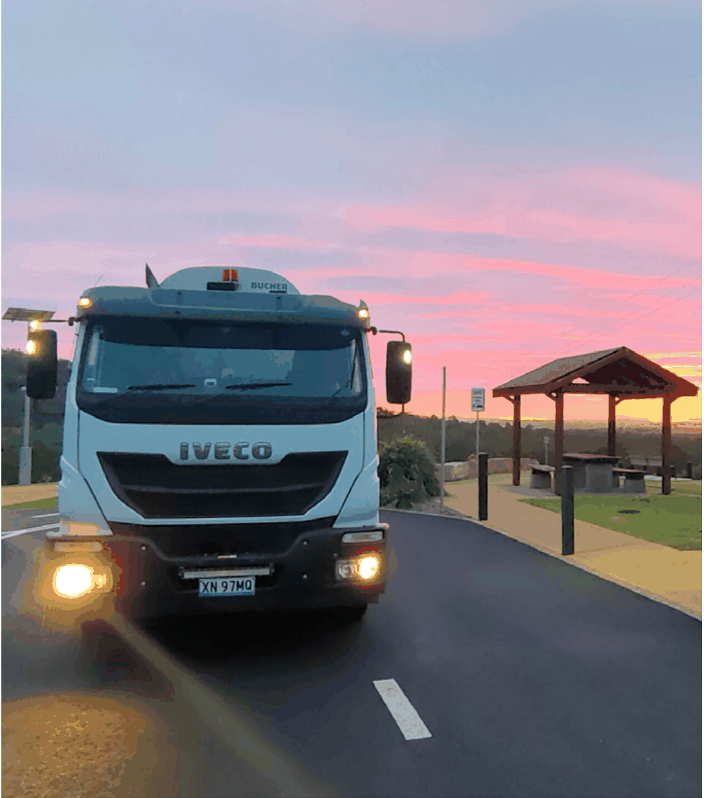

# Cessnock Development Control Plan 2010 - Waste Management Guideline - Tourist and Visitor Accommodation

Source PDF: [Waste-Management-Guideline-Tourist-and-Visitor-Accommodation.pdf](Waste-Management-Guideline-Tourist-and-Visitor-Accommodation.pdf)

### Cessnock LGA

### 2024

### WASTE MANAGEMENT

> [Picture on page 1: a picture, saved as a picture (images/waste-management-guideline-tourist-and-visitor-acc-page-1-4.gif, 150 dpi).]

### GUIDELINES

### TOURIST AND VISITOR

### ACCOMMODATION

### STRATEGIC PLANNING | WASTE & ENVIRONMENT

> [Picture on page 2: a picture, saved as a picture (images/waste-management-guideline-tourist-and-visitor-acc-page-2-1.gif, 150 dpi).]

Journey Through Time, created by local school students and artist Steven Campbell.

#### Acknowledgement of Country

Cessnock City Council acknowledges that within its local government area boundaries are the traditional

lands of the Wonnarua people, the Awabakal people and the Darkinjung people. We acknowledge these

Aboriginal peoples as the traditional custodians of the land on which our offices and operations are located,

and pay our respects to Elders past and present. We also acknowledge all other Aboriginal and Torres Strait

Islander people who now live within the Cessnock Local Government Area.

### Contents

| 1. | Introduction Waste Management Plan Waste collection service Waste generation | 4 6 6 6 |
|---|---|---|
| 2 | Bin infrastructure | 8 |
| 3 | Waste management system Internal waste storage area Waste storage area - General Manufactured home estates Caravan parks | 11 12 12 13 13 |
| 4 | Waste collection Waste collection vehicle Waste collection vehicle access Waste collection point Bin transfer | 14 15 15 16 16 |
| 5 | Useful resources | 17 |
| 6 | Appendix A | 19 |

### INTRODUCTION

### Introduction

Tourist and visitor accommodation facilities require appropriate waste management practices

by the management body to ensure adequate waste separation facilities are available to

users of the site. The scale of tourist and visitor accommodation facilities can vary and waste

management, including facilities and collection areas, will need to be designed accordingly

based on the size of the premises and number of occupants or users of the site. This guideline provides general guidance to develop a waste management system for the

following landuses.

### a. Tourist and visitor accommodation including

•	 Serviced apartments

•	 Backpackers

accommodation

•	 Hotel or motel

accommodation

### b. The following landuses

•	 Camping grounds

•	 Caravan parks

•	 Eco-tourist

facilities

•	 Manufactured

home estates

> [Picture on page 5: a picture, saved as a picture (images/waste-management-guideline-tourist-and-visitor-acc-page-5-22.gif, 150 dpi).]

### Waste Management Plan

All proposed tourist and visitor accommodation

facilities within this guideline are required to

submit a Waste Management Plan (WMP)

with a development application. If the cost

of the proposed development exceeds $5M

in value the WMP is required to be prepared

by a suitably qualified waste management

consultant/practitioner.

The WMP is to be prepared with reference to

this guideline and other relevant standards or

documentation.

### Waste collection service

New tourist and visitor accommodation

facilities are required to provide waste

collection services to the proposed premises

by the owner of the property. The waste

management system will need to be

integrated into the overall design of the

proposed development with waste storage

and collection points located on-site. To

ensure waste collection can be undertaken

safely and efficiently the waste collection

vehicle will need to enter and exit the site in a

forward direction.

### Waste generation

Waste generation rates from tourist and visitor

accommodation facilities will vary based on

the scale of the operation. Average recyclable

and residual waste generation rates have

been provided in Appendix A of this guideline

for tourist and visitor accommodation facilities.

The waste generation rates are to be provided

to each element of the proposed development

i.e some tourist and visitor accommodation

may provide an on-site restaurant or function

rooms. Waste from each element of the

proposed development is to be calculated

and used to determine the size and number

of bins required for the overall operation of the

development.

If the premises or premises element is

not provided in Appendix A supporting

documentation providing estimates of the

volume of waste streams from the proposed

operation is to be provided in the submitted

WMP.

> [Picture on page 6: a picture, saved as a picture (images/waste-management-guideline-tourist-and-visitor-acc-page-6-48.gif, 150 dpi).]

### Manufactured home estates

Waste collection from the operation of manufactured home estates is required to account for

waste generation from each individual manufactured home. Table 1 provides the average waste

generation rate for each manufactured home site within the proposed estate.

Table 1: Waste generation from single manufactured home allotment within estate

| WASTE TYPE | VOLUME (L/WEEK) | VOLUME (L/FORTNIGHT) |
|---|---|---|
| Recycling | 120 | 240 |
| Residual | 120 | 240 |

Source: Gladstone Regional Council, SC6.7 Waste Management

### Caravan parks

Waste collection from the operation of caravan parks is required to account for waste generation

from each individual caravan park site. Table 2 provides the average waste generation rate for

each site within the proposed caravan park

Table 2: Waste generation from single site within a caravan park

| WASTE TYPE | VOLUME (L/WEEK) | VOLUME (L/FORTNIGHT) |
|---|---|---|
| Recycling | 60 | 120 |
| Residual | 60 | 120 |

Source: Gladstone Regional Council, SC6.7 Waste Management

### BIN

### INFRASTRUCTURE

### Bin infrastructure

All tourist and visitor accommodation facilities require access to recycling and residual waste bins

and sufficient bin storage to accommodate the projected volume of waste from the proposed

development. Operations involved in food production and preparation, or have a proportion of

organic waste in their waste stream, should provide separate bin storage. A variety of bin sizes are available for the storage and collection of waste materials and the

selection of bin infrastructure will be dependent on the waste materials collected and the design

of the site. Mobile bins can range in volume and size and are typically collected by ‘rear-lift ‘waste collection

vehicles. Table 3 provides the dimensions of mobile bins to enable sizing of the waste storage

area for the proposed tourist or visitor accommodation facility. Table 3: Mobile waste bin dimensions

| BIN CAPACITY (L) | HEIGHT (MM) | DEPTH (MM) | WIDTH (MM) | FOOTPRINT AREA (M2) |
|---|---|---|---|---|
| 80 | 870 | 530 | 450 | 0.24 |
| 120 | 940 | 560 | 485 | 0.27 |
| 140 | 1065 | 540 | 500 | 0.27 |
| 240 | 1080 | 735 | 580 | 0.43 |
| 360 | 1100 | 885 | 600 | 0.53 |
| 660 | 1250 | 850 | 1370 | 1.16 |
| 770 | 1425 | 1100 | 1370 | 1.5 |
| 1100 | 1470 | 1245 | 1370 | 1.7 |
| 1300 | 1408 | 1250 | 1770 | 1.21 |
| 1700 | 1470 | 1250 | 1770 | 1.27 |

Source: Appendix B Better Practice Guidelines for Waste Management and Recycling in

Commercial and Industrial Facilities, NSW EPA, 2012.

Bulk bins are larger than mobile waste bins and are typically serviced by ‘front-lift ‘waste

collection vehicles. Table 4 provides the typical dimensions of bulk bins to enable sizing of the

waste storage area for the proposed tourist or visitor accommodation facility.

Table 4: Bulk waste bin dimensions

| BIN CAPACITY (M3) | HEIGHT (MM) | DEPTH (MM) | WIDTH (MM) | FOOTPRINT AREA (M2) |
|---|---|---|---|---|
| 1.5 | 1190 | 1080 | 2070 | 2.23 |
| 2 | 865 | 1400 | 1830 | 2.6 |
| 3 | 1225 | 1505 | 1805 | 2.7 |
| 4.5 | 3750 | 1605 | 1805 | 2.9 |

Source: Appendix B Better Practice Guidelines for Waste Management and Recycling in

Commercial and Industrial Facilities, NSW EPA, 2012.

> [Picture on page 10: a picture, saved as a picture (images/waste-management-guideline-tourist-and-visitor-acc-page-10-8.gif, 150 dpi).]

### WASTE

### MANAGEMENT

### SYSTEM

### Waste management system

### Internal waste storage area

Tourist and visitor accommodation should

provide appropriate waste systems within

each room or unit, including waste cupboards

or identified bins, to facilitate separation

of recyclable and residual waste materials

by staff or the occupant. Sufficient space

for the storage of at least one day’s worth

of recycling and residual waste are to be

provided and identified on floor plans.

### Waste storage area

### General

The design of the tourist or visitor

accommodation building site needs to

incorporate sufficient space for the selected

size and number of bins required for the

volume of waste material generated between

collection periods.

The waste storage area is to incorporate the

following:

•	 Sufficient floor space for the required

number of bins with a 0.2m space between

bins to allow maneuvering.

•	 Unobstructed 1.8m clearance zone between

the stored bins and the waste storage area

entrance to permit access and movement.

•	 Located in close proximity to the waste

collection point.

•	 Fully enclosed and walled with through

access to other on-site infrastructure not

permitted.

•	 Compliant with the Building Code of

Australia (BCA) with the floor waterproofed,

non-slip and sealed.

•	 The floor is to be graded to a central

drainage point and connected to the sewer.

•	 Provision of an adequate water supply

through a centralized mixing valve and

hose cock.

•	 Provision of adequate lighting and

ventilation in accordance with the BA.

Flexible design of the waste storage area

should also be considered including:

•	 Additional floor space for extra bins or

containers to capture additional separated

waste streams

•	 Minimising potential obstacles within the

waste storage area that would limit bin size

•	 Increasing width of access or doorways to

allow for potential change in bin size

Tourist or visitor accommodation facilities

that incorporate other uses, such as food

and drink premises, will also require waste

storage area space for specialized waste

streams such as chemicals or liquid wastes

such as cooking oils. A suitable sized space

must be allocated to the storage of these

waste streams and be kept secured and

accessible to staff members and specific

waste collection contractors only.

Suitable space is to be provided near the

waste storage area to store re-usable

commercial items such as crates, pallets,

kegs etc so that storage in a public place is

completely avoided.

Tourist and visitor accommodation facilities

with three or more storeys should be provided

with a method for transporting waste from

each level to the waste storage area. This

may include a goods lift or waste chute

system (See Waste Management Guideline –

Residential Flat Buildings).

### Manufactured home estates

Manufactured home estates will require

communal waste storage areas to service the

individual manufactured homes on-site. The

waste storage area should provide occupants

with waste storage solutions for recyclable

and residual waste streams. Green waste

and/or organics storage solutions should also

be provided where available.

The waste storage area is to accommodate

the number of the selected bin sizes (see

Table 3) The waste storage area is to be

located within 75m of each manufactured

home that it is servicing.

Mobile waste bins may be collected or

transferred from the waste storage area by

the site manager.  to a larger waste storage

area at the waste collection point.

### Caravan parks

Caravan parks will require communal waste

storage areas to service the cabins or

caravans at each site. The waste storage

area should provide occupants with waste

storage solutions for recyclable and residual

waste streams. Green waste and/or organics

storage solutions should also be provided

where available.

The waste storage area is to accommodate

the number of the selected bin size (see Table

3). The waste storage area is to be located

within 75m of each site within the caravan

park that it is servicing.

> [Picture on page 13: a picture, saved as a picture (images/waste-management-guideline-tourist-and-visitor-acc-page-13-33.gif, 150 dpi).]

### WASTE

### COLLECTION

### Waste collection

### Waste collection vehicle

The selection of waste collection vehicle will

be dependent on the type of bin infrastructure

utilised for the proposed development.

Waste collection vehicle specifications are

outlined in Appendix C of the NSW EPA’s ‘Better

Practice Guidelines for Waste Management

and Recycling in Commercial and Industrial

Facilities’ and Appendix B of the NSW EPA’s

‘Better practice guide for resource recovery in

residential developments.

These waste collection vehicle specifications

are to be used to determine access to the

waste collection point to the tourist or visitor

accommodation facility.

### Waste collection vehicle access

The waste collection vehicle must be able

to safely and efficiently access the site

and nominated on-site waste collection

point. Access and egress to and from the

proposed development to public roads is to

be supported by swept path models for the

largest waste collection vehicle that could

service the building. Swept path models for

waste collection vehicles are outlined in

•	 Appendix D of the NSW EPA’s ‘Better Practice

Guidelines for Waste Management and

Recycling in Commercial and Industrial

Facilities’.

•	 Section 5 of AS/NZS 2890.2 Parking facilities,

Part 2:Off-street commercial vehicle

facilities

Access and egress from the site by the waste

collection vehicles must be in a forward

direction with a 0.5m unobstructed clearance

either side of the vehicle.

The access/egress point from the site is to be

designed with the following requirements:

•	 The waste collection vehicle must enter and

exit the site in a forward direction

•	 A 0.5m unobstructed clearance either side

of the waste collection vehicle

•	 Grades of entry/exit ramps must not exceed

the capabilities of the waste collection

vehicle in accordance with Australian

Standard AS2890.2 Parking Facilities: Off-

Street Commercial Vehicle Facilities.

•	 Height clearance must be sufficient for the

entry of the waste collection vehicle, with a

general minimum clearance of 3.8m.

The WMP submitted with a development

application is to include a structural

engineer’s report confirming the following:

•	 The design of the access driveway, or ramp,

to the site is of sufficient strength to support

the weight of the waste collection vehicle

•	 The route of waste collection vehicle

travel (or circulation roadway), including

pavement, are of sufficient strength to

support the weight of the waste collection

vehicle

•	 The waste collection point (or service area)

is of sufficient strength for movement and

maneuvering of the waste collection vehicle

Note: When assessing pavement strength,

the area/pavement will need to support the

waste collection vehicle ‘gross weight’.

### Waste collection point

The waste collection point for the proposed

tourist and visitor accommodation facility

is to be appropriately located to allow easy

collection. The waste collection point is to be

located:

•	 Away from intersections, roundabouts or

slow-points such as pedestrian crossings

•	 Away from busy roads or narrow lanes

•	 Free from obstructions such as awnings,

trees or overhead structures, wires or

services

•	 Away from public areas

•	 Away from driveways, loading areas or

parking bays

•	 Where normal operations of the premises

will not be blocked or impeded

•	 Where there is clear vision of traffic as

the collection vehicle leaves the waste

collection point.

The nominated on-site waste collection point

must have sufficient area for maneuvering

of the waste collection vehicle with minimal

need for reversing. The waste collection point

is to be provided on the Site or Floor Plans

and include swept path models for a waste

collection vehicles as outlined in Appendix D

of the NSW EPA’s ‘Better Practice Guidelines

for Waste Management and Recycling in

Commercial and Industrial Facilities’.

For rear loaded waste collection vehicles and

unobstructed 2m loading zone is required

behind the vehicle for loading of bins. A 0.5m

side clearance is also required on either side

of the vehicle.

### Bin transfer

If the waste storage area and waste

collection point are in separate locations

bins will be required to be moved between

the locations. The bin carting route between

the two locations for bins smaller then 660L

is to be designed with consideration of the

following:

•	 Free of stairs or kerbs along the route

•	 Grades along the route should not exceed

1:14

•	 The route distance should not exceed 75m.

Bins between 660L and 1.5m3 should not be

moved more then 5m between the waste

storage area and waste collection point while

movement of bins greater then 1.5m3 should

be avoided.

### USEFUL

### RESOURCES

### Useful resources

NSW EPA 2012, Better Practice Guidelines for Waste Management and Recycling in Commercial

and Industrial Facilities,

Resources for local council waste and recycling operations (nsw.gov.au) NSW EPA 2019, Better practice guide for resource recovery in residential developments,

Resources for local council waste and recycling operations (nsw.gov.au)

> [Picture on page 18: a picture, saved as a picture (images/waste-management-guideline-tourist-and-visitor-acc-page-18-7.gif, 150 dpi).]

### APPENDIX A

Appendix A: Waste generation rates from tourist and visitor accommodation

| TYPE OF PREMISES | RESIDUAL WASTE (L PER 100M2 FLOOR SPACE/DAY) | RECYCLING (L PER 100M2 FLOOR SPACE/DAY) | COMMENT |
|---|---|---|---|
| TOURIST/VISITOR ACCOMMODATION AND ANCILLARY SERVICES |  |  |  |
| Bar (without meals/food service) | 50 | 50 | • Calculate restaurant separately • Calculate any accommodation separately |
| Cafes | 100 | 120 |  |
| Entertainment services (theatre, cinema) | 5 | 10 | Based on floor space for patrons (seating areas for theater) |
| Gymnasiums | 20 | 15 |  |
| Hair and Beauty | 63 | 50 |  |
| Motel or hotel | 10 | 5 | Per guest room |
| Offices | 10 | 15 |  |
| Retail – non-food | 50 | 100 |  |
| Restaurants | 400 | 280 |  |

62-78 Vincent Street, Cessnock NSW 2325  |  PO Box 152 Cessnock NSW 2325

02 4993 4100  |  council@cessnock.nsw.gov.au  |  www.cessnock.nsw.gov.au
