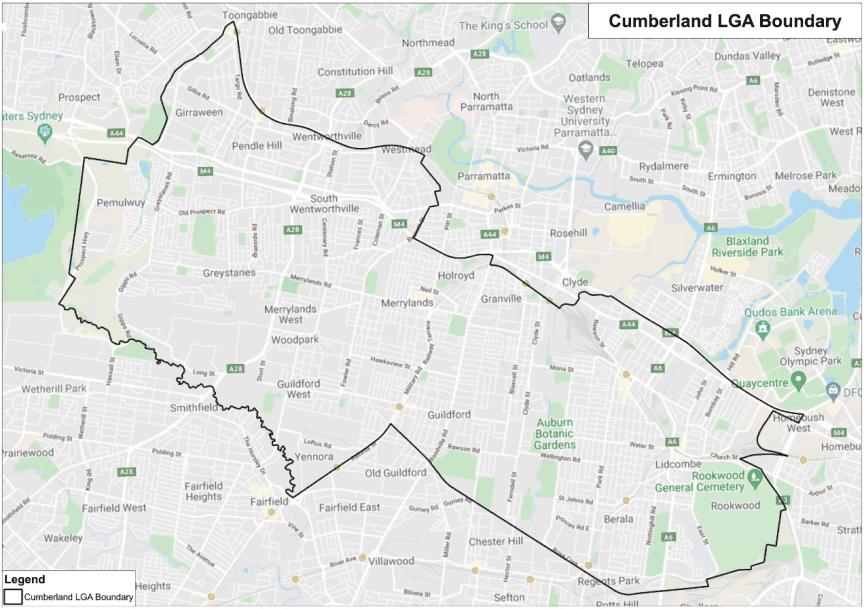
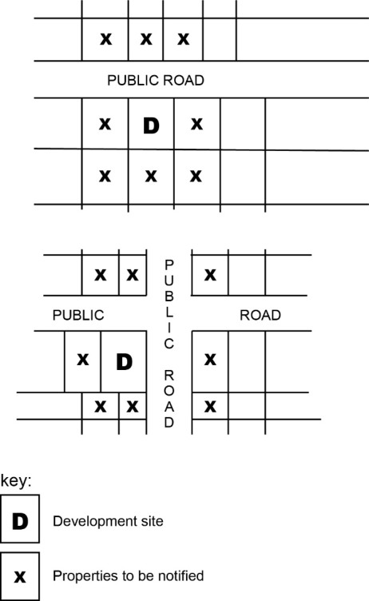

### PART A1

### INTRODUCTION

#### This page has been left intentionally blank.

## 1. Introduction

### 1.1 Name and application

#### 1.1.1 Citation

This Plan may be cited as the Cumberland Development Control Plan 2021 (Cumberland DCP

2021).

#### 1.1.2 Land covered by this DCP

The Cumberland DCP 2021 applies to land where Cumberland City Council is the consent

authority.

> [Picture on page 7: a picture, saved as a picture (images/part-a-introduction-and-general-controls-page-7-9.gif, 150 dpi).]

Figure 1: Cumberland City Boundary

#### 1.1.3 Adoption

Council has consolidated all of its DCPs that apply to Cumberland City into one plan. This Plan

was made under Section 3.43 of the Environmental Planning and Assessment Act 1979 (EP&A

Act) and Part 3 of the Environmental Planning and Assessment Regulation 2000 (EP&A

Regulation). It was adopted by Cumberland City Council on 19 August 2020 and became

effective on 5 November 2021.

#### 1.1.4 Savings Provision

This DCP does not apply to an application under the EP&A Act which was lodged with Council

but not finally determined before the commencement of this DCP. Any application lodged before

the commencement of this DCP will be assessed in accordance with any relevant previous

DCPs or other Council’s policy which applied at the time of application lodgement.

#### 1.1.5 Terms used in this DCP

In this DCP, terms have the meaning described in the EP&A Act and the Cumberland Local

Environment Plan 2021 (Cumberland LEP 2021). Certain terms used in this DCP are defined

in the glossary. Any reference in a Part of this consolidated Development Control Plan to “this DCP” or “this

Plan” is a reference to the Part of this consolidated DCP where the reference is contained.

### 1.2 Purpose

The purpose of the Cumberland DCP 2021 is to provide specific controls to guide development

and achieve particular development outcomes within the Cumberland City. This DCP is a supplementary development guideline that supports the Cumberland LEP 2021.

### 1.3 Aims

The Cumberland DCP 2021 aims to:

• ensure high quality development across Cumberland by establishing a framework for

sustainable land use;

• provide guidelines for applicants to formulate development proposals;

• manage development appropriately to support redevelopment and reinvestment in

Cumberland;

• protect the existing residents and wider community; including amenity, culture, and the

natural environment; and

• address recent and emerging issues with new controls which are relevant to the

Cumberland City that will better manage development and its future implications.

### 1.4 Objectives

The objectives of this DCP are to:

• ensure that development promotes economically, socially and environmentally

sustainability and is designed to avoid, minimise and manage potential environmental

risks;

• ensure future development has consideration for all existing and future residents of the

Cumberland City at all stages of their life cycle;

• ensure new developments enhance Cumberland as a great place to live and work and

deliver the desired future character;

• ensure new development is integrated with existing and planned transport systems and

promote sustainable transport behaviour within Cumberland; and

• provide an appropriate opportunity for the public to participate in the development

process.

### 1.5 Relationship to other Plans and policies

1.5.1 Revocation of Auburn DCP 2010, Holroyd DCP 2013 and Parramatta DCP 2011 Pursuant to Section 3.43(4) of the Environmental Planning and Assessment Act 1979, the

Cumberland DCP 2021 revokes Auburn DCP 2010, Holroyd DCP 2013 and Parramatta DCP

2011 which covered land for which this DCP now applies.

1.5.2 Cumberland Local Environmental Plan 2021 The Cumberland DCP 2021 is to be read in conjunction with Cumberland LEP 2021. It covers

most of Cumberland City Council excluding land covered by the State Environmental Planning

Policy (State Significant Precincts) 2005. In the event of an inconsistency between the

provisions of the Cumberland LEP 2021 and this DCP, the provisions of Cumberland LEP 2021

shall prevail to the extent of the inconsistency.

#### 1.5.3 State Environmental Planning Policies

State Environmental Planning Policies (SEPPs) address matters of state significance and

should be read in conjunction with the Cumberland LEP 2021 and the Cumberland DCP 2021.

Should there be a conflict in controls between a SEPP and a LEP or DCP, the provisions within

a SEPP shall prevail unless otherwise stated.

#### 1.5.4 Local Infrastructure Contributions Plans

Under Section 7.11 and/or 7.12 of the EP&A Act, Councils are able to levy contributions from

developments for the provision of public services and facilities required as a consequence of

development. These contributions are used for the upgrade and development of community

facilities, recreation facilities, infrastructure, roads and traffic management and town centre

improvements.

#### 1.5.5 Public domain plans

The relevant public domain plan is required to be considered in the design of the public domain

where Council is the consent authority, including:

• Auburn Town Centre Public Domain Plan;

• Berala Public Domain Plan;

• Former RAAF Stores Depot Public Domain Plan; and

• Wentworthville Town Centre Public Domain Plan. Other public domain plans may be prepared during the life of the Cumberland DCP.

#### 1.5.6 Other approvals

Approvals may also be required from other government agencies as in some cases a

development proposal may constitute “designated” or “integrated” development under the

EP&A Act.

#### 1.5.7 Policies, guides, forms and checklists

Some types of development may require consulting Council’s policies or guides, or completing

forms or checklists. It is recommended applicants visit Council’s website

(www.cumberland.nsw.gov.au) and follow the prompts to this DCP.

#### 1.6 Structure of Cumberland DCP 2021

This DCP contains 8 Parts. Each part contains objectives and development controls that relate

to development within Cumberland City. This DCP also contains Special Precincts and Site

Specific Development Controls for certain areas within the Cumberland City. In the event of an

inconsistency between the main body of this DCP and Special Precincts and Site Specific

Development Controls, the latter shall prevail. The plan is divided into the following Parts: Part A - Introduction and General Controls This Part explains Council’s planning framework and details information which must be

submitted with all development applications. It also details the notification requirements for

development applications and controls for subdivision and site amalgamation.

Part B - Development in Residential Zones This Part contains the controls which apply to residential development within the residential

zones. Part C - Development in Business Zones This Part contains the controls which apply to commercial and mixed use development and

shop top housing development within business zones. Part D - Development in Industrial Zones This Part contains the controls which apply to industrial, employment and innovation-based

development within industrial zones. Part E - Other Land Use Based Development Controls This Part contains the controls for places of public worship, centre based childcare centres,

educational facilities, community facilities and sex services premises. Part F - Special Precinct and Site Specific Development Controls This Part contains specific controls for Council’s nominated Special Precincts and Sites within

Cumberland. Part G - Miscellaneous Development Controls This Part contains the controls for advertising and signage; traffic, transport, parking and

access; heritage; waste management; stormwater management; tree management;

sustainability; and urban heat management. Definitions This Part contains the definitions which the DCP relies on. The definitions sit separately to the

standard instrument dictionary definitions held in the Cumberland LEP 2021.

## 2. Notification requirements

### 2.1 Application of this Part

This Part sets out the procedures for public exhibition and notification of development

applications in the Cumberland City LGA. In particular, this Part:

• summarises the public exhibition requirements contained in the EP&A Act and EP&A

Regulation for certain types of applications;

• specifies the notification procedures for all other development applications including

applications for modification of development consent; and

• aligns with guidance provided in Council’s Community Participation Plan (Cumberland

Community Engagement and Participation Strategy).

### 2.2 Application of this Part

In circumstances where there may be any inconsistency between the requirements contained

in this Part and any other, the provisions of this Part shall apply.

### 2.3 Objectives

The objectives of notification are to:

• outline the public exhibition and notification procedures for applications to ensure the

community is informed of development proposals and applicants are aware of Council’s

notification requirements;

• notify the appropriate owners and/or occupiers of development occurring on adjoining

and nearby properties;

• provide the opportunity for public involvement in the development assessment process;

• ensure an efficient development assessment process by enabling Council to obtain the

views of interested persons within logical timeframes before determining a DA; and

• specify circumstances when notification of development applications is not required.

### 2.4 Voluntary planning agreements

For the notification requirements relating to voluntary planning agreements please consult the

EP&A Act and Council’s Planning Agreements Policy.

### 2.5 Provisions

The provisions within this Part relating to notification areas and periods of notification are a

minimum and may be increased at the discretion of Council once the nature and likely impact

of the proposal have been considered. Christmas/New Year period In accordance with the EP&A Act, notification periods during the Christmas/New Year period

may be extended to take into account public holidays.

2.5.1 Development to which advertising notification provisions apply The advertising and notification procedures in this Part apply to all development and related

applications lodged with Cumberland City Council.

The EP&A Act and EP&A Regulation specify the advertising requirements for:

• designated development; and

• integrated development. Notification and advertising of applications for the above developments will be in accordance

with the requirements of the EP&A Act and EP&A Regulation. Council will also implement any other advertising, notification and/or consultation requirements

that may be specified within any other State policy or legislation, i.e. SEPPs. The EP&A Act and EP&A Regulation specify the advertising requirements for the following:

• designated development;

• advertised development;

• state significant development and state significant advertised development; and

• other advertised development including nominated integrated development. The above categories of development will be notified in accordance with the relevant provisions

of the EP&A Act and EP&A Regulation.

2.5.2 Development applications requiring notification and advertising Table 1 lists the notification and advertising requirements for development applications.

Table 1: Notification requirements

| Proposed use or development | Letters to adjoining owners | Notice on Council’s website | Notice on site | Notification period (days) | Re- notification (if required) (days) |
|---|---|---|---|---|---|
| Dwelling houses (including single and 2 storey dwellings, additions, secondary dwellings) |  |  | N/A | 14 days | 7 days |
| Dual occupancies and manor houses |  |  | N/A | 14 days | 7 days |
| All other development in residential areas or directly adjoining a residential area (including across a road, laneway or the like) Development includes residential subdivision (eg. Torrens Title and subdivision involving construction of a roadway) but excludes a strata and stratum subdivision, community title subdivision and health consulting rooms |  |  | N/A | 14 days | 7 days |
| Multi dwelling housing Residential flat buildings Seniors housing Boarding House |  |  |  | 14 days | 7 days |

| Proposed use or development | Letters to adjoining owners | Notice on Council’s website | Notice on site | Notification period (days) | Re- notification (if required) (days) |
|---|---|---|---|---|---|
| Non-Residential development within residential zones being: Educational establishments Places of public worship Places of public entertainment Child care centres Hospitals (in any zone) |  |  |  | 14 days | 7 days |
| Business and office premises – existing use rights |  |  | N/A | 14 days | 7 days |
| New business / office / retail premises (excluding uses addressed elsewhere in this table) – two storeys or more |  |  |  | 14 days | 7 days |
| New business / office / retail premises (excluding uses addressed elsewhere in this table) adjoining or opposite to residential development |  |  |  | 14 days | 7 days |
| Mixed use development and shop top housing |  |  |  | 14 days | 7 days |
| New industrial building adjoining or adjacent to residential development |  |  | N/A | 14 days | 7 days |
| Industrial development adjoining or adjacent to residential area operating outside standard hours of operation OR Industrial development adjoining or adjacent to residential area that may impact on residential amenity |  |  | N/A | 14 days | 7 days |
| Industrial development – existing use rights |  |  | N/A | 14 days | 7 days |
| Automotive uses (eg. car parks, service station, transport depots, and truck depots) |  |  | N/A | 14 days | 7 days |
| Vehicle repair station and vehicle body repair workshops adjoining and/or |  |  | N/A | 14 days | 7 days |

| Proposed use or development | Letters to adjoining owners | Notice on Council’s website | Notice on site | Notification period (days) | Re- notification (if required) (days) |
|---|---|---|---|---|---|
| adjacent to residential development |  |  |  |  |  |
| Telecommunications facilities |  |  | N/A | 14 days | 7 days |
| Home industry and home business |  |  | Yes | 14 days | 7 days |
| Food and drink premises excluding pubs adjoining and/or adjacent to residential development |  |  | N/A | 14 days | 7 days |
| Signage more than 20m² (Also see other requirements in State Environmental Planning Policy No. 64 – Advertising and Signage) |  |  | N/A | 14 days | 7 days |
| Sex service premises adjoining residential development or zone |  |  |  | 14 days | 7 days |
| Amusement centre |  |  |  | 14 days | 7 days |
| Demolition or use of an item/group of environmental heritage |  |  |  | 14 days | 7 days |
| Heritage items and developments in a conservation/heritage area |  |  |  | 14 days | 7 days |
| Hotel and motel accommodation and pubs |  |  |  | 14 days | 7 days |
| Public administration buildings |  |  |  | 14 days | 7 days |
| Council-related development applications |  |  |  | 28 days | 7 days |

Note: Notification periods are also available on Council’s website.

2.5.3 Development applications not requiring notification and advertising Table 2 below lists the types of development applications which do not require advertising or

notification.

Table 2: Types of development applications which do not require advertising or notification

#### Development NOT requiring advertising and notification

Exempt and Complying Development

Section 4.55 (1)

Section 4.55 (1A) (see also section 2.6 of this Part)

General alterations only (and does not alter/modify the height or external configuration of a

building and not a heritage item) where Council considers no adverse environmental impact

is created

Changes which are the result of conditions of consent on an application previously notified

Strata subdivision application

Stratum subdivision application

Torrens title subdivision application not involving construction of a new road

Change of use in business zones where Council considers no adverse environmental impact

is created

Change of use in industrial zones not adjacent to or adjoining residential development

Demolition of structures not of heritage significance

### 2.6 Development applications that are amended, modified or reviewed

#### 2.6.1 Amended applications

Where an application is amended before it is determined, the amended application/plans will

be re-advertised or re-notified if it is considered that there will be an additional likely

environmental impact or impact of the development on adjoining or nearby land or development.

However, if it is considered that the likely environmental impact is insignificant, the development

application will not be re-advertised or re-notified, or the notification period may be reduced.

This is at the discretion of Council. If an application is withdrawn and a subsequent application is made, the new application will be

advertised or notified in accordance with this Part, as if the previous application had not been

made.

#### 2.6.2 Modified applications

Section 4.55 (1) modifications involving minor error, misdescription or miscalculation Applications for modification involving minor error, misdescription or miscalculation are not

required to be notified. Section 4.55 (1A) modifications involving minimal environmental impact Section 4.55 (1A) applications will generally not be notified. However, if in the opinion of

Council, the proposed modification has potential to increase the impact of the development on

adjoining or nearby land or development, Council may notify the proposed modification under

this section as follows:

• written notice to adjoining landowners and occupiers; and

• the notification period is 14 calendar days. If Council considers the application will cause an increased environmental impact, the

application may be amended to a Section 4.55 (2) application and be advertised and notified in

accordance with this section.

All persons who made a submission to the previous development application shall also be

notified in accordance with this section. Section 4.55 (2) other modifications Applications received under Section 4.55 (2) shall be advertised and notified in the same

manner as the original development application. All persons who made a submission to the

previous development application shall also be notified in accordance with this section. Section 4.56 modification by consent authority of consents granted by the court Applications received under Section 4.56 of the EP&A Act shall be exhibited in accordance with

the requirements prescribed by Section 4.56 of the EP&A Act and the EP& A Regulations. Section 8.2 (determinations and decisions subject to review) applications Applications under Section 8.2 Reviews may require:

• re-notification to previous persons who made a submission; and/or

• re-advertisement and/or notification in the same manner as the original application, if

the development application is amended and considered to have greater impact than

the original development application.

2.6.3 Notification of Building Information Certificate Application Council may notify adjoining owners and occupiers where it is considered that the development,

works and/or structures cause adverse impact. Where written notice is given, it shall be for a minimum of 14 days.

### 2.7 Other notification considerations

#### 2.7.1 NSW Land and Environment Court appeals

In the event of an application being refused, either on its merit or because the application is

inadequate or incomplete and is subsequently subject to an appeal to the Land and

Environmental Court, persons who made submissions shall be notified of the appeal.

#### 2.7.2 Notification of adjoining local government areas

Where Council considers that there are adjoining properties located outside the boundaries of

the Cumberland City which will be affected by development in the Cumberland City, Council

shall endeavour to notify those properties in accordance with this Part.

#### 2.7.3 Public notification of development consents

Council shall give written notice of the determination of a development application to each

person who made a written submission in relation to that application. This notice will specify

when the determination was made and the application outcome. In the case of petitions submitted to Council, the principal author shall be notified of Council’s

decision. If the principal author is not readily identifiable then the first identifiable signatory shall

be notified.

### 2.8 Procedures

#### 2.8.1 Advertising procedures

The notification period for all development applications to be advertised and or notified shall

commence a day after the date of the advertisement and/or letter.

Development to be advertised will require a notice to be published on Council’s website.

Notification timeframes are provided in Table 1. The notice shall contain the following information as a minimum:

• a description (including the address) of the land on which the development is

proposed to be carried out;

• the name of the applicant and the consent authority;

• a description of the proposed development;

• whether or not the development is designated development, nominated integrated

development, threatened species development, Class 1 aquaculture development or

State significant development;

• a statement that the development application and the documents accompanying the

application, including any environmental impact statement, are publicly available on

the consent authority’s website for the period specified in Schedule 1 to the Act for

that kind of development; and

• a statement that any person, during the submission period specified in Schedule 1 to

the Act for that kind of development, may make submissions to the consent authority

concerning the development application and that the submissions must specify the

grounds of objection (if any).

#### 2.8.2 Notification procedures

Persons to be notified The following are minimum requirements for notification:

• for buildings of single ownership, notification will be to the building owner/s;

• where the parcel of adjoining or opposite land is under more than one ownership,

notification will be sent to one owner; and

• for strata title buildings, notification will be to the:

- owners corporation. Subject to compliance of the owners corporation, a notice will

be placed in the foyer of the strata building, and

- owners of the strata units and occupiers within the building that adjoins the

proposed development (at the discretion of Council).

Areas to be notified The areas to be notified are outlined in Figure 2. This area shows minimum requirements and

may be increased at the discretion of Council, depending on the nature and likely impact of the

proposal.

> [Picture on page 18: a picture, saved as a picture (images/part-a-introduction-and-general-controls-page-18-1.gif, 150 dpi).]

Figure 2: Areas to be notified

Method of notification Written notice (e.g. letters of notification) must contain as a minimum the following information:

• identification/description of the relevant parcel of land (lot description and address);

• a description of the proposed development;

• name of applicant;

• the registered number of the application;

• an A4 size plan including a site plan and the elevations of the building (if relevant);

• the place and times the application can be inspected and submissions made;

• the closing date for submissions;

• an invitation to make a written submission;

• Council address, telephone and email contact including the name of the assessing

officer;

• date of the notification letter;

• length of notification period; and/or

• a statement outlining the privacy rights and that submissions will be disclosed to any

person requesting information under the Government Information (Public Access) Act

2009 (GIPA Act) or alternatively seeking access to Council’s documents under Section

12 of the Local Government Act 1993.

Council has discretion whether to:

• notify fewer properties than described in the diagram;

• notify properties beyond adjoining properties;

• extend the notification period;

• place a public notice in a local newspaper;

• exhibit plans at other public venues;

• hold a public meeting/public information session/workshop;

• consult with relevant community groups; and/or

• provide additional advice in the written notice. Notification at the development site When notice is required on the site, the following information shall be on the notice:

• development application number;

• the name of the applicant;

• site address of proposed development;

• a brief description of the development;

• advertising period and the period in which the application can be inspected and

submissions made;

• a contact person within Council and the telephone number of that person;

• an invitation to make a submission; and

• the date of the notice. Other forms of notification and advertisement The details of the applications on notification and/or advertisement may be placed on exhibition

on Council’s website and at the Council’s Customer Service Centres, and relevant Council

libraries. Period of public exhibition The notification and advertising period for development is as specified in Table 1 – Notification

Requirements. The notification and advertising period may be varied at the discretion of Council after

considering the scale, intensity and location of development, likely impact of the development

on adjoining or nearby residents, and the level of public interest or likely public interest in the

proposal. The exhibition period may be extended to take into account public holidays. The notification period for re-exhibition of amended plans may be reduced where in the opinion

of Council, the amendments are of a minor nature with minimal effect on local amenity. Circumstances where notification of an application may not be necessary

• if a development application is amended;

• Council has notified/advertised the original application in accordance with this Part;

• Council is of the opinion that the amended application differs only in minor respects

from the original application, and does not result in a greater environmental impact or

reduced levels of amenity to adjoining or nearby residents; and

• Council may decide to dispense with further notification/advertising in relation to the

amended application at the discretion of the council for the management of assessment

of the application.

### 2.9 Submissions for advertising and notification

#### 2.9.1 Submission period

The submission period will be in accordance with the notification period specified in the

notification or advertisement. The notification or advertisement will refer to the development application and accompanying

material as being on exhibition for a stated period of days with the closing date for submissions

being at the end of the stated period. The period may be increased if the consent authority considers that a longer period shall be

given.

#### 2.9.2 Making a submission

Any person may make a submission within the submission period to either object to or support

a proposed development. Submissions must be in writing and delivered to Council either by

person, post or e-mail. Submissions must be received by Council before the close of business on the last day of the

exhibition period or otherwise determined by Council. Consideration of late submissions within

a reasonable short period of the end of the exhibition period will be at the discretion of Council. All submissions received in the correct manner during the submission period will be taken into

consideration in the determination of the application. Council will address submissions during the assessment prior to a determination. As a minimum, submissions must include the following:

• clear identification of the subject property;

• the development application number;

• clear indication of the name, address and telephone number, email, facsimile of the

author and the contact details of the respondent during business hours (to enable

Council to notify the author in advance if the matter is to be considered at a Council

meeting);

• reasons for the objection (this shall be brief and to the point and refer to the specific

application);

• other relevant documents (e.g. surveys, plans or photographs); and

• suggestions for how the proposal might be amended to address their objections.

#### 2.9.3 Form letters and petitions

When Council receives a petition in respect of a development application, modified application

or Section 8.2 Reviews applications, the head petitioner, or where not nominated, the first

petitioner will be acknowledged for the purpose of future contact. Where a petitioner or contact is not nominated, one will be selected by Council. Only the head

petitioner will be advised of Council meetings or receive confirmation of the determination of an

application. Form letters and petitions shall be counted as one submission.

#### 2.9.4 Disclosure of submissions

All submissions are subject to a request for access by interested persons under section 12 of

the Local Government Act 1993 or under the Government Information (Public Access) Act 2009.

If such a request is received, the submission(s) – including names and addresses of submitters

– will be made available for inspection. A request for personal information to be suppressed by Council can be made under section 58

of the Privacy and Personal Information Protection Act 1998. Council will consider these

requests in accordance with this Act. The final determination of such requests will be made by

the General Manager. The information contained within submissions is intended for the use by Council staff only. The

information will be retained by Cumberland City Council and stored within its central records

system.

#### 2.9.5 Copyright

Copies of plans will not be copied or made available other than through public viewing.

#### 2.9.6 Acknowledgment of submissions

All submissions will be acknowledged as soon as practicable, after receipt by Council. If the

application is to be considered at a Council meeting, Council may notify the person who made

the submission. If the matter is to be determined at a Council meeting, contact will be made with the person who

made the submission, provided the daytime contact details (e.g. telephone number, facsimile

and or email) have been provided in the submission. Best endeavours will be made to ensure that all persons who have provided their daytime

contact details will be contacted prior to determination of the application to be considered by

Council. However, it is noted that the onus is on the person who made the submission to seek

information about the meeting dates, times and or agenda from the officer responsible for the

application or from the Council website. In the event of a rescission motion being lodged, those persons having made a submission and

the applicant will be notified of this either by telephone, mobile, mail, or email.

#### 2.9.7 Anonymous submissions

Anonymous submissions will not be considered by Council.

#### This page has been left intentionally blank

> [Picture on page 23: a picture, saved as a picture (images/part-a-introduction-and-general-controls-page-23-1.gif, 150 dpi).]
