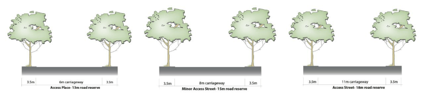

### PART A2

### SUBDIVISION

#### This page has been left intentionally blank.

## 1. Introduction

### 1.1 Land to which this part applies

This Part applies to all land in Cumberland City where development for the purpose of

subdivision is permitted.

### 1.2 Purpose of this part

This Part is intended to guide the assessment of subdivisions.

## 2. Objectives and Controls

### 2.1 Design and landscaping for subdivision

#### Objectives

Reflect the predominant subdivision pattern of the locality. Provide allotments of appropriate area and configuration to facilitate development that

meets the requirements of different zones. Maintain and enhance existing streetscape and landscape character.

#### Controls

C1. In determining the suitability or otherwise of any subdivision application, consideration

of the following matters will be taken into account:

• slope and orientation of land;

• opportunities for solar and daylight access to future development;

• design of roads, access ways and individual site access;

• retention of special qualities or features of a site, such as trees and views;

• availability of utilities;

• evacuation controls;

• provision of adequate site drainage; and

• provision of public open space.

C2. Avoid rear fences directly fronting public roads. Where this is unavoidable, the following

measures may be required (see Figure 3):

• greater setbacks for landscaping against fences, consistent with acoustic and road

design standards (Figure 3 (left)); and

• building frontages to face road by provision of parallel access road separated by

landscaped buffer (Figure 3 (right)).

> [Picture on page 25: a picture, saved as a picture (images/part-a-introduction-and-general-controls-page-25-31.gif, 150 dpi).]

Figure 3: Landscaping

Easement of support C3. The provision of an easement of support will be required to cover all embankments that

extend into the lots if the batters are steeper than 5 to 1.

Retaining walls

C4. Provide space for a retaining wall within the newly created allotment boundaries where

required as a result of topography, new road construction and/or impact on existing

allotments.

### 2.2 Services

#### Objectives

Ensure the provision of public utilities to each allotment, within road reserves, in an

efficient and cost-effective manner.

Maximise the opportunities for shared (common) trenching and to reduce restrictions on

landscaping within road reserves.

Ensure residential, industrial and business areas are adequately serviced in a timely,

cost effective, coordinated and efficient manner.

#### Controls

C1. Easements required by Council for the purpose of subdivision may include those

necessary for utility services. The width of the easement is to be determined by the

service authority.

C2. The design, construction and location of utility services shall conform to Council’s

stormwater standards and work specifications for subdivision and developments and

the specific standards of the relevant servicing authority.

C3. Design road corridors and other accessways to take into account existing services to

avoid any unnecessary alterations or diversions.

C4. Where possible, coordinate compatible public utility services in common trenching to

minimise cost.

C5. Areas affected by construction works are to be reinstated to appropriate grades, covered

with 100mm of topsoil and turf.

Electricity C6. For subdivision requiring a new low voltage electricity supply, reticulate via an

underground supply system. Service battleaxe blocks with underground electricity to the

rear of the accessway.

Water supply C7. Provide an adequate reticulation water supply system from water supply mains for

domestic supply and firefighting purposes.

Sewerage C8. Arrange sewerage reticulation to allow the whole of each new allotment to be serviced

by gravity drainage.

### 2.3 General residential

#### Objectives

Enable flexibility in the choice of housing design and siting of a dwelling house as well

as suitable space available for other activities normally associated with the use of a

dwelling house.

Provide an appropriate level of amenity for new and existing residential areas.

Ensure appropriate levels of service for utilities and the road network are achieved and

to optimise existing infrastructure.

Adequately consider environmental constraints and impacts including flooding,

drainage, vegetation, erosion on a proposed subdivision.

Ensure the proposed development lot is of sufficient size to accommodate the form of

dwelling house proposed.

#### Controls

Lot and road orientation C1. Allotment orientation should ensure that living and private open space areas of any

dwelling can be orientated to the north and that dwellings can be positioned so that the

possible overshadowing impact on existing or future adjoining buildings can be

minimised.

C2. Allotments shall be design and configured to:

• minimise boundary retaining walls;

• minimise potential overlooking; and

• maintain solar access, where slopes face south.

Allotment size and dimensions C3. In addition to the minimum area specified in the Cumberland LEP 2021, the frontage

and depth of a proposed allotment shall be consistent with the prevailing subdivision

pattern of the immediate locality where it is proposed to erect a dwelling house on the

allotment.

C4. The access corridor of a battleaxe shaped allotment is not included in the calculation of

the minimum area required for that allotment.

C5. Corner allotments shall have a minimum width of 14m.

C6. Multiple subdivisions of battleaxe lots is not permitted.

C7. Proposed allotments, which contain existing buildings and development, shall comply

with the site coverage and other controls contained within Part B Residential.

Battleaxe lots C8. Multiple subdivisions of into battleaxe lots are not permitted.

C9. Any proposed vehicular access corridors shall have a maximum length of 60m, a

minimum width of 4m and a minimum width of shared corridor of 6m.

C10. A maximum of 2 adjoining battle-axe lots is permitted. Access to more than 2 lots shall

be via a dedicated road.

C11. Dwelling house development on battle-axe lot must comply with the site coverage,

landscape area and private open space requirements set out in Part B1 of this DCP.

The calculation of compliance with these controls will not include the area of any access

corridor, right of carriageway or the like.

Access to battleaxe lots C12. A maximum of two residential allotments may be served by a shared access corridor.

C13. Where two corridors are shared, reciprocal rights of way and easements for drainage

and services shall be granted over the access corridors for the benefit of both

allotments.

C14. An access corridor to a single allotment shall be constructed with full width concrete

paving, minimum 3m wide.

C15. Shared access corridors (serving two allotments) shall be constructed with a full width

centrally located driveway in accordance with AS2890 and relevant engineering

specifications.

Access corridors C16. Any proposed vehicular access corridors shall have a maximum length of 60m, a

minimum width of 4m and a minimum width of shared corridor of 6m.

C17. The number of battleaxe shaped blocks in a subdivision should be kept to a minimum.

No more than three battleaxe allotments shall adjoin each other, and access to more

than three lots should be by a dedicated road.

C18. No more than two allotments should be served by a shared access corridor.

C19. Where two corridors are shared, reciprocal rights of way and easements for drainage

and services shall be granted over the access corridors for the benefit of both

allotments.

### 2.4 Residential flat building, multi-dwelling development and mixed use

#### development

#### Objectives

Ensure that subdivision and new development is sympathetic to the landscape setting

and established character of the locality.

Provide allotments of sufficient size and dimensions to facilitate development of the land

at a density permissible within the zoning of the land having regard to site opportunities

and constraints.

Facilitate lot amalgamations to ensure better forms of housing development and design.

#### Controls

Lot amalgamation C1. Development sites involving more than one lot shall be consolidated.

C2. Plans of Consolidation shall be submitted to, and registered with, the office of the NSW

Land and Property Management Authority. Proof of registration shall be produced prior

to release of the Occupation Certificate.

C3. Adjoining parcels of land not included in the development site shall be capable of being

economically developed and not result in site isolation.

Subdivision

C4. The community title or strata title subdivision of a residential flat building shall be in

accordance with the approved development application plans, particularly in regard to

the allocation of private open space, communal open space and car parking spaces.

C5. Proposed allotments, which contain existing buildings and development, shall comply

with site coverage and other controls contained within this Part.

C6. Council will allow the strata subdivision of residential flat buildings subject to compliance

with all other related controls contained in this DCP.

Creation of new streets

C7. A minimum width of 6m shall be provided for all carriageways on access roads. If parallel

on-street parking is to be provided, an additional width of 2.5m is required per vehicle

per side.

### 2.5 Centres

#### Objectives

Ensure development sites are of a reasonable size to efficiently accommodate

architecturally proportioned buildings and adequate car parking, loading facilities, etc.

Provide lots which are of sufficient size to satisfy user requirements and to facilitate

development of the land while having regard to site opportunities and constraints.

Provide lots of a size and dimension that facilitate the orderly development of the

commercial centres.

Provide essential public utility services to the satisfaction of relevant authorities.

#### Control

Size and dimensions

C1. Proposed lots shall be of sufficient area and dimension to allow a high standard of

architectural design, the appropriate siting of buildings and the provision of required car

parking, loading facilities, access and landscaping.

### 2.6 Roads

#### Objectives

All new proposed streets are designed to convey the primary residential functions of the

street including:

• responding to topography;

• integration with the existing street pattern in a fully connected system;

• safe and efficient movement of vehicles and pedestrians;

• provision for on street parking;

• provision of landscaping;

• location, construction and maintenance of public utilities; and

• movement of service and delivery vehicles.

#### Control

C1. Where a new street is to be created, the street shall be designed to Council’s standards

having regard to the circumstances of each proposal. Consideration shall be given to

maintaining consistency and compatibility with the design of existing roads in the

locality.

Road design speeds

C2. A combination of measures may be required to limit design speeds by:

• limiting street length; and/or

• introducing bends.

C3. Introducing slow points, bends and other traffic management measures such as

constriction of carriageway width and speed humps. These may not be appropriate in

all situations.

C4. Road design and speed profiles shall conform to Roads and Maritime Services (RMS)

guidelines.

Road reserve

C5. Carriageway, verge and road reserve widths shall be provided as shown in Table 3 and

Figure 4 below.  Where not already provided, Council will require 4m x 4m splay corners

to be dedicated in road reserves at intersections.

C6. While discouraged, where rear fences face major roads, greater verge widths may be

required for landscape measures to screen fences, without compromising visibility at

intersections.

> [Picture on page 30: a picture, saved as a picture (images/part-a-introduction-and-general-controls-page-30-33.gif, 150 dpi).]

Figure 4: Carriageway widths

Table 3: Carriageway, verge and road reserve widths

| Road type | Minimum carriageway (m) | Minimum verge (m) | Minimum road reserve (m) | Maximum number of lots served |
|---|---|---|---|---|
| Access place minor cul-de-sac | 8.5 | 2.2 | 13 | 15, including corner lots |
| Minor access street minor loop roads, and cul-de-sacs | 10.5 | 2.2 | 15 | 30, including corner lots |
| Other road types | 13 | 3.5 | 20 |  |

On street parking

C7. On street parking shall be provided as part of the carriageway.

Pedestrian/cyclist facilities

C8. An access place or street shall be provided with a 1.2m wide concrete footpath on all

frontages. Council will consider the alternative of interlocking road pavements for short

length access places serving up to 10 dwelling allotments.

C9. Where a cycleway and access approved plan exists, pedestrian and cyclist paths shall

be provided in accordance with that plan.

Road formation

C10. New roads must be constructed with kerb and gutter, 1.2m wide concrete footpath and

be sealed from gutter to gutter.

C11. Cul-de-sacs will be accepted only where surrounding land has been fully developed or

where the DCP provides for cul-de-sacs roads. Cul-de-sac roads are to have a 12m

radius with 12m reverse curves on boundary alignment.

### 2.7 Industrial subdivision

#### Objectives

Maintain and protect the environmental amenity of adjacent land uses.

Provide lots of sufficient size to satisfy user requirements and to facilitate development

of the land having regard to site opportunities and constraints.

Provide lots of a sufficient area and dimension to allow for the siting of buildings

including provision of adequate car parking, landscaping, access and other potential site

activity and where possible reduce driveways to main roads.

Provide essential public utility services to the satisfaction of relevant authorities.

#### Controls

C1. New lots shall remove or reduce vehicular driveways and access points to main or

arterial roads where alternatives are available.

C2. Adequate allowance shall be provided for the manoeuvring and turning of heavy

vehicles on site.

C3. For industrial allotments with an area of 1,200m2 or greater:

• the minimum width of the allotment at the building line shall be 24m; and

• the minimum depth of the allotment shall be 45m.

C4. For industrial allotments with an area of less than 1,200m2:

• the minimum width of the allotment at the building line shall be 20m; and

• the minimum depth of the allotment shall be 40m.

C5. For corner allotments, a 6m x 6m corner splay is to be provided. In special

circumstances, a deeper cut-off may be required.

Utility services

C6. The applicant shall demonstrate that each proposed lot can be connected to appropriate

utility services including water, sewerage, power and telecommunications (and where

available gas). This may include advice from the relevant service authority or a suitably

qualified consultant.

C7. Any application for strata subdivision shall demonstrate that each lot is serviced for

parking and loading and shall generally comply with the requirements of Part G3 of this

DCP.

#### This page has been left intentionally blank

> [Picture on page 34: a picture, saved as a picture (images/part-a-introduction-and-general-controls-page-34-1.gif, 150 dpi).]
