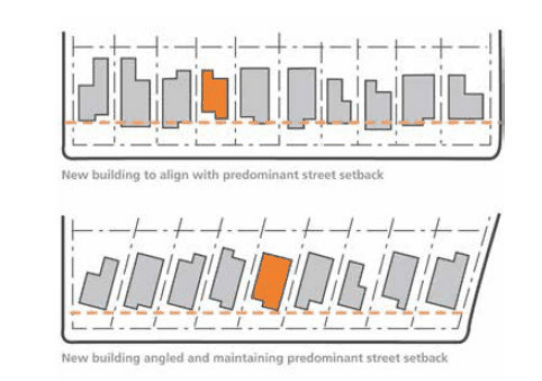
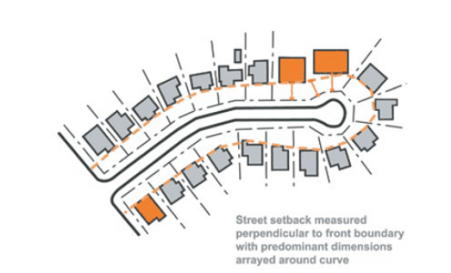
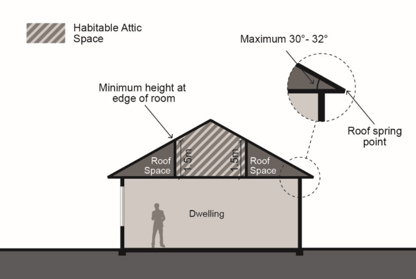
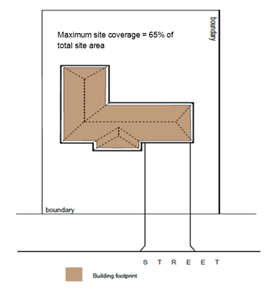
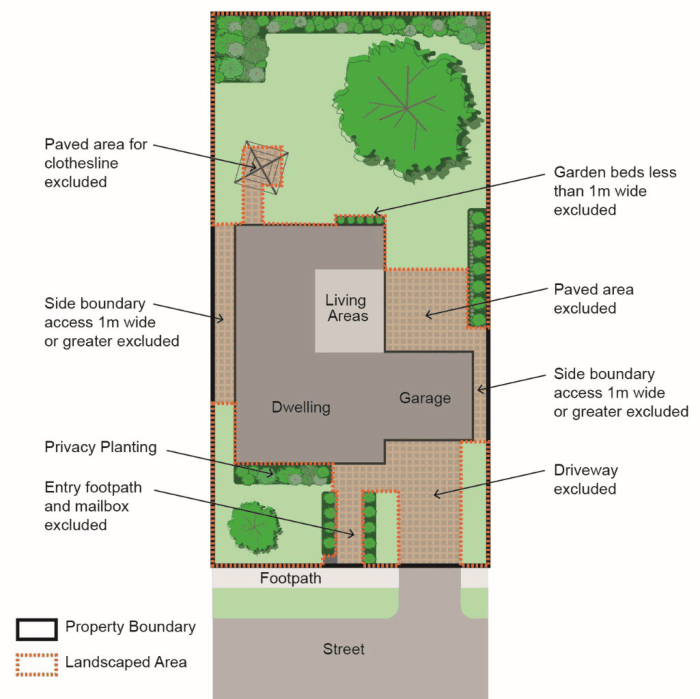
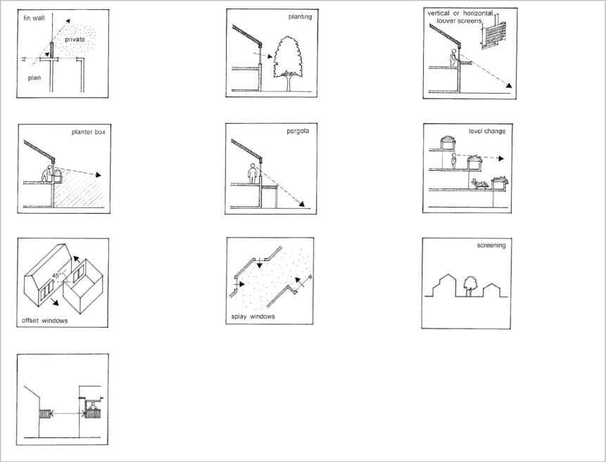

### PART B1

### DWELLING HOUSES AND

### SECONDARY DWELLINGS

#### This page has been left intentionally blank.

## 1. Introduction

### 1.1 Land to which this Part applies

This Part applies to development types detailed within this Part within land zoned Residential

under Cumberland Local Environmental Plan 2021.

### 1.2 Purpose of this Part

This Part is intended to guide the assessment of the development of a dwelling house,

secondary dwelling and associated outbuildings.

## 2. Objectives and Controls

### 2.1 Setbacks

#### Objectives

Ensure that the bulk and scale of new dwelling housing and alterations and additions to

existing dwelling houses maintains the established bulk, scale and existing streetscape

character.

Provide sufficient separation between dwelling housing/buildings to allow for privacy,

sunlight access and a sense of openness between buildings/dwelling housing.

Provide spatial separation between dwelling houses to minimise overshadowing of the

proposed development and manage potential privacy issues on surrounding residences

and their private open space.

#### Control

Setbacks shall be provided in accordance with Table 1 and measured in accordance

with Figure 1 and Figure 2.

Table 1: Dwelling house setbacks

| Setbacks |  |
|---|---|
| Front Setback (primary frontage) | Minimum 6m Dwelling house shall align with the street Balconies, porticos, entrances may protrude by a maximum of 0.9m |
| Side Setback | Minimum 0.9m |
| Side Setback (zero lot line) | Maximum length of walls along the first floor side boundaries shall be 10m without any indentations or offsets or other articulation features. Indentations or offsets shall be a minimum width of 1m |
| Rear Setback | Minimum 8m |
| Corner Dwelling House Setback | Minimum 2m (setbacks of less than 2m may be considered, subject to justification and merit assessment) A corner dwelling house shall address both streets through appropriate design Where a new building is located on a corner, the main frontage shall be determined on the basis of existing subdivision and streetscape patterns |
| Secondary Frontage (setback where dwelling faces secondary street) | Minimum 4m, with garage to be setback a minimum 5.5m from property boundary |

> [Picture on page 9: a picture, saved as a picture (images/part-b-development-in-residential-zones-page-9-1.gif, 150 dpi).]

Figure 1: Front setback alignment

> [Picture on page 9: a picture, saved as a picture (images/part-b-development-in-residential-zones-page-9-3.gif, 150 dpi).]

Figure 2: Front setback alignment (curved street/cul-de-sac)

### 2.2 Height

#### Objectives

Establish the maximum storey limit for single dwelling houses, their alterations and

additions and associated outbuildings.

Floor to ceiling heights provide well-proportioned rooms and spaces to allow for light

and ventilation into the built form and ensures good internal amenity.

Ensure sunlight access, privacy and amenity for new developments and neighbouring

properties is maintained.

#### Controls

A dwelling house and alterations and additions to a dwelling house shall be no more

than 2 storeys in height.

The minimum floor to ceiling height is 2.7m.

### 2.3 Attics

#### Objectives

Allow attics where they do not impact on the bulk and scale of a dwelling house.

Maintain sunlight access, privacy and amenity for the dwelling house and neighbouring

properties.

#### Controls

General Attics may be incorporated in a dwelling house where they comply with height and

floorspace ratio requirements.

The design of a dwelling house with attics is to minimise roof bulk.

Roofs containing attics are not to exceed a 32 degree pitch.

The external walls of the building should not extend above the attic floor level.

Attics are to be no greater than 25m² in floor area.

Attics are to be designed to fit within the building envelope (with the exception of dormer

windows) and are not to increase the bulk and height of the roof.

Attic spaces shall have 1.5m minimum wall height at the edge of the room with a 30

degree minimum ceiling slope.

Two storey dwellings Attics within roof spaces of a 2 storey dwelling house may be used for storage purposes

only and may not include any windows.

One storey dwellings Habitable attics are only permitted in one storey dwellings.

Habitable spaces within attics are to be designed with the ability to cross ventilate.

Dormer windows may be included in attics, provided they are no higher than the height

of the main roof of the dwelling house, no greater than 1.5m in width and are not to

incorporate or access a balcony.

Any proposed attic windows are not to overlook windows of adjacent dwellings or their

private open spaces. An outlook to the street should be provided from attic windows

where appropriate.

> [Picture on page 11: a picture, saved as a picture (images/part-b-development-in-residential-zones-page-11-1.gif, 150 dpi).]

Figure 3: Attic diagram

### 2.4 Streetscape

#### Objectives

Ensure that the appearance of development is of high visual quality that enhances and

addresses the street.

Ensure that dwelling house design, detailing and finishes provide an appropriate scale

to the street and add visual interest.

Ensure that a dwelling house located on corner lots are designed to address both street

frontages including windows and doors.

#### Controls

An articulation zone shall be permitted in the front setback to the primary street frontage.

The articulation zone is to be a maximum of 0.9m in depth.

Building elements permitted in the articulation zone include: verandahs, porticos/entry

features, bay windows, awnings, shade structure, window box treatment, balcony, patio,

pergola, terrace, verandah or steps.

The dwelling house entry shall be visible from the street and provide a sense of address.

Windows and doors in facades facing the street shall be provided in a balanced manner

and respond to the orientation and internal uses.

Large areas of blank, minimally or poorly articulated walls are not acceptable. Measures

to avoid this may include windows, awnings, sun shading devices, pergolas, or a

recognisable increased setback to the upper storey.

### 2.5 Building materials

#### Objective

Building design, detailing and finishes provide an appropriate scale to the street and

add visual interest.

#### Controls

New dwelling houses and alterations and additions to existing dwelling houses shall use

durable, quality materials that provide consistency and compatibility with the

streetscape and character of its locality.

Building materials and/or colours shall be used to reduce the appearance of bulk.

Building materials for dwelling houses and alterations and additions to existing dwelling

houses must be compatible with the streetscape and character of its locality.

Building materials and colours used for additions should integrate/blend with the original

structure.

### 2.6 Site coverage

#### Objectives

The site coverage must provide adequate areas for landscaping, including deep soil,

infiltration of stormwater and private open space.

Ensure that new dwelling housing and alterations and additions to existing dwelling

housing are consistent with the character and the future amenity of its locality.

Provide spatial separation between dwelling houses to minimise overshadowing of the

proposed development and manage potential privacy issues on surrounding residences

and their private open space.

#### Controls

Site coverage shall be provided in accordance with Table 2 and Figure 4.

The non-built upon area shall provide landscaping and deep soil opportunities as well

as provide for private open space.

Table 2: Site coverage requirements

| Lot Size | Maximum Site Coverage |
|---|---|
| 450m2 or less | 70% |
| 451m2 or greater | 65% |

> [Picture on page 13: a picture, saved as a picture (images/part-b-development-in-residential-zones-page-13-1.gif, 150 dpi).]

Figure 4: Site area diagram

### 2.7 Landscaping

#### Objectives

Maintain and enhance the existing streetscape and landscaped character of the

residential neighbourhoods.

Provide adequate opportunities for water infiltration and tall trees to grow and to spread,

so as to create a canopy effect.

Ensure that the landscaped area provided for a dwelling house has good solar access,

optimises usability, privacy, accessibility, neighbours’ amenity and provides a central

uninhibited area for passive and active recreation.

#### Controls

The total landscaped area for a dwelling house shall be as follows:

Table 3: Site coverage

| Lot Size | Minimum Landscaped Area |
|---|---|
| 450m2 or less | 15% |
| 451m2 or greater | 20% |

Landscaped area includes areas edged orange in Figure 5.

> [Picture on page 14: a picture, saved as a picture (images/part-b-development-in-residential-zones-page-14-1.gif, 150 dpi).]

Figure 5: Landscaped areas inclusion/exclusions

The landscaped area shall be a deep soil zone.

The majority of the deep soil zone shall be provided as a consolidated area at the rear

of a dwelling house to provide for continuous area of deep soil and vegetation and shall

extend across at least 50% of the rear boundary.

Deep soil zones shall have a minimum width of 1m.

Landscaped area above structures (or planting on slab) shall not be considered deep

soil zone.

### 2.8 Private open space

#### Objectives

Part of the private open space area serves as an extension of the dwelling house for

relaxation, dining, entertainment, recreation and children’s play.

Private open space:

• takes advantage of available outlooks or views and natural features of the site;

• reduces adverse impacts of adjacent buildings on privacy and overshadowing; and

• enhances surveillance, privacy and security when private open space adjoins public

space.

#### Controls

Private open space shall be located at ground level at the rear and/or side of the dwelling

house and shall have:

• a minimum area of 50m2 per dwelling house on lots greater than 451m2;

• a minimum area of 30m2 per dwelling house on lots 450m2 or smaller;

• a minimum dimension of 4m in any direction ( a minimum dimension of 3m in any

direction shall be considered on lots 450m2 or smaller); and

• direct access from a living area of the dwelling house. Private open space shall be bounded by buildings, fencing or other screening devices

and also incorporate dense landscaping that restricts views to a height of 1.8m.

Additional private open space may be located above ground in the form of a balcony

subject to site conditions and privacy considerations.

Private open space and balconies shall predominantly face north, east or west, to

enhance residential amenity.

### 2.9 Dwelling house mix

#### Objectives

Internal dwelling house sizes are suitable for a range of household types.

All rooms are adequate in dimension and accommodate their intended use.

#### Controls

General The size of the dwelling house shall determine the maximum number of bedrooms

permitted as set out in Table 4.

Table 4: Dwelling house layout

| Maximum Number of Bedrooms | Minimum Dwelling House Size* |
|---|---|
| 1 bedroom | 65m2 |
| 2 bedrooms | 85m2 |
| 3 bedrooms | 115m2 |
| 4 bedrooms | 130m2 |

\*Note: does not apply to secondary dwellings At least one living area shall be spacious and connect to private outdoor areas.

Bedroom size A new dwelling house shall contain a minimum of 1 master/double bedroom. The

minimum size for master/double bedroom shall be 12m2 excluding built-in wardrobes.

The minimum size for a single bedroom shall be 10m2 excluding built-in wardrobes.

### 2.10 Visual and acoustic privacy

#### Objectives

Ensure the siting and design of buildings/dwelling house provides visual and acoustic

privacy for residents and neighbours in their dwellings and private open spaces.

Protect private open spaces and living areas of adjacent dwellings from overlooking

through landscaping measures.

#### Controls

Visual Privacy Site layout and building design shall ensure that windows do not provide direct and close

views into windows, balconies or private open spaces of adjoining dwellings.

Windows to living rooms and main bedrooms shall be located to face the front and rear

of the site.

Bay windows and corner elements with windows at an angle to the main walls shall only

be located on the front facade or on the ground floor at the rear of the dwelling house.

These windows and corner elements shall not provide direct views onto adjoining private

open space.

The windows of a dwelling house are to be located so they do not provide direct and

close views into the windows of habitable rooms and private open spaces of adjoining

dwellings.

Direct views onto adjoining private open space shall be obscured by:

• existing dense vegetation or new planting;

• in case of windows overlooking neighbouring private open space areas fixed

obscure glazed or highlight window type; and/or

• in case of balconies/verandahs or similar elevated outdoor areas, screening is to be

provided that has a maximum area of 25% openings, is permanently fixed and made

of durable materials. Building design elements and landscaping shall be designed to increase visual privacy

including but not limited to, recessed balconies and/or vertical screens blade walls

between adjacent balconies, fencing, vegetation, louvers and pergolas which limit

overlooking both horizontally and vertically to habitable rooms and/or private open

space (refer to Figure 6).

> [Picture on page 17: a picture, saved as a picture (images/part-b-development-in-residential-zones-page-17-1.gif, 150 dpi).]

Figure 6: Privacy elements

The windows of living rooms that are within a distance of 9 metres of the windows of

living rooms (other than bedrooms) of adjacent dwellings shall be offset by a distance

sufficient to limit views between windows.

Window of upper floor habitable rooms (excluding bedrooms) shall have a minimum sill

height of 1500mm.

Any proposed attic windows are not to overlook windows of adjacent dwellings or their

private open spaces.

Juliet balconies and bay windows are not to project more than 600mm outside the

building envelope.

Acoustic privacy Where dwellings or dwelling house additions are proposed within close proximity to busy

roads and rail corridors, non-habitable rooms should be located on the noise affected

side of each dwelling house and should be able to be sealed off by doors from living

areas and bedrooms where practicable, whilst maintaining good housing design and

building appearance. Alternative design solutions incorporating noise attenuation

measures may be considered in these circumstances.

Air conditioners, swimming pool pumps and the like are not to exceed 5dba above

background noise levels and should not be audible from habitable rooms of

neighbouring dwellings.

For development adjacent to a rail corridor, or major road corridor with an annual

average daily traffic volume of more than 40,000 vehicles, applicants must consult State

Environmental Planning Policy (Infrastructure) 2007 and the relevant NSW guidelines.

Where acoustic reports are required by the SEPP and Guidelines, the building is to be

designed and detailed to comply with the recommendations of that report.

Balconies First floor rear balconies shall have a maximum depth of 3m.

Balconies at the rear shall be semi recessed and/or screened so that the view lines are

to the rear of that property and not to the adjacent properties. Screening shall be

provided by durable fixed privacy screens, minimum 1.5m in height as measured above

finished floor level and a minimum of 75% obscured.

Balconies should be oriented to the rear or face the street or another element of the

public domain, such as a park.

Balconies shall not be located on side walls elevations or on the corner of a dwelling

house. Exceptions may be granted where side elevation faces street or public open

space.

All balconies and decks higher than 800mm above existing ground level shall

incorporate privacy measures to ensure that the privacy of surrounding residents is not

unduly reduced.

### 2.11 Solar access

#### Objectives

Ensure adequate residential amenity through the provision of sunlight access and good

solar access to the living spaces and private open space areas of a dwelling house all

year round.

Ensure reasonable levels of direct sunlight to living areas and private open space of

subject and adjoining developments.

Minimise overshadowing of windows to internal living areas and private open space of

adjoining dwellings through building design.

#### Controls

Solar access Development is to be designed and sited to minimise the extent of shadows that it casts

on:

• private open space within the development;

• private open space of adjoining dwellings;

• public open space such as bushland reserves and parkland;

• solar collectors of adjoining development; and

• habitable rooms within the development and in adjoining developments. Subject and adjoining properties are to receive a minimum of 3 hours sunlight to one or

more living areas, and to at least 50% of the private open space between 8:00am and

4:00pm on 21 June. Where existing development currently receives less sunlight than

this requirement, this should not be unreasonably reduced.

In habitable rooms, head and sill heights of windows should be sufficient to allow sun

penetration into rooms.

Where practicable, living areas of a dwelling house such as kitchens and family rooms

shall be located on the northern side of a dwelling house and service areas such as

laundries and bathrooms to the south or west.

Building setbacks may need to be increased to maximise solar access and to minimise

overshadowing from adjoining buildings. Building heights may also need to be stepped

to maximise solar access.

Solar collectors C8. Solar collectors proposed as part of a new development shall have a minimum of 3

hours of solar access between 8am and 4pm on 21 June.

C9. Existing solar collectors on the adjoining properties shall have a minimum of 3 hours of

solar access between 8am to 4pm on 21 June.

C10. Where adjoining properties do not have any solar collectors, a minimum of 3m2 of north

facing roof space of the adjoining dwelling shall retain unimpeded solar access between

8am to 4pm on 21 June.

### 2.12 Cross ventilation

#### Objectives

The design of development is to utilise natural breezes for cooling and fresh air during

summer and to avoid unfavourable winter winds.

All dwelling houses are designed to maximise natural ventilation.

#### Controls

Rooms with high fixed ventilation openings such as bathrooms and laundries shall be

situated on the southern side to act as buffers to insulate the dwelling house from winter

winds. Garages may also useful as buffers on the southern and western sides.

Dwelling houses shall be designed with bathrooms, laundries and kitchens sited in a

position that allows natural ventilation of the room through an openable window.

### 2.13 Ancillary site facilities

#### Objectives

Ensure that site facilities are integrated into the development and do not diminish or

adversely affect residential amenity or dwelling house appearance.

Ensure site facilities are adequate, accessible to all residents and easy to maintain.

Cater for the efficient use of public utilities including water supply, sewerage, power,

telecommunications and gas services and for the delivery of postal and other services.

#### Controls

If provided, a maximum of one TV antenna for each dwelling house shall be provided.

Satellite dishes, telecommunication antenna and other ancillary facilities shall be

located away from the primary street frontage and incorporated into the overall dwelling

house design, where possible.

Open air clothes drying facilities should be provided in a sunny, well ventilated and

convenient location, which is adequately screened from the street and other public

places.

Mailbox structures shall:

• meet the relevant Australia Post service requirements; and

• be provided located centrally and close to the major street entry to the dwelling

house. Where an air conditioning unit is to be installed, the motor unit shall be located at the

rear or side of the dwelling house and shall be appropriately noise attenuated and

appropriately screened.

### 2.14 Fencing

#### Objectives

Establish a cohesive streetscape character with fencing that makes a positive

contribution to the visual character of the street and neighbourhood.

Protect the privacy, security and amenity of residents.

Enable passive surveillance of the dwelling house and adjoining public realm.

Provide fencing of an appropriate form and scale.

#### Controls

General New fences and walls are to be constructed of materials compatible with the associated

dwelling house and adjoining fences.

Fences are to respond to the architectural character of the street and/or area and the

buildings that they front.

Fences shall be stepped with the topography of the site.

Fencing shall be constructed of durable materials and must not contain barbed wire,

chain wire, razor wire, broken glass or be electrified.

Fencing along primary frontage Front fences should not exceed 1.5m in height. Any solid upstand section should be

limited to 900mm in height. The top half of the fence should be an open design with a

minimum open area of 50% (provided that there is articulation) for visibility to and from

the site.

Where noise attenuation is required under the State Environmental Planning Policy

(Infrastructure), front fences may be permitted to a maximum height of 1.8m and must

be setback a minimum of 1m from the boundary to allow landscape screening to be

provided. Landscape species chosen should be designed to screen the fence without

impeding pedestrian movements along the roadway. Front fences and landscape

screening must not compromise vehicular movement sightlines.

Gates shall be of materials that are consistent with the front fence and shall open into

the property and not onto a roadway, footpath or public space.

Suitable planting should be used to soften the visual relationship between fences and

the public domain.

Front fences shall not be constructed of solid pre-coated metal type materials.

Side and rear fences Side dividing fences where located within the front yard area shall not exceed a height

of 1.2m as measured above existing ground level and shall be a minimum of 50%

transparent.

Side fences shall not exceed a height of 1.2m within the front setback area of an

allotment.

Fences located on side or rear boundaries of the premises, behind the main building

line, shall be a minimum of 1.8m high, and not exceed a maximum height of 2.1m from

ground level.

The construction of side and rear fences is required where a suitable fence does not

exist, or the current fence is in poor condition.

Fencing on corner lots and secondary streets On secondary street frontages, fences shall be a minimum of 1.8m high and not exceed

a maximum height of 2.1m from the front boundary to the rear of the dwelling house and

shall be a minimum of 50% permeable.

For corner sites, the maximum construction height for walls, fences and landscaping

must be 900mm at the street corner of the allotment in an area measuring 1.5m x 1.5m

from the corner. This will assist sight lines for pedestrian and vehicular movements.

Council may permit fencing up to 1.2m where a corner lot ‘splay’ exists and it can be

demonstrated that fencing will not impede sight lines.

### 2.15 Rainwater tanks

#### Objectives

Facilitate the installation of rainwater tanks to facilitate capture of rainwater runoff to

reduce the consumption of potable water.

Minimise the visual impacts of rainwater tanks on the streetscape and neighbouring

properties.

#### Controls

Above ground rainwater tanks shall not be located within the front setback of a dwelling

house.

Rainwater tanks that are visible from the street shall be suitably screened, unless

Council is satisfied that the tank will not have an adverse impact on the streetscape.

### 2.16 Safety and security

#### Objectives

Design dwelling houses and their landscaping in order to maintain the safety and

security of a property.

Implement key principles of Crime Prevention through Environmental Design (CPTED)

for residential development through natural surveillance, access control and ownership.

Provide personal and property security for residents and visitors and enhance

perceptions of community safety.

Maximise potential for passive surveillance of the public domain from residential

dwelling houses.

Provide clear delineation between public and private domain through dwelling house

and landscape design.

#### Controls

Surveillance Dwelling houses adjacent to streets or public spaces shall be designed to allow casual

surveillance over the public area.  There shall be at least one living room window facing

that area.

Dwelling houses shall be oriented toward the street with entrances clearly visible both

day and night (battleaxe lots excepted).

Dwelling houses on battleaxe lots shall be designed with clear and uninterrupted sight

lines to entrances.

Blank walls along street frontages are prohibited.

Secondary entries to dwelling houses may be provided off rear lanes where:

• the lane is well lit;

• there is some natural surveillance of the lane from adjoining dwellings; and

• the lane provides access to other dwellings. The use of roller shutters on window and door openings that have frontage to the street

or are adjacent to public open space is discouraged.

Security grilles, where used, should complement the architectural features and materials

of the dwelling house.

Landscaping that may provide concealment opportunities for potential intruders shall be

avoided.

Ownership Each property shall be clearly identified by street number, which is visible from a car

on the street.

Property lines and private areas should be defined through building materials, fencing

and landscaping.

### 2.17 Cut and fill

#### Objectives

Encourage dwelling houses/buildings to follow the natural topography of the land to

minimise disruption on natural drainage patterns.

Reduce the bulk and scale of dwelling houses.

Ensure that excavation and filling of a site does not result in unreasonable amenity

impacts to adjoining dwellings.

#### Controls

Development shall be designed and constructed to integrate with the natural topography

of the site.

Cut and fill shall not create a detrimental impact on the overland flow of the site.

Fill, up to 300mm, is permitted within 900mm of side or rear boundaries.

Fill, 600mm or greater, is to be contained within the building envelope.

Where fill is more than 150mm deep, it shall not occupy more than 50% of the

landscaped area.

Cut is permitted to a maximum of 1m (excluding basements).

Cut is to be limited to 450mm where it is within 900mm of the rear or side boundaries.

Where cut and fill is proposed, applicants are to ensure that the privacy and amenity of

the development and surrounding dwellings is not affected.

Excavation or fill is not to result in the loss of significant mature trees within the side,

front or rear boundary setbacks.

### 2.18 Car parking and site access

#### Control

Car parking and site access will comply with the provisions set out in Part G3 of this

DCP.

### 2.19 Garages and carports

#### Control

Garage and carports will comply with the provisions set out in Part G3 of this DCP.

### 2.20 Outbuildings

#### Objectives

Ensure outbuildings complement and do not dominate or detract from the built form

character of the area.

Protect the visual and acoustic privacy and amenity of adjoining properties.

Maintain sufficient landscape and private open space areas and preserve existing

mature trees.

#### Controls

Area The total combined amount of enclosed floor space (with roof and walls) for outbuildings

shall not exceed 25m2.

Outbuildings are included as part of maximum site coverage calculations.

Height The height of outbuildings shall not exceed the following:

• Sheds 2.4m;

• Gazebos 2.7m;

• Cabanas 2.7m; and

• Garages 2.7m. The maximum building height of a new outbuilding or the alterations and additions to an

existing outbuilding is 4.8m above existing ground level.

Setbacks Outbuildings shall be setback behind the front building line. Outbuildings are to be

setback a minimum of 900mm of the property boundary.

The external wall of outbuildings cannot extend across more than 50% of the rear

property boundary.

Where adjoining properties contain an outbuilding on the property line, it may be

appropriate for an outbuilding to be built along the shared party wall.

Landscaped area Outbuildings shall be positioned to optimise private open space.

### 2.21 Secondary dwellings

#### Objectives

Ensure a secondary dwelling is integrated with the design of the principal dwelling

house, and is subservient in size, scale and nature to the principal dwelling house.

Ensure secondary dwellings does not detract from the amenity of adjoining neighbours.

Ensure that room sizes within secondary dwellings are functional, of sufficient size and

cater for the intended use of the secondary dwelling.

#### Controls

Design and appearance The appearance of a secondary dwelling is not to detract from the visual amenity of the

development on the site and surrounding locality.

Secondary dwellings shall compliment the principal dwelling house in style of

construction, design and materials.

Metal or corrugated iron materials should be avoided, with the exception of roofs.

Secondary dwellings that are attached to the principal dwelling are to be integrated with

the design, colour and materials of the principal dwelling house.

Conversions of existing outbuildings will only be considered where:

• The building meets the standards required by the Building Code of Australia (BCA);

and

• The principal dwelling house complies with the provisions of this DCP including, but

not limited to, landscaping, setback, and parking requirements. Secondary dwellings shall not be forward of the principal dwelling house.

Lot restriction The minimum site area for a detached secondary dwelling shall not be less than 380m2.

Height Detached secondary dwellings shall be a maximum of 2 storeys and, where 2 storeys

in height, shall not be any higher than the principal dwelling house.

Attics within secondary dwellings are not permitted.

The floor to ceiling height of a habitable room within a secondary dwelling shall not be

less than 2.4m and not greater than 2.7m.

A secondary dwelling, where located above a garage facing a laneway, is permitted to

be 1 storey above the garage.

Setbacks Setbacks for secondary dwellings shall be provided in accordance with Table 5.

Secondary dwellings are not permitted within the front setback area of the principal

dwelling house.

Table 5: Setbacks – for secondary dwellings

| Setback |  |
|---|---|
| Secondary Street (Corner sites) | Minimum 3m |
| Side | Minimum 0.9m, 1.5m for 2 storeys |
| Rear Setback | Minimum 0.9m, 3m for 2 storeys |

Minimum dwelling and bedroom size The size of a secondary dwelling shall not be less than 25m2.

The size of a bedroom of a secondary dwelling shall not be less than 8m2.

Orientation A living area of a secondary dwelling shall be north-facing where possible, and be

provided a window in its northern façade.

Private open space for secondary dwelling and principal dwelling houses shall be

provided with a northern orientation.

The living area of the secondary dwelling shall be designed to be accessible to a private

open space.

Privacy Secondary dwelling design shall minimise direct and close views into windows,

balconies or private open spaces of adjoining dwellings.

The windows of living rooms within a secondary dwelling that are within a distance of

9m of the windows of living rooms (other than bedrooms) of adjacent dwellings shall be

offset by a distance sufficient to limit views between windows. In case of windows

overlooking neighbouring private open space areas, windows shall be fixed obscure

glazed or highlight window type with a minimum sill height of 1.5m above finished floor

level.

Balconies of secondary dwellings shall be semi recessed and/or screened so that the

view lines are to the rear of the associated principal dwelling house and not to the

adjacent properties. Screening shall be provided by durable fixed privacy screens,

minimum 1.8m in height as measured above finished floor level and a minimum of 75%

obscured.

First floor balconies shall be a maximum of 12m2.

Balconies shall not be located on side walls. Exceptions may be granted where side

elevations face the street or public open spaces.

Site coverage The maximum site coverage for a secondary dwelling, combined with an existing or

proposed dwelling house shall remain compliant with the site coverage controls for a

single dwelling house.

Deep soil zone Establishment of a secondary dwelling must not reduce the deep soil zone to less than

the minimum required for the principal dwelling house.

Facilities A secondary dwelling shall contain at the minimum:

• kitchen/kitchenette;

• bathroom;

• living room; and

• bedroom. A common laundry may be provided to share for the principal and secondary dwellings.

Landscaped area Private open space within the landscaped area shall be shared between secondary

dwellings and principal dwelling house without any internal fencing or other method of

demarcation.

Private open space for secondary dwellings and principal dwelling house shall be

located at ground level at the rear of the principal dwelling house.

#### This page has been left intentionally blank.

> [Picture on page 29: a picture, saved as a picture (images/part-b-development-in-residential-zones-page-29-1.gif, 150 dpi).]
