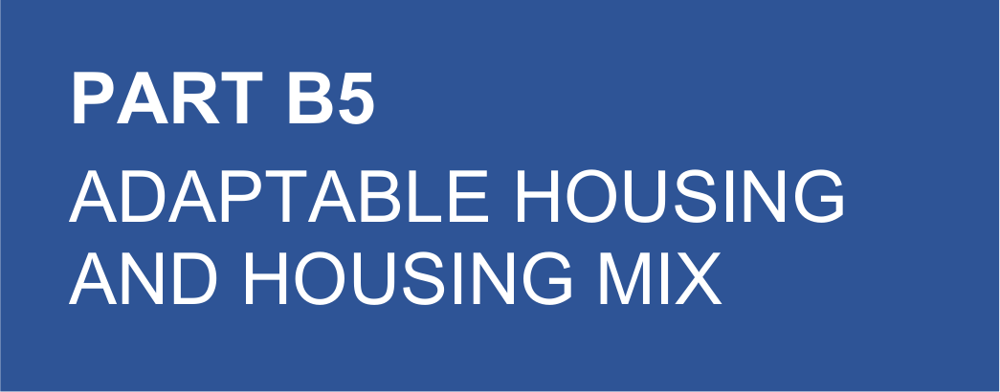

### PART B4

### BOARDING HOUSES

#### This page has been left intentionally blank.

## 1. Introduction

### 1.1 Land to which this Part applies

This Part applies to development of land for the purposes of a boarding house under the

Cumberland Local Environmental Plan 2021.

### 1.2 Purpose of this Part

This Part is intended to guide the assessment of boarding house developments under

Cumberland Local Environmental Plan 2021.

## 2. Objectives and Controls

### 2.1 General Objectives

Encourage the provision of high-quality boarding houses within the Cumberland City.

Ensure the size and design of boarding house developments are suitable for the zone

in which they are proposed to be located.

Ensure the safety, security, health and wellbeing of boarding house residents and the

local community through appropriate location, design and management of boarding

houses.

Ensure that boarding houses are appropriately located within the Cumberland City to

ensure the safety, security, health and amenity for both boarding house residents and

adjoining neighbours.

### 2.2 Character and amenity

#### Objectives

Conserving the physical character where relatively intact and of good quality.

Maintaining the traditionally diverse population and housing mix.

Ensuring new development is in context with surrounding development and has

minimum adverse impact on environmental quality or residential amenity.

#### Controls

The design of a boarding house is to be compatible with the character of the local area.

New boarding houses (including alterations and additions) shall comply with the building

setback controls comparable to the predominant building type in the relevant zones as

set out below in Table 8.

Table 8: Building envelope control

| Zone | Development Type |
|---|---|
| R2 Low Density Residential | Dwelling house |
| R3 Medium Density Residential | Multi-dwelling housing |
| R4 High Density Residential | Residential flat building |
| B1 Neighbourhood Centre | Shop top housing |
| B2 Local Centre | Shop top housing |
| B4 Mixed Use | Shop top housing |

### 2.3 Operational management

#### Objectives

Minimise the potential adverse impacts of boarding houses on adjoining properties and

the wider locality by introducing effective planning, design and on-going management

controls.

Ensure an acceptable level of amenity in boarding house premises to meet the needs

of residents.

Ensure that acceptable levels of service provision are maintained.

#### Controls

General All boarding houses are to have a managing agent, contactable 24 hours per day, 7

days per week. If a boarding house has capacity to accommodate 20 or more lodgers,

it is required that there be an on-site resident manager. The on-site resident manager

must be 18 years of age or over.

The name and contact details of the on-site manager or managing agent is to be

provided externally at the front entrance of the boarding house and internally within the

communal living area.

A Plan of Management must accompany a development application for any new

boarding house or alterations/and or additions to an existing boarding house.

‘House Rules’ must be prepared as part of the Plan of Management. The approved

House Rules must be clearly displayed within each bedroom and within the communal

living area of the boarding house.

An Emergency Evacuation Plan must be prepared as part of the Plan of Management

detailing the evacuation procedures in the event of the emergency, provision of resident

log book, identifying the assembly point and detailing how residents will be made aware

of the procedures contained within the Plan.

A list of contact details must be clearly displayed within the common area including the

contact details for: the managing agent; emergency services including fire, ambulance

and police; utilities such as gas, electricity and water, and any approved emergency

repair persons, such as a plumber and electrician.

Developments of 3 storeys or more must incorporate a lift capable of accommodating a

stretcher and must be accessible at each floor.

The Manager/Caretaker bedroom plus ensuite must be a minimum of 16m².

Secure storage facilities must be provided with a minimum capacity of 1m² per person.

This space must be lockable.

Internal communal living area Living areas are to have a minimum dimension of 4m.

Communal living area/s must be located on the ground floor and are to be located near

commonly used spaces or adjacent to the communal outdoor open space.

Communal living area/s should have a northerly aspect, where possible, and should be

located where they will have a minimal impact on adjoining properties in terms of noise

generation and visual privacy.

Consideration should be given to ensure that bedrooms adjoining the living area/s are

protected from excessive noise.

Laundry facility requirements 1 automatic washing machine for the first 12 residents plus 1 automatic washing

machine for every additional 12 residents thereafter or part thereof.

1 domestic dryer for first 12 residents plus 1 domestic dryer for every additional 12

residents thereafter or part thereof.

1 large laundry tub with running hot and cold water for up to 12 residents and 1 additional

tub for premises that contain more than 12 residents.

Location of clothes drying facilities Drying areas must not be visible from the street, or any public place.

Drying areas shall be located to maximise solar access.

Clothes drying and laundry facilities shall be wheelchair accessible.

### 2.4 Visual privacy

#### Objective

O1 Building design and landscaping elements should ensure privacy for the development

and adjoining residential uses without compromising access to light, air and views from

habitable rooms and private open space.

#### Controls

Placement of windows and other openings should not result in direct overlooking of

adjoining residential uses. Where overlooking may occur, use of highlight windows,

window screening or other privacy measures should be provided.

Landscape screening should be provided within outdoor communal areas to minimise

overlooking of adjoining properties.

The main entrance of the boarding house should be provided within the front (street)

elevation to address the street and to minimise potential privacy impacts upon

neighbouring properties.

### 2.5 General design

#### Objective

O1 Ensure an acceptable level of amenity in boarding house premises to meet the needs

of residents.

#### Controls

Boarding houses must provide the following facilities within each building:

• bedrooms;

• laundry facilities;

• adequate communal kitchen facilities and dining area (one per floor for multi storey

boarding houses) where individual kitchenettes are not provided within the boarding

rooms;

• individual ensuite and/or adequate communal bathroom facilities;

• communal living area (one per floor for boarding houses more than three storeys in

height);

• communal garbage storage and recycling facilities;

• communal outdoor open space area; and

• on-site boarding house manager (where 20 or more lodgers). Flyscreens are to be provided to all openable windows and doors.

At least one phone must be provided within each communal area to allow residents to

contact emergency services.

A safety switch must be fitted to all electrical meter box/es.

A maximum of one television antenna is to be provided per boarding house.

### 2.6 Acoustics

#### Objectives

O1. Ensure an acceptable level of amenity in boarding house premises to meet the needs

of residents whilst minimising potential noise adverse impacts to surrounding

development.

#### Controls

Boarding house design should attempt to locate bedrooms away from significant internal

and external noise sources.

During the design of a boarding house consideration must be given to the potential

acoustic impact upon adjoining neighbours. The following noise minimisation measures

should be considered at the design stage:

• offsetting the location of windows in respect to the location of windows on

neighbouring properties;

• appropriate building separation and setbacks to neighbouring properties;

• sensitive location of communal outdoor areas away from main living areas or

bedroom windows of any adjoining dwelling;

• the use of screen fencing or acoustic barriers as a noise buffer to external noise

sources;

• incorporation of double glazing for windows; and

• locate similar building uses (such as bedrooms or bathrooms) back to back

internally within the building, to minimise internal noise transmission.

### 2.7 Car parking

Car parking will comply with the provisions set out in Part G3 of this DCP.

#### This page has been left intentionally blank.

> [Picture on page 51: a picture, saved as a picture (images/part-b-development-in-residential-zones-page-51-1.gif, 150 dpi).]
