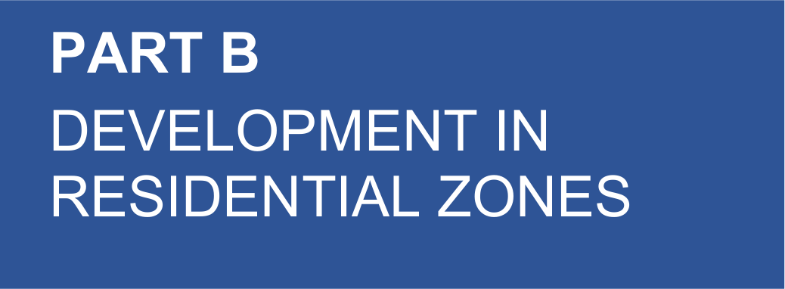
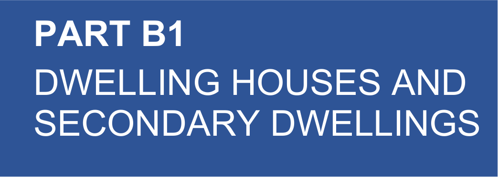

# Cumberland Development Control Plan 2021 - Part B Development in Residential Zones

> This chapter is split into 5 section file(s), one per sub-part heading, in the order they appear in the PDF.

Source PDF: [Cumberland DCP Part B.pdf](Cumberland%20DCP%20Part%20B.pdf)

> [Picture on page 1: a picture, saved as a picture (images/part-b-development-in-residential-zones-page-1-1.gif, 150 dpi).]

### PART B

### DEVELOPMENT IN

### RESIDENTIAL ZONES

#### This page has been left intentionally blank.

### Part B Contents

| PART B1 – DWELLING HOUSES AND SECONDARY DWELLINGS |  | B6 |
|---|---|---|
| 1. Introduction |  | B8 |
| 2. Objectives and Controls |  |  |
| 2.1 | Setbacks | B8 |
| 2.2 | Height | B9 |
| 2.3 | Attics | B10 |
| 2.4 | Streetscape | B11 |
| 2.5 | Building Materials | B12 |
| 2.6 | Site Coverage | B12 |
| 2.7 | Landscaping | B13 |
| 2.8 | Private Open Space | B14 |
| 2.9 | Dwelling House Mix | B15 |
| 2.10 | Visual and Acoustic Privacy | B16 |
| 2.11 | Solar Access | B18 |
| 2.12 | Cross Ventilation | B19 |
| 2.13 | Ancillary Site Facilities | B19 |
| 2.14 | Fencing | B20 |
| 2.15 | Rainwater Tanks | B21 |
| 2.16 | Safety and Security | B22 |
| 2.17 | Cut and Fill | B23 |
| 2.18 | Car Parking and Site Access | B23 |
| 2.19 | Garages and Carports | B24 |
| 2.20 | Outbuildings | B24 |
| 2.21 | Secondary Dwellings | B25 |
| PART B2 – LOW RISE MEDIUM DENSITY DEVELOPMENT |  | B29 |
| 1. Introduction |  | B31 |
| 2. Relationship with Design Guide |  | B31 |
| 2.1 | Relationships to Low Rise Housing Diversity Design Guide for Development Applications | B31 |

| 2.2 Development Control Standards to consider for | B31 |
|---|---|
| Low Rise Housing Diversity Development |  |
| 3. Objectives and Controls |  |
| 3.1 Site Frontage | B34 |
| 3.2 Overshadowing | B34 |
| 3.3 Site Layout | B35 |
| 3.4 Landscaping | B35 |
| PART B3 – RESIDENTIAL FLAT BUILDINGS | B37 |
| 1. Introduction | B39 |
| 2. Relationship with SEPP 65 and Apartment Design Guide | B39 |
| 2.1 Relationship to SEPP65 / NSW Apartment Design Guide | B39 |
| 2.2 Development Control Standards to consider for Residential | B39 |
| Flat Buildings |  |
| 3. Objectives and Controls |  |
| 3.1 Building Envelope | B40 |
| 3.2 Basement Design | B40 |
| 3.3 Car Parking | B41 |
| PART B4 – BOARDING HOUSES | B43 |
| 1. Introduction | B45 |
| 2. Objectives and Controls |  |
| 2.1 General Objectives | B45 |
| 2.2 Character and Amenity | B45 |
| 2.3. Operational Management | B46 |
| 2.4 Visual Privacy | B47 |
| 2.5 General Design | B48 |
| 2.6 Acoustics | B48 |
| 2.7 Car Parking | B49 |
| PART B5 – ADAPTABLE HOUSING AND HOUSING MIX | B51 |
| 1. Introduction | B53 |
| 2. Objectives and Controls |  |
| 2.1 Adaptable Housing | B53 |

### 2.2 Housing Mix

B53

#### This page has been left intentionally blank.

> [Picture on page 6: a picture, saved as a picture (images/part-b-development-in-residential-zones-page-6-1.gif, 150 dpi).]

<!-- sections -->
## Sections

1. [Part B1 DWELLING HOUSES AND SECONDARY DWELLINGS](01-b1-dwelling-houses-and-secondary-dwellings.md)
2. [Part B2 LOW RISE MEDIUM DENSITY DEVELOPMENT](02-b2-low-rise-medium-density-development.md)
3. [Part B3 RESIDENTIAL FLAT BUILDINGS](03-b3-residential-flat-buildings.md)
4. [Part B4 BOARDING HOUSES](04-b4-boarding-houses.md)
5. [Part B5 ADAPTABLE HOUSING AND HOUSING MIX](05-b5-adaptable-housing-and-housing-mix.md)
