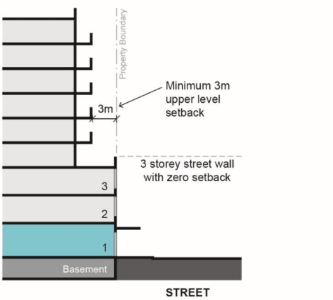
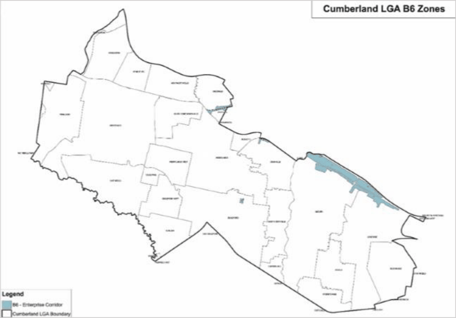

## 3. Objectives and controls

### 3.1 Lot size and frontage

#### Objectives

Avoid land locking of adjoining sites and creation of isolated sites.

Facilitate development that is compatible with both the established character and desired future amenity.

Provide sufficient lot frontage for development to accommodate adequate vehicular access and basement car parking and enable streetscape activation to occur.

Provide sufficient lot width to provide adequate building depth and separation between buildings.

#### Controls

C1. Unless otherwise stated as site specific controls in this DCP, the minimum lot frontage for shop top housing development within Zone B2 Local Centre and Zone B4 Mixed Use shall be:

• up to 3 storeys: 20m; and

• 4 storeys or greater: 30m.

C2. Lot size and frontage shall provide an appropriate site configuration that achieves:

• adequate car parking area and manoeuvring for vehicles in accordance with AS2890;

• ground level frontage that is activated and not dominated by access apertures to car parking areas; and

• the required setbacks and building separation set out by this DCP or the Apartment Design Guide.

C3. Council may require the consolidation of more than 1 existing land holding to be undertaken in order to meet all the requirements of this development control plan.

C4. Commercial development is not permitted on battleaxe lots.

C5. In instances where lot amalgamation in order to meet the requirements of this DCP cannot be achieved, refer to Part A3 of this DCP.

### 3.2 Setbacks and separation

#### Objectives

Ensure a consistent built streetscape and continuous built edge adjacent to footpaths that will reinforce the retail activity and commercial uses within the majority of the town centre.

Protect the amenity of adjoining sites and reduce the impact of buildings on the public domain.

Ensure appropriate building setback and separation to minimise overshadowing of residential areas and the public domain.

#### Controls

Front setback

C1. Front Setback: Nil (except for B1 Neighbourhood Centre zoned land). A greater setback may be required to align with the predominant street setback.

C2. For B2 and B4 zones, or unless otherwise stated in site specific controls within this DCP, a street wall height (i.e. podium height) of 3 storeys with a zero setback to the street is required.

C3. A minimum 3m setback shall be provided for levels above the street wall height for the podium.

C4. Levels above street wall height are to be setback to ensure visual separation. This may be achieved through upper level setbacks, material variances and/or horizontal recesses.

C5. Council may require alternative street wall heights and setbacks where compatibility with the existing prevailing built form within the immediate context can be demonstrated

> [Picture on page 7: a picture, saved as a picture (images/part-c-development-in-business-zones-page-7-6.gif, 150 dpi).]

or is necessary.

Figure 1: Street wall / podium height

Side and rear setback

C6. Where a site adjoins any residential zone (and not separated by a road), the side setback shall be a minimum of 3m.

C7. Rear Setback: 15% of site length where boundary adjoins a residential development or a residential zone.

### 3.3 Landscaping and open space

#### Objectives

Provide open space that is accessible for all, functional and attractive, and provides for passive recreation and landscaping.

Ensure safe public open spaces which allow for casual surveillance.

Improve visual quality and amenity of business and commercial precincts through preserving and retaining existing mature trees within landscaping design.

Enhance the existing streetscape and promote a scale and density of new planting that softens the visual impact of buildings.

#### Controls

Landscaping

C1. Landscape reinforces the architectural character of the street and positively contributes to maintaining a consistent streetscape character.

C2. Landscaping is to form an integral part of the overall design concept.

C3. At grade car parking areas, particularly large areas, shall be landscaped so as to break up large expanses of paving. Landscaping shall be required around the perimeter and within large car parks.

C4. In open parking areas, 1 shade tree per 10 spaces shall be planted within the parking area.

C5. Fencing shall be integrated as part of the landscaping theme so as to minimise visual impacts and to provide associated site security.

C6. Paving and other hard surfaces shall be consistent with architectural elements.

C7. For developments with communal open space, a garden, maintenance and storage area are to be provided, which is efficient and convenient to use and is connected to water for irrigation and drainage.

Street trees

C8. Street trees shall be planted at a rate of 1 tree per 10 lineal metres of street frontage, even in cases where a site has more than 1 street frontage, excluding frontage to laneways.

C9. Street tree planning shall be consistent with the relevant Public Domain Plan, strategy, plan, guideline or policy.

C10. Significant existing street trees shall be conserved. Where there is an absence of existing street trees, additional trees shall be planted to ensure that the existing streetscape is maintained and enhanced.

C11. Vehicular driveways shall be located a minimum of 3m from the outside edge of the trunk measured 1m above the existing ground level of any street tree to be retained.

C12. Services shall be located to preserve significant trees.

C13. At the time of planting, street trees shall have a minimum container size of 200 litres and a minimum height of 3.5m, subject to species availability.

Open space

C14. Where buildings are setback from the street, the resulting open space shall provide usable open space for pedestrians.

C15. Open space areas are to be paved in a manner to match existing paving or to suit the architectural treatment of the proposed development.

### 3.4 Public art

#### Objectives

Provide art works which are integrated into broader development and planning of business centres.

Avoid standalone public art projects that fail to address the locality and its culture.

#### Controls

C1. Public art is encouraged to be provided within the business centres, in accordance with Council’s relevant adopted Policy.

C2. Public art provided shall develop the cultural identity of the community and reflect the culture of the community.

C3. Artworks shall be integrated into the design of buildings and the landscape.

### 3.5 Streetscapes

#### Objectives

Ensure new and infill development respects the character and integrity of the existing streetscape, and is sympathetic in terms of scale, form, height, shopfront character, parapet, verandah design, and colours and materials, in a manner which interprets the traditional architecture, albeit in modern forms and materials.

Address and activate street corners and to create landmarks that assist in defining local character, helping people to navigate easily through the place.

#### Controls

C1. New shopfronts shall be constructed in materials which complement the existing or emerging character of the area.

C2. Development shall provide direct access between the footpath and the shop.

C3. Security bars, and roller shutters are not permitted; however, transparent security grilles of lightweight material may be used.

C4. Signage shall be minimised and coordinated to contribute to a more harmonious and pleasant character for the locality.

C5. Require buildings at visually significant locations to be well designed and respond to the different characteristics of the streets the address.

C6. Development on corner sites will be required to accommodate a splay corner to facilitate improved traffic conditions.

C7. Buildings on corners must address both frontages to the street and/or public realm to:

• articulate street corners by massing and building articulation, to add variety and interest to the street;

• present each frontage of a corner building as a main street frontage, reflect the architecture, hierarchy and characteristics of the streets they address, and align and reflect the corner conditions; and

• development on corner sites will require land to be dedicated to accommodate a splay corner to facilitate improved traffic conditions.

### 3.6 Building Use

#### Objective

O1. Encourage commercial activity within Cumberland’s town centres.

#### Control

C1. Ground floor uses in business zones are to comprise non-residential uses.

### 3.7 Façade design, shopfront and materials

#### Objectives

Ensure building longevity and a visually positive streetscape through the provision of high quality materials and finishes.

Design buildings to maintain a pedestrian scale through articulation and detailing on the lower levels of the building.

Enhance the quality and character of the business precinct, and promote a visually interesting skyline.

Provide for active shopfronts and vibrant commercial centres through activating the street, during both trading and non-trading periods.

Create an inviting, visually pleasing and safe environment.

#### Controls

Façade design

C1. Facade proportions and vertical and horizontal emphasis shall be appropriate to the scale of development and its interaction with the streetscape. Vertical emphasis shall be incorporated above awnings.

C2. Building facades at street level along primary streets and public places consist of a minimum of 80% for windows/glazed areas and building and tenancy entries.

C3. Visible light reflectivity from building materials used on the facades of new buildings shall not exceed 20%.

C4. Building services, such as drainage pipes, shall be coordinated and integrated with overall façade and balcony design.

C5. Ventilation louvres and carpark entry doors shall be integrated with the design of the overall façade.

C6. Security devices fitted to building entrances and windows shall be transparent to allow for natural surveillance, and made of light weight material.

C7. The ground floor level must have active uses facing streets and public open spaces.

Shopfronts

C8. Retail outlets and restaurants are located at the street frontage on the ground level.

C9. Where possible, offices should be located at first floor level or above.

C10. A separate and defined entry shall be provided for each use within a mixed use development.

C11. Street and tenancy numbers shall be located on shopfronts and awnings and shall be clearly visible from the street.

C12. Solid roller shutters and security bars, either internal or external, that block out or obscure windows or entrances, are not permitted.

Materials

C13. High quality design, construction and materials shall be implemented to ensure the building has a long life and requires low maintenance.

C14. Building materials and finishes complement the finishes predominating in the area. Different materials, colours or textures may be used to emphasise certain features of the building.

C15. New buildings shall incorporate a mix of solid (i.e. masonry concrete) and glazed materials, consistent with the character of buildings in the locality. Active street frontages are to maximise the use of glazing.

C16. All street frontage windows located at ground floor level are to be clear glazing.

C17. Building finishes should not result in causing glare that creates a nuisance and hazard for pedestrians and motorists in the centre.

Advertising in shopfronts

C18. For advertising on shopfronts, refer to Part G1 of this DCP.

### 3.8 Ceiling height

#### Objectives

Ensure an acceptable level of amenity and future flexibility is provided for new commercial and residential developments.

Encourage articulation of the façade of the building by variation in the ceiling heights of the various floors, which gives the building a top, middle and base.

#### Controls

C1. The minimum finished floor level (FFL) to finished ceiling level (FCL) in a commercial building, or the commercial component of a building, shall be as follows:

• 3.5m for ground level (regardless of the type of development); and

• 3.3m for all commercial/retail levels above ground level.

C2. Refer to the ADG for minimum ceiling heights for all residential levels above ground floor in mixed use developments.

### 3.9 Roof design

#### Objectives

Incorporate well designed rooftops that add visual interest to the skyline when viewed from street level or surrounding key vantage points.

Ensure development captures the potential to create communal open space and landscaping on roofs that are well designed and safe.

#### Controls

C1. Roof design shall be integrated into the overall building design.

C2. Design of the roof shall achieve the following:

• concealment of lift overruns and service plants;

• presentation of an interesting skyline;

• enhancing views from adjoining developments and public places; and

• complement the scale of the building and surrounding development.

C3. Roof forms shall not be designed to add to the perceived height and bulk of the building.

C4. Landscaped and communal open space areas on flat roofs shall incorporate shade structures and wind screens.

C5. Communal open space, lift overruns and service plants shall be setback from the building edge so as to be concealed.

C6. Roof design is to respond to the orientation of the site, through using eaves and skillion roofs to respond to sun access.

C7. Consideration should be given to facilitating the use of roofs for sustainable functions, such as:

• installing rain water tanks for water conservation;

• orient and angle roof surfaces suitable for photovoltaic applications; and

• allow for future innovative design solutions such as water features or green roofs.

### 3.10 Awnings

#### Objectives

Ensure the amenity of pedestrians through weather protection.

Maintain a consistent streetscape and provide visual interest through a continuous awning theme.

#### Controls

C1. Continuous awnings are required to be provided to all active street frontages (except laneways).

C2. Awnings generally:

• should be flat;

• must be a minimum 2.4m deep;

• are to be setback up to 1.2m from kerb to allow for clearance of street furniture, trees, and other public amenity elements;

• have a minimum soffit height of 3.2m; and

• have slim vertical fascias and/or eaves not to exceed 300mm.

C3. Awnings on street corner buildings shall wrap around corners.

C4. Awning design must match building facades and be complementary to those of adjoining buildings and maintain continuity.

C5. Canvas blinds along the street edge are not permitted.

C6. Awnings are to be located over all building entries to indicate entry points.

C7. In the event of separated buildings, awnings should be complementary to each other in regards to size, design and location.

C8. Awning design shall have consideration of growth pattern of mature trees. Cut outs or offsets in awnings for trees and light poles are not acceptable.

C9. Lighting fixtures shall be recessed into the design, with all wiring and conduits to be concealed.

C10. The drainage from stormwater from awnings is not be visible from the footpath and it is to be concealed or recessed into the ground floor frontage of the building.

C11. Street awnings which appear as horizontal elements along the façade of the building shall be provided as part of all new development.

C12. Awnings shall provide weather protection and must not be perforated.

### 3.11 Visual and acoustic privacy

#### Objectives

Ensure new development achieves adequate visual and acoustic privacy levels for occupants, neighbouring residents, commercial buildings and private open spaces, through the provision of acoustic privacy design.

Maximise outlook and views to the street and public spaces without compromising visual privacy.

Minimise impacts from noise generating infrastructure.

#### Controls

Visual privacy

C1. New development shall be located and oriented to maximise visual privacy between buildings on site and adjacent buildings, by providing adequate building setbacks and separation.

C2. Residential components of mixed use developments are to comply with the controls in Part B of this DCP and the Apartment Design Guide (as applicable).

Acoustic privacy

C3. Conflicts between noise, outlook and views are to be resolved by using design measures, such as double glazing, operable screened balconies and continuous walls to ground level courtyards, where they do not conflict with streetscape or other amenity requirements.

C4. Where commercial/office uses and residential uses are located adjacent to each other, air conditioning units, buildings entries and the design and layout of areas serving after hours uses shall be located and designed to minimise any acoustic conflicts.

C5. Developments shall be designed to minimise the impact of noise associated with uses whose hours may extend outside of normal business hours, including restaurants and cafes. Operation includes loading/unloading of goods/materials, and the use of plant and equipment at a proposed commercial premise.

C6. Mixed use developments shall be designed to locate driveways, carports or garages away from bedrooms.

C7. Mechanical plant must be visually and acoustically isolated from residential uses.

C8. New development shall comply with the provisions of the relevant acts, regulations, environmental planning instruments, Australian Standards and guidelines as applicable for noise, vibration and quality assurance. This includes:

• Development Near Rail Corridors and Busy Roads, NSW Department of Planning, December 2008 – Interim Guidelines;

• NSW Noise Policy for Industry;

• Interim Guideline for the Assessment of Noise from Rail Infrastructure Projects; and

• NSW Road Noise Policy.

Interface with schools, places of public worship, and public precincts

C9. Where a site adjoins a school, place of public worship or public open space, the building design will:

• incorporate an appropriate transition in scale and character along the site boundary(s); and

• present an appropriately detailed facade and landscaping in the context of the adjoining land use.

This interface shall be identified in the site analysis plan and reflected in building design.

C10. The potential for overlooking of playing areas of schools shall be minimised by siting, orientation or screening.

C11. Fencing along boundaries shared with public open space shall have a minimum transparency of 50%.

C12. Sight lines from adjacent development to public open space shall be maintained and/or enhanced. Direct, secure private access to public open space is encouraged.

### 3.12 Hours of operation

#### Objectives

Create vibrant centres by encouraging business activity.

Ensure the operation of commercial or retail uses does not cause undue disturbance to the amenity of surrounding residential areas.

#### Controls

C1. Where no existing hours of operation or conditions exist, the retail and/or commercial development are to operate within the following hours:

• 6.00 am to 10.00 pm Monday to Saturday and 9.00 am to 6.00 pm on a Sunday or a public holiday; or

• 7.00 am to 9.00 pm Monday to Saturday and no operation on a Sunday or a public holiday, for development adjoining or is opposite a residential lot within a residential zone.

C2. For hours extending outside the times identified in C1, applicants must demonstrate that noise, amenity and light impacts and crime prevention factors have been considered and addressed, through the submission of the following reports for assessment:

• acoustic report (Note: for developments in town centres where there is no residential development within close proximity of the development site, Council may consider waiving the need for an acoustic report for hours of operation up to midnight);

• Crime Prevention Through Environmental Design (CPTED) report; and

• Plan of Management.

### 3.13 Solar access

#### Objectives

Ensure development does not hinder the obtainment of adequate daylight access to habitable rooms of other dwellings.

Provide public open spaces that receive adequate daylight access for the enjoyment of all users.

New buildings are designed to protect solar amenity for the public domain and residents.

#### Controls

C1. Developments shall be designed to maximise northern aspects for residential and commercial uses.

C2. The living rooms and private open spaces for at least 70% of dwellings on neighbouring sites shall receive a minimum of 3 hours of direct sunlight between 8am and 4pm in mid-winter.

C3. A minimum of 50% of public open spaces and a minimum of 40% of school playground areas are to receive 3 hours of daylight between 9am and 3pm in mid-winter.

C4. Developments shall be designed to control shading and glare.

C5. Shadow diagrams (plan and elevation) shall accompany development applications for buildings, to demonstrate that the proposal will not reduce sunlight to less than 3 hours between 8am and 4pm on 21 June.

### 3.14 Natural ventilation

#### Objectives

Ensure buildings are designed to provide direct access to natural ventilation and to assist in promoting thermal comfort for occupants.

Reduce energy consumption by minimising the use of mechanical ventilation, particularly air conditioning.

#### Controls

C1. Natural ventilation is incorporated into the building design.

C2. Orient buildings to maximise prevailing breezes.

### 3.15 Building maintenance

#### Objectives

Natural ventilation is incorporated into the building design.

Orient buildings to maximise prevailing breezes.

#### Controls

C1. Windows shall be designed to enable cleaning from inside the building.

C2. Durable materials, which are easily cleaned and graffiti resistant, are to be selected.

C3. Building maintenance systems are to be incorporated and integrated into the design of the building form, roof and façade.

### 3.16 Energy efficiency

#### Objectives

Promote sustainable development which uses energy efficiently and minimises non-renewable energy usage in the construction and use of buildings.

Ensure that development contributes positively to an overall reduction in energy consumption and greenhouse gas emissions.

Reduce energy bills and the whole of life cost of energy services.

#### Controls

C1. Improve the control of mechanical space heating and cooling by designing heating/ cooling systems to target only those spaces which require heating or cooling, not the whole building.

C2. Improve the efficiency of hot water systems by:

• encouraging the use of solar powered hot water systems. Solar and heat pump systems must be eligible for at least 24 Renewable Energy Certificates (RECs) and domestic type gas systems must have a minimum 3.5 star energy efficiency rating;

• insulating hot water systems; and

• installing water saving devices, such as flow regulators, 3 stars Water Efficiency Labelling and Standards Scheme (WELS Scheme) rated shower heads, dual flush toilets and tap aerators.

C3. Reduce reliance on artificial lighting and design lighting systems to target only those spaces which require lighting at any particular ‘off-peak’ time, not the whole building.

C4. Incorporate a timing system to automatically control the use of lighting throughout the building.

C5. All non-residential development Class 5-9 will need to comply with the Building Code of Australia energy efficiency provisions.

C6. An Energy Efficiency Report from a suitably qualified consultant that demonstrates a commitment to achieve no less than 4 stars under the Australian Building Greenhouse Rating Scheme or equivalent must be provided for all commercial and industrial development with a construction cost of over $5 million.

### 3.17 Water efficiency

#### Objectives

Ensure appropriate building design, site layout, internal design and water conserving appliances are adopted to increase water efficiency.

Encourage the collection and reuse of stormwater and reduce stormwater runoff into new development.

#### Controls

C1. New developments shall connect to recycled water if serviced by a dual reticulation system for permitted non potable uses, such as toilet flushing, irrigation, car washing, firefighting and other suitable purposes.

C2. Where a property is not serviced by a dual reticulation system, development shall include an onsite rainwater harvesting system or an onsite reusable water resource for permitted non potable uses, such as toilet flushing, irrigation, car washing, firefighting and other suitable purposes.

Rainwater tanks shall be installed as part of all new development in accordance with the following:

• the rainwater tank shall comply with the relevant Australian Standards;

• the rainwater tank shall be constructed, treated or finished in a non-reflective material that blends in with the overall tones and colours of the subject and surrounding development;

• rainwater tanks shall be permitted in basements provided that the tank meets applicable Australian Standards;

• the suitability of any type of rainwater tanks erected within the setback area of development shall be assessed on an individual case by case basis. Rainwater tanks shall not be located within the front setback; and

• the overflow from rainwater tanks shall discharge to the site stormwater disposal system. For details, refer to the Stormwater Drainage Part G4 of this DCP.

### 3.18 Wind mitigation

#### Objective

Satisfy nominated wind standards and maintain comfortable conditions for pedestrians.

#### Controls

C1. Site design for tall buildings (towers) shall:

• set tower buildings back from lower structures built at the street frontage to protect pedestrians from strong wind downdrafts at the base of the tower;

• ensure that tower buildings are well spaced from each other to allow breezes to penetrate local centres;

• consider the shape, location and height of buildings to satisfy wind criteria for public safety and comfort at ground level; and

• ensure usability of open terraces and balconies.

C2. A Wind Effects Report including results of a wind tunnel test is to be submitted with the DA for all buildings greater than 35m in height.

### 3.19 Food and drink premises

#### Objective

Minimise potential adverse amenity impacts from food and drink premises.

#### Controls

C1. An acoustic report prepared by a suitably qualified acoustical consultant is to be undertaken if there is the potential for significant impacts from noise emissions from the food and drink premises on nearby residential or sensitive receivers, including those that may be located within the same building/development.

C2. An air quality assessment prepared by a suitably qualified consultant is to be undertaken if there is potential for significant impacts from air emissions, including odour and smoke, from the development. The air quality assessment should be prepared in accordance with NSW EPA’s Assessment and Management of Odour from Stationary Sources in NSW – Technical Framework or equivalent.

C3. Any application involving charcoal/solid fuel cooking or coffee roasting must also be accompanied by detailed plans and performance specifications for all odour filtration processes and chemical/photochemical treatments that are required to effectively remove smoke and/or odour from exhaust air.  The proposed treatment system must comply with Australian Standard 1668.2 – 2012. The use of ventilation and air conditioning in buildings – Part 2: Mechanical ventilation in buildings.

C4. Where a food and drink premises is located within a mixed use building containing residential units, impacts from internal transmission paths for noise and smoke/odour through the building must be assessed and adequately managed.

C5. Provision of space within a new mixed use development for vertical exhaust risers to service future ground floor commercial uses must be included. Kitchen exhaust air intakes and discharge points must comply with the requirements of Australian Standard

1668.2 – 2012 The use of ventilation and air conditioning in buildings – Part 2: Mechanical ventilation in buildings.

C6. All waste and recyclable material generated by the food and drink premises must be stored in a clearly designated, enclosed waste storage area with complies with AS4674

– Construction and Fitout of food premises. Commercial waste collections are to generally occur between 6:00am and 10:00pm where residential premises may be impacted.

### 3.20 Safety and security

#### Objectives

Ensure a safe and secure environment which promotes activity, vitality and viability and in turn encourages a greater level of security.

Ensure building and place design is guided by the Crime Prevention through Environmental Design (CPTED) principles.

#### Controls

General

C1. Development shall address and be consistent with Council’s policy on Crime Prevention Through Environmental Design (CPTED principles). The CPTED analysis is to consider the key CPTED principles and address relevant controls set out in this section.

Surveillance

C2. Buildings (including openings) adjacent to streets or public spaces shall be designed to overlook and allow passive surveillance over the public domain and common areas (i.e. lobbies and foyers, hallways, recreation areas and carparks).

C3. The main entry to a building should face the street.

C4. All entrances and exits shall be made clearly visible from the public realm or communal open space to which they face.

C5. Landscaping and plantings are to be designed to provide uninterrupted sight lines and avoid opportunities for concealment.

C6. Building entrances, exits, urban public spaces and other main pedestrian routes of travel are required to be appropriately illuminated to minimise shadows and concealment of spaces.

C7. Hidden recesses along or off pedestrian access routes within car parks shall be avoided.

C8. CCTV security monitoring of a high definition quality is to be provided.

C9. Blind or dark alcoves near lifts and stairwells, at the entrance and within carparks along corridors and walkways are not permitted.

C10. Secure entries shall be provided to all entrances to private areas, including car parks and internal courtyards.

Access control

C11. Commercial uses must be separated from residential uses in mixed use developments where access (e.g. lifts) is shared.

C12. Commercial and retail servicing, loading and parking facilities shall be separated from residential, access, servicing and parking.

C13. Entrances to upper level residential apartments are to be separated from commercial / ground floor entrances to provide security and identifiable addresses.

C14. Shared pedestrian entries to buildings shall be lockable.

C15. Clear sightlines are to be provided from building entrances, foyers and lobbies into the public realm.

C16. Loading docks and service entry in the vicinity of main entry areas shall be secured outside business hours.

C17. Access to a loading dock, car parking or other restricted areas in a building shall only be available to occupants or users via a large security door with an intercom, code, or card lock system.

C18. Access from car parks to dwellings should be direct and safe for residents day and night.

C19. Security grilles shall:

• be at least 70% visually permeable;

• not encroach or project over Council’s footpaths; and

• be made from durable, graffiti-resistant materials.

C20. Security bars are not permitted.

C21. For at risk premises, security measures such as alarms, appropriate lighting and security patrols shall be included.

Lighting

C22. Adequate lighting shall be provided within a development, such as pedestrian routes and accessways, common areas and communal open space, car parking areas, all entries and under awnings. Timers and motion sensors may be implemented where appropriate to reduce energy consumption.

C23. Pedestrian walkways and car parking shall be direct, clearly defined, visible and provided with adequate lighting, particularly those used at night.

C24. Lighting shall be provided to highlight the architectural features of a building and enhance the identity and safety of the public domain, but does not floodlight the façade and avoids shadows.

C25. Illumination in carparks and building entrances should draw attention to the spaces to increase perceived safety.

C26. Lighting shall not interfere with the amenity of residents or affect the safety of motorists. Excessive lighting shall not be permitted.

Public / private interface

C27. Site planning shall provide clear definition of territory and ownership of all private, semi-public and public places.

C28. Demarcate safe routes for pedestrians in car parking areas, using floor markings, ceiling lights and dedicated pedestrian paths.

### 3.21 Pedestrian access and building entry

#### Objectives

Ensure pedestrian access to workspaces, retail areas, mixed use and to the public domain is direct and efficient for the entire community.

Require development to provide an environment which is permeable and safe for all pedestrians.

Ensure building entries are clear and legible and provide orientation for both pedestrians and drivers from the street.

#### Controls

C1. The design of buildings shall comply with Australian Standards for Access and Mobility.

C2. Access to public areas of buildings shall not have unnecessary barriers or obstructions including uneven and slippery surfaces, steep stairs and ramps, narrow doorways, paths and corridors.

C3. Developments must provide continuous paths of travel from all public roads and spaces, as well as unimpeded internal access.

C4. Separate entries from the street are to be provided for cars, pedestrians, multiple uses (commercial and residential) and ground floor apartments.

C5. Entries and associated circulation space is to be of an adequate size to allow movement of furniture.

C6. Provision of mailboxes for residential units shall be incorporated within the foyer area of the entrance to the residential component of the mixed use developments.

### 3.22 Pedestrian links, arcades, laneways and new streets

#### Objectives

Provide safe, functional and convenient connections to enhance the pedestrian network and to provide linkages between shopping areas, public spaces and car parking.

Make vehicular access to buildings more compatible with pedestrian movements and the public domain.

Promote permeability in the redevelopment of large sites.

Ensure all new proposed laneways, streets and roads are designed to convey the primary function of the street, including:

• safe and efficient movement of vehicles and pedestrians;

• provision for parked vehicles and landscaping, where appropriate;

• location, construction and maintenance of public utilities; and

• movement of service and delivery vehicles.

#### Controls

Arcades / pedestrian links

C1. Arcades shall:

• be a minimum width of 6m, with a minimum floor to ceiling height of 4m, and free of all obstructions (e.g. columns and stairs). Public seating, waste bins, planter boxes and other like furnishings may be included, provided they do not unreasonably impede pedestrian access;

• accommodate active uses, such as shops, commercial uses, public uses, residential lobbies, cafes or restaurants;

• be obvious and direct thoroughfares for pedestrians;

• provide adequate clearance to ensure pedestrian movement is not obstructed;

• have access to natural light for all or part of their length and at the openings at each end;

• have signage at the entry indicating public accessibility and to where the arcade leads; and

• have clear sight lines from end to end with no opportunities for concealment along its length.

C2. No goods are to be displayed within arcades.

C3. Shops at the entrance of arcades or internalised shopping malls shall have direct pedestrian access to the street.

C4. Direct and unrestricted public access shall be provided during business trading hours.

C5. Where access is restricted to arcades outside of business hours, doors shall be secure, of a high visual quality and allow visibility into the arcade. Impermeable roller shutter doors or steel security bars will not be permitted.

C6. Active retail/ commercial frontages shall be provided on both sides, for the full length of the arcade.

Laneways

C7. Where development adjoins a laneway or through block connection, ground level uses should be designed to provide a direct interface to that space.

C8. Development shall provide a high level of passive surveillance over the laneway and must install CCTV cameras.

C9. Public access to laneways shall be provided in perpetuity, unless otherwise stipulated by Council.

C10. Facade design shall have a high visual quality and strong articulation in form and materials for buildings addressing laneways.

C11. Continuous awnings are not required on laneways.

C12. Laneways and private accessways shall provide clear sight lines and adequate lighting, be direct and shall allow access for pedestrians.

C13. Signage shall be provided that indicates the public accessibility of lanes and rear accessways and the street to which the lane connects.

C14. Laneways shall be visually appealing, which may be achieved through building design or the provision of public art.

C15. All laneways shall be 8m in width, unless specified otherwise.

Creation of new streets and laneways

C16. On sites where a new street is created, the street shall be built to Council’s relevant engineering standards.

C17. New streets and laneways shall maintain consistency and/or compatibility with the design of existing roads in the locality, as deemed appropriate by Council.

C18. Development adjoining a new laneway shall contribute to an attractive streetscape and presents a well-designed and proportioned facade and incorporates windows, balconies, doorways and landscaping.

C19. New public laneways created within large blocks shall be undertaken in a manner that enhances both pedestrian and vehicle connectivity.

C20. Road widths shall be consistent with Part A2 of this DCP.

C21. New streets, roads and laneways shall be dedicated to Council.

C22. Redevelopment of sites over 4000m2 shall maximise the permeability of the site and where practicable provide new pedestrian links.

### 3.23 B6 Enterprise Corridor Zone

> [Picture on page 23: a picture, saved as a picture (images/part-c-development-in-business-zones-page-23-11.gif, 150 dpi).]

Figure 2: Cumberland City B6 Enterprise Corridor Zones

#### Objectives

Ensure appropriate building setbacks along identified major routes to maintain built form.

Manage the size and hours of certain uses with the enterprise zone.

#### Controls

C1. Commercial development shall be located at least at street level, fronting the primary street and where possible the secondary street.

C2. Minimum front setbacks for B6 Enterprise Corridor zones shall be 5m.

C3. Where development in a B6 Enterprise Corridor zone has access to a rear laneway, development may have a rear setback of 4m at ground level.

### 3.24 Parking

#### Control

C1. Car parking will comply with the provisions set out in Part G3 of this DCP.

### 3.25 Vehicle access

#### Control

C1. Vehicle access will comply with the provisions set out in Part G3 of this DCP.
