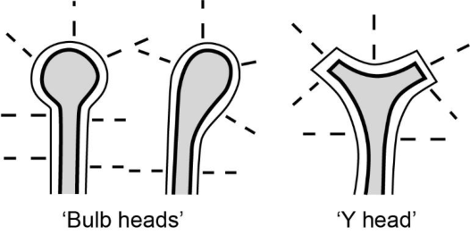

## 2. Objectives and controls

### 2.1 Setbacks and streetscape character

#### Objectives

Encourage innovative industrial design which enhances the quality of the existing industrial areas in Cumberland City, whilst recognising the design attributes of traditional industrial development.

Developments are separated to minimise operational constraints imposed by 1 industrial use upon an adjacent land use of any type.

Reduce bulk/overbearing form and overshadowing on the street and adjoining properties.

Reduce land use conflict between residential and non-residential uses.

#### Controls

General

C1. Landscape all front setbacks to provide a high quality streetscape.

C2. Front setback areas shall not be used for storage or display of goods or excessive signage, loading/unloading or large areas of car parking.

C3. Ensure landscaping setbacks comprise soft landscaping and deep soil zones only.

Setback where lots adjoin residential zones or open space

C4. Industrial development adjoining residential or open space zones shall comply with the setbacks in Table 1 below.

Table 1: Setback requirements for industrial development

| Boundary | Minimum building setback (includes the required landscape setback) | Minimum width of landscaping within the building setback |
|---|---|---|
| Side – adjoining non-industrial zone other than residential | 4m | 2m |
| Side – adjoining a residential use / zone | 6m | 3m |

| Boundary | Minimum building setback (includes the required landscape setback) | Minimum width of landscaping within the building setback |
|---|---|---|
| Rear – adjoining a non-industrial zone other than residential | 4m | 2m |
| Rear – adjoining a residential uses / zone | 6m | 3m |

C5. Where an industrial development adjoins a residential zone, appropriate buffer mechanisms shall be provided to ensure that:

• neighbourhood residential amenity is maintained;

• the primary buildings and structures on the industrial land are visually separated from neighbouring residential dwellings; and

• overshadowing does not occur (see solar access below).

C6. Provide window placement and/or tall trees as ways to protect privacy, reduce noise and light pollution.

Front setbacks

C7. Front setbacks are to be 5m. Where the prevailing building setbacks within the street are significantly different, consideration will be given to an alternative setback.

Side and rear setbacks

C8. Buildings may be built on a nil side or rear setback, except where a setback is required to screen buildings from:

• public places;

• adjoining residential properties;

• other sensitive land uses;

• where rear access is required; and

• where land adjoins the M4 Motorway.

In such circumstances, a 4.5m landscape setback is required.

C9. Development adjacent to Duck River shall provide a 5m easement for public access within the foreshore building line area along Duck River. This easement shall be established under a Section 88B instrument and shall be registered with NSW Land Registry Services.

Setbacks for specific street frontages

C10. The building lines set out in Table 2 apply to the principal street frontage of land zoned General Industrial IN1 and Light Industrial IN2 within Cumberland City. They are based on a conversion from the previous imperial measures into metric.

Table 2: Building line requirements for principal street frontage in IN1 and IN2 zones

| Smithfield Industrial Lots |  |
|---|---|
| 15m | • All Streets (west of Fairfield Road) • Yennora Industrial Area • Fairfield Road (south of Dursley Road) • Pine Road, Loftus Road (between Pine Road and Norrie Street) • Nelson Road (west of Yennora Ave) |

|  | • Norrie Street (west side) • Boola Avenue (east side between Loftus Road and Bend) • Loftus Road/Military Road (between Boola Avenue and Byron Road) • Byron Road (west side between Dennistoun Avenue and Military Road) • Loftus Road (south side between Norrie Street and Yennora Avenue) |
|---|---|
| 10m | • Dursley Road |
| 2m | • Nelson Road (north of Yennora Avenue) |
| 7.5m | • Boola Avenue (north side between Norrie Street and Yennora Avenue) • Yennora Avenue (west side between Boola Avenue and Loftus Road), • Kiora Crescent • Norrie Street (east side between Boola Avenue and Loftus Road) |
| 4.5m | • Loftus Road (south side between Yennora Avenue and Boola Avenue) • Boola Avenue (between Yennora Avenue and Bend), • Boola Avenue (west side between Bend and Loftus Road), • Yennora Avenue (east side) |
| 3.5m | • Military Road • Boola Avenue (south side between Norrie Street and Yennora Avenue) • Yennora Avenue (west side between Boola Avenue and Military Road |
| 5.5m | • Military Road (north side between Norrie Street and Yennora Avenue) • Norrie Street (east side between Boola Avenue and Nelson Road) |
| 6m | • Boola Lane (r.o.w) |
| 30.5m | • Dennistoun Avenue (southside) |
| 10m | • Fairfield Road (east side between Dennistoun Avenue and Dursley Road) |
| Guildford Industrial Area |  |
| 4.5m | • Carrington Road (south side), • Cann Street, Guernsey Street, Clarke Street • Military Road (between Byron Road & Carrington) • Byron Road (east side between Military Road and Dennistoun Avenue) |
| 15m | • Byron Road (west side between Military Road and Dennistoun Avenue) |
| Holroyd Industrial Avenue |  |
| 7.5m | • Walpole Street (north side between the Creek and Crescent Street) • Crescent Street • Walpole Street (north side between Fox Street and the Creek) |
| 4.5m | • Peel Street, Fox Street • Robert Street (south side between Fox Street and Peel Street) |
| Girraween/Toongabbie Industrial Area |  |
| 10m | • Toongabbie Road, Amax Avenue • Mandoon Road, Magowar Road • Gilba Road, Wiltona Place |
| 30.5m | • Oramzi Road (west side between Gilba Road and Wiltona Avenue) • Great Western Highway |
| 15m | • Great Western Highway (between Toongabbie Road and Girraween Road) |
| Greystanes Industrial Area |  |
| 7.5m | • Great Western Highway (west of Greystanes Road) |

### 2.2 Siting and building design

#### Objectives

Achieve high quality, innovative environmental and architectural design for all buildings within new and existing industrial areas.

Ensure industrial development presents attractive and compatible facades to adjoining uses, and activates the public domain.

Create identifiable, attractive and safe entrances to buildings.

#### Controls

C1. Use non-industrial aspects of a development (e.g. offices) to address the street.

C2. Avoid long blank walls of warehouse units, by providing articulation to the façade or division of massing, especially on street frontages.

C3. Entries to buildings should be clearly visible to pedestrians and motorists and be integrated into the form of the building.

C4. Architecturally express the structure of the building externally to address the primary street frontage and minimise use of reflective glass or large blocks of one material.

C5. Articulate entrances, office components and stairwells to create rhythm along facades to minimise the appearance of bulk and scale.

C6. Introduce a mix of materials, and incorporate horizontal and vertical modulation, including windows in appropriate proportions and configurations.

C7. New development on corner sites is to address both street frontages in terms of façade treatment, fenestration and articulation of elevations, to achieve a high standard of environmental design.

C8. Roof ventilation, exhaust towers, mechanical plant and the like should be located so as not to be readily visible from any public or residential area.

C9. All rooftop or exposed structures including lift motor rooms, plant rooms, together with air conditioning, ventilation and exhaust systems, are to be integrated into the building design in order to ensure interesting and high quality appearance.

### 2.3 External materials

#### Objectives

Contribute to visual amenity of the urban environment through appropriate selection of materials and colours.

Minimise the impact of glare onto the surrounding environment.

#### Controls

C1. Lighter colours shall be used on external walls of the building to reduce heat gain in summer, especially for building facades facing east, west and north.

C2. Roofs and walls shall be well insulated in office components of buildings to reduce winter heat loss and summer heat gain.

### 2.4 Solar access

#### Objectives

Maintain mid-winter solar access to primary indoor spaces and private open spaces within adjoining residential dwellings.

Ensure office spaces within the subject and adjoining developments receive sufficient solar access.

Minimise reduction of solar access to surrounding buildings resulting from a development.

#### Controls

C1. Where a site adjoins or is opposite to a residential property and the proposed structures are over 6m in height, shadow diagrams based on a survey of the site and adjoining development shall be provided. These diagrams shall demonstrate the impact on adjoining residential properties or public domain for 8am, 12noon and 4pm at 21 June.

C2. Development is not to unreasonably impact on solar access requirements of adjacent and adjoining residential properties.

C3. If adjoining residential, public open space or sensitive land uses (e.g. schools) already receives less than 3 hours of sunlight, any reduction may be unacceptable.

C4. Buildings shall be oriented towards the north so that they make best use of solar access to lower heating and cooling costs.

C5. Building elevation treatments shall control solar access into the building by the use of appropriate shading devices and methods.

### 2.5 Road design and construction

#### Controls

C1. Ensure that new roads are constructed with kerb and gutter and are sealed from gutter to gutter. Construction is to be of a standard not less than Council’s standard specification for heavy duty roads.

C2. Ensure that the minimum width of carriageway plus verge is 20m wide with 12m carriageway and 4m verges. The construction of 1.2m wide concrete footpaths will be required.

C3. Cul-de-sac roads will only be accepted where surrounding land has been fully developed, or where the site specific controls for the area provide for cul-de-sac roads.

C4. Ensure that cul-de-sac roads have a 20m radius turning circle with 18m radius reverse curves on boundary alignments.

C5. Provide a higher strength pavement for cul-de-sacs at intersections in industrial areas. Generally a minimum of 1m clearance is required.

> [Picture on page 9: a picture, saved as a picture (images/part-d-development-in-industrial-zones-page-9-1.gif, 150 dpi).]

Figure 1: Types of cul-de-sacs

### 2.6 Pedestrian and cyclist facilities

#### Objectives

Encourage greater bicycle use, decrease the reliance on private vehicles and encourage alternative, more sustainable modes of transport.

#### Controls

C1. Pedestrian access to private land shall be provided as part of the internal circulation network.

C2. Bicycle parking is to be provided as specified in AS 2890.3 – Bicycle Parking Facilities.

C3. Bicycle parking shall be located in a safe and secure location that is covered and convenient for users.

C4. Trip end facilities including showers and lockers must be provided to adequately service the number of bicycle parking spaces required for industrial development as per the provisions set out in Part G3.

### 2.7 Public domain improvements

#### Objectives

Improve the visual quality and amenity of industrial development through effective landscape treatment of individual sites and to achieve high levels of amenity for employees, including passive/recreational use.

Complement the pedestrian and cycle movement network and open space corridors.

Design landscaping to enhance streetscape character and contribute to urban heat management.

#### Controls

C1. All areas not built-upon shall be landscaped to soften the impact of buildings and car parking areas.

C2. Landscaping within setback areas shall be of a similar scale to buildings. All landscaped areas shall be separated from vehicular areas by means of a kerb or other effective physical barriers.

C3. Fencing shall be integrated as part of the landscaping theme so as to minimise visual impacts and to provide associated site security.

C4. Landscaping shall promote safety and surveillance of the street.

C5. A minimum of 15% of the site shall be provided and maintained as soft landscaping, with lawns, trees, shrubs, for aesthetic purposes and the enjoyment of workers of the site.

### 2.8 Biodiversity

#### Objective

Ensure a high standard of environmental quality of individual sites.

#### Controls

C1. Landscape plant species used in the public domain shall be predominantly native, including local indigenous species.

C2. Plant species that are drought tolerant or will require minimal watering once established shall be used.

C3. Water-conserving landscape practices shall be applied where possible, including soil amendment, mulch, irrigation zoning, limited turf areas, planting in relation to micro-climate, water scheduling, and selection of plants with water needs that match site rainfall and drainage conditions.

C4. Landscape plant species used in the public domain shall be predominantly native, including local indigenous species.

C5. Native ground covers and grasses shall be used in lieu of turf where practicable.

C6. Development shall comply with the biodiversity requirements set out in Part G5 of this DCP and the tree management and landscaping requirements set out in Part G7 of this DCP.

### 2.9 Storage areas

#### Objective

Protect and enhance visual amenity.

#### Control

C1. Storage areas and other potentially unsightly areas shall be screened from adjacent properties.

### 2.10 Safety and security

#### Objectives

Ensure that adequate measures are taken to protect the personal safety of workers, clients and the general public.

Reduce crime risk and minimise opportunities for crime.

#### Controls

C1. Provide details on measures to be undertaken to safeguard workers, clients and the general public. Such details are to include:

• security personnel;

• lighting of access ways and car parking areas, particularly in respect of isolated premises;

• security doors;

• ‘active’ uses presented to the street to promote surveillance and safety;

• premises clearly numbered, with the number clearly visible from the street;

• avoid the use of isolated back lanes and poorly lit areas; and

• any landscaping that is proposed must not obstruct the visibility from public areas of entrances and exits.

C2. A crime risk assessment against the Crime Prevention and the Assessment of Development Applications” Guidelines is to be undertaken for larger developments. The recommendations of the assessment shall be used to inform the design and operation of the development.

### 2.11 Fencing

#### Objectives

Minimise any visual impacts to the streetscape.

Provide site security whilst allowing passive surveillance to and from the public domain.

Ensure that fencing complements the building and landscape design for the site.

#### Controls

C1. Fencing shall be integrated as part of the landscaping theme, so as to minimise visual impacts and to provide associated site security.

C2. Ensure all fencing along the principal street frontage is an open/permeable style, incorporating pickets, slats, palings or the like.

C3. Fencing along the street frontage shall be a maximum height of 1.8m and incorporated with appropriate landscaping.

C4. Fences behind the front setback shall be a maximum of 2.1m and incorporated with appropriate landscaping.

C5. Chain wire fencing is not permitted.

C6. Solid metal panel fences (sheet metal or similar) of any height are not permitted along the street frontage or forward of the building alignment.

C7. If the side or rear boundary faces a side or rear boundary of a residential premises, a timber paling/pre-coated metal fencing (commencing at the front building alignment) is permitted along with acoustic fencing and planting.

### 2.12 Operational management

#### Objective

The hours of operation are managed to ensure residential amenity is protected.

Ensure potential adverse environmental, public health and amenity impacts from industrial developments are adequately controlled.

Development incorporates measures needed to protect the community from dangerous or hazardous goods storage and hazardous processes or uses.

Ensure that the use of the land does not create an offensive noise or add significantly to the background noise level of a locality.

Minimise impact of noise on sensitive receivers through appropriate design and measures.

Provide a pleasant working environment and a high level amenity within industrial areas.

Ensure adequate operational arrangements are provided for the development.

Minimise unacceptable impacts on surrounding land uses and the transport/road network.

#### Controls

Hours of operation

C1. Where an industrial site is located adjoining or adjacent to, or within 200m of residential development, or where in the opinion of Council, truck movements associated with the industry will intrude on residential streets, hours of operation shall generally be restricted to 7am to 6pm Monday to Saturday with no work on Sundays.

C2. Retail trade in industrial zones are to be undertaken within the hours of 7am to 6pm, Monday to Saturday and 7am to 2pm on Sunday.

C3. Where an extension to the above hours is required due to the nature of the activities to be undertaken, a detailed submission shall be lodged with Council, demonstrating how environmental impacts can be minimised to acceptable levels to support the proposed extended hours of operation inclusive of an acoustic report and operation management plan

Hazardous goods and chemicals

C4. Where a development involves the storage and/or use of dangerous goods, full details of the quantities and types of goods and chemicals are to be submitted with the development application, together with the storage locations, mediums and the use intended for the goods and chemicals.

C5. Development is to comply with the requirements of SEPP 33 – Hazardous and Offensive Development. Based on the types and quantities of hazardous goods and of materials used/stored in a development, Council may require an assessment in accordance with SEPP 33.

Environmental management plan

C6. An Environmental Management Plan (EMP) shall be submitted with the application if the development is considered to pose a high risk of adverse environmental impacts. The plan should detail how all environmental impacts will be controlled and/or managed within the site during ongoing operation of the development. Depending on the extent

and nature of the proposal under consideration, this could include but may not be limited to:

• noise and vibration control;

• surface water management and stormwater protection;

• trade waste arrangements (if applicable);

• control and treatment of air emissions;

• dust and erosion control (including stockpiles, if applicable);

• waste management, including handling of potentially contaminated material;

• identification of relevant person/s on site who are responsible for control strategies, including their position title and contact details; and

• details of complaints handling arrangements.

Noise

C7. Sources of noise, such as plant equipment and machinery, shall be sited away from adjoining properties as far as practicable and, where necessary, screened by walls or other acoustical treatment.

C8. Operations are to be conducted so as to avoid unreasonable noise and interference to adjoining development, particularly residential development.

C9. Operations are to be undertaken in accordance with licences and guidelines from relevant authorities.

Staff amenities

C10. Provide a high level of staff facilities and recreation space including as a minimum:

• indoor and outdoor breakout/communal space;

• kitchen; and

• end of trip facilities.

Plan of Management

C11. A plan of management is required to be prepared for the development.  The plan is to bring together other plans related to the development and identified in this DCP, and to provide a framework for the management of complaints. A review mechanism shall also be provided to ensure the effectiveness of the plan of management and to refine the plan as required. The plan of management shall be made to available to Council or other relevant authority at any time if requested.

### 2.13 Environmental management

#### Objectives

Any machinery or processes used should not result in air pollution emissions that have a detrimental impact on the environment.

Potential adverse environmental, public health and amenity impacts from industrial developments must be adequately controlled.

Ensure waste storage and removal will not have a detrimental effect on environmental amenity.

Ensure that Council is satisfied that no new building works take place on land contaminated by previous land uses, unless suitably remediated in accordance with SEPP 55 – Remediation of Land (or equivalent).

Ensure future building works are constructed on stable sub-surfaces.

Prevent potential contamination of land, groundwater and surface water from Underground Petroleum Storage Systems (UPSS) sites.

Encourage a high standard of environmental design within new and existing industrial areas.

Minimise energy use in buildings while creating a comfortable working environment.

Reduce the amount of greenhouse gas emissions.

Development incorporates discharge systems designed to minimise the discharge of pollutants into the waste water and stormwater system.

Ensure that satisfactory measures are incorporated to alleviate negative environmental impacts associated with industrial zones.

#### Controls

Air quality

C1. Details of any equipment, processes and air pollution control or monitoring equipment shall be submitted to Council with a development application including an assessment of air quality according to EPA standards.

Waste

C2. An on-going waste management plan is required to be submitted with the application to detail how all solid and liquid wastes handled on site will be managed. The plan may include, but is not limited to, details on:

• all waste storage areas (including internal and external areas/rooms);

• waste collection arrangements, including collection location and times/frequency;

• measures to prevent potential pollution from waste storage/handling activities on site;

• any trade waste arrangements; and

• measures for dealing with contaminated and/or hazardous waste.

C3. Garbage storage areas shall be designed so as to:

• be readily serviced within the confines of the site with minimum impact on adjoining uses;

• incorporate ventilation measures; and

• have suitable access to water to maintain waste storage areas.

Contamination

C4. An assessment is to be made by the applicant under SEPP No. 55 – Remediation of Land (or equivalent) as to whether the subject land is contaminated prior to the submission of a development application.

C5. All underground petroleum storage systems (UPSS) must be designed, installed and operated in accordance with the Protection of the Environment (Underground Petroleum Storage Systems) Regulation 2019 (the Regulation) and guideline to the Regulation published by the NSW EPA.

C6. An application involving installation or modification to a UPSS must be accompanied by:

• detailed plans of the UPSS; and

• certification that the plans and proposed design comply with the Regulation and Australian Standard 897 – 2008 The design, installation and operation of underground petroleum storage systems.

C7. Service station forecourts must be designed and managed in accordance with environmental best practice as outlined in the NSW EPA Practice Note Managing runoff from service station forecourts (2019). An application for a service station must be accompanied by detailed plans of forecourt areas which identify all proposed design features and measures to manage runoff in accordance with the Practice Note.

Sustainability and energy efficiency

C8. Improve the efficiency of hot water systems by:

• providing solar powered hot water systems where possible. Solar and heat pump systems must be eligible for at least 24 Renewable Energy Certificates (RECs) and domestic type gas systems must have a minimum 3.5 star energy efficiency rating;

• insulating hot water systems; and

• installing water saving devices, such as flow regulators, 3 stars Water Efficiency Labelling and Standards Scheme (WELS Scheme) rated shower heads, dual flush toilets and tap aerators.

C9. An Energy Efficiency Report from a suitably qualified consultant that demonstrates a commitment to achieve no less than 4 stars under the Australian Building Greenhouse Rating Scheme or equivalent must be provided for all commercial and industrial development with a construction cost of over $5 million.

C10. The amount of exposed glazing to the eastern and western facades of buildings shall be minimised.

C11. Building design shall minimise reliance on existing energy supplies through the use of renewable energy sources including incorporation of photovoltaic cells, wind turbines, battery storage and solar hot water wherever practicable.

Water pollution and stormwater management

C12. For industrial developments such as mechanical repair workshops and garages, pollution control monitoring equipment, e.g. retention pits, traps, or bunding shall be used to control the discharge of pollutants into the stormwater system.

C13. If the premises are subject to licence under the Protection of the Environment Operations Act 1997, development is to comply with any conditions of such licence that form part of any building approval.

### 2.14 Loading requirements

Refer to Part G3 of this DCP for loading requirements.

### 2.15 Car parking design

Refer to Part G3 of this DCP for car parking design controls.

### 2.16 Traffic and transport management plan

Refer to Part G3 of this DCP for Traffic and Transport Management Plan requirements.

#### This page left intentionally blank
