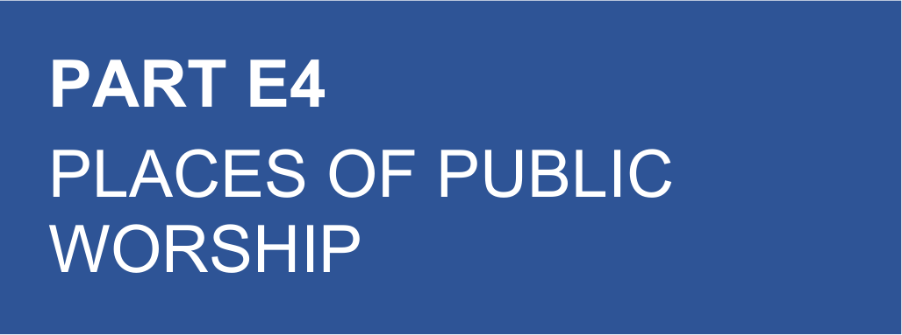

### PART E3

### EDUCATIONAL

### ESTABLISHMENTS

## 1. Introduction

### 1.1 Land to which this Part applies

This Part of the DCP applies to all land where educational establishments are permissible and

specifically applies to development applications for any of the following:

• the establishment of a new purpose-built educational establishment;

• alterations and/or additions to, or intensification of an existing educational

establishment; and

• conversion or adaptation of existing buildings to an educational establishment.

### 1.2 Relationship to other documents

This Part of the DCP should be read in conjunction with the State Environmental Planning Policy

(Education Establishments and Child Care Facilities) 2017 and Design Quality Guidelines.

## 2. Objectives and controls

### 2.1 Acoustics

#### Objective

Minimise noise impacts of educational establishments that may impact upon

neighbouring or nearby properties.

#### Controls

C1. The design of the proposed educational establishment shall minimise the projection of

noise from the various activities anticipated to occur within the site. Adjoining and nearby

residents should not be exposed to unreasonable levels of noise arising from the

proposed use.

C2. A noise impact assessment statement, prepared by a suitably qualified acoustic

engineer, is to be submitted with all applications for development within residential

zones or development located in close proximity to residential development. This should

describe hours of operation and predicted noise levels for regular lunch and tea breaks

and for special events. Where possible, reference should be made to similar operating

uses within the Cumberland City.

C3. Where it can be demonstrated that the development is of a minor nature involving

alterations, additions or modifications to an established educational establishment, a

noise report may not be required.

### 2.2 Traffic, parking and transport

#### Control

C1. Development for the purposes of an education establishment will comply with the

specific traffic, parking and transport requirements set out in Part G3 of this DCP.

### 2.3 Operational Plan of Management

#### Objective

Provide certainty for both the consent authority and the local community about the

ongoing management practices to be employed by the proposed use to manage its

impact upon the neighbourhood.

#### Control

C1. An Operational Plan of Management must be provided for a new education

establishment. This will be used both for the assessment of the application as well as a

means to manage the ongoing operation of the proposed premises through the

conditions of development consent. The Operational Plan of Management (including

amendments, if any) will be incorporated as a condition of development consent. This

plan must include, but is not limited to the following information:

• operation hours, including a schedule of the regular classes held, lunch and tea

breaks, recurring events (such as sport afternoons) and special events throughout

the year and location of these events;

• the maximum number of full-time equivalent staff;

• the number of enrolled students to be in attendance at regular classes. details of

outdoor space provision (covered and uncovered);

• details of available public transport links, hub and frequency;

• a safety audit and its recommendations;

• consideration and details of CPTED principles to be implemented;

• a list of the types of community purposes (i.e. community colleges, senior citizens

groups, youth groups etc) any building may be used for outside the regular classes,

breaks and other events. how often and how many people it will attract;

• a list of the type of organisations that may lease or use any building and for what

purposes. how often and how many people it will attract;

• an explanation of the measures that will be in place to manage parking, local traffic

and pick up and drop off arrangements both in regular operations and when a

special event is scheduled;

• contact persons who will be responsible for complaints handling. This is to be

updated periodically;

• anticipated growth of the educational establishment and how these long- term

projections will be factored into the development and managed in the future; and

• for senior level educational establishments, details of the number of student drivers,

the number and location of allocated parking spaces and the measures to monitor

the safety of student drivers (e.g. guardian permission slips).

#### This page has been left intentionally blank.

> [Picture on page 21: a picture, saved as a picture (images/part-e-other-land-use-based-development-controls-page-21-1.gif, 150 dpi).]
