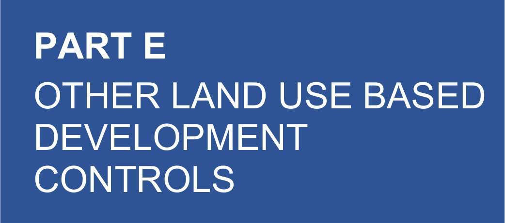
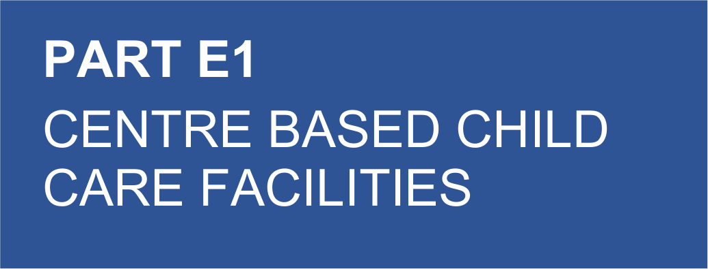

# Cumberland Development Control Plan 2021 - Part E Other Land Use Based Development Controls

> This chapter is split into 5 section file(s), one per sub-part heading, in the order they appear in the PDF.

Source PDF: [Cumberland DCP Part E.pdf](https://planfortomorrow.sharepoint.com/sites/Planfortomorrow/Shared%20Documents/00%20NSW-Planning-Resources/dcp/cumberland-development-control-plan-2021/part-e-other-land-use-based-development-controls/Cumberland%20DCP%20Part%20E.pdf)

> [Picture on page 1: a picture, saved as a picture (images/part-e-other-land-use-based-development-controls-page-1-1.gif, 150 dpi).]

### PART E

### OTHER LAND USE BASED

### DEVELOPMENT

### CONTROLS

#### This page has been left intentionally blank.

### Part E Contents

| PART E1 – CENTRE BASED CHILDCARE FACILITIES | E6 |
|---|---|
| 1. Introduction | E8 |
| 2. Objectives and controls | E8 |
| 2.1 General | E8 |
| 2.2 Bulk and scale | E8 |
| 2.3 Traffic, parking and transport | E9 |
| PART E2 – COMMUNITY FACILITIES | E11 |
| 1. Introduction | E13 |
| 2. Objectives and controls | E13 |
| 2.1 Bulk and scale | E13 |
| 2.2 Traffic, parking and transport | E13 |
| 2.3 Landscaping and open space | E13 |
| 2.4 Operational Plan of Management | E14 |
| PART E3 – EDUCATION ESTABLISHMENTS | E16 |
| 1. Introduction | E18 |
| 2. Objectives and controls | E18 |
| 2.1 Acoustics | E18 |
| 2.2 Traffic, parking and transport | E18 |
| 2.3 Operational Plan of Management | E19 |
| PART E4 – PLACES OF PUBLIC WORSHIP | E21 |
| 1. Introduction | E23 |
| 2. Objectives and controls | E23 |
| 2.1 Bulk and scale | E23 |
| 2.2 Traffic, parking and transport | E23 |
| 2.3 Acoustic privacy | E24 |
| 2.4 Landscaping and open space | E24 |
| 2.5 Operational Plan of Management | E24 |

| PART E5 – SEX SERVICE PREMISES | E27 |
|---|---|
| 1. Introduction | E29 |
| 2. Objectives and controls | E29 |
| 2.1 General | E29 |
| 2.2 Design of premises | E29 |
| 2.3 Hours of operation | E30 |
| 2.4 Traffic, parking and transport | E30 |
| 2.5 Plan of Management | E30 |
| 2.6 Signage | E32 |
| 2.7 Health and building matters | E32 |
| 2.8 Safety and security | E32 |

> [Picture on page 6: a picture, saved as a picture (images/part-e-other-land-use-based-development-controls-page-6-1.gif, 150 dpi).]

<!-- sections -->
## Sections

1. [Part E1 CENTRE BASED CHILD CARE FACILITIES](01-e1-centre-based-child-care-facilities.md)
2. [Part E2 COMMUNITY FACILITIES](02-e2-community-facilities.md)
3. [Part E3 EDUCATIONAL ESTABLISHMENTS](03-e3-educational-establishments.md)
4. [Part E4 PLACES OF PUBLIC WORSHIP](04-e4-places-of-public-worship.md)
5. [Part E5 SEX SERVICE PREMISES](05-e5-sex-service-premises.md)
