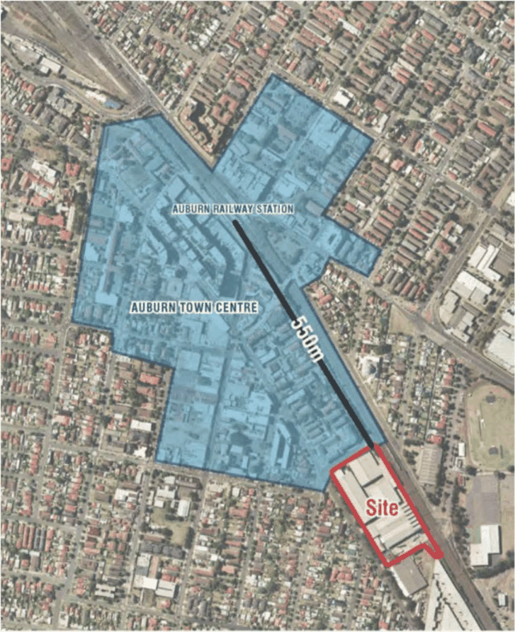
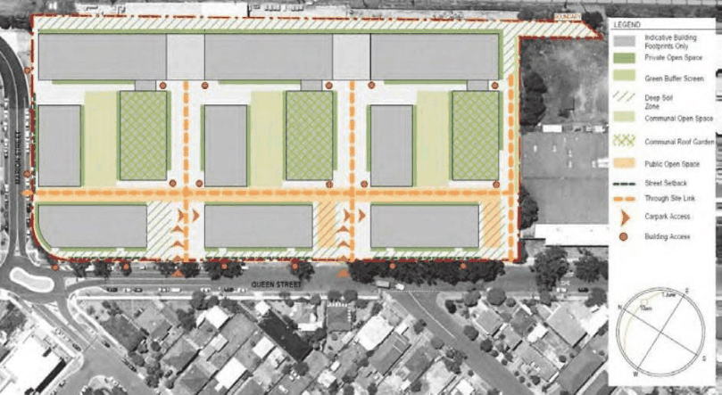
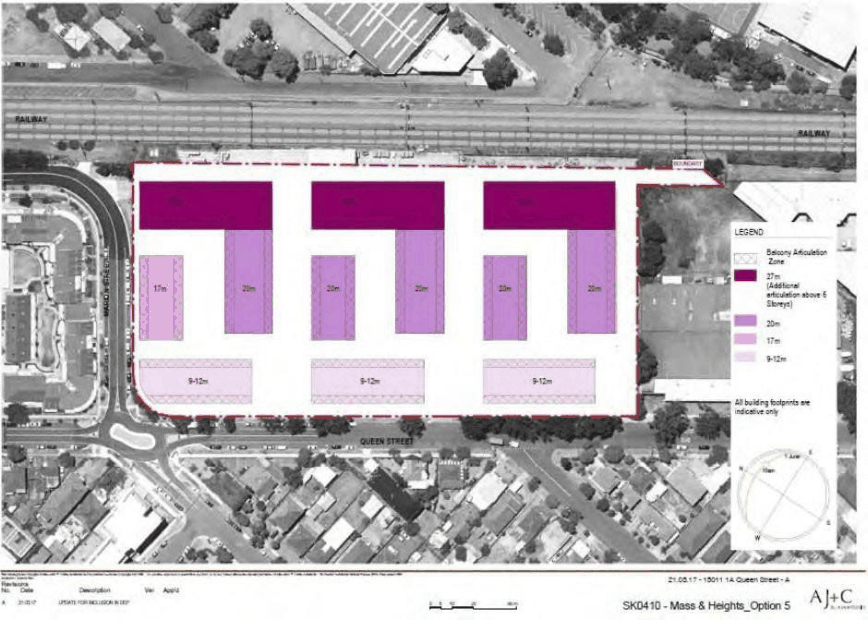

### PART F1-1

### 1A AND 1B QUEEN

### STREET, AUBURN

This page has been left intentionally blank.

## 1. Introduction

### 1.1 Land to which this Part applies

This Part applies to land zoned R4 High Density Residential known as 1A and 1B Queen Street

(Queen Street Site). The site is outlined in red in Figure 1 below.

> [Picture on page 17: a picture, saved as a picture (images/part-f1-precinct-and-site-specific-development-controls-page-17-5.gif, 150 dpi).]

Figure 1: Area to which this Part applies

### 1.2 Purpose of this Part

The purpose of this part is to provide provisions to guide redevelopment of the site for residential

purposes. In the case of any inconsistency between the controls in other parts of the DCP and the controls

in this Part, the controls in this part prevail to the extent of the inconsistency.

## 2. Vision and general objectives

### 2.1 Vision

The vision for the Queen Street site is to create a high quality residential development that has

a scale and form that is compatible with surrounding land uses and takes advantage of the site’s

proximity to existing facilities, services and public transport infrastructure.

### 2.2 Objectives

#### General

Provide new housing opportunities within walking distance of the town centre, rail station

and other public transport opportunities.

Ensure development is of a scale and character that is consistent with that planned for

the neighbouring locality.

Ensure that a range of housing types are provided across the site.

Provide an overall built form that is varied and visually interesting.

Be of a scale that provides logical transitions to the planned future scale of development

in the area surrounding the site, particularly to the town centre, adjoining residential

zones and the rail corridor.

Provide visual interest through building articulation, variation in building form, building

material palettes/textures when viewed from all external locations including the rail line.

Incorporate building envelopes which are compatible with the scale of existing and

future neighbouring development.

Provide sufficient communal open space to satisfy the needs of residents.

## 3. Specific objectives and controls

### 3.1 Connections and access

#### Objective

Improve the site’s connections to Auburn railway station by extending and improving

pedestrian and cycle connections within the site.

#### Controls

Provision for access and through site links should be generally consistent with the

strategy shown in Figure 2.

The Queen Street frontage is to complement surrounding existing and proposed

development.

In providing vehicular access, preference is to be given to Queen Street and to ensuring

sufficient space for truck movements.

Provide through site connectivity including pedestrian and cycle access through the

public open space of the development.

### 3.2 Open space

#### Objectives

Provide high quality public spaces that make a positive contribution to the visual quality

of the development.

Provide communal spaces that allow opportunities for amenity, outlook and visual

separation for residents.

Maximise the size of public open space areas to enhance useability and flexibility of the

space.

#### Controls

Open space provisions for the development should be generally consistent with the

strategy shown in Figure 2.

Public open space of at least 300 square metres in total, accessible to the public and legible

from Queen Street, Louisa Street and/or Marion Street frontages is to be provided.

The public open space should be focussed in one or two large, useable open spaces.

Development should allow for the creation of open space areas that provide sufficient

separation between buildings to enable appropriate levels of visual and acoustic privacy

to be achieved and act as shared landscaped areas for use by residents.

Open spaces should be well designed areas that include:

• a space that is legible as public space, rather than a space only for the use of

residents,

• both soft and hard surfaces, (and therefore cannot all be considered deep soil),

• seating (formal and informal) for individual and group use,

• trees and other landscaping,

• ideally provision for suitable recreation activities in a space designed for flexible use,

• public art in the main space. Communal open space and deep soil zones are to comply with the relevant provisions

of SEPP No 65-Design Quality of Residential Apartment Development and the

Apartment Design Guide.

Deep soil planting areas should enhance site amenity and the streetscape along the rail

corridor and all adjoining streets.

The provision of communal space on roof top levels is supported.

The associated owners’ corporation will own and maintain public and communal open

space and associated infrastructure servicing the proposed development.

> [Picture on page 20: a picture, saved as a picture (images/part-f1-precinct-and-site-specific-development-controls-page-20-11.gif, 150 dpi).]

Source: AJ&C, September 2016 (as amended by Council July 2017)

Figure 2: Access and open space strategy.

### 3.3 Building form

#### Objectives

Encourage buildings with a scale and form that is compatible with those planned in

neighbouring areas.

Provide a transition in height and density from the site to surrounding residential areas,

the railway line and the town centre.

Ensure that built form defines and activates the site’s open spaces and complements

the surrounding land use context.

Building forms should address street frontages along Marion Street and Queen Street

and corner buildings shall address both streets.

#### Controls

Development within the site should be generally consistent with the built form strategy

shown in Figure 3.

Buildings are to reinforce the edges of public spaces and connections on the site.

Development is to include a variety of residential dwelling types.

Ground floor dwellings are to have direct street address where fronting a public street

edge.

Building envelopes Lower scale housing forms such as townhouses / terraces are to be provided along Queen

Street to provide an active address to this street and a scale that responds to

neighbouring development.

The following minimum setbacks shall apply to the site:

• front setback from Queen Street shall be 6m;

• building setback from the rail corridor shall be 6m;

• setback from Marion Street shall be 4m; and

• the setbacks at the corner of Queen and Marion Streets should apply to the final

property boundary after any land dedication for the roundabout. Note: the setback areas are to be unencumbered by balconies

Building separation is to comply with the relevant provisions of SEPP No 65-Design

Quality of Residential Apartment Development and the Apartment Design Guide.

Building heights are shown in metres in the Cumberland Local Environmental Plan 2021

Height of Buildings Map and site specific clauses are included within Cumberland Local

Environmental Plan 2021.

Appropriate building articulation, façade treatment and modulation is to be provided.

• buildings are to achieve visual interest through variations in massing, articulation

and composition of building elements including fenestration, material use,

entrances, balconies, balustrades and planters;

• development is to achieve a varied silhouette when viewed from the rail corridor;

and

• design elements and façade treatments should aim to minimise glare affecting

passing pedestrians, vehicles and trains.

Vertical and horizontal articulation should be substantial, to enable the buildings to be

read as separate buildings and should include:

• vertical recesses;

• separate façade components with distinct architectural detailing; and

• DCP enforced building setbacks and height controls.

> [Picture on page 22: a picture, saved as a picture (images/part-f1-precinct-and-site-specific-development-controls-page-22-1.gif, 150 dpi).]

Source: AJ&C, September 2016

Figure 3: Built form strategy

### 3.4 Acoustic amenity

#### Objective

Achieving occupant amenity by responding appropriately to noise emitters.

#### Controls

An acoustic assessment prepared by a suitably qualified acoustic consultant is to be

submitted with any development application for the site. The assessment should

address, at minimum:

• impacts on acoustic privacy of proposed residential uses from any surrounding

noise sources, such as road and rail traffic and industrial uses;

• the impact of the development on the surrounding area, through mechanical

services, earthworks, excavation and construction phases of development; and

• design of buildings shall comply with the internal noise levels in the Clause 102 (3)

of the SEPP (Infrastructure) 2007.

This page has been left intentionally blank.

> [Picture on page 24: a picture, saved as a picture (images/part-f1-precinct-and-site-specific-development-controls-page-24-1.gif, 150 dpi).]
