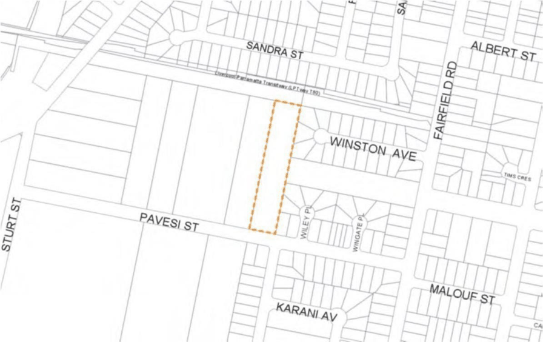
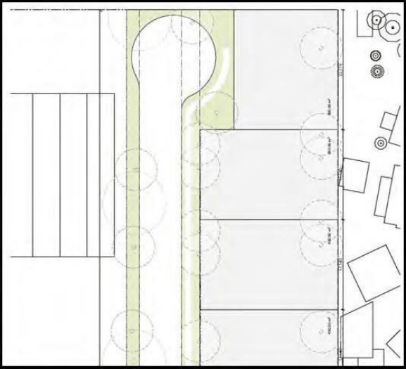
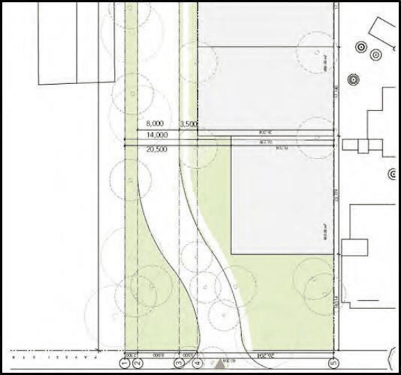
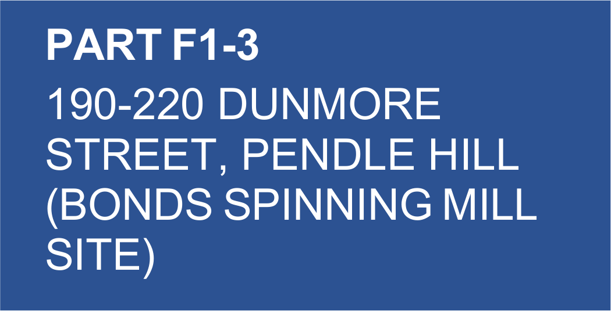

### PART F1-2

37-39 PAVESI STREET,

### SMITHFIELD

This page has been left intentionally blank.

## 1. Introduction

### 1.1 Land to which this Part applies

This section applies to land at 37-39 Pavesi Street, Smithfield, being identified as Lot 36 DP

10958, as shown in Figure 1.

> [Picture on page 26: a picture, saved as a picture (images/part-f1-precinct-and-site-specific-development-controls-page-26-5.gif, 150 dpi).]

Figure 1: Land to which this section applies.

## 2. Specific objectives and controls

### 2.1 Amenity

#### Objectives

Maximise separation between industrial premises and residential dwellings to ensure

amenity for residential dwellings and reduce any potential for conflict between these two

land uses.

Ensure that the adjoining industrial property cannot gain access to the road servicing

the residential dwellings.

#### Controls

The access road is located along the western boundary of the site.

A minimum 1m landscaped buffer is provided between the cul-de-sac bulb and side

property boundary, and between any parking bays and the property boundary (Figure

2).

A minimum 2.5m landscaped buffer is provided between the road and property boundary

in all other locations including the end of the cul-de-sac as shown in Figure 2.

Access to the new road is only for the purpose of residential development.

The dwellings at the front should face Pavesi St and all other dwellings must address

the new road.

### 2.2 Traffic, access and parking

#### Objectives

Avoid any impact on the operation of the Pavesi Street traffic control device (slow point).

Ensure safe movement of all vehicles along the entire length of the access road.

Enable pedestrian access to all dwellings.

#### Controls

The access road is located to ensure passenger vehicles can turn left-in/right-out at

Pavesi Street without being affected by the slow-point bollards.

The width and alignment of the access road must enable two service vehicles to pass

each other safely at any point along the road (i.e. without crossing the road centre-line).

A 14m road reserve is provided (Figure 5), incorporating:

• an 8m carriageway if parking is on-street, or 7m carriageway if parking is in bays;

and

• a 3.5m verge between property boundaries and the street (including the two front

dwellings and two rear dwellings). The design speed for the access road is 25kph.

A footpath is provided along the entire length of the access road.

> [Picture on page 28: a picture, saved as a picture (images/part-f1-precinct-and-site-specific-development-controls-page-28-1.gif, 150 dpi).]

Figure 2: Dimensions of landscaped buffer.

> [Picture on page 28: a picture, saved as a picture (images/part-f1-precinct-and-site-specific-development-controls-page-28-3.gif, 150 dpi).]

Figure 3: Dimensions of road reserve.

This page has been left intentionally blank.

> [Picture on page 30: a picture, saved as a picture (images/part-f1-precinct-and-site-specific-development-controls-page-30-1.gif, 150 dpi).]
