### PART F1-3

### 190-220 DUNMORE

### STREET, PENDLE HILL

### (BONDS SPINNING MILL

### SITE)

This page has been left intentionally blank.

## 1. Introduction

### 1.1 Land to which this Part applies

This section applies to land at 190-220 Dunmore Street, Pendle Hill, being identified as Lot 1

DP 735207, as shown in Figure 1.

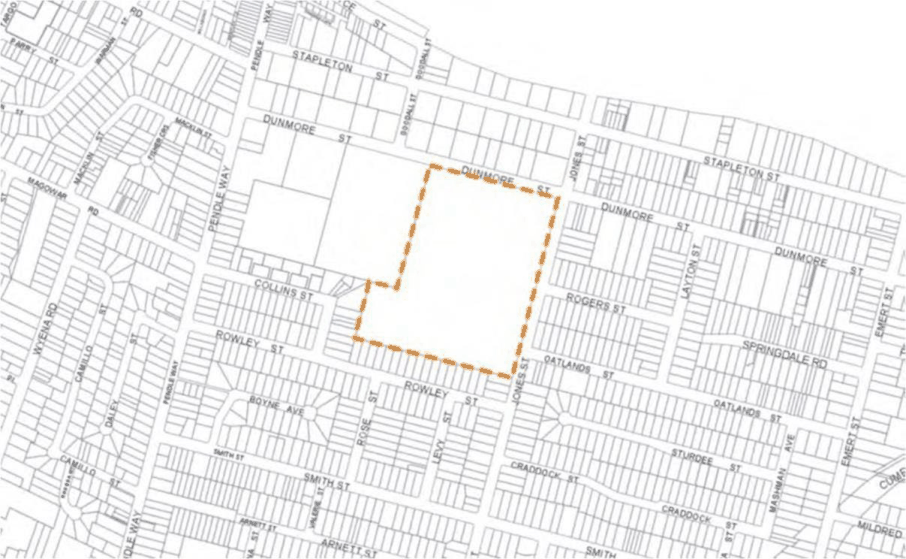

> [Picture on page 32: a picture, saved as a picture (images/part-f1-precinct-and-site-specific-development-controls-page-32-5.gif, 150 dpi).]

Figure 1: Land to which this Part applies

## 2. Vision and general objectives

### 2.1 Vision

The Bonds Spinning Mill site is a vibrant, mixed use and compact urban precinct that respects

and celebrates its past history and integrates with, complements and enhances the surrounding

Pendle Hill community.

### 2.2 General objectives

Development responds to and respects the site and its context, including its strategic,

transit proximate location, topography and surrounding residential uses

Development is predominantly residential in use, making an important contribution to

the amount and choice of housing for the broader community

Development creates a new heart for the precinct and surrounding Pendle Hill community,

including the establishment of non-residential uses that enhance convenience and

lifestyle and the provision of a new, publicly accessible, multi-use park and network of

public open space

Existing heritage is retained, restored and adaptively reused to reference the past and

provide an asset and focal point for the precinct. New buildings adjacent to existing

retained heritage buildings on the site achieve proportional relationships

Development provides for public access to the precinct and an interconnected, fine- grain

and permeable movement network that prioritises pedestrian and cyclist movement

Development provides for a varied, integrated open space network that provides for a

diverse range of informal active and passive recreational activities in a largely green,

soft landscaped setting

Buildings are sited, angled and designed to maximise climatic responsiveness and

provide high levels of desirable solar access and natural ventilation

Development creates a high level of residential amenity, including optimising outlook and

views to desirable landscape elements, and respects the amenity of surrounding

established residential areas

Development defines and activates Jones Street, Dunmore Street and new streets

Development is well designed, with a positive relationship between buildings and

adjoining public domain, including providing for high levels of amenity for key public

spaces

Development provides for a high level of engagement between the public and private

domains, in particular providing for pedestrian integration and extensive opportunities

for passive casual surveillance.

### 2.3 Master plan

The vision and principles for the site as identified above are spatially expressed in the urban

structure for the precinct as shown in Figure 2. To ensure that development provides key elements, where variations to the master plan are

proposed, the development application is to demonstrate how the vision and principles have

been achieved.

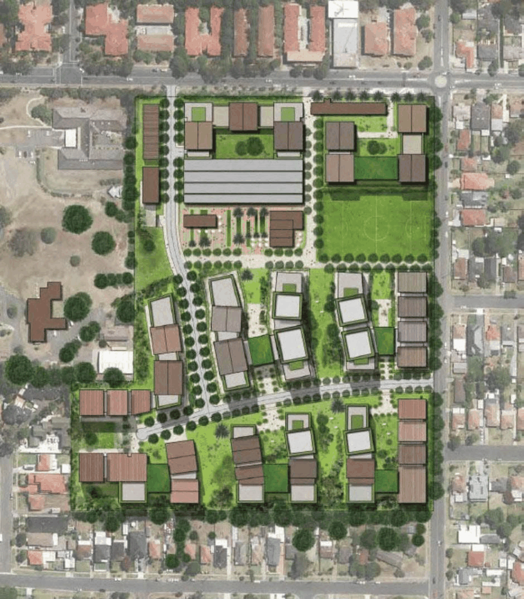

> [Picture on page 34: a picture, saved as a picture (images/part-f1-precinct-and-site-specific-development-controls-page-34-7.gif, 150 dpi).]

Figure 2: Master Plan

## 3. Specific objectives and controls

### 3.1 Land use

#### Objectives

Development creates a high density, vibrant and active urban precinct while ensuring

that local movement, community & open space infrastructure is maintained or improved.

Development provides for centrally located, integrated non-residential uses that support

the convenience and lifestyle needs of residents of the precinct and Pendle Hill

community.

#### Controls

Land use is generally in accordance with Figure 3

Non-residential uses are located generally in accordance with Figure 3.

Development provides for a maximum of 6,000sqm of GFA of non-residential uses.

Note: preferred non-residential uses include retail uses (including supermarket, cafes and

specialty retail), local services / businesses, medical and community centres. Non-residential uses maximise activation of the multi-use park and public plaza as well

as retained heritage buildings.

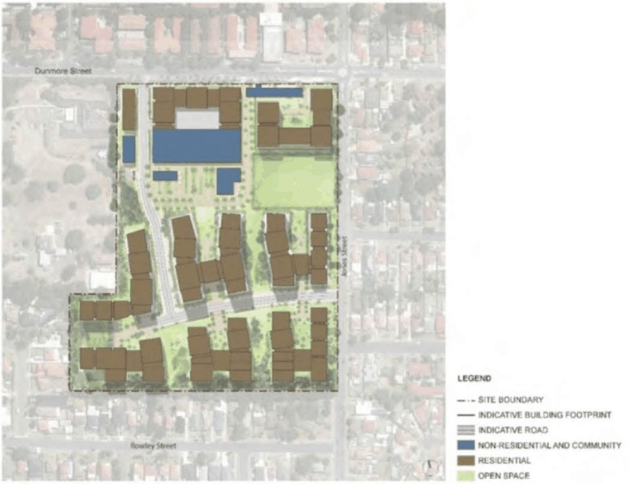

> [Picture on page 35: a picture, saved as a picture (images/part-f1-precinct-and-site-specific-development-controls-page-35-17.gif, 150 dpi).]

Figure 3: Land use

### 3.2 Building height

#### Objectives

Building height is varied throughout the precinct to create an articulated and visually

interesting skyline, and reinforces the visual prominence of the crest of the hill upon

which Dunmore House is located.

Building height adopts a height pyramid principle with taller buildings located in the

centre of the site transitioning to lower rise buildings at the site’s edges.

Building height retains reasonable solar access to neighbouring sites.

#### Controls

Maximum building height is generally in accordance with Figure 4.

Basement levels are integrated with existing benched ground levels to create new

communal landscaped open space.

Storeys above level 4 are to be set back from the street front by an additional 3m from

building line of the storeys below.

Reduced level details must be in accordance with Part G Cumberland DCP 2021.

Maximum building height is limited to 4 storeys within the heritage precinct.

Maximum building height adjacent to the site’s boundary with properties in the R2 Low

Density Residential zone is 3 storeys.

Maximum building height fronting a street that separates the site from land in the R2

Low Density Residential zone is 4 – 6 storeys.

Buildings are setback to allow adequate daylight access to neighbouring properties.

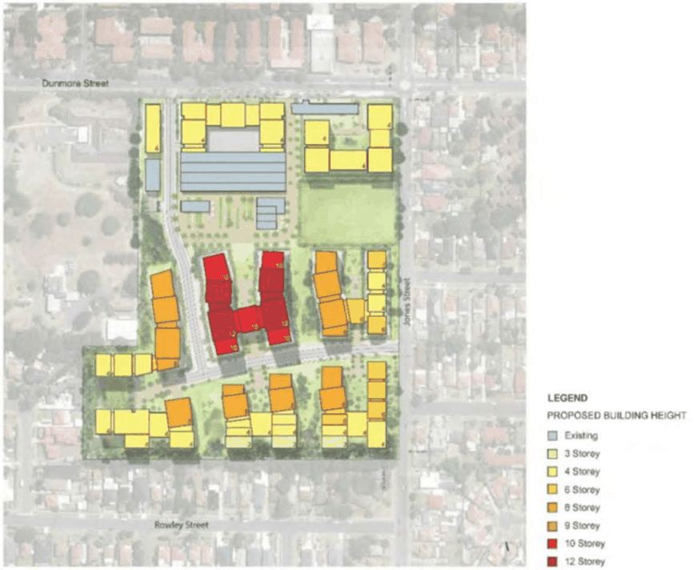

> [Picture on page 37: a picture, saved as a picture (images/part-f1-precinct-and-site-specific-development-controls-page-37-1.gif, 150 dpi).]

Figure 4: Building height

### 3.3 Building siting

#### Objectives

Buildings are sited to optimise climatic responsiveness, in particular solar access to

ground floor communal open space and public domain.

Buildings are sited to frame and define streets.

Buildings are sited to provide a high level of amenity for adjoining and nearby residential

uses.

Buildings are sited to create a physically and visually permeable and open character.

#### Controls

Buildings are setback a sufficient distance from existing and new streets to provide a

balance between activating the street and providing sufficient area for landscaping to

soften the visual impact of the built form in the streetscape.

Building setbacks and separations for buildings fronting internal streets and pocket

parks, are generally consistent with Figure 7 - 9.

Buildings provide a continuous street edge to Jones Street. This does not apply to locations

for vehicle access or the location of the park as well as where mature trees that must be

retained are present.

Buildings are setback a minimum of 12m from the site’s south-western, southern and

eastern boundaries.

Any possible overlooking to residential areas adjacent is treated with fixed privacy screens,

fixed depth planter boxes or similar to maintain adequate privacy to adjoining residential

areas.

Building setbacks and separations for buildings:

• on the precinct’s southern boundary, levels above 4 storeys are generally consistent

with Figure 5; and

• on the precinct’s eastern boundary, levels above 4 storeys are generally consistent

with Figure 6. Buildings adjoining the precinct’s southern boundary are separated into distinct,

separate buildings and do not create a continuous boundary edge condition.

Buildings to the Jones Street frontage will have a varying setback that allows ground floor

courtyards (no closer than 12m to the Jones Street boundary) with a further setback for

the building as well as increased setbacks to retain mature vegetation where relevant.

Buildings are sited with their long axis aligned north-south to provide north-south views

and accessibility throughout the precinct, in particular to the multi-purpose park and

heritage buildings.

Buildings along the southern edge are designed to enable possible future links to the

south between main building forms.

Buildings addressing Dunmore Street have a 4m front setback.

### 3.4 Built form

#### Objectives

Buildings are designed to activate and engage with the adjoining public domain.

Buildings are designed to reduce the bulk and scale when viewed from the public

domain and provide visual interest.

Internal street setbacks and upper level setbacks enable sunlight and view corridors,

whilst allowing passive surveillance from upper level balconies and terraces.

#### Controls

Buildings are designed to have their main living areas and adjoining private open space

oriented to and directly overlook the public domain.

Building facades are angled to optimise solar access to main internal living areas and

adjoining private open space and optimise outlook and views to high amenity features

such as open space.

The Jones Street and Dunmore Street street-walls are broken into a number of smaller

parts through significant recesses, other facade modulation or via distinct building

elements.

Building facades feature articulation within a cohesive overall composition using design

measures such as:

• recessed and / or projecting balconies;

• large windows and other openings;

• sun control devices such as eaves, louvres and screens;

• privacy screens;

• blades or fins;

• elements of a more lightweight material than the main structural framing balustrades

to balconies that have a more lightweight appearance than masonry such as glass,

metal or timber. In relation to residential uses at ground level:

• the number of individual dwelling entries from the adjoining public domain are

maximised;

• where entries provide access to more than one dwelling, they relate to each lift core,

are clearly defined and legible and preferably form an architectural feature of the

building;

• pedestrian entries are directly accessible from and at the same level as the adjoining

public footpath;

• main living areas and adjoining private open space are oriented to be parallel and

directly overlooking the adjoining public domain;

• front boundary treatments combine level change, landscaping and fencing to

provide a reasonable level of privacy for residents while providing for casual passive

surveillance of the adjoining public domain;

• internal living areas are integrated with areas of outdoor private open space to

provide a transition between the public and private domains. In relation to non-residential uses at ground level:

• the number of individual tenancies that adjoin and are directly accessible from the

public domain are maximised;

• pedestrian entries are at the same level as the adjoining public domain;

• large areas of transparent glazing or other openings enable clear sightlines between

the public domain and internal areas, in particular those with high levels of activity

such as reception, seating and dining areas;

• cafes or restaurants include outdoor seating in the adjoining public domain;

• awnings or other overhangs provide shelter for pedestrians;

• universal access is provided. Maximum building depth and width is in accordance with the NSW Apartment Design

Guide (ADG).

Building separation is generally consistent with Figures 7 - 9.

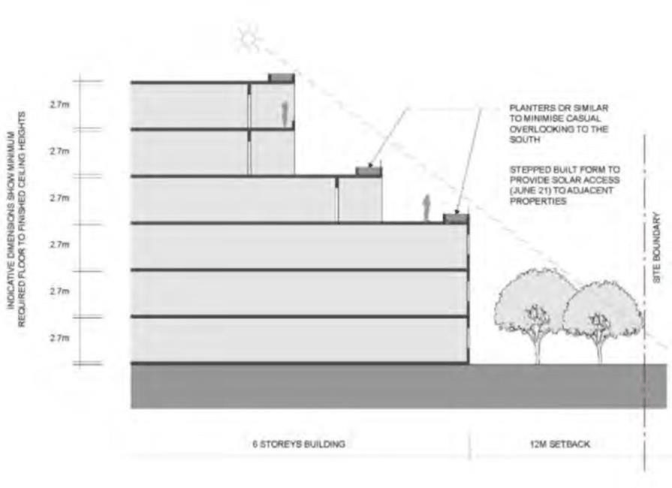

> [Picture on page 40: a picture, saved as a picture (images/part-f1-precinct-and-site-specific-development-controls-page-40-1.gif, 150 dpi).]

Figure 5: Indicative section at precinct southern boundary, adjoining Jones Street

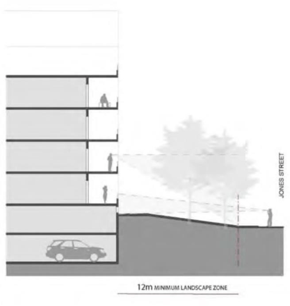

> [Picture on page 40: a picture, saved as a picture (images/part-f1-precinct-and-site-specific-development-controls-page-40-3.gif, 150 dpi).]

Figure 6: Indicative section at precinct eastern boundary, adjoining Jones Street

Note: Upper level building setbacks are indicative only. Refer to Figure 4 for indicative building heights.

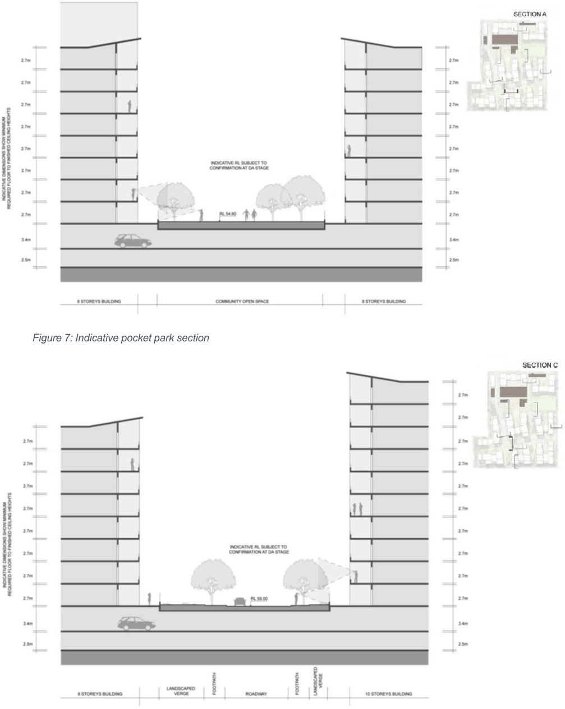

> [Picture on page 41: a picture, saved as a picture (images/part-f1-precinct-and-site-specific-development-controls-page-41-1.gif, 150 dpi).]

Figure 7: Indicative pocket park section

Figure 8: Indicative internal street section

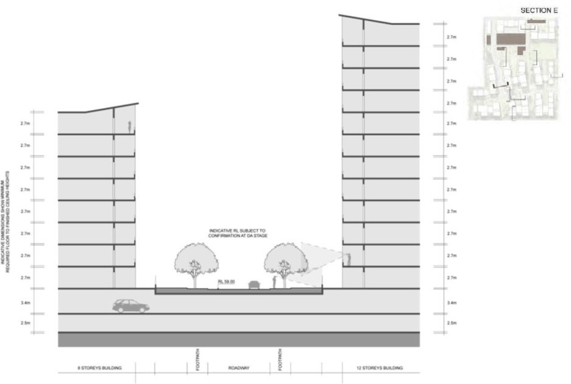

> [Picture on page 42: a picture, saved as a picture (images/part-f1-precinct-and-site-specific-development-controls-page-42-1.gif, 150 dpi).]

Figure 9: Indicative internal street section

### 3.5 Open space

#### Objectives

Development provides for open space that includes a publicly accessible multi-use park

for the precinct and surrounding Pendle Hill community.

Development provides for public and private open spaces that are well located and

accessible, forming an interconnected network of green spaces.

Development provides for public and private open spaces that have a layout, design,

area and dimensions that are useable and fit for their intended purpose.

Development provides for public and private open spaces that have a high level of

amenity, including adequate solar access.

Development provides for public and private open spaces that where publicly accessible,

are physically and visually accessible and permeable, and are directly overlooked and

activated by adjoining uses.

Development provides for public and private open spaces that have a coherent, legible

landscape character, and offers a high level of visual amenity.

Development provides for public and private open spaces that cater for a diverse range

of informal passive and active recreation activities.

Development provides for public and private open spaces that cater for biodiversity,

enable infiltration of stormwater into the ground and improves microclimate.

Development that enhances the surrounding and internal street landscapes with quality

landscaping and architectural responses, to facilitate a network of green links.

Development promotes social cohesion and a sense of community through providing

spaces that cater for organised and informal community gathering and interaction.

#### Controls

Development creates a publicly accessible multi-use public park having a minimum area

of 5,500sqm on the northern part of the site that is located between the heritage buildings

and new development and has substantial frontage to Jones Street.

The multi-use park includes the following facilities:

• soft and hard landscaping for passive recreation and active play;

• adaptable playground areas; and

• amenities such as BBQ facilities, shade structures, seating, lighting, bins and

signage.

Development provides for continuous linear space through-site links between development

blocks that provide a physical and visual connection between the multi- use public park

and public plaza and the site’s southern boundary.

Development includes at least five public pocket parks distributed throughout the

precinct.

Development provides for approximately 25,000sqm of publicly accessible open space.

Where possible, public open space includes areas for community gardens in locations

that do not compromise the useability of the space for informal active and passive

recreation activities.

Publicly accessible open space is provided with a range of amenities such as seating,

lighting, paving and BBQ facilities.

A minimum of 4 hours of solar access should be maintained to at least 60% of the public

park on June 21.

Open space is provided generally in accordance with Figure 10.

Indicative sections of the public park and marketplace plaza are provided in Figure 11

and 12.

Existing significant trees around the perimeter of the site, in particular those that provide

a screening function for adjoining uses, are retained where not required for site access

points, and are integrated into the prevailing landscape character of the precinct.

Development provides for:

• public open space;

• private communal open space;

• private, individual use open space; and

• landscaped areas and deep soil areas.

Development includes a public plaza as an extension of the multi-use park that features

a combination of hard paving and soft landscaping and caters for informal community

gathering and interaction, including occasional events.

Deep soft landscape areas are located between buildings and the southern boundary

of the site.

Plantings in open space areas incorporate a diverse selection of locally native species

including trees, shrubs and grasses/groundcovers.

Except for the public plaza, public open space optimises permeable soft landscaping

such as turf and planted areas.

Open space includes sufficient area for deep soil planting to support large, spreading

canopy trees.

All streets:

• include a minimum 4m landscaped verge on both sides; and

• are generally in accordance with the landscaping elements shown in Figures 11 and

12\. Extensive, co-ordinated tree plantings are provided within new street reserves.

Development creates a community precinct focussed within and around the heritage

buildings that includes public open space and non-residential uses.

Development facilitates public access to the site by maintaining strong connections and

a permeable pedestrian and public open space network.

Development includes community gardens.

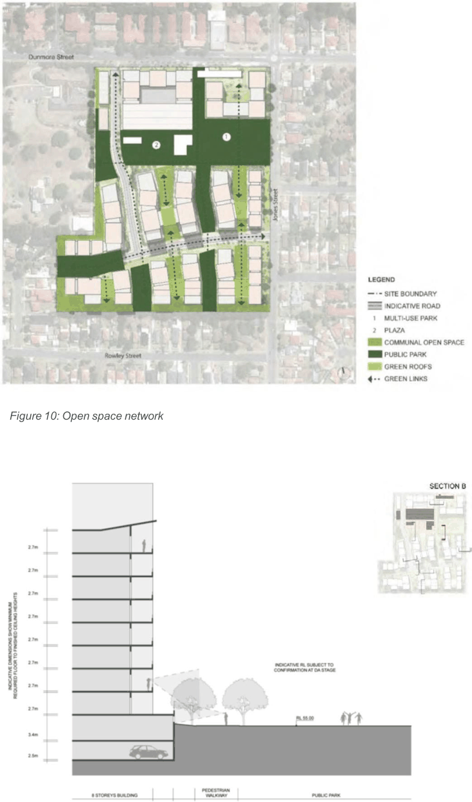

> [Picture on page 45: a picture, saved as a picture (images/part-f1-precinct-and-site-specific-development-controls-page-45-1.gif, 150 dpi).]

Figure 10: Open space network

Figure 11: Indicative section of public park

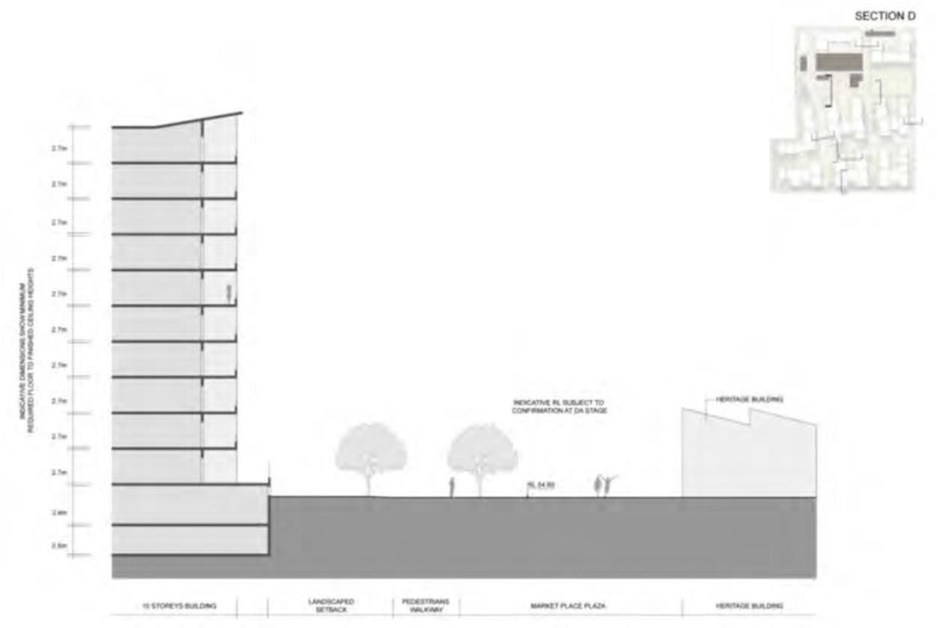

> [Picture on page 46: a picture, saved as a picture (images/part-f1-precinct-and-site-specific-development-controls-page-46-1.gif, 150 dpi).]

Figure 12: Indicative section of marketplace plaza

### 3.6 Movement network

#### Objectives

The movement network provides for multiple points of public access to the precinct.

The movement network is functional and provides for the efficient and safe movement

of vehicles, pedestrians and cyclists.

The movement network provides a comfortable and attractive environment for pedestrians

and cyclist.

The movement network where appropriate, provides opportunities for social interaction

and gathering.

On-site car parking is provided at a rate that balances the need to provide for the

convenience needs of residents and visitors with encouraging more sustainable forms

of movement such as the public transport, walking and cycling for commuter and

recreational trips.

On-site car parking is provided in a form that reduces overall building size and enables

the creation of a positive relationship between buildings and the adjoining public domain,

in particular through high levels of integration at the ground level.

#### Controls

The street network, pedestrian network, site access and car access points are provided

generally in accordance with Figure 13 – Movement Network.

The existing street network is extended into the site to provide for at least one vehicle

access onto Dunmore Street and one access on to Jones Street.

Vehicle ingress and egress to the site is two-way.

Pedestrian and cyclist movement is prioritised over vehicular movement.

Streets include pedestrian paths on both sides. The pedestrian and cycle access network:

• is direct and accessible to all;

• is easily identified by users;

• has a public character;

• includes signage advising of the publicly-accessible status of the link and the places

to which it connects;

• is clearly distinguished from vehicle access-ways; and

• allows visibility along the length of the link to the public domain at each end Strong, legible pedestrian connections are established between the site and adjoining

areas.

The pedestrian and cycle access network:

• aligns with breaks between buildings so that views are extended and the sense of

enclosure is minimised;

• includes materials and finishes (paving materials, tree planting, furniture etc.)

integrated with adjoining streets and public spaces and be graffiti and vandalism

resistant;

• is well-lit to safety standards;

• is open to the sky along the entire length; and

• is accessible 24 hours a day. Provision is made to allow possible future connections from the site to the south

Street furniture is provided and includes a high quality, durable and co-ordinated

selection of:

• paving;

• seating;

• lighting;

• rubbish bins; and

• signage. Street trees are to be provided within deep soil zones on all streets that:

• comprise a co-ordinated palette of climatically responsive species;

• are robust and low-maintenance;

• are planted in a co-ordinated, regularly spaced and formalised manner;

• increase the comfort of the public domain for pedestrians, including through the

provision of shade in summer; and

• enhance the environmental performance of the precinct by increasing opportunities

for energy conservation. In areas where deep soil zones cannot be achieved, suitable trees species still:

• comprise a co-ordinated palette of climatically responsive species;

• are robust and low-maintenance; and

• provide adequate canopy shade, for the comfort of pedestrians. On-site car parking is provided in accordance with Part G, Cumberland DCP 2021.

Carpark access is co-ordinated to provide for efficiently and convenience while not

adversely affecting the pedestrian movement or the visual amenity of the public domain.

On-site resident car parking is provided in basement form.

Basement car parking protrudes above ground level:

• for ventilation purposes only; and

• for a maximum height of 1m.

### 3.7 Managing transport demand

#### Objective

Ensure that the transport demand generated by development is managed in a sustainable

manner.

#### Controls

All development applications are to include a ‘Transport Impact Study’ addressing the

potential impact of the development on surrounding movement systems, where the

proposed development comprises:

• non-residential development of more than 1,000m² GFA;

• residential development of 100 or more new dwellings; or

• likely to generate significant traffic impacts according to the consent authority. The development application and applications for subdivision are to include a site wide

‘Green Travel Plan’ to outline initiatives for walking, cycling and the use of public

transport. The Green Travel Plan should address different transport needs and patterns

for residential and non-residential uses. Where relevant, initiatives are to be

implemented prior to the issue of an Occupation Certificate.

All development applications are to include a ‘Transport Access Guide’, and a strategy

for its future availability to residents, employees and visitors, where the proposed

development comprises:

• Multi-dwelling housing; or

• Non-residential development more than 1,000m² GFA. Residential development within an 800m radial catchment of a railway station must provide

at least one car-share parking space for every 100 dwellings.

Car-share parking spaces are included in the maximum number of visitor car parking

spaces required for a development in Part G - Miscellaneous Controls, Cumberland DCP

2021.

Car-share parking spaces must be publicly accessible at all times, conveniently located,

adequately lit and identified with sign-posting and road marking.

Car-share spaces must comply with the relevant Australian Standard.

Written evidence must be provided with the construction certificate demonstrating that

offers of a car space to car-share providers have been made together with the outcome

of the offers or a letter of commitment to the service.

All car-share parking spaces are to be retained as common property by the Owners

Corporation of the site. A covenant is to be registered with the strata plan advising of

any car-share parking space. The covenant is to include provisions that the car-share

parking space(s) cannot be revoked or modified without prior approval of Council.

End-of-trip facilities including showers and lockers must be provided to adequately service

the number of bicycle parking spaces required for employees in commercial premises

and are to be located close to the bicycle parking area, entry/exit points, and within an

area of security camera surveillance preferably where there are such building security

systems.

Note: Council will give consideration to granting a floor space exemption where the applicant demonstrates the provision of end of trip facilities within the residential and commercial components of the development.

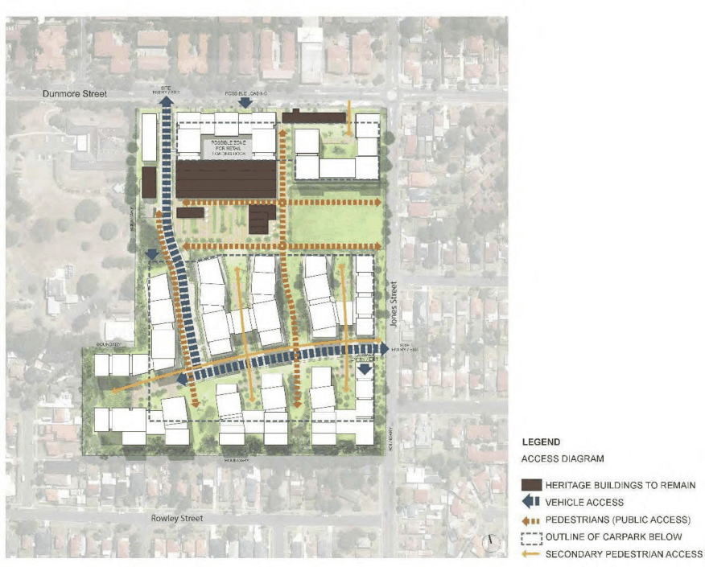

> [Picture on page 49: a picture, saved as a picture (images/part-f1-precinct-and-site-specific-development-controls-page-49-13.gif, 150 dpi).]

Figure 13: Movement network

### 3.8 Heritage

#### Objectives

All development seeks to respect and celebrate the site’s former use as the Bonds

Spinning Mill.

All development seeks to identify the potential for archaeological remains.

All development seeks to ensure adequate protection and best-practice management

of archaeological relics.

All development seeks to minimise the potential for the disturbance of archaeological

relics likely to be located on the site.

#### Controls

The following heritage buildings are retained as shown in Figure 14:

• Administration Building;

• Dance Hall;

• Cutting Room;

• Cotton Bale Stores; and

• John Austin Centre Development is sited and designed in accordance with Section 11.10 of the Conservation

Management Plan (Design Guidelines). Refer to Council’s website for a copy of the

CMP.

Retained heritage building are sympathetically restored, adaptively re-used and

integrated with the balance of the precinct.

The spaces around the heritage items are accessible to the public.

New buildings adjacent to heritage buildings shown in Figure 14, are to achieve

proportional relationships, including:

• fenestration proportions;

• materiality; and

• key elevational alignments. New development which falls within, or adjoins heritage curtilage zones, requires

consideration of building materials that are complimentary to the retained heritage

buildings, and are sympathetically designed in accordance with the CMP.

Industrial archaeology such as information signage and public artwork is distributed

throughout the site to provide a time line highlighting important events and characters

from the site’s history.

The first development application is supported by a public art and interpretation strategy

that complies with these controls.

View corridors are provided from the public plaza to Dunmore House and from Jones

Street through the multi-use park to the John Austin Centre.

An historical archaeological assessment should be prepared by a suitably qualified and

experienced historical archaeologist to inform the redevelopment of the site. This

assessment should clearly identify and assess the potential for archaeological relics and

engineering works, including providing an assessment of their significance in

accordance with the NSW Heritage Division Guideline: Assessing Significance for

Historical Archaeological Sites and Relics, 2009. The assessment should then consider

what impacts, if any, the proposed activity will have on any potential archaeological

resource and include appropriate recommendations for its management according to

significance. The Assessment should be submitted to Council for consideration in

support of the first development application.

Where the assessment determines that the development would disturb a potential

historical archaeological resource, an application for an excavation permit under the

Heritage Act 1977 (NSW) must be submitted to the NSW Heritage Council. A copy of

the report and the permit are to be provided to Council with the development application.

The applicant is to lodge, prior to issue of a Construction Certificate, a Construction

Heritage Management Plan which addresses the following:

• Mitigation measures that will be in relation to the likely archaeology onsite;

• The proposed monitoring in place for any archaeological relics uncovered;

• Training, resources and consultation for staff on the site during excavation;

• Incident management protocol; and

• Methods dealing with unexpected finds during works. During the development, if any archaeological remains are discovered, the developer is

to stop works immediately and notify the NSW Heritage Division and Council. Any such

find is to be dealt with appropriately, in accordance with the Heritage Act 1977 (NSW),

and recorded, and details given to Council prior to the continuing or works.

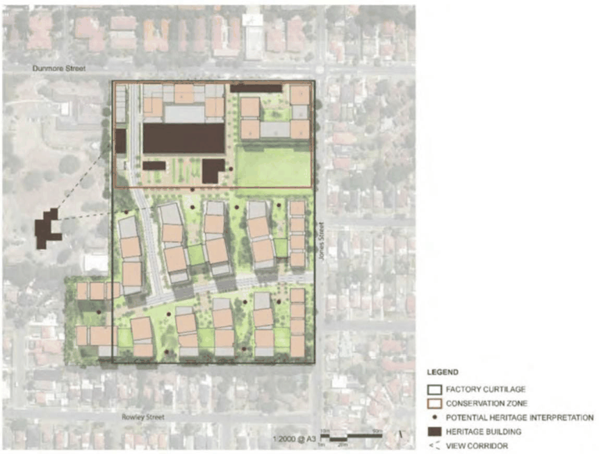

> [Picture on page 51: a picture, saved as a picture (images/part-f1-precinct-and-site-specific-development-controls-page-51-16.gif, 150 dpi).]

Figure 14: Heritage

This page has been left intentionally blank.

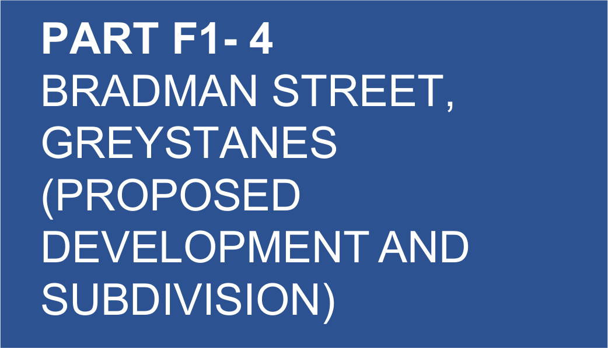

> [Picture on page 53: a picture, saved as a picture (images/part-f1-precinct-and-site-specific-development-controls-page-53-1.gif, 150 dpi).]
