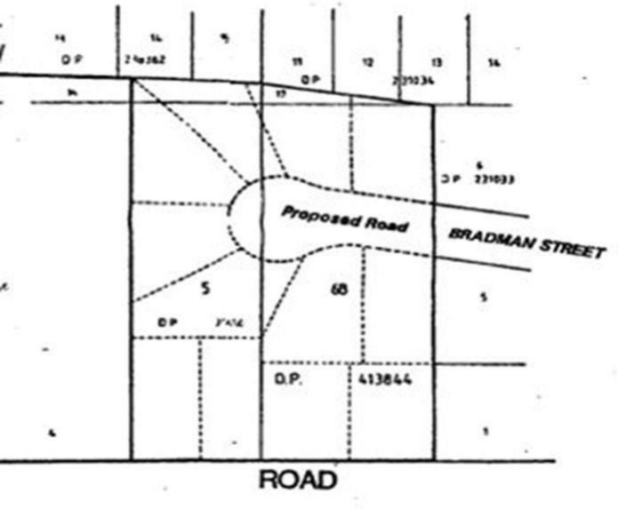

### PART F1- 4

BRADMAN STREET,

### GREYSTANES

### (PROPOSED

### DEVELOPMENT AND

### SUBDIVISION)

This page has been left intentionally blank.

## 1. Introduction

### 1.1 Land to which this section applies

This section applies to land situated in the Cumberland City being Lot 5 DP 20650, Lot 6B DP

413844 and Lots 16 and 17 DP 238362, as shown in the diagram below. This plan aims to provide a cul-de-sac at the eastern end of Bradman Street, Greystanes.

## 2. Specific Objectives and Controls

#### Objectives

Facilitate the conventional subdivision of Lot 5, DP 20650, Lot 6B DP 413844, Part Lot

16 and Lot 17, DP 238362 into 12 lots; and

Prevent the linking of the existing sections of Bradman Street.

> [Picture on page 55: a picture, saved as a picture (images/part-f1-precinct-and-site-specific-development-controls-page-55-11.gif, 150 dpi).]

Figure 1: Bradman Street subdivision map

This page has been left intentionally blank.

> [Picture on page 57: a picture, saved as a picture (images/part-f1-precinct-and-site-specific-development-controls-page-57-1.gif, 150 dpi).]
