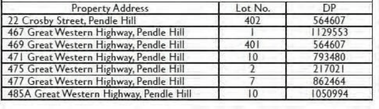
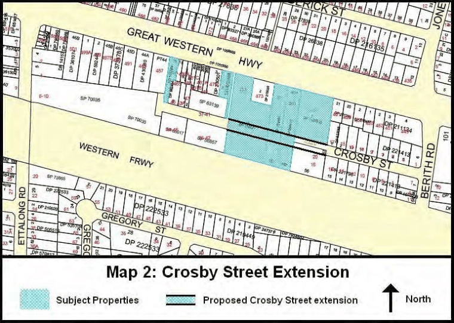

### PART F1-5

CROSBY STREET,

### GREYSTANES

This page has been left intentionally blank.

## 1. Introduction

### 1.1 Land to which this Part applies

This section applies to lands at Crosby Street precinct, Greystanes, as indicated in Table 1 and

shown on Map 2.

## 2. Vision

As of 2010, Crosby Street, Greystanes, has been divided into two, unconnected sections. This section

of the DCP is intended to guide future subdivision within the precinct to ensure that the two sections are

connected, that development addresses the completed Crosby Street and that additional vehicular

access from the parallel Great Western Highway is minimised.

## 3. Specific objectives and controls

#### Objectives

Facilitate the reasonable development of the Crosby Street precinct by permitting the

completion of Crosby Street, Greystanes.

Minimise the number of properties with vehicular access from the Great Western

Highway.

Ensure that further development results in the completion of Crosby Street.

Ensure that development addresses both sides of Crosby Street.

#### Controls

This section of the DCP applies to all development within the Crosby Street precinct, as

indicated in Table 1 and shown in Figure 1.

Development for the purposes of the erection of a new detached dwelling house and

additions and alterations to an existing, detached dwelling house is excluded from the

provisions of this section.

Subdivision of land in this precinct shall not result in:

• lots having a maximum dimension of more than 37m; or

• hatched-shaped allotments having vehicular access from the Great Western

Highway. Land shall be dedicated for the Crosby Street extension in accordance with Figure 2 for

a 15m wide road reservation.

A 7.5m wide vehicular carriageway shall be constructed along the proposed extension of

Crosby Street, with a 3.75m footpath verge with a roll-top kerb along either side to match

adjoining.

Road layout and geometry shall be in accordance with the provisions of Part A and G of

this DCP and with other approved standards, either the Guide to Traffic Engineering

Practice published by NAASRA, or the Roads and Maritime Services guidelines.

All roadworks, including drainage, kerb and gutter and footpaths, shall be constructed at

the applicant’s expense and the required land dedicated to Council prior to release of any

Subdivision or Occupation Certificate. Alternatively, Council may accept lodgement of a

bond, through a bank guarantee, for the agreed value of the works plus interest for 10

years, in lieu of construction of the works.

Where hatched shaped allotments are created with frontage to both the Great Western

Highway and the Crosby Street extension, a restriction to use under Section 88B shall

be included upon the title, with Council listed as a party, to require no access from the

Great Western Highway, upon extension of Crosby Street to the subject property.

Temporary access shall be permitted from the Great Western Highway until such time as

all land dedication and road construction for the Crosby Street extension is completed to

the subject property.

Approval of temporary access from the Great Western Highway shall be subject to the

agreement of the Roads and Maritime Services and any affected landholders.

Where temporary access from the Great Western Highway has been permitted, the

following works shall be carried out at the expense of the landowner(s) at such time as

the Crosby Street extension is completed to the subject property:

• all necessary works to permit vehicular access from Crosby Street, including

removal of fences and construction of a suitable vehicular driveway from the

property boundary to the kerb-line;

• all necessary works required to deny access from the Great Western Highway,

including erection of fencing at the property line and removal of any vehicular

driveway from the property boundary to the kerb-line.

Development shall not extinguish the existing right of carriageways linking Crosby Street

and Great Western Highway located on 477 and 485A Great Western Highway.

Table 1: Land subject to Section 1 of this Part.

> [Picture on page 60: a picture, saved as a picture (images/part-f1-precinct-and-site-specific-development-controls-page-60-27.gif, 150 dpi).]

> [Picture on page 61: a picture, saved as a picture (images/part-f1-precinct-and-site-specific-development-controls-page-61-1.gif, 150 dpi).]

Figure 1: Crosby Street map

This page has been left intentionally blank.

> [Picture on page 63: a picture, saved as a picture (images/part-f1-precinct-and-site-specific-development-controls-page-63-1.gif, 150 dpi).]
