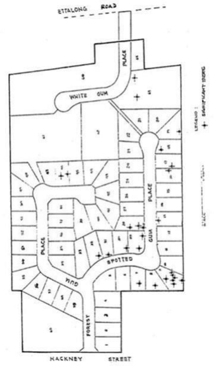

### PART F1-6

### FOREST GUM ESTATE

This page has been left intentionally blank.

## 1. Introduction

The Forest Gum Estate, Greystanes is intended to be developed as a low density residential area. As a response to potential over development, it is intended to impose additional development controls

which would apply to this site. Rather than limiting the range of building forms by providing additional

FSR controls, it is considered appropriate to contain development within an appropriate building

envelope. In addition, controls on the minimum amount of private open space will ensure that sufficient

private open space is provided for each dwelling. As the Forest Gum Estate is a comparatively large development, it is appropriate to designate significant

trees subject to Council’s Tree Management Order and provide soil erosion and sedimentation controls

within this Development Control Plan.

### 1.1 Land to which this Part applies

This section of the DCP applies to land outlined in heavy black as shown on the plan map

below.

> [Picture on page 65: a picture, saved as a picture (images/part-f1-precinct-and-site-specific-development-controls-page-65-14.gif, 150 dpi).]

Figure 1: Forest Gum Estate map

## 2. Specific objectives and controls

#### Objectives

Ensure the low density development is consistent with that allowed under the R2 zone

of Cumberland LEP 2021.

Ensure a building envelope is provided to contain the bulk and scale of development.

Ensure significant trees are identified and protected.

Ensure controls are provided relating to soil erosion and sedimentation during

construction and building works.

Note: The provisions of Part B of this DCP relating to one and two Storey Residential Development” and “Dual Occupancy” specifically apply to the subject land except where the provisions of this section apply.

#### Controls

Private open space A minimum area of 80m² excluding side and rear setbacks shall be provided as usable

private open space for each allotment.

Tree management Those trees identified as being significant on the map are subject to the provisions of

Cumberland City Council’s Tree Management Order.

Those trees identified as being significant on the map are subject to the provisions

of Cumberland City Council’s Tree Management Order.

In respect of Lot 9 DP 845448 shown on the map Council may consider the removal of

trees provided four significant trees are retained and a schedule of replacement trees is

provided to the satisfaction of Council.

Soil erosion and sedimentation Measures to prevent soil erosion and sedimentation as detailed in Part G of this DCP.

This page has been left intentionally blank.

> [Picture on page 68: a picture, saved as a picture (images/part-f1-precinct-and-site-specific-development-controls-page-68-1.gif, 150 dpi).]
