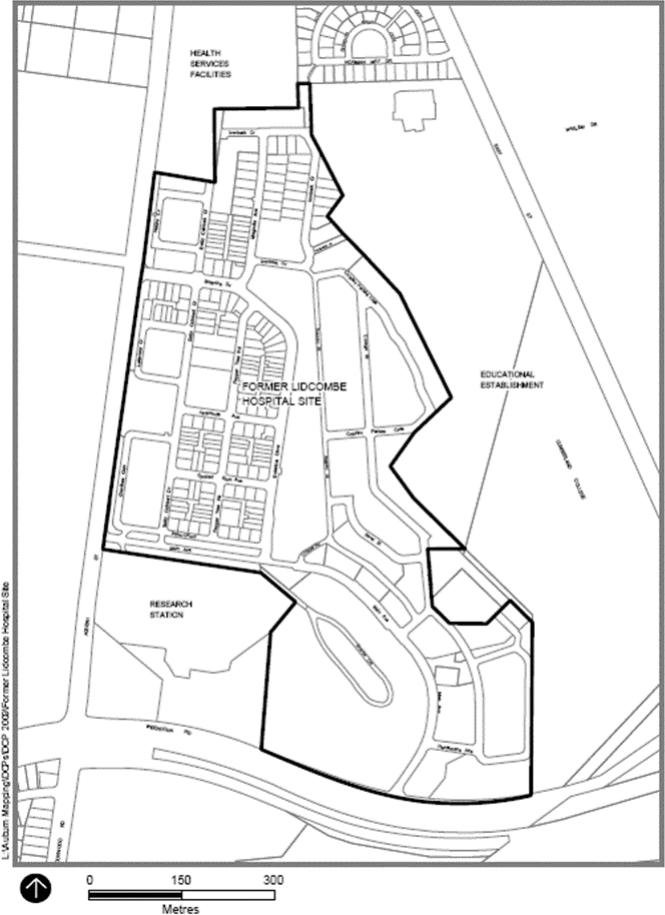
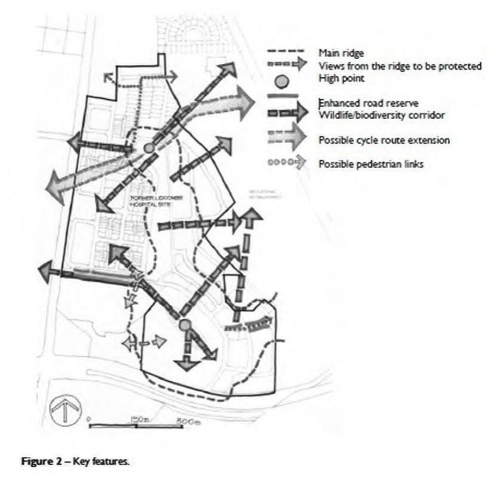
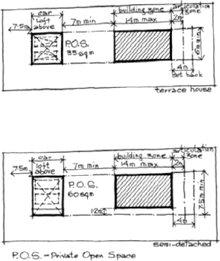
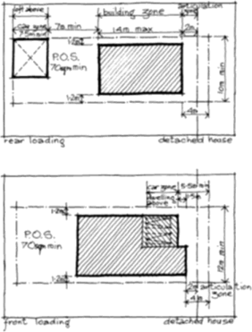
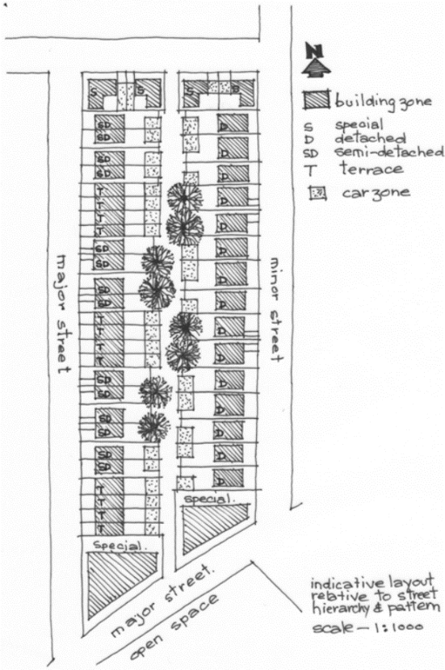
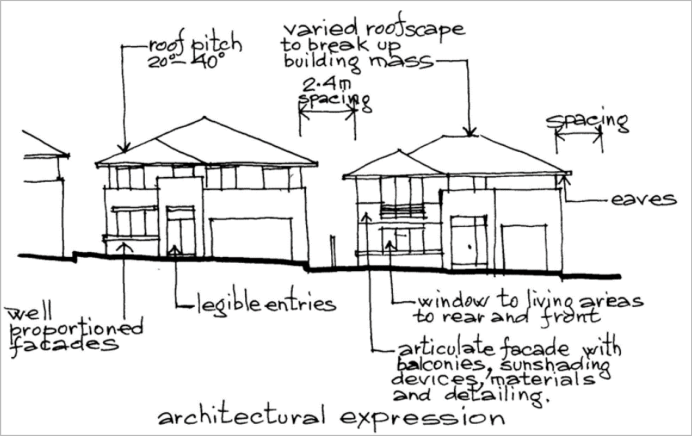
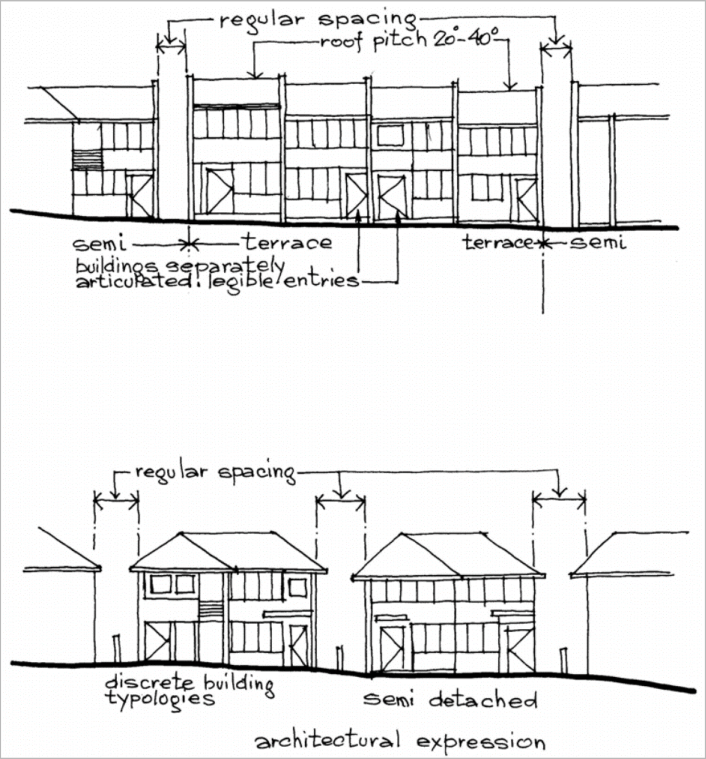
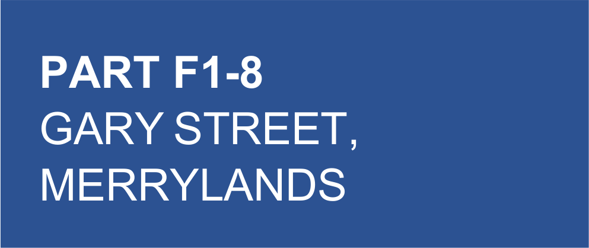

### PART F1-7

### FORMER LIDCOMBE

### HOSPITAL SITE

This page has been left intentionally blank.

## 1. Introduction

### 1.1 Land to which this Part applies

This Part applies to land zoned R3 Medium Density Residential under the provisions of

Cumberland LEP 2021 and known as the Former Lidcombe Hospital site, as shown in Figure 1

below.

> [Picture on page 70: a picture, saved as a picture (images/part-f1-precinct-and-site-specific-development-controls-page-70-6.gif, 150 dpi).]

Figure 1: Area to which this Part applies

Where there is an inconsistency between this Part and other Parts within this DCP, the

provisions of this Part prevail.

## 2. General objectives

This Part seeks to ensure that re-development achieves the following objectives and outcomes:

The site, when re-developed, maintains its uniqueness and character.

Future development retains and responds to key characteristics of the site.

The features of the site are integrated into the overall planning of the site.

Retention, adaptive reuse and integration of significant and other buildings to give unique

character to the site, to enable future generations to read the “story” of the site and to

reduce waste through reuse of existing building fabric.

Retention of significant remnant vegetation, cultural plantings and landscape features in

the public domain and retention of significant road alignments, to protect and enhance

biodiversity and ecological niches.

Provision of employment opportunities and opportunities for cultural development by

providing for mixed uses in key heritage buildings.

Provision of a range of quality open space to meet passive and active recreational needs

of the community (excluding organised sport) in locations that are easily accessible and

in locations that maximise the retention of key landscape features and significant

vegetation in the public domain.

Integration of landuse and transport planning by providing pedestrian, bicycle and transport

connections within the site and between the site and its surrounds by way of bus

transport and by co-location of services, facilities and employment opportunities.

Development of safe, well designed subdivisions, residential areas and dwellings, taking

account of energy efficiency and efficient water management principles.

Create a sustainable community socially, culturally, environmentally and economically.

Ensure that a comprehensive ecologically sustainable development (ESD) strategy

applies to the design, development, conservation, construction and maintenance

processes.

Ensure that ESD principles underpin the overall development including the design of

dwellings and living areas.

Retain and reuse the existing buildings, where possible.

### 2.1 Staged development

On 7 July 2004, consent orders were issued by the Land and Environment Court approving

development application number 572/02 for the staged development of the site for subdivision,

civil works including roads, drainage and provision of open space, demolition of buildings,

regrading, landscaping, removal of trees, site remediation and separate access and uses.

### 2.2 Terms Unique to the Part

Studio accommodation Are a room or suite of rooms no greater than 55m² in floor area located over a garage which is not part of the front streetscape. The rooms are capable of separate occupation.

Terrace houses Are a form of multi dwelling housing. They are dwellings that have a common side wall(s) with

an adjoining dwelling(s) in a group of three up to a maximum of 8 dwellings where the garage

is detached from the dwelling and is accessed from the side or rear of the lot. Town houses Are a form of multi dwelling housing. They are dwellings that have a common side wall(s) with

an adjoining dwelling(s) in a group of three up to a maximum of 8 dwellings where the garage

is attached with the dwelling at the front or side.

## 3. Specific objectives and controls

> [Picture on page 72: a picture, saved as a picture (images/part-f1-precinct-and-site-specific-development-controls-page-72-10.gif, 150 dpi).]

Figure 2: Key features

### 3.1 Planning Principles

This section sets out requirements that apply to the overall urban design and structure planning

for the site. The key objective of this section is to ensure that the urban design/structure plan

for the site retains key features (see Figure 2) of the site and responds to these.

#### 3.1.1 Built elements to be retained

#### Objectives

Ensure that, wherever possible, existing buildings and road alignments are retained and

adaptively reused.

Ensure that future generations are able to interpret the history of the site.

Individual buildings of significance are to be retained and conserved, or adaptively reused,

on the site to achieve quality conservation and urban design outcomes.

Retain road alignments of significance to contribute to the historical layering of the site.

#### Control

Buildings and elements to be retained shall be detailed in the plans approved as part of

the determination of development application number 572/02 (as amended) for the

staged development of the site.

#### 3.1.2 Landscape elements to be retained

#### Objectives

Ensure that overall landscape integrity of the site is retained.

The landscape integrity and natural and cultural attributes of the site are utilised as

opportunities to define the structure of future development on the site by:

• using the natural lines of drainage to define the location and form of streets and

open spaces;

• protecting the ridge top and high points within the public domain;

• protecting significant tree groups within the public domain;

• protecting individual significant trees within the private domain, where it is not

possible to protect in the public domain;

• responding to the different topography and character of the site on the western and

eastern sides of the ridge;

• retaining existing water bodies and water detention basins as part of an ecologically

sustainable approach to stormwater management;

• protecting the visual prominence of the site and protecting significant views from the

site along the main ridge; and

• protecting significant remnant vegetation within the public domain.

#### Control

Landscape elements shall be retained and incorporated into the overall urban design in

accordance with the performance criteria above.

#### 3.1.3 Open space

#### Objectives

Ensure that a variety of quality, conveniently located open space is provided to meet

diverse passive and active recreation needs of the community, and where possible, to

protect and promote biodiversity.

Ensure that the open space network provides high quality and diverse recreational

opportunities and responding to the special features of the site by:

• locating open space to protect significant tree groups;

• locating open space to protect significant remnant vegetation;

• locating open space to protect and highlight topographical features such as high

points, ridgelines, drainage lines and other features;

• protecting significant heritage items;

• integrating stormwater management;

• protecting the landscape frontage to the site along Joseph Street;

• locating open space to reinforce pedestrian legibility and permeability through the

site; and

• creating wildlife corridors linking across the site from Rookwood Cemetery to

Carnarvon Golf Course.

#### Control

Public open space shall be provided as detailed in the plans approved as part of the

determination of development application number 572/02 (as amended) for the staged

development of the site.

#### 3.1.4 Street layout

#### Objectives

Ensure that the road and street layout respects the history of the site and responds to

key characteristics of the site.

The roads and streets on the site are to be designed to respond to the site character by:

• respecting and retaining the significant existing road patterns, structure and

character where possible;

• retaining the ridge road through the site as the main collector road;

• responding to existing site topography when determining street alignments;

• minimising cut and fill;

• protecting significant landscape or built elements;

• defining property boundaries or neighbourhood boundaries;

• fronting onto open space areas;

• providing opportunities for linkages to adjoining uses; and

• defining clear residential and open space precincts.

O3. The street pattern is organised so that

• the heritage buildings and landscape are retained and fully integrated into the

development;

• there are long sight lines affording views and vistas; and

• the undulations of the topography are clearly visible.

#### Control

The street layout shall be detailed as shown in the plans approved as part of the

determination of development application number 572/02 (as amended) for the staged

development of the site.

#### 3.1.5 Street hierarchy

#### Objectives

Strengthen links and interconnections with adjoining sites.

Minimise the adverse impacts of vehicular traffic on future residential environments.

Optimise links to the surrounding road network and adjoining uses by:

• providing the main site entry of Joseph Street at the existing traffic lights;

• providing a secondary site entry point on Joseph Street with limited turns (left-in and

left-out);

• upgrading the existing site entry on Weeroona Road;

• providing continued access to the MS Society site and Ferguson Lodge via the local

road network;

• allowing for future road connections to the TAFE and University to the east of the

site; and

• ensuring all roads (except laneways) are public streets. Minimise the impact of vehicular traffic on the amenity of the future residential

environment by:

• providing a hierarchy of streets that concentrates the principal traffic on a collector

road through the centre of the site;

• designing local streets to be low speed low volume roads that offer high pedestrian

and residential amenity;

• providing rear laneways for private access to garages to reduce the visibility of

garages on primary street frontages; and

• creating a landscape framework that reinforces the hierarchy of the streets.

#### Control

The development shall adopt the street hierarchy consistent with the plans approved as

part of the determination of development application number 572/02 (as amended) for

the staged development of the site.

#### 3.1.6 Pedestrian and cycle circulation

#### Objectives

Encourage and facilitate walking and cycling within the site and the general neighbourhood.

Encourage use by pedestrian and cyclist use of the site by:

• providing footpaths on all streets on the site;

• providing safe and high amenity pedestrian linkages connecting all major activities

and open spaces;

• providing a cycleway through the centre of the site following the route of the main

collector road along the ridge;

• designing for safe on-street cycling conditions along residential streets;

• providing bicycle parking at key locations;

• providing new pedestrian and cycle access to adjoining housing development to the

north and Coleman Park; and

• allowing for future pedestrian/cycle links to adjoining sites and regional routes and

integrating accessibility for the mobility impaired.

#### Controls

Pedestrian and cycle routes shall be provided as shown in the plans approved as part

of the determination of development application number 572/02 (as amended) for the

staged development of the site.

Streetscaping/public domain design shall strengthen the role of these routes and take

account of safety of these routes.

#### 3.1.7 Car parking

#### Objectives

Maintain high amenity of the residential neighbourhoods and heritage precinct by

ensuring that adequate provision is made for resident, non-resident and visitor parking.

Adequate car parking is to be incorporated on the site to cater for residents and visitors

without compromising the setting and amenity of the residential environment by:

• ensuring all multi-unit dwellings have basement parking accessed from rear lanes;

• limiting on-street parking to one side on local streets;

• limiting parking along the main collector road, where necessary, to create a parkway

character and enhance heritage setting; and

• allowing small discrete car parking areas to the rear of buildings within the heritage

core.

#### Controls

Public parking spaces shall be provided in addition to the resident parking provided for

each dwelling.

Public domain, street and landscape design shall clearly delineate parking areas

All car parks shall be landscaped and screened.

#### 3.1.8 Built form character and scale

#### Objectives

Ensure that new buildings enhance the overall character of the site.

The location, scale and character of new buildings are to protect the overall cultural

significance of the site by:

• ensuring new buildings associated with the existing heritage buildings respect the

scale, form and character of the heritage items;

• protecting the existing physical and visual relationship between groups or

complexes of buildings;

• siting larger footprint buildings along the northern and eastern side of the site where

there are less physical and cultural constraints; and

• developing buildings which protect the amenity of open spaces and key views into

and out of the site.

#### Controls

The design of new buildings shall emphasise the street and open space hierarchy by

defining built edges through building setback, height, articulation and historic/distinct

architectural form.

New development shall respond to and reflect the built form hierarchy.

### 3.2 Heritage

#### 3.2.1 Built heritage

#### Objectives

Ensure that use of the buildings does not expose the building to unusual risk of damage.

Ensure that the heritage buildings are economically adapted and reused.

Ensure that the works and uses of the heritage buildings contribute to the integration of

the heritage core and precinct to the development as a whole.

Ensure that the use of buildings does not compromise their heritage significance and

does not expose the building to unusual risk of damage.

New development is to be compatible with the overall residential character of the former

Lidcombe Hospital site and the heritage core precinct (as identified on the NSW State

Heritage Register).

Ensure that the use of built heritage will not impact significantly on the heritage fabric of

the building or reduce its heritage significance.

The use of built heritage will not result in risk of damage to the heritage fabric of the

building by virtue of how the building is to be managed or the intensity of that use.

#### Controls

Buildings and landscape elements in the heritage core precinct shall be retained.

#### 3.2.2 Maintenance schedule

#### Controls

The detailed maintenance schedule for all buildings identified for retention shall include:

immediate works; 5 year; 10 year; and continuing maintenance schedule.

Specific levels of conservation/repair works for the buildings listed in the table above

are required by this Part as follows:

• All items of exceptional, high and moderate significance be brought to the following

level of condition prior to time of transfer, resale or lease. Items of exceptional and high significance:

• All external fabric (including roofs, walls, windows, doors) shall be restored/repaired

to a level of condition which gives the basis of a habitable building as defined by

Council.

• All infestations of pest and vermin in proposed retained buildings shall be controlled

and damaged fabric restored/repaired to a level of condition which gives the basis

of a habitable building as defined by Council.

• All electrical, water, sewerage, gas services shall be restored/repaired to a level of

condition which will allow full and unrestricted use of the services in the building by

a new occupant. This includes fixtures such as wires, pipes, switch boards, gas and

water metres but does not include finishes and fittings.

• All interiors of items of exceptional and high significance shall be brought to a

standard which provides the basis for a habitable interior as defined by Council.

• Interiors of items of exceptional significance as identified by Cumberland City

Council are to be conserved and restored to the condition known at a determined

date. Items of moderate significance:

• Exteriors of items of moderate significance (to be retained) shall be repaired as

required to an acceptable habitable standard.

• Interiors of items of moderate significance (to be retained) shall be retained/repaired

as required to an acceptable level which provides the basis of a habitable interior.

#### 3.2.3 Archaeological heritage

#### Controls

Demolition and excavation of the site is to be carried out in accordance with the approved

Archaeological Management Plan (which sits within the Conservation Management

Plan). This work should also comply with the Heritage Act 1977 and Cumberland LEP

2021 in relation to development works and disturbance of potential archaeological

resources.

The recording and conservation of archaeological resources shall be achieved in

accordance with the heritage provisions of the Heritage Act 1977, Cumberland LEP 2021

and with the approved Lidcombe Hospital Site Archaeological Management Plan.

Proposals for development and excavation of the site shall consider the need to obtain

an excavation permit in accordance with the Heritage Act 1977 and with reference to the

Conservation Management Plan and Archaeological Management Plan referred to

above. Permits will generally be required to carry out further archaeological assessment

in areas identified as high or moderate archaeological significance prior to further site

disturbance.

Note: No further action is required in relation to archaeological resources in other areas

of the site unless relics or evidence is discovered during site disturbance or excavation

and either the provision of the Heritage Act 1977 applies relating to European relics, or

the National Parks and Wildlife Act 1974 applies regarding indigenous sites.

#### 3.2.4 Landscape heritage

#### Objectives

The Main Avenue heritage landscape element is to be restored to replace missing

elements such as plantings of pines and palms.

Any new development near heritage landscape elements are not to adversely affect the

significance or character of those elements.

Any items of heritage landscape significance, which are considered unsustainable by virtue

of health, longevity, safety or other relevant consideration, are to be replaced with

suitable new plantings in accordance with the approved landscape master plan.

#### Controls

The conservation of the heritage landscape elements must be achieved in accordance

with the heritage provisions of the Cumberland LEP 2021 and with the approved

Lidcombe Hospital Site Conservation Management Plan.

Proposals for development of the site must be made in accordance with the approved

Lidcombe Hospital Site Conservation Management Plan and Heritage Impact Statement

prepared for the site, and take account of the landscape elements defined in the

Lidcombe Hospital Site Conservation Management Plan.

Note: In this section, a landscape master plan is the plan prepared by the applicant which accompanies the first stage development application. It sets out the general principles of embellishment to be undertaken in subsequent stages of the development of those areas where the developer intends to undertake the embellishment of local open space. The landscape master plan is to be consistent with the principles and requirements of the Lidcombe Hospital Site Conservation Management Plan, September 2002.

### 3.3 Landscaping, public open space and public domain

#### 3.3.1 Landscape Planting

#### Objectives

Retain and enhance existing endemic vegetation and biodiversity.

Retain significant heritage plantings.

Provide quality private open space to meet the recreational and living needs of

residents.

Ensure that landscaping on private land contributes to the character of precincts and

streetscapes.

Provide quality public open space and public domain.

Landscaping is to:

• enhance the amenity of all areas of the development;

• be easily maintained and robust; and

• contribute to the landscape masterplan of the development. Establish linkages and connections in the design of spaces through the selection of

appropriate plant species.

The selection of plant species are to be based on the following:

• appropriate remnant and endemic species;

• solar access to private open space and buildings;

• cultural landscape precedence; and

• demonstrated performance suitability of species within the planting environment. New plants are to be of species which are suited to the site conditions and have

sympathetic character and style of the existing planted species.

Ensure that the proposed planting considers the species endemic to the Auburn area and

the preferred plant species list contained in the Auburn Parks Infrastructure Manual. This

Manual is available from Cumberland City Council on request.

#### Controls

Existing vegetation consisting of significant heritage plantings and other mature plantings

shall be retained when determining site layout and road alignments. The retention of

these elements in development control shall be complemented with additional planting

to provide identity to different parts of the development.

Retention of trees shall consider:

• the safe useful life expectancy (assessed by a qualified arborist) and estimated

future lifespan;

• the current and future amenity and contribution to the landscape that the tree

provides;

• management and safety issues associated with retention; and

• heritage considerations including the natural and cultural history of the site. Landscape design of private lots and retained existing trees shall contribute to the

landscape amenity of the neighbourhood and precinct landscape framework.

Street patterns and street tree planting shall be strong components of the landscape

framework.

Streetscape planting shall ensure the coherence of new plantings and continuity with

key elements and themes of the existing landscape.

The detailed landscape design of streets and pathways shall reinforce people’s

understanding of the street hierarchy.

Public open space areas shall be sized and designed as manageable parcels and

readily accessible by maintenance personnel and equipment.

#### 3.3.2 Public open space area

#### Objectives

Ensure the provision of open space to allow suitable access and locations for both active

and passive recreation activities appropriate to the size and function of the open space

area. (Note: appropriateness in this sense includes matching the type of activities

encouraged on that space to the proximity of dwellings to minimise disturbance of

residents. Adequate protection must be provided to ensure significant existing trees are

not damaged by construction activities).

Ensure the retention and enhancement of existing significant vegetation contributes to

the conservation of wildlife corridors.

Existing vegetation complements the overall landscape scheme for the site and provides

variety and visual identity to different residential areas.

Open space associated with the heritage core precinct are to remain accessible to the

public at all times.

Pedestrian and cycle crossings of roads are to be sited in high usage locations and

provide adequate safety for motorists, pedestrians and cyclists.

Ensure that the design and layout of public open space takes advantage of available

views and site features.

All open space areas are to be maintained to a high level to encourage resident usage

and a sense of community ownership.

The public domain needs to create focal points for the community and a hierarchy of

spaces that provide a local identity.

Landscape treatments are to be provided in open space areas in accordance with the

landscape master plan.

All ponds within public open space areas are to have dual use functions for water

treatment and be embellished for passive recreation with appropriate safety measures.

#### Controls

Landscape plans for local open space shall be consistent with the principles and

requirements of the approved Lidcombe Hospital Site Conservation Management Plan.

Open space areas shall be of manageable sizes and not fragmented pockets spread

throughout the site.

Footpath links shall be provided to, and through, open space areas in accordance with

open space embellishment plans.

Open space embellishments shall include some provision for car parking including

parking for persons with disabilities.

The maximum gradient of footpaths and cycle ways shall be similar to the adjacent road

pavement.

Shared pedestrian and cycle way paths along collector roads or through open space areas

shall be 2.5m wide. A pedestrian footpath along local roads (where not a shared way)

shall be 1.2m wide.

Open space areas shall be designed to minimise the risk of crime and provide links to

other areas of open space and focal nodes within the site.

Significant vegetation shall be retained and included in embellishment designs wherever

practicable and where medium to long term public safety and tree vigour can be

expected.

Drainage facilities shall be designed to provide multi use recreation opportunities and to

be incorporated as an integral component of the public open space network.

“Village green” within the heritage core shall be publicly accessible at all times.

Signage in accordance with Council requirements shall be provided in all public areas to

indicate street names, essential service locations, pedestrian routes and public facilities.

### 3.4 Roads and access

#### 3.4.1 Roads, streets, lanes and footpaths

#### Control

The following principles underpin the design of the roads, streets and lanes within the

site:

• the internal circulation network will comprise a system of roads, streets, lanes and

pathways servicing the development within the site;

• all roads shall be dedicated to Council except for lanes and access lanes; and

• the visual appearance of roads of different classification shall also convey the

purpose and function of that road.

#### 3.4.2 Hierarchy

#### Objectives

Provide a road and street hierarchy that is safe and efficient for vehicles as well as

pedestrians and cyclists, endeavours to create safe travel speeds and minimises the

adverse effects of through traffic.

Ensure that the road and footpath system is fully accessible for elderly and people with

disabilities.

Ensure that there is a clear street hierarchy reinforced by building type.

Ensure that existing roadways and associated service infrastructure to be retained,

upgraded if necessary and reused as road and/or pathways within the site.

Road and street hierarchy is reinforced through landscape embellishment.

Internal roads and intersections are controlled by appropriate low impact means to slow

and control traffic movement.

Access to the arterial road system and the designated locations of an approved intersection

form and design is to be satisfactory to the Roads and Traffic Authority (RTA).

Footpaths and roads are accessible to people with disabilities.

#### Controls

A network shall be established which provides convenient linkages for all modes of

transport to all areas within the site and has regard to travel distances, drainage, public

utilities and view corridors.

A network of roads, streets and lanes shall be provided with a clear physical and visual

distinction between each type based on function, convenience, amenity, safety and

traffic volume.

All junctions and intersections shall be detailed in response to the expected future traffic

volumes and operational speeds, providing appropriate restraint of speed, clarity of

priority, together with the safe accommodation of pedestrians’ and cyclists’ movements

The network of roads, streets and lanes shall generally conform to the functions as set

out in Table 1.

Table 1: Road and street functions

| Road Type | Max traffic volu me (vpd) | Max number of dwellings | Design speed (k ph) | Standard road reserve (m) |
|---|---|---|---|---|
| Collector Road | 3,000 | 1,000 | 50 | 22.2 |
| Local streets | 1,000 | 200 | 40 | 13 |
| Special streets | Variable | Variable | 40 | Variable |
| Lanes | 160 | 16 | 10 | 7 |
| Lane (access) | 160 | 16 | 10 | 5 |

Any collector roads permitted to carry loadings in excess of 3,000 vpd shall not to have

direct vehicular access from the adjoining properties, and shall make provision for the

restraint of over-speeding, for ease of pedestrian/cyclist crossing, and for control of

intersection movements.

Road and street lighting shall be compliant with the relevant Australian Standards to

facilitate a safe environment for all users.

Landscape embellishment shall be themed and respond to the road hierarchy.

Acceptable levels of access, safety and convenience shall be provided to all users

ensuring acceptable levels of amenity.

New development shall make adequate provision for bus services to service the site

and ensure that road and kerb design can accommodate articulated low floor buses.

Non-resident parking and overflow parking from adjoining development shall be

discouraged by the use of ‘resident only’ controls or other appropriate parking measures.

A legible, safe and convenient network of all weather pathways for pedestrians and

cyclists, including users with disabilities and limited mobility, shall be provided in

accordance with provisions contained in the Disability Discrimination Act 1992.

Cater for the integrated provision of landscaping, public utilities and drainage.

No direct vehicular access except at controlled intersections shall be permitted to arterial

or sub arterial roads

Safe and convenient interaction between the use of the hall, particularly peak patron

use, and the operation of the adjoining road and path/cycle ways shall be provided.

The location and design of road intersection junctions with Weeroona Road will consider

sight distance and expected future traffic volumes.

Road geometry shall comply with the RTA Road Design Guide

Footpaths and road interfaces shall be in accordance with disability standards.

#### 3.4.3 Design widths

#### Objectives

Ensure that sufficient carriageway and verge widths are provided to allow streets to perform

the designated functions within the overall road network and to accommodate public

utilities and drainage.

Ensure that the main collector road functions as a two way bus route that allows

unobstructed movement in both directions

Ensure safety at bus stop areas.

Ensure that the overall dimension and appearance of the road network visually reinforces

its intended function, and in particular conveys to motorists the appropriate travelling

speed.

Align with the dimensions and characteristics of the urban road hierarchy set out in

Cumberland City Council’s Development Design Specifications – D1 Geometric Road

Design: Urban (Auspec March, 2001). Possible flexibility on some of the criteria enables

the development to meet best management practice and the desired outcomes.

The design and alignment of collector roads are provided for the efficient and unimpeded

movement of buses and needs to comply with relevant State government agency and

local contracted bus service provider requirements.

#### Controls

Street planting in publicly dedicated roads shall only be permitted following Council approval

of a tree planting plan prepared by a qualified Landscape Architect. All plans

documenting the location of proposed street planting shall indicate the location of all

services, vehicular entry points, road crossing areas, designated bus stops, traffic signs

and street lighting.

Carriageway and verge widths for particular street types are set out in Table 2 below: Table 2: Appropriate carriageway and verge widths for particular road types

| Type | Standard carriageway width (m) | Standard total verge width (m) | Standard road reserve (m) | Footpath required | Dedication to Council required |
|---|---|---|---|---|---|
| Collector Road | 12.2 | 9 | 22.2 | 1.2m on both sides | Yes |
| Local streets | 7.5 | 5.5 | 13 | 1.2m on one side | Yes |
| Special streets | Detailing to achieve heritage requirements. |  |  |  |  |
| Lanes | 4‐5 | 2 | 7 | No | No |
| Lane (access) | 3 | 2‐3 | 5 | No | No |

Where lanes do not front garages the width of the carriageway shall be reduced to a

minimum of 3m where adequate provision has been made for passing oncoming traffic.

Collector roads fronting public open space may reduce the minimum verge width to 1m

and reduce carriageway width by 2.6m (providing there is adequate parking space and

road infrastructure requirements are allowed for).

#### 3.4.4 Streetscape, lighting and signage

#### Objectives

Ensure the design of the streetscape contributes to a cohesive landscape theme that

relates to the development concept for the site and complements the surrounding

development.

New development is compatible with the existing character of the locality in the context

of the heritage precinct.

Ensure that the development enhances the visual character and amenity of the street

and reflects its function in the movement hierarchy developed for the site.

Ensure that street planting defines the public realm from privately owned areas and

reinforces the character of various street types and locations.

Buildings are to address the street frontage and are compatible with adjoining

development in terms of street elevation and presentation.

New buildings adjacent to items of heritage significance need to comply with the

requirements of the Conservation Management Plan regarding appropriate scale,

materials and finishes.

Ensure that the building heights at the street frontage do not dominate the streetscape.

Ensure that double garage doors do not dominate the streetscape.

Streetscape design should consider vehicle crossing points, pedestrian crossing points,

visual amenity, fencing styles, lighting and any other necessary street furniture.

Signage is to be clear and visible and conform with relevant Council requirements.

Street trees should be planted in accordance with the landscape masterplan in particular

its reference to the retention of existing trees in the plan.

#### Controls

Streetscape elevations shall be required for development applications for individual blocks.

Individual buildings within a block shall be considered as part of a greater whole, with

particular reference to the place-making principle of creating areas of distinct character

by concentrating certain dwelling types together

Public street furniture shall include bus shelters, lighting poles and lighting, plant guards,

barriers and signage and shall be of a design specified and approved by Council.

Choice of materials for hard surfaces, especially carriageways and footpaths/cycle ways

shall be of a type and specification approved by Council. Changes in paving material will

be allowed to signal changes in street use and character.

Street trees shall be planted at approximately 10m intervals or as otherwise in accordance

with the approved landscape master plan. Plant selection and streetscape design shall

consider:

• species habit;

• mature size of species;

• requirement for evergreen or deciduous trees depending on aspect;

• likely impacts due to surrounding structures and services plus potential impact or

nuisance from flower and/or fruit drop;

• lighting, visibility and safety considerations; and

• heritage items and landscape elements

#### 3.4.5 Linkages

#### Objectives

Ensure that the access points to the site minimises travel, provide safe and efficient

access.

Ensure that the transport network makes provision for access to adjoining land uses.

Ensure that links between the site and adjoining land uses are agreed to by the adjoining

owners prior to inclusion in any development application.

Controls to discourage student parking within the Lidcombe Hospital site should be

considered in consultation with Council.

#### Controls

Provision shall be made in this development for all classes of access to the Multiple

Sclerosis facility and to Ferguson Lodge, and also consideration being given to

facilitating possible future connections into the adjoining lands to the south-west of the

site.

Pedestrian and cycle access shall be provided through to East Street and Norman May

Drive; to Joseph Street/Georges Avenue signalled intersection by the shortest

practicable and convenient route and provision shall be made for possible future

connections to the educational institutions to the east.

The satisfactory management of the base, casual, and the peak parking loadings and

the consequent use of the parking sites shall be provided, off-street and on-street, for

all land uses.

#### 3.4.6 Pedestrian and cycle network

#### Objectives

Ensure that the design of the development encourages residents to walk or cycle for

trips within the site.

Establish a network of pedestrian linkages to allow residents, including disabled residents

and visitors, easy and safe access to the open space and other public amenity features

of the site and public transport.

Ensure that the cycle network is connected within the site and to other networks external

to the site.

Ensure a clear distinction between designated local internal routes and those used to

connect to external areas of the site.

Provide a pedestrian network of suitable material, width and design that can link to existing

or possible future pedestrian networks on neighbouring areas and that is serviceable in

all weather conditions.

Pedestrian links should function without conflict with cycle links and link key areas or

high use areas of the site.

Provide a cycleway of suitable material, width and design that can link into existing or a

possible future cycle link on neighbouring areas.

Provide safe pedestrian links throughout the site, to open space areas and to adjoining

sites.

Provide a cycleway and pedestrian network to link to Joseph Street, Weeroona Street

and Norman May Drive.

Safe pedestrian links are provided to access the existing linkage through Carnarvon

Golf Course.

Appropriate levels of lighting are provided to all road and pedestrian linkages.

#### Controls

Pedestrian links shall not conflict with vehicular movements.

Access and facilities for the disabled and physically impaired shall be provided in

accordance with provisions of the Disability Discrimination Act 1992 and Council’s

standards.

Road crossings shall be located where there is adequate sight distance and suitable lighting

provided and to provide adequate safety for motorists, pedestrians, cyclists and disabled

users.

Changes in surface finish shall be considered at road crossings, designated bus stops

and intersections.

Where shared use of the street pavement is required, the design shall reflect that dual

use to promote safety.

Cycle links shall be of sufficient width and profile for the purpose intended and where

used in conjunction with pedestrian links the pathway should be widened at conflict

points to allow safe passage of both pedestrians and cyclists.

Pedestrian facilities shall be consistent and continuous, and meet all the functional

requirements for independent use by elderly and disabled users, including the vision

impaired, wheelchair and electric scooter users.

Tactile ground indicator tiles shall be used at all road crossings, bus stops etc.

### 3.5 Site planning controls

This section sets out the objectives, performance criteria and development standards that relate

to site planning and subdivision development.

#### Objective

The site planning and subdivision controls are to ensure that:

• interference with the topography is minimised;

• the topography can be clearly read and understood;

• the subdivision patterns set up regular rows of buildings and spaces and are suitable

for the dwelling types;

• a system of vehicular access to properties contributes to rather than dictates the

resolution of the street; and

• there are precincts/streets with a range of discrete characters

#### Controls

The street and block pattern shall:

• relate to the building types;

• minimise cut and fill;

• enable small increments of change between buildings;

• enable the street hierarchy to be reinforced by the building types;

• set up an appropriate spacing between buildings;

• create a regular pattern of driveway access from the street;

• provide views and vistas;

• reinforce the qualities of the site; and

• have the potential to provide external linkages over time.

#### 3.5.1 Setbacks

Setbacks are required to protect the privacy of adjoining residents, to provide for sunlight to

adjoining dwellings and to provide a visual rhythm and coherence to the streetscape. Refer also

to the subdivision and allotment planning controls diagrams in section 3.6.

#### Objectives

Ensure that the dwellings address the public domain and set up a spatial rhythm.

Ensure there is adequate solar access and privacy The setbacks to the street need to provide:

• a clear reading of the topography;

• a clear edge to the street and/or open space system;

• a semi-private zone;

• houses which are more dominant than garages;

• reinforcement of the street hierarchy;

• reinforcement of the street block where appropriate; and

• an open streetscape with adequate areas for landscaping, fencing, and screen

planting. The setbacks to the side boundary and the rear are to ensure that there is:

• adequate solar access to neighbours;

• privacy for residents and neighbours, and minimise overshadowing; and

• an even spatial rhythm along the street so that individual building types do not

dominate.

#### Controls

Table 3 below sets out the minimum setback requirements for all dwelling types on the

site.

Table 3: minimum setback requirements for all dwelling types

| All dwelling types |  |
|---|---|
| Primary front setback | 4m to building façade of habitable rooms from the front boundary line. This setback may be reduced to 3m for dwellings fronting public open space or a corner, providing solar access and other environmental provisions are met. |
| Side and rear set back | A 1.2m side setback is required for 1 and 2 storey portions of dwellings. Garages, including those with studio accommodation above, in lanes can be located on the rear boundary provided a minimum of 7.5m is provided between the façade and opposite boundary fence or building façade. (Refer below for additional requirements). |
| Eaves/facias | 825mm for 1 or 2 storey buildings. |

Garages facing a street shall be set back a minimum of 5.5m from the front boundary.

Lots with rear vehicular access to the property can have a zero line setback at the rear

where the minimum distance between building facades which contain habitable rooms

with windows or another garage is 7.5m.

Two storey, open, non-habitable structures including carports, pergolas, verandahs and

entry features shall sit within the 2m articulation zone as measured from the primary

front setback.

Adjoining building facades shall be aligned. Building facades may vary in alignment only

if a cohesive streetscape is achieved. Any variation to the alignment shall be derived

from the building type and the topography, i.e. where a lot slopes away from an area of

parkland or to achieve a more successful result by locating a building or group closer to

the street edge.

#### 3.5.2 Orientation

#### Objectives

Ensure that the orientation and organisation of lots will enable dwellings to achieve the

environmental performance guidelines as set out in section 2 of this Part.

The building zone for the dwelling is predominantly at the front of the lot.

The higher density areas with smaller lot frontages are predominantly east-west or

north-south where the north is at the rear.

Ensure the subdivision of allotments maximises the potential for energy efficient housing

development whilst maintaining the design integrity of the overall development.

All allotments are to provide for sufficient area to allow the siting of dwellings and to allow

for adequate areas of private open space, vehicle access and parking as set out

elsewhere in this Part.

#### Control

Lots shall be oriented to facilitate the siting of dwellings to meet the Ecologically

Sustainable Development (ESD) criteria set out in this Part.

The above requirements may be varied in cases where an applicant submits an

integrated subdivision and development application demonstrating that the performance

criteria have not been compromised.

#### 3.5.3 Safety (CPTED) requirements

Applicants must refer to Council’s Policy on Crime Prevention Through Environmental Design,

2006.

#### 3.5.4 Private open space and landscaping

#### Objective

Private open space areas are to:

• relate to the living spaces, windows, access/egress points and function of the

dwelling; and

• be amenable and suitable for the intended use All setback areas are to be landscaped to Council’s satisfaction.

Ensure private open space is of a size and location suitable for the intended use.

Private open spaces and living areas are protected from overlooking from public and

neighbouring areas.

Private open space areas are clearly defined and screened for private use.

Landscape treatment of private open space areas contribute to the master planned themes

for streetscape and public open space (where private open space is visible from these

public areas).

Landscape treatments complement solar access requirements for buildings.

Planting:

• is appropriate for its setting and environment;

• is provided in the public and private domain;

• complements the existing landscaping and topography, lighting and street furniture;

• is simple and robust; and

• provides privacy, screening and shading where required.

O9. All new landscaping is to be designed to be low maintenance and low water usage.

#### Controls

New plantings shall contain endemic species that are of low maintenance and low water

usage.

Cultural plantings shall be used where existing plantings are to be enhanced.

The minimum area of soft landscaping for residential development as a percentage of

the total site area for each dwelling type shall be as set out in Table 4 below.

Private open space shall be of a minimum size as set out in Table 4 below and be able

to contain a square measuring a minimum of 4m x 4m which is free from obstructions

such as garden beds and steps.

Private open space areas associated with residences shall accommodate outdoor

recreation needs and function as an extension of interior living areas.

Planting shall be used to minimise overlooking between dwellings, and between

dwellings and public or common areas; having regard to crime prevention principles.

Planting shall be of appropriate mature heights and volumes to the space allotted to

them.

The area between the front property boundary and the front building line shall not be

considered as private open space unless solar access is principally to the front garden

space and this area is suitably fenced and screened.

Table 4: Minimum private open space per dwelling type

|  | Detached | Semi‐detached / zero lot line houses | Terrace houses & town houses |
|---|---|---|---|
| Minimum area of private open | 70m² | 60m² | 35m² |
| space |  |  |  |
| Minimum landscaped area of | 45% | 40% | 30% |
| site |  |  |  |

#### 3.5.5 Fencing

#### Objectives

Fencing is to:

• clearly demark the public, semi-public and private domains;

• complement the dwellings and the streetscape; and

• provide privacy where appropriate. All new dwellings to have side and rear boundary fences.

Front fences, where appropriate, contribute to the streetscape and allow gardens to

contribute to the public domain

Front fences, where appropriate, extend alongside boundaries of corner sites back to

the building line.

Ensure that rear and side fencing assists in providing privacy to private open space

areas.

Fence height, location and design should not affect traffic sight distances at

intersections.

Ensure that front fences relate in proportion to the height of the building and are

appropriate to the style of residence

#### Controls

Side boundary fencing constructed behind the building alignment setback shall be a

maximum height of 1.8m and be constructed from materials which complement the

design of the dwelling.

The front and side dividing fences where located within the front yard area shall not exceed

a height of 1.2m as measured above existing ground level and shall be a minimum of

50% transparent.

Front and side dividing fences where located within the front yard area shall not be

constructed of solid pre-coated metal type materials such as colorbond or similar.

Front fencing that is to provide privacy screening for external living areas shall be

considered up to a maximum height of 1.8m if complementary to the dwelling design.

Fencing to secondary road frontages and rear vehicular access shall be a maximum of

1.8m in height at the road boundary from the rear boundary up to the line of the front of

the dwelling and must be of materials and design complementary to both the streetscape

and dwelling.

Front fences shall be compatible with and sympathetic to the dwelling design.

Fencing styles shall complement both the architectural design of the dwelling and the

streetscape. Front fences should not exceed 1.2m in height unless required for provision

of privacy to private open space and unless appropriately screened by landscaping and

with variations in materials and alignment.

#### 3.5.6 Ancillary site facilities

Refer to Part B of this DCP.

#### 3.5.7 Site drainage and stormwater management

The provision for and use of treated effluent is to be considered in housing development and

public open space areas. Stormwater runoff from the overall site should not occur at a rate greater than that which existed

prior to site development works unless catered for in downstream control facilities and agreed

by both the owner of the affected property and Council. The conservation and re-use of stormwater is encouraged, but not so as to cause degradation

of downstream waterway systems or result in economically unsustainable design alternatives.

The system provided should ensure that there is no decline in the quality of stormwater leaving

the site.

#### Objectives

The drainage strategy takes into account a total catchment management approach such

that downstream drainage systems are not impacted adversely through alteration to

existing drainage flows from the site.

Drainage systems and ground surface areas are to be protected from pollutants and soil

erosion. Pollutant and sediment control measures are required for all subdivision

applications.

The drainage works for the site are to preserve the effectiveness of existing downstream

flood mitigation and drainage works.

Proposed development is not to increase downstream flooding or increase pollutants on

a total site performance basis. Off-site mitigation measures will be accepted as meeting

this criteria subject to satisfactory arrangements with the affected landowner.

Stormwater infrastructure is to be designed to be aesthetically pleasing and landscaped

so as to serve a dual function as a continuation of the open space and stormwater

management.

#### Controls

Stormwater shall be detained so that it is discharged from the site at rates not exceeding

those at present and so there is no increase in the rate of flow in the catchments below

the land to which this Part applies.

Stormwater shall be treated so that it is discharged from the site with a quality not less

than the water quality of discharges at present and meeting all antecedent precipitation

index (API) parameters for discharge of stormwater from new development sites up to 1

year ARI.

Stormwater shall be collected, conveyed and discharged for storms up to a 20 year ARI

frequency, without flooding or unacceptable inconvenience.

Residential site drainage shall comply with the Part G of this DCP as well as additional

site specific requirements provided below.

Soil and water management plans shall be submitted with all subdivision applications,

and development activities shall be staged in a manner to suitably manage the effects

of land disturbance.

Dual use of open space areas for drainage and stormwater management shall be

encouraged as an efficient utilisation of land and shall be designed and constructed in

accordance with appropriate standards relating to public safety and risk management.

The developer shall determine with Council appropriate operation procedures and designs

including fences and other measures to ensure appropriate public safety relating to

stormwater infrastructure (both dedicated to Council and in private ownership),

particularly permanent water bodies.

Drainage facilities shall be of standard or other approved designs and supported by design

calculations. Designs are to facilitate maintenance, cleaning and disposal of excess

plant materials and other pollutants

Drainage systems shall be designed and constructed in accordance with the design

guidelines set out in the most current version of Australian Rainfall and Runoff published

by the Institute of Engineers Australia. The adequacy of water quality systems shall be

assessed by suitable modelling.

On-site detention (OSD) systems shall be designed in accordance with the requirements

set out in Australian Rainfall and Runoff and Part G of this DCP.

Trapped sag points shall be avoided.

Permanent structures (i.e. dwellings, garages, impervious fencing etc.) shall not be

constructed within the 1% Average Exceedance Probability (AEP) storm level or

drainage flow path. Habitable rooms shall have a freeboard of 500mm above the flow

surface unless otherwise justified. Garages and basement car parks shall be designed

to prevent storm flows from entering. Larger floods shall not to result in catastrophic

impacts.

Site servicing and building design shall provide for maximum practical rain water use in

the private and public domain. Alternatively, these needs may be serviced by the

installation of a treated effluent reticulated system to Sydney Water’s requirements.

### 3.6 Residential development and subdivision controls

#### 3.6.1 Housing and private domain principles

This section recognises that a range of densities is required to create a diverse built form that provides a wide choice of housing types. A range of densities across the site is occurring and is further anticipated, and concentration of

certain types is encouraged where it may be appropriate to create areas of distinct character

where all other urban design, built form and housing controls can be met. The private domain is to provide a high level of amenity to residents. The private domain

includes private open space as well as the interface between private open space and dwelling

interiors. Adequate solar access and privacy are fundamental qualities of the private domain. To guide the built form and character of the private domain and to ensure that a high quality

environment is created the following principles are to be met:

• a range of building types and densities are to be provided. This mix should include

detached, semi-detached/zero lot line dwellings, town houses and terrace houses

along with some studio accommodation above garages that are separate from the

dwellings;

• buildings are to address the street and reinforce territorial definition;

• building design is to be responsive to, and integrated with, its environment and

adjoining dwellings;

• building design is to be contemporary and be compatible in scale and proportion

with the horizontal proportions of the heritage hospital buildings;

• the building design is to be energy efficient and may include eaves and other

shading devices;

• building design is encouraged to link internal living and external courtyard/garden

spaces;

• street facades and appearance are to be considered as part of overall streetscape

design;

• building materials and finishes are to be durable; and

• private domain landscape is to contribute to the landscape masterplan for the site.

#### 3.6.2 Housing objectives

#### Objectives

To ensure that residential development of land: Creates a high level of residential amenity.

Ensures that individual housing design is integrated and sympathetic to the approved

master plan and intended character of the area.

Ensures a distinctive architectural approach is adopted using a variety of housing types

that incorporate strong contemporary roof forms and modulation, eave overhangs, as

well as elements such as louvres that control and regulate the microclimate.

Promotes the building of dwellings that maximise the opportunity for energy efficient

usage and solar access.

Provides residents with a high level of private amenity, particularly in relation to outlook

and private open space.

Creates a socio-economically diverse residential community that is safe and convenient

for residents.

Provides opportunities for social interaction, neighbourhood living, recreation, and

cultural and environmental awareness.

Note: the Master plan is a plan prepared by the applicant that accompanied the Stage 1 development application. It sets out the general principles relating to the development of the site in relation to the principal road network, open space areas and drainage infrastructure. The master plan is consistent with the principles and requirements of the Lidcombe Hospital Site Conservation Management Plan September 2002.

#### 3.6.3 Subdivision, allotment planning, size and shape

#### Objectives

Subdivision provides for a variety of housing types to meet a variety of housing needs

including meeting the needs of the aged and people with a disability.

The allotment size and shape is adequate to contain the particular housing type, open

space and car parking (with the required amenity).

The allotment size and shape sets up a regular subdivision pattern related to the particular

dwelling type, the street hierarchy and the block and street pattern.

The allotment size and shape allows for buildings to align with the street system.

Where there are special conditions relating to landscape, topography, heritage,

retention of existing buildings, that unique sized and shaped allotments are created.

Subdivision makes provision for dwelling houses and multi dwelling housing such as:

• detached housing;

• semi detached/zero lot line houses; and

• terrace houses.

Individual allotments permit sufficient area commensurate with the dwelling type to allow

for useable outdoor open space and solar access as required elsewhere in this Part.

The allotments and the location of the buildings are organised to set up regular patterns

of buildings and space.

The allotments enable a range of housing types and spatial distribution.

The irregular shaped and sized allotments provide the opportunity for specific design

solutions.

The allotments are predominantly rectangular.

The allotments which provide the higher density are located around the open space

system.

The allotments are located so that the dwellings relate to the street hierarchy.

#### Controls

A street hierarchy shall be defined and related to housing types.

Level changes along a street block shall be made incrementally with minimal cut and

fill.

Vehicular access ways at the rear of properties shall take advantage of level changes to

increase the size of rear yard areas, and minimise cut and fill, and reflect the topography.

Housing types shall be built to a height of up to 3 storeys where it is necessary to define

and balance the spatial system.

Minimum lot frontages for each of the dwelling types are set out in Table 5 below.

Table 5: Minimum subdivision standards for individual dwelling types

|  | Detached | Semi‐detached /zero lot line houses | Terrace houses & town houses |
|---|---|---|---|
| Minimum frontage width at building line (m) | 12* | 7.5 | 6 |

\*may be reduced to 10m if the dwelling has a garage that is accessed from the rear

of the property

Strata titling of studio accommodation shall be considered where the following outcomes

are provided:

• both the primary residence and the studio have individual frontage to a public road;

• a minimum of 1 covered off-street car parking space is provided for the studio in

addition to car parking required for the principal residence;

• the studio accommodation has a minimum habitable floor area of 45sqm;

• the studio accommodation has a balcony or private courtyard (designed to eliminate

overlooking) of minimum 8sqm and a minimum depth of 2m;

• the allotment on which the studio accommodation is located has a minimum width

of 10m and a maximum area of 55sqm; and

• the privacy of the principal residence’s rear yard and adjoining allotments is not

compromised. Ensure subdivision and allotment planning for front and rear loading and multi dwellings

> [Picture on page 97: a picture, saved as a picture (images/part-f1-precinct-and-site-specific-development-controls-page-97-4.gif, 150 dpi).]

are undertaken in accordance with Figures 3 and 4.

> [Picture on page 97: a picture, saved as a picture (images/part-f1-precinct-and-site-specific-development-controls-page-97-6.gif, 150 dpi).]

Figure 4: Subdivision and

allotment planning control

diagram – Multi dwellings.

Figure 3: Subdivision and

allotment planning control

diagram – Front loading and

rear loading.

#### 3.6.4 Dwelling design and form

#### Objectives

A range of dwelling types form a series of neighbourhoods, each having a distinctive

character arising from the predominance of a particular dwelling type related to the street

hierarchy, topography, heritage features and open space.

Housing variation caters for a socio-economically diverse community.

Ensure dwellings and garages are designed with regard to site conditions and minimise

impact on landform.

Ensure dwelling and garage design has regard to the amenity of adjoining development

and surrounding properties.

Ensure that dwellings built in the vicinity of heritage or retained buildings are designed

so as not to detract from the significance or character of the heritage building or group

of heritage buildings.

Ensure that dwellings have a high level of internal and external amenity.

Denser housing forms are to be located around open space and on wide verges.

Dwelling groups are not composed of different dwelling types (e.g., terrace dwellings

are to stand alone as one group).

Dwellings in the vicinity of heritage and/or retained buildings are to be sensitive to and

compatible with such buildings and be designed so as to not detract from the

significance or character of the heritage/retained building(s).

Taller or raised housing forms are to be located where land slopes away from an open

space or across the width of the street.

Where land slopes along the street, dwellings to follow the slope of the land.

Floor to ceiling heights to enable good light penetration and cross ventilation.

Ensure that groupings of similar types of dwellings create areas of a particular identity

in the built form and streetscape.

Ensure that dwelling design and types reinforce corners, the street, and open space

hierarchy.

Dwellings and garages are designed with regard to the site conditions and minimise the

impact on landform.

Ensure the majority of garages for dwellings are located off the primary street frontage

and are accessed by a rear lane.

#### Controls

A minimum of 20% of the total number of dwellings shall be detached dwellings.

The building height controls and floor to ceiling controls applicable to buildings are set

out in the Table 6, below.

Table 6: Floor to ceiling heights

|  | Levels | Minimum | Maximum |
|---|---|---|---|
| Dwellings | Ground floor 1st and 2nd floor | 2.7m 2.4m | 3m 2.7m |

Groupings shall comprise denser forms around parks, open space and wide verges.

The maximum building depth of any second or third storey components of dwellings

shall be 14m.

Stairs, verandahs, entry features, courtyard walls, balconies, carports and porticos may

encroach within the primary building line by not more than 2m provided the design,

materials, colour and construction match the main dwelling.

Dwellings shall be predominantly 2 storeys with some component of single storey. 3 storey

dwellings shall be considered if they are on sites where it can be demonstrated that it

enhances the streetscape and/or legibility.

The floor level of any dwelling shall be a minimum of 500mm above the 1% AEP level

of any adjacent drainage easement or water course or OSD facility.

Garage door openings fronting a public road shall be not be more than 5m wide or 50%

of the frontage width of the allotment measured at the building alignment, whichever is

the greater.

Garage door fronts shall be setback a minimum of 5.5m from the street boundary and

1.5m back from the front dwelling façade.

A minimum of 30% of dwellings shall have garage access from the rear of the allotment.

Rear access shall be organised to optimise the street character and to limit the number

of garage doors facing the street frontage.

Garages, particularly doors, carports and parking areas shall be detailed to reduce their

visual impact and add interest at ground level. The materials used in the garage shall

complement those of the house.

Garage and carport design shall be in the same application as the dwelling even if it is

to be constructed at a later date.

Carports shall be designed so that secondary elements do not dominate the dwelling

façade.

Pitched roofs to carports shall not permitted unless compliance with the streetscape

objectives can be demonstrated and the carport structure does not dominate the

dwelling façade.

Carports shall be a maximum of 3.5m in width.

Carports shall be designed as open pergola type structures. This may include a flat roof

and shall not be screened on the sides or front.

Carport structures shall be setback a minimum of 2m from a primary street front

boundary.

Carport structures shall not exceed 3.5m in height including all elements.

#### 3.6.5 Density of dwellings

#### Objectives

Ensure that the amount of development over the whole site is to enable a successful

resolution between the new development, the heritage buildings and the public domain

including open space.

The highest density housing forms are located around the open spaces.

Density is to be optimised while allowing for:

• adequate open space;

• appropriate curtilage for heritage and retained buildings;

• appropriate curtilage for landscape of exceptional and high value;

• a street and block system which suits the building typologies and enables the

reading of the landscape setting; and

• minimum intrusion on the topography.

#### 3.6.6 Site coverage

#### Objectives

Site coverage enables the proposed building type, adequate open space and the

required car parking.

Site coverage varies to suit the dwelling type i.e. terrace houses require greater site

coverage than detached houses.

Development achieves:

• a clear physical (bulk) relationship between each building type and its allotment size

with regard to creating neighbourhoods of some homogeneity; and

• adequate separation between dwellings particularly at the rear of the site.

#### Control

The maximum site coverage for residential development as a percentage of the total

site area for each dwelling type shall be as per the table below:

Table 7: Maximum site coverage

|  | Detached | Semi detached/ zero lot line houses | Terrace houses and townhouses |
|---|---|---|---|
| Maximum site coverage | 55% | 60% | 70% |

#### 3.6.7 Composition within street blocks and along streets

#### Objectives

Ensure that the organisation of the dwellings within the street block relate to the street

and open space hierarchy and desired future character of the precinct.

Overall the composition within the residential street blocks is arranged so that:

• the street hierarchy is reinforced;

• the characteristics of the topography and landscaping are revealed;

• there is a setting for the dwellings;

• there is a public realm of high quality;

• view corridors are reinforced;

• views and vistas between dwellings are provided where appropriate;

• competing requirements for rear access, building type, streetscape and street

hierarchy are balanced;

• the composition of lanes within street blocks sets up the response required for the

housing to the street;

• the number of any particular housing type within a block responds to the street

composition;

• building types on opposite sides of the street are of a similar type so that precincts

and streets have a consistent character;

• for parks and vegetated areas that slope from one side to the other, housing fronting

the low side of that slope is to be generally higher than the housing on the high side.

Thus better defining the spatial volume of the park and street;

• vehicular access ways at the rear of properties can be open (permitted security

gates) at both end; and

• rear vehicular access ways, streets and dwellings are located as closely as possible

to the natural contours.

#### Control

Dwellings shall be organised so that:

• denser dwelling forms are to be located around open space and wide streets;

• high house forms are located on the main entrance park way;

• the spacing between different types of dwellings is to be regular and related to

topography, length of street block and potential view corridors; and

• the qualities of the topography and spatial organisation are balanced by the built

form.

See Figure 5 below.

> [Picture on page 101: a picture, saved as a picture (images/part-f1-precinct-and-site-specific-development-controls-page-101-10.gif, 150 dpi).]

Figure 5: Composition within street blocks

#### 3.6.8 Architectural Expression

#### Objectives

Ensure that dwellings relate well to one another and contribute to the quality of each

precinct and the overall quality of the development.

The architectural expression of dwellings is to ensure that:

• attached housing has clearly defined party walls which enable buildings to adjust to

the topography without large benching;

• roof forms in attached housing are to reflect the stepped changes at ground level;

• a high standard of architectural design of both individual dwellings and groups of

dwellings;

• special design responds to unusual block shapes such as corner lots, non

rectangular lots, and heritage buildings;

• special urban design features are reinforced such as the alignment of roads which

curve towards a spatial gateway or landscape focus;

• building entries are clear and legible;

• windows, facades and rooms are well proportioned;

• materials and detailing are appropriately used;

• roof forms are used which relate to the definition of space and do not create big

buildings such as hip roofs on runs up terrace houses are not appropriate;

• attention to both the building base and roof is required;

• roof forms in attached housing reflect the stepped changes at ground level;

• windows to main rooms are directed to the front and rear

• the head height of windows relate to the height of the ceiling; and

• there is variety but continuity between dwellings.

#### Controls

Design of dwellings shall consider the following:

• Articulation of building facade using:

- material and detailing;

- legible building entrances;

- balcony and other elements; and

- well proportioned openings, window, type and size.

• corner buildings shall be articulated to reinforce the corner condition by addressing

both street frontages;

• building elements such as balconies, verandahs, pergolas, sun shading, porches

and other elements shall be used to articulate the façade;

• windows to living areas shall be directed either to the street or rear private open

space (and vehicular access ways) to provide surveillance to the street and other

open space areas;

• modulation of the facade shall be integral to the design of the building, its setting

and not arbitrary;

• level changes along a street block shall be made incremental with minimal cut and

fill; and

• vehicular access ways to the rear of properties shall take advantage of level changes

to increase the area of the rear yard area, minimise cut and fill and reflect the

topography. Refer to Figure 6 and 7 below. Windows and doors, particularly those that face the street, shall be provided in a

balanced manner and respond to the orientation and internal uses.

Roofs shall be pitched between 20 and 40 degrees with well resolved junctions. Refer

to Figure 6 and 7 below.

> [Picture on page 103: a picture, saved as a picture (images/part-f1-precinct-and-site-specific-development-controls-page-103-1.gif, 150 dpi).]

Figure 6: Forms of architectural expression

> [Picture on page 103: a picture, saved as a picture (images/part-f1-precinct-and-site-specific-development-controls-page-103-3.gif, 150 dpi).]

Figure 7: Forms of architectural expression

#### 3.6.9 Adaptable housing

#### Objectives

Ensure a sufficient proportion of dwellings include accessible layouts and features to

accommodate changing environments of residents.

Development to allow for dwelling adaptation that meet the changing needs of people’s

lifestyle.

#### Controls

A minimum of 10% of the total number of dwellings shall be constructed so as to be

adaptable for use by aged or disabled occupants in accordance with the relevant

provisions of the Building Code of Australia and Australian Standards.

Refer to the requirements for adaptable housing in Part B of this DCP.

#### 3.6.10 Building materials

#### Objectives

Ensure that materials are durable and have a long life.

Ensure that materials have low embodied energy.

Ensure that materials contribute to the design of the buildings in terms of aesthetics and

comfort.

Materials are to:

• create a high quality finish which is robust over time;

• be appropriate to the scale and detailing of the building;

• relate well to one another;

• respond to the heritage buildings on the site; and

• provide thermally responsive dwellings.

#### Controls

Walls Exterior walls shall be predominantly masonry and/or timber. Lightweight materials

especially timber can be used to add interest and texture to the building and to break up

larger expanses of wall.

Bolder brighter shades for areas of detail shall be appropriate provided that these are in

keeping with the overall colour scheme of the house and do not detract from the general

harmony of the street.

Roofs Single colour tile roofs are preferred. Pre-finished metal sheeting may be used on

concealed roofs or “lean to” construction.

Colours shall reinforce the character of the precinct.

Windows Windows may be constructed of timber or pre-finished aluminium and shall be in a dark

colour.

#### 3.6.11 Solar amenity

#### Objectives

Ensure that housing design is energy efficient, assists in developing ecologically

sustainable residential communities and leads to a reduction in the household use of

fossil fuels.

The design of buildings minimises household energy needs, utilises passive solar

design principles and ensures adequate solar access.

Shading to western walls is to be provided where not overshadowed by adjoining walls

or vegetation.

Roof insulation is incorporated into all residential development.

All dwellings have high levels of light penetration. Cross ventilation is provided.

Buildings are to be designed with windows that are located, sized and/or shaded (including

the use of eaves) to facilitate thermal performance and minimise the use of artificial light

during daylight hours.

The design of residential dwellings is to demonstrate passive design principles

including:

• window placement;

• building orientation;

• shading;

• insulation;

• ventilation; and

• sensitive landscaping.

#### Controls

The use of materials shall minimise energy use over their whole lifecycle.

All residential buildings, where not affected by external noise sources, shall be able to

be operated in a naturally ventilated mode and achieve comfortable internal conditions.

Vegetation shall be used to cool the ambient temperature within the development. Selective

use of trees shall include consideration of deciduous trees to provide shading in summer

and allow passive heat in winter.

Buildings shall be designed to allow passive heating in winter. Selective shading shall

be applied so that the high angles of sunlight in summer do not penetrate the buildings.

Distances between buildings shall be designed to allow natural light to dwelling living

spaces.

#### 3.6.12 Privacy and overshadowing

#### Objectives

Ensure the design of buildings and position of windows respects the privacy of adjoining

residents.

Buildings are to be sited and designed to ensure provision of daylight to habitable rooms

in adjacent dwellings and neighbouring open space including the private open space

associated with dwellings.

Buildings are to be designed to ensure appropriate levels of privacy.

Developments are to include site planning, building design and landscaping that

minimises the overshadowing of adjoining properties.

#### Controls

Windows to living areas shall face predominantly to the street and to the rear.

Windows to living areas that face directly on to windows, balconies or private open space

of adjoining properties shall be appropriately screened and/or have reasonable

separation. A distance of 9m between openings of separate dwellings is required unless

other mitigating measures are adopted.

First floor balconies shall not be permitted where directly overlooking living areas of

adjacent dwellings unless suitable screening is provided.

At least 50% of the ground level private open space shall receive not less than 3 hours

of sunlight between 9:00am and 3:00pm on June 21 for a minimum of 80% of all

dwellings.

At least one internal living area shall have access to a minimum of 3 hours of direct sunlight

between the hours of 9:00am and 3:00pm on June 21. This shall be achieved for a

minimum of 80% of all dwellings.

### 3.7 Waste controls

Applicants must refer to the waste requirements held in Part G of this DCP.

### 3.8 Parking and loading controls

Applicants must refer to the parking requirements held in Part G of this DCP.

This page has been left intentionally blank.

> [Picture on page 108: a picture, saved as a picture (images/part-f1-precinct-and-site-specific-development-controls-page-108-1.gif, 150 dpi).]
