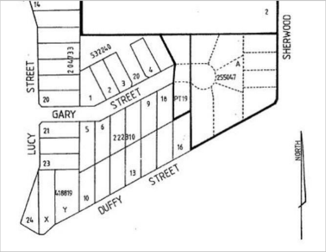

### PART F1-8

GARY STREET,

### MERRYLANDS

This page has been left intentionally blank.

## 1. Introduction

#### Proposed development and subdivision of Gary Street

This section provides a guideline for the creation of a cul-de-sac at the eastern end of Gary Street, Merrylands.

## 2. Specific objectives and controls

#### Objective

Ensure the creation of a cul-de-sac occurs at the time redevelopment occurs on the

subject land.

#### Control

Redevelopment of the properties identified in bold outline below requires the dedication

of land for the purpose of creating a cul-de-sac in accordance with the plan.

> [Picture on page 110: a picture, saved as a picture (images/part-f1-precinct-and-site-specific-development-controls-page-110-12.gif, 150 dpi).]

Figure 1: Gary Street Subdivision

This page has been left intentionally blank.

> [Picture on page 112: a picture, saved as a picture (images/part-f1-precinct-and-site-specific-development-controls-page-112-1.gif, 150 dpi).]
