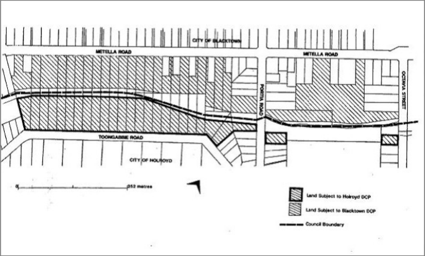
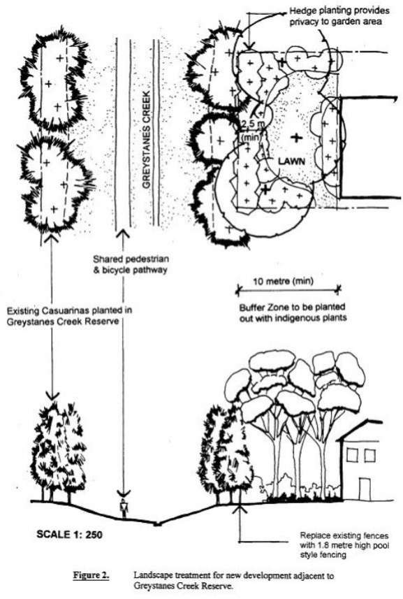

### PART F1-9

### GREYSTANES CREEK

This page has been left intentionally blank.

## 1. Introduction

### 1.1 Land to which this Part applies

This section applies to land situated in Cumberland City outlined in heavy black as shown on

the plan map marked Figure 1. A list of the properties subject to this plan is contained in

Appendix A. All sections of the Plan shall apply when affected properties are developed for multiunit

dwellings or are subdivided. For other forms of development the “Setback” and “Drainage”

sections shall apply.

## 2. Vision and general objectives

### 2.1 Context

In early 1993, a portion of Greystanes Creek between Oklahoma Avenue/Memphis Crescent

and Octavia Road, Toongabbie was realigned as part of flood mitigation works, and a program

of regeneration to re-establish the native vegetation was commenced prior to the formation of

Cumberland City Council. A Plan of Management (POM) for Greystanes Creek Reserve has also been prepared, which

outlines future management strategies and works which will enhance the Reserve’s value for

recreation, wildlife habitat, nature conservation, water quality improvement, drainage, and flood

mitigation. Private property adjacent to the Greystanes Creek Reserve will play a vital role in

supporting these works, and this section of the DCP aims to ensure that new development is

compatible with the aims of the POM.

### 2.2 Aims

The purpose of this section of the DCP is to provide guidelines that will ensure development on

land adjacent to Greystanes Creek Reserve is compatible with the Greystanes Creek Reserve

Plan of Management by:

• extending the potential for a wildlife corridor by re-establishing the native bushland

vegetation of the creek environment on land adjacent to the Reserve;

• enhancing the visual appeal, landscape characteristic and scenic quality of the

Reserve;

• providing a visual buffer between the Reserve and development on land adjacent

to the Reserve; and

• limiting sediment and nutrient run-off through the establishment of a vegetated

buffer between new development and Greystanes Creek Reserve.

> [Picture on page 115: a picture, saved as a picture (images/part-f1-precinct-and-site-specific-development-controls-page-115-1.gif, 150 dpi).]

Figure 1: Greystanes Creek

## 3. Specific objectives and controls

### 3.1 Setback

#### Objectives

Ensure the potential for a wildlife corridor onto land adjacent to the Reserve.

Ensure a visual buffer is provided between the Reserve and development on adjacent

land.

#### Controls

All buildings and structures shall be set back 10m from the boundary adjacent to the

Greystanes Creek Reserve. Buildings and hard surfaces shall not be permitted within

this 10m zone. This zone will constitute part of the overall landscaped area of the

development.

The 10m setback has been derived from the expected size of the tree canopy for those

tree species indigenous to the area. This will permit the planting of trees close to the

property boundary adjacent to Greystanes Creek.

Reserve with the reduced likelihood of tree roots interfering with buildings or utilities when

the trees mature. The tree canopy will also not extend over the roof of any buildings,

which could be a matter of concern.

Consideration will be given to setbacks of less than 10m on those blocks that have a

side boundary with the reserve.

### 3.2 Fences

#### Objectives

Ensure there is a minimal physical barrier to the extension of the wildlife corridor from

the Reserve onto adjacent land.

Ensure there is a minimal visual barrier between the Reserve and development on

adjacent land.

#### Controls

Fencing of property along boundaries with the Greystanes Creek Reserve shall have a

maximum height of 1.8m and be of an open pool type construction.

The fencing is to be of a dull metallic finish and of a colour that blends with the natural

bushland environs. This type of fencing will extend the potential for a wildlife corridor by

removing the physical barrier between plantings on the Reserve and adjacent land. The

open fencing will enhance the scenic quality of the Reserve through the visual integration

of the Reserve and adjacent land and increase safety by providing improved visibility.

### 3.3 Landscaping and site design

#### Objectives

Extend the potential for a wildlife corridor by re-establishing the native bushland

environment on land adjacent to the Reserve.

Enhance the visual appeal, landscape characteristic and scenic quality of the Reserve.

Provide for shade and acoustic and visual privacy on land adjacent to the Reserve.

#### Controls

Retention of native vegetation

There shall be no removal of local endemic trees or understorey vegetation, other than

noxious weeds, within the proposed 10m buffer.

All plans for development must ensure that local endemic plant species are retained

and protected.

Vegetation to be retained is to be protected from damage during construction works,

such as the compaction of soil and damage to root systems.

Council’s Tree Management Order forbids the removal or lopping of any tree without

Council consent.

Vegetation

Council shall require that all vegetation planted in the landscaped area are plants commonly

found in the area, as per Appendix A. A list of specialist nurseries is available from

Council.

Developers will be required to submit landscape plans with the Development

Application.

The details of the proposed landscaping are to be prepared by a suitably qualified

person acceptable to Council.

Council requires that a landscape bond be lodged on the basis of the value of the

proposed development. The bond is to be retained for a minimum period of 12 months

after the completion of development to ensure that landscaping works have been

undertaken, are successful, and have been satisfactorily maintained.

Landscape works

Within the 10m buffer zone landscape works shall be undertaken in accordance with

this plan so as to re-establish local bushland vegetation.

The landscape works shall consist of a garden bed located adjacent to the boundary

fence (Refer to Figure 2).

The garden bed shall have a minimum width of 2.5m, be planted only with those endemic

plant species listed in the Species List and include trees, shrubs and groundcover.

The planting shall be of sufficient density to replicate a natural bushland ecosystem. The

aim is to provide habitat for native wildlife, such as birds, invertebrates and insects.

The following density of plantings are given as a guideline:

Planting Densities:

• Trees: 1 per 4-5 m²;

• Shrubs: 2 per 1m²; and

• Ground cover: 4-8per m².

> [Picture on page 118: a picture, saved as a picture (images/part-f1-precinct-and-site-specific-development-controls-page-118-1.gif, 150 dpi).]

Figure 2: Landscape treatments

### 3.4 Drainage

#### Objectives

Ensure the amount of urban run-off pollutants to Greystanes Creek is as minimal as

possible.

Ensure adequate control erosion measures are taken.

#### Controls

Appropriate erosion and sedimentation controls shall be undertaken in accordance with

Council’s Erosion and Sedimentation Control Policy to the satisfaction of Council’s

Building Surveyor.

Measures to minimise nutrients and sediment entering Greystanes Creek shall be

undertaken through the establishment of a vegetated buffer between the development

and Greystanes Creek.

### 3.5 Fire

#### Objectives

Ensure the potential for bushfire risk on the Reserve and adjacent land is as minimal as

possible.

#### Controls

It is recommended that fuel reduction measures are undertaken on land adjacent to the

Reserve.

Measures include the provision of leaf guards to gutters. Within the Greystanes Creek

Reserve itself, the creek and drainage channels form natural fire breaks, which,

combined with fragmented and isolated nature of the vegetation, means that major fire

events are unlikely to occur.

## 4. Appendix A – Greystanes Creek

#### Land within the Greystanes Creek Precinct

DP 837421 Lot 41 139 Toongabbie Road, Toongabbie DP 837421 Lot 40 137 Toongabbie Road, Toongabbie DP 837421 Lot 39 135 Toongabbie Road, Toongabbie DP 837421 Lot 38 133 Toongabbie Road, Toongabbie DP 837421 Lot 37 131 Toongabbie Road, Toongabbie DP 837421 Lot 36 129 Toongabbie Road, Toongabbie DP 837421 Lot 35 127 Toongabbie Road, Toongabbie DP 837421 Lot 34 125 Toongabbie Road, Toongabbie DP 837421 Lot 33 123 Toongabbie Road, Toongabbie DP 837421 Lot 32 121 Toongabbie Road, Toongabbie DP 837421 Lot 31 119 Toongabbie Road, Toongabbie DP 837421 Lot 30 117 Toongabbie Road, Toongabbie DP 837421 Lot 29 115 Toongabbie Road, Toongabbie DP 837421 Lot 28 113 Toongabbie Road, Toongabbie DP 837421 Lot 27 111 Toongabbie Road, Toongabbie DP 837421 Lot 26 109 Toongabbie Road, Toongabbie DP 837421 Lot 25 107 Toongabbie Road, Toongabbie DP 837421 Lot 24 105 Toongabbie Road, Toongabbie

DP 837421 Lot 16 103 Toongabbie Road, Toongabbie DP 837421 Lot 18 101 Toongabbie Road, Toongabbie DP 837421 Lot 23 99 Toongabbie Road, Toongabbie DP 837421 Lot 22 97 Toongabbie Road, Toongabbie DP 837421 Lot 21 95 Toongabbie Road, Toongabbie DP 617512 Lot 1 26 Portia Road, Toongabbie DP 11508 Lot 206 29 Portia Road, Toongabbie DP 11508 Lot 181 18 Portia Road, Toongabbie

This page has been left intentionally blank.

> [Picture on page 122: a picture, saved as a picture (images/part-f1-precinct-and-site-specific-development-controls-page-122-1.gif, 150 dpi).]
