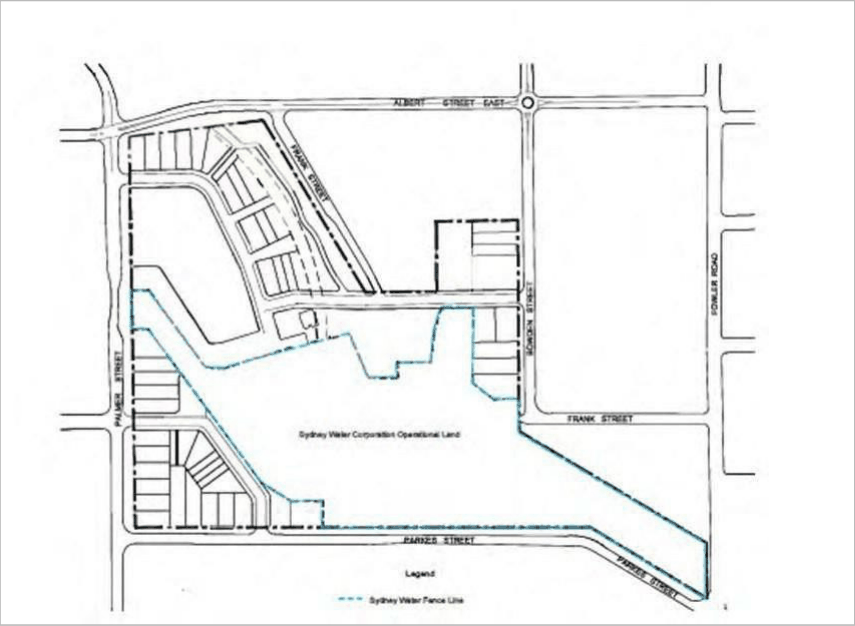
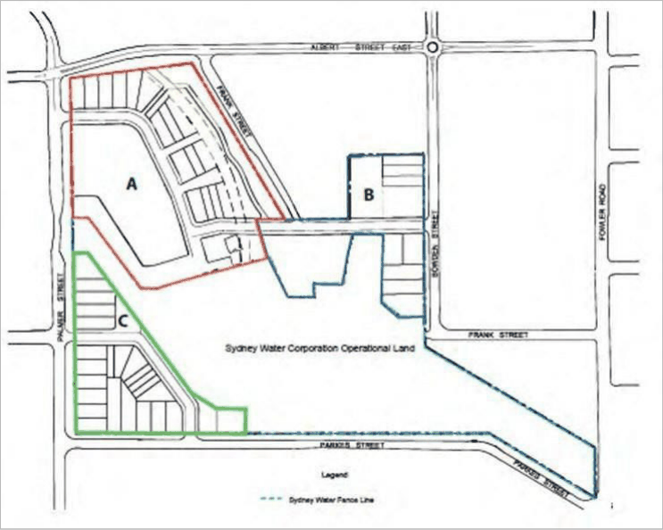
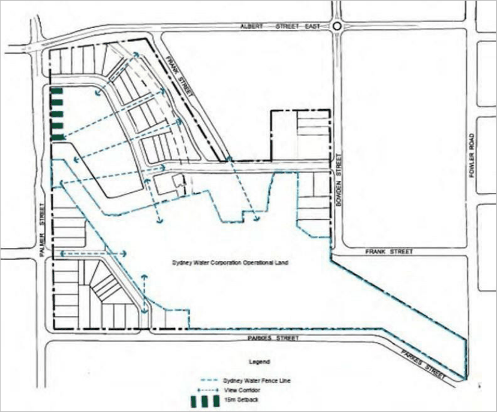
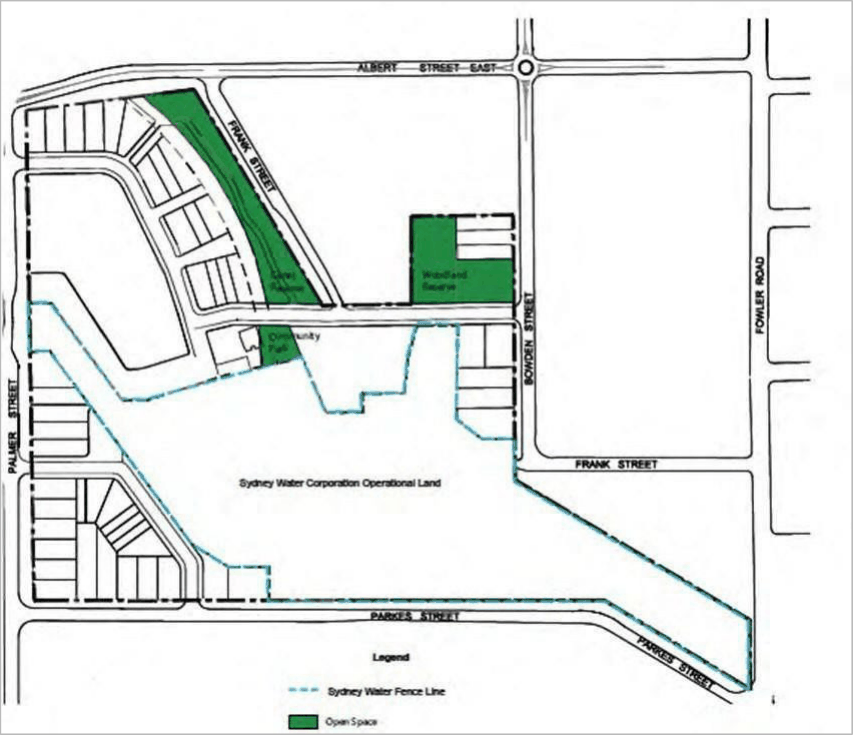
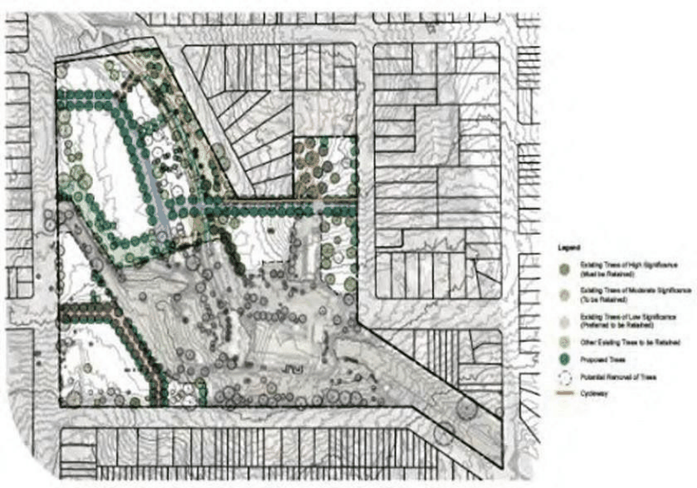
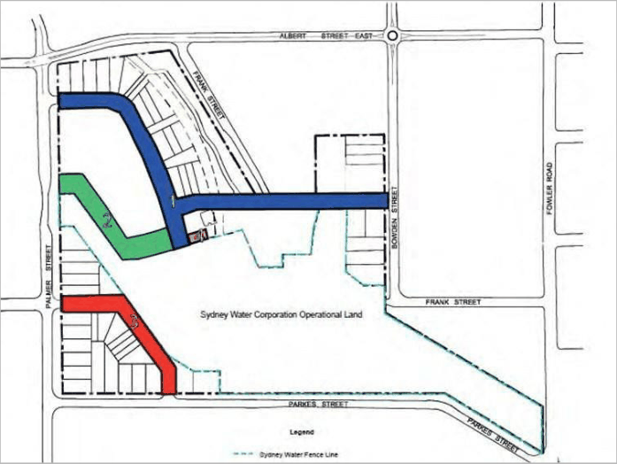
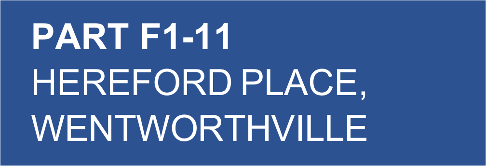

### PART F1-10

### GUILDFORD PIPEHEAD

### PRECINCT

This page has been left intentionally blank.

## 1. Introduction

### 1.1 Land to which this Part applies

This part applies to the land shown on Figure 1 and known as the Guildford Pipehead Precinct.

> [Picture on page 124: a picture, saved as a picture (images/part-f1-precinct-and-site-specific-development-controls-page-124-4.gif, 150 dpi).]

Figure 1: Guildford Pipehead precinct map

### 1.2 Relationship to other Parts of this DCP

Part F of the DCP shall be read in conjunction with the following Parts of Cumberland DCP

2021, which contain objectives and development controls that may relate to development in this

part:

• Part B – Development in the Residential Zones;

• Part C – Development in the Business Zones;

• Part E - Other Land Use Based Development Controls; and

• Part G – Miscellaneous Development Controls.

## 2. Vision and general objectives

### 2.1 Objectives

Facilitate the appropriate reuse of lands within the Guildford Pipehead Precinct that is

surplus to current Government needs.

Conserve and enhance the heritage significance of the Guildford Pipehead Precinct.

Protect and conserve the natural heritage features of the Precinct and allow historic

interpretation of the Guildford Pipehead Precinct.

Only permit development that is reflective and sympathetic to the historic nature of the

Guildford Pipehead Precinct and the character of the area surrounding it.

Ensure that development on the perimeter of the precinct is compatible in character and

scale with the surrounding residential area.

Mitigate the impact of the change in land use with respect to the security needs of the

operational Pipehead site.

Provide for the conservation of and public access to:

• Land with significant natural heritage or conservation values; and

• That part of the Lower Prospect Canal outside the operational Pipehead site.

### 2.2 Sub-Precincts

For the purposes of this Part of the DCP, the Guildford Pipehead Precinct is divided into the

three sub-precincts, as indicated on Figure 2, whose character is described below. Sub-Precinct A

• having an approximate area of 24,011m²;

• bounded by Palmer, Albert and Frank Street;

• includes State heritage listed canal and significant heritage landscape plantings;

• land is generally flat, with several steep embankments;

• contains existing industrial sheds, from sites former use;

• provides vistas to Prospect Hill, Blue Mountains and Holsworthy;

• partial interface with low density, detached dwellings; and

• sub-Precinct A allows permeable views to Sydney Water site. Sub-Precinct B

• approximate area of 17,842m²;

• frontage to Bowden Street;

• contains significant plantings, predominant woodland character;

• existing cycleway access is located within Sub-Precinct; and

• contains a number of steep slopes. Sub-Precinct C

• approximate area of 13,600m²;

• located at the intersection of Palmer and Parkes Streets;

• separated from SWC land by existing pipeline;

• land is generally flat, although sloping along Parkes Street; and

• interface with existing low density, detached dwellings.

> [Picture on page 126: a picture, saved as a picture (images/part-f1-precinct-and-site-specific-development-controls-page-126-1.gif, 150 dpi).]

Figure 2: Sub-Precincts map

## 3. Specific Objectives and Controls

### 3.1 Urban Design

#### Objectives

Provide passive surveillance to the Sydney Water operational land through road and lot

layout to allow visual connectivity and security.

Interpret key historic themes and heritage values of the site through urban design and

built form.

Conserve existing significant vegetation.

Allow the provision of a network of well located and usable open spaces.

Provide a range of housing types that integrate with the existing built interface and

landscape features.

#### Controls

Create an east/ west link through the site to provide physical and visual connectivity.

Create connections with the established residential area of Guildford West.

Maximise pedestrian access and visual connectivity to the existing canal.

Integrate new housing with housing forms in the existing area.

Locate higher density housing types having regard for topography and significant visual

corridors of the precinct.

Facilitate pedestrian and vehicular access that allows connectivity within precinct.

Design development to retain, as far as possible, the natural heritage features of the

precinct.

Maintain the landscape character of the precinct.

### 3.2 Lot Structure

#### Objectives

Integrate new development with established development within the Guildford West

area.

Ensure all lots have a street address and enforce the street edge.

Allow visual connectivity into and within the precinct.

Create lot structures to ensure development maintains significant visual corridors.

Ensure sustainable development through lot orientation.

Ensure active surveillance of all public spaces.

#### Controls

All lots shall have a primary frontage addressing a street.

No battleaxe lots are to be created within the precinct.

Note: Refer to Figure 6.

Sub-Precinct A

Lots located north of New Road 1 in Sub-Precinct A shall have a primary frontage to

New Road 1 and a secondary frontage to Albert Street East.

Lots located between New Road 1 and the Lower Canal in Sub-Precinct A shall have a

primary frontage to New Road 1 or New Road 4.

Sub-Precinct B

Lots in Sub-Precinct B shall have frontage to Bowden Street.

Where possible, lots in Sub-Precinct B shall have a secondary frontage to New Road 1.

Internal lots shall have frontage to New Road 1.

Sub-Precinct C

Lots in Sub-Precinct C shall have frontage to either Palmer or Parkes Streets, or New

Road 2.

Lots Sub-Precinct C may have a secondary frontage to New Road 2.

### 3.3 Built form

#### Objectives

Ensure that building heights have regard for the heritage values of the Precinct, the

topography and significant visual corridors of the Precinct and the character of the

surrounding residential area.

Ensure development is setback from internal and external roads and the Lower Canal

so that the open appearance of the precinct is maintained.

Allow row housing and zero-lot-line detached houses to be erected within the Precinct.

Maintain existing views to, from and through the precinct.

Ensure that the built form of the Precinct responds to existing vegetation and heritage

items, including those on the Sydney Water operational land, and the surrounding built

environment.

#### Controls

Building orientation and articulation

All buildings shall address the relevant lots primary frontage to an existing or new road

(or both) with appropriate articulation to provide interest to the public domain.

Building height

Note: The maximum permissible height (in metres) is detailed within Cumberland Local

Environmental Plan 2021, as a written statement and associated maps.

The maximum height of buildings, in storeys, within the Guildford Pipehead Precinct

shall be: Table 1: Maximum height of buildings (storeys)

| Building type | No. of storeys |
|---|---|
| Detached and Attached Housing | 2 |
| Multi Dwelling Housing | 2 |
| Residential Flat Building | 4 |

Notwithstanding C1, Council may permit 3-storey multi dwelling housing:

• within Sub-Precinct A, south and west of New Road 1; and

• within Sub-Precinct B, south of New Road 1 immediately east of the Community

Park

Setbacks

Buildings within Sub-Precinct A shall be setback from streets, side and rear boundaries

in accordance with the requirements of Part B of this DCP but with the following

exceptions (as shown on Figure 3):

• 15m from Palmer Street, between the Sydney Water operational land and New Road

1;

• 5m from the Lower Canal.

Buildings within Sub-Precincts B and C shall be setback from streets, side and rear

boundaries in accordance with the requirements of Part B of the DCP, except where

specified under C4 above.

Despite the requirements of Part B of the DCP, except where the relevant lot boundary

is also the boundary of the Guildford Pipehead Precinct:

• row houses forming part of multi dwelling housing may be constructed with no

setback to a side lot boundary; and

• detached houses on lots less than 450m² may be constructed on one lot boundary.

View corridors

The view corridors identified on Figure 3 shall be a minimum of 10m in width and be free

of all buildings and structures, except:

• access ramps;

• barbeques;

• children’s play equipment;

• clothes lines and hoists;

• driveways, paths and paving;

• fences less than 1.8m in height;

• on-site detention tanks and basins below finished ground level;

• rainwater tanks below finished ground level; and

• water features and ponds. Landscaping within the view corridors shall not include species greater than 1.8m in

height at maturity.

Building form and materials

Buildings shall respond to existing vegetation and heritage items, including those on the

Sydney Water operational land, and the surrounding built environment through the use

of:

• dark tones of brick sympathetic to the dark tones of the existing landscape;

• light tones for metal roofs;

• low pitched roofs and generous eaves; and

• natural or painted timber detail to complement the dark shades of existing

vegetation.

Apartment buildings are to incorporate:

• articulated facades to add character to the public domain and streetscape; and

• split face block structure or panels including the use of metal sheeting elements to

reflect the former industrial heritage of the site.

Gable and hipped roofs are to have a pitch of 20 – 30 degrees, to match that of existing

Building 25, while skillion roofs are to have a pitch of 10 degrees.

Sub-Precinct A

Housing within Sub-Precinct A should include a mixture of residential flat buildings, multi

dwelling housing, attached housing and detached housing on small lots.

Sub-Precinct B

Housing within Sub-Precinct B should include a mixture of residential flat buildings, multi

dwelling housing, attached housing and detached houses.

Sub-Precinct C

Housing within Sub-Precinct C should include a mixture of multi dwelling housing,

attached housing and detached houses.

> [Picture on page 130: a picture, saved as a picture (images/part-f1-precinct-and-site-specific-development-controls-page-130-4.gif, 150 dpi).]

Figure 3: View corridors and setbacks

### 3.4 Landscape and Open Space

#### Objectives

Conserve existing significant vegetation within the precinct.

Enhance the appearance and amenity of the proposed development by sensitively

integrating architecture and landscape through effective site planning and landscape

design.

Retain and enhance the landscaped amenity of the precinct.

Provide areas of landscaped open space for a new residential community.

Integrate proposed open spaces with the surrounding landscape, open spaces and

streets.

Consolidate stands of various species forming part of the Cumberland Plain Woodland

endangered ecological vegetation community within the proposed open space areas.

Ensure any proposed fencing does not detract from the visual amenity and landscape

character of the site, and is sympathetic to the built form of the precinct.

The streetscape character shall reinforce and enhance the road hierarchy.

Incorporate crime prevention through design principles in landscape and open space

design.

Ensure that the streetscape character and tree species reflect the precincts natural

character and landforms while accommodating the function needs of pedestrian, cycle

and vehicular movements along each of the roads.

#### Controls

A variety of open spaces shall be provided. A number of areas have been identified by

Council as suitable and are indicated on Figure 4:

• Canal Park;

• Community Reserve; and

• Woodland Reserve.

> [Picture on page 131: a picture, saved as a picture (images/part-f1-precinct-and-site-specific-development-controls-page-131-15.gif, 150 dpi).]

Figure 4: Open spaces map

Landscape plans shall be prepare for each proposed open spaces, providing the

following character and facilities for each:

• Canal Park – passive and active recreation, including a children’s playground and

a cycleway connecting the existing Lower Canal Cycleway with Bowden Street;

• Community Reserve – passive recreation, including picnic and BBQ facilities; and

• Woodland Reserve – passive recreation and native vegetation conservation. The creation of a Heritage Square for passive recreation, including picnic and BBQ

facilities is encouraged. Refer to Section 3.6.

Trees identified as high and moderate significance indicated on Figure 5 must be

retained.

All other trees should be incorporated into site planning.

All tree species shall be in keeping with Councils native tree list and be low water, low

maintenance and suitable for use in urban environmental. Planting shall build upon the

existing landscaped character of the precinct, and not be in direct conflict with existing

historical plantings.

Street trees shall be located in accordance with those indicated on Figure 5.

> [Picture on page 132: a picture, saved as a picture (images/part-f1-precinct-and-site-specific-development-controls-page-132-17.gif, 150 dpi).]

Figure 5: Trees map

Appropriate street tree species to be planted shall be in accordance with the table below.

Table 2: Appropriate street tree species

| Appropriate street tree species |  |  |
|---|---|---|
| Street | Species | Common name |
| New Road 1 New Road 2 | Angophora Floribunda Brachychiton Acerifolius Waterhouse Floribunda | Roughed Barked Apple Illawarra Flame Tree Weeping Lilly Pilly |
| Other roads and accessways | Corymbia Ficifolia 'Summer Red' Jacaranda Mimosifolia Melaleuca linaiifolia Tristaniopius laurina | Red Flowering Gum Jacaranda Snow in September Water Gum |

### 3.5 Transport and Access

#### Objectives

Provide pedestrian, cycle and vehicle connections to create permeable site.

Draw on existing infrastructure, far as possible, by incorporating existing entry points

into the road design of the precinct.

#### Controls

The road structure within the precinct should be provided as shown on Figure 6.

> [Picture on page 133: a picture, saved as a picture (images/part-f1-precinct-and-site-specific-development-controls-page-133-11.gif, 150 dpi).]

Figure 6: Road structure map

Roads shall be constructed to the following specifications:

New Road 1

• 15m road reserve;

• 8m carriageway, including provision for parking on one side;

• 2.5m shared path on one side where cycleway is located;

• 1.5m footpath on one side; and

• grass verges on both sides (2m or 1.5m where cycleway is located).

New Road 2

• 15m Road reserve;

• 8m carriageway, including provision for parking on one side;

• 1.5m footpath on one side; and

• grass verges on both sides (3.5m or 2m where footpath is located).

New Road 3

• 15m road reserve;

• 8m carriageway, including provision for parking on one side;

• 1.5m footpath on one side; and

• grass verges on both sides (3.5m or 2m where footpath is located).

New Road 4

• 6m carriageway; and

• grass verges on both sides (to match New Road 2). For the purposes of Sydney Water operational requirements, New Roads 2, 4 and the

southern component of new road 1 shall be designed and constructed to a standard

suitable to carry the loading of a 130 tonne crane.

Suitable crash prevention barriers be included in the design of New Road 2 and 4 to

ensure that vehicles cannot impact on Sydney Water Operational Infrastructure.

Development in Sub-Precinct A shall not have vehicular access from Palmer Street or

Albert Street East.

Development located between New Road 1 and the Lower Canal shall not have

vehicular access from New Road 1.

Vehicular access to lots located between New Road 1 and the Lower Canal may be

provided through a shared private accessway located within a view corridor shown on

map 4.

### 3.6 Heritage

#### Objectives

Acknowledge the historically significant role the precinct and the existing Sydney Water

site combined played in delivering Sydney’s water supply.

Provide visual continuity across the site so there are vistas into the Sydney Water site

from the surplus land.

Maximise public access through the site as well as adjacent to the Sydney Water

boundary so that the Sydney Water function is readily apparent.

Retain existing structures within the precinct to provide a connection with the character

of the former use of the site.

Interpret the history of the site through the retention of structures and moveable heritage

items located in the precinct.

Ensure the upper canal is a distinct landscape element of the site.

Retain significant landscape vegetation, to allow interpretation of the site and landscape

continuity between the precinct and the Sydney Water site.

#### Controls

Development shall be sited to maintain significant view corridors between the precinct

and the established residential area, as identified on Figure 4.

Roads and residential development shall be located to maximise views into the

operational Sydney Water site.

Moveable items located in the precinct, that contribute to the story of the site and the history

of water supply in Sydney should be retained and incorporated into the landscape as

sculptural elements.

Existing landscape vegetation, identified as significant heritage landscape elements are

to be retained in order to provide interpretation of the site and continuity between the

precinct and the Sydney Water site.

Note: Figure 5 details significant landscape vegetation to be retained.

Public interpretation strategy for the lower canal and Pipehead site shall be developed

and implemented during redevelopment of the site.

Development in the precinct shall be designed to follow and not disrupt the topography

of the landscape.

Black palisade fencing shall be erected between the residential and operational lands

within the precinct.

Adaptive reuse of Building 25 structure Note: Building 25 was originally built as a storage depot for the construction of the Warragamba

Dam and relocated to Guildford.

Part of the structure of building 25 shall be retained in order to:

• provide a significant visual landmark element that recognises the former use of the

site;

• visually connect the residential lands with the continuing operational Sydney Water

site; and

• interpret the former use of the Pipehead site. Any part of the structure of building 25 retained within the proposed Heritage Square may

be used for general recreation or social purposes and may retain a part of the roof

sheeting for sun shading.

The roof character of new buildings shall integrate with, and not effect the character of

the precinct.

Note: It is recommended that gable and hipped roofs are to have a pitch of 20 – 30

degrees, to match that of existing Building 25, while skillion roofs are to have a pitch of

10 degrees.

Sub-Precinct A

Housing within Sub-Precinct A should include a mixture of residential flat buildings, multi

dwelling housing, attached housing and detached housing on small lots.

Sub-Precinct B

Housing within Sub-Precinct B should include a mixture of residential flat buildings, multi

dwelling housing, attached housing and detached houses.

Sub-Precinct C

Housing within Sub-Precinct C should include a mixture of multi dwelling housing,

attached housing and detached houses.

This page has been left intentionally blank.

> [Picture on page 138: a picture, saved as a picture (images/part-f1-precinct-and-site-specific-development-controls-page-138-1.gif, 150 dpi).]
