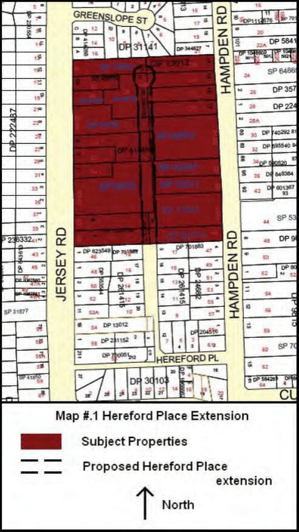

### PART F1-11

HEREFORD PLACE,

### WENTWORTHVILLE

This page has been left intentionally blank.

## 1. Introduction

### 1.1 Land to which this Part applies

This Part applies to development on land as detailed within this Part. The Hereford Place precinct comprises the land described in Table 1 below, known as 20-44

Jersey Road and 23-45 Hampden Road, South Wentworthville and as indicated on Figure 1.

Medium density residential development is envisaged for this precinct.

> [Picture on page 140: a picture, saved as a picture (images/part-f1-precinct-and-site-specific-development-controls-page-140-7.gif, 150 dpi).]

Figure 1: Hereford Place extension

| Property Address | Lot and DP or SP No. |
|---|---|
| 20 Jersey Road (Cumberland Hwy) South Wentworthville | SP73491 |
| 22 Jersey Road (Cumberland Hwy) South Wentworthville | Lot 2A DP406503 |
| 24 Jersey Road (Cumberland Hwy) South Wentworthville | SP68037 |
| 24A Jersey Road (Cumberland Hwy) South Wentworthville | SP68192 |
| 26‐28 Jersey Road (Cumberland Hwy) South Wentworthville | SP73156 |
| 30 Jersey Road (Cumberland Hwy) South Wentworthville | Lot A DP412854 |
| 32 Jersey Road (Cumberland Hwy) South Wentworthville | Lot B DP412854 |
| 34 Jersey Road (Cumberland Hwy) South Wentworthville | Lot A DP414666 |
| 36‐40 Jersey Road (Cumberland Hwy) South Wentworthville | SP79670 |
| 42 Jersey Road (Cumberland Hwy) South Wentworthville | Lot 4 DP1138704 |
| 44 Jersey Road (Cumberland Hwy) South Wentworthville | Lot 3 DP1138704 |
| 23 Hampden Road, South Wentworthville | Lot 14 DP13012 |
| 25 Hampden Road, South Wentworthville | Lot 13 DP13012 |
| 27 Hampden Road, South Wentworthville | Lot 12 DP13012 |
| 29 Hampden Road, South Wentworthville | Lot 11 DP13012 |
| 31‐35 Hampden Road, South Wentworthville | SP66581 |
| 37 Hampden Road, South Wentworthville | SP42344 |
| 39 Hampden Road, South Wentworthville | SP73811 |
| 41‐43 Hampden Road, South Wentworthville | SP77447 |
| 45 Hampden Road, South Wentworthville | SP81074 |

Table 1: Land subject to Section 1 of this Part

## 2. Vision

Medium density residential development requires adequate local road access. However, half of the

properties within this precinct have vehicular access only from the Cumberland Highway (also known

as Jersey Road). This is unsatisfactory given that the Highway is primarily a metropolitan arterial road.

Given this, the provision of alternative vehicular access to these properties is required to facilitate

satisfactory development and minimise traffic conflicts on the Highway. To provide this alternative vehicular access, it is proposed to extend Hereford Place north from Jersey

Lane. To achieve this, land is required from properties currently fronting both the Cumberland Highway

and Hampden Road. To minimise traffic conflicts and congestion on Hampden Road, and to prevent

private driveways from being used by through traffic, access from Hampden Road will not be permitted

for redeveloped properties.

## 3. Objectives and Controls

#### Objectives

Facilitate the reasonable development of the Hereford Place precinct by permitting the

extension of Hereford Place, Wentworthville.

Minimise vehicular access to properties from the Cumberland Highway.

Ensure that alternative vehicular access is provided to properties with frontage to the

Cumberland Highway, South Wentworthville.

Reduce vehicular traffic and conflicts on Hampden Road, South Wentworthville, by

providing alternative vehicular access from an extended Hereford Place.

#### Controls

This section of the DCP applies to all development within the Hereford Place precinct,

as indicated in Table 1 and shown on Figure 1.

Development for the purposes of additions and alterations to existing detached dwelling

houses is excluded from the provisions of this section.

All development shall provide for future permanent vehicular access from the Hereford

Place extension.

Land shall be dedicated for the Hereford Place extension in accordance with Figure 1.

An 8m wide vehicular carriageway shall be constructed along the proposed extension

of Hereford Place, with a 4m footpath verge with a roll-top kerb along either side.

Road layout and geometry shall be in accordance with the provisions of Part G of this

DCP and with other approved standards, either the Guide to Traffic Engineering Practice

published by NAASRA, or the Roads and Maritime Services guidelines.

For all development except the erection of a dwelling house, all roadworks, including

drainage, kerb and gutter and footpaths, shall be constructed at the applicant’s expense

and the required land dedicated to Council prior to release of any occupation certificate.

Alternatively, Council may accept lodgement of a bond, through a bank guarantee, for

the agreed value of the works plus interest for 10 years, in lieu of construction of the

works.

For the erection of a new detached dwelling house, all roadworks, including drainage,

kerb and gutter and footpaths, shall be constructed at the applicant’s expense and the

required land dedicated to Council prior to release of any construction certificate.

A restriction to use under Section 88B shall be included upon the title, with Council listed

as a party, to require no access from either the Cumberland Highway or Hampden Road,

upon extension of Hereford Place to the subject property.

Temporary access shall be permitted from the Cumberland Highway or Hampden Road

until such time as all land dedication and road construction for the Hereford Place

extension is completed between Jersey Lane and the subject property.

Approval of temporary access from the Cumberland Highway or Hampden Road shall be

subject to the agreement of the Roads and Maritime Services and any affected

landholders.

At such time as all land dedication and road construction for the Hereford Place extension

is completed between Jersey Lane and the subject property, the following works shall

be carried out at the expense of the landowner(s):

• all necessary works to permit vehicular access from Hereford Place, including

removal of fences and construction of a suitable vehicular driveway from the

property boundary to the kerb-line;

• all necessary works required to deny access from the Cumberland Highway or

Hampden Road, including erection of fencing at the property line and removal of any

vehicular driveway from the property boundary to the kerb-line.

This page has been left intentionally blank.

> [Picture on page 145: a picture, saved as a picture (images/part-f1-precinct-and-site-specific-development-controls-page-145-1.gif, 150 dpi).]
