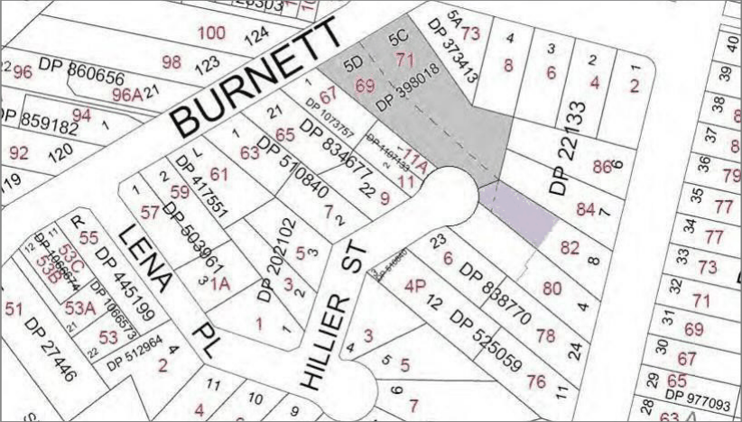

### PART F1-12

HILLIER STREET,

### MERRYLANDS

This page has been left intentionally blank.

## 1. Introduction

### 1.1 Hillier Street, Merrylands

Hillier Street, Merrylands (Hilltop) is an incomplete cul-de-sac, where subdivision and

development has not yet permitted the construction of a turning bulb. This section of the DCP

is intended to guide future development within the precinct to ensure that a turning bulb may be

constructed without unnecessarily preventing development of properties zoned R3 Medium

Density Residential.

## 2. Specific objectives and controls

#### Objectives

Facilitate the reasonable development of the Hillier Street precinct by permitting the

completion of Hillier Street, Merrylands.

Ensure that further development results in the completion of Hillier Street.

Minimise the number of properties required to dedicate land to Council.

Ensure that 82 Clarence Street retains the opportunity to subdivide broadly in

accordance with Council’s previous development control plan.

#### Controls

This section of the DCP applies to all development within the Crosby Street precinct, as

indicated in Table 1 and shown on Figure 1.

Development for the purposes of the erection of a new detached dwelling house and

additions and alterations to an existing, detached dwelling house is excluded from the

provisions of this section.

Land shall be dedicated to Council to allow creation of the cul-de-sac head in

accordance with the layout shown on Figure 1.

Land dedication is to occur prior to the redevelopment of 69 and 71 Burnett Street for

medium density housing.

Medium density residential development of 69 and 71 Burnett Street is subject to:

• amalgamation of these properties;

• a boundary adjustment between 69 Burnett Street and 82 Clarence Street, in

accordance with Figure 1, to ensure that the later has a frontage to the Hillier Street

extension; and

• vehicular access to the amalgamated site is only provided from the Hillier Street

extension.

An appropriate cul-de-sac turning bulb is to be constructed within the area shown on Figure

1.

Road layout and geometry shall be in accordance with the provisions of Part G, of this

DCP and with other approved standards, either the Guide to Traffic Engineering Practice

published by NAASRA, or the Roads and Maritime Services guidelines.

All roadworks, including drainage, kerb and gutter and footpaths, shall be constructed at

the applicant’s expense and the required land dedicated to Council prior to release of any

Subdivision or Occupation Certificate. Alternatively, Council may accept lodgement of a

bond, through a bank guarantee, for the agreed value of the works plus interest for 10

years, in lieu of construction of the works.

Table 1: Land subject to Hillier Street extension

| Property Address | Lot No. | DP |
|---|---|---|
| 71 Burnett Street | 5C | 398018 |
| 69 Burnett Street | 5D | 398018 |
| 82 Clarence Street | 8 | 22133 |
| 80 Clarence Street | 4 | 23384 |

> [Picture on page 148: a picture, saved as a picture (images/part-f1-precinct-and-site-specific-development-controls-page-148-8.gif, 150 dpi).]

Figure 1: Hillier Street extension:

This page has been left intentionally blank.

> [Picture on page 150: a picture, saved as a picture (images/part-f1-precinct-and-site-specific-development-controls-page-150-1.gif, 150 dpi).]
