### PART F1-13

### HOLROYD GARDENS

This page has been left intentionally blank.

## 1. Introduction

This Part of Cumberland Development Control Plan 2021 provides a framework that will guide future

development in Holroyd Gardens. The controls and guidelines demonstrate Cumberland City Council’s commitment to ensuring

redevelopment of the former Goodlet and Smith Brickworks site takes place in a sensitive, sustainable

and exemplary manner. Both Council and the joint venture development partner, Delfin Property Group, are committed to

ensuing development of the site is of the highest quality.

### 1.1 Land to which this Part applies

This Part applies to land known as “Holroyd Gardens”, located adjacent to Walpole Street, the

Main Southern Railway and Walpole Street Park, Holroyd. The site is defined by the locality

plan (Figures 1 and 2) Boundaries for this DCP may be extended in future by the inclusion of

additional lands. Where this is the case, the DCP will be amended accordingly.

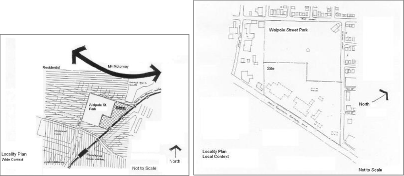

> [Picture on page 152: a picture, saved as a picture (images/part-f1-precinct-and-site-specific-development-controls-page-152-14.gif, 150 dpi).]

Figure 1: Locality plan - wide context

Figure 2; Locality plan – local context

### 1.2 Relationship to other Parts of this DCP

Part F of Cumberland DCP 2021 shall be read in conjunction with the following Parts of

Cumberland DCP 2021, which contain Objectives and Development Controls that relate to development in this Part:

• Part A – Introduction and General Controls;

• Part B – Development in Residential Zones;

• Part C – Development in Business Zones;

• Part E – Other Land Use Based Development Controls;

• Part G – Miscellaneous Development Controls; and

• Definitions.

## 2. Vision and general objectives

### 2.1 Vision and context

Holroyd Gardens is intentionally considered as a garden neighbourhood, with ample open

space throughout and the distinctive heritage precinct being actively used as interpretation,

open space and community facilities at the heart of the neighbourhood. A wide linear parkway traverses the length of the neighbourhood and has adjacent to its mid

point a large artificial wetland. The site is also directly connected to Walpole Street Park, which

extends through to the Heritage Precinct. This combined park system enables all residents to

have easy access to a variety of pleasant recreation opportunities. The main road system and pathway system through the centre of the neighbourhood is intended

to give all residents easy access to Walpole Street Park and the Merrylands Town Centre. The

road system and attention to streetscape gives the neighbourhood a distinctive character. With the exception of the Heritage Precinct, the site will be developed for residential and

activities ancillary to such residential development, such as open space and home offices. Based on the current indicative Master Plan, this DCP envisages that the site will have a

maximum density of 260-280 dwellings, comprised of a mix of detached, semi-detached and

medium density multi- unit housing. Council may at its discretion consider and approve a

variation to the Master Plan where compelling economic, environmental or social grounds are

present, and where the overarching objectives and principles of this DCP can be achieved.

### 2.2 Objectives

General Redevelopment of the former Goodlet and Smith Brickworks site should:

• be responsive to the needs of the community,

• achieve high levels of design and appearance,

• be responsive to the heritage significance of the site, and

• be well integrated with its surrounding urban context. Ensure that the urban structure, layout and form of the development responds positively

to its urban context, Specifically:

• incorporation and extension of Walpole Street Park into and through the site;

• establishing open space links, including pedestrian and bicycle linkages, which

connect the site with Walpole Street Park, Merrylands Town Centre and areas

further afield; and

• ensure an appropriate and supportive frontage to Walpole Street and Walpole Street

Park Ensure a supportive relationship with the heritage significance of the site. Specifically:

• conserve and refurbish significant heritage buildings within an established heritage

precinct;

• Introduce activities within the heritage precinct in order to ensure that the area

becomes a “seamless” component of the greater site; and

• Implement specific controls for areas in close proximity to heritage items that ensure

new buildings are complementary and not mimicking in terms of form and

appearance. Ensure that buildings on the site provide a supportive relationship with the public domain

and appropriately respond to the needs of pedestrians.

Enable a wide choice of housing types, including adaptable housing, in order to

effectively respond the changing need of the community and residential market.

Provide a high level of amenity for future residents and users of the site through the

provision of a coordinated palette of urban elements including furniture, lighting, paving

and vegetation.

### 2.3 Access and linkages

Collector Road A collector road serves to provide a link road through the project. The collector road will have a

strong landscape amenity with a regular row of advanced trees and wide verges with wide foot

paths/cycleways. The collector road commences at Walpole Street near the Fox Street

intersection. Park Edge Terraces Park Edge Terraces are positioned along the flanks of the Linear Park and elsewhere. These

Terraces have two advantages: They allow access to houses overlooking the reserve; and, they

also allow access to the Walpole Street Reserve, allowing the eastern side of the park to be

accessible to potential users. Cycleways and pedestrian paths Cycleways and pedestrian paths are aligned with the open space system as well as streets.

These cycleways and pathways link towards:

• Merrylands Town Centre;

• A’Becketts Creek;

• Merrylands railway station; and

• The Heritage Precinct.

### 2.4 Open spaces

Public open spaces The open space system within Holroyd Gardens is extensive and provides variety of spaces

appropriate for a wide range of activities. These include:

• linking visually and physically the heritage precinct buildings with the Walpole Street

Reserve;

• the formation of a linear parkway that provides visual amenity, recreation areas and

pedestrian/cycle linkages;

• the retention and the re-use of several of the former brickworks buildings as a centre

piece for community use;

• a central open area adjacent to the Heritage Precinct, opens up to the linear

parkway and lake, and provides direct visual links with Walpole Street Park; and

• creation of a variety of landscaped spaces throughout the neighbourhood.

Semi public/semi private open spaces - front gardens The amenity of the front gardens is important for extending the general quality of Holroyd

Gardens landscape system. The front yard areas of housing are considered as an opportunity to extend the quality of the

street landscape into the front areas of the housing. Colourful front area planting is encouraged.

### 2.5 Built form

#### Objectives

Density and building height Housing is placed so that there is a clear transition in building height and bulk from Walpole

Street, towards the railway line and from the Heritage Precinct outwards. This enables

the gradual change in density from key elements of the open space system, as well as

the vehicular and pedestrian approaches to the housing areas.

Housing is positioned so that all houses provide direct surveillance of the proposed street

and open space systems, with the majority of housing positioned so that it has frontage

to reserves and open space. This strategy encourages a high level of community

supervision of the open space areas, as well as maximising the benefit of the open space

system to the enjoyment of the residents.

Housing is grouped in order to provide areas with opportunity for distinct residential

character. There are areas of terrace housing for instance forming two “crescents” facing

open spaces. Multi- unit housing is placed alongside the Linear Parkway as well as the

Collector Road. The longer building forms of the multi- unit dwellings assist in providing

a noise buffer alongside the railway corridor.

Residential buildings are to complement heritage buildings within and adjacent to the

heritage precinct. It is intended that the addition of any new residential buildings will

encourage a higher degree of supervision and better use of the heritage precinct. New

buildings adjacent to heritage buildings are to complement (though not mimic) the

heritage buildings by virtue of their height, scale, bulk, materials and appearance.

### 2.6 Streetscape

A high level of attention to streetscape is a key principle to the visual success of the Holroyd

Gardens. This applies to the areas immediately fronting the street, as well as those spaces that

are visible from the street.

#### Objectives

The streetscape should be characterised by buildings with individual variety that give

interest, while still forming a cohesive sense of neighbourhood.

Ensure that each of the individual houses or groups of houses reinforce and add to the

tree lined street environment with a high level of private area planting.

Ensure consistent frontages, ridge heights and eave heights.

Require a variety of materials within an agreed palette of building materials to be used.

### 2.7 Building envelope

#### Objectives

Ensure housing is considered in terms of its relationship to adjoining buildings to

encourage the reinforcement of street enclosure and street character.

Encourage verandahs and projecting awnings, “Dutch Gable” roof forms and similar

techniques that “break up” the roof shape.

Ensure long flat faced walls are avoided. Walls should incorporate bay windows, porches,

small verandahs, French windows to give relief and articulation to exterior walling, and

provide internal amenity.

### 2.8 Adaptable housing

#### Objective

Ensure housing addresses, where practicable, the needs of the disabled and the elderly.

### 2.9 Energy efficiency

#### Objective

Ensure housing demonstrates attention to energy efficient design by:

• Maximising north orientation;

• The use of wall and ceiling insulation;

• Building forms that allow cross ventilation and zoned heating and cooling;

• The use and sensible placement of thermal mass; and

• Appropriate landscape placement.

### 2.10 Waste management

#### Objective

Ensure the provision of adequate dedicated spaces for the storage of waste and recycling

away from street. Adequate storage is required for all dwellings.

### 2.11 Off street parking

#### Objectives

Ensure parking complies with Council’s provisions and is to be designed so as to reduce

visual impact on the streetscape.

Ensure driveways are designed to minimise the area of hard paving to a practicable

minimum.

## 3. Specific objectives and controls

### 3.1 Open space

#### Objectives

The open space system is generally as defined in Figure 3.

Open space on the site will be interpreted as a continuous system, comprising places

(the heritage precinct, landscaped spaces etc) and linkages (linear park corridor, streets

etc).

All parks are to be highly accessible, as well as framed and defined by the street system.

The site is to provide for linkages to the wider open space system, such as the regional

bicycle corridor and Walpole Street Park.

Streets are important elements of the open space system. They should provide direct

links between key open space destinations.

Pedestrian linkages The pedestrian system is generally as defined in Figure 3.

A Linear Park Corridor, generally corresponding to the alignment of A’Becketts Creek,

will allow for a future pedestrian and bicycle linkage between the site, Merrylands and

areas to the north. It will also incorporate a segment of the regional bicycle system.

A strong pedestrian linkage will be developed between the Heritage precinct, artificial

wetland, and will eventually continue on to the rotunda and Children’s Museum in

Walpole Street Park. This pathway will provide a strong physical and visual link between

Walpole Street Park attractions, the heritage precinct and the site generally.

Secondary pedestrian linkages will be provided adjacent to Walpole Street park, adjacent

to Walpole Street and south west through Walpole Street Park, linking Merrylands to the

site.

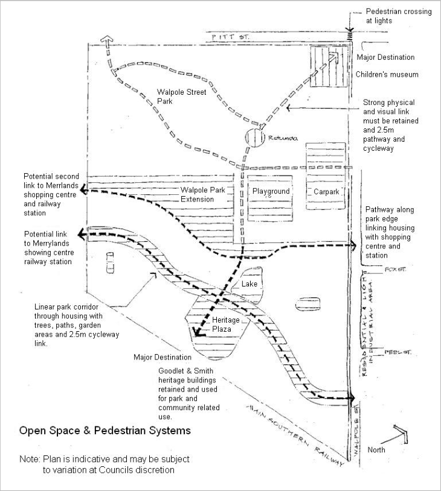

> [Picture on page 157: a picture, saved as a picture (images/part-f1-precinct-and-site-specific-development-controls-page-157-13.gif, 150 dpi).]

Figure 3: Open space and pedestrian systems map

Landscape A coordinated landscape master plan for the entire site will be developed and

implemented.

Plant species chosen for the site should be appropriate in terms of meeting the

functional requirements of the environment in which they are to be utilised.

The Heritage Precinct and link with Walpole Street Park will be enhanced through the

use of (complementary) feature planting.

Each Precinct and/or each major street type will contain subtle differences in landscape

approach in order to accentuate legibility.

#### 3.1.1 Elements of the Open Space System

The Heritage Precinct The Heritage Precinct is located generally adjacent to the Main Southern Railway line, in a

central location between Walpole Street and the southern boundary of the site. The location

and extent of the Heritage Precinct is defined in Figure 4. The Heritage Precinct should be the focus of development on the site. Refer to the Development

Strategy for the Heritage Precinct of the Goodlet and Smith Brickworks Site.

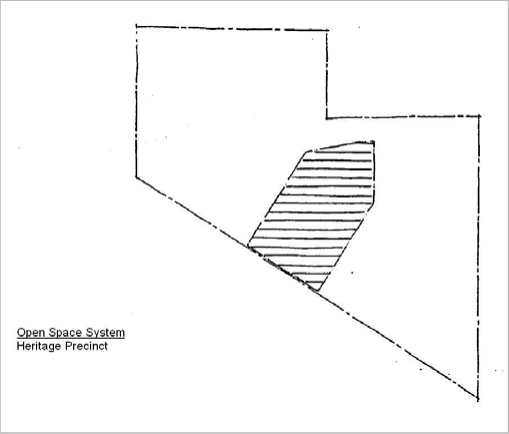

> [Picture on page 158: a picture, saved as a picture (images/part-f1-precinct-and-site-specific-development-controls-page-158-17.gif, 150 dpi).]

Figure 4: Open space system - Heritage precinct

Linear Park Corridor The location of the linear park corridor is described in Figure 5.

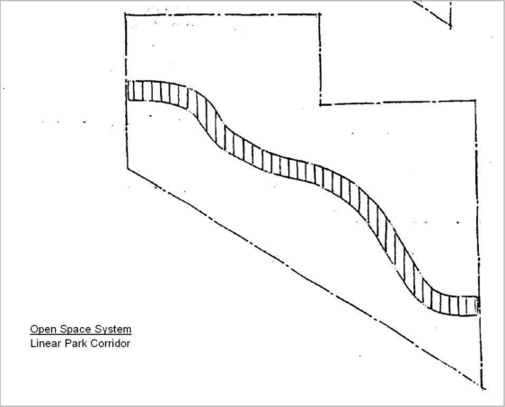

> [Picture on page 159: a picture, saved as a picture (images/part-f1-precinct-and-site-specific-development-controls-page-159-3.gif, 150 dpi).]

Figure 5: Open space system - linear park corridor

#### Objectives

Encourage the relocation of the weir currently located within the existing A’Becketts Creek

alignment to a position within the Linear Park Corridor is encouraged. This will be

confirmed following detailed hydraulic investigation ensuring the ability to maintain

adequate flood capacity.

#### Controls

The Linear Park corridor will be approximately 19m in width.

The Linear Park corridor is to be accessible from both sides and is to incorporate a

pedestrian and bicycle path of at least 2.5m width

The Linear Park Corridor is to accommodate a component of the overland flow generated

by development on the site and is to incorporate substantial planting and other

landscape treatments to accentuate its appearance as a “creek-like” corridor.

#### 3.1.2 Extension to Walpole Street Park

#### Objectives

Provide a pedestrian connection to the principal east-west linkage between the Park

and Heritage Precinct.

Maximise casual surveillance from adjacent residences.

Ensure the park extension is well lit. Ensure Walpole Street Park is to be highly accessible.

#### Controls

Walpole Street Park is to be extended to a new boundary alignment immediately

adjacent to residential development on the site (see Figure 6).

The extension area of Walpole Street Park is to incorporate an informal pedestrian path

linking Walpole Street to the southern extent of the site.

Planting in the Walpole Street Park extension area is to be ground covers or clean

trunked tree species only.

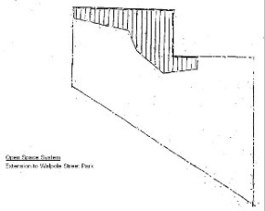

> [Picture on page 160: a picture, saved as a picture (images/part-f1-precinct-and-site-specific-development-controls-page-160-8.gif, 150 dpi).]

Figure 6: Open space system - extension to Walpole Street Park

#### 3.1.3 Landscaped Spaces

#### Objective

Ensure high quality landscapes spaces are provided at various locations throughout the

site.

#### Controls

The design of landscape spaces should complement and contribute to the urban setting

and add value and amenity to adjacent areas. In addition, they should be designed to:

• be environmentally sustainable, particularly in their use and demand for water;

• clearly convey a message that they are available and meant to be used;

• allow a range of potential activities;

• be engaging from the outside and within; and

• foster a safe and secure public domain.

#### 3.1.4 Pedestrian and Cyclist Facilities

The off-street pedestrian system is comprised of formed paths of either 2.5m width for major linkages

and pedestrian/bicycle linkages, or 1.5m width for secondary (pedestrian only) linkages. These are

detailed in Figure 3.

#### Objective

Ensure all pedestrian and cyclist paths allow high levels of casual surveillance through

their location, lighting and form of adjacent planting.

#### Development Controls

All footpaths adjacent to streets are to be a minimum of 1.5m width.

Footpaths are to be provided adjacent to streets according to the following schedule:

Table 1: Footpath provision

| Street/location | Footpath provision |
|---|---|
| Collector Road | at least one side |
| Access Street | at least one side |
| Access Street serving a maximum of 8 dwellings | none required |
| Park Edge Terrace | at least one side |
| Shared Accessway | none required |

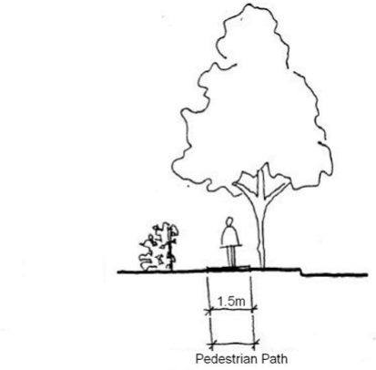

> [Picture on page 161: a picture, saved as a picture (images/part-f1-precinct-and-site-specific-development-controls-page-161-3.gif, 150 dpi).]

Figure 7: Pedestrian park

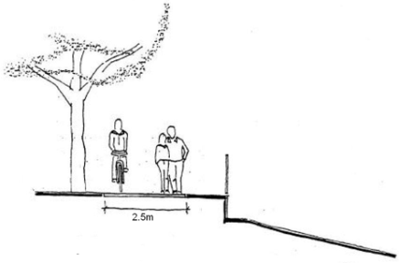

> [Picture on page 161: a picture, saved as a picture (images/part-f1-precinct-and-site-specific-development-controls-page-161-5.gif, 150 dpi).]

Figure 8: Pedestrian and cyclist facilities

#### 3.1.5 The Drainage System

#### Objectives

Ensure the provision of a combination of underground culverts, the linear park corridor,

existing overland flow corridors and the sub-street drainage system will accommodate

the ARI 1 in 100 flow.

#### Development Controls

An artificial wetland is to be provided adjacent to the Collector Road and Heritage Precinct.

The wetland will be a permanent water body, designed to be an important visual amenity

for Holroyd Gardens and to treat stormwater pollutants through the use of macrophytes

and other such species. The wetland will accommodate a freeboard in order to

accommodate on site detention from the western portions of the site.

An on site detention system is to be designed and constructed to the satisfaction of Council.

### 3.2 Streets

#### 3.2.1 Key Principles

Street system

#### Objectives

Ensure the street system (see Figure 9) will be the main north south link between Walpole

Street and potential future development to the south. It will circulate around the heritage

precinct (east) and will be linked by lower order roads at regular intervals along its length.

Allow the Walpole Street Park Extension to be utilised for construction of streets, in

order to maximise the developable area.

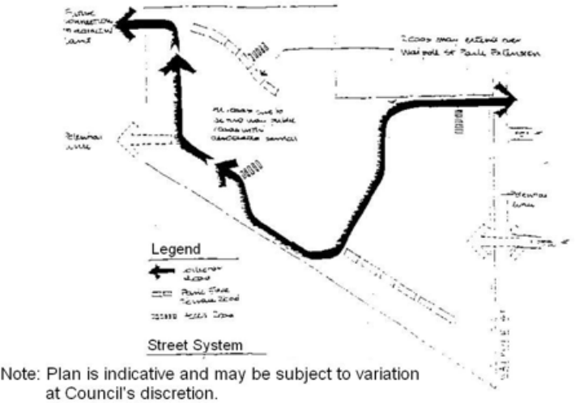

> [Picture on page 162: a picture, saved as a picture (images/part-f1-precinct-and-site-specific-development-controls-page-162-22.gif, 150 dpi).]

Figure 9: Street system map

#### Controls

Require streets to frame and define key public spaces.

Ensure the provision for the requirements of emergency and service vehicles are made.

Street character

#### Objective

Ensure streets are designed such that they are appropriate for all potential users. The

design of the street environment should support the establishment of distinct zones of

activity, including public space (traffic, parking and pedestrian zones), semi-public space

(front yards and porches) and private space (within the building).

#### Controls

Buildings shall be sited so that they provide strong definition of the public realm. The ratio

of building height (at any point) to the horizontal distance between buildings (at a

corresponding point), across a street, should generally fall between 1:1.25 and 1:3.7,

except in areas adjacent to heritage items. A ratio of up to 1:3.7 will be allowed in cases

where smaller buildings are to be located opposite apartment buildings.

In situations where no other building has been proposed for across the street, the horizontal

distance between buildings is assumed to be the distance between the proposed

building and the maximum building setback (as defined in Clause 4.2) behind the

opposite verge/property boundary.

Streets are to be designed such that there is a clear distinction and progression from

private space to semi public, to public space.

Buildings shall be sited and designed to maximise casual surveillance of the public

realm.

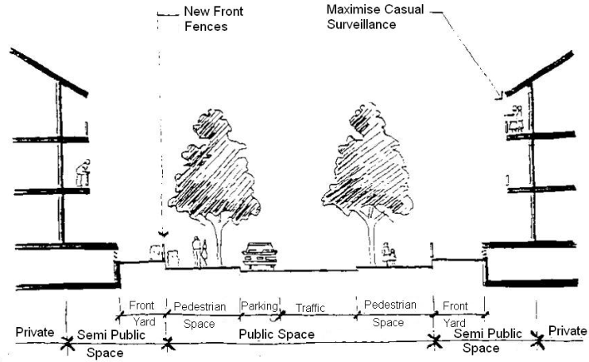

> [Picture on page 164: a picture, saved as a picture (images/part-f1-precinct-and-site-specific-development-controls-page-164-1.gif, 150 dpi).]

Figure 10: Street character - cross section

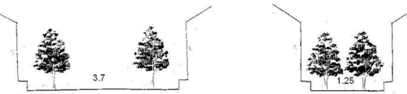

> [Picture on page 164: a picture, saved as a picture (images/part-f1-precinct-and-site-specific-development-controls-page-164-3.gif, 150 dpi).]

Figure 11: Street character – building height to road length

Principal entrance The principal entrance to the site will be from Walpole Street, adjacent to the Walpole Street Park boundary.

#### Objectives

Allow for a possible second entrance to the site to align with Peel Street.

Ensure the main entrance is to be designed to provide and coordinate with speed and

traffic control on Walpole Street.

Ensure the main entrance will be designed to reflect its role as a gateway to the site.

#### 3.2.2 Street Types and Dimensions

Collector road

#### Objectives

Provide a principle access for the entire site by connecting with Walpole Street adjacent

to Walpole Street Park and circulating east around the heritage precinct.

Make provisions for future connections with residential development to the south of the

site.

Allow all potential housing types to have frontage to the Collector Road.

#### Controls

Typical street sections for the collector road are illustrated in Figure 15:

• carriageway: 8m wide kerb to kerb over its entire length (any variation to be

demonstrated to the satisfaction of Council’s Engineer);

• verge area: 3m - 3.75m (both sides);

• building setback: 4.5m maximum to the principal façade; and

• the verge area may be reduced to 1.5m on one side where the collector road has

development frontage to only one side.

Council may consider variations to the above dimensions only where overarching principles

for Street System, Street Character and Street Landscape (Section 3.3.1) are achieved.

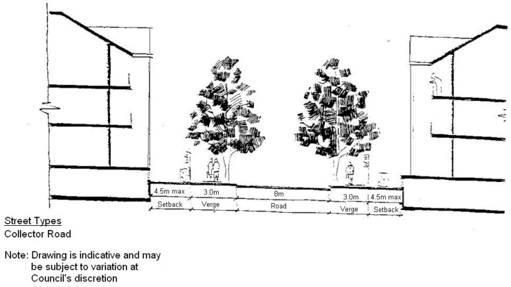

> [Picture on page 165: a picture, saved as a picture (images/part-f1-precinct-and-site-specific-development-controls-page-165-19.gif, 150 dpi).]

Figure 12: Street types – collector road

Park edge terrace The Park Edge Terrace is a street type which has dwellings located on one side and park

frontage on the other.

#### Objectives

Increase the level of casual surveillance, thereby enhancing activity, safety and security

for park users through the positioning of a road between buildings and the park.

Allow all potential housing types to have frontage to the Park Edge Terrace.

#### Controls

A typical street section for the Park Edge Terrace is illustrated in Figure 16:

• carriageway: 6.5 – 7m maximum;

• verge area: 3 - 3.75m to development side 1.5m to the park side; and

• building setback: 4.5m maximum to the principal façade. Council may consider variations to the above dimensions only where overarching principles

for Street System, Street Character and Street Landscape (Section 3.3.1) are achieved.

Access streets

#### Objectives

Provide access streets that connects with the collector road and may be either through

routes or cul-de-sacs.

#### Controls

Typical street sections for Access Streets are illustrated in Figure 17:

• carriageway: 6.5-7m;

• verge Area: 3 - 3.75m (both sides); and

• building Setback: 4.5m maximum to the principal façade. The verge area may be reduced to 1.5m on one side where the access street has

development frontage to only one side, or where the access street is a cul-de-sac and

serves no more than 8 dwellings.

Council may consider variations to the above dimensions only where overarching principles

for Street System, Street Character and Street Landscape (Section 3.3.1) are achieved.

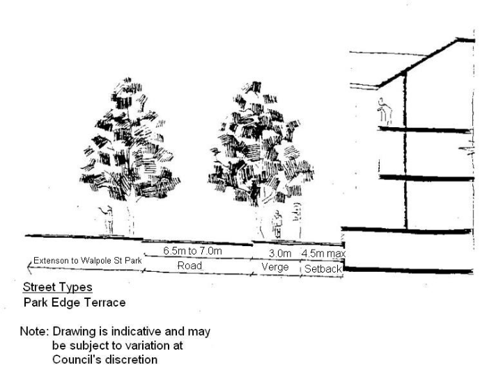

> [Picture on page 167: a picture, saved as a picture (images/part-f1-precinct-and-site-specific-development-controls-page-167-1.gif, 150 dpi).]

Figure 13: Street types – park edge terrace

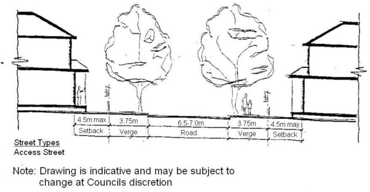

> [Picture on page 167: a picture, saved as a picture (images/part-f1-precinct-and-site-specific-development-controls-page-167-3.gif, 150 dpi).]

Figure 14: Street types – access street

Shared accessway

#### Objectives

Allow for shared accessways which may be provided at various locations within Holroyd

Gardens and will serve only a limited number of dwellings.

Ensure the shared accessway will be designed in a manner which provides equal priority

for both pedestrians and vehicles.

#### Controls

A typical street section for the Shared Accessway is illustrated in Figure 15. Final

dimensions and street design is subject to RMS concurrence:

• carriageway: 5m - 6.5m maximum;

• verge area: none required; and

• building setback: 4.5m maximum to the principal façade. Turning areas shall be provided for garbage services and delivery trucks in the form of

8m radius turning bulbs or equivalent turning areas within the road reserve at the end

points of roads or at a location where garbage trucks can service residences.

Allowance shall be made for visitors to the Heritage Precinct to turn and exit the site in

that vicinity.

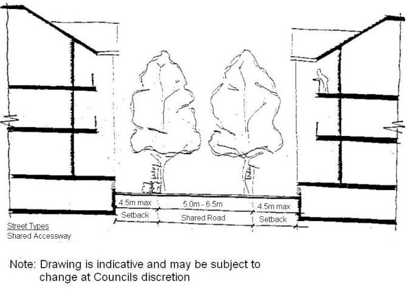

> [Picture on page 168: a picture, saved as a picture (images/part-f1-precinct-and-site-specific-development-controls-page-168-12.gif, 150 dpi).]

Figure 15: street type – shred accessway

#### 3.2.3 Road Intersections

#### Objectives

Ensure all road intersections encourage safe vehicle movement.

Make provisions for efficient and safe pedestrian movement.

#### Controls

Require minimum curb radius profiles to encourage slower vehicle turns.

Pram ramps are to be provided for all pedestrian crossing movements.

On street parking

#### Controls

On Street parking will be available on all streets according to the following schedule:

Table 2: Parking provisions

| Street/location | Parking provision |
|---|---|
| Collector Road | at least one side |
| Access Street | at least one side |
| Access Street serving a maximum of 8 dwellings | none required |
| Park Edge Terrace | at least one side |
| Shared Accessway | none required |

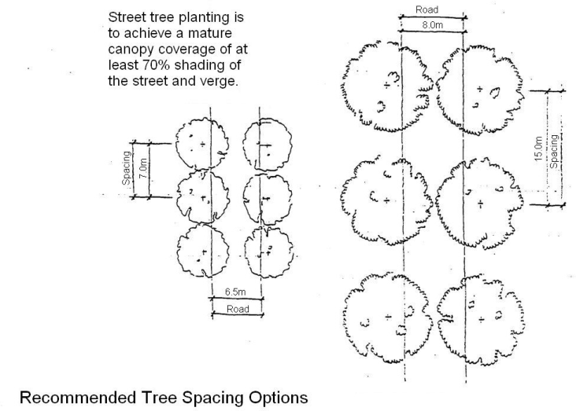

> [Picture on page 169: a picture, saved as a picture (images/part-f1-precinct-and-site-specific-development-controls-page-169-6.gif, 150 dpi).]

Figure 16: Recommended tree spacing options

#### 3.2.4 Street Landscape

Street tree planting

#### Objectives

Utilise thematic street tree planning to complement the functional role of streets.

Ensure that separate species be utilised on separate street types

Encourage deciduous street tree planting on all streets.

#### Controls

Street trees will be planted at a maximum spacing of 15m, measured from centre of

trunk to centre of trunk.

At least one street tree shall be planted for each allotment.

Street Tree species should be selected such that they achieve the following:

• super-advanced at planting (at least 200 litre);

• possess suitable anti vandal treatment;

• clean trunked to a height of at least 2m;

• a mature height which is complementary to the scale of the street and the height of

predominant buildings which have frontage to that street; and

• a mature canopy diameter of at least 7m and which allows for 70% of the street and

verge area.

Street furniture

#### Objectives

Ensure there is to be a coordinated palette of street furniture utilised on the site.

Ensure the items will be selected to relate strongly to the heritage significance of the

site.

#### Control

Items Detail of the palette of street furniture selected shall be submitted within a Landscape

Master Plan for the site, which will address all elements of the public domain in a

coordinated and holistic manner.

Lighting

#### Objectives

Provide lighting to improve the level of safety within all streets.

Ensure light pole and luminaires shall be of a style, colour and form compatible with the

heritage context of the site and the style, colour and form of other urban elements.

A strategy for lighting public spaces will be developed in conjunction with Council and

will address the full range of issues including light type, appearance and spacing, as well

as achievement of the relevant standards for acceptable ambient lux levels in public

streets and spaces.

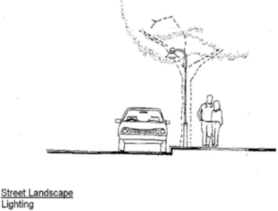

> [Picture on page 171: a picture, saved as a picture (images/part-f1-precinct-and-site-specific-development-controls-page-171-1.gif, 150 dpi).]

Figure 17: Street landscape - lighting

#### Controls

Light poles shall be compatible with the pedestrian scale by virtue of their height and

relationship to street dimensions.

Light poles shall be evenly spaced and contribute to establishing a regular pattern and

rhythm in the street. Spacing of light poles is to be coordinated with the spacing of street

trees.

Services

#### Controls

All services are to be located below ground, both within streets and between streets and

individual dwellings.

All principal services are to be provided in accordance with the requirements of the

responsible authority.

### 3.3 Built form

#### Objectives

Buildings should address and define the public domain, including streets and open

space.

Buildings may be located up to the surveyed boundary of the Walpole Street Park

Extension.

Development should form an organised and visually supportive and pleasing appearance

to Walpole Street Park and Walpole Street. A high level of casual surveillance is to be

afforded by the design of buildings. Service spaces and private open space areas are

to be appropriately screened from public view.

Setbacks along each street should not be randomly composed. There should be a

general consistency of building alignment and the street frontage.

Development of the site will be staged, commencing in the area adjacent to Walpole

Street.

Development of the site shall comprise a mix and variety of housing types throughout.

#### 3.3.1 Building envelope and form

With the exception of the Heritage Precinct, the site will be developed for residential and

activities ancillary to such residential development, such as open space and home offices. Based on the current indicative Master Plan, this DCP envisages that the site will have a

maximum density of 260- 280 dwellings, comprised of a mix of detached, semi-detached and

medium density multi- unit housing. Council may at its discretion consider and approve a

variation to the Master Plan where compelling economic, environmental or social grounds are

present, and where the overarching objectives and principles of this DCP can be achieved. Setbacks

#### Controls

Buildings must be set back from the property boundary by a distance which supports the

achievement of the preferred building height to street width principle. (refer to section

3.3.1).

Building setbacks are described on the street sections appearing in Section 3.3.

Specifically these correspond to a maximum of 4.5m to the principal facade.

Building height

The building height on any street must fall within the range defined by achievement of

the preferred building height to street width principle (refer to Section 3.3.1).

Building height must conform with the Master Plan approved by Council. A revised

Master Plan may be accepted and approved by Council from time to time.

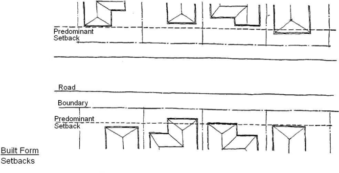

> [Picture on page 172: a picture, saved as a picture (images/part-f1-precinct-and-site-specific-development-controls-page-172-22.gif, 150 dpi).]

Figure 18: Built form setbacks

Roof form

#### Objectives

Ensure there is a defined palette of roof colours and materials to be utilised throughout

the DCP area.

Habitable use of roof space is encouraged in all residential development. Roof space is

not counted as an additional storey for the purposes of this DCP.

#### Controls

Roofs shall be pitched at a slope which allows their habitable use and which is compatible

with the pitch of roofs present on the heritage structures within the Heritage Precinct.

Roof form features such as hips, gables, chimneys etc. are encouraged in order to give

greater visual interest and break up the bulk and mass of the roofscape

Eaves overhang should be considered in order to provide weather protection to walls.

Roofs should be of a colour and material which is compatible with important heritage

buildings in the locality, and the surrounding urban context. Coloured corrugated steel

and Marseilles tiles are encouraged due to their historic association with the site.

#### 3.3.2 Massing and Fenestration

#### Objectives

The massing of buildings on the site should serve to fragment larger building forms into

more human scaled components, in both vertical and horizontal planes.

Building facades are to be articulated and fragmented. They are to utilise building form,

the play of light and shade, solid and void, and a variety of materials and elements in

order to achieve visual interest and supportive relationship with the scale of pedestrians

experiencing the urban environment both inside and outside the site.

Building facades are to exhibit a clear expression of “base”, “middle” and “top” components.

#### Controls

The horizontal bulk of buildings shall be downplayed through the use of strong vertical

elements, particularly in cases where long walls will address the street.

There shall be regular spacing of solid elements and openings within the street facade

of buildings.

Windows shall be vertical in proportion in order to reduce the apparent bulk of buildings.

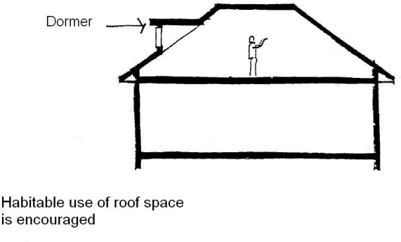

> [Picture on page 174: a picture, saved as a picture (images/part-f1-precinct-and-site-specific-development-controls-page-174-1.gif, 150 dpi).]

Figure 19: Habitable use of roof space

#### 3.3.3 Orientation and Solar Access

#### Objectives

While having regard to the orientation of the site, buildings are to be sited and designed

in a manner which minimises their impact in terms of overshadowing.

Buildings are to be sited and designed such that a maximum of solar access is gained

to internal living spaces and outdoor private open spaces.

#### Controls

North facing windows to main living spaces should receive a minimum of 4 hours direct

sunlight during mid-winter while east and west facing windows should receive a

minimum 2 hours direct sunlight during mid-winter. South facing windows in connection

with main living areas should be minimised.

No building should unreasonably overshadow a public space or neighbouring private

space between the hours of 10:00am and 2:00pm during mid-winter.

#### 3.3.4 Building appearance

#### Objectives

The appearance of housing across the site should be coordinated such that there is a

reasonable level of individual variety, within the context of achieving a compatible

relationship between all buildings. There should be a mix of building forms.

Porches and verandahs are encouraged in order to provide shelter, identity, enhance

casual surveillance of the street and provide the opportunity for increased community

interaction.

Front yards are an important aspect for the setting and public appearance of buildings.

Front yards should be seen as an opportunity to extend the quality of public landscape

into semi-public areas.

Front yards should be designed and planted to support the architecture of the building

as well as the overall landscape concept for the site.

#### Controls

All new buildings must consider and respond supportively to buildings located in adjacent

positions, as well as across the street. Consistency between ridge, eave and opening

heights are important in this respect.

Building materials and colours selected and utilised on the site are to be coordinated

throughout the site and are to be compatible with the heritage structures currently, or

formerly, located on the site, and adjoining buildings. Generally, buildings of masonry

and/or render construction with light colours of a neutral tone are preferred.

All housing shall have a clear and visible address point that is directly approached from

the street. The front entrance pathway should not be shared with other buildings.

Entry spaces shall be designed in a manner that restricts direct views into the living

spaces of dwellings.

Landscaping within front yards should enable high levels of casual surveillance of the

street to be maintained.

Landscape details shall be submitted with each development application.

#### 3.3.5 Specific Precinct Controls

Heritage Precinct Transition area Building controls for the heritage precinct transition area apply to the area defined on Figure

20\. Specifically, this area encompasses all land within 25m inside of the Heritage Precinct’s

northern, eastern and southern boundaries.

#### Objectives

Provide an appropriate visual setting for heritage items;

Ensure that new development respects the established patterns in the former Goodlet

and Smith Brickworks;

Ensure a harmonious and compatible relationship between the scale of heritage

buildings and new development;

Ensure that new development respects the architectural style and character of the

heritage precinct.

#### Controls

Setting Care should be taken in the placement of new buildings such that vistas of important

heritage buildings are maintained along streets.

No part of any new development within the heritage precinct should project below the

eaves overhang of a heritage item.

No new building should be located closer than 3m from a heritage item or its overhang,

whichever is the greater.

New buildings within the heritage precinct should be designed in a manner compatible

with the appearance of existing heritage items, without mimicking those heritage items.

Scale New buildings located within the heritage precinct should be compatible with existing

heritage buildings. They should not visually dominate or compete with the scale of

heritage items.

New development within the heritage precinct should not have more than 2 storeys of

habitable space (exclusive of roofspace). Roof pitch and form should reflect that of

adjoining heritage items

No portion of a new building located within the heritage precinct should extend above

the ridge height of the Patent Kiln.

Simple roof forms, which do not compete with heritage buildings, are appropriate.

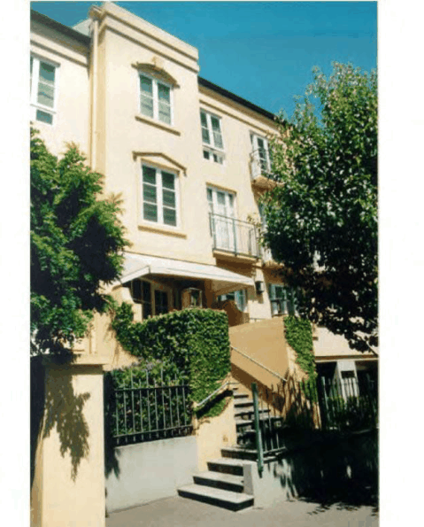

> [Picture on page 176: a picture, saved as a picture (images/part-f1-precinct-and-site-specific-development-controls-page-176-11.gif, 150 dpi).]

Figure 20: Example of clearly defined entry

Materials While not mimicking existing heritage buildings, new buildings located within the heritage

precinct should adopt and utilise external materials and finishes complementary to the

heritage fabric. These should be neutral tones

Front fences should be either low brick walls or incorporate a plinth, composed of simple

rendered and painted brick. Exposed recycled brick is also appropriate.

Balconies and verandahs should incorporate only simple railings and balustrades,

sympathetic with fencing.

Elaborate fretwork is to be avoided.

Gutters and flashings are to be of a traditional form. Fascia gutters are to be avoided.

New development proposed for the heritage precinct should be reviewed by Council’s

heritage advisor.

#### 3.3.6 Development Adjacent to the Heritage Precinct

Building controls for areas adjacent to the heritage precinct apply to the area defined on Figure

21\. Specifically, this area encompasses all land outside 25m of the Heritage Precinct’s northern,

eastern and southern boundaries.

#### Objectives

Provide an appropriate visual setting for heritage items.

Ensure that new development respects the established patterns in the former Goodlet

and Smith Brickworks.

Ensure a harmonious and compatible relationship between the scale of heritage

buildings and new development.

Ensure that new development respects the architectural style and character of the

heritage precinct.

#### Controls

Setting New development should be designed and sited in a manner which does not detrimentally

effect the heritage significance of either the entire precinct, or individual elements within

the precinct.

New development should be designed in a manner sympathetic to the appearance of

existing heritage items.

Scale The scale, bulk and height of new buildings located adjacent to the heritage precinct

should be visually compatible with, and should not dominate, existing heritage items

located within the precinct.

Any proposed building (or part of a building) located within 20m of an identified heritage

item should not have more than 2 storeys of habitable space (exclusive of roofspace).

Roof forms which are sympathetic to those within the heritage precinct are encouraged.

Materials While not mimicking existing heritage buildings, new buildings located adjacent to the

heritage precinct should adopt and utilise external materials and finishes complementary

to the heritage fabric. These should be light colours and neutral tones

Front fences should be either low brick walls or incorporate a plinth, composed of simple

rendered and painted brick.

Balconies and verandahs should incorporate only simple railings and balustrades,

sympathetic with fencing.

Elaborate fretwork is to be avoided.

Gutters and flashings are to be of a traditional form. Fascia gutters are to be avoided.

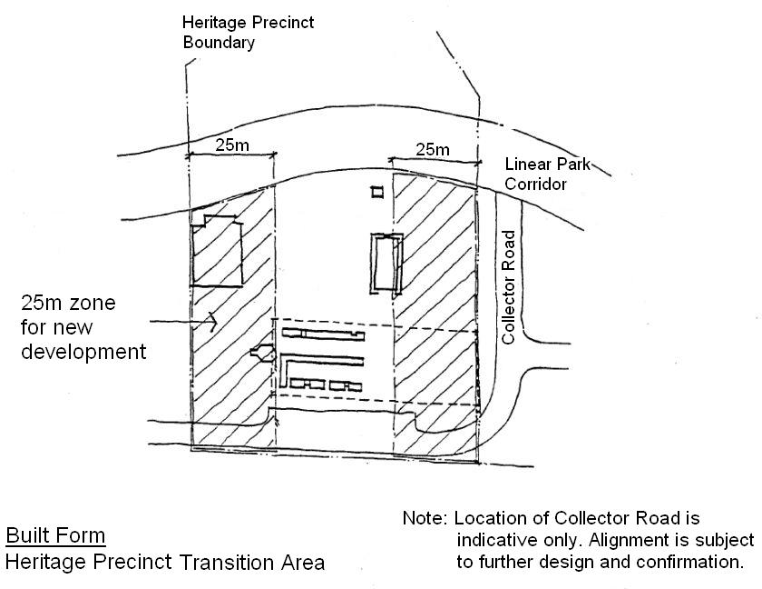

> [Picture on page 178: a picture, saved as a picture (images/part-f1-precinct-and-site-specific-development-controls-page-178-3.gif, 150 dpi).]

Figure 21: Built form – heritage precinct transition area

#### 3.3.7 Development Adjacent to Walpole Street

#### Objectives

Ensure buildings experiencing dual frontage to both Walpole Street and streets internal

to the site, present a suitable facade to Walpole Street and foster a suitable relationship

to the public domain external to the site.

Provide high levels of casual surveillance to Walpole Street.

Ensure there is a balance between the requirements of privacy for dwellings and the

creation of a suitable interface with Walpole Street.

#### Controls

Service areas fronting Walpole Street are to be adequately screened such that they are

obscured from pedestrian view.

Building services such as water heaters, rainwater tanks etc may not be located on

facades facing Walpole Street.

Boundary fencing must be coordinated along the length of Walpole Street.

Boundary fencing may be no higher than 1.8m in height.

Boundary fencing should utilise a variety of materials and/or incorporate substantial

articulation and modulation in order to create visual interest. The creation of recessed

bays, incorporating planting is encouraged in this respect.

Buildings with frontage to Walpole Street shall include adequate measures to ameliorate

noise impacts generated from both passing traffic and industrial activities located

opposite. These measures, and their appropriateness, must be demonstrated through

submission of an acoustic assessment.

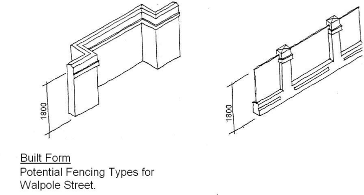

> [Picture on page 179: a picture, saved as a picture (images/part-f1-precinct-and-site-specific-development-controls-page-179-8.gif, 150 dpi).]

Figure 22: Built form – potential fencing types for Walpole St

3.3.8 Development Adjacent to the Main Southern Railway and Adjoining Industrial

Development

#### Objectives

Ensure buildings located adjacent to the Main Southern Railway present a suitable

facade to the railway alignment in order to enhance the visual perception of the site.

#### Controls

Service areas fronting the railway alignment are to be adequately screened/obscured

from view.

Building services such as water heaters, rainwater tanks etc should not be located on

facades facing the railway alignment.

No building should be located within 3m of the railway alignment or the common

boundary of adjoining industrial development.

All buildings located adjacent to the railway alignment and/or adjoining industrial activities

must include adequate measures to ameliorate noise impacts generated from the railway

and/or industrial activities. These measures, and their appropriateness, must be

demonstrated through submission of an acoustic assessment.

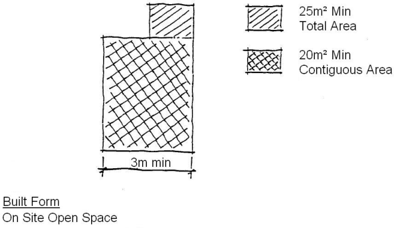

> [Picture on page 180: a picture, saved as a picture (images/part-f1-precinct-and-site-specific-development-controls-page-180-1.gif, 150 dpi).]

Figure 23: Built form – on-site open space

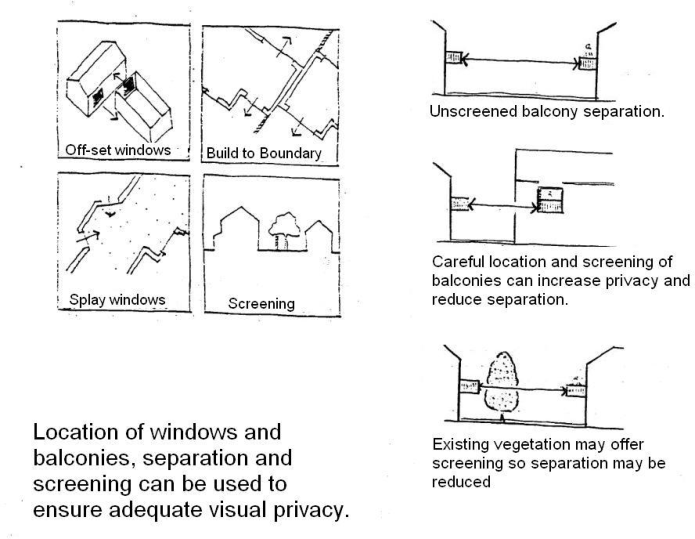

> [Picture on page 180: a picture, saved as a picture (images/part-f1-precinct-and-site-specific-development-controls-page-180-3.gif, 150 dpi).]

Figure 24: Examples of adequate visual privacy

#### 3.3.9 Site development issues

On site open space All dwellings are to be provided with private open space which achieves the following

principles:

• amenity, slope and dimensions suited to the needs of users;

• adequate privacy for residents;

• access to adequate direct sunlight, particularly during winter months; and

• be adjacent and/or visible from the main living areas of dwellings.

Each dwelling must be provided with a minimum area of private open space consisting

of one of the following attributes:

• ground level area totalling 25m², having a minimum contiguous area of 20m² and a

minimum dimension of 3m; or

• a balcony, located immediately adjacent to the main living area, with a minimum

area of 6m² and a minimum dimension of 1.5m (only applicable for blocks of units).

Privacy and overlooking

Visual privacy Direct overlooking of main internal living areas and private open spaces of adjacent

properties should be minimised through building location, the offset positioning and

design of windows, the positioning and design of balconies and/or the use of screening

devices where necessary.

Acoustic privacy

Site layout and building design minimises the transmission of external noise to habitable

rooms through attention to:

• siting of buildings;

• internal room layout;

• location of private open space;

• location and design of windows; and

• building construction methods. Habitable rooms, particularly bedrooms, shall be separated from significant noise

sources.

Casual surveillance

Casual surveillance of streets and other public spaces is to be maximised through the

following design principles:

• living areas should be located in areas which directly overlook public spaces;

• windows should be located such that they provide for casual surveillance of public

spaces; and

• planting located in semi-public and private areas should be selected such that a

generally unobstructed view of public spaces may be available.

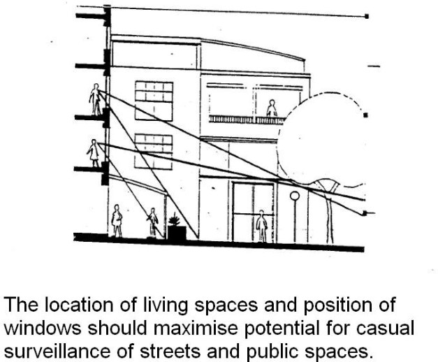

> [Picture on page 182: a picture, saved as a picture (images/part-f1-precinct-and-site-specific-development-controls-page-182-1.gif, 150 dpi).]

Figure 25: Location of living spaces

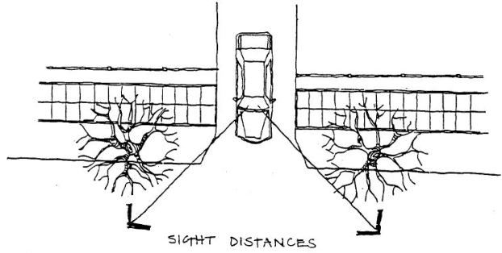

> [Picture on page 182: a picture, saved as a picture (images/part-f1-precinct-and-site-specific-development-controls-page-182-3.gif, 150 dpi).]

Figure 26: Site distances

Access and parking

Parking areas, driveways and street access design are to comply with the relevant

Australian Standards. Refer to Part G of Cumberland Development Control Plan 2021.

Car parking

On site car parking for residents is to be provided according to the following:

Table 3: Parking provision

| Development type | Parking provision |
|---|---|
| Apartments | 1 space per apartment, dedicated to that apartment; and 1 space per 5 apartments for visitor parking. |
| Houses, Duplexes, Terrace Houses | At least 1 space undercover; and at least 1 additional space on site. |

Bicycle parking is to be provided in multi- unit buildings at a rate of 1 space per 3

apartments.

Driveways

Where paving materials are utilised, these should be:

• in materials, other than plain concrete, and of colours which complement the site;

• the use of colour and materials should be coordinated across the site and be

selected from a defined palette for the site; and

• of adequate strength and non-slip qualities.

Access for the street Double driveways should be no greater than 5m in width. Single car driveways should

be no greater than 3m in width.

Flooding and stormwater disposal

Habitable floor levels of buildings are to be located at least 300mm above the 1 in 100

year ARI flood level.

Basement level carparks are to incorporate measures such that they are able to remain

flood free for the 1 in 100 year ARI flood event.

Connection of developments to the street or piped stormwater disposal system.

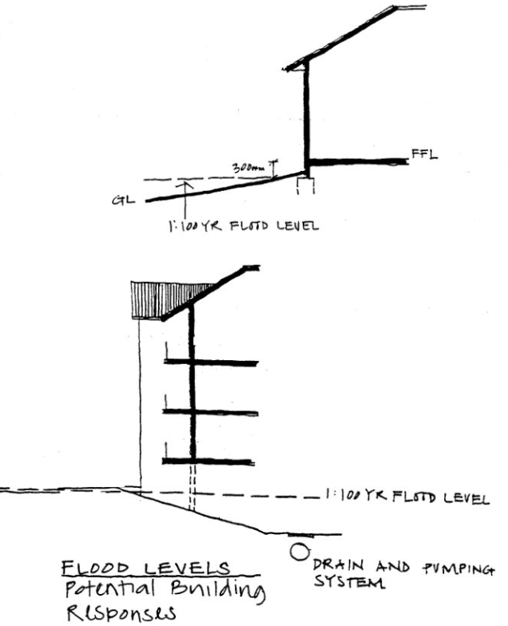

> [Picture on page 184: a picture, saved as a picture (images/part-f1-precinct-and-site-specific-development-controls-page-184-1.gif, 150 dpi).]

Figure 27: Flood levels and potential building responses

### 3.4 Disabled access and adaptable housing

The term adaptable housing implies that flexibility is built in at the design stage in order to allow

dwellings to be modified when and if, changing circumstances dictate. In this way, adaptable

housing achieves principles of robustness in the urban environment. Similarly, adequate

provision of disabled access to buildings provides for greater equity and recognises the diversity

of potential user groups in the community.

#### Controls

Disabled access Access into or around detached dwellings, townhouses and duplexes is to be flat, or gently

sloping. The majority of all ground floor dwellings (detached, terrace houses and

duplexes) should be capable of adaptation to allow barrier free access.

All public spaces should be designed in a manner which allows their equitable use by

disabled residents and visitors.

Adaptable housing Development of the site is to achieve the provision of a total of 26 adaptable dwellings,

in accordance with AS 4299-Adaptable Housing (Class C). This standard is based on a

rate of provision of 1 adaptable unit per 10 dwellings.

### 3.5 Ancillary issues

#### 3.5.1 Energy efficiency

#### Objectives

Ensure the design and layout of housing on the site facilitates the achievement of

appropriate levels of energy efficiency.

Encourage building design to minimise fossil fuel energy use and to maximise use of

natural ventilation, daylight and solar energy.

Encourage buildings to utilise layouts that minimise winter heat loss and make use of

solar energy for heating wherever possible.

Ensure buildings are designed to minimise excessive exposure to summer sun.

#### Controls

Windows shall be located to facilitate thermal control.

Building materials should be durable and require low levels of maintenance.

Materials, which have a higher thermal mass value (e.g. bricks, concrete and stone),

shall be utilised where they may benefit thermal control and energy efficiency of a

building.

Buildings are to utilise materials which posses a low level of embodied energy.

Buildings are to maximise the use of recycled and recyclable materials. In particular,

building materials currently located on the site should be reused wherever possible.

Building fitouts shall utilise energy efficient appliances where available.

All dwellings are to achieve a minimum 3.5 star rating under the Housing Energy Scheme

(NatHERS) Compliance with this requirement is to be demonstrated by the applicant as

part of the development application submission.

#### 3.5.2 Garbage disposal and waste storage

#### Controls

Appropriate space shall be provided within each dwelling for the temporary storage of

garbage and recyclables.

A waste storage area is provided on site, is accessible to users and is of a size that

caters for the following requirements:

Tables 4a and 4b: Waste storage requirements

| Capacity (litres) | Height (mm) | Width (mm) | Depth (mm) |
|---|---|---|---|
| 120 | 930 | 480 | 550 |
| 240 | 1080 | 575 | 730 |
| 1100 | 1465 | 1360 | 1220 |

| Dwelling type | Provision |
|---|---|
| Detached House | 1 x 240litre bin 1 x 240litre split recycling bin |
| Villa or Townhouse | 1 x 240litre bin 1 x 240litre split recycling bin |
| Apartments | 1 x 1100litre container per 8 units |
| Apartments (not exceeding 10 units) | 1 x 240litre split recycling bin |
| Apartments (>10 units) | 1 x 240litre paper recycling bin per 6 units 1 x 240litre comingled bin per 6 units |

The location and design of waste storage facilities is complementary to the architecture,

landscape and street frontage of the development.

#### 3.5.3 Boundary fencing

#### Objectives

Use fencing to enhance an image/perception of quality and provide appropriate levels

of privacy.

Use front fences to provide a suitable transition between the public domain and semi-

public areas located within individual allotments.

Discourage high front fences which are not transparent

#### Controls

Detached, Terrace houses Duplexes:

• the option of no front fence is encouraged;

• front fences must not exceed 1.5m from ground level (excluding piers); and

• front fences must be highly transparent. Apartment Buildings:

• front fences are required for all buildings in order to provide an appropriate transition

between public and semi-public space;

• front fences must not exceed 1.8m (excluding piers); and

• front fences must be highly transparent. Side and rear fencing should be generally no higher than 1.8m. They should provide an

adequate level of privacy to private open spaces and should be consistent with building

design and where visible from the street.

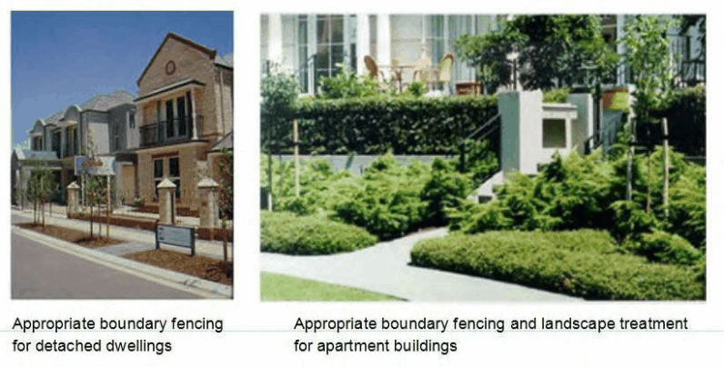

> [Picture on page 187: a picture, saved as a picture (images/part-f1-precinct-and-site-specific-development-controls-page-187-1.gif, 150 dpi).]

Figure 28: Boundary fencing and landscaping

#### 3.5.4 Street numbers

#### Control

C1. All street numbers must be clearly visible from the principal street frontage.

#### 3.5.5 Garages and outbuildings

#### Controls

Garages and outbuildings are to comply with all other relevant sections of this DCP,

Specifically, Building Envelope, Building Form, Building Appearance and Specific

Precinct Controls where applicable.

Garages and outbuildings should be designed to complement the architecture of the

main building to which they are related.

All garages and carports must be set back behind the main front facade of the building

to which they are related.

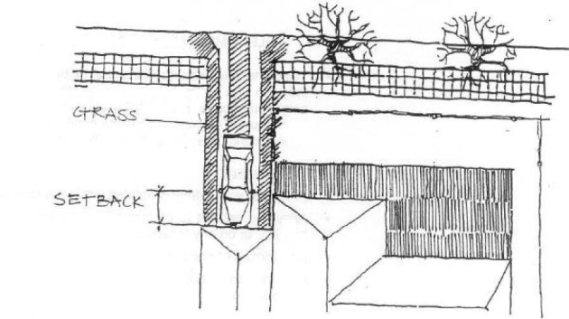

> [Picture on page 187: a picture, saved as a picture (images/part-f1-precinct-and-site-specific-development-controls-page-187-15.gif, 150 dpi).]

Figure 29: Garage setback

#### 3.5.6 Clothes drying areas

#### Controls

Clothes drying areas are to be screened from both the street and adjoining properties.

Clothes drying areas are to be easily accessible from dwellings and should not dominate

the form and availability of private open space within a development.

#### 3.5.7 Storage areas

#### Control

Adequate storage space is to be provided for all residential development and may be

provided either within a dwelling or within common areas such as parking garages.

#### 3.5.8 Telecommunications facilities

#### Controls

Telecommunications facilities are to be located such that they do not detract from the

aesthetic appeal of the neighbourhood or adversely impact on the visual amenity of

neighbours.

Telecommunications services are to be located underground (see also section 3.3.6).

#### 3.5.9 Antennae

#### Controls

Antennae are preferably located within the roof cavity.

Antennae are not to be located on the front facade of any building, or on any facade

facing Walpole Street.

A maximum of one antenna is permitted per building.

Antennae must not extend above the uppermost ridge line of a building.

#### 3.5.10 Cabling

#### Control

All cabling for the purposes of pay TV etc must be located below ground.

#### 3.5.11 Satellite Dishes

#### Controls

No satellite dish is to be located on the front facade of a building, or be visible from a

public street.

Satellite dishes are to be located below the ridgeline (or parapet) of the roof.

A maximum of one satellite dish is permitted per building.

This page has been left intentionally blank.

> [Picture on page 190: a picture, saved as a picture (images/part-f1-precinct-and-site-specific-development-controls-page-190-1.gif, 150 dpi).]
