### PART F1-14

### PEMULWUY

### RESIDENTIAL

This page has been left intentionally blank.

## 1. Introduction

### 1.1 Land to which this Part applies

Land to which this Part applies includes land identified as land within the residential precinct of

Pemulwuy as shown in Figures 1 and 2.

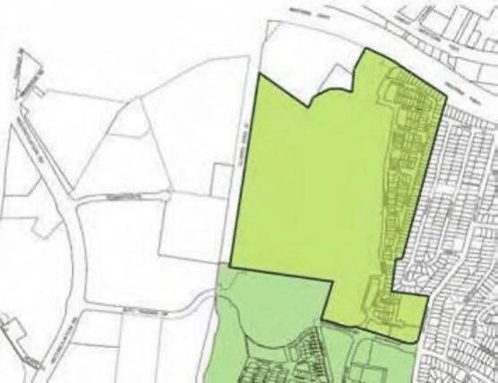

> [Picture on page 192: a picture, saved as a picture (images/part-f1-precinct-and-site-specific-development-controls-page-192-5.gif, 150 dpi).]

Figure 1: Pemulwuy North sub precinct

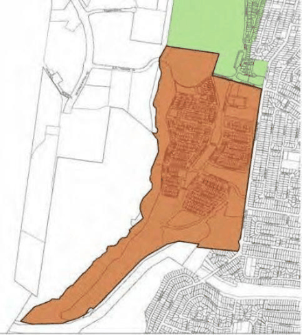

> [Picture on page 192: a picture, saved as a picture (images/part-f1-precinct-and-site-specific-development-controls-page-192-7.gif, 150 dpi).]

Figure 2: Pemulwuy South sub precinct

## 2. Vision and General Objectives

### 2.1 Vision

The vision for Pemulwuy is for a high quality public domain, incorporating the natural

characteristics, ecology and heritage of the site. Sustainable development principles underlie

the proposed urban outcome. While most of these objectives apply at the scale of precinct and

subdivision planning, many can be applied also at the lot scale.

### 2.2 General Objectives

#### Objectives

Ensure that development within the Pemulwuy Residential Precinct is primarily used for

residential purposes and associated facilities.

Provide for a range of housing types, including secondary dwellings, dual occupancies,

attached dwellings, semi-detached dwellings and multi dwelling housing, in areas well

served by public transport and near local shops.

Allow people to carry out a reasonable range of activities from their homes while

maintaining neighbourhood amenity.

Allow for a variety of small scale local non-residential uses that primarily serve local

residents and are compatible with the character of the living area.

Allow home occupations where such activities are unlikely to adversely affect the living

environment of neighbours.

Prohibit development that is of an offensive, hazardous, noisy, intrusive or

environmentally inappropriate nature.

Allow for local open space that is accessible and well located, that promotes the use and

enjoyment of local open space for both residents and the workforce, that may include

elements of the natural environment, and that provides for active and passive recreation.

## 3. Specific objectives and controls

### 3.1 Public open space

#### 3.1.1 Public domain open space strategy

#### Objectives

Develop a strong and high quality network of public open spaces that includes town

squares, parks and streets.

Develop a public domain that links the Pemulwuy community together through open

space corridors.

Design the public domain at a scale that encourages pedestrian use, and is well

addressed by surrounding development.

Provide areas of high amenity for the local community to focus upon and use.

Design the public domain within the site (comprising parks, riparian and drainage corridors,

water bodies, paths, cycleways and streets) to create a unique setting and exemplar for

development throughout Pemulwuy.

Ensure that the design of these facilities achieves longevity of the service life of the assets,

and ease of maintenance of the public domain and open space areas and the

improvements located in them.

Reinforce within the mixed-use centre near the Driftway Drive/Butu Wargun Drive

intersection civic, cultural and recreational facilities supported by workplaces, shops and

a variety of housing types.

Consider the Biodiversity Management Measures.

#### Controls

Locate parks to achieve views from and towards Prospect Hill.

Locate parks for the amenity of the residents and to be easily accessed.

Design parks for the site appropriate to their place and role. Design open spaces which:

• are generally edged by streets. Where this does not occur, the public/private

interface shall be suitably delineated;

• are within an easy 5 minute walk from most residences;

• are well distributed and part of a public domain network;

• provide a distinctive focus for local neighbourhoods;

• allow for a range of passive recreational activities;

• are part of a hierarchical public domain network of parks and streets which interpret

points of difference within the site, related to topography, site features, orientation,

and aspect; and

• may be reinforced with associated community facilities. Landscape open space areas using anti-graffiti treatment and materials, including wall

treatment to masonry surfaces.

Design the Greystanes Creek Woodland Park and the Northern Bushland Park to provide

access for Council’s maintenance equipment through the provision of appropriate

access points.

#### 3.1.2 Trees and ecological habitats

#### Objectives

Create neighbourhood identity using indigenous tree species.

Enhance and maintain biodiversity by complementing other conservation initiatives.

Use locally indigenous plant species, including threatened and regionally significant

species, in drainage areas, streetscapes and open spaces.

Conserve threatened species populations and their habitats.

Create fauna movement corridors within the site and link to external ecological resources

(where practicable allowing for other site uses).

Reduce water and fertiliser demand.

Maintain tree hazard at acceptable levels.

Create an environmental corridor along Greystanes Creek.

Retain and add to existing trees on Prospect Hill, consistent with the Prospect Hill

Conservation Management Plan, thereby forming large stands of trees to provide a

visual buffer to development when viewed from the top of Prospect Hill.

#### Controls

Manage trees in accordance with Part G of this DCP.

Ensure that the tree network and structure will provide a coherent wildlife corridor

throughout the site from adjacent sites.

Retain existing healthy trees unless there are clearly justifiable reasons for their removal

and alternatives have been considered (see Part G).

Retain where possible existing trees consist with Figure 1 (Pemulwuy South) and Figure

2 (Pemulwuy north), subject to future detailed design. With regard to the latter and in the

interest of the development generally, retain as many trees as possible under the

direction of a qualified arborist.

Retain where possible trees located in areas depicted as public open space, especially

where species from the Cumberland Plain Woodland and Sydney Coastal River Flat

Forrest suite of species are to be preserved and augmented. For example, stands or

groups of trees are located predominantly around the existing creek line, and are to be

retained as part of the riparian zone adjacent to the creek where possible.

Wherever possible, to use correct genotypes and collect seed from the local trees. This

applies throughout the public domain. In some locations, exotic species can be used for

landscape accent and shade.

Clear weeds and non-natives as part of a program to re-establish native plants.

Retain and add to existing trees on Prospect Hill, consistent with the Prospect Hill

Conservation Management Plan, thereby forming large stands of trees to provide a

visual buffer to development when viewed from the top of Prospect Hill.

Replace the predominant pine forestation of Pemulwuy with native planting.

Preserve and protect any scarred tree located in Pemulwuy, in consultation with

Aboriginal/ Archaeological advice.

Ensure tree species selection is consistent with Figure 1 (Pemulwuy North) and Figure

2 (Pemulwuy South).

Ensure that the hierarchy of street trees reflect the scale of the streets, design intent,

safe usage of trees and building size.

Retain scattered trees of landscape and ecological value in the private domain.

Apply the following process for tree selection and establishment for the site, whichever

is the lesser:

• select the most appropriate tree species based on the suitability of the site; in

particular, species which are resilient to storm damage (given appropriate

establishment and maintenance);

• ensure that tree plantings mature with the highest possible root and structural

strength by appropriate plant selection, procurement, site preparation,

establishment and maintenance; and

• design the public domain to incorporate sufficient space to allow for tree

establishment, where proposed. This includes the provision for the development of

deep structural roots.

Manage retained native trees within the public domain by integrating periodic hazard

assessment (undertaken by a qualified arborist) with the implementation of appropriate

arboricultural treatments to maintain tree hazard at acceptable levels. Ensure frequency

of hazard assessments is 12 monthly or at a time when significant changes in the use

of the site are proposed, whichever the lesser.

Apply the following process for tree removal from the site:

• where possible, trees that may need to be removed are to be transplanted in the

core riparian zone or outer protection zone of the Greystanes Creek Corridor;

• in addition, trees to be removed are those that fall within proposed road corridors,

within or close to building foot prints or those identified as structurally unsound,

dangerous or inappropriate for retention as outlined in the arborist report. The total

extent of these additional trees to be removed is to be determined as part of the

design development phase of the project;

• confirm the final extent of trees to be removed by a qualified arborist; and

• ensure tree removal involves the complete removal from site of the tree and root

system. Roots less than 50mm diameter may remain.

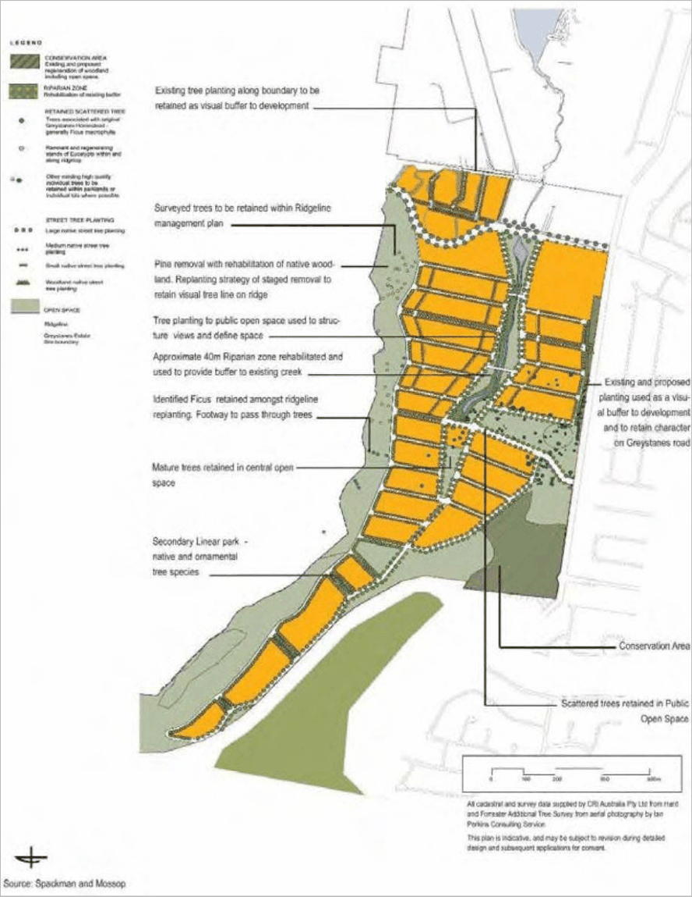

> [Picture on page 197: a picture, saved as a picture (images/part-f1-precinct-and-site-specific-development-controls-page-197-1.gif, 150 dpi).]

Figure 3: Trees and ecological habitat

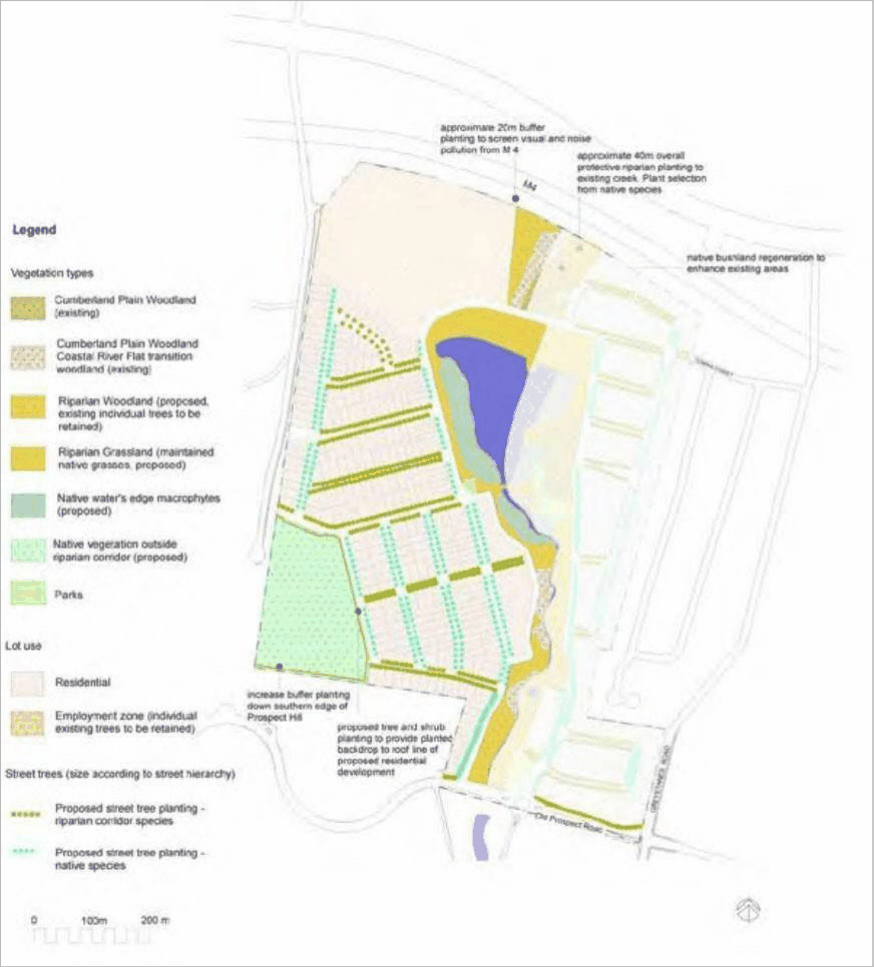

> [Picture on page 198: a picture, saved as a picture (images/part-f1-precinct-and-site-specific-development-controls-page-198-1.gif, 150 dpi).]

Figure 4: Proposed vegetation strategy

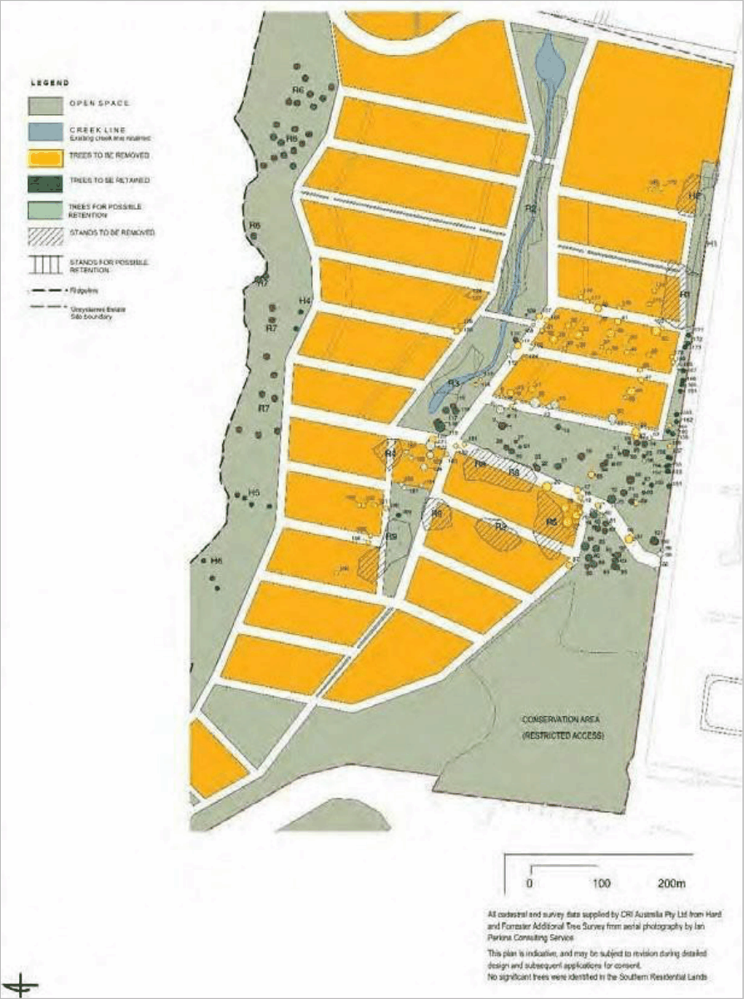

> [Picture on page 199: a picture, saved as a picture (images/part-f1-precinct-and-site-specific-development-controls-page-199-1.gif, 150 dpi).]

Figure 5: Existing individual tree strategy

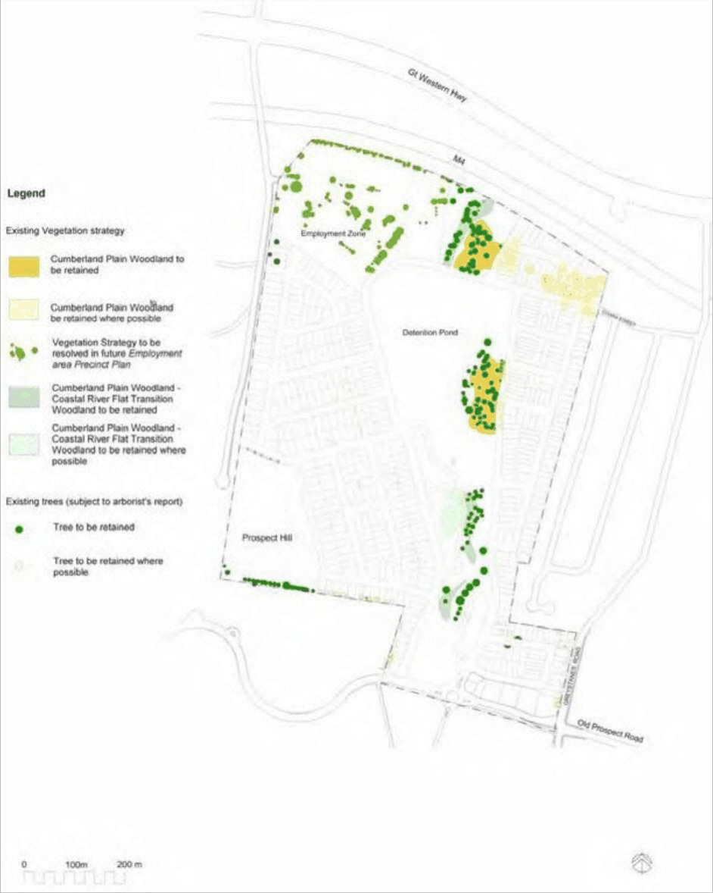

> [Picture on page 200: a picture, saved as a picture (images/part-f1-precinct-and-site-specific-development-controls-page-200-1.gif, 150 dpi).]

Figure 6: Existing vegetation/tree strategy

#### 3.1.3 Public Open Spaces – Pemulwuy North

Greystanes Creek Woodland Park

#### Objectives

Provide the Greystanes Creek Woodland Park as a linear Environmental Protection area,

with some open space to protect and enhance the ecological riparian outcomes on the

site.

Service the community’s recreational needs through provision of distinct areas.

Locate the Woodland Park centrally and overlooked on both sides by houses to improve

passive surveillance.

Visually link the park clearly with the adjacent street system, enhanced by tree avenues

and vistas to control views and enclose spaces.

Enhance biodiversity and ecological processes on the site through the provision of a

vegetated environmental protection zone.

#### Controls

Greystanes Creek Woodland Park has been completed, and provides:

• a vegetated riparian zone (consisting of a core riparian zone and an outer protection

zone) in accordance with the agreement reached between Stockland and the

Department of Planning (refer to Figure 7);

• rehabilitation of the existing core environmental protection zone and outer protection

zone and identified areas of Sydney Coastal River Flat Forest and Cumberland Plain

Woodland;

• a diversity of local native trees, shrubs and groundcover species in the core riparian

zone, as detailed in the Vegetation Management Plan/Bushland Management Plan

for the Greystanes Creek Woodland Park;

• a coherent wildlife corridor linking surrounding open spaces and ecological habitat;

• lighting at key points;

• sedimentation ponding;

• open amenity areas, such as a picnic area on the eastern side of the lake, seating

and small areas of hard standing/paving;

• unstructured recreation areas;

• dedicated pedestrian/cycle paths, generally in the outer protection area; and

• public art at appropriate locations and of an appropriate nature.

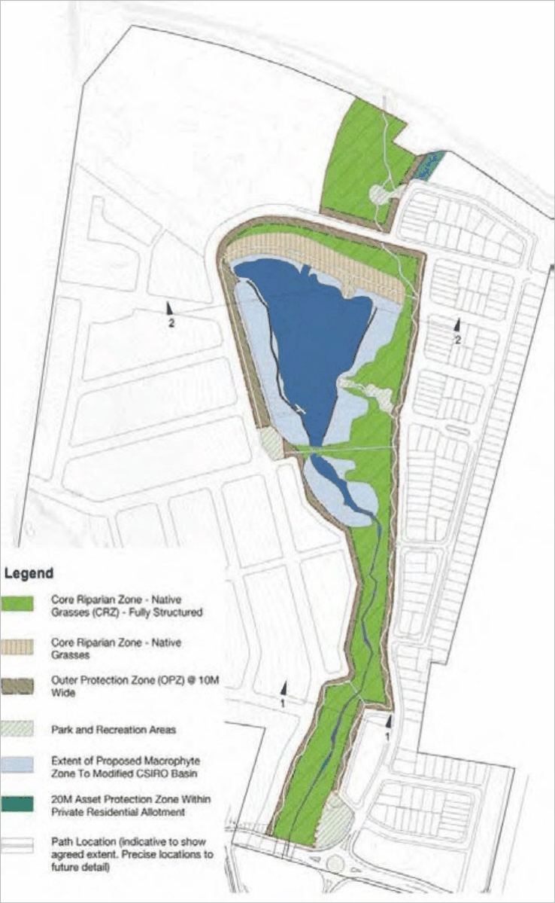

> [Picture on page 202: a picture, saved as a picture (images/part-f1-precinct-and-site-specific-development-controls-page-202-1.gif, 150 dpi).]

Figure 7: Riparian corridor plan - Greystanes Creek Woodland Park

Prospect Hill State Heritage Register area The Prospect Hill State Heritage Registered area is listed on the NSW State Heritage Register

(SHR) and the Register of the National Estate. The area also includes land along the ridgeline

south of Butu Wargun Drive, plus an identified curtilage. The part of the SHR area south of Butu Wargun Drive, is addressed in the section on Prospect

Hill under Public Open Space Precincts of Pemulwuy South.

#### Objectives

Retain the open grass hill character as open space and preserve the distinctive

ridgeline.

Consult with local community groups to ensure that the future proposal reflects the

historical relevance of the past.

Because the topography of the ridgeline lends itself to prime viewing, to locate these within

the pedestrian network, consistent with the Prospect Hill Heritage Landscape Study and

Plan and the Prospect Hill Heritage Interpretation Plan.

#### Controls

Ensure all development within Prospect Hill is informed by the following documents:

• Prospect Hill Conservation Management Plan (Conybeare Morrison; 2005);

• Prospect Hill Heritage Landscape Study and Plan (NSW Government Architect’s

Office; 2008); and

• Prospect Hill Heritage Interpretation Plan (MUSEcape; 2009).

Village Green “Village Green” is located adjacent to the north-west corner of Butu Wargun Drive and Driftway

Drive, Pemulwuy. This location is central to the residential developments and community and

retail facilities of Pemulwuy for optimum accessibility.

#### Objectives

Provide landscape and heritage interpretation which protects and interprets the natural,

Indigenous and cultural significance of the Prospect Hill SHR area.

Open views in to the Greystanes Creek Woodland Park from the entry road, adding to

the feeling of a well connected open space network.

Provide a hub for activity, close to the village centre.

#### Controls

Village Green has been completed, and provides:

• a paved area for seating/meeting with an open pavilion structure;

• shade coverage and a play area for toddlers and young children allowing for

parental supervision;

• amenity lighting at key points;

• low profile fencing around some areas of the park;

• a large area of flat maintained turf for informal and unstructured recreation

(approximately half a playing field for informal ball games). The topography is

graded around the edges to define the recreation space and the interface with the

road; and

• public art at appropriate locations and of an appropriate nature.

Northern Bushland The “Northern Bushland” area is located north of the detention basin within the identified

potential dam break flood hazard zone. The area contains the creek and identified ecological

communities/trees of varying quality. An opportunity arises to create public open space in the

form of unstructured open space with an ecological feel. See the Objectives below for three

distinct bushland character types required.

#### Objectives

Retain and enhance the existing creek line as a natural system through a vegetated

riparian zone.

Service the community’s passive recreational needs.

Provide a safe recreational environment.

#### Controls

Vegetate in accordance with the Vegetation Management Plan/Bushland Management

Plan prepared for the Northern Bushland Park.

In the vegetated riparian zone, provide a diversity of local native trees, shrubs and

groundcover species.

Retain existing trees, and regenerate by planting further native bushland species.

Provide a 2.5-3m pedestrian/cycleway through the area. Locate the pathway to facilitate

a rider experience of the range of habitat types and the sequence of open and enclosed

spaces.

Where practicable, provide pedestrian/cycle links to the north using existing culverts.

Within the open space area, provide activity nodes for a playground, fitness equipment/

sculpture/ seating and for environmental interpretation.

Regenerate areas of bushland to protect existing trees and provide a buffer zone to the

M4.

Provide limited open maintained grassland with pedestrian access in accordance with

Figure 8.

Provide adequate lighting at key points.

Note: Refer to Figure 8 for the agreed riparian corridor for the Northern Bushland Park and Figure 9 for indicative concept plans.

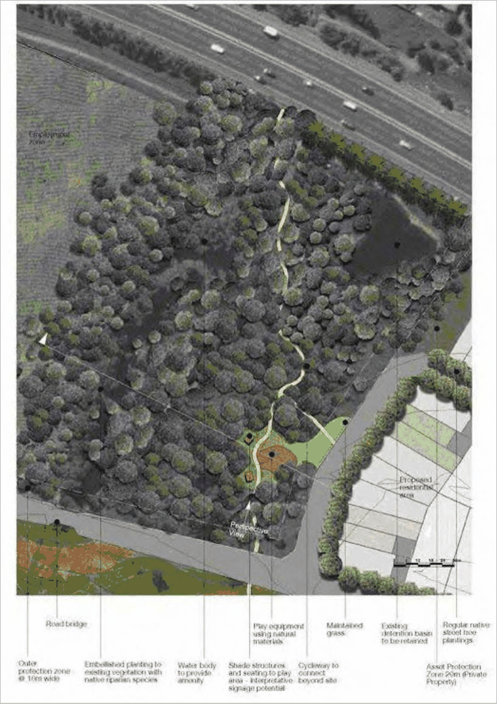

> [Picture on page 205: a picture, saved as a picture (images/part-f1-precinct-and-site-specific-development-controls-page-205-1.gif, 150 dpi).]

Figure 8: Concept plan for the Northern Bushland Park

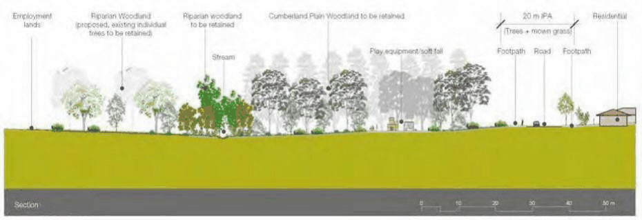

> [Picture on page 206: a picture, saved as a picture (images/part-f1-precinct-and-site-specific-development-controls-page-206-1.gif, 150 dpi).]

Figure 9: Concept section A for the Northern Bushland Park

Lakeside area

#### Objectives

Provide visual amenity for residents of Pemulwuy.

Enhance the existing flora and fauna species.

Sensitively locate circulation and viewpoints in order to minimise disturbance while

providing the opportunity to observe and appreciate wildlife.

Service the community’s recreational needs.

Provide a safe recreational environment.

#### Controls

Create viewpoints overlooking the lake, linked by a cycle/pedestrian route around it.

In the design of embankments and their surrounds, ensure safety around the water’s

edge. Fully investigate safety issues relating to the dam.

Locate the cycle and pedestrian route along the top of the dam wall offering views up

and down the creekline.

Provide macrophyte zones for water quality treatment with baffling structures to direct

flow.

Provide adequate lighting at key points.

Provide public art at appropriate locations of an appropriate nature.

Note: Refer to Figure – 11 for an illustrative view and concept plan of the area.

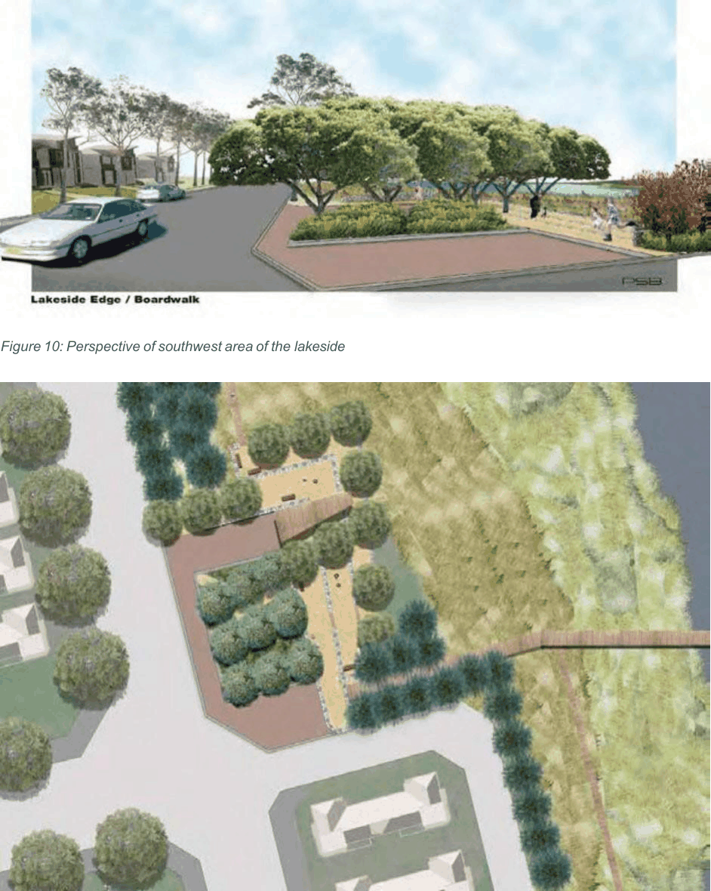

> [Picture on page 207: a picture, saved as a picture (images/part-f1-precinct-and-site-specific-development-controls-page-207-1.gif, 150 dpi).]

Figure 10: Perspective of southwest area of the lakeside

Figure 11: Concept plan for the southwest area of the lakeside

Neighbourhood pocket parks (Pemulwuy North)

#### Objectives

Provide unstructured open spaces.

Provide key pedestrian nodal points and connections.

Provide a safe recreational environment.

#### Controls

Define park tree avenues with the main aspect being in an easterly direction.

Plant shrubs and trees of an ornamental character with larger species providing shade.

Where the park is fronted by a pedestrian footpath, clearly delineate the public/private

domain through the use of front fences.

Use front verandas or porches in adjacent development to encourage use and

overlooking.

Create opportunities for play settings and seating.

Provide appropriate lighting. Consider public art as part of the overall design.

Note: Refer to s 12 and 13 for an illustrative view and concept plans

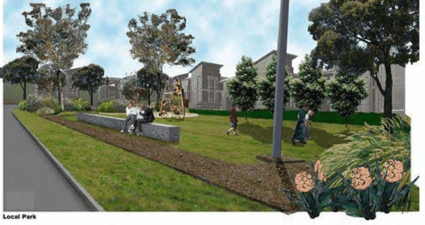

> [Picture on page 209: a picture, saved as a picture (images/part-f1-precinct-and-site-specific-development-controls-page-209-1.gif, 150 dpi).]

Figure 12: Perspective of Neighbourhood Pocket Park

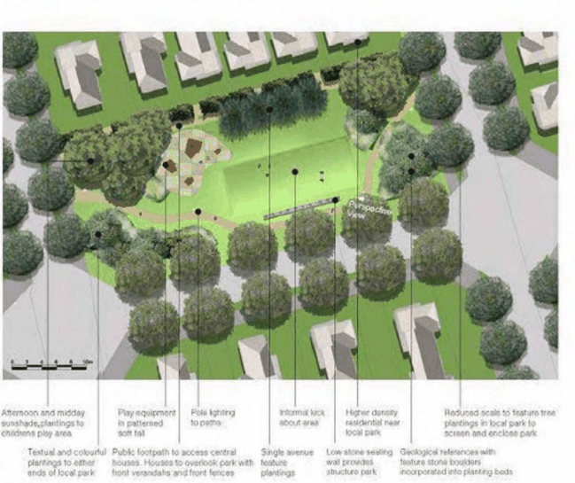

> [Picture on page 209: a picture, saved as a picture (images/part-f1-precinct-and-site-specific-development-controls-page-209-3.gif, 150 dpi).]

Figure 13: Concept plan for Neighbourhood Pocket Park

#### 3.1.4 Public Open Spaces – Pemulwuy South

The Public Open Space Precincts of Pemulwuy south of Butu Wargun Drive (with a small

exception in the north-west corner) are identified below in Figure 14.

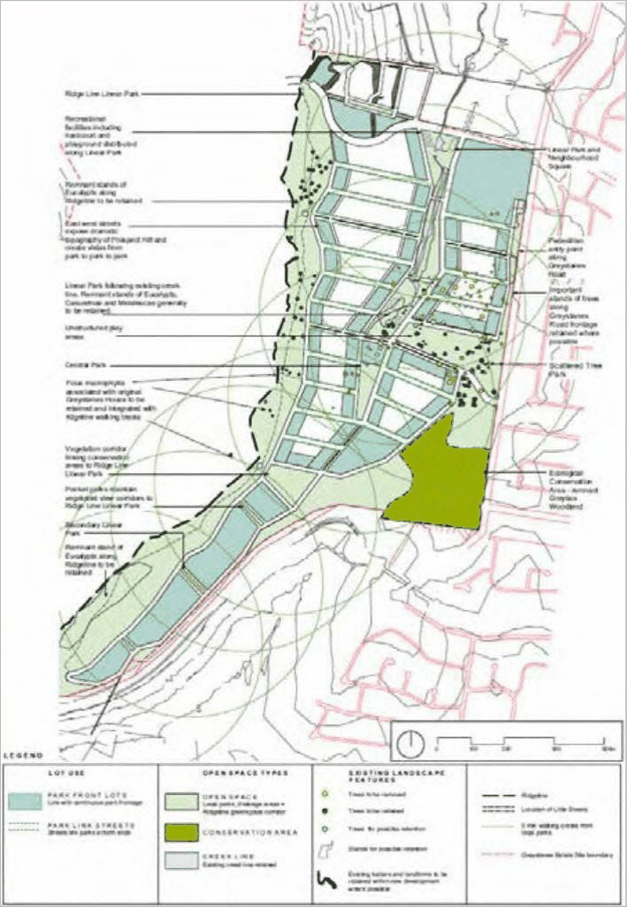

> [Picture on page 210: a picture, saved as a picture (images/part-f1-precinct-and-site-specific-development-controls-page-210-1.gif, 150 dpi).]

Figure 14: Open space precinct of Pemulwuy South

Greystanes Creek linear park (south of Butu Wargun)

#### Objectives

Service the communities’ recreational needs by providing three distinct areas of varying

size:

• A neighbourhood square;

• riparian buffer/open amenity; and

• structured recreation. Make strong visual links with the adjacent street system, enhanced by tree avenues and

vistas to control views and enclose spaces.

#### Controls

Within Nelson Square, provide for:

• a paved area for seating/meeting;

• external café seating;

• ornamental tree and shrub planting;

• historical installation/public art;

• interactive edge to existing creek line;

• development as a visual gateway into site from east/west link street;

• shade coverage and play area for toddlers and young children allowing for parental

supervision; and

• lighting at key points. Ensure that the riparian buffer/open amenity zone dominates the secondary area, defining

the extent of open space and creating a distinct character to the park by providing:

• areas of open space for informal/passive recreation;

• seating;

• areas of hardstanding/paving;

• connectivity through the internal area of the park to pedestrian/cycle links with the

wider Estate; and

• rehabilitation of existing riparian buffer zone. For structured activity areas, provide two half-size multi-use hardcourts that are central

to the overall layout of development. Use strategic buffer planting to reduce noise and

visual disturbance to immediate residential areas.

Central park

#### Controls

In relation to the Linear Park, ensure that Central Park:

• is a smaller scale suitable for passive recreation;

• provides a space to service the mixed use buildings and bus stop;

• has potential for external café restaurant seating;

• provides a combination of paved areas, maintained grass and ornamental planting

to create a character of small scale; and

• contains high quality eucalyptus trees that add a distinct character and are pivotal

to the overall design of the central park.

Scattered tree park

#### Objectives

Retain wherever possible the existing trees of ecological or landscape values in this

area.

Form a link between the creekline vegetation and the narrow strip of Cumberland Plain

Woodland which borders Greystanes Road.

Protect known sites of Aboriginal heritage.

Provide an unstructured recreation facility for residents.

Maintain and enhance strong links to Grey Box Reserve.

Ensure that activities and uses of this park do not to impinge on Grey Box Reserve.

Generally, to provide low-key picnic and recreation activities for in this park.

#### Controls

Ensure that new vegetation is primarily Cumberland Plain species.

Enclose the open space to the eastern end with areas of regenerated bushland.

Plant and screen known aboriginal sites to protect their location.

Provide continuous shared access from Linear Park through Scattered Tree Park to

Grey Box Reserve.

Secondary linear parks

#### Objectives

Locate secondary parks close to residences.

Provide for unstructured activities.

Create a pedestrian/cycle link from the Prospect Hill ridgeline to the north-south

connector road.

Provide visual amenity in the public domain.

#### Controls

Locate secondary parks within five minutes walking distance of the immediate

community.

Define parks by tree avenues, with the main aspect being in an easterly direction. (Figure

shows a concept design for these parks and Figure shows a section through the

Secondary Linear Park.)

Enhance aspect by framing and opening up views in an easterly direction.

Plant shrubs and trees of an ornamental character.

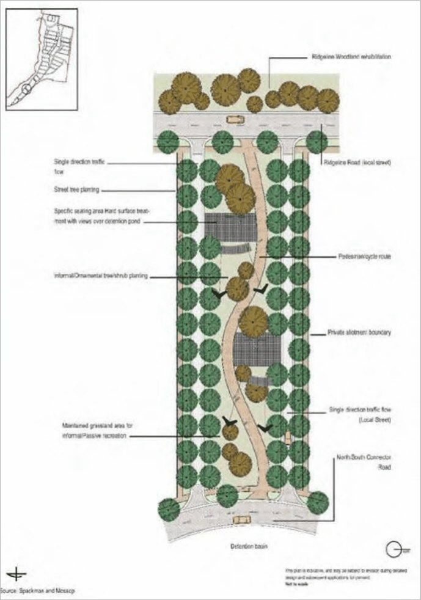

> [Picture on page 213: a picture, saved as a picture (images/part-f1-precinct-and-site-specific-development-controls-page-213-1.gif, 150 dpi).]

Figure 15: Secondary linear Parks

Prospect Hill park The Prospect Hill State Heritage Registered area is listed on the NSW State Heritage Register

(SHR) and the Register of the National Estate. The area also includes land along the ridgeline

south of Butu Wargun Drive, plus an identified curtilage. The part of the SHR area north of Butu Wargun Drive, is addressed in the section on Prospect

Hill under Public Open Space Precincts of Pemulwuy North.

#### Objectives

Provide landscape and heritage interpretation which protects and interprets the natural,

Indigenous and cultural significance of the Prospect Hill SHR area.

Consult with local community groups to ensure that development reflects the historical

relevance of the past.

Because the topography of the ridgeline lends itself to prime viewing, to locate these

within the pedestrian network, consistent with the Prospect Hill Heritage Landscape

Study & Plan and the Prospect Hill Heritage.

#### Controls

Ensure all development within Prospect Hill (Marrong Reserve) is to informed by the

following documents:

• Prospect Hill Conservation Management Plan (Conybeare Morrison; 2005);

• Prospect Hill Heritage Landscape Study & Plan (NSW Government Architect’s

Office; 2008); and

• Prospect Hill Heritage Interpretation Plan (MUSEcape; 2009).

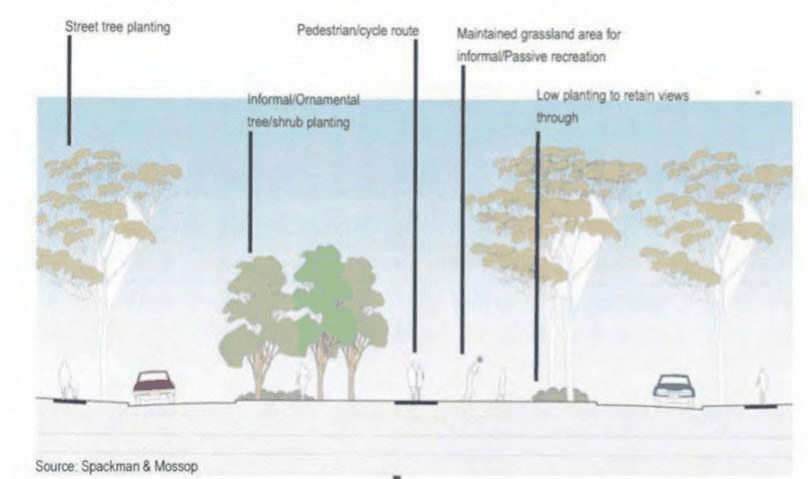

> [Picture on page 214: a picture, saved as a picture (images/part-f1-precinct-and-site-specific-development-controls-page-214-22.gif, 150 dpi).]

Figure 16: Section through secondary linear park

#### 3.1.5 Wet Basins

#### Objectives

Integrate water storage requirements within Pemulwuy South into a safe and natural

setting.

Design the wet basin and surrounding area as a feature within the landscape.

Retain long distance views from the Secondary Linear Parks and promote casual

surveillance.

Be accessible for passive recreation only.

Ensure safety is of prime importance.

#### Controls

Control water levels to ensure safety is preserved.

Secure deeper areas of the basins with a buffer of planting.

Ensure that edge treatment of the Basins is natural, with riparian planting, shrubs and

trees.

Use local stone to set the pond into the existing topography.

Keep vegetation to a minimum where it interferes with long distance views from the

Secondary Linear Parks and casual surveillance.

Note: Figure and Figure provides an illustrative layout to the wet basins in the Southern Residential Lands

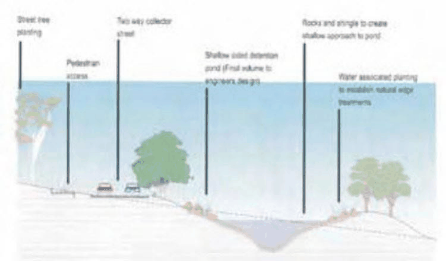

> [Picture on page 215: a picture, saved as a picture (images/part-f1-precinct-and-site-specific-development-controls-page-215-20.gif, 150 dpi).]

Figure 17: Section B-B through wet basin

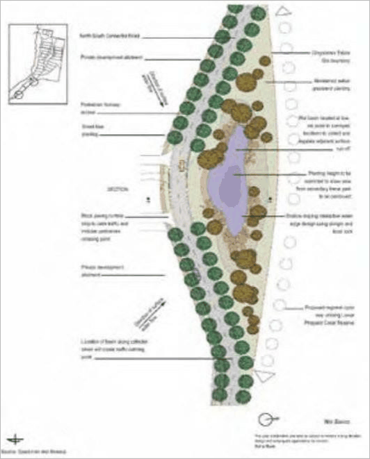

> [Picture on page 216: a picture, saved as a picture (images/part-f1-precinct-and-site-specific-development-controls-page-216-1.gif, 150 dpi).]

Figure 18: Wet basin landscape treatment

#### 3.1.6 Grey Box Reserve

#### Objectives

Conserve areas of high Potential Archaeological Deposits (PAD) and significant known

artefacts or sites.

Define the boundary of the bushland conservation area known as Grey Box Reserve.

Incorporate areas of potential archaeological deposits and representative elements of

the cultural landscape.

Manage the impacts from recreation and access on the bushland ecology.

Educate the local community in the pre-European history of the site.

#### Controls

Retain the area on site that most closely reflects the pre-European cultural landscape.

Refer to Figure 19.

Limit recreational opportunities in the conservation area to passive activities.

Prepare a plan of management detailing measures to appropriately manage the Aboriginal

cultural heritage. This should be prepared in consultation with the local Aboriginal

community, the National Parks and Wildlife Service (NPWS) and Council. An

open artefact scatter representative of those identified elsewhere within the survey area,

is shown in Figure 19 (Archaeological and Excavation Sites).

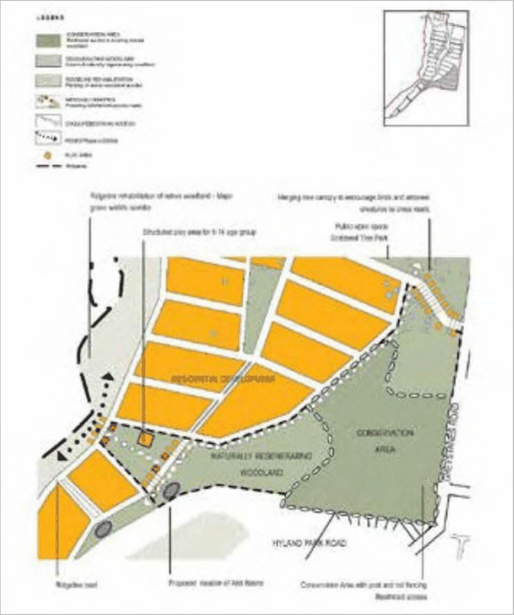

> [Picture on page 217: a picture, saved as a picture (images/part-f1-precinct-and-site-specific-development-controls-page-217-3.gif, 150 dpi).]

Figure 19: Bushland conservation area (Grey Box reserve)

Note:

• Council will not consent to development within the area indicated by blue dashed line

in Figure 19 below without the concurrence of the Heritage Office. Refer to Figure 20

below under Solar Access and Sun Shading for further Lot. Orientation Principles

• Develop a suitable educational program in consultation with the local Aboriginal

community, National Parks and Wildlife Service and Council.

• Ensure that interpretive signs and other educational material are general in nature and

do not draw attention to any physical aspects of the Aboriginal cultural heritage section

through the wet basin.

### 3.2 Subdivision

#### 3.2.1 Geotechnical Considerations

#### Objectives

Characterise site subsurface and geotechnical conditions based on test pit, borehole

and laboratory data.

Provide pavement thickness designs for the proposed road network. A range of subgrade

conditions have been considered including the use of lime stabilised subgrade to control

potential excessive in situ moisture at the time of construction and to improve subgrade

strength and reduce pavement cover requirements.

Provide guidance on earthworks requirements for proposed roads, residential lots and

other civil works.

Provide assessment of lot classifications in accordance with AS2870-1996 “Residential

Slabs and Footings”, together with recommendations on footings.

Ensure that all designs for roads and pavements consider the impacts of soil salinity,

soil sodicity, sulphate aggressive soils, dispersive soils and saline groundwater.

Minimise disturbance to natural hydrological systems as a result of development, and to

provide for appropriate management of land affecting the process of salinisation, or

affected by salinity.

Prevent damage to buildings and infrastructure caused by salinity.

#### Controls

Develop road and pavement designs in accordance with the guidelines contained in the

Site Investigations for Urban Salinity, Roads and Salinity and Building in a Saline

Environment (DIPNR, 2003).

Design pavements on natural subgrades for CBR values in the expected range from

about 2.5% to 4.5%, for which pavement thicknesses of about 300mm to 500mm would

be required. Excessively wet natural subgrade may necessitate a further 250mm to

400mm thickness of subgrade replacement. Review engineering plans for each staged

development and prepare a specific pavement design in accordance with Council’s

requirements.

Design pavements on natural subgrade stabilised by the in situ addition of lime for a CBR

value of 10%, for which pavements thickness of about 250mm to 300mm would be

required. Provided lime stabilisation is carried out to a depth of about 300mm to 350mm,

it is anticipated that the need for conventional subgrade replacement (of excessively wet

subgrade) would be unlikely.

Carry out earthworks for pavement construction, lot filling and other civil works in

accordance with Council’s specifications for Subdivisions and Development and/or

AS3798-1996 Guidelines on Earthworks for Commercial and Residential Developments.

Compaction control for these works should also be in accordance with the above

Standard.

Assess AS2870 classifications for all lots and document findings in a report prepared

by the geotechnical consultant towards the completion of each staged development.

Minimise the impact of the proposed development on local and regional salinity

processes.

Minimise the impact of salinity on the proposed development.

#### 3.2.2 Block and Lot Structure

#### Objectives

Design blocks and subdivisions that support and relate to the public domain.

Efficiently utilise developable land. Provide for a diversity of housing choice.

Minimise disturbance to natural hydrological systems as a result of development.

Provide for appropriate management of land affecting the process of salinisation, or

affected by salinity.

Prevent damage to buildings and infrastructure caused by salinity.

Design building blocks and lots to minimise cut and fill and retaining walls.

Consider all relevant site constraints, including location of services, easements,

available access, topography, privacy and solar orientation.

Create a comfortable home, structure blocks to maximise the natural characteristics of

an allotment. This includes taking into account:

• aspect,

• views,

• existing slope,

• trees,

• predominant breezes, orientating living rooms to the north, and

• drainage and flooding potential. Subdivide blocks to create a lot structure that anticipates the siting of dwelling types that

support the public domain.

Subdivide blocks to create a lot structure that anticipates the siting of dwelling types

incorporating solar design principles.

Increase the efficiency of dwellings and external spaces and minimise residual parcels.

Maintain views to and from Prospect Hill.

#### Controls

Design subdivision blocks which:

• value and efficiently use urban land - do not create difficult residual spaces and

awkward boundary conditions;

• are capable of flexibility for future development involving re-subdivision or

amalgamation;

• actively seek to ensure retention of all existing trees wherever possible; and

• create a block structure that orientates streets to link public open spaces. For

example, implement the principles shown in Figure 16 to accommodate pedestrian

travel in the public domain, with urban street block dimensions generally within the

following maximum dimensions:

- Length - less than 250m or,

- Depth - less than 80m deep or less than 40m deep in conjunction with little streets. Maximise the number of allotments in areas with the greatest amenity including those

areas close to retail/community facilities, public transport and along park frontages.

Maximise the number of allotments addressing streets in the southern part of each block

to increase the number of dwellings with northerly aspect to rear living rooms and

gardens. Refer Figure 21 below.

Design lots which:

• have a generally orthogonal lot geometry to increase efficiency of dwellings and

external spaces and minimise residual parcels;

• Accommodate a variety of housing types to suit different household mixes and sizes;

• reflect landscape features such as slope and waterways by addressing storm water

run off, the opportunity for views and breezes and reduction in the height of retaining

walls;

• achieve dwelling units oriented for optimal solar access, including the use of eaves,

window awnings and screens that contributes to a comfortable living environment;

• maximise the number of allotments addressing streets to the south to increase the

number of dwellings with northerly aspect to rear living rooms and gardens;

• align the setback to the front of the dwelling with the facades of adjoining dwellings

on the street; and

• create lots within the Pemulwuy South precinct in accordance with the Lot Size and

Frontage Width ranges for each dwelling type as specified for the Pemulwuy South

precinct. Design corner lots to address both street frontages.

Maximise solar access with either east-west lots or north-south lots, with special

attention to lots that are on the south side of the street.

For East-West orientated Lots in particular:

• provide generally wider frontages to lots addressing the Prospect Hill to

accommodate dwellings with modulated side setbacks and courtyards to maximise

solar access;

• provide generally wider frontages to lots addressing streets to the north to

accommodate passive solar design in future dwellings;

• provide uniform scale, height, setbacks and consistent architectural character to

dwellings addressing open spaces to reinforce the public domain;

• create corner lots that accommodate secondary street setbacks and allow dwellings

to reinforce their prominent position and address both primary and secondary street

frontages; and

• within the Pemulwuy South precinct, generally provide wider frontages to lots

addressing Greystanes Road and Hyland Park where the Estate meets existing

suburban areas.

For North-South orientated Lots in particular:

• coordinate cut and fill and finished levels between lots to provide equitable access

to solar access and outlook;

• massing of dwellings should respond to existing site falls and topography;

• locate parking areas on the southern side of dwellings where possible; and

• create corner lots with adequate dimensions that allow dwellings to accommodate

secondary street setbacks, respond to both street frontage and mark important

corners in the subdivision.

Notes:

• Applications for subdivision of land into less than 300m² lots parcels are Integrated

Housing developments, and are subject to provisions set out in the following section on

Coordinated Development and Integrated Housing Sites; and

• Topographically steep areas are generally considered sites for Coordinated

Development and are subject to provisions set out in the following section on

Coordinated Development and Integrated Housing Sites.

• Applications for Coordinated Development are subject to provisions set out in the

following section on Coordinated Development and Integrated Housing Sites.

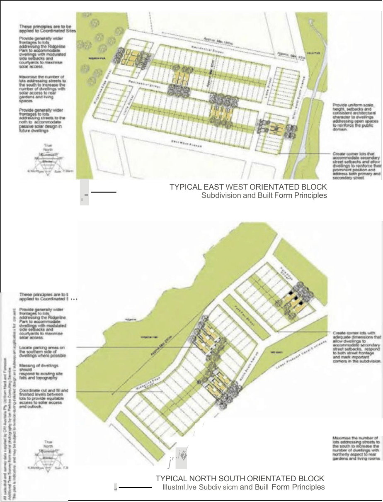

> [Picture on page 222: a picture, saved as a picture (images/part-f1-precinct-and-site-specific-development-controls-page-222-1.gif, 150 dpi).]
> Words printed on the picture (title and legend, copied from the PDF):
> TYPICAL EAST WEST ORIENTATED BLOCK
> I
> Subdivision and Built Form Principles
> TYPICAL NORTH SOUTH ORIENTATED BLOCK
> l,
> lllustml.lve Subdiv sicm and Buill Form Principles

### .-

#### /

### ...

Figure 20: Typical subdivision.

#### 3.2.3 Cut and Fill at Subdivision

#### Objectives

Minimise cut and fill.

Coordinate cut and fill between all lots to provide equitable access to sunlight, outlook

and privacy to all dwellings.

Ensure unimpeded natural groundwater flow.

Protect the geotechnical integrity of lots, including adjoining lots.

#### Controls

On cross-sloped land, ensure side boundary cut and fill (and associated retaining wall)

at subdivision stage is no greater than 900mm (Pemulwuy South).

On front-to-back-sloped land, ensure rear boundary cut and fill (and associated retaining

wall) at subdivision stage is no greater than 1.5m, to reduce front to back lot grades. No

further rear boundary retaining walls are permitted (Pemulwuy South).

Limit retaining walls in the front setback to 1m in height, or tiered in sections of no more

than 1m with at least 0.5m width landscaped separation between wall tiers.

Coordinated development and integrated housing sites Topographically steep areas indicated in Figures 21 and 22 are considered sites for

Coordinated Development. Integrated Housing developments are applications for subdivision of parcels of land into less than 300m².

#### Objectives

Ensure that the design of dwellings on steep sites, noise affected and small lots is

carried out in an architecturally consistent and integrated manner.

Ensure that the key focuses are a high quality streetscape, a strong neighbourhood

character and residential amenity.

Ensure that the built form responds to the topographical constraints, particularly the

slope and orientation of each allotment.

Ensure that new development provides appropriate residential amenity, particularly with

respect to visual privacy, and the relationship between dwellings.

Ensure that new development provides appropriate residential amenity, particularly with

respect to solar gain to each allotment and the relationship between dwellings.

Note: Address these objectives during the subdivision application stage in particular.

#### Controls

Design dwellings on Integrated Housing sites as a unified group of buildings with

consistent alignments, articulation, material selection and architectural character.

For Coordinated Developments, coordinate side boundary setbacks, building envelopes,

finished floor levels and cut and fill between all lots to provide equitable access to

sunlight, outlook and privacy to all dwellings at the subdivision stage where possible.

Where side and rear boundary retaining walls intersect, ensure that the maximum height

difference between the lowest bottom of wall and highest top of wall is 2.4m.

Council may consider variations to the controls within this DCP on Coordinated

Development sites where applicants can demonstrate compliance with the objectives of

the controls.

Lots with cross slopes

The subdivision layout must incorporate wider lots on the steeper sections of the site.

Narrower lots may be considered where it is proposed to subdivide the land as

integrated development.

Boundary cut or fill and retaining walls are to be constructed at subdivision stage no

greater than 900mm, unless otherwise stated.

Boundary retaining walls which extend beyond the front wall of the building must not be

higher than 600mm (Pemulwuy South).

Preliminary finished ground levels are to be constructed at subdivision stage.

Lots with front to back slopes - Pemulwuy south

Rear boundary cut or fill and retaining walls of maximum 1.5m in height are to be

constructed at subdivision stage of the development to reduce front to back lot grades.

No further rear boundary retaining walls are permitted.

C12. Preliminary building pad levels shall be constructed at subdivision stage which provide

for a minimum floor level split of 1m or as appropriate to facilitate split level house

designs. See Section 3.3.2 - Elevated Sites (Steep Land) in Pemulwuy for requirements

for cut and fill within building envelopes on front-to-back slopes.

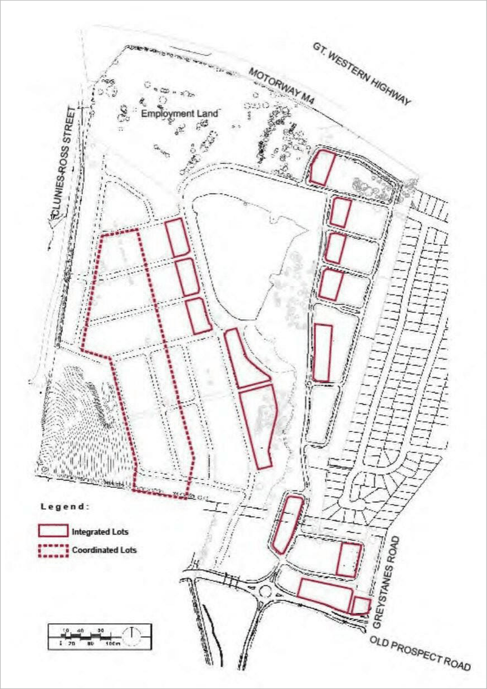

> [Picture on page 225: a picture, saved as a picture (images/part-f1-precinct-and-site-specific-development-controls-page-225-1.gif, 150 dpi).]

Figure 21: Integrated and coordinated sites in Pemulwuy North

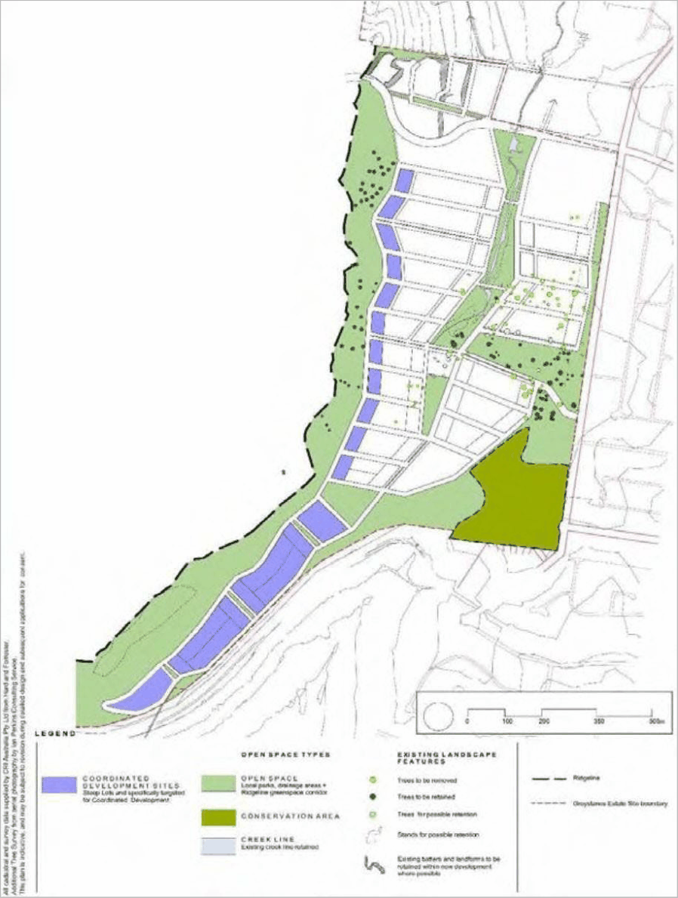

> [Picture on page 226: a picture, saved as a picture (images/part-f1-precinct-and-site-specific-development-controls-page-226-1.gif, 150 dpi).]

Figure 22: coordinated sides identified for Pemulwuy South

### 3.3 Building and Siting Requirements for Residential Development

#### 3.3.1 Architectural Character

#### Objectives

Interpret the subdivision pattern through building types.

Minimise cut and fill and not impede natural groundwater flow.

Reinforce the public domain, create attractive streetscapes with strongly defined parks

and open spaces.

Provide a high level of amenity for occupants.

Maximise casual surveillance of dwellings from the street and of the street from the

dwellings, to promote safer streets.

Develop building types that minimise potential salinity problems.

Provide for a variety of housing types and mix.

Adopt a contemporary design form.

Be responsive to the local climate, environment and lifestyle of western Sydney.

Improve the outlook and surveillance of streets and open spaces.

Develop a diverse range of housing styles of high quality, ranging from single lots to

townhouses, integrated housing developments and apartments.

Provide for a variety of occupants and ages, and provide a more sustainable life cycle

model than conventional monocultural housing development.

#### Controls

Provide a variety of building types and housing types throughout Pemulwuy in

accordance with Figure 23 and Figure 24.

Accommodate a range of innovative dwelling types including single dwellings, home

offices and home/work spaces.

Design, model and articulate dwellings with a consistent relationship to the street and

to each other.

Design with a simplicity of building elements that create a contemporary façade. Avoid

historical reproduction styles and/or mixtures of styles such as Federation, Edwardian,

Colonial, Victorian and Georgian.

Modulate side boundary setbacks and incorporate courtyards, atria, toplights and the

like to maximise solar access to dwellings.

Prefer elevated finished floor levels and entries, balconies and street elevations to

improve outlook and surveillance of streets and open spaces.

Design corner dwellings to reinforce their prominent location and address both primary

and secondary street frontages.

Ensure all dwelling entries are clearly visible from the street by day and night.

Ensure a maximum 500mm cut and 500mm fill for allotments unless otherwise stated

elsewhere.

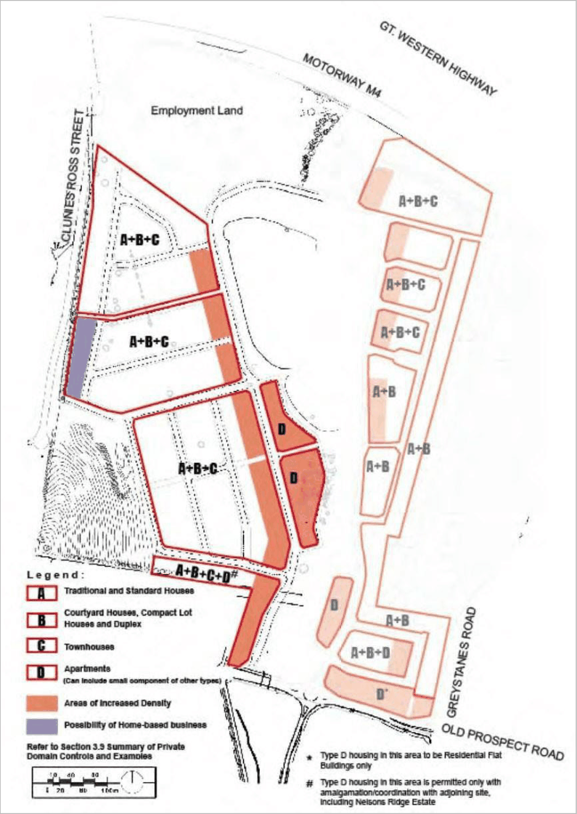

> [Picture on page 228: a picture, saved as a picture (images/part-f1-precinct-and-site-specific-development-controls-page-228-4.gif, 150 dpi).]

Figure 23: Housing types for Pemulwuy North

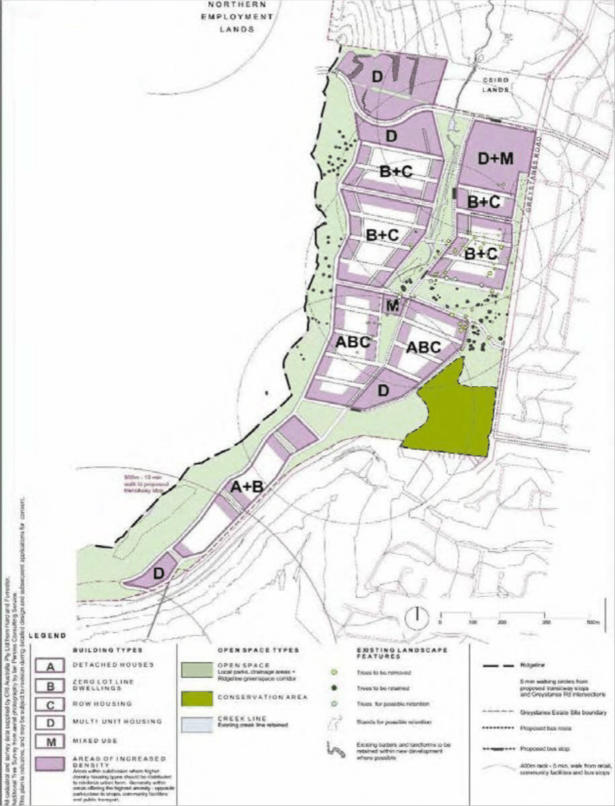

> [Picture on page 229: a picture, saved as a picture (images/part-f1-precinct-and-site-specific-development-controls-page-229-1.gif, 150 dpi).]

Figure 24: Housing types for Pemulwuy South

#### 3.3.2 Elevated Sites (Steep Land)

Refer to Figures 25 and 26.

#### Objectives

Ensure that the built form responds to the topographical constraints, particularly the

slope and orientation of each allotment.

Ensure that new development provides appropriate residential amenity, particularly with

respect to visual privacy, and the relationship between dwellings.

Ensure that new development provides appropriate residential amenity, particularly with

respect to solar gain to each allotment and the relationship between dwellings.

Ensure dwelling designs allow acceptable driveway grades for vehicular access to

garages.

Minimise the bulk and scale of dwellings on steep slopes when viewed individually and

collectively within and external to the site.

#### Controls

The maximum height for a dwelling house (in metres) is detailed within Cumberland

Local Environmental Plan 2021, as a written statement and associated maps.

Dwelling designs must respond to the topography of the land through split level designs,

unless privacy to adjacent properties can be maintained through alternative good design.

Elevated entries should be no more than 1m above the natural ground level at a point

3m set back from the front boundary.

The garage level is to be no greater than 500mm above or below natural ground level

to help reduce driveway gradients.

Ensure dwelling designs allow driveway grades for vehicular access to garages that

comply with AS 2890.1.

Retaining walls along on-street boundaries must be constructed of materials

complementary to the home.

Retaining walls must comply with the Building Code of Australia (BCA).

No cut or fill is to be placed in easements to drain storm water.

Retaining walls constructed alongside boundaries and protruding forward of the adjacent

front building line must be tapered to meet the profile of the finished ground level.

Where side and rear boundary retaining walls intersect, ensure that the maximum height

difference between the lowest bottom of wall and highest top of wall is 2.4m (Pemulwuy

North).

Brick walls are to be of salt proof construction. Dwelling design should consider: -

• existing ground levels;

• proposed cut and fill, and finished floor (FFL) and existing ground levels as indicated

on the proposed site plan; and

• existing sewer and drainage easements for stormwater and overland flows, and the

impact any proposed retaining walls will have. Easements cannot be obstructed or

built over.

Development applications for elevated sites must include:

• top of wall (TOW) and bottom of wall (BOW) levels for retaining walls;

• full construction details of proposed walls including drainage, materials and finishes;

• connection into the stormwater system for behind-wall drainage lines and surface

pits; and

• proposed finished ground levels (FGL).

Lots with cross slopes

Where lots have side cross slopes which exceed 3 degrees (5%), designs must respond

to the slope of the land through split house designs (see Figures 27 and 28).

Maximum 500mm cut and 500mm fill within building envelope.

Finished floor levels are to be no greater than 500mm above finished ground level. Where

it can be demonstrated that a better design outcome can be achieved without

compromising privacy, amenity and views into and out of the site, overshadowing and

height controls , particularly relating to the bulk and scale of the dwelling, Council may

consider relaxing the 500mm restriction up to a maximum of a 900mm total above the

finished ground level.

Garden retaining walls are not to exceed 700mm above finished ground level. Any

remaining slope is to be graded out (Pemulwuy North).

Dwelling heights and designs are to ensure reasonable visual privacy to the down-slope

side of the dwelling, by incorporating privacy measures to minimise potential overlooking.

Garages are to be located on the lower (eastern) side of side cross-sloped lots, and

access is to be provided in accordance with AS 2890.1 – Off Street Parking.

Maximum height of side fencing is 1.5m to reduce the overall wall/fence height

(Pemulwuy South).

Lots with front to back slopes

Where front to back slopes are steep, i.e. above approximately 5 degrees (9%), house

designs must respond to the topography of the land through front-to-back full level split

designs (Type 1 as shown in Figure 30).

Where front to back slopes are moderate, i.e. approximately between 3 degrees and 5

degrees (4.5% and 9%), house designs are to respond to the topography of the land

through split level designs (Type 2, refer to Figure 31).

Maximum 700mm cut and 700mm fill for lots requiring a full-level split type 1 house design

on lots with a front to back slope, to be contained within the building envelope.

Finished floor levels are to be no greater than 500mm above finished ground level. Where

it can be demonstrated that a better design outcome can be achieved without

compromising privacy, amenity and views into and out of the site, particularly relating to

the bulk and scale of the dwelling, the Council may consider relaxing the 500mm

restriction up to a maximum of a further 400mm (i.e. no more than 900mm total above

the finished ground level).

Dwelling designs are to ensure reasonable visual privacy to the down-slope side of the

dwelling, by incorporating privacy measures to minimise potential overlooking. See

Section 3.3.9.

Where rear boundary retaining walls constructed at subdivision exceed 1.2m in height

(to a 0.5m maximum), the maximum height of any boundary fence shall be 1.5m.

No further rear boundary retaining walls are permitted.

Garden retaining walls are not to exceed 700mm above finished ground level. Any

remaining slope is to be graded out.

Driveway grades are to be in accordance with AS 2890.1.

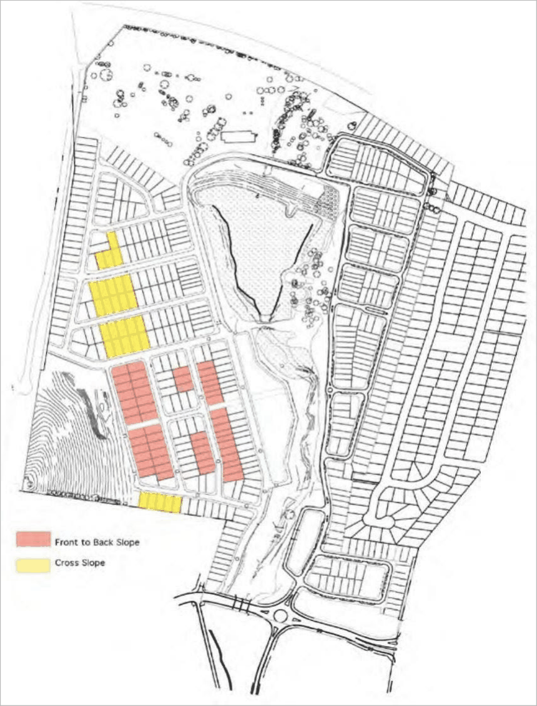

> [Picture on page 233: a picture, saved as a picture (images/part-f1-precinct-and-site-specific-development-controls-page-233-1.gif, 150 dpi).]

Figure 25: Steep land - Pemulwuy North

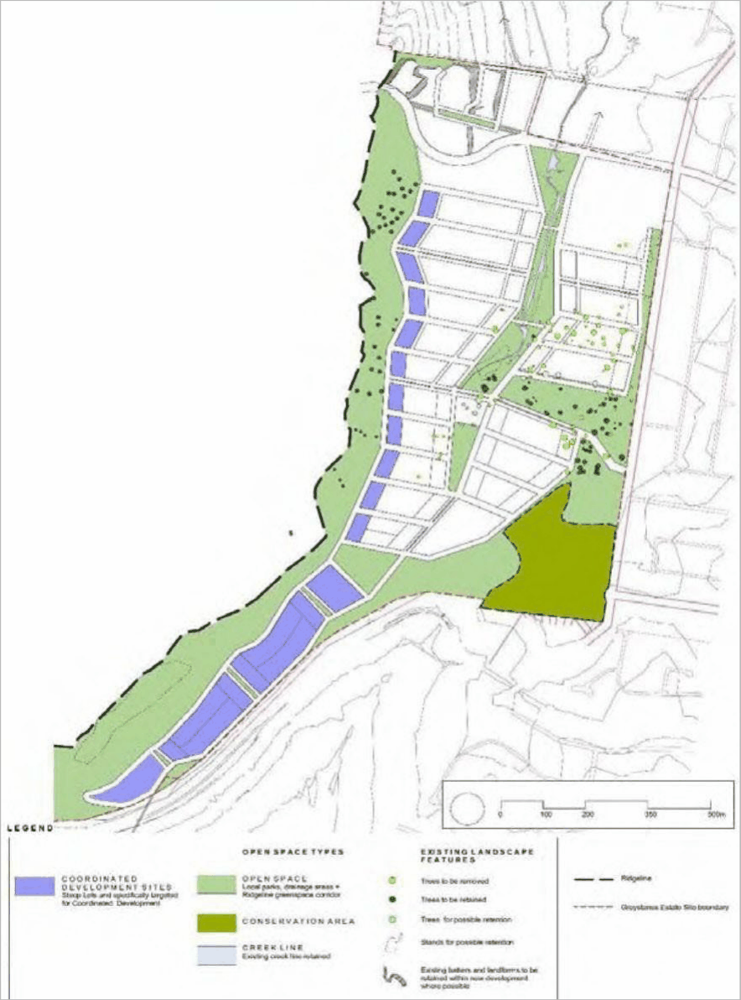

> [Picture on page 234: a picture, saved as a picture (images/part-f1-precinct-and-site-specific-development-controls-page-234-1.gif, 150 dpi).]

Figure 26: Steep Land - Pemulwuy South

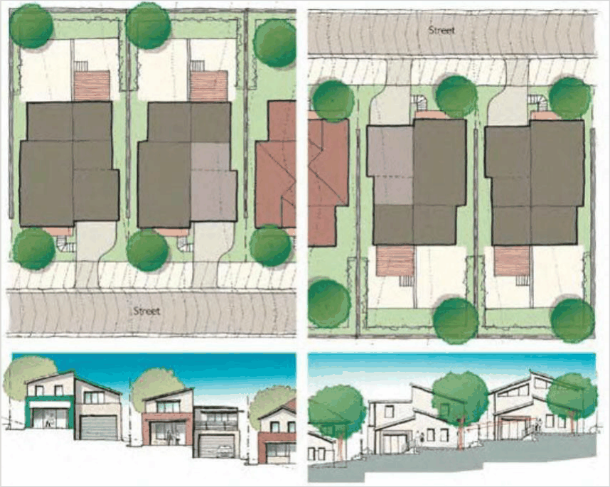

> [Picture on page 235: a picture, saved as a picture (images/part-f1-precinct-and-site-specific-development-controls-page-235-1.gif, 150 dpi).]

Figure 27: Split level house designs for cross slopes

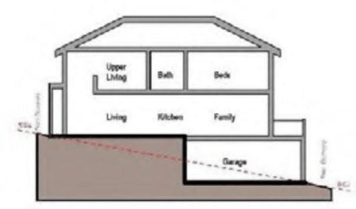

> [Picture on page 235: a picture, saved as a picture (images/part-f1-precinct-and-site-specific-development-controls-page-235-3.gif, 150 dpi).]

Figure 28: Section-cross slope lot

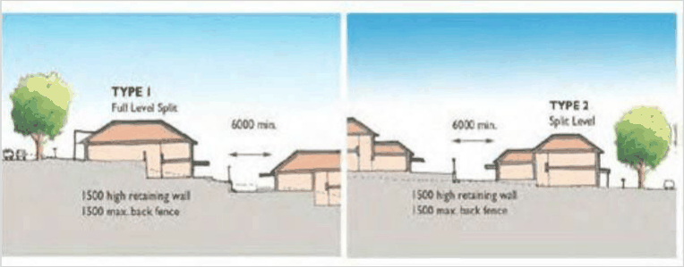

> [Picture on page 236: a picture, saved as a picture (images/part-f1-precinct-and-site-specific-development-controls-page-236-1.gif, 150 dpi).]

Figure 29: Front to back slope split level house design

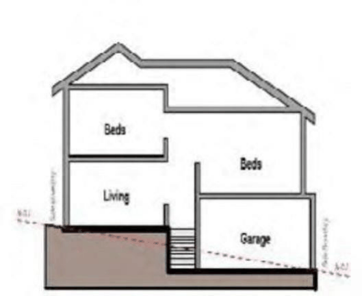

> [Picture on page 236: a picture, saved as a picture (images/part-f1-precinct-and-site-specific-development-controls-page-236-3.gif, 150 dpi).]

Figure 30: Type 1 Section through front to back slope lot

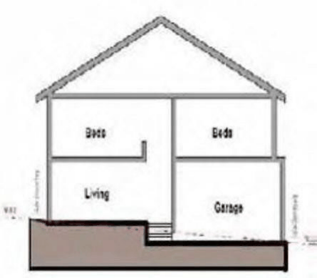

> [Picture on page 236: a picture, saved as a picture (images/part-f1-precinct-and-site-specific-development-controls-page-236-5.gif, 150 dpi).]

Figure 31: Type 2 Section front to back slope lot

#### 3.3.3 Building to a Side Boundary

#### Objectives

Protect the residential amenity of immediately adjoining properties.

Provide efficient access along easements for the purpose of maintenance of the wall

built to the boundary.

Protect adjoining properties from soil instability or damp arising from adjacent properties.

Design footings of the building built to the boundary to support and protect the building

from damage in the event that disturbance or settlement occurs within the zone of

influence.

Avoid significant adverse impacts upon stormwater behaviour along maintenance

easements.

Avoid significant adverse impacts on stormwater drainage pipes along maintenance

easements.

#### Controls

Boundary walls

For allotments with single street access (including corner allotments), only the ground

floor wall of a 2 storey building may be built on the boundary, and for a maximum length

of 10m.

Set first floor walls and balconies in 1m from the property boundary (see Figure 32).

For allotments with dual access (garage entry to the rear or double fronted lots) 2 storey

walls may be built to the boundary where the building envelope permits.

Note: A corner allotment is classified as a single access allotment in this instance.

On sloping land, ensure that the wall built to the boundary is located on the lower side

of the lot.

Ensure that the wall built on the boundary is finished to match the front of the house.

Generally locate the garage against the side property boundary.

Design the footings and finish of the wall built to the boundary to allow for the maximum

cut/fill on the adjoining allotment along the boundary. Ensure that the footings extend

below their zone of influence, where they will affect the laying of services within

excavation of the adjacent maintenance easement. If the adjoining dwelling has not yet

completed construction, see Figure 34 - Detail A. If the adjacent house has completed

construction, refer to Figure 35 - Detail B, showing the need for a retaining wall.

Note: Both figures assume a cut of 500mm, which may vary by up to a further 400mm

in each instance (max. side boundary wall cut/fill is 900mm). Note: There may be further

variations where slope is extreme, but these are subject to privacy, neighbour amenity,

overshadowing and height controls.

All piers along the drainage easement boundary to have a minimum depth equal to the

level of the invert of any potential or constructed stormwater pipe or culvert.

Ensure that the drop-edge beam on the adjoining property is treated with a masonry

surface treatment suitable to exposure to view.

Maintenance easements

Where a maintenance easement is created on a property adjacent to a wall built to the

boundary, ensure that any retaining wall constructed within the easement. In particular,

ensure a maintenance easement of minimum width 900mm.

The following should be considered for maintenance easements:

• a maximum cut into the easement of 300mm;

• any retaining wall within the easement has a maximum height of 300mm plus 300mm

of post below ground, consistent with Figure 35 below;

• a minimum post width of 200mm;

• a minimum distance between the retaining wall and any built structure on the property

of 600mm, to allow maintenance access;

• in the event of fill in the maintenance easement being placed against a wall built to the

boundary on the adjacent property, ensure that the fill does not interrupt the effective

discharge of moisture from weep-holes in that wall;

• landscape planters placed in the maintenance easement should not interfere with

access to the wall, and to stormwater flow where appropriate.

• a drainage pipe between the retaining wall and property line to avoid significant adverse

impacts upon stormwater behaviour; and

• a maximum timber paling fence height of 1.8m, comprising a 300mm retaining wall and

1.5m timber fence.

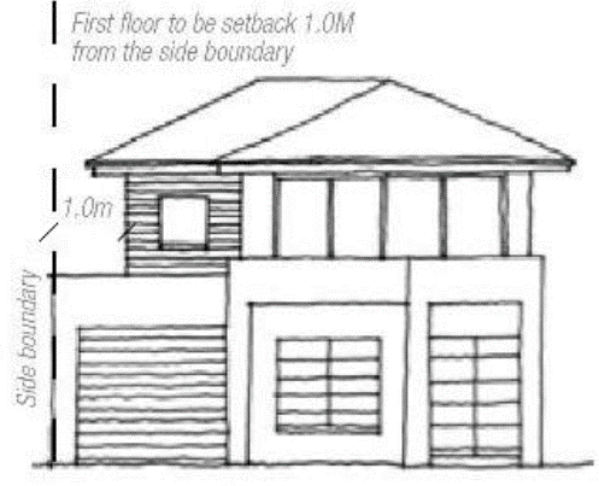

> [Picture on page 238: a picture, saved as a picture (images/part-f1-precinct-and-site-specific-development-controls-page-238-25.gif, 150 dpi).]

Figure 32: Side setback

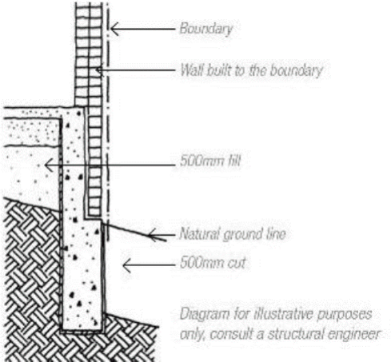

> [Picture on page 239: a picture, saved as a picture (images/part-f1-precinct-and-site-specific-development-controls-page-239-1.gif, 150 dpi).]

Figure 33: Drop edge beam detail A

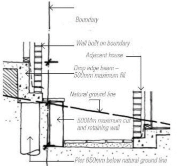

> [Picture on page 239: a picture, saved as a picture (images/part-f1-precinct-and-site-specific-development-controls-page-239-3.gif, 150 dpi).]

Figure 34: Drop edge beam detail B

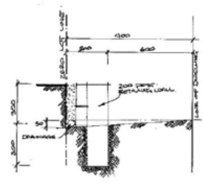

> [Picture on page 239: a picture, saved as a picture (images/part-f1-precinct-and-site-specific-development-controls-page-239-5.gif, 150 dpi).]

Figure 35: Retaining walls within maintenance easement

#### 3.3.4 Building Articulation and Street Address

#### Objectives

Develop a relationship between buildings and the street through entries, porches,

verandahs, balconies, bay windows and the like.

Ensure entries to all houses are clearly visible from the street.

Promote the safety and security of streets and parks through entry points, windows,

doors and balconies in the front façade.

Provide elements and features on those parts of the dwelling seen from the street to

articulate the building as well as contribute to attractive and safer streets and parks.

#### Controls

Develop the architectural character of buildings with appropriate solar protection

elements, expressed door and window openings, and the like.

Design buildings which incorporate articulation to the built form and do not rely on “add

on” structures to break up the façade.

Accommodate a range of roof forms in order to provide variety and reduce the bulk and

scale of the streetscape.

Design dwellings to incorporate variety in materials, colours and finishes to external

elevations.

A minimum 2m x 2m build free zone in the front setback area is required for a mandatory

native tree in the front garden.

Articulation elements are required in the design of your home. These elements may

protrude 1.5m into the 3m setback, without encroaching on the 2m x 2m garden bed.

Articulation elements must be lightweight in design and of an open nature. For example:

pergolas, not solid roofs are permitted over balconies in the front setback area.

Balustrades to balconies should be open and not solid.

Where roofs are proposed to first floor balconies at the street elevation they must be set

back a minimum 3m from the front boundary.

On a corner allotment, articulation elements are also required to the secondary street.

They may protrude up to 500mm into the side setback.

For side elevations/facades on corner lots; the maximum run of un-broken wall length

is 12m. A step of 480mm in the wall must otherwise be designed (Pemulwuy North).

Consider active street frontage, defined as one or a combination of:

• clearly defined and accentuated building entrances;

• building articulation through modulation in the façade, incorporating elements such

as blade walls, chimneys, entries, balconies, verandahs, porches, loggias, bay

windows, screens, awnings and feature walls with a combination of materials and

colours;

• building designs which provide passive/active surveillance through providing living

areas to the street frontage;

• shop front café or restaurant; and

• commercial and residential lobbies if accompanied by an entrance. Ensure garages and carports must not dominate the street frontage. Garages are to be

a recessive element and shall be located a minimum distance of 1m behind the front

wall of the dwelling (excluding any projecting elements).

Ensure carports and garages facing a public street or accessway are no more than 6m

or 50% of the frontage width, whichever is the lesser (Pemulwuy North).

Individual entries are to be provided to 50% of ground floor dwellings within residential

flat buildings.

Address and activate all streets with street frontages that promote surveillance. The design

and layout of any car courts should improve safety through short distances with good

sight lines and the use of a mews dwelling above the garages in some places to increase

potential for passive surveillance.

Provide a path leading from the street to the front door that is physically separated from

the driveway.

Ensure access between a dwelling and street frontage is unobscured and direct.

Finished floor levels of the porch/verandah for front to back slope lots in Pemulwuy North

should be at the same level to the footpath. When the finished floor level of the porch/

verandah is lower than the footpath, it must not exceed 600mm from the footpath RL.

Elevated front entries should be no more than 1m above the natural ground level.

Open types of security screening maybe used on windows facing the street. Block out

security shutters are not permissible on front elevations.

#### 3.3.5 Setbacks

Note: Further to the general Setback controls below, certain specific setback requirements

apply just to the Pemulwuy North or South sub-precincts. See Sections 3.4 (North) or Section

3.5 (South), and Section 3.4.3 Development Adjacent to Employment Lands (in particular the

former CSIRO Employment Land).

#### Objectives

Provide setbacks to reinforce the vegetated character of the public domain with front

gardens.

Establish continuous gardens in deep soil planting in the centre of blocks to increase

the amenity of private blocks.

Ensure no loss of amenity by neighbours.

#### Controls

The setback controls for Pemulwuy North and South vary slightly, and are therefore addressed

under their specific precincts below (Sections 3.4 and 3.5), and summarised here. In all

instances of building to a side boundary, the length and height of walls on the boundary ensure

no loss of amenity by neighbours. Sections 3.3.5 to 3.3.7 also aim to control setbacks.

Table 1a: Setbacks

|  | Pemulwuy North | Pemulwuy South |
|---|---|---|
| Front of building | 3m‐4.5m (depending on vicinity of riparian public open space ‐ see Figure 5.4) | 3m |
| Front garage | 5.5m | 5.5m |
| Front porch / verandah | ⅓ into front setback, but not unroofed |  |
| Rear set back | A. North-South lots: 1 storey = 6m Lot depth max. 35m = 6m 2 storey = 8m Lot depth >35m = 8m If rear garage (as below) = 3m from B. East-West lots: little streets = 3m form garage garage to dwelling to dwelling other streets = 4.5m |  |
| Rear garage | 0m, (via a "shared vehicular access") | 0m, if via a "little street" or "shared vehicular access" (not a public street) |
| Side setback | Type A detached dwelling = 0.9m to both Type B dual occupancy/courtyard = 0.9 + 0m Type C townhouse/rowhouse = 0m to both Type D Apartments = 3m | Type A detached dwelling + courtyard = 0.9m to both Type B dual occupancy only = 0.9 + 0m Type C low density townhouse/rowhouse = 0m to both Type D Apartments + higher density townhouse = 3m |
| Secondary street frontage | 1.5m+ | 4m (from Part B Residential Controls) |

#### 3.3.6 Soar Access and Sun Shading

#### Objectives

Achieve a northerly orientation and midwinter solar access to main indoor living spaces

and primary private open spaces.

Provide sun protection on glazing with appropriate orientation.

#### Controls

Windows of north facing/orientated habitable rooms of dwellings are to receive a

minimum of 4 hours of direct sunlight between 8:00am and 4:00pm on 22 June.

New development must not result in windows to north facing living areas of neighbouring

dwellings receiving less than 4 hours direct sunlight between 8:00am and 4:00pm 22

June.

Private open space is to achieve at least 3 hours of direct sunlight between 9:00am and

3:00pm in on 22 June for 50% of the required private open space.

Note: Relaxation of these controls may be permissible on Coordinated Development

and Integrated Housing Sites where a development application for subdivision

demonstrates that solar access has been maximised through integration of built form

controls.

Where relaxation of these controls has occurred, design initiatives that maximise natural

light into dwellings are to be incorporated. For example, through wider frontages,

courtyard housing, and material selection.

On north facing facades, minimise summer solar access and maximise winter solar

access. To achieve this, consider measures such as external horizontal shading, eaves,

awnings, balconies, pergolas with appropriate planting and the like.

On east and west facing facades, minimise summer solar access and maximise winter

solar access. To achieve this, consider measures such as external adjustable vertical

shading, sliding screens and adjustable louvers and the like.

The design of dwellings shall generally be consistent with the Lot Orientation Principles

in Figure 36 and Solar Orientation Principles in Figure 37 in order to achieve optimum

solar access.

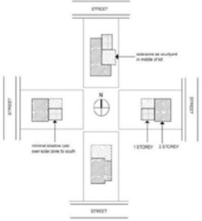

> [Picture on page 243: a picture, saved as a picture (images/part-f1-precinct-and-site-specific-development-controls-page-243-19.gif, 150 dpi).]

Figure 36: Solar access by lot orientation

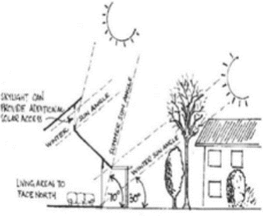

> [Picture on page 244: a picture, saved as a picture (images/part-f1-precinct-and-site-specific-development-controls-page-244-1.gif, 150 dpi).]

Figure 37: Solar access

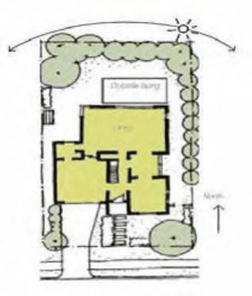

> [Picture on page 244: a picture, saved as a picture (images/part-f1-precinct-and-site-specific-development-controls-page-244-3.gif, 150 dpi).]

Figure 38: Solar access to private open space

#### 3.3.7 External Private Open Space

#### Objectives

Provide useable private open space related to the needs of residents for leisure,

recreation, outdoor entertaining and service functions.

Soften the appearance and integrate the homes and fencing.

Provide screening for privacy, and shade during the summer months.

Complement street tree and parkland planting.

Ensure continuation of green corridors from conservation areas through the riparian

corridor and up onto Prospect Hill.

Protect and enhance locally indigenous biodiversity.

Reduce the impact of soil loss on adjoining properties.

#### Controls

Provide useable private open space, directly accessible from living and/or dining areas

to each dwelling.

Type A, B and C dwellings are required to provide an area equivalent to 20% for

Pemulwuy South and 30% for Pemulwuy North of the total site area as a pervious (soft)

surface.

Type D dwellings (and Type M in the case of Pemulwuy South) are required to provide

an area equivalent to 20% of the total site area as external private open space, at ground

level or in the form of a balcony.

Private open space is to achieve at least 3 hours of direct sunlight between 9:00am and

3:00pm on 22 June for 50% of the required private open space. Refer to Figure 38.

Private open space elements

All private open space (excluding balconies) is to have a minimum dimension of 3m

which is to be accessible from living or dining areas, and be suitable for outdoor living.

Balconies are to have a minimum dimension of 2.4m where they are accessible from

living or dining areas. In such cases, they can be used in the private open space

calculation. This dimension may be reduced to 1.8m where functionality can be

demonstrated.

Balconies should be located to provide active street frontages.

All existing trees shall be retained unless it can be demonstrated that this cannot be

incorporated into the design.

Private open space elements accessible from other habitable rooms and secondary

living spaces are to have a minimum dimension of 1.2m. (Pemulwuy North).

Hard and soft landscaped area

A minimum of 20% for Pemulwuy South and 30% for Pemulwuy North of the total site

area shall remain as a pervious (soft) surface, unless otherwise noted on Figures 39

and 40.

Where impervious areas exceed 80% for Pemulwuy South and 70% for Pemulwuy North

of the total site area, Council will require an on-site detention system.

Note: These figures may be affected by the future provision of community detention

basins. Changes are at the discretion of Council’s engineering staff.

No more than 45% of the front setback area shall be paved or sealed (inclusive of

driveway). Where a double garage is proposed, this may increase to no more than 50%

of the front setback.

Front and rear setback areas are to be landscaped in accordance with the setback

requirements provided in Section 3.3.3 (Setbacks) and Figures 40 and 41. The area to

be landscaped may incorporate garden beds, soft landscaping, paved areas, paths,

swimming pools and driveways.

The planting proposal for the front setback should utilise plants with varying heights with

the overall objective being to reduce the impact of the development on the streetscape.

Planting should comprise of all 3 canopy levels, i.e. upper and lower canopies, and

groundcovers.

A native tree is required to the front and rear of each proposed dwelling, with a mature

height at least equivalent to the height of the proposed dwelling. Minimum pot size 75

Litres.

Note: in the case of a dual occupancy this means 1 tree to the front and rear of each

unit.

The entire front yard/setback of all new dwellings in Pemulwuy is to be planted out with

only native plant species, at least 20% of which are to be locally indigenous to the

Cumberland LGA (see Council’s Native Tree List).

Note: The use of indigenous species or low water use species within a portion of the

open space is required for certification under the new BASIX regulation from 1 July 2004.

Visit www.basix.nsw.gov.au for more information.

Plant predominantly native landscaping to the front and rear of each allotment to enhance

the natural environment. The limited use of exotic species is permitted in the rear yard

only.

Planting in the front and rear setbacks should include additional plantings to provide both

privacy and screening to adjoining residents as well as softening of retaining walls, and

fencing.

Type D and M dwellings are required to distribute this landscaped area as a combination

of private and communal open space to provide privacy between dwellings, useable

outdoor spaces and gardens.

Provide a minimum 500mm setback (in the form of a landscape strip/garden bed) between

the driveway and side boundary. It is required that this area be planted with suitable

native plant species.

Note: take into consideration the possible accommodation of a retaining wall where cut

and/or fill has occurred on sloping lots. Where there is a zero lot alignment, the 500mm

setback may include both the landscape strip/garden bed and retaining wall where bed

width is maximised to a minimum 270mm for planting.

The driveway and pedestrian access path shall be separated by a landscape strip/garden

bed.

When constructing brick or masonry garden and retaining walls, water features, paving

or other hardscape elements, select brick & mortar or masonry that is suitable for saline

soils. For example, appropriate footings and linings should contain concrete Type C and

32MPa.

Landscape documentation Accompany all applications with a fully documented landscape concept plan consistent

with that required in Part G, prepared by a qualified Landscape Architect. The Council

approved landscape plan is the plan to be used by the company, or owner, constructing

the landscape works. As such it is important the plan provides enough details to enable

construction. Likewise, an Implementation Report and Maintenance Report are

required. See Part B (External Private Open Space) of this DCP for all built form

development applications within Pemulwuy.

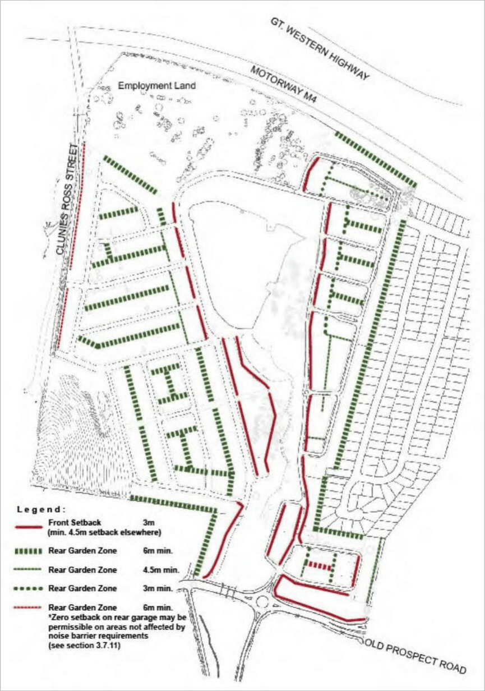

> [Picture on page 247: a picture, saved as a picture (images/part-f1-precinct-and-site-specific-development-controls-page-247-1.gif, 150 dpi).]

Figure 39: Private open space - Pemulwuy North

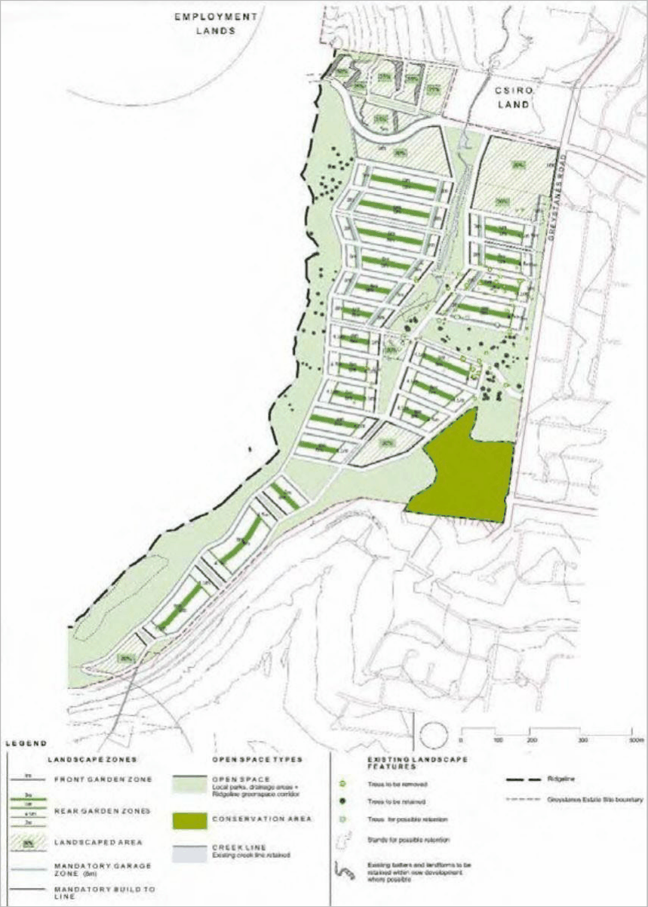

> [Picture on page 248: a picture, saved as a picture (images/part-f1-precinct-and-site-specific-development-controls-page-248-1.gif, 150 dpi).]

Figure 40: Private Open Space - Pemulwuy South

#### 3.3.8 Plant Selection

#### Objectives

Ensure a high standard of environmental quality of individual developments.

Produce the highest landscape value for the local character.

Provide a mix of native/endemic vegetation to promote low water use and encourage

native wildlife into the area.

Protect visual privacy through plant selection.

Regulate micro-climate through plant selection. Manage the land to minimise groundwater salinity.

Mitigate any adverse effects of the proposed development on the species, populations

or ecological communities.

#### Controls

The front setback area is to consist entirely of native plant species with at least 30% of

the proposed species being local to the Cumberland City area. A list of native species

suitable for Cumberland City Council area is provided on the following table.

A suitable native tree shall be provided to both the front and rear setback.

Screen planting should be provided along all side and rear boundaries to the private

open space area (Pemulwuy North).

Exotic species are permitted in rear yards only.

Landscaping should provide a visual screen and contribute to summer shading and

winter sun penetration.

Species of plants shall be chosen to minimise water use.

The selection of the type of plant should be based on:

• the purpose of the plant. If planting on the northern side of the house, deciduous

(loses its leaves) trees and plants should be considered to provide summer shade

and allow winter sun to get through; and

• the ultimate height and spread above and below ground of the plants in relation to

adjacent buildings, services and other plants and the scale of the location. Council requires the use of Buffalo turf species including ‘Sir Walter’ in the front yard and

encourages its use in the rear yard within all residential lots. Specify in landscape plans

that existing turf to the nature strip is replaced at completion of construction works with

‘Sir Walter’.

Pemulwuy is affected by existing saline and sodic soils, as described in Section 3.9.6 of

this Part of the DCP. Therefore, favour gardens which do not require a lot of watering,

and avoid species that are sensitive to the above soil types.

Note: A table of trees, shrubs and ground covers specific to Pemulwuy but can be found

on Council’s website under Pemulwuy. This list can be read in conjunction with a

broader list of native trees and shrubs suitable to the Cumberland City area, also found

on Council’s website.

#### 3.3.9 Privacy

#### Objectives

Ensure visual and acoustic privacy for residential development, both within a

development and between a development and its neighbours.

Ensure an acoustic environment suitable for residential uses.

Ensure that the siting and design of development minimises the impacts of noise

transmission between properties.

#### Controls Visual Privacy

Dwellings are to maximise visual privacy through consideration of the layout of internal

rooms and external living spaces, design of openings, screens, walls and choice of

materials.

Protect privacy and encourage integrated outdoor living spaces by orienting primary

openings in living areas to the street and/or rear gardens.

Upper storey windows (excluding stairwells), and balconies (within 6m of the rear

boundary) facing a side or rear boundary must incorporate privacy measures.

Achieve privacy in the design of housing by providing the following separations to all

openings (windows, doors or balconies) between rooms in multi-unit dwellings and

between openings facing the rear boundary of single dwellings at ground level:

• 6m between non-habitable rooms;

• 9m between a habitable and non habitable room;

• 9m between a habitable room and a balcony; and

• 12m between habitable rooms. Where possible, openings should be off set to reduce setbacks, and in addition, screening

and other treatments may be considered in reducing separation distance whilst

maintaining adequate visual privacy.

Minimise privacy conflicts through:

• careful consideration of the layout of internal rooms and external livings spaces;

• design of openings;

• 1.5m minimum sill height;

• fixed and obscure glass to 1.5m above first floor finished floor level with clear glass

permitted above;

• screens;

• blade walls;

• external fixed privacy screen; and

• choice of materials. Within apartments, townhouses and Mixed Use Development containing Residential, such

as Aged Housing, Apartments integrated with Retail/Commercial or Community

Facilities, and Residential Flat Buildings, windows are to be offset from windows in an

adjacent development to limit views. Alternatively, sill heights of 1.5m above finished

floor level are to be provided.

Bathroom or ensuite windows fronting the street must incorporate privacy measures.

Elevated ground floor levels to the rear or side of the property, including the main built

form, terraces, decks and balconies that exceed 500mm above natural ground level

must incorporate privacy measures to minimise potential overlooking.

Landscape screening at the rear of terraces, decks and balconies may be acceptable in

some situations.

Upper floor windows or balconies within 6m of the rear boundary must incorporate

privacy measures.

Acoustic privacy

Dwellings are to maximise acoustic privacy through consideration of the layout of internal

rooms and external living spaces, design of openings, screens, walls and choice of

materials.

The design of buildings should minimise the opportunity for sound transition through the

building structure and should protect noise sensitive areas such as bedrooms.

Note: Additional documentation may be required to be submitted with a Development

Application to demonstrate that the privacy of adjacent properties will not be

compromised

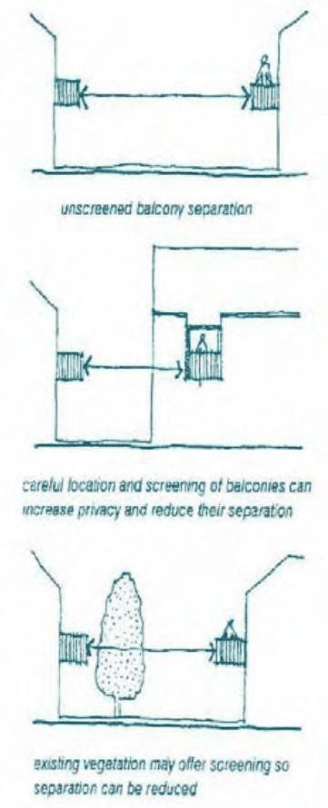

> [Picture on page 252: a picture, saved as a picture (images/part-f1-precinct-and-site-specific-development-controls-page-252-1.gif, 150 dpi).]

Figure 41: Achieving acoustic and visual privacy

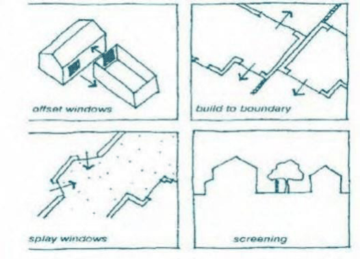

> [Picture on page 252: a picture, saved as a picture (images/part-f1-precinct-and-site-specific-development-controls-page-252-3.gif, 150 dpi).]

Figure 42: Achieving acoustic and visual privacy

#### 3.3.10 Clunies Ross Street Residential Frontage

#### Objectives

Minimise the impact of noise from the existing employment sites to proposed residential

areas.

Achieve external noise goals where feasible or reasonable.

Where this is considered impractical, to achieve internal noise criteria by appropriate

façade treatment.

#### Controls

A noise barrier ranging from 4m to 4.5m in height is to be erected along the western site

boundary between the employment lands and the Clunies Ross Street access road to

control noise to the ground floor of future dwellings (refer to Figure 44).

Control sleep arousal to second storey bedrooms, additional attenuation measures are

required. These should consist of, but are not limited to:

• improved glazing to windows and the provision of air conditioning to allow windows to

be kept closed during night time periods; and/or

• locating bedrooms on the eastern side of the house away from the noise source, with

bathrooms, study, media rooms and the like on the western side of the house. Note: The combination of attenuation measures to the built form is to be determined at

Development Application stage based on the advice of an acoustic consultant.

Ensure that noise from employment related uses in Pemulwuy does not exceed stated

criteria in Section 3.10.6 entitled Environmental Management – Noise and Vibration

Management, when measured at the residential receiver.

Ground floor bedrooms are to be setback a minimum of 10m from the acoustic barrier.

Second storey bedrooms are to be setback a minimum of 14m from the acoustic barrier.

A landscape buffer and mound of 3m in width consisting entirely of native species is to

be provided in front of the acoustic barrier to ensure suitable aesthetic outcomes (refer

to Figure 43 for landscape concept design) The landscaping design is to:

• consisting of entirely native species;

• screen the acoustic wall; and

• minimise on-going maintenance requirements.

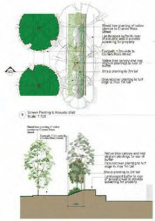

> [Picture on page 254: a picture, saved as a picture (images/part-f1-precinct-and-site-specific-development-controls-page-254-1.gif, 150 dpi).]

Figure 43: Extent of acoustic wall

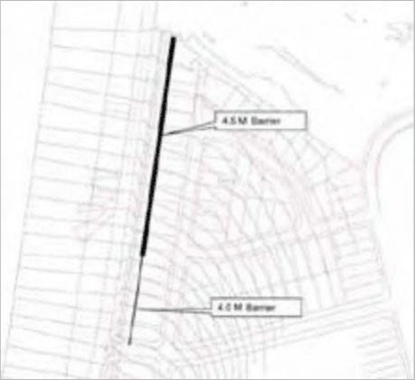

> [Picture on page 254: a picture, saved as a picture (images/part-f1-precinct-and-site-specific-development-controls-page-254-3.gif, 150 dpi).]

Figure 44: Acoustic wall.

#### 3.3.11 Roof Design

#### Objectives

Design roofs to contribute to the variety and diversity of homes in a street.

Design roofs to reflect a contemporary style.

#### Controls

Provide from these acceptable styles: hipped, gable, skillion, flat roofs with parapets

and curved roofs.

Prefer that traditional roof forms, such as hipped and gable roofs, have a minimum pitch

of 25 degrees (Pemulwuy South), or 22.5 degrees (Pemulwuy North).

Prefer that skillion roofs have a pitch between 10 and 20 degrees (Pemulwuy South), or

above 5 degrees (Pemulwuy North).

Ensure that all roofs have a minimum of 450mm eaves or other shading devices such

as awnings, louvres, pergolas or screens.

#### 3.3.12 Materials and Colours

#### Objectives

Use building mass or bulk/reflective insulation in wall and ceiling systems to encourage

an improved thermal performance.

Use building materials and building techniques that will minimise salinity problems.

Use external materials and colours that reflect the contemporary nature of Pemulwuy.

#### Controls

Ensure a predominantly masonry external finish. Face brick, render, bagged or a

painted finish are acceptable.

Use by preference bulk or reflective insulation in roof systems and fall arrest sarking to

improve thermal performance.

Provide a mix of materials and colours to create visual interest and variety in the

streetscape.

For the parts of the home seen from the street, ensure a combination of materials

including but not limited to:

• feature stonework; and

• light weight materials such as timber, feature panelling, plywood, pre-finished metal

sheeting, etc. Use by preference building materials which minimise their impact on the environment.

These materials can be from renewable resources, and are:

• energy efficient;

• durable;

• low maintenance;

• recycled or recyclable; and

• non-polluting in use, manufacture and disposal. Natural colours, such as off whites, creams, browns and greys, are permitted as major

external wall colours. The use of stronger accent colours is acceptable for highlighting

building elements such as entry porticos, feature materials, etc.

Roofing materials are to be selected from the following:

• Low profile concrete or terracotta tiles; and

• Pre-finished and pre-coloured metal roofing. Multi -coloured tiled roofs are not permitted.

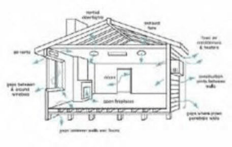

> [Picture on page 256: a picture, saved as a picture (images/part-f1-precinct-and-site-specific-development-controls-page-256-1.gif, 150 dpi).]

Figure 45: Energy smart house

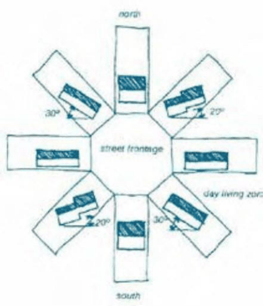

> [Picture on page 256: a picture, saved as a picture (images/part-f1-precinct-and-site-specific-development-controls-page-256-3.gif, 150 dpi).]

Figure 46: Lot orientation for good solar access

#### 3.3.13 Water and Energy Efficiency

#### Objectives

Design living and working environments that minimise energy and water use; and

Use passive and active design initiatives to ensure comfortable living environments that

respect the principles of ecologically sustainable development.

Implement sustainable practices in water and energy efficiency.

Minimise reliance on artificial heating and cooling, and maximise natural lighting.

To minimise water usage.

#### Controls

Ensure all new residential development complies with the requirements of the Building

Sustainability Index (BASIX) for energy efficiency. Obtain BASIX Certification prior to

the final design submission.

Take advantage of northerly aspects.

Achieve cross ventilation. To do so, windows are to be located to take advantage of

prevailing winds in summer.

Design floor layout to allow penetration of light to rooms.

Incorporate courtyards, light wells and atria to assist natural lighting and ventilation.

Provide at least double orientation to all dwellings.

Use building mass and/or building insulation to improve the climatic performance of

buildings.

Ensure all new residential development complies with the requirements of the Building

Sustainability Index (BASIX) for water efficiency. Obtain BASIX Certification prior to the

final design submission.

Rainwater tanks are to be sited, and to be of a finish, that does not adversely impact on

the amenity of future residents and/or adjoining properties in terms of bulk, scale, design,

style, height and location

#### 3.3.14 Garages, Car Parking and Driveways

#### Objectives

Contain the per capita growth in VKT (vehicle kilometres travelled) by achieving higher

than normal public transport usage.

Manage the supply of parking facilities in a manner that supports the use of existing and

proposed public transport services.

Encourage a reduction in the level of vehicular traffic by reducing parking requirements.

Ensure adequate parking for various land uses which sustain the market viability of the

development within Pemulwuy.

Limit the impact of garages and driveways along streets, to maximise the street address

of buildings and to emphasise pedestrian safety.

Minimise the provision of on-site parking, and to enhance the street activity of the

neighbourhood.

Seek a balance between satisfying a proportion of parking demand onsite, addressing

car use reduction objectives and minimising the spread of parking into surrounding

streets.

Facilitate convenient and safe vehicular movement.

Encourage efficient use of space.

#### Controls

On-street parking

On street parking should be designed to be consistent with the design principles and

dimensional requirements of Australian Standards AS2890 and AS1742.

Provide on-street parking which is well-lit and offers casual surveillance for street

security.

Limit on-street parking to not compromise the streetscape character nor the active

streetscape.

Provide sufficient on-street parking so that garages and carports do not dominate the

street frontage.

Off-street parking

Minimise off-street parking supply, having regard to:

• access to public transport (located within 400m);

• surveys of existing similar developments indicating a lower parking demand;

• land use synergies with surrounding land uses;

• complimentary/shared use of parking facilities; and

• the ability to manage the use of on street parking. A minimum of one off-street parking space with at least one enclosed garage is to be

provided on each allotment. Three car garages are not permitted.

Off street parking shall be consistent with the design principles and dimensional

requirements of Australian Standards AS 2890.1.

Where possible, locate parking on the southern side of dwellings or on the down-slope

side of sloping lot frontages.

Garages

On allotments with direct access from the main street the garage is to be set back at

least 5.5m from the property boundary.

Garage doors are to be panel lift or panel glide.

Garages should incorporate additional space for storage, such as recesses for bins and

recycling.

Parking may be provided in basements under building footprints. Naturally ventilated semi-

basement car parks extending to 1.2m above adjacent ground level are preferred in any

under-building parking.

Prefer garage access from car courts (shared rear access) where it is available.

The minimum aisle width of car courts shall be 6m adjoining the public road and where

accessing parking. This can be reduced to allow for landscaping where vehicle turning

movements are not compromised.

The design of car courts and associated garages is to ensure that vehicles enter and

exit in a forward direction.

On site parking for residential flat building developments is to be provided at a rate not

more than:

• 1 space per bed-sit, studio or one bedroom dwelling;

• 1.25 spaces per two bedroom dwelling;

• 1.5 spaces per dwelling with three or more bedrooms;

• visitor parking is to be provided at 0.25 spaces per dwelling and be provided in

designated spaces.

• cycle parking spaces are required within parking areas for Residential flat buildings.

For individual houses with 3 bedroom or more, storage spaces in the garage are

preferred; and

• provide a vehicle wash bay of permeable material construction.

Driveways Driveway crossings are to be between 3m and 5m wide at the front boundary for single

garages and tandem garages.

Driveway crossings of between 5m and 6m in width for double garages are permitted;

however, at least 25% of the width of the allotment must be soft landscaping. Driveway

levels and vehicle crossings from street to front boundary must be submitted and

approved by Council.

Driveway crossings must be plain concrete. Refer to Figure 47.

Driveway materials from the garage to the front boundary include paving, coloured

concrete, patterned or stencilled concrete. Plain concrete driveways and car tracks will

not be approved.

A pedestrian pathway is required from the front boundary to the entry of the dwelling,

and must be separate from the driveway.

A vehicle crossing application must be made to Council for proposed works within the

nature strip.

500mm of planting is to be provided between the side boundary and the driveway.

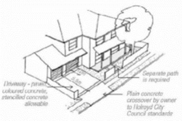

> [Picture on page 259: a picture, saved as a picture (images/part-f1-precinct-and-site-specific-development-controls-page-259-28.gif, 150 dpi).]

Figure 47: Driveway crossover

#### 3.3.15 Fencing

#### Controls

Note: Consider specific requirements for lots with sloping land. Front fencing The front fence piers and base are to be constructed of rendered, bagged or face

brickwork to match the style of the home, with a light weight see-through infill.

Figure 48 shows the required dimensions of front fencing.

Front fencing must return along the boundary to the front building facade.

Fencing must step down to meet the slope of your allotment as shown in Figure 49.

Front fencing can be used as a retaining feature.

Maximum height of 1.2m from natural ground on the street side of the fence, except

where slopes exceed 1:8.

Side and rear fencing

The provision of side and rear fences is mandatory.

Side and rear fencing is to be 1.8m high lapped and capped timber fencing, or must be

reduced to 1.5m high when built on top of a retaining wall. Colorbond fencing or similar

is not permitted. Where the retaining wall exceeds 1.2m, the combined wall and fence

should not exceed 2.4m.

Note: See Section 3.3.2 Elevated Sites (Steep Land) in Pemulwuy - Lots with Front to

Back Slopes, for exceptions.

The side fencing and gate is to finish on the wall built to the boundary or 1m behind the

front of the home. No side fencing is to be forward of the building line (at which point it

becomes “front fencing” - see above).

Maximum height of 1.8m from natural ground on the street side of the fence.

An additional 300mm on top of the required 1.8m high lapped and capped timber fencing

may be required to minimise overlooking into adjacent homes. Refer to elevated site

requirements.

Corner/Secondary Street Fencing

The piers and base are to be constructed of rendered, bagged or face brickwork to match

the style of the home and not to exceed 1.8m above the level of the adjacent footpath

or verge.

Stained or painted timber infill panels. Hebel or similar aerated concrete product may be

used as a lightweight masonry option, particularly where nearby easements for services

are on the lot.

Figure 50 shows required dimensions of corner or secondary street fencing.

On sloping land, the height of fencing must step to follow the slope of your allotment as

shown in Figure 49. The low wall plinth must be no greater than 0.6m at the highest

step.

Fencing can be used as a retaining feature.

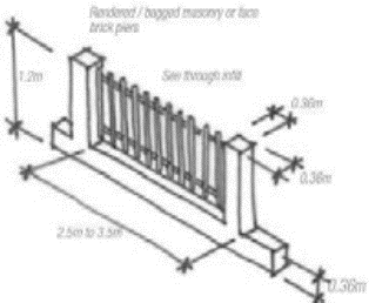

> [Picture on page 261: a picture, saved as a picture (images/part-f1-precinct-and-site-specific-development-controls-page-261-5.gif, 150 dpi).]

Figure 48: Front fence detail

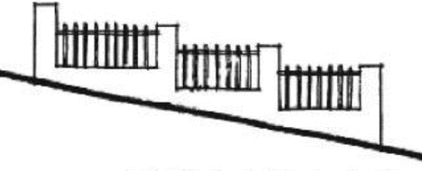

> [Picture on page 261: a picture, saved as a picture (images/part-f1-precinct-and-site-specific-development-controls-page-261-7.gif, 150 dpi).]

Figure 49: Sloping fence detail

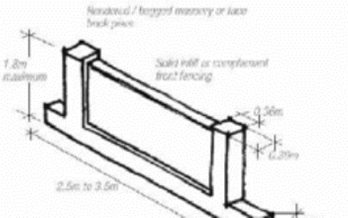

> [Picture on page 261: a picture, saved as a picture (images/part-f1-precinct-and-site-specific-development-controls-page-261-9.gif, 150 dpi).]

Figure 50: Corner allotment side fencing

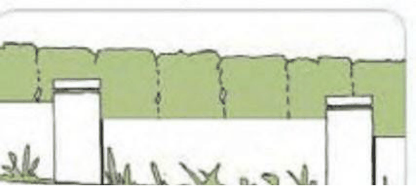

> [Picture on page 262: a picture, saved as a picture (images/part-f1-precinct-and-site-specific-development-controls-page-262-1.gif, 150 dpi).]

Figure 51: Lakefront front boundary fencing

#### 3.3.16 Adaptable and Affordable Housing

#### Objectives

Ensure dwellings within Pemulwuy are capable of being adapted to accommodate the

needs of people with limited mobility.

Provide some private market affordable housing within Pemulwuy.

Offer affordable housing that supports the needs of changing populations.

#### Controls

Ensure that 20% of multi-unit housing, shop-top housing and mansion house apartments

are compliant with Class C – Adaptable Housing Features as set out in Australian

Standard AS4299.

Ensure that 100% of aged housing is compliant with Class C – Adaptable Housing

Features as set out in Australian Standard AS4299.

Ensure that 100% of adaptable housing is compliant with Adaptable Housing Class A

or B.

Council to encourage some private market affordable housing products in an integrated

manner (i.e. not in clusters but distributed throughout the larger site), particularly in the

latter stages of the development.

#### 3.3.17 Safety, Security and Lighting

#### Objectives

Address the principles of Crime Prevention through Environmental Design (CPTED).

Design with safety and security as a key concern.

Provide public open spaces with a strong physical connection to housing so as to achieve

a clear ownership of public space. It is recognised that well used and valued public open

spaces reduce opportunities for crime and increase risk for potential offenders.

Avoid the misapprehension that a public park is a private space.

#### Controls

Edge open space areas with streets and housing, providing clear sight lines from private

residences to public domain areas.

Identify lots edging open spaces as suitable for increased densities, thereby maximising

the number of dwellings which overlook open spaces. Incorporate passive open space

surveillance into lot layout and design of residences, including balconies, porches, etc.

Provide parking for open spaces along illuminated public streets edging parks rather than

consolidating car parking within the parks themselves. This is designed to increase

casual surveillance of parked vehicles and their occupants.

Design parking areas at recreational locations to avoid loitering.

Design public streets edging open spaces to provide safe, well lit pedestrian routes,

eliminating the need to circulate across parks at night.

Provide adequate lighting in recreational areas, parklands, cycleways, and pedestrian

thoroughfares.

Clearly articulate public spaces with public streets.

Control vehicle access to public open space by the use of low fencing or bollards on

accessways to the park edge. Avoid the use of high gates, fences and enclosures.

Design street furniture and amenities to be vandal resistant, with walls treated with

sacrificial coatings to deter and remove graffiti.

Ensure landscaping maintains view corridors and clear sight lines.

Locate bus stops in safe, well-lit locations with good surveillance. Adequately light entrances to buildings, with lighting that does not produce shadows.

At building entrances, ensure clear sight lines are not be obscured by landscaping or

other obstacles.

Ensure all dwelling entries are clearly visible from the street by day and night.

Design first floor uses to overlook the street and car parking areas.

Ensure private landscaping does not provide opportunities for concealment e.g. along

pathways or adjacent to service areas.

Minimise the length of car courts accessing rear garages, with clear sight lines provided

to/from the public road. In some places, mews dwellings above rear garages will

increase the potential for passive surveillance. Provide sensor lighting mounted at

appropriate locations within the car courts.

Provide facilities at bus stop locations to encourage increased use and safety. Such

facilities shall include:

• bus lay-bys and speed controls to protect pedestrians, depending on the particular

road design; and

• shelters and seating for waiting passengers, display of timetable information and

street lighting for security.

#### 3.3.18 Bushfire Protection

#### Objectives

Provide residential development with adequate protection from the potential bushfire

hazard.

#### Controls

Development must comply with Planning for Bushfire Protection (NSW Rural Fire

Service: 2019) or subsequent amendments.

In the case of the riparian corridor, provide an Outer Protection Area and Inner

Protection Area in the form of fuel reduced zones and perimeter road.

#### 3.3.19 Salinity

#### Objectives

Minimise disturbance to natural hydrological systems as a result of development.

Provide for appropriate management where urban development may affect the process

of salinisation.

Provide for appropriate management where the land is affected by groundwater salinity.

Prevent damage to buildings and infrastructure caused by salinity.

#### Controls

Consent must not be granted for development to which this clause applies unless the

consent authority has considered:

• the impact of the proposed development on local and regional salinity processes;

and

• the impact of salinity on the proposed development. In particular, that appropriate

measures have been carried out to the Engineer’s satisfaction, including:

- use of saline-resistant building materials;

- treatment of outer walls below ground; and

- drainage deviation.

#### 3.3.20 Servicing

#### Objectives

Minimise the impact of services on the public domain.

Ensure efficient storage and collection of waste and quality design of facilities.

#### Controls

Provide each dwelling with a secure external clothes drying area with access to sunlight

and breezes, screened from the public domain.

Locate adequate rubbish and recycling areas where they are convenient and

accessible:

• adjacent to access lanes or ‘little streets’ where they exist;

• not forward of the prevalent built edge to the street; and

• screened from the public domain Provision shall be made within all development for the convenient movement of bins to

streets for collection.

In addition to garages, the adequate storage of bulky goods in multi-unit housing is

required at a rate of:

• 7.5 cubic metres for a studio/one bedroom unit;

• 10 cubic metres for a two bedroom unit; and

• 12.5 cubic metres for units with three or more bedrooms. Antennae, satellite dishes, water tanks, service metres and solar heating should be sited

to minimise their impact on the public domain.

#### 3.3.21 Telecommunications

#### Objectives

Ensure the capacity for advanced telecommunications systems within Pemulwuy.

#### Controls

Demonstrate the provision of telecommunication infrastructure:

• to all dwellings, community buildings and commercial premises;

• that has the capacity to support multiple telecommunication services; high speed

internet (including broadband), voice and data systems;

• that can be duplicated and upgraded in a cost effective and timely manner; and

• that is located underground.

#### 3.3.22 Dwelling Types – Summary

An abbreviated form of the essential differences between Types A, B, C, D and M, compared between Pemulwuy North and Pemulwuy South is shown in the following table:

Table 1b: Dwelling types

|  | Pemulwuy North | Pemulwuy South |
|---|---|---|
| Side setbacks Type D South *Aged Housing *Apartments *Townhouses *Residential Flat Buildings (RFB's) | Type A detached dwelling = 0.9m to both. Type B dual occ. Only = 0.9 + 0m. Type C townhouse/rowhouse = 0m to both. Type D RFB/Mansion House Apartment = 3m* | Type A detached dwelling + courtyard = 0.9m to both. Type B dual occ. Only = 0.9 + 0m. Type C low density townhouse/rowhouse - 0m to both. Type D Apartment/RFB/Aged + higher density townhouses = 3m* Type M Mixed use development (Residential) = 3m* *Type M = Aged housing; Apartments integrated with Retail / commercial or Community Facilities; RFB's. |
| Lot size | Type A = 400 - 600m² Type B = 300 - 500m² Type C = 200 - 300m² Type D = 100 - 250m² Type D Mansion House Apartment = 80-150m² (total lot 1350m²) | Type A = 300 - 600m² Type B = 250 - 400m² Type C = 200 - 300m² Type D = 100 - 250m² Type M Mixed Use (Res) = 100 - 250m² |
| Frontage | Type A = 15 - 20m Type B = 10 - 14m Type C = 6 - 9m Type D Mansion House Apartment = 30m | Type A = 9 - 16m Type B = 6 - 12m Type C = 6 - 9m |
| Min. "Landscaped soft area" (Soft/pervious) as % of site area | Type A = 30% Type B = 30% Type C = 30% Type D Mansion House Apartment = 20% | Type A = 20% Type B = 20% Type C = 20% Types D/M = 20% |
| Front Setbacks | 3-4.5m (depending on the vicinity of riparian public open space) | 3m |
| Rear setbacks | 1 storey = 6m 2 storey = 8m If rear garage (as below) = 3m from garage to dwelling | North-South lots: Lot depth max. 35m = 6m Lot depth >35m = 8m East-West lots: Little streets access = 3m from garage to dwelling Other streets = 4.5m |

### 3.4 Subprecinct Controls – Pemulwuy North

The following controls apply specifically to the Pemulwuy precinct predominantly to the north of

Butu Wargun as identified in Figure 1.

#### 3.4.1 Height Limits

#### Objectives

Achieve building heights and forms that respect the streetscape and heritage values of

Prospect Hill, and that assist in establishing an attractive streetscape.

#### Controls

Note: The maximum height for a dwelling house (in metres) is detailed within Cumberland Local

Environmental Plan 2021, as a written statement and associated maps.

Height limits (expressed as storeys) are stipulated on Figure 52 and should be read in

conjunction with the Height of Building map associated with Cumberland Local

Environmental Plan 2021.

External wall height controls relate to site falls of up to 1 in 8. For sites steeper than 1 in

8 relaxation of these controls may be permissible. See Fencing in Section 3.3.15.

The building elevation facing the street is to be a minimum of two storeys unless

designated as a ‘single storey permitted development’.

Single storey zone

Buildings are limited to single storey height, with a maximum external wall height of 4m,

with roof terraces or attic rooms permitted;

Maximum building height is to be 6m.

Part one/two storey zone

For part one/two storey sites adjacent to Prospect Hill:

The maximum external wall height is 4m at the front and 6.5m at the rear;

The maximum building height is 9m and is not to exceed RL 79.

Maximum building height may be permitted only where it can be demonstrated that the

views into and within the site relating to the height, bulk, and scale of the dwelling are

not compromised.

Two storey zone

Two storey height limit, with a maximum external wall height of 6.5m.

Maximum building height is to be 9m.

On sites with slopes greater than 1:8, maximum external wall height may be increased to

7.5m and building height to 10m dependant on scale, bulk, privacy and overshadowing

issues.

Three storey zone

Three storey height limit, with a maximum external wall height of 10m.

Maximum building height is to be 12.5m.

Three storey development is a minimum and maximum for the zone fronting the east/west link

road adjacent to the village centre.

Note: The minimum floor to ceiling height of a dwelling is controlled by Part B of this DCP.

> [Picture on page 268: a picture, saved as a picture (images/part-f1-precinct-and-site-specific-development-controls-page-268-7.gif, 150 dpi).]

Figure 52: Building height - Pemulwuy North

#### 3.4.2 Setbacks

#### Objectives

Provide setbacks to reinforce the vegetated character of the public domain with front

gardens.

Establish continuous gardens in deep soil planting in the centre of blocks to increase

the amenity of private blocks.

Ensure no loss of amenity for neighbours.

#### Controls

Provide 3m - 4.5m front setbacks to dwellings as specified in Figure 39 (Private Open

Space).

Provide a minimum 5.5m setback to garages from the front street boundary.

Front porches or verandas are allowed to encroach within one third of the front setback

area in which instance the porch or verandah must be unroofed.

Rear setback to be 6m to single storey elements and 8m to 2 storey elements.

Rear garages can be built to rear boundary alignment where accessed through shared

vehicular access. Any studios over garages are not to overlook or overshadow adjacent

dwellings or private open space.

Provide a minimum side setback of 0.9m both sides for detached dwellings and 0.9m

minimum for duplex and courtyard houses with a zero lot line permitted one side. No

side setbacks required for townhouses/row houses.

Apartment Buildings (Type D housing): Side setbacks provide for minimum separation

distances in accordance with Section 3.3.9 (Visual and Acoustic Privacy), with a

minimum of 3m.

Side setback to secondary street frontage shall be 1.5m minimum.

> [Picture on page 269: a picture, saved as a picture (images/part-f1-precinct-and-site-specific-development-controls-page-269-25.gif, 150 dpi).]

Figure 53: Habitable room setback from employment lands

#### 3.4.3 Development Adjacent to Other Precincts

Development adjacent to employment lands

#### Objectives

Ensure suitable residential amenity for dwellings adjacent to Employment Land (as

shown in Figure 80).

Minimise the impact of noise from the proposed former CSIRO Employment Land on

the proposed residential areas.

#### Controls

Habitable rooms/buildings are not permitted within 10m of the rear boundary (refer to

Figure 53). Improved glazing is required on windows facing the Employment Land.

Setbacks and landscaping buffer within the Employment Lands must also protect

residential amenity.

Employment land uses

Noise attenuation to the adjoining residential lands is to be achieved by the appropriate

siting of employment buildings to the north (refer to ‘Noise Impact Assessment’ – Richard

Heggie and Associates).

If required, additional acoustic treatment is to extend along the northern boundary between

Clunies Ross Street and the Employment Land buildings, the nature of which is to be

determined at Development Application stage based on the advice of an appropriately

qualified acoustic consultant.

Noise monitoring

Compliance noise monitoring shall be conducted by Stockland to demonstrate compliance

with established noise goals for both traffic and industrial noise. Internal and external

noise monitoring shall be conducted by Stockland Corporation Ltd on site to establish

that the implemented noise controls will result in an acceptable acoustic amenity in noise

affected areas.

Traffic noise

The installation of a noise logger on site for a period of a least 1 week is required where

a noise barrier is adopted to achieve established noise criteria.

Industrial noise

Ensure that the noise from employment related uses does not exceed stated criteria in

Section 3.10 - Environmental Management entitled Industrial Noise Criteria for

Residences adjoining Clunies Ross Street when measured at the residential receiver.

Operator attended measurements, supplemented by noise logging where appropriate,

on site for a period of a least one week is required where a noise barrier is adopted to

achieve established noise criteria.

Interface to existing residential to east

#### Objective

Create new dwellings that do not create undue amenity impacts to the rear of existing

dwellings in terms of overshadowing, overlooking, visual impacts or density/bulk of

development.

#### Controls

Provide a minimum rear garden zone setback of 6m between the eastern site boundary

and the single storey rear elements.

Provide a minimum rear setback of 8m between the eastern boundary and the two

storey elements.

Ensure that new development does not cause undue loss of visual privacy or undue

overshadowing to rear of existing gardens and dwellings.

New dwellings to moderate building bulk with generally single storey rear elements.

Orientate windows of upper levels northwards rather than eastwards on rear elements

where possible.

### 3.5 Subprecinct Controls - Pemulwuy South

The following controls apply specifically to the Pemulwuy precinct predominantly to the south

of Butu Wargun as identified in Figure 2.

#### 3.5.1 Height Limits

#### Objectives

Achieve building heights and forms that respect the streetscape and heritage values of

Prospect Hill, and that assist in establishing an attractive streetscape.

Site and design development proposals that are in proximity to the Prospect Hill State

Heritage Registered Area to ensure that views to and from the Prospect Hill ridgeline

are maintained.

#### Controls

Note:

• The maximum height for a dwelling house (in metres) is detailed within Cumberland

Local Environmental Plan 2021, as a written statement and associated maps.

• The minimum floor to ceiling height of a dwelling is controlled by Part B of this DCP.

• Cumberland Local Environmental Plan 2021 applies to views to and from Prospect Hill. Height limits (expressed as storeys) are stipulated on Figure 55 and should be read in

conjunction with the Height of Building map associated with Cumberland Local

Environmental Plan 2021.

External wall height controls relate to site falls of up to 1 in 8. For sites steeper than 1 in

8, relaxation of these controls may be permissible. Refer to Figure 55.

Two storey zone

Two storey development is permissible within this zone.

Maximum external wall height is to be 6.5m. Maximum building height is to be 9m.

Where basement parking is proposed, on sites with slopes greater than 1:8, maximum

external wall height can be increased to 7.5m and building height to 10m.

Two storey little street zone

Two storey development is permissible within this zone.

Maximum external wall height is to be 6.5m; and Maximum building height is to be 9m.

Two storey roof zone

Two storey development with attic rooms or roof terraces permissible within this zone.

Maximum external wall height is to be 7.5m.

Maximum building height is 10m.

> [Picture on page 273: a picture, saved as a picture (images/part-f1-precinct-and-site-specific-development-controls-page-273-1.gif, 150 dpi).]

Figure 54: Height control strategy - Pemulwuy South

Three storey zone Three storey development permissible within this zone.

Maximum external wall height is to be 10m.

Maximum building height is to be 12.5m.

Prospect Hill development area Maximum building height is not to exceed the RLs stipulated in Figure 56.

Three storey development is permissible in this zone, where achievable.

The maximum external wall height is to be 10m.

Prospect Hill special area Maximum height of development to be determined in consultation with the Heritage

Office.

> [Picture on page 274: a picture, saved as a picture (images/part-f1-precinct-and-site-specific-development-controls-page-274-12.gif, 150 dpi).]

Figure 55: Height limits on slopes>1:8

#### 3.5.2 Setbacks

#### Objectives

Provide setbacks to reinforce the vegetated character of the public domain with front

gardens.

Establish continuous gardens in deep soil planting in the centre of blocks to increase

the amenity of private blocks.

Ensure no loss of amenity for neighbours.

#### Controls

Provide a minimum 3m front setback to dwellings.

Provide a minimum 5.5m setback to garages from the street frontages.

Provide the following rear landscaped setbacks to north-south lots:

• up to 35m depth requires a minimum of 6m from rear boundary; and

• greater than 35m depth requires a minimum of 8m from the rear boundary. Provide the following rear setbacks to east-west lots:

• lots accessible from little streets require a minimum of 3m from rear of garage zone;

and

• lots accessible from public streets require a minimum of 4.5m from the rear

boundary.

> [Picture on page 275: a picture, saved as a picture (images/part-f1-precinct-and-site-specific-development-controls-page-275-12.gif, 150 dpi).]

Figure 56: Type A detached dwelling - Pemulwuy south - setbacks layout

### 3.6 Transport Plan

Principles for a Transport Plan:

#### Objectives

Address transport targets.

Establish guiding principles for design and layout of the site consistent with increasing

the mode split towards public transport and non-private vehicle usage and minimise

vehicle kilometres travelled (VKTs).

Provide for all modes of transport which are integrated into the surrounding network of

each mode.

Identify a range of transport infrastructure which addresses site requirements including

the staging and funding proposals.

To identify pedestrian links to the Transitway and bus route networks.

#### Controls

Reduce the mode split of ‘car as driver’ for the journey to work by at least 10% (e.g.

from 75% to 65%) compared to the existing surrounding area.

Reduce the total VKT (vehicle kilometres travelled) to be generated by the proposed

development by at least 5% below that which would be generated by a ‘conventional’

approach to development.

#### 3.6.1 Regional Requirements

#### Objectives

Provide regional transport infrastructure which will achieve the transport targets

established by SEPP (Western Sydney Employment Area) 2009.

Develop transport infrastructure that will service the needs of the site and integrate into

an improved regional transport network.

Provide infrastructure which recognises the need to integrate all modes of transport

including public transport, private vehicle transport, walking and cycling.

Develop measures to mitigate potential transport impacts generated by the

development of Pemulwuy on surrounding areas.

#### Controls

Provide regional (and local) transport infrastructure improvements that are consistent

with:

• The Deeds of Agreement between Stockland and the Roads and Maritime Services;

• The Deeds of Agreement between Boral Resources (NSW) Pty Ltd and the Roads

and Maritime Services; and

• Council’s relevant Local Infrastructure Contributions Plan.

#### 3.6.2 Transport Design Guidelines – Land Use Location

#### Objectives

Generate efficient travel patterns across the site to reduce VKTs.

Maximise the use and support the viability of public transport services.

Avoid potential conflicts between various land uses. Site and design land uses to accommodate mobility impaired persons.

#### Controls

Provide appropriate and conveniently located services (such as shops) and open space

as shown on the Figures 58 and 59 to reduce trip length and to encourage use of

pedestrian/ cycleway networks.

Ensure that land uses are well integrated with public transport stops, nodes and

interchanges so as to provide safe, attractive and inviting environments.

Separate residential and employment precincts to avoid potential road function conflicts

and unnecessary through traffic.

Locate higher density development in close proximity to transport nodes.

Locate the village centre as shown on the concept plan to avoid unnecessary traffic

infiltration in residential streets. The layout strategy is shown in Figure 59.

> [Picture on page 278: a picture, saved as a picture (images/part-f1-precinct-and-site-specific-development-controls-page-278-1.gif, 150 dpi).]

Figure 57: Urban Design Strategy - Pemulwuy South

> [Picture on page 279: a picture, saved as a picture (images/part-f1-precinct-and-site-specific-development-controls-page-279-1.gif, 150 dpi).]

Figure 58: Road hierarchy layout - Pemulwuy South

#### 3.6.3 Access to Pemulwuy

#### Objectives

Ensure safe access to Pemulwuy.

Provide access through Pemulwuy by improving the regional road network, including

accessing Pemulwuy from Clunies Ross Street, linking through to Butu Wargun Drive.

Design and construct roads in order to control the speed and noise of the anticipated

traffic volume and contribute to safety.

Ensure that walking and cycling are encouraged and not impeded by road design.

#### Controls

Ensure that intersections into Pemulwuy are designed with sound traffic planning

principles and relevant guidelines including, but not limited to:

• RMS - Road Design Guide;

• AUSTROADS – Guide to Traffic Engineering Practice. Locate vehicular access and linkages to Pemulwuy as shown on:

• Figure 60 (Street Types - Pemulwuy North); and

• Figure 59 (Road Hierarchy Layout - Pemulwuy South). Cowra Street is to provide for pedestrian and cyclist access only from Pemulwuy. Future

subdivision layout is to maintain the opportunity for a vehicular link to Cowra Street.

Consider construction of a northern connection from Butu Wargun Drive to Clunies Ross

Street.

Provide cycleway and footpath networks consistent with Section 3.6.9 Pedestrian and

Cycle Routes.

#### 3.6.4 Public Road Design

#### Objectives

Create a clearly defined road hierarchy based on use, function, amenity and geometric

design requirements.

Maximise the efficiency of the Pemulwuy road network to reduce trip lengths and

enhance the viability of public transport.

Allow efficient movement through Pemulwuy for regional traffic while discouraging such

traffic into the residential areas.

Provide a safe road network for all modes using the roads including private and public

transport, cyclists, pedestrians and mobility impaired persons.

Design streets that enhance the physical and visual connectivity of neighbourhoods.

#### Controls

The internal road network layout should be sufficiently permeable for convenient pedestrian

and local vehicle movement. However, it should also be sufficiently constrained to

discourage non-essential traffic from entering the residential precincts.

Detailed design of the road network (e.g. intersection layout, pavement materials) should

be consistent with the traffic engineering principles of the RMS - Road Design Guidelines

or AUSTROADS Guide to Traffic Engineering Practice. See Figure 59 (Pemulwuy North)

and Figure 58 (Pemulwuy South) for an indicative road layout.

The design of roads should seek to minimise the traffic noise impact on adjacent

properties particularly at approaches to residential areas.

Street reservations shall be used to accommodate landscaping, run-off treatment and

infrastructure such as integrated underground services reticulation.

The design of roads and bridges should seek to accommodate, whenever possible, the

continuity of vegetation corridors and habitat to promote fauna movements.

Road design principles are summarised in C7 which address the functional needs of traffic,

pedestrians and cyclists. Figures 60 to Figure 65 shows street sections. These

requirements do not apply to private access ways.

The design of the roads should minimise the amount of cut and fill and to minimise

impacts on salinity.

Trees planted within the roadway and road reserve may be supported by two poles until

sufficiently established.

Traffic flow is to be controlled in residential areas to 50 km/h and below (whilst maintaining

the ability for street sweeping) through implementation of the following measures:

• low profile, landscaped roundabouts at major residential intersections;

• on-street parking used as an anticipated hazard through the action of parking cars;

• eliminating opportunities for vehicles to cross directly over intersections by

staggering junctions, particularly local streets;

• overall street lengths are kept to a minimum to reduce potential for acceleration;

• median strips enclosing roadway carriageway restricting traffic to a single width

eliminating overtaking and reducing overall speed;

• defined bus routes along the collector roads will control the flow of traffic by creating

temporary traffic obstacles and slowing traffic, meaning bus bays within residential

precincts to be used only when absolutely necessary;

• planting in median; and

• planting in parking lanes.

> [Picture on page 282: a picture, saved as a picture (images/part-f1-precinct-and-site-specific-development-controls-page-282-1.gif, 150 dpi).]

Figure 59: Street types - Pemulwuy north

#### 3.6.5 Public Road Designs – Pemulwuy North

#### Controls

East-West avenues (Figure 58)

• indicative traffic volume – 3000– 7000 vehicles per day;

• 21m road reserve;

• 14m carriageway width;

• one through traffic lane of 3.5m, provided in each direction;

• parking provision in carriageway or indented between street trees on both sides;

and

• 1.5m footpath width on one side, 2.9m footpath/cycleway on other.

Major avenue

• indicative traffic volume – 3,000 – 7,000 vehicles per day;

• 19m road reserve;

• 12m carriageway width;

• one through traffic lane of 3.5m, provided in each direction;

• parking provision in carriageway indented between street trees on both sides; and

• 1.5m footpath on each side.

Park edge avenues type 1

• indicative traffic volume – 300 – 3,000 vehicles per day;

• 16.5m road reserve;

• 12m carriageway width;

• one through lane of 3.5m, provided in either direction;

• parking provision in carriageway indented between street trees on both sides; and

• 1.5m minimum footpath width on residential side. Cycleway/footpath in reserve.

Park edge avenues type 2 (Figure 59)

• indicative traffic volume – 300 – 3,000 vehicles per day;

• 14m road reserve;

• 9.5m carriageway width;

• one through lane of 3.5m, provided in either direction;

• parallel parking provision in carriageway indented between trees on residential side;

and

• 1.5m minimum footpath width on residential side. Cycleway/footpath in reserve.

Minor avenues

• indicative traffic volume – 300 – 3,000 vehicles per day;

• 15.5m road reserve;

• 8.5m carriageway width;

• parallel parking provision in carriageway indented between trees on one side; and

• 1.2m minimum footpath width on both sides.

Residential street type 0

• indicative traffic volume – 50 – 300 vehicles per day;

• 17.5m road reserve;

• 7.5m carriageway width; and

• 1.2m minimum footpath width on both sides.

Residential street type 1

• indicative traffic volume – 50 – 300 vehicles per day;

• 14.5m road reserve;

• 7.5m carriageway width; and

• 1.2m minimum footpath width on both sides.

• Residential Street Type 2 (Figure 62)

• indicative traffic volume – 50 – 300 vehicles per day;

• 10.5m road reserve;

• 5.5m carriageway width;

• one way access; and

• 1.2m minimum footpath width on both sides.

Ridgeline edge streets

• indicative traffic volume – up to 50 - 300 vehicles per day;

• 10.5m road reserve;

• 6m carriageway width;

• one way access;

• 1.2m footpath; and

• cyclists to share road with vehicles.

Park edge access way

• indicative traffic volume – up to 20 - 50 vehicles per day;

• 9m road reserve;

• 5.5m carriageway width;

• 1.2m footpath on residential side;

• one way access;

• one parking lane on residential side;

• 2.5 - 3m pedestrian/cyclist path in the park reserve on eastern side; and

• 1.2m footpath in the park reserve on western side.

> [Picture on page 285: a picture, saved as a picture (images/part-f1-precinct-and-site-specific-development-controls-page-285-1.gif, 150 dpi).]

Figure 60: Street sections - Pemulwuy North

> [Picture on page 286: a picture, saved as a picture (images/part-f1-precinct-and-site-specific-development-controls-page-286-1.gif, 150 dpi).]

Figure 61: Street sections - Pemulwuy North

> [Picture on page 287: a picture, saved as a picture (images/part-f1-precinct-and-site-specific-development-controls-page-287-1.gif, 150 dpi).]

Figure 62: Street section - Pemulwuy North

#### 3.6.6 Public Road Designs – Pemulwuy South

#### Controls

Distributor (East-West Link Road)

• indicative traffic volumes – 11,000 vehicles per day on completion and if open to all

traffic;

• 24m road reserve;

• 2 lanes provided in each direction – (3.5m + 3.5m) x 2;

• potential to utilise clearway conditions during peak periods;

• no parking in carriageway from the intersection with Greystanes Road to the first

roundabout.

• parking provision in carriageway during non-clearway periods (or indented)

providing 2 through traffic lanes in each direction at peak times and one through

lane in each direction at other times;

• 1.5m footpath width located on one side away from the kerb; and - designated 3m;

and

• shared cycle/ pedestrian path provided.

Collector road (East-West and Major North-South Avenues)

• indicative traffic volume – 6,000 – 7,000 vehicles per day;

• 19 - 21m road reserve;

• one through traffic lane of 3.5m, provided in each direction;

• parking provision in carriageway or indented between street trees;

• 1.5m footpath width located both sides away from the kerb; and

• an additional 1.4m footpath for a cycle lane to be provided on the East- West

Avenue.

Local streets (Minor North-South Avenues, Ridgeline Edge, Park Pair, Residential and Park Edge Streets)

• indicative traffic volume – 300 – 3,000 vehicles per day;

• 10 – 15.5m road reserve;

• 5.5 – 8.5m carriageway width;

• parallel parking provision in carriageway;

• Park Pair Streets one way access;

• 1.2m minimum footpath width on both sides excluding Ridgeline edge streets (one

side only); and

• cyclists to share road with vehicles.

Local access street (Little Streets)

• indicative traffic volume – up to 300 vehicles per day;

• 10.5m road reserve;

• 5.5m carriageway width;

• one way access;

• no parking provision in carriageway;

• access to all sites;

• 1.2m footpath on both sides; and

• cyclists to share road with vehicles.

> [Picture on page 289: a picture, saved as a picture (images/part-f1-precinct-and-site-specific-development-controls-page-289-1.gif, 150 dpi).]

Figure 63: Distributor and collector roads - Pemulwuy South

> [Picture on page 290: a picture, saved as a picture (images/part-f1-precinct-and-site-specific-development-controls-page-290-1.gif, 150 dpi).]

Figure 64: Minor north/south avenues - Pemulwuy South

> [Picture on page 291: a picture, saved as a picture (images/part-f1-precinct-and-site-specific-development-controls-page-291-1.gif, 150 dpi).]

Figure 65: Park pair, residential and little streets - Pemulwuy South

#### 3.6.7 Streets, Park Edges, Pedestrian Spines – Landscape Designs

Note: For Objectives for design of Street Landscape, Park Edges and Pedestrian Spines, refer

to Section 3.6.6 above.

> [Picture on page 292: a picture, saved as a picture (images/part-f1-precinct-and-site-specific-development-controls-page-292-1.gif, 150 dpi).]

Figure 66: Streetscape design

> [Picture on page 292: a picture, saved as a picture (images/part-f1-precinct-and-site-specific-development-controls-page-292-3.gif, 150 dpi).]

Figure 67: Park edge access ways

> [Picture on page 293: a picture, saved as a picture (images/part-f1-precinct-and-site-specific-development-controls-page-293-1.gif, 150 dpi).]

Figure 68: Landscaped pedestrian spine design

#### 3.6.8 Public Transport

#### Objectives

Achieve a minimum 10% increase in non-private vehicle mode splits for the journey to

work compared to a “conventional development” approach.

Provide a bus route through the site to link to local busways and the regional transport

network.

Ensure that public transport stops, nodes and interchanges are safe, attractive and

inviting to maximise their use.

Achieve reductions in VKT of at least 5% compared to ‘conventional’ residential

development.

#### Controls

Public transport access points are to be provided to maximise the proportion of residents

who are located within 400m safe walk of a bus stop.

Bus routes should create links to Blacktown, Merrylands Station, and any proposed

transitways.

Bus stops to be identified at 200m intervals with bus shelters to be provided at 400m

intervals along designated bus routes.

In developing the residential land, construct and dedicate roads.

Local Public Transport

Provide appropriate facilities at bus stop locations to encourage increased use and safety.

Such facilities may include bus lay-bys, speed controls to protect pedestrians, shelters

and seating for waiting passengers, display of timetable information and street lighting

for security.

Make arrangements with bus operators to provide bus services as early as possible

within the development in order to promote usage.

Continue to seek optimum timetabling links to any proposed transitways/ bus routes.

Provide link feeder services to surrounding local areas, i.e. Greystanes, to improve

access, catchment size and hence service viability.

Implement ‘Demand Management’ by promoting alternative modes of travel to the private

car. This could include distribution of information packs on bus services and cycle routes,

free bus tickets, advertising of services and introduction of bus services to each stage of

development as the latter is completed.

The site owner/developer is to provide welcome information to incorporate public

transport information and timetabling, including links to any proposed transitway.

The alignment and geometry of roads that form bus routes need to allow for efficient and

unimpeded movement of buses without facilitating high traffic speeds. Where potential

traffic calming devices are installed along bus routes specific design requirements for

bus access must be employed; and

Indicative performance guidelines for bus routes are as follows:

• Minimum geometric layout:

- Radius: 12.5m;

• Road grades:

- Max. desired pavement crossfall: 3%;

- Max. desired gradient: (within 50m of stations): 6%;

- Absolute max. gradient: (within 50m of stations): 12%. (Source: RMS and AUSTROADS)

#### 3.6.9 Pedestrian and Cycle Routes

#### Objectives

Encourage trips to be undertaken by walking and cycling instead of private vehicle.

Promote connectivity throughout Pemulwuy.

Create a clearly defined pedestrian and cycleway network within and through Pemulwuy.

Make connections to regional cycle links and between major areas of proposed and

existing open space and other recreational, community and employment land uses.

Ensure non-vehicular links provide a safe and secure environment, both in terms of road

safety and personal security, which encourages walking and cycling.

#### Controls

Create pedestrian and cycle linkages between the residential precinct and areas of open

space, recreational, community and employment land uses, broadly along the alignment

shown on Council’s Bike Plan.

Within the Greystanes Creek Woodland Park, locate pedestrian and cycle routes as far

as practicable in the outer protection zone.

Continue a shared vehicle and cycle routes along the ridgeline edge street in Pemulwuy

South.

Locate and design walking and cycling networks to:

• provide direct routes between key trip origins and destinations;

• minimise steep grades; and

• be safe in terms of road safety and person security.

Pedestrian

Undertake detailed design of pedestrian control and protection facilities is to be undertaken

in accordance with the relevant sections of the Australian Standards (AS1742) and

council’s Work Specifications for Subdivision and Development. This includes

pedestrian crossings, signage, local area traffic management and disabled access.

Ensure pedestrian only footpaths have a minimum width of 1.2m (wider footpath may be

required in areas of high pedestrian activity such as community facilities, shops and

other activity centres) and a maximum grade of 15%, except where grades on Prospect

Hill make this unachievable.

Due to difficult grades, provide only walking tracks up to Prospect Hill linking to strategically

located lookout points. The design and location of this path/s is to be in accordance with

the Prospect Hill Conservation Management Plan, Heritage Landscape Plan and

Heritage Interpretation Plan.

For identified pedestrian spine connections from Prospect Hill to the Woodland Park (see

Figure 60), provide a reserve of 10m, with appropriate landscaping. These connections

are to be overlooked with 2 storey houses that address the pedestrian route, creating

passive surveillance with windows, balconies, sit-outs, and the like. Design fencing to

assist in the overlooking of this public domain area.

Cycleways

Design cycling routes within the road hierarchy to reflect the level of activity and function

of the various roads such as dedicated cycleways on collector roads and shared access

on local streets.

Link designated cycleway routes to the surrounding regional cycleway network. Cycle

routes along open spaces are to be between 2.5 – 3m in width (where shared with

pedestrians), and designated accordingly.

Dedicated cycle lanes are to be either line marked or separated from the road lanes.

Provide opportunities for the cycle network to link with the proposed regional cycle route,

including that along Lower Prospect Canal Reserve.

Link the pedestrian/cycle route to the north under existing roads (M4, Great Western

Highway) using existing culverts if possible. Consult Blacktown City Council in this

regard.

Link pedestrian/cycle routes within the Greystanes Creek Woodland Park with those in

Pemulwuy South.

Use cycle routes to link all amenities and areas of interest, including commercial/retail

areas, play areas and viewpoints.

Ensure technical design requirements such as pavement design and intersection/crossing

treatments are consistent with AUSTROADS Guidelines (1998) Guide to Traffic

Engineering Practice, Part 14, Bicycles.

Distribute secure bike parking throughout the cycleway network and likely destination

points. Parking facilities range from simple hitching rails to secure bike lockers. Key

locations would be within the employment precinct, near public transport linkages, at the

village centre, at the Village Green, at Prospect Hill Park, and at the eastern detention

pond lookout.

Provide for cycle refuge facilities at cycleway access points with collector roads.

> [Picture on page 297: a picture, saved as a picture (images/part-f1-precinct-and-site-specific-development-controls-page-297-1.gif, 150 dpi).]

Figure 69: Bike Planning

#### 3.6.10 Service Areas for the Village Centre (Pemulwuy South)

#### Objectives

Provide adequate access for service and delivery vehicles.

#### Controls

Ensure access and circulation design within development complies with Australian

Standard AS 2890.

Allow service and delivery vehicles to efficiently and safely access the Village Centre.

Ensure loading dock and delivery areas are appropriately designed.

### 3.7 Heritage

#### 3.7.1 Aboriginal Archaeology and Heritage

To provide information that could be used for planning and impact assessment, detailed

archaeological investigations have been completed for Pemulwuy. The sensitive nature of some

of the findings means that the accompanying maps (Figure 70 and Figure 71) provide only a

general indication of the vicinity of archaeological items. For further information, see the

Biodiversity and Heritage Background Report (Pemulwuy South) and Aboriginal Heritage

Reports by ERM, May 2004, March 2005 and Jo McDonald Cultural Heritage Management,

August 2003; (Pemulwuy North).

> [Picture on page 299: a picture, saved as a picture (images/part-f1-precinct-and-site-specific-development-controls-page-299-10.gif, 150 dpi).]

Figure 70: Aboriginal sites sensitivity map - Pemulwuy North

> [Picture on page 300: a picture, saved as a picture (images/part-f1-precinct-and-site-specific-development-controls-page-300-1.gif, 150 dpi).]

Figure 71: Archaeological and excavation sites - Pemulwuy South

#### 3.7.2 Strategic Archaeological Management

The area is important to Aboriginal people, as Prospect Hill and the surrounding area is known

to have been a significant meeting place. It also has historical significance for its association

with conflict between local Aboriginal people and the first settlers at Prospect Hill. For further

explanation, refer to the Prospect Hill Conservation Management Plan.

#### Objectives

Retain and preserve some representative areas of high potential for archaeological

deposits (PAD).

Conserve representative Aboriginal artefacts, sites and sensitive areas (PADs) within

open space, where possible.

Salvage information and artefacts from PAD sites that will be impacted by development.

Recreate and manage elements of the cultural landscape by rehabilitating a suitable area

of woodland communities to resemble those that existed prior to European settlement.

This would be undertaken in consultation with the local Aboriginal community.

Incorporate recognition of the Aboriginal and European heritage of the site into

conservation management strategies.

Protect identified scarred trees.

Determine the ownership and ongoing management responsibility of the surrounding

open space areas.

Define the excavation program.

Record findings.

Obtain a Consent to Destroy.

Educate the local community in the pre-European history of the site.

Interpret the findings of the ERM archaeological excavations at CSIRO-4 and educate

the local community on the pre-European history of the site.

Protect site locations, contextualised in the broader cultural landscape.

Reflect Aboriginal occupation and history in the public areas.

Conserve areas of high PAD and significant known artefacts or sites within Grey Box

Reserve.

Manage the impacts from recreation and access.

Educate the local community in the pre-European history of the site.

#### Controls

Create an area of open space with the primary function being conservation of ecological

and archaeological resources.

Undertake investigations prior to destruction of known or potential sites for the purposes

of salvage and contextual information.

Retain all potential scarred trees in open space that is accessible to the Aboriginal

community.

Seek comment to destroy CSIRO-4 (PAD2) under section 90 of the National Parks and

Wildlife Act 1974.

Develop a program to educate the local community on the pre-European history and

heritage values of the Pemulwuy area.

Recreate and manage the cultural landscape in conjunction with the local aboriginal

community by vegetating open space to resemble the natural landscape prior to

European settlement. These strategies are outlined elsewhere.

Scarred trees

#### Controls

Ensure scarred trees are located within open space (e.g.: on the western side of

Greystanes Creek), surrounded by enhanced locally indigenous vegetation, yet that is

accessible to the Aboriginal community.

Protect scarred trees and avoid drawing attention to them, place a screen using locally

indigenous shrubs around the tree.

Place any developments such as playground structures, benches, barbecue facilities

etc. away from the trees.

Dedicate the open space within which the tree is contained to Council prior to

development of adjoining areas.

Consult the Aboriginal community in naming of these open space areas.

Involve representatives of the Aboriginal community in confirming and locating the tree

prior to development commencing, and ensure that correct protection measures are in

place.

Note the existence and protected status of the scarred tree in any bushfire management

plan so that the tree is not impacted during any hazard reduction burning.

Excavation for salvage and consent to destroy

Areas of PAD (Potential Archaeological Deposit) that are outside conservation areas will be

developed. In order to obtain archaeological information about the site before it is destroyed, a

salvage excavation program is required prior to development.

#### Controls

For the area outside any conservation area and outside the drip line of any scarred tree,

prepare an application for section 90 Consent to Destroy from NPWS, with permit to

salvage/ collect any artefacts observed by the aboriginal community during monitoring

of construction impacts.

In order to obtain archaeological information about the archaeologically sensitive areas,

develop a detailed salvage excavation program for selected areas outside any

conservation area shown in Figures 70 and 71and 72 (E.g.: PADs 1 to 4).

Prepare a detailed report that outlines the method and results of excavation. In the report

discuss the results in light of all surface survey results and excavation results within

Pemulwuy.

Provide a copy of the report to the NPWS, Cumberland City Council, the Deerubbin

Aboriginal Land Council, Darug Tribal Corporation, Darug Custodian Aboriginal

Corporation, and Gandangara Local Aboriginal Land Council.

Prepare a Plan of Management to ensure the ongoing protection of Indigenous cultural

heritage that will be preserved within open space across Pemulwuy. Include within the

Plan the scarred tree and any PAD within the open spaces, and incorporate relevant

natural areas to achieve protection of a holistic cultural landscape. Involve the Aboriginal

community in the preparation of the Plan of Management.

Monitor ground clearing during the initial construction phase through the Aboriginal

community under a Section 80 Permit in the event that archaeological material is

encountered.

If archaeological material is observed during or after clearing, cease work immediately,

consult the Aboriginal community, and seek advice from NPWS. The Aboriginal

community will collect this material. This work should be covered by the Section 87

Permit and should not impact on the construction schedule.

Should human skeletal remains be encountered, then work must cease immediately and

advice sought from NPWS and the Aboriginal community. The section 90 consent would

not cover this type of evidence.

Use information obtained from salvage excavation in conjunction with the existing ERM

test excavation results when developing an Aboriginal heritage education program

including signage for any conservation area and other open space locations.

Aboriginal Heritage management measures

#### Controls

Do not make site locations and descriptions publicly available.

Provide general knowledge of Aboriginal sites and their legal protection to developers and

general maintenance staff. The proponent should make clear to construction crews/

subcontractors, the specific responsibilities regarding the protection of Indigenous

cultural heritage items (e.g.: CSIRO-1), to ensure that inadvertent damage or destruction

does not occur in those areas to be preserved.

Prepare an education strategy for cultural heritage awareness for developers, contractors

and Council. Include a fact sheet and sensitivity map indicating areas requiring particular

attention and consultation with the Aboriginal community and NPWS.

Invite the Aboriginal community to actively participate in developing the education

strategy.

Consult the Aboriginal community prior to and during clearing and preliminary ground

work to collect artefacts from areas to be developed.

Do not erect signs which draw attention to the identified archaeological sites. This will

prevent disturbance to Aboriginal and archaeological sites.

In the naming of parklands and reserves, incorporate recognition of Aboriginal occupation

and the history of the area. Consult the Aboriginal community in the naming of these

features.

Consult the Aboriginal community regarding an appropriate memorial under

management measures.

Consult the Aboriginal community on the development of any walking routes or areas

within the precinct which incorporate descriptive signs and interpretation along these.

Consult the Aboriginal community regarding the design of landscaping of waterways

and parklands in the precinct as well as re-vegetation programs.

Grey Box Reserve Aboriginal Heritage management

#### Controls

Preserve Grey Box Reserve, Pemulwuy, incorporating areas of potential archaeological

deposits and representative elements of the cultural landscape.

In particular, preserve the core conservation area in the south eastern corner of the site.

Prepare a plan of management for Grey Box Reserve, detailing measures to appropriately

manage the Aboriginal cultural heritage. This should be prepared in consultation with

the local Aboriginal community, the National Parks and Wildlife Service (NPWS) and

Council.

Limit recreational opportunities in the conservation area to passive activities.

Develop a suitable educational program in consultation with the local Aboriginal

community, National Parks and Wildlife Service and Council.

Ensure that interpretive signs and other educational material are general in nature and

do not draw attention to any physical aspects of the Aboriginal cultural heritage.

#### 3.7.3 European Heritage

#### Objectives

Protect the integrity of the crown of Prospect Hill and other sites identified as being of

European heritage significance.

Research and document the history of the site of Pemulwuy and its role in the history of

Sydney.

Educate the community on the history and role of the site.

Utilise the history of the site as a theme in its redevelopment.

Preserve the original gates of Greystanes House as an integrated part of the

development.

#### Controls

Record Pemulwuy as a whole in its current state photographically, utilising aerial

photography and possibly digital video recording.

All documentary, cartographic and photographic material related to the development,

growth, buildings and history of the site should be sourced, accessioned and archived.

Collect copies of accessible historic material into an archive which must be lodged in the

care of an organisation which is acceptable to Council and where it is available for

research and educational purposes. Identify archive material held elsewhere and cross-

reference it with the above archive. A written description of major structures should

accompany the photographic record.

Incorporate the Greystanes House gates into the development at an appropriate

location and keep them in a satisfactory condition.

#### 3.7.4 Prospect Hill State Heritage Registered Area

#### Objectives

Protect the integrity of the Prospect Hill State Heritage Registered Area.

Research and document the history of the Prospect Hill State Heritage Registered Area

and its role in the history of Sydney.

Educate the community on the history and role of the site.

Utilise the history of the site as a theme in its redevelopment.

#### Controls

Maintain the prominence of Prospect Hill as a significant remnant geologic and topographic

element. Site and design development at critical locations so that views of the ridgeline

are maintained.

Ensure that future use, landscape interventions, heritage interpretation and vegetation

management of the Prospect Hill SHRA are informed by and consistent with:

• Prospect Hill Conservation Management Plan (Conybeare Morrison: 2005);

• Prospect Hill Heritage Landscape Study and Plan (Government Architect’s Office:

2008); and

• Prospect Hill Heritage Interpretation Plan (MUSEcape: 2009). Development within the vicinity of the Prospect Hill State Heritage Register Area may

require a Heritage Impact Assessment to accompany Development Applications. The

Heritage Assessment shall be in accordance with the three documents listed above

under C2. The need for a heritage assessment is at the discretion of Council.

In the instance where a broad Heritage Assessment of the interface between the Prospect

Hill State Heritage Register Area and the adjoining sites has been undertaken, submit

with all Development Applications a Statement of Environmental Effects addressing this

Heritage Assessment.

### 3.8 Biodiversity

Although Cumberland Plain Woodland occurs on site, these remnants are mostly small and in

relatively poor condition. Despite this, the endangered status of the woodland has been

recognised by the formulation of objectives. A high proportion of the woodland will be conserved

and added to by regeneration. The ecological objectives of the site have been developed in

recognition of the fact that the site has been extensively cleared, and have been devised to

allow for retention and enhancement of the existing patches of native vegetation and, where

possible, improving linkages between them.

#### Objectives

Maintain the existing level of biodiversity during and after development.

Conserve significant vegetation communities that are locally indigenous to Pemulwuy.

Conserve threatened species populations and their habitats. Retain and enhance the riparian corridor.

Create fauna movement corridors within the site and link to external ecological

resources (where practicable allowing for other site uses).

Balance the ecological values of the site with other development requirements.

#### Controls

Create areas of public open space with the incorporation of conservation, ecological

and archaeological resources.

Provide an open space network which will have multiple functions, including increasing

areas of native vegetation and providing fauna movement corridors.

Plant and manage the site to minimise hazards and manage impacts from bushfire.

Conserve remnant communities of Cumberland Plain Woodland and Sydney Coastal

River Flat Forest.

#### 3.8.1 Ecologically Sustainable Development

#### Objectives

Abide by the precautionary principle.

Promote social equity, including inter/generational equity.

Conserve biological diversity and ecological integrity; and

Improve valuation and pricing of environmental resources.

#### Controls

Undertake adequate studies and analysis of the natural heritage of a site to determine

an appropriate course of action having regard to the available information.

Maximise use of renewable energy sources e.g. energy and service efficient subdivision

layout; and minimise materials consumption e.g. recycling and re-use of materials in the

enhancement and formation of on-site landforms.

Practise water efficiency and conservation measures to reduce water consumption, the

use of solar energy for heating appliances, and maintenance or improvement of water

quality through a catchment management approach to the site.

Maintain and enhance significant vegetation and habitat.

Minimise the use of non-native flora, and protect threatened ecological communities e.g.

provide compensatory and additional habitat in appropriate areas for vegetation

corridors, by tree propagation and planting native species within existing and proposed

vegetation corridors.

Recognise and integrate significant cultural and archaeological features/aspects into

designs.

Ensure that the Cumberland Plain Woodland/Sydney Coastal River Flat Forest along the

Creek, containing several mature species typical of the area, is largely conserved and

managed to enhance the ecological value of the site.

#### 3.8.2 Fauna Movement Corridors

#### Objectives

Provide vegetation which will facilitate movement through the site of non-ground

dwelling fauna.

Provide additional foraging habitat.

Provide connectivity with off-site linkages for main corridors to and from external

ecological resources.

#### Controls

Use locally indigenous species in vegetating the corridor network including threatened

and regionally significant species. Plantings should be propagated from locally collected

seed and be hardened on site.

Retain existing canopy species typical of Cumberland Plain Woodland and Sydney

Coastal River Flat Forest where possible throughout the site.

Provide a vegetated riparian corridor (consisting of a core riparian zone and outer protection

zone) along either side of Greystanes Creek to protect water quality, aquatic habitat and

allow for fauna movement, plus some passive recreational and aesthetic functions.

Refer to Figures 72 and 73 below.

Ridgeline and creekline corridors should have a minimum width of 20m.

Extend the riparian corridor the entire length of Pemulwuy and provide additional

opportunities to link westward to Cumberland Plain Woodland around Prospect

Reservoir.

Extend the riparian corridor along the eastern side of the detention pond as the primary

corridor.

Utility services and recreation uses may be located within the corridor provided they are

sited and designed recognising the ecological function of the corridor.

Facilitate fauna movement through the vegetation in the parks street trees and Grey

Box Reserve.

Provide details in development applications which demonstrate how connectivity with

these off-site linkages can be achieved.

> [Picture on page 308: a picture, saved as a picture (images/part-f1-precinct-and-site-specific-development-controls-page-308-1.gif, 150 dpi).]

Figure 72: Flora and fauna corridors - Pemulwuy North

> [Picture on page 309: a picture, saved as a picture (images/part-f1-precinct-and-site-specific-development-controls-page-309-1.gif, 150 dpi).]

Figure 73: Flora and fauna corridors - Pemulwuy South

#### 3.8.3 Development Areas

#### Objectives

Enhance and maintain biodiversity by complementing other conservation initiatives.

Use locally indigenous plant species, including threatened and regionally significant

species, in drainage areas, streetscapes and open spaces.

Reduce water and fertiliser demand.

Reduce salinity effects on the site, buildings and infrastructure.

#### Controls

Manage any development proposal to provide opportunities to enhance and maintain

biodiversity by complementing other conservation initiatives.

Use locally indigenous plant species, including threatened and regionally significant species

in drainage areas, streetscapes and open spaces. (Use of local native species will not

only enhance biodiversity but will reduce water and fertiliser demand, resulting in

decreased water and nutrient volumes draining from the site).

#### 3.8.4 Biodiversity Management Measures

#### Objectives

Rehabilitate and regenerate native vegetation.

Protect threatened species. Manage weeds.

Minimise impacts from access to the conservation areas.

Minimise hazards and manage impacts from fire. Minimise litter and waste.

Control and minimise impacts from sediment disturbance and erosion.

Replace the pine plantation.

Manage feral and domestic animals to minimise impacts on native flora and fauna.

Protect water quality and aquatic habitat.

Protect significant trees.

Involve the community.

#### Controls

Design any conservation area to optimise edge-to-area ratios and to incorporate areas

of greatest biodiversity. The conservation areas include the Greystanes Creek riparian

corridor, Prospect Hill ridgeline, Grey Box Reserve and other areas identified as

bushland.

Prepare a bushland management plan prior to any development which identifies areas

to be revegetated, the species to be used and other detailed management issues.

Regenerate the understorey in conservation areas to increase overall viability and

robustness.

Collect and propagate seeds of locally indigenous species as part of such development.

These are to be used in revegetating the open space corridors, including the riparian

corridor and ridgeline.

Prefer native grasses in service/open space areas rather than kikuyu, couch or other

conventional non-native grasses. (“‘Sir Walter” Buffalo grass is a non-native turf species

unsuited to these bushland areas).

Threatened Species

Consult with NPWS and specialists in threatened flora to determine specific management

measures for Pimelea spicata (a low spreading shrub that is listed as an endangered

species) prior to any development within Pemulwuy South.

Prior to development of the residential lands south of Watkin Tench Parade, a recovery

plan for Pimelea spicata should be prepared which takes into account the population in

Pemulwuy and connectivity with the population found along the Lower Prospect Canal

Reserve.

Retain and enhance continuous canopy in the conservation area and open space corridors

to allow for possible squirrel glider movement onto the site.

Retain and enhance foraging habitat (Cumberland Plain Woodland) as appropriate within

conservation areas to provide for Greater Broad-nosed Bat, Eastern Freetail Bat and

Eastern Falsistrelle.

Elsewhere, where there is minimal potential conflict with urban development, retain

significant mature trees with high ecological value as habitats for the Powerful Owl,

Greater Broad-nosed Bat, Eastern Falsistrelle, Eastern Freetail Bat and the Masked

Owl.

Weeds

Remove all weeds from conservation areas.

Ensure that weed control is an integral part of maintaining and enhancing biodiversity

of the conservation areas and corridors.

In any bushland management plan, address weed management and removal methods

such as hand weeding, spraying etc. The plan is to give attention to the conservation

and corridor areas.

Replant cleared areas with locally indigenous plants following weed removal, to

minimise soil erosion.

Outline a priority listing of target and noxious weeds in any bushland management plan,

including Lantana, African Olive, Smallleaved Privet and Large-leaved Privet.

Ensure that houses have outlooks to the bushland to encourage residents to take

ownership of the bush and minimise dumping of rubbish and garden clippings. Houses

should not immediately abut conservation areas (ie be separated by road or some other

divider).

Access to the conservation areas

Minimise access to conservation areas to allow the sites to regenerate with minimal

human contact.

Domestic animals are prohibited in the conservation areas.

Fire

Prepare a fire management plan for the protection of life and property. The fire

management plan should identify suitable fire regimes for the protection and

maintenance of biodiversity.

Ensure that fire management elements are incorporated into the design of the

conservation areas and through the central ridgeline ie fire trails.

Identify appropriate fire management regimes for vegetation management.

Litter and waste

Provide adequate signs and rubbish bins to encourage proper disposal of litter.

Secure rubbish bins sufficiently to prevent feral cats, dogs, rats and other undesirable

species from opening them.

Maintain and empty bins on a regular basis to prevent waste accumulating.

Undertake regular patrols of conservation areas and report rubbish dumping.

Sediment disturbance and erosion

Implement appropriate sediment and erosion controls as per Part G of this DCP.

Commence planting and/or install fencing as soon as possible following weed removal

to minimise erosion.

Prepare a sediment and erosion control plan for each subdivision stage. It should

address the conservation areas, open space corridors and creekline where applicable.

The pine plantation

Remove the majority of pine trees from Pemulwuy, although some pine trees may be

retained for street tree planting.

A program for the removal of the pine trees is to occur on a staged basis.

Feral and domestic animals

Prepare a feral and domestic animal management plan for Pemulwuy north and

Pemulwuy South.

Implement an education program for residents on responsible pet ownership.

Water quality and aquatic habitat

Rehabilitate, enhance and re-establish the waterways of Pemulwuy, including

creeklines and drainage lines.

Provide an appropriate vegetated riparian corridor either side of Greystanes Creek.

Vegetation within the buffer should be rehabilitated and weeds removed.

Enhance vegetation using locally indigenous species of trees, shrubs, grasses and

groundcovers.

Preserve indigenous vegetation in riparian corridors.

Install appropriate pollution controls such as gross pollutant traps in upper catchments

(at site boundary if necessary) to prevent ingress of litter.

Significant trees

Where existing trees are healthy, sound and can reasonably be incorporated into the

design, Council will normally require them to be retained. Council will consider

concessions to the development control standards contained within this DCP in order to

encourage the retention of existing mature trees. This should be discussed with officers

prior to proceeding too far with your plans.

An application to remove a tree may be refused by Council if the tree:

• form(s) a prominent part of the streetscape;

• stands alone and is thus of more significant than if it were part of a group of trees;

• is of historic or cultural significance or is/are registered on any Council register of

significant trees;

• is prominent due to its height, size, position or age;

• is a locally indigenous, rare or endangered species;

• provides a significant visual screen;

• is part of an important habitat for wildlife;

• is part of remnant or riparian vegetation;

• can be effectively treated by applying appropriate remedial treatment such as

pruning of branches, pruning of roots and removal of deadwood or by other

appropriate action as recommended by an arborist; and

• is listed under the provisions of the Threatened Species Conservation Act 1995.

(Listed as a threatened species, is habitat to a threatened species or is part of an

endangered ecological community). Note: Council may refuse an application to remove a tree(s) but may give conditional

consent for the appropriate remedial “branch or root pruning” for that tree(s).

Retain and maintain hollow-bearing trees on site for their fauna habitat value wherever

possible.

Community involvement

Prepare a community consultation strategy to involve the community in ongoing

biodiversity management, including preparation of the bushland management plan.

Develop an educational program highlighting the significance of the site and how the

community can be involved in restoring and maintaining the open space corridor.

Ensure that the Aboriginal community is consulted in reserve design, re-vegetation and

interpretation programs.

Involve the community in weed removal and replanting programs and continue to involve

the community in maintenance to instil a sense of ownership.

### 3.9 Stormwater and Flooding Management

#### 3.9.1 The Catchments

Pemulwuy can be divided into two main catchments. These are:

• Catchment A = all of the area of Pemulwuy North (north of Butu Wargun) plus the

“Northern Residential Lands” of Pemulwuy South that are north approximately of

Bobbina Avenue / Morley Avenue, all of which drains northward to the central former

CSIRO Basin in Pemulwuy North via Greystanes Creek; and

• Catchment B = that part of Pemulwuy South approximately south of Bobbina Avenue /

Morley Avenue, which drains southwards to Prospect Creek, partially called the

“Southern Residential Lands”.

This is shown indicatively in Figure 74 and in Figure 75 below.

> [Picture on page 314: a picture, saved as a picture (images/part-f1-precinct-and-site-specific-development-controls-page-314-12.gif, 150 dpi).]

Figure 74: Boundary Catchment A (Greystanes Creek) and Catchment B (Prospect Creek)

> [Picture on page 315: a picture, saved as a picture (images/part-f1-precinct-and-site-specific-development-controls-page-315-1.gif, 150 dpi).]

Figure 75: Prospect drainage strategy

#### 3.9.2 Stormwater Management during Construction

#### Objectives

Prevent sediment polluting creeks.

#### Controls

Ensure that sediment control measures are in accordance with the requirements of the

Managing Urban Stormwater Guidelines and with the Managing Urban Stormwater:

Soils and Construction published by the NSW Department of Housing or its equivalent.

Stage development activities to minimise land disturbance.

Limit earthworks and disturbance of stable rehabilitated landforms.

Divert clean run-off from upstream areas around disturbed areas. Stabilise and vegetate areas immediately following the completion of works.

Provide temporary sediment basins, fences, catch drains, check dams and other

structures to collect and treat run-off from disturbed areas.

Monitor discharges from sediment basins and implement flocculation as required to limit

TSS concentrations in water discharged from the temporary basins to 50 mg/L.

Provide vegetated buffer strips around all water bodies and drainage channels.

Temporarily stabilise stockpiles and disturbed areas.

Restrict vehicle access to designated entry and exits.

Provide stabilised site access.

#### 3.9.3 Stormwater Management after Development

#### Objectives

Provide a development consistent with the principles of total watercycle management

but recognising potential salinity problems.

Limit stream velocities to prevent erosion and scour of local waterways.

Reduce pollutant loadings to maintain downstream water quality. Prevent the contamination of surface water or groundwater by stormwater run-off.

Ensure reduced demand for imported mains water by water conservation measures and

re-use of stormwater in accordance with the principles of Water Sensitive Urban Design.

Protect and enhance the environmental and scenic value of the creek corridors.

Ensure that additional stormwater runoff generated by the development does not adversely

affect peak flows, velocities and water levels downstream of the site in the full range of

flood up to 1 in 100 year storm event.

#### Controls

Note: The water treatment objectives for Prospect Creek and the Upper Parramatta River

catchments are listed in Tables 1 and 2 respectively. The objectives outlined in these tables are

consistent with Council’s Stormwater Management Plans.

Ensure stormwater management systems are incorporated in the initial stages of design

and infrastructure provided prior to the development of individual sites.

Design stormwater management measures to the water quality objectives of:

• the Stormwater Management Plan;

• the flow requirements of the UPRCT;

• Cumberland City Council; and

• Fairfield City Council. Where feasible, incorporate in the proposed stormwater management measures,

natural treatment mechanisms and features.

Integrate public open space with the trunk stormwater drainage corridors.

Where practical, reuse stormwater collected on developed lots. This can include

rainwater tanks.

Carry out further Stormwater Management consultation with authorities during the

development application stage.

As part of the development process, undertake detailed hydrologic, hydraulic and water

quality modelling.

Use the results of the monitoring program required by the section of this plan below

dealing with salinity, to inform surface water management practices as required.

Table 2a: Pollutant Retention Criteria for Prospect Creek Catchment

| Pollutant | Treatment Options |
|---|---|
| Suspended Solids | 80% retention of the average annual load |
| Total Phosphorus | 45% retention of the average annual load |
| Total Nitrogen | 45% retention of the average annual load |
| Litter | Retention of litter greater than 50mm for flows up to 25% of the 1 year ARI peak flow |
| Coarse Sediment | Retention of sediment coarser then 0.125mm for flows up to the 1 in 1 year ARI peak flow. Discharge free of settleable matter for all storm events less than or equal to the capacity of the water quality control ponds. |
| Oil and Grease | No visible discharge |
| Unnatural discolouration | No visible discharge |

Source: Prospect Creek Stormwater Management Plan

Table 2b: Pollutant Retention Criteria for Greystanes Creek Catchment

| Pollutant | Description | Retention Controls |
|---|---|---|
| Litter | All anthropogenic material | 70% of objects 5mm diameter or great |
| Coarse Sediment | Coarse sand | 80% of the load particles 0.5mm or less |
| Nutrients | Total phosphorus and Total Nitrogen | 45% retention of the load |
| Fine Particulates | Fine sand | 50% of the load for particles 0.1mm dia. or less |
| Cooking Oil and Grease | Free Floating Oils that do not emulsify in aqueous solutions | 90% of the load with no visible discharges |
| Hydrocarbons | Anthropogenic hydrocarbons that can be emulsified | 90% of the load with no visible discharges |

Source: Upper Parramatta River Catchment Stormwater Management Plan

Stormwater Pollution Load Assessment in Pemulwuy To provide preliminary sizes for the water quality ponds, a level one pollution load assessment was completed, as defined in the EPA guidelines. The recommended total wetland pond sizings are:

• Greystanes Creek catchment – 2.2 hectare surface area; and

• Prospect Creek catchment – 0.75 hectare surface area.

The above pond sizings are subject to confirmation by AQUALM modelling. The proposed

Drainage Strategy is shown in Figure 75.

#### 3.9.4 Source, Conveyance and Discharge

#### Objectives

Adopt within the stormwater plans three types of runoff quality controls. In summary, the

controls are:

• source controls - controls applied to the individual lots to address specific pollutants

associated with the specific development;

• conveyance controls - controls applied to the local and trunk drainage systems which

may include grass swales, and streams incorporating ponds, ripple zones and

macrophytes; and

• discharge controls - controls applied to piped or channelised drainage systems prior

to discharging in creeks or water quantity/quality control basins. These include gross

pollutant traps, wetlands and water quality control ponds.

Use Source controls to reduce runoff rates and minimise the pollutant loads discharged

from individual development sites.

Apply Conveyance Controls to the local and trunk drainage systems to minimise the

pollutant load transferred from the development sites to the discharge points.

Use Discharge Controls to ensure that water quality targets in the Stormwater

Management Plan are achieved.

#### Controls

Source Control

Use Stormwater Harvesting – i.e.: maximise the amount of stormwater run-off used on

the development, minimise impervious areas and, where possible use pervious paving

systems.

Install rainwater tanks along with water correcting fittings in accordance with the

principles of Water Sensitive Urban Design.

Use Buffer Strips, where the development lot layouts allow, where the landscaping is

used to treat run-off. Use vegetated buffer strips to reduce the amount of fine sediment

and nutrients discharged from the lot to the stormwater system.

Waterway protection control

Protect and enhance the main watercourse flowing through Pemulwuy as a natural

stream system.

Collect treated stormwater.

Include in the watercourse a meandering natural runoff channel with aquatic and

terrestrial riparian vegetation.

Where feasible, include in the watercourse a meandering low flow invert, ponds and

ripple zones, and aquatic and riparian vegetation.

Discharge control

Provide Gross Pollutant Traps incorporating a screen and coarse sediment sump upstream

of the discharge points into the main creekline and not in the core riparian corridor.

Design these to achieve the pollutant reduction targets set out in Tables 1 and 2 for

coarse sediment and litter.

Design the traps for cleaning by Cumberland City Council’s drain cleaning equipment in

order to minimise maintenance and cleaning costs.

Provide integrated water quantity and water quality control ponds in the regional basin in

Pemulwuy North. Ensure the ponds have been sized to meet the treatment objectives for

sediments and nutrients outlined in the stormwater management plans.

The ponds should consist of a series of shallow, densely planted zones and deep water

areas.

Locate a device immediately upstream of the basin to prevent floating pollutants and

pollution spills entering the basin.

3.9.5 Residential Catchment ‘A’ Flow Management (+ Detention ponds)

#### Objectives

Design and maintain development so that existing peak flows from the Fox Hills basin

are not adversely affected, taking into account the planned residential developments in

the Catchment, and proposed modifications to the central basin.

Ensure that the stormwater system for any development does not increase the

downstream flooding of Pemulwuy.

Convey stormwater within the northern Catchment A of Pemulwuy in the riparian

channel/corridor of Greystanes Creek.

Ensure the riparian channel/corridor of Greystanes Creek is part of an important

recreational, ecological and visual linear park system capable of conveying the 1 in 100

year average recurrence interval flows.

Link the drainage corridor with water bodies so as to maintain suitable water quality as

well as provide further habitat.

Ensure that development does not adversely affect pollution levels in the catchment.

#### Controls

General

As part of any application for the subdivision of land in the Residential Catchment A (to

Greystanes Creek), identify such proposals and confirm arrangements to be made for

the expansion of the flood basin to attenuate post-development flows and treat run-off

quality.

Should it prove impractical or impossible, for whatever reason, to satisfy storage and quality

treatment objectives with the flood basin, provide alternative arrangements within the built

environment.

Implement the stormwater management measures outlined above during construction.

If sediment from the Residential Catchment A (to Greystanes Creek) is deposited off site

in the basin or the downstream creek channel during development and construction on

the site, remove it at regular intervals and prior to completion of construction.

Provide the following drainage infrastructure:

• drainage corridor along central spine;

• water pollution control within the basin;

• detention storage within the basin;

• creek works to accommodate flows;

• collect runoff from Council drainage system which discharges from Greystanes

Road onto the site;

• outlet structures;

• gross pollutant traps;

• pipe drainage; and

• overland flow paths. Ensure that the community based detention system negates the requirement for on-site

detention on individual development lots, as specified in the UPRCT on-site detention

policy.

Consider sourcing water from the detention basin to irrigate public reserves in the area,

subject to the maintenance of environmental flows to Greystanes Creek.

Ensure wetland planting (macrophyte zones) on the foreshore of the new basin will

further increase the ability of the basin to improve stormwater quality.

Stormwater detention (Catchment A)

#### Objectives

Ensure that the stormwater runoff generated from this portion of the western precinct

does not adversely affect peak flows, velocities and water levels downstream of the

existing regional basin (refer to Figure 76).

Design on-site detention that is consistent with the conceptual modelling by Patterson

Britton This modelling has identified a required storage which can be accommodated

between the road and existing basin.

#### Controls

Design on-site detention that is consistent with the conceptual modelling by Patterson

Britton (see Figure 76 and 77).

Ensure that detailed design of the basin is integrated with the landscape setting.

Submit details of the basin to Council as part of the Development Application for the

relevant stage.

Locate the proposed stormwater detention basin outside the CSIRO basin 100-year flood

zone.

Provide preliminary sizes for the water quality ponds, a level one pollution load

assessment was completed, as defined in the EPA guidelines. Ensure that the

recommended total wetland pond sizings are:

• Greystanes Creek catchment – 2.2 hectare surface area; and

• Prospect Creek catchment – 0.75 hectare surface area. Note: The above pond sizings are subject to confirmation by AQUALM modelling. The

proposed Drainage Strategy is shown in Figure 75.

> [Picture on page 322: a picture, saved as a picture (images/part-f1-precinct-and-site-specific-development-controls-page-322-1.gif, 150 dpi).]

Figure 76: On site detention concept

> [Picture on page 322: a picture, saved as a picture (images/part-f1-precinct-and-site-specific-development-controls-page-322-3.gif, 150 dpi).]

Figure 77: On site detention detail

#### 3.9.6 Residential Catchment ‘B’ Flow Management

The Southern Residential Catchment B is located in the Prospect Creek catchment, and

stormwater management plans have been prepared by Cumberland City Council for these local

catchments. Fairfield City Council requires that there be no significant adverse impacts on flood levels in

Prospect Creek. Refer to the Prospect Creek Stormwater Management Plan.

#### Objectives

Design and maintain development in the Residential Catchment B (to Prospect Creek)

so that downstream flows are not adversely affected, based on a comparison of peak

flows, velocities and water levels in the 2 % AEP, 1% AEP and probable maximum floods

at critical points downstream.

Provide pollutant retention criteria for new developments and treatment objectives for

various types of developments, through the stormwater management plans.

Ensure that the stormwater runoff generated within Catchment B does not adversely

affect peak flows, velocities and water levels within Prospect Creek.

#### Controls

Implement the stormwater management measures outlined above during construction.

If sediment from the Residential Catchment B (to Prospect Creek) is deposited off site

in the downstream creek channel during development and construction on the site,

remove it at regular intervals and prior to completion of construction.

Provide integrated water quantity and water quality control ponds at each of the

discharge points within the site.

Provide the following drainage infrastructure:

• shaping drainage corridor to various outlets;

• water pollution control pond(s);

• detention storage;

• gross pollutant traps;

• pipe drainage; and

• overland flow paths. Ensure that the community based detention system will negate the requirement for on-

site detention on individual development lots, as specified in the UPRCT on-site

detention policy.

Ensure that the recommended total wetland pond sizings are:

• Prospect Creek catchment – 0.75 hectare surface area; and

• Greystanes Creek catchment – 2.2 hectare surface area.

Note: The above pond sizings are subject to confirmation by AQUALM modelling.

#### 3.9.7 Stormwater Documentation Requirements

#### Objectives

Comply fully with Cumberland City Council’s OSD policy and the Upper Parramatta

River Catchment Trust handbook.

Accommodate capacity for future development of the adjoining residential lands.

#### Controls

Prepare detailed Hydraulic plans to accompany Development Applications for

subdivision.

Detail conveyance of existing and proposed overland flows to the satisfaction of Council.

Design all overland flow paths and corridors to accommodate storm events stipulated

under the Section below on Flood Risk Management.

Land located along the southern boundary of the Residential Lands may be required to

convey a large volume of overland flow from the existing adjoining property to the

south/south west. To ensure that overland flow within this portion of the western precinct

is adequately conveyed, Development Applications for subdivision of this area shall

include the following details and must comply fully with Cumberland City Council’s OSD

policy and the Upper Parramatta River Catchment Trust handbook:

• a fully detailed catchment analysis in order to determine existing overland flows; and

• a fully detailed hydraulic report and associated plans which indicate proposed

method of conveying overland flows. Overland flow paths shall be designed so as to accommodate capacity for future

development of the adjoining residential lands.

Provide Stormwater Plans to accompany development applications for individual lots in

Pemulwuy.

Ensure these plans are consistent with stormwater management plans prepared by

Council, under direction from the EPA.

Adopt within the stormwater plans three types of runoff quality controls - Source,

Conveyance and Discharge.

#### 3.9.8 Water Bodies Management

#### Objectives

Provide a safe and efficient urban water management system.

Contribute to the amenity, appearance and urban structure of Pemulwuy.

Achieve multiple use of drainage systems.

#### Controls

Utilise the Pemulwuy North regional detention basin to control runoff rates and quality in

Catchment A (incorporating Pemulwuy North and the Northern Residential Catchment of

Pemulwuy South).

Utilise Ponds to control runoff rates and quality in Catchment B (namely the Southern

Residential Lands of Pemulwuy South).

Maximise use of regional facilities to achieve the runoff flow rate and water quality

controls.

Assess adequacy of water quality pond sizes using AQUALM model for construction

certificate approval.

Integrate bush regeneration in the agreed core riparian zone to achieve a fully vegetated

corridor of local native trees, shrubs and groundcover species and native macrophytes

in the water quality ponds. Areas outside the core riparian zone can be multifunctional.

Integrate the landscaping with the design of the waterbodies to improve the amenity of

the area.

Include emergent macrophyte plantation in the basin for control of nutrients. All control

of sediment must be via source control before entering the Creek.

Ensure the spillway outlet from the basin maintains a continuous downstream

environmental flow as approved by Cumberland City Council.

Prepare an operational plan for all ponds which is integrated across the entirety of

Pemulwuy. The operational plan should set out how the main water bodies will be

managed in terms of maintenance, safety, nominating activities, frequency and

responsible authorities. This should be in accordance with the requirements of the

Constructed Wetlands Manual (DLWC 2000).

Design outlet to the ponds to allow water levels to be varied for aquatic plant

management.

Regularly maintain gross pollutant traps and coarse sediment sumps to prevent a build

up of sediment in main water bodies.

Rehabilitate and protect the existing Creek.

#### 3.9.9 Flood Risk Management

#### Objectives

Prevent the negative impact of water on human life and property.

Prevent the negative impact of development on the receiving waters of the catchment.

#### Controls

Accommodate the minor drainage system flows in pipes with capacity no less than the

5 year ARI storm.

Accommodate flows in excess of the capacity of the minor system in overland flow paths

and corridors (major systems), up to the 1 in 100 year ARI storm on the roads and open

space.

Provide multiple uses for drainage corridors incorporating a naturalistic meandering low

flow channel with a series of pools and ripple zones.

Locate habitable floor levels and developable land, other than open space, at least 0.5m

above the Greystanes Creek 100 year ARI flood level.

Provide appropriate flood hazard warning signage where appropriate.

Design Butu Wargun Drive to provide a flood-free evacuation route in the event of a

probable maximum flood (PMF).

Integrate flood detention and water quality control basins for the Catchment B (Prospect

Creek) Lands.

### 3.10 Environmental Management

Redevelopment of the former CSIRO site and Boral lands into the Pemulwuy residential lands

requires the implementation of numerous environmental management measures to ensure an

environmentally sound and sustainable development.

#### 3.10.1 Site Contamination and Remediation

The residential lands of Pemulwuy have been the subject of a number of site investigations

concentrating on identifying areas of environmental concern (AEC) relating to former non-

residential activities on the land. These AEC included quarrying, laboratories, chemical storage

areas, sheep dips and waste disposal areas. These AEC have been investigated and (where

necessary) remediated. The work conducted in assessing and remediating these AEC has been

signed off by a NSW Environment Protection Authority (EPA) auditor through the issuing of Site

Audit Statements. This does not exclude the need for future assessment and remediation of

future AEC at Pemulwuy.

#### Objectives

Ensure the appropriate assessment, remediation, validation and auditing of potentially

contaminated land to reduce the risk of harm to human health or the environment.

Ensure land is suitable for the intended use.

Ensure that future occupants or workers at the site are not exposed to contaminated

materials.

Follow the contamination management strategies produced for the various precincts of

Pemulwuy.

#### Controls

During bulk earthworks activities, initiate an unexpected findings protocol to address the

potential discovery of contaminated soil or other hazardous materials.

As a result of the protocol, ensure that appropriate assessment, and (where necessary)

remediation and validation occurs.

Make provision in the protocol to inform Council of the discovery of such materials.

Before the lodgement of any development application for the site, complete a groundwater

Assessment in accordance with ‘Schedule B(6) Guidelines for Risk Bases Assessment

of Groundwater Contamination’ in the National Environmental Protection Councils

National Environment Protection (Assessment of site Contamination) Measure (1999).

Remediation is required to render the site suitable for the proposed land use, consistent

with:

• the Contamination Management Strategy (prepared by Environmental and Earth

Sciences and RES for Pemulwuy North); and

• the Remediation Action Plan (prepared by HLA Envirosciences for Pemulwuy

South). Ensure the remediation of the site is certified by a NSW EPA Accredited Site Auditor.

Note: Building waste and asphalt waste have been classified by the NSW EPA as ‘inert

waste’ (Table 1, NSW EPA 1999 - Environmental Guidelines: Assessment,

Classification and Management of Liquid and Non-Liquid Wastes).

Therefore, materials meeting this description, and meeting the physical and other criteria

stipulated in the Material Management Guidelines (HLA 2001, prepared for Pemulwuy

South) are not considered to be contaminated, and are therefore not part of the

remediation works.

#### 3.10.2 Earthworks Management

#### Objective

Ensure that any fill utilised throughout the site is clean and complies with relevant

standards.

#### Controls

Determine a Phase 1 Contamination Investigation by an environmental consultant.

Evaluate each portion of the estate as required by the Phase 1 Investigation for:

• existing condition down to bedrock;

• groundwater monitoring; and

• validation of both fill zone foundation and proposed fill material to provide material

within acceptable EPA criteria for re-use. Obtain approval of the above by a NSW EPA Accredited Site Auditor to allow placement

of fill and the excavation and re-use of on-site material to provide a revised landform.

Upon the validation and approval of fill foundation and fill material, place and compact

material generally in accordance with:

• all material <300 mm in size;

• compaction up to 98% standard compaction to building and road lots;

• moisture content 60-90% of optimum;

• compaction to 95% standard in landscaped areas. Landscaped areas should then

be ripped to a depth of 300/450 mm and organic material should then be mixed to

improve soil quality as required; and

• fill to be placed in layers no more than 300mm thickness. Ensure that final verification of placement of clean fill material is undertaken through the

process of design/construction Quality Assurance Audits and validated by a NSW EPA

Accredited Site Auditor.

Minimise the potential for establishment of perched water tables at the fill/natural soil

interface by ensuring that drainage is established between the 2 layers.

#### 3.10.3 Waste Management

#### Objectives

Minimise waste generation and disposal to landfill during demolition and construction works

in accordance with the “waste hierarchy” (which means promoting source separation

and subsequent reuse/recycling of materials over and above disposal).

Ensure that reuse/recycling options are utilised at every opportunity and that any

necessary waste disposal is lawful and efficient.

Ensure that the provision of adequate and appropriate storage area for waste and

recyclables during all stages of development.

To maximise the amenity of the development and opportunity for reuse/recycling by

residents through effective design of facilities.

#### Control

Integrate waste management planning process into all stages of development.

Provide source separation facilities (e.g. waste bays) on building sites so that different

materials may be easily separated during demolition and construction works. This will

maximise the potential for reuse/recycling during demolition and construction works.

Locate garbage/recycling storage areas in Type D developments so as to be easily

serviced, and to not cause any negative impacts in terms of visual appearance, noise or

smell, to adjoining properties or to the street.

Provide waste separation facilities in all Type D kitchens to encourage the separation of

waste at its source.

Use ventilation stacks wherever possible (and necessary) to vent shops and basements.

Submit a Site Waste Minimisation and Management Plan (SWMMP) in accordance with

Part G of this DCP with any development application prior to development approval.

#### 3.10.4 Soil Erosion & Sediment Control

Soil Erosion & Sediment Control in Pemulwuy is controlled by Part G, Soil Management. The control measures are to be in accordance with the Managing Urban Stormwater Guidelines

including the Managing Urban Stormwater: Soils and Construction published by the Department

of Housing, and have been incorporated into the stormwater management strategy described

above in Section 3.9 entitled Stormwater and Flooding Management.

#### 3.10.5 Salinity

Salinity within Pemulwuy is controlled by the Cumberland Local Environmental Plan 2021, under

Salinity in the Pemulwuy Precinct. The draft Salinity Hazard Mapping for Western Sydney (DLWC 2000) indicates areas along

Greystanes Creek to be classified as an area of extensive salinity hazard, with the remaining

land to be areas of localised hazard. Potential salinity on the site is therefore considered to be an environmental constraint which

requires appropriate management.

#### Objectives

Minimise disturbance to natural hydrological systems as a result of development, and to

provide for appropriate management of land affecting the process of land salinisation, or

affected by salinity.

Prevent damage to buildings and infrastructure in urban areas caused by salinity.

Identify areas of the site that have sufficient cover of non-saline soils to warrant no formal

salinity treatments.

Increase the volume of non-saline soils won from road reserves, etc to be utilised as an

“asset” in managing actual salinity affected soils, building sites, drainage and

landscaping works.

Decrease the volume of salinity affected soils that require treatment/management.

#### Controls

Prepare a soil salinity management strategy for each stage of development. The main

components of the strategy should include:

• review of existing geotechnical and geochemical site data to refine interpreted

distribution of non-saline A and B1 Horizons and slightly to moderately saline B2

and C Horizons;

• additional investigations to further refine the soil salinity data base;

• co-ordinate subdivision design to optimise earthworks and civil works in relation to

soil salinity management. Initiatives could include but not be limited to:

- winning/stockpiling A and B1 Horizon materials from road reserves and other

areas prior to filling;

- considering lime stabilised subgrades to enable reduced pavement thicknesses

and

- decreased excavation volumes of potential salinity affected soils from road

reserves;

- scheduling salinity affected soils to be placed at depth in fill areas; and

- gypsum/lime modification to B1 Horizon sourced fill or in situ material to improve

soil condition for revegetation capacity and rate.

• prepare and implement an “earthworks management plan” for each subdivision

stage: this work should include basic terrain evaluation so that earthworks methods

can be tuned for slight, moderate and steep slopes. Induct the earthworks contractor

and machine operators on relevant aspects of the earthworks strategy;

• implementation and validation of the earthworks management plan will include

stockpile quality assurance and management and a level of geotechnical

supervision that will require regular engineering inputs in addition to technical inputs

for compaction control; and

• assessment of the need for further salinity management interventions during

residential construction, e.g. granular vapour barriers, lime/gypsum treatments,

durable concretes, suspended floor construction, etc.

Monitoring

Complement baseline monitoring of soil salinity (performed prior to development) by

ongoing monitoring during the development phase to determine any potential changes

and inform future stages/sites.

Prepare a salinity monitoring program by an appropriately qualified person.

The monitoring program should consist of monthly sampling, in addition to sampling

after rainfall events greater than 20mm in 24 hours.

Prepare a report consolidating the results of the first 12 months of monitoring and

submitted to Council.

Locate the monitoring wells shall be located to facilitate the long term monitoring of the

deep and shallow water tables.

Salinity monitoring shall be the responsibility of the owner of the land.

Site design

Avoid disturbance of natural flow lines and the use of cut and fill construction techniques

without adequate alternative drainage provisions - this is where the salinity is first likely

to appear.

Retain native vegetation along watercourses.

Rehabilitate disturbed areas using native vegetation.

Stormwater and drainage

Note: Salinity problems generally occur in the areas where water accumulates, or which are

subject to continuous wetting and drying cycles. This can be where natural through flow or

surface flow is impeded by buildings, or by associated retaining walls or land resurfacing.

Therefore:

Ensure correct drainage, which helps protect foundations, footings and walls from salt

attack.

Avoid areas of impeded sub-surface flow and the interception of groundwater.

Minimise deep infiltration and throughflow when designing stormwater management.

Design and construct detention and retention basins to avoid high velocity runoff and

soil erosion in susceptible areas, and for ease of maintenance.

Building slabs/concrete

In order to prevent moisture rising through the slab, firstly lay a thick layer of sand on

the site. Next, lay a damp-proof membrane of thick plastic.

Make concrete more resistant to salinity by increasing its strength to reduce the

permeability.

Consider using a sulphate resistant concrete, which will reduce reinforcement corrosion.

Minimum of 65 millimetres of concrete cover on strip or slab reinforcement is

recommended in saline environments. Compaction and curing of the concrete are also

advised.

Consider suspended slab or pier and beam housing construction methods, to minimise

the expose of building materials to corrosive elements and to minimise cut and fill so

that groundwater and sub-surface water flow is not impeded.

Bricks

Consider a brick damp course, which if correctly installed, will prevent moisture moving

into the bricks.

Consider salt resistant bricks (or exposure quality bricks) and concrete. These are

available and are more suitable for use in saline environments.

Consider adding waterproofing to the mortar to prevent water entry.

Vegetation and landscaping:

Favour gardens which do not require a lot of watering. This includes:

• use of native plants which do not require excess watering;

• deep rooted trees to prevent the ground water table rising;

• the use of mulch; and

• the reduction of lawn areas. Do not locate gardens close to buildings, as watering may affect foundations or render

the dampcourse ineffective.

#### 3.10.6 Noise and Vibration Management

#### Objectives

Achieve external noise goals where feasible or reasonable.

Where this is considered impractical, to achieve internal noise criteria by appropriate

façade treatment.

#### Controls

External noise levels

Achieve the Road Traffic Noise Criteria for Residential Receivers as detailed in Table

3.

Achieve the Industrial Noise Criteria for Residences adjoining Clunies Ross Street as

detailed in Table 4. In particular, though not exclusively.

Internal noise levels

Achieve the Internal noise criteria for both traffic and industrial noise in habitable areas

as detailed in Table 5.

> [Picture on page 332: a picture, saved as a picture (images/part-f1-precinct-and-site-specific-development-controls-page-332-1.gif, 150 dpi).]

Figure 78: Area requiring acoustic treatment

Table 3: Road Traffic Noise Criteria for Residential Receivers

| Type of Development | Day (7:00am ‐ 10:00pm) | Night (10:00pm‐ 7:00am) | Where criteria are Already Exceeded |
|---|---|---|---|
| New residential land use developments affected by freeway/arterial traffic noise. | LAeq (15hour) 55dBA | LAeq (9hour) 50dBA | Where feasible and reasonable, existing noise level should be reduced to meet the criteria via judicious design and construction of the development. Location, internal layouts, building materials and construction should be chosen so as to minimise noise impacts. |
| New residential land use developments affected by freeway/arterial traffic noise. | LAeq (1hour) 55dBA | LAeq (1hour) 50dBA | Where feasible and reasonable, existing noise level should be reduced to meet the criteria via judicious design and construction of the development. Location, internal layouts, building materials and construction should b |
| Note: These criteria are non‐mandatory in nature and the design solutions should take into account cost, feasibility and equity and community preferences. |  |  |  |

Table 4: Industrial Noise Criteria for Residences adjoining Clunies Ross Street

| Time of Day | Intrusive LAeq (15minute) Criterion for New Sources | Amenity LAeq(period) Criterion for New Sources |
|---|---|---|
| Day | 51dBA | 47dBA |
| Evening | 51dBA | 44dBA |
| Night | 46dBA | 42dBA |

Table 5: Internal noise criteria for both traffic and industrial noise in habitable areas

| Internal Space | Time Period | Noise Level |
|---|---|---|
| Sleeping Areas | Day (7:00am to 10:00pm) Night (10:00pm to 7:00am) | LAeq(1hour) 40dB(A) LAeq(1hour) 35dB(A) |
| Other Living Areas | Day (7:00am to 10:00pm) Night (10:00pm to 7:00am) | LAeq(1hour) 45dB(A) LAeq(1hour) 40dB(A) |

Sleep arousal design For the purpose of setting an acceptable sleep arousal criterion, and taking into

consideration the duration of noise level events such as those associated with trucks

near or on Clunies Ross Street for example, adopt the Finegold approach, as

documented in the Environmental Criteria for Road Traffic Noise (ECRTN; Office of

Environment and Heritage, or its equivalent).

Adopt a design indoor sleep arousal ASEL (A-weighted Sound Exposure Level) of 57

dBA to protect future residences, such as those facing Clunies Ross Street.

Limit noise impacts from vehicle traffic upon nearby and adjoining residential land by

permitting bus only access on Butu Wargun Drive between the residential and industrial

areas.

In the event that Butu Wargun Drive is open to other classes of traffic, the consent authority

must consider the noise impacts likely to arise, in particular, whether the ECRTN criteria

relevant to Pemulwuy residential areas will be exceeded.

Measuring traffic noise

Where required, quantify the external acoustic environment using the methods outlined

below. Methods departing the procedural requirements outlined should be supported by

a scientifically valid rationale to demonstrate that the method is no less accurate than

that described.

Undertake preliminary LAeq (1hour) noise measurements between the periods 7:00am

to 9:00am or 4:00pm to 6:00pm.

Where the measured facade corrected LAeq (1hour) exceeds 55dBA, the requirements

of this Plan are triggered and long-term, unattended measurements are required.

Conduct long-term, unattended measurements over a minimum of three consecutive

weekdays (ie Monday to Friday, not weekends).

Conduct noise measurements in accordance with Australian Standard AS2702-1984 –

Acoustics – Methods for the Measurement of Road Traffic Noise.

Note: LAeq(1hr) is the LAeq noise level for a specific 1 hour period. For assessment

purposes, the LAeq(1hr) represents the highest tenth percentile hourly A-weighted Leq

noise level (or if this cannot be accurately defined, the LAeq noise level for the noisiest

hour) during the period 7:00am to 10:00pm or the period 10:00pm to 7:00am, as relevant.

Measure LAeq on a 15-minute basis. To calculate the logarithmic average over a 1 hour

period, LAeq(1hr) = 10 X log10 ((● i=1 to 410(LAeq,15min,i/10)/4), where there are 4 X

15 minute measurements conducted over a 1 hour period.

Carry out noise measurements in positions representative of the nearest facade noise

level. Where this is not possible, select a location where accurate extrapolation of the

facade noise level can be made from the measurement position.

Where measurements are acquired in the free field façade, apply correction factor of

\+2.5 dBA.

Measuring industrial noise

Conduct operator-attended noise measurements, supplemented by long-term noise

logging where appropriate, at residential areas adjacent to Clunies Ross Street.

Noise measurement procedures shall be generally guided by the requirements of AS

1055-1997 “Acoustics - Descriptions and Measurement of Environmental Noise” and the

NSW Industrial Noise Policy (INP) 2000.

Carry out noise measurements in positions representative of the yard areas of present

and future residences.

Operating conditions of the building – ventilation measures

Where the indoor design noise levels cannot be satisfied with windows open to an area

of 5% of the floor area of the room under consideration, alternative means of ventilation

are required.

The following hierarchy of alternatives should be considered in the options analysis with

(i) being most preferred and (ii) least preferred:

• i) Design the building to ensure that passive ventilation will not seriously compromise

the acoustic integrity of the building. Noise sensitive uses should be located as far

as practicable from noise sources. Windows should be orientated away from noise

sources.

• ii) Provide the building with mechanical ventilation satisfying the requirements of the

Building Code of Australia.

For the purpose of design analysis, a room by room approach is acceptable and hence

assumes that internal doors are closed and that negligible noise transfer between rooms

occurs. If a perimeter approach is adopted, the lower indoor design noise level shall be

adopted for the composite space.

Acoustic compliance reporting

Accompany Development Applications by a Preliminary Report demonstrating

compliance with established noise levels (see Tables 3 and 4).

Where measured noise levels exceed criteria, state in the Preliminary Report whether

a Design Report for road traffic or industrial noise is required.

Ensure that the preliminary report, as a minimum includes:

• a site plan of the development proposal showing the locating of the noise

measurement locations;

• a summary of the measured industrial or adjusted facade traffic noise levels; and

• a statement qualifying whether the measured noise levels comply with established

noise criteria and whether a Design Report is required.

Where the Preliminary Report demonstrates that a Design Report is applicable, (that is,

where the preliminary road traffic or industrial noise measurements exceed the noise

goals detailed in Tables 3 and 4), submit a design report with the Development

Application.

The design report shall include:

• a site plan of the development proposals showing the location of the noise

measurement points;

• where applicable a graphical representation of the acquired road traffic or industrial

noise data;

• tabulated results of operator attended noise measurements;

• a statement quantifying the measured or adjusted facade noise levels derived for

design purposes for road noise or, in the case of industrial noise levels, at the yard

areas of residential properties;

• recommendations for specific noise controls to satisfy the design noise goals; and

• a statement indicating that the design noise levels will be achieved following the

effective implementation of the required noise controls.

Following completion of the attenuation measures, submit a statement from “an acoustic

consultant having the technical eligibility criteria required for membership of the

Association of Australian Acoustical Consultants (AAAC) and/or grade membership of

the Australian Acoustical Society (MAAS)”, clearly indicating that the acoustic

recommendations of the design report have been satisfactorily incorporated.

Submit the validation statement to Council/Principal Certifying Authority (PCA) prior to

the issue of Subdivision/Occupation Certificates.

#### 3.10.7 Air Quality Management

#### Objectives

Minimise trip length and encourage the use of pedestrian/cycleways.

Reduce traffic emissions overall by improvement of local bus services and linkage to

major transport routes and transitways.

Improve energy efficiency through design and orientation of houses.

#### Controls

Design roadways to minimise trip length and encourage the use of

pedestrian/cycleways.

Locate and provide access to services and facilities in order to minimise trip length and

encourage the use of pedestrian/cycleways.

Include linkages to centres of employment, cultural and natural interest to minimise trip

lengths.

Improve local bus services and linkages to major transport routes and transitways.

Design and orientate houses for energy efficiency.

This page has been left intentionally blank.

> [Picture on page 338: a picture, saved as a picture (images/part-f1-precinct-and-site-specific-development-controls-page-338-1.gif, 150 dpi).]
