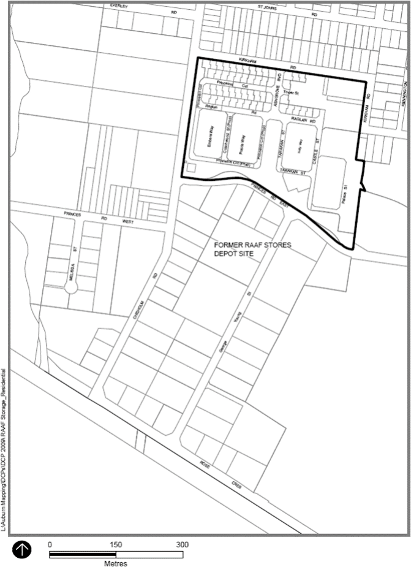

### PART F1-15

### RAAF STORES DEPOT

This page has been left intentionally blank.

## 1. Introduction

### 1.1 Land to which this Part applies

This Part applies to land zoned R3 Medium Density Residential within the Former RAAF Stores Depot

site under Cumberland LEP 2021. Refer to Figure 1 below.

> [Picture on page 340: a picture, saved as a picture (images/part-f1-precinct-and-site-specific-development-controls-page-340-5.gif, 150 dpi).]

Figure 1: Area to which this Part applies.

### 1.2 Purpose of this Part

The purpose of this part is to provide land use provisions to guide redevelopment of the former RAAF Stores Depot site.

## 2. General objectives

Encourage design that will enhance the existing character of the locality; and

Ensure that redevelopment is integrated with the surrounding development.

## 3. Specific objectives and controls

### 3.1 Residential density and dwelling mix

#### Objectives

Encourage a range of housing types to meet the needs of the community.

Provide interesting and varied streetscapes.

Ensure development is not excessive in scale and the distribution of housing forms

reflects the scale and character of existing development.

Incorporate a range of dwelling types and sizes. Locate higher density housing to act

as a buffer to industrial development to the south of the site.

#### Controls

Residential development shall not exceed a gross residential density of 28 dwellings per

hectare.

Courtyards shall not be built within the front building alignment.

Single dwelling traditional lot development shall occur along the interface with existing

residential areas.

### 3.2 Car parking

The applicant shall refer to Part G of this DCP.

### 3.3 Noise

The applicant shall refer to Part B of this DCP.

### 3.4 Adaptable housing

The applicant shall refer to the relevant adaptable housing provisions in Part B of this DCP.

### 3.5 Stormwater management

The applicant shall refer to the Part G of this DCP.

### 3.6 Tree preservation

The applicant shall refer to Part G of this DCP.

### 3.7 Public domain

The applicant shall refer to the Former RAAF Stores Depot Public Domain Plan for public

domain requirements. This Plan is available from Cumberland City Council on request.

This page has been left intentionally blank.

> [Picture on page 343: a picture, saved as a picture (images/part-f1-precinct-and-site-specific-development-controls-page-343-1.gif, 150 dpi).]
