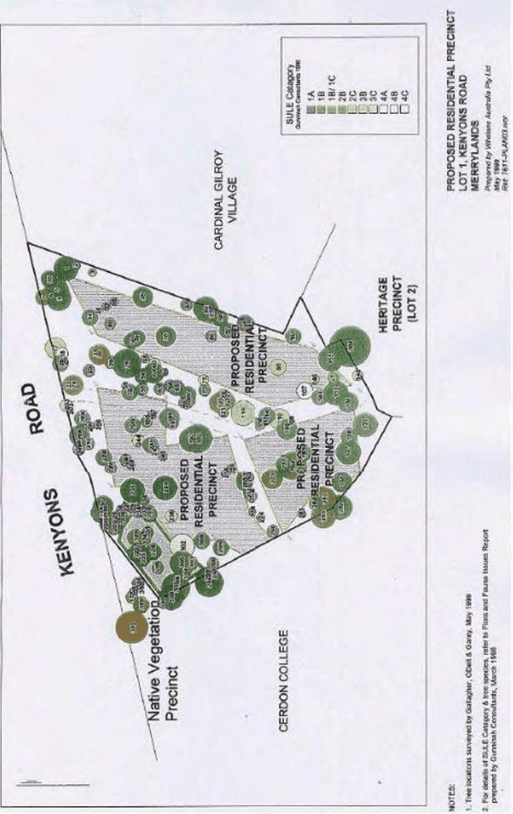
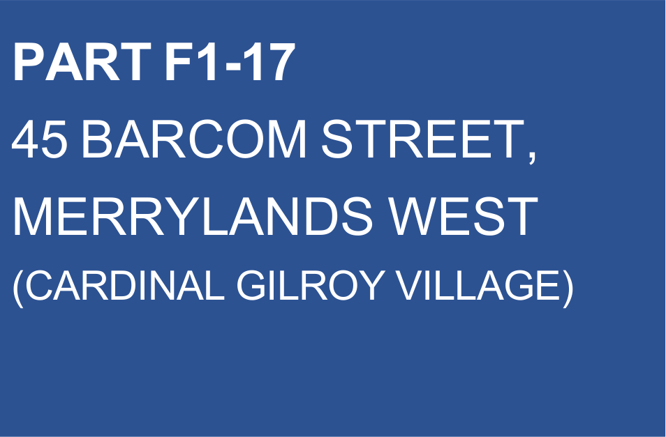

### PART F1-16

### SHERWOOD SCRUBS

### AND ADJOINING LAND

This page has been left intentionally blank.

## 1. Introduction

### 1.1 Land to which this Part applies

This section applies to Lots 1 DP 1002887 and Lot 12 DP 1075418 (“The Site”) on Kenyons

Road, Merrylands.

## 2. Specific Objectives and Controls

#### Objectives

Ensure that the siting of any future development are appropriate to the locality and of

significant vegetation and natural or built heritage are preserved;

Ensure that future development meets sound environmental practices and standards;

and

Encourage adaptive re-use and restoration of heritage buildings within the site.

#### Controls

Any dwelling or other building erected within Lot 1 DP1002887 shall be wholly contained

within a designated “Residential Precinct” as identified on Appendix A.

Unless otherwise directed by Council, all existing trees greater than 3.5m in height

external to a designated “development precinct” are to be protected and preserved.

As far as possible, disturbance of the ground surface within the drip line of all trees over

3.5m in height is to be avoided. All dwellings, structures and access roads are to be

located to avoid disturbance of the following individual specimens:

Table 1: Identified Species –disturbance to be avoided

| Tree Number* | Description |
|---|---|
| 312 | Broad‐leaved Ironbark |
| 192 | Mature Grey Box |
| 193 | Mature Grey Box |
| 249 | Mature Grey Box |

(* Tree Numbers as identified on Appendix A)

The design of the second storey should be integrated into the overall dwelling design

and the reduced building footprint should assist in the retention of trees.

Preservation of existing trees within designated “Residential Precincts” is to be maximised

by the appropriate siting of dwellings, buildings and associated private open space

areas. Specific trees likely to be affected by the siting of dwellings or structures are to

be clearly identified on any plans for erection of such and may only be removed with the

express consent of Council.

Development within Lot 1 DP1002887 shall make provision for establishment and

maintenance of a “Native Vegetation Precinct”. The location and extent of this precinct

is to be as shown on Appendix A.

#### 2.1 Specific Requirements applying to Lot 12 DP 1075418

#### Objective

Ensure the heritage significance of this site is retained.

#### Controls

The provisions of Cumberland Local Environmental Plan 2021 with respect to adaptive

re-use of heritage items apply to this site.

Any application to Council for adaptive re-use and/or residential development within this

lot shall be accompanied by a Conservation Plan prepared by a suitably qualified

architect.

The Conservation Plan will:

• describe the significance of buildings, structures and their setting as part of the

environmental heritage of Cumberland City;

• consider appropriate steps for conservation of identified elements to be undertaken in

conjunction with the proposed development; and

• describe appropriate steps to mitigate any adverse impact on the heritage significance

of identified elements arising as a result of the proposed development.

## 3. Appendix A – Guidelines for Development

> [Picture on page 347: a picture, saved as a picture (images/part-f1-precinct-and-site-specific-development-controls-page-347-2.gif, 150 dpi).]

#### This page left intentionally blank

> [Picture on page 349: a picture, saved as a picture (images/part-f1-precinct-and-site-specific-development-controls-page-349-1.gif, 150 dpi).]
