### PART F1-17

## 45 BARCOM STREET, MERRYLANDS WEST

### (CARDINAL GILROY VILLAGE)

## 1. Introduction

### 1.1 Purpose of this DCP

The DCP outlines the ‘site specific controls’ (the detailed planning and design framework) that

relates to 45 Barcom Street site (refer to Figure 1) which is located within the Merrylands West

area to guide the future redevelopment of the site. Where there is inconsistency between this document and provisions contained elsewhere in the

Cumberland DCP 2021, the site-specific controls contained in this document shall apply to the

extent of the inconsistency.

### 1.2 Land to which this Part applies

This section applies to land at 45 Barcom Street, Merrylands West, containing three (3) lots

with a total area of 7.44ha including Lot 5 DP 701151 (2.42ha), Lot 8 DP 732058 (1.928ha)

and Lot 11 DP 1075418 (3.092ha) and shown in Figure 1.

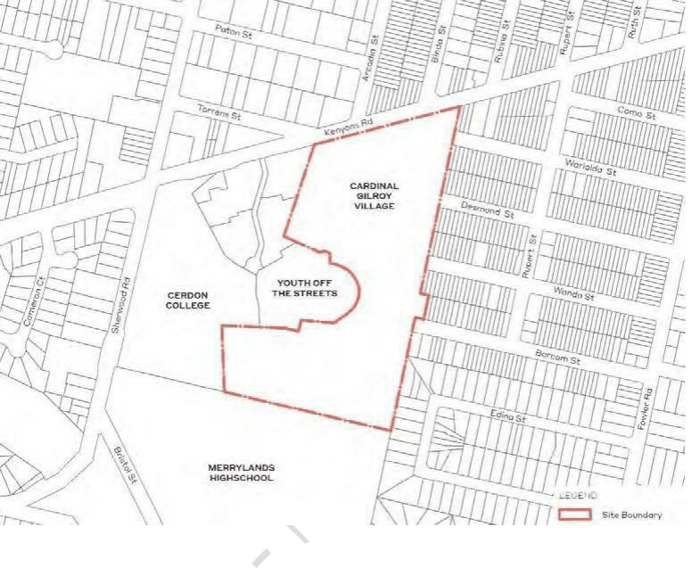

> [Picture on page 350: a picture, saved as a picture (images/part-f1-precinct-and-site-specific-development-controls-page-350-13.gif, 150 dpi).]

Figure 1: Land to which this Part applies

#### 1.3 Relationship to Cumberland Development Control Plan 2021

The controls contained in this part are supplementary to and shall be read in conjunction with

the following relevant parts of Cumberland DCP 2021.

• Part A - Introduction and General Controls

• Part B - Development in Residential zones

• Part C - Development in Business zones

• Part E - Other land use-based development controls

• Part F1 - Residential site-specific development controls (refer to Sherwood scrubs and

adjoining land)

• Part G - Miscellaneous Development Controls (for general heritage conservation, traffic and

parking controls, tree management and landscaping and other related controls)

• In addition to this Part, SEPP ((Housing for Seniors or People with a Disability) 2004, SEPP

65 and the NSW Apartment Design Guide (ADGs) must be considered when preparing a

development application. Where there is an inconsistency between this DCP Part and

provisions contained elsewhere in Cumberland DCP 2021, the provisions of this Part shall

prevail.

## 2. Vision and General Objectives

### 2.1 Vision

The Cardinal Gilroy Village is a vibrant and active Seniors Housing development that integrates

with, complements and enhances the surrounding Merrylands West community.

### 2.2 General Objectives

#### Objectives

Development is predominantly residential in use, making an important contribution to the

amount and choice of housing for seniors and people with a disability along with the

provision of some related retail and commercial uses for its occupants and the

surrounding neighbourhood and broader community. The site will establish a ‘landmark’

development for Seniors and People with a Disability and deliver a mix of high-quality

seniors housing to meet a demonstrated need.

Buildings are sited, positioned and designed to maximise climatic responsiveness and

provide high levels of desirable solar access and natural ventilation.

Development creates a high level of residential amenity, including optimising outlook

and views to desirable landscape elements, and respects the amenity of surrounding

established residential areas.

Deliver the highest standards of urban planning and excellence in architectural design.

Development creates two distinct precincts to the north and south with a green heart

(open space) at its core. Central Park will be a publicly accessible, multi-use park that

forms the centre piece of new through-site linkages.

Development provides for a varied, integrated open space network that provides for a

diverse range of informal active and passive recreational activities in a largely green,

soft landscaped setting and development that provides for considerable area of

landscaped open space to reduce urban heat loads.

Development that provides for considerable area of landscaped open space to reduce

urban heat loads and maintain the landscaped character of the locality.

Create liveable communities by providing high quality amenities and open space to

meet the needs of existing and future residents of Merrylands West.

The establishment of permissible retail/commercial uses at ground level fronting

Kenyons Road to enhance convenience and service the day to day needs of occupants

and surrounding residents.

Development responds to and respects the site and its context, including its strategic,

transit proximate location, topography and surrounding residential uses and heritage

significant surrounds located to the site’s west.

Existing heritage surrounding the site is retained, enhanced and respected through

increased building separation distances and setbacks, protection of key view corridors

and the provision of landscaped open space within the visual curtilage of the heritage

significant items.

Development provides for a high level of engagement between the public and private

domains, in particular providing for pedestrian integration and extensive opportunities

for passive casual surveillance.

### 2.3 Master plan

The vision and principles for the site as identified above are spatially expressed in the urban

structure for the precinct as shown in Figure 2.

To ensure that development provides key elements, where variations to the master plan are

proposed, the development application is to demonstrate how the vision and principles have

been achieved.

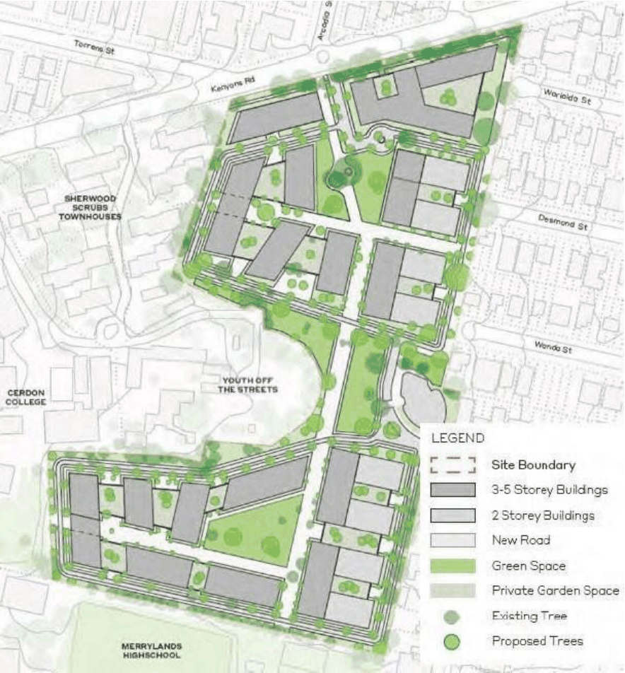

> [Picture on page 353: a picture, saved as a picture (images/part-f1-precinct-and-site-specific-development-controls-page-353-1.gif, 150 dpi).]

Figure 2: Master Plan

## 3. Specific objectives and controls

### 3.1 Land use

#### Objectives

Development creates a vibrant and active Seniors Housing development that integrates

with, complements and enhances the surrounding Merrylands West community.

Development provides for permissible retail/commercial uses on the ground level fronting

Kenyons Road that supports the day to day and lifestyle needs of residents and the

surrounding neighbourhood.

#### Controls

Land use is in accordance with Figure 3.

Development provides for a maximum of 1,480sqm of GFA of permissible

retail/commercial uses. Note: permissible retail/commercial uses include kiosks,

neighbourhood shops and health services facilities, etc.

Permissible retail/commercial uses such as a neighbourhood shop, kiosk and health

services facilities are located at ground level fronting the Kenyons Road buildings in

accordance with Figure 3.

The open space areas detailed in Figure 3 are publicly accessible and connected by a

network of pedestrian linkages (refer to Section 3.6 below).

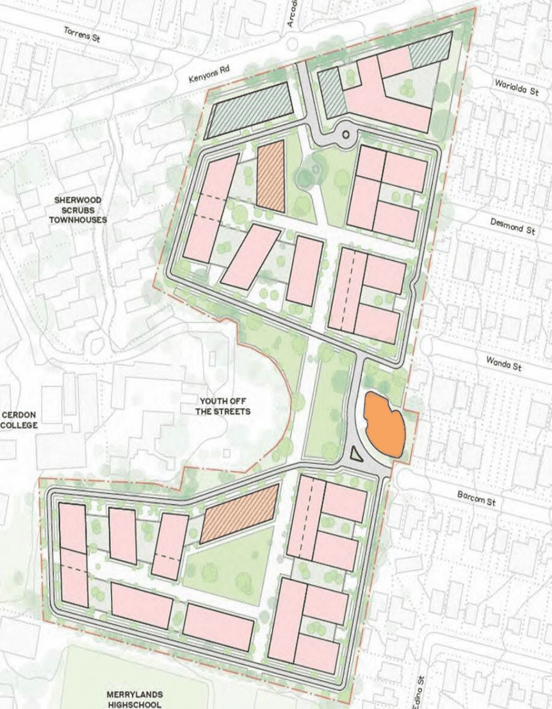

> [Picture on page 355: a picture, saved as a picture (images/part-f1-precinct-and-site-specific-development-controls-page-355-1.gif, 150 dpi).]

Figure 3: Land use

#### Building Height

#### Objectives

Figure 3: Land use

### 3.2 Building Height

Objectives Building height is varied throughout the site to reflect the scale and density of

surrounding development and create an articulated and visually interesting development

Develop a strong and high-quality network of public open spaces that includes town

squares, parks and streets.

Building height adopts a height pyramid principle with taller buildings located in the

centre of the site transitioning to lower rise buildings at the site’s edges.

Building height retains adequate solar access and privacy to neighbouring educational,

residential and heritage significant properties throughout the year.

#### Controls

Maximum building height is generally in accordance with Figure 4.

Building heights allow solar access to neighbouring properties in accordance with

Part B under Cumberland DCP 2021.

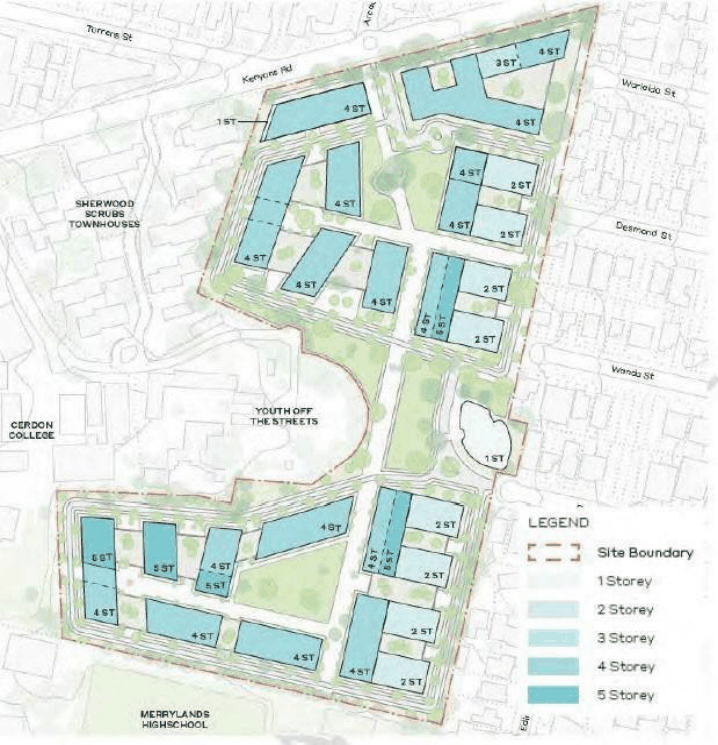

> [Picture on page 356: a picture, saved as a picture (images/part-f1-precinct-and-site-specific-development-controls-page-356-14.gif, 150 dpi).]

Figure 4: Building height (storeys)

### 3.3 Building siting and setbacks

#### Objectives

Buildings are sited to provide adequate separation between proposed buildings within

and adjoining the site, and a physical and landscaped buffer to proposed buildings

adjoining (or located outside) especially adjoining residential and heritage significant

properties.

Buildings are sited to provide a high level of amenity within and for adjoining residential

and heritage significant properties.

#### Controls

All residential buildings on the site are setback in accordance with the provisions of Part

3F- I of the Apartment Design Guide (ADG).

Setbacks for all buildings adjacent to the boundary are in accordance with Figure 5 with

indicative sections in Figures 6-8.

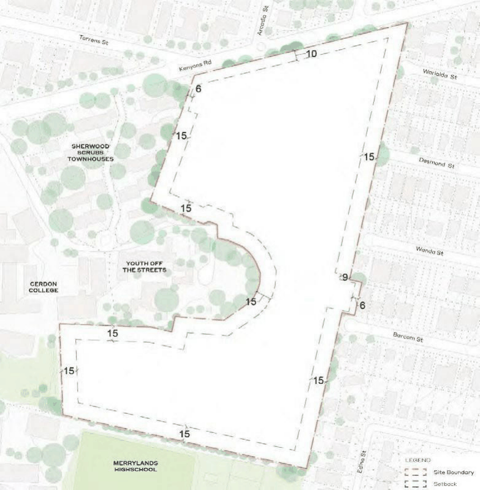

> [Picture on page 357: a picture, saved as a picture (images/part-f1-precinct-and-site-specific-development-controls-page-357-14.gif, 150 dpi).]

Figure 5: Building setbacks

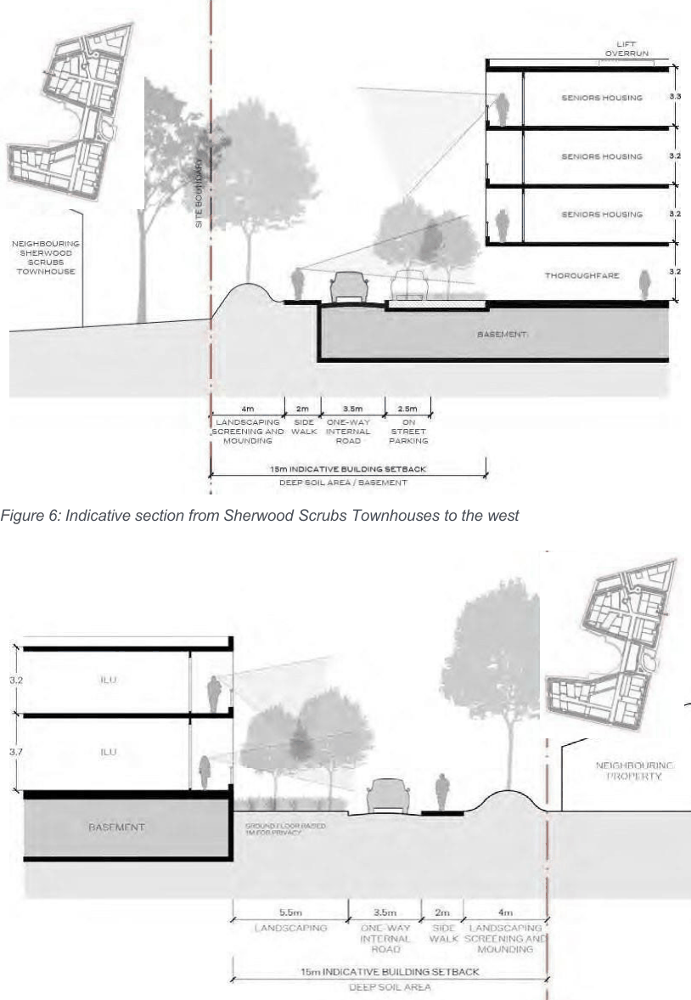

> [Picture on page 358: a picture, saved as a picture (images/part-f1-precinct-and-site-specific-development-controls-page-358-1.gif, 150 dpi).]

Figure 6: Indicative section from Sherwood Scrubs Townhouses to the west

Figure 7: Indicative section adjacent to the residential development to the east

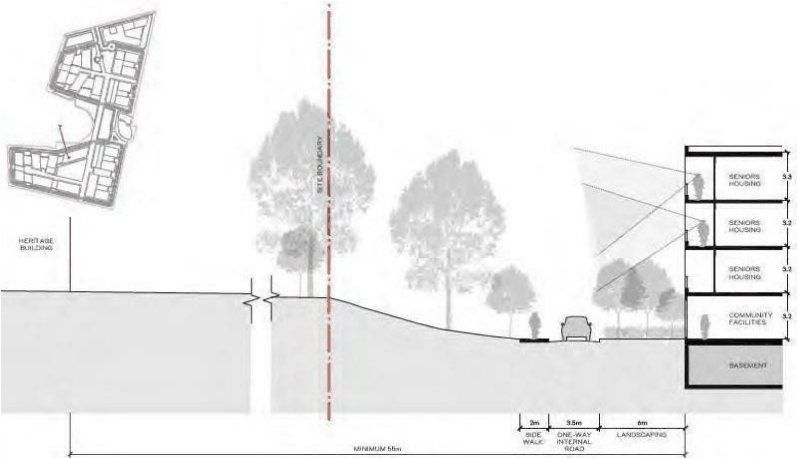

> [Picture on page 359: a picture, saved as a picture (images/part-f1-precinct-and-site-specific-development-controls-page-359-1.gif, 150 dpi).]

Figure 8: Indicative setbacks from the heritage item to the west

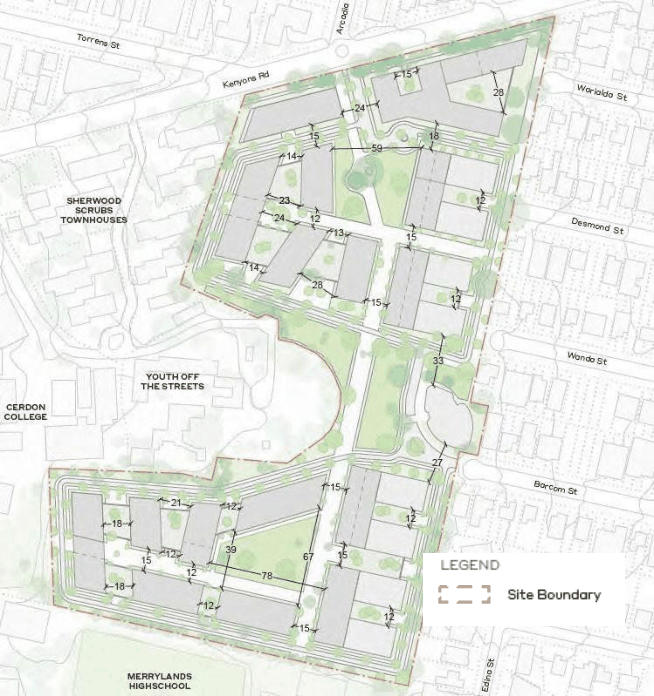

> [Picture on page 359: a picture, saved as a picture (images/part-f1-precinct-and-site-specific-development-controls-page-359-3.gif, 150 dpi).]

Figure 9: Building separation setbacks

Building setbacks and separation distances for buildings fronting internal streets and

open space areas are to be generally consistent with Figure 9.

Buildings fronting Kenyons Road are to be setback 10m from the street boundary.

Awnings may encroach into the setback area consistent with Figure 10.

Overlooking to adjoining residential zones is minimised via the use of fixed privacy

screens, fixed depth planter boxes or similar where required.

Buildings are setback to allow direct solar access to neighbouring properties in

accordance with Part B under Cumberland DCP 2021.

Buildings are sited to ensure lines of sight to publicly accessible and communal open

space is maximised.

### 3.4 Built form

#### Objectives

Buildings are designed to activate and engage with the adjoining public domain.

Buildings are designed to reduce the bulk and scale when viewed from the public domain

and provide visual interest and to minimise built form impacts from the site to the

adjoining residential and heritage significant properties.

Internal street setbacks and upper-level setbacks enable sunlight and view corridors,

whilst allowing passive surveillance from upper-level balconies and terraces.

#### Controls

Building fronting Kenyons Road are designed to have activated uses at ground level

that ensures:

• the number of individual tenancies that adjoin and are directly accessible from the

public domain are maximised;

• multiple accessible pedestrian entries are provided from the public domain;

• large areas of transparent glazing or other openings enable clear sightlines

between the public domain and internal areas, in particular those with high levels

of activity;

• any kiosk uses may include outdoor seating fronting Kenyons Road;

• awnings or other overhangs provide shelter for outdoor seating areas and minimise

noise transmission to dwellings above; and

• roller shutters or bars are not permitted on windows or openings fronting the public

domain.

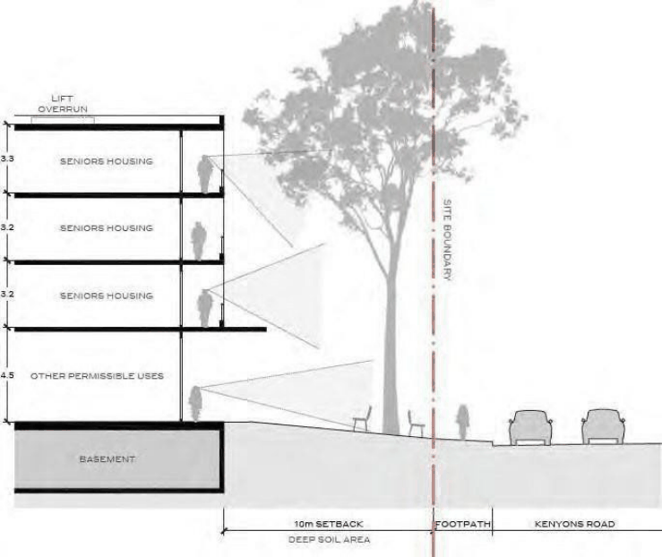

> [Picture on page 361: a picture, saved as a picture (images/part-f1-precinct-and-site-specific-development-controls-page-361-1.gif, 150 dpi).]

Figure 10: Indicative section for buildings fronting Kenyons Road

Loading docks and any vehicular access points are not be located fronting the public

domain and are to be unobtrusively located to minimise the visual impact.

Upper-level residential dwellings are designed to have their main living areas and

adjoining private open space oriented to and directly overlook the public domain, internal

roads or publicly accessible open space areas in accordance with Figure 11.

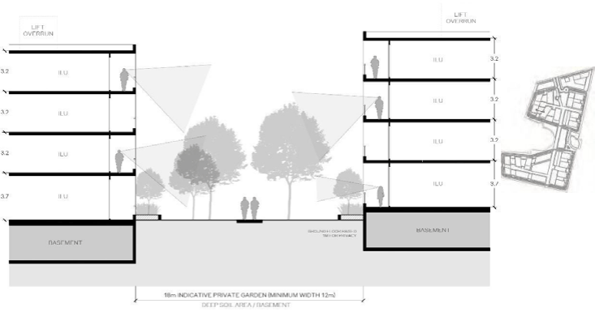

> [Picture on page 361: a picture, saved as a picture (images/part-f1-precinct-and-site-specific-development-controls-page-361-8.gif, 150 dpi).]

Figure 11: Indicative section for buildings Building designs are to follow the topography of the land and minimise the cut and fill

of the site.

Floor to ceiling heights are provided in accordance with the ADG.

Building facades are positioned to optimise solar access to main internal living areas and

adjoining private open space and optimise outlook and views to high amenity features

such as open space.

Blank walls are to be avoided and building facades feature articulation using design

measures such as:

• recessed and/or projecting balconies

• blades or fins

• privacy screens

• large windows and other openings

• sun control devices such as eaves, louvres and screens

• differentiation of materials

• architectural features.

Maximum depth and width is in accordance with the ADG.

New development adjacent to the heritage building requires consideration of building

materials that are complementary to the retained heritage buildings, sympathetically

designed and supported by a Heritage Impact Statement.

View corridors to the adjacent heritage building are maximised through the publicly

accessible central park from the Barcom Street entrance and community centre.

Building facades are designed to provide a variety of design solutions, to promote

diversity, choice and character of space.

### 3.5 Open space and landscaping

#### Objectives

To provide for open space includes a variety of publicly accessible parks, communal

open space and through-site links for the benefit of the surrounding Merrylands West

community.

To provide for publicly accessible and communal open space that caters for a diverse range

of informal passive and active recreation activities that are accessible, useable,

permeable and fit for their intended purpose.

To provide for publicly accessible and communal open spaces that have a high level of

amenity, including adequate solar access throughout the year, shade during the

summer, circulation and safety.

To provide for publicly accessible and communal open spaces that have a coherent,

legible landscape character, and offers a high level of visual amenity.

To enhance the surrounding and internal pedestrian and street networks with quality

landscaping and architectural responses, to facilitate a network of green links.

To promote social cohesion and a sense of community through providing spaces that

cater for organised and informal community gathering and interaction.

To respect the existing natural assets such as existing significant trees and other

planting to create attractive spaces and encourages biodiversity.

#### Controls

Development is to provide a publicly accessible central park (open space) area having

a minimum area of 5,000sqm located centrally on the site that forms the green heart of

the Cardinal Gilroy Village. Indicative sections of the publicly accessible central park are

provided in Figure 13.

All publicly accessible and communal open space areas include the following:

• soft and hard landscaping for passive recreation and active play;

• sufficient area for deep soil planting to support large, spreading canopy trees

• adaptable playground areas; and

• amenities such as BBQ facilities, shade structures, seating, lighting, bins and

signage.

Open spaces are designed to create a variety of type of space (path, street, square,

park) character of space (public, recreational, semi-private) and scale of space, that

responds to the characteristics of all proposed areas and landscaping in accordance

with Figure 12.

Development provides for continuous linear through-site links between building that

provide a physical and visual connection between the publicly accessible central park

and surrounding properties.

Ground level communal open space area for occupants are to be provided for the

northern and southern precincts with a direct visual connection to the publicly accessible

central park and green spaces where possible. All publicly accessible and communal

open space is to be designed in accordance with CPTED principles.

Where possible, publicly accessible and communal open space includes areas for

community gardens in locations that do not compromise the useability of the space for

informal active and passive recreation activities.

A minimum of 4 hours of direct solar access is to be maintained to at least 50% of the

publicly accessible central park on June 21 between 10.00am and 3.00pm.

A minimum of 2 hours of direct solar access is to be maintained to at least 50% of the

communal opens space areas on June 21 between 10.00am and 3.00pm.

Open space is provided generally in accordance with Figure 12. Indicative sections of

the publicly accessible central park are provided in Figure 13.

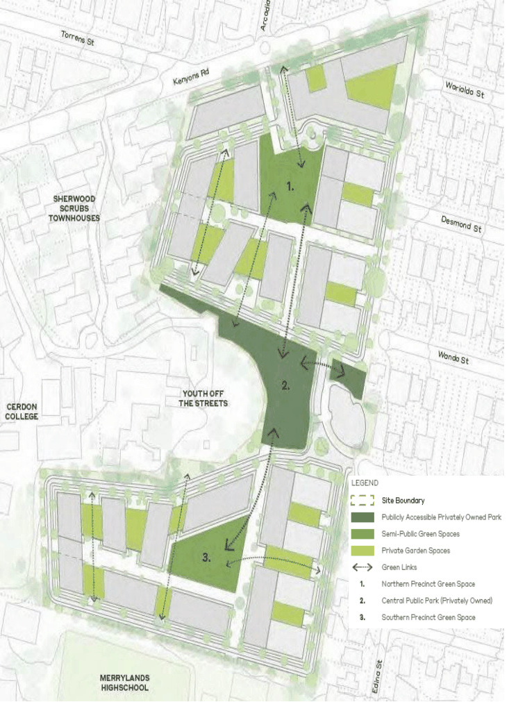

> [Picture on page 364: a picture, saved as a picture (images/part-f1-precinct-and-site-specific-development-controls-page-364-1.gif, 150 dpi).]

Figure 12: Open space network and linkages

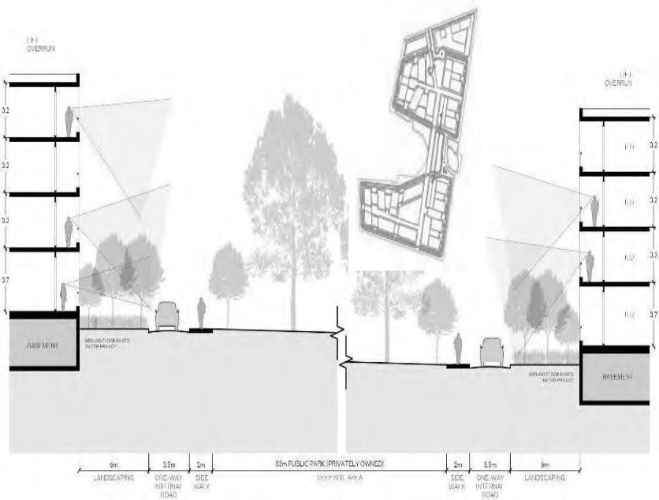

> [Picture on page 365: a picture, saved as a picture (images/part-f1-precinct-and-site-specific-development-controls-page-365-1.gif, 150 dpi).]

Figure 13: Indicative section of buildings overlooking public and private open space Existing significant trees around the perimeter of the site, in particular those that provide

a screening function for adjoining uses are retained where not required for site access

points or internal roads and are integrated into the prevailing landscape character of the

precinct.

A minimum of 25% of the site area is to comprise of deep soil landscaped area.

A minimum of 50% of the front setback area to Kenyons Road is to comprise of deep

soil landscaped areas.

Deep soil landscape areas are located between buildings and between the residential

boundaries surrounding the site. The deep soil landscaped areas on the boundaries are

to contain a combination of mounding and/or dense landscaping to provide amenity and

maximise screening between properties.

Plantings in open space areas incorporate a diverse selection of locally native species

including trees, shrubs and grasses/groundcovers.

### 3.6 Movement network

#### Objectives

The movement network provides for multiple points of public access to the precinct.

The movement network is functional and provides for the efficient, safe and comfortable

movement of vehicles, pedestrians and cyclists.

The movement network where appropriate, provides opportunities for social interaction

and gathering.

#### Controls

Vehicular movement and directions are provided in accordance with Figure 14. Limited

on-street parking is provided for pick up and drop off zones for residents and their guests

adjacent to building entries.

The vehicular and pedestrian access points from the public domain are provided on

Kenyons Road and Barcom Street in accordance with Figure 14.

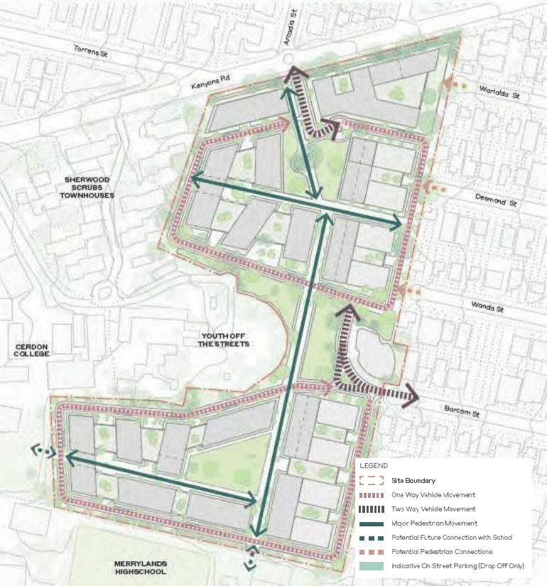

> [Picture on page 366: a picture, saved as a picture (images/part-f1-precinct-and-site-specific-development-controls-page-366-11.gif, 150 dpi).]

Figure 14: Movement Plan

All internal streets around the periphery of the site are to:

• be single land to a maximum width of 3.5 metres;

• limited on-street parking is provided for pickup and drop off zones for residents and

their guests adjacent to building entries;

• include pedestrian paths and landscaping;

• prioritise pedestrian and cyclist movement over vehicular movement; and

• include a landscaped verge on both sides with extensive and co-ordinated tree

plantings and be generally in accordance with the indicative sections in Figures 15

and 16.

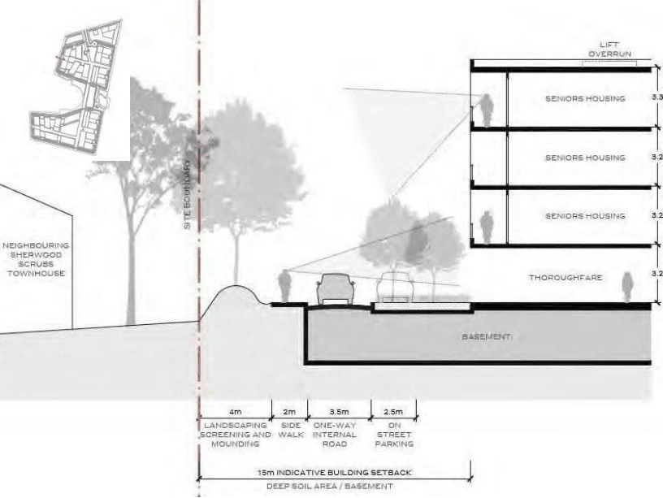

> [Picture on page 367: a picture, saved as a picture (images/part-f1-precinct-and-site-specific-development-controls-page-367-8.gif, 150 dpi).]

Figure 15: Indicative western section

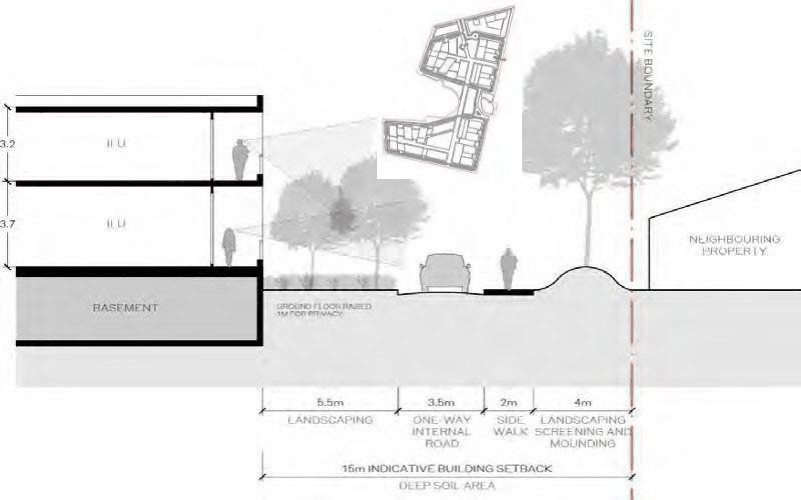

> [Picture on page 368: a picture, saved as a picture (images/part-f1-precinct-and-site-specific-development-controls-page-368-1.gif, 150 dpi).]

Figure 16: Indicative western section

The pedestrian and cycle access network:

• is direct, accessible and easily identified by all users;

• includes signage for way-finding and advising of the publicly accessible status of

the link and the places to which it connects;

• is integrated into the network design and includes furniture, facilities and materials

of a high quality

• is well lit and open to the sky for the entire length

• is clearly distinguished from vehicle access-ways

• allows visibility along the length of the through-site links.

Street furniture is provided and includes a high quality, durable and co-ordinated

selection of:

• paving;

• seating;

• lighting;

• rubbish bins; and

• signage.

Provision is made to allow possible future connections from the site to adjoining

properties to the east, west and south in accordance with Figure 14.

Street trees are to be provided on all streets and pedestrian links that:

• comprise a co-ordinated palette of climatically responsive species;

• are robust and low-maintenance;

• are planted in a co-ordinated and formalised manner;

• increase the comfort of the public domain for pedestrians, including through the

provision of shade in summer; and

• enhance the environmental performance of the precinct by increasing opportunities

for energy conservation.

### 3.7 Managing transport demand and parking

#### Objectives

The movement network provides for multiple points of public access to the precinct.

On- site car parking is provided at a rate that balances the needs to provide for the

convenience needs of residents and visitors while encouraging more sustainable forms

of movement such as public transport, walking and cycling.

On-site car parking is provided in a form that reduces overall building size and enables

the creation of a positive relationship between building and the adjoining public domain,

through high levels of integration at the ground floor level.

#### Controls

All development applications are to include a ‘Transport and Traffic Impact Assessment

Study’ addressing the potential impact of the development on surrounding movement

systems, where the proposed development comprises:

• Retail/commercial development of more than 1,000m² Gross Floor Area;

• residential development of 100 or more new dwellings; or

• likely to generate significant traffic impacts according to the consent authority.

Any development application is to include a site wide ‘Green Travel Plan’ to outline

initiatives for walking, cycling and the use of public transport. The Green Travel Plan

should address different transport needs and patterns for residential and

retail/commercial uses.

Any development application is to include a ‘Transport Access Guide’, and a strategy

for its future availability to residents, employees and visitors, to the Seniors Housing

development.

End-of-trip facilities including showers and lockers must be provided to adequately

service the number of bicycle parking spaces required for employees in the

retail/commercial uses and are to be located close to the bicycle parking area, entry/exit

points, and within an area of security camera surveillance preferably where there are

such building security systems.

On-site car parking is provided in accordance with Part G, Cumberland DCP 2021 and

the State Environmental Planning Policy (Housing for Seniors of People with a Disability)

2004.

All on-site car parking is provided within basements where the basement only protrudes

a maximum of 1 metre above ground level. Limited on-street parking is provided for

pickup and drop off zones for residents and their guests adjacent to building entries.

### 3.8 Environmental performance

#### Objectives

To reduce environmental impact over the life cycle of a building.

On- site car parking is provided at a rate that balances the needs to provide for the

convenience needs of residents and visitors while encouraging more sustainable forms

of movement such as public transport, walking and cycling.

To enhance local biodiversity through the planting of diverse native plant species.

To promote renewable energy initiatives.

To reduce urban heat island effect by providing sharing trees, vegetation and selection

of materials that deflect radiation from the sun.

#### Controls

Ensure rainwater is captured, stored and used for non-potable uses such as irrigation

of landscaping.

To reduce the necessity for mechanical heating and cooling.

To enhance local biodiversity through the planting of diverse native plant species.

Consideration should be given to utilising roof space for developing roof gardens (green

roof).

Where appropriate bio-walls (green walls) should be incorporated in the design of

buildings.

Selection of sustainable materials should be considered as part of the future

development, with a relatively positive impact on communities and the environment.

During demolition of existing structures, recycling or reuse of resources and waste

management approaches should also be considered throughout development stages.

Materials should provide optimal insulation and address the reduction of urban heat

island effect.

This page has been left intentionally blank

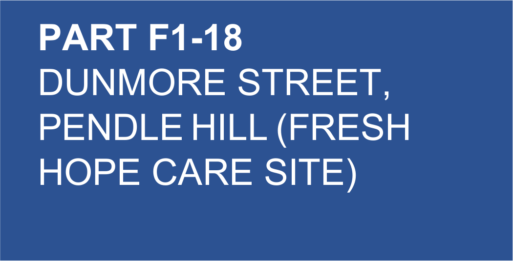

> [Picture on page 372: a picture, saved as a picture (images/part-f1-precinct-and-site-specific-development-controls-page-372-1.gif, 150 dpi).]
