### PART F1-18

DUNMORE STREET,

### PENDLE HILL (FRESH

### HOPE CARE SITE)

## 1. Introduction

### 1.1 Land to which this section applies

This section applies to the following land (as shown in Figure 1 below):

| Address | Lot and DP |
|---|---|
| 284 Dunmore Street, Pendle Hill | Lot 1 DP24728 |
| 105 Pendle Way, Pendle Hill | Lot 2 DP24728 |
| 93 Pendle Way, Pendle Hill | Lot 8 DP24728 |
| 91 Pendle Way, Pendle Hill | Lot 9 DP24728 |
| 87 Pendle Way, Pendle Hill | Lot 10 DP24728 |
| 85 Pendle Way, Pendle Hill | Lot 11 DP24728 |
| 83 Pendle Way, Pendle Hill | Lot 12 DP24728 |
| 282 Dunmore Street & 95 Pendle Way, Pendle Hill | Lot 472 DP1204429 |
| 268-280 Dunmore Street, Pendle Hill | Lot A DP335578 |
| 222-266 & 282 Dunmore Street & 89 Pendle Way, Pendle Hill | Lot 2 DP554208 |
| 222-266 Dunmore Street, Pendle Hill | Lot 3 DP554208 |

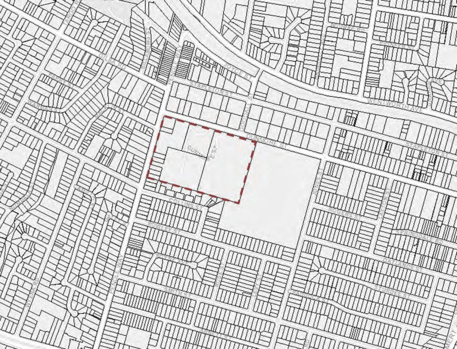

> [Picture on page 373: a picture, saved as a picture (images/part-f1-precinct-and-site-specific-development-controls-page-373-5.gif, 150 dpi).]

Figure 1: Land to which this section applies

## 2 Vision and general objectives

### 2.1 Vision

The Dunmore Street site is a high-quality residential precinct that respects and celebrates its

history and integrates with and enhances the surrounding Pendle Hill area.

The site will play an important role in contributing to additional supply for seniors housing and

affordable key worker housing, capitalising on its proximity to the Pendle Hill local centre, the

adjacent Bonds Spinning Mills site and Pendle Hill railway station.

The site provides a high-amenity landscaped setting, including an open space curtilage to the

heritage listed Dunmore House, new opportunities for publicly accessible open space and

community uses for the local population.

### 2.2 General objectives

O1. Development responds to the natural and built form elements of the site, the surrounding

local character, the existing orthogonal street grid, heritage items and evolving built form

scale, including the adjacent Bonds Spinning Mills site.

O2. Development is predominantly for seniors housing and affordable key worker housing,

significantly contributing to housing choice and affordability in the Cumberland LGA.

O3.  Celebrate and give precedence to the heritage components of the site while maintaining

a heritage curtilage around Dunmore House, which is also a key determining feature in

the open space network and landscaped character of the site.

O4. New buildings adjacent to heritage items will respect the site’s heritage through appropriate

setbacks and design.

O5.  Development is well designed and effectively transitions to development on adjoining

sites through building heights, massing, setbacks and landscaping.

O6. Development on the corner of Dunmore Street and Pendle Way will be of a height, scale

and design that provides a built form marker when approaching the site from the Pendle

Hill local centre and railway station.

O7. Existing mature vegetation on the site is retained and complemented through new planting

of native species and landscaping.

O8. The site will contain a legible and permeable movement network for pedestrians and

cyclists, including potential linkages to the adjoining Bonds Spinning Mills site.

O9. The site will provide an extensive open space network comprised of private and public

open spaces, including the publicly accessible open space curtilage to Dunmore House.

### 2.3 Indicative Master plan

The vision and objectives for the site as identified above are expressed in the structural design for the site as shown in Figure 2. To ensure that development provides key elements, where variations to the Indicative Master

Plan are proposed, the relevant development application (DA) is to demonstrate how the vision

and objectives have been achieved.

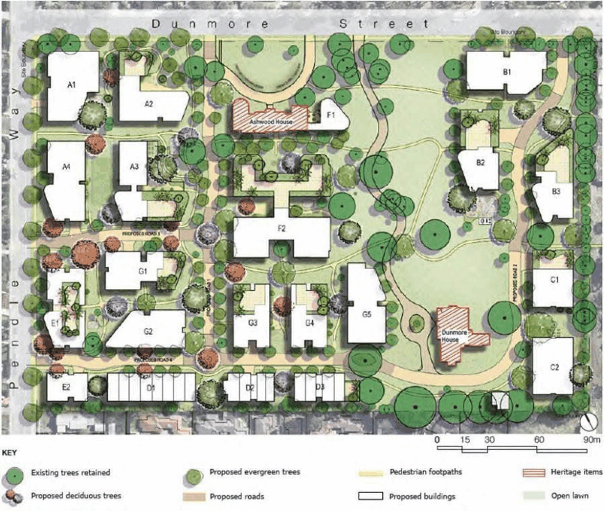

> [Picture on page 375: a picture, saved as a picture (images/part-f1-precinct-and-site-specific-development-controls-page-375-7.gif, 150 dpi).]

Figure 2: Indicative Master Plan

## 3 Specific objectives and controls

### 3.1 Land use

#### Objectives

O1. Create a high-quality residential precinct, primarily consisting of seniors and affordable key

worker housing.

O2. Provide an extensive open space network, including a centrally located publicly accessible

recreational and community space in the Dunmore House curtilage, for new residents

and the local community.

O3. Provide for associated ancillary uses to meet the daily convenience and recreational

needs of onsite residents and workers.

#### Controls

C1. Land uses are to predominantly comprise residential development, specifically seniors

housing and affordable key worker housing.

C2. Non-residential uses are to generally include:

a. allied health services

b. publicly accessible recreational and community uses

c. places of public worship

d. café/s

C3. Non-residential uses permissible in the R4 High Density Residential zone, such as cafes

and neighbourhood shops, are to be located at ground level to maximise accessibility

and contribute to the activation of streets.

### 3.2 Building height

#### Objectives

O1.  Provide opportunities for increased height and density to support the future provision of

seniors housing and affordable key worker housing on the site.

O2.  Ensure building heights respond to the existing and future built form character of the

area, including the adjoining Bonds Spinning Mills site and lower density residential

developments surrounding the site.

O3. Minimise any adverse shadow impacts to open spaces within the site and adjoining

residences.

O4. Maintain ‘finer-grained’ proportions along the southern boundary to respond to existing

lower density residential development on Collins Street.

#### Controls

Maximum building heights to be generally in accordance with Figure 3: Building

heights

Reduced level details must be in accordance with Part G Cumberland DCP 2021.

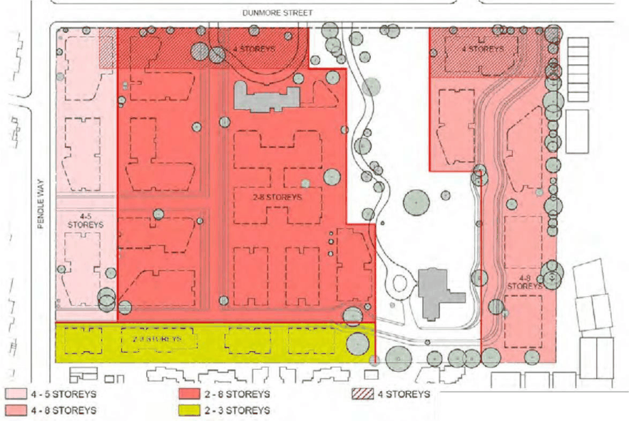

> [Picture on page 377: a picture, saved as a picture (images/part-f1-precinct-and-site-specific-development-controls-page-377-1.gif, 150 dpi).]

Figure 3: Building heights

### 3.3 Building siting and setbacks

#### Objectives

O1. Provide appropriate separation distances between future buildings on the site in order to

maximise amenity for future residents.

O2. Achieve an appropriate built form scale along Dunmore Street and Pendle Way that

contributes to the prevailing streetscape and the existing and future character of the

locality.

O3. Buildings are sited to respect and complement the existing heritage items on the site. O4. Buildings are sited to frame new streets and pedestrian links within the site and to maintain

view corridors to and from the site.

O5. Maintain high levels of visual and acoustic amenity and minimise overshadowing of

surrounding areas, including the lower density detached dwellings along the site’s

southern boundary on Collins Street.

#### Controls

C1. Building setbacks and building separations should generally comply with Figure 4 to

Figure 7, including:

• Minimum setback of 6m to Pendle Way

• Minimum setback of 6m to Dunmore Street

• Minimum setback of 6m for first and second storey and a minimum 8m setback

for third storey to the southern boundary with existing residences on Collins

Street

• Minimum setback of 10m to the southern boundary on eastern part of the site.

• Minimum setback of 10m to the eastern boundary

• Minimum 12m primary separation distance between all new buildings on the

site

• Minimum 12m separation distance between Ashwood House and any new

building to the immediate south and additional secondary setback of 23m

towards the centre of the building.

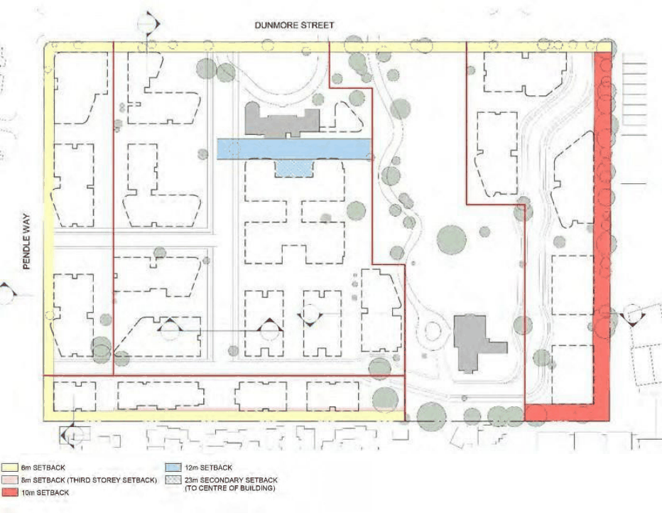

> [Picture on page 378: a picture, saved as a picture (images/part-f1-precinct-and-site-specific-development-controls-page-378-8.gif, 150 dpi).]

Figure 4: Setbacks plan

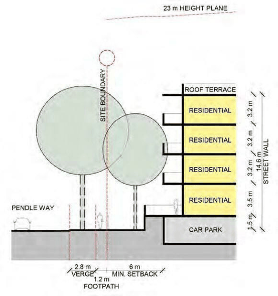

> [Picture on page 379: a picture, saved as a picture (images/part-f1-precinct-and-site-specific-development-controls-page-379-1.gif, 150 dpi).]

Figure 5: Street setback – Pendle Way

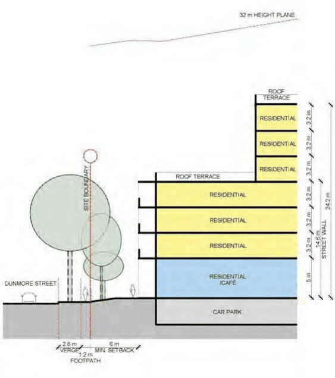

> [Picture on page 379: a picture, saved as a picture (images/part-f1-precinct-and-site-specific-development-controls-page-379-3.gif, 150 dpi).]

Figure 6: Street setback - Dunmore Street

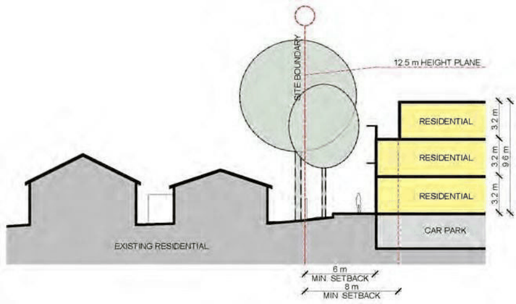

> [Picture on page 380: a picture, saved as a picture (images/part-f1-precinct-and-site-specific-development-controls-page-380-1.gif, 150 dpi).]

Figure 7: Southern boundary setback

### 3.4 Built form and building design

#### Objectives

Buildings are designed to complement existing streetscapes and to address and

engage with the adjoining public domain.

Buildings are designed to provide a high level of architectural quality and visual interest

and are of an appropriate bulk and scale when viewed from the public domain and

surrounding residential areas.

#### Controls

C1.  Building facades along Dunmore Street and Pendle Way street-walls are to incorporate

a number of smaller parts through significant recesses, other facade modulation and

distinct building elements and materials.

C2. In relation to residential uses at ground level:

• the number of individual dwelling entries from the adjoining public domain are

maximised

• where entries provide access to more than one dwelling, they relate to each lift

core, are clearly defined and legible and preferably form an architectural feature of

the building

• front boundary treatments use measures such as level changes, landscaping and

fencing to provide privacy for residents whilst also providing for casual passive

surveillance of the adjoining public domain

• internal living areas are integrated with areas of outdoor private open space to

provide a transition between the public and private domains

C3. In relation to non-residential uses at ground level:

• pedestrian entries are at the same level as the adjoining public domain

• cafes or restaurants can have outdoor seating in the adjoining public domain

• universal access is provided

C4. Buildings located on corner sites to be articulated to address each street frontage and to

define prominent corners.

C5.  The building on the Dunmore Street-Pendle Way corner is to provide a built form marker

through a height of 5 storeys and the expression of architectural elements such as

building articulation, material, colour and roof form.

### 3.5 Solar access and overshadowing

#### Objectives

Minimise overshadowing impacts to surrounding public domain and private developments.

Provide reasonable amount of solar access to new public open spaces within the site.

#### Controls

C1. Provide a minimum of 2 hours of solar access to the publicly accessible open space zoned

RE2 Private Recreation between 9am and 3pm in mid-winter.

### 3.6 Open space and landscaping

#### Objectives

O1. Provide a series of generous publicly accessible open spaces for recreational uses,

improving the quality of the public domain and connectivity with surrounding open

spaces.

O2. Retain and enhance the landscaped setting of both Ashwood House and Dunmore House.

O3. Provide sufficient private communal open space and rooftop gardens to cater for passive

and active recreation opportunities for future residents.

O4. Provide high quality landscaping around the perimeter of the site to enhance the

streetscape and quality of the built environment.

O5. Mitigate any visual impacts of buildings to the south of Ashwood House through provision

of soft landscaping.

#### Controls

Open space and deep soil zone should generally be provided in accordance with Figure

#### 8.

Provide a central north-south landscaped publicly accessible open space from Dunmore

Street to the site’s southern boundary at the rear of Dunmore House. This publicly

accessible open space area is to include the following facilities:

• soft and hard landscaping for passive and active recreation

• amenities such as BBQ facilities, shade structures, seating, lighting, bins,

playgrounds, community gardens and signage

Provide publicly accessible pocket parks with varied landscape features within the

clusters of buildings connecting to the publicly accessible open space.

Provide private communal open spaces at the ground level and rooftop areas with a

variety of facilities including seating, BBQ facilities and shelters.

Ground level courtyards are to be provided for ground level Independent Living Units as

per the ADG.

Provide a landscape buffer zone (south of Ashwood House) for the provision of tall

screening trees.

Provide high quality evergreen trees and screening within the setbacks along the site’s

boundaries as shown in Figure 1: Setbacks plan. This is to be achieved by providing a

6m deep soil zone along Pendle Way, Dunmore Street and the southern boundary of

the precinct, and a minimum of 10m deep soil zone along the eastern boundary of the

precinct.

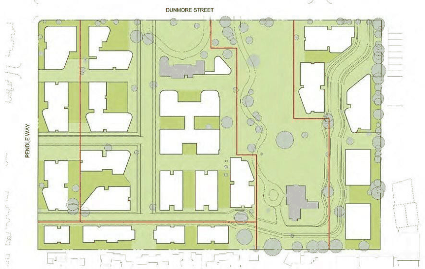

> [Picture on page 382: a picture, saved as a picture (images/part-f1-precinct-and-site-specific-development-controls-page-382-16.gif, 150 dpi).]

Figure 8: Open space network

### 3.7 Movement network

#### Objectives

O1. Improve the site’s accessibility and strengthen its connection to surrounding areas.

O2. Provide a functional movement network that provides for the efficient and safe movement

of all road users.

O3. Encourage walking and cycling through the provision of a comfortable and attractive

environment.

O4. Provide a number of residential access points to activate street frontages and internal

private and publicly accessible open spaces and to provide passive surveillance

opportunities.

O5. Reduce traffic impacts to Pendle Way and Dunmore Street and improve the public domain

for pedestrians.

#### Controls

C1. The street network, pedestrian network, site access and car access points are provided

generally in accordance with Figure 5: Public and pedestrian links.

C2. The site will incorporate 4 new two-way private roads that will intersect with the adjacent

local roads (Dunmore Street and Pendle Way). The new private roads are to be located

more than 40 metres (centre to centre) from the nearest intersections on the opposite side

of the road.

C3. Vehicular access points to buildings are to be provided within building footprints. If access

is not within the building, high quality landscape and driveway design are to be

incorporated to ensure a landscaped streetscape and to mitigate potential visual and

acoustic privacy issues for residents.

C4. Provide new pedestrian access points along both Pendle Way and Dunmore Street.

C5. Provide a minimum of 4 new publicly accessible through-site links connecting the precinct

to the surrounding area, including the Pendle Hill local centre, Pendle Hill railway station

and the Bonds Spinning Mills site.

C6. Streets include pedestrian paths on each side.

C7. Pedestrian footpaths on new roads are separated with a planting strip which is at least

1.8m in width.

C8. Private pedestrian links are interconnected with the new publicly accessible links.

C9. The pedestrian and cycle access network:

Is direct and accessible to all

is easily identified by users

has a public character

includes signage advising of the publicly accessible status of the link and the

places to which it connects

is clearly distinguished from vehicle access-ways

allows visibility along the length of the link to the public domain at each end.

C10. Strong, legible pedestrian connections are established between the site and adjoining

areas.

C11. The pedestrian and cycle access network:

aligns with breaks between buildings so that views are extended and the sense

of enclosure is minimised;

includes materials and finishes (paving materials, tree planting, furniture etc.)

integrated with adjoining streets and public spaces and be graffiti and vandalism

resistant;

is well-lit to safety standards;

is open to the sky along the entire length; and

is accessible 24 hours a day.

C12. Street furniture is provided and includes a high quality, durable and co-ordinated

selection of paving, seating, lighting, rubbish bins, playground equipment and signage.

C13. Street trees are to be provided within deep soil zones on all streets that:

comprise a co-ordinated palette of climatically responsive species

are robust and low-maintenance

are planted in a co-ordinated, regularly spaced and formalised manner

increase the comfort of the public domain for pedestrians, including through the

provision of shade in summer

enhance the environmental performance of the precinct by increasing

opportunities for energy conservation.

C14. In areas where deep soil zones cannot be achieved, suitable trees species will:

comprise a co-ordinated palette of climatically responsive species

are robust and low-maintenance

provide adequate canopy shade, for the comfort of pedestrians.

C15. On-site car parking is provided in accordance with Part G, Cumberland DCP 2020. C16. Carpark access is co-ordinated to provide for efficiency and convenience while not

adversely affecting the pedestrian movement or the visual amenity of the public domain.

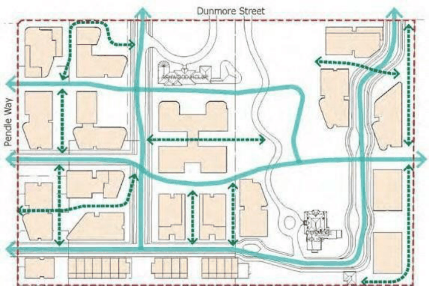

> [Picture on page 385: a picture, saved as a picture (images/part-f1-precinct-and-site-specific-development-controls-page-385-1.gif, 150 dpi).]

Figure 9: Public and pedestrian links

### 3.8 Managing transport demand

#### Objective

O1. Ensure that the transport demand generated by development is sustainably managed.

#### Controls

C1. DAs are to include a Transport Impact Assessment addressing potential impacts of

development on the surrounding transport network, where the proposed residential

development comprises 100 or more new dwellings.

C2. Car parking spaces are to be provided in accordance with State Environmental Planning

Policy (Housing for Seniors or People with a Disability) 2004, Australian Standard/ New

Zealand Standard, Parking Facilities, Part 6: Off -Street Parking for People with

Disabilities AS/NZS 2890.6:2009 and Part G3 Cumberland DCP 2021.

C3. Bicycle parking spaces are to be provided in accordance with Part G3 Cumberland DCP

2021.

C4. One ambulance space to be provided as required for the Residential Aged Care facility.

### 3.9 Heritage

#### Objectives

O1. Development respects and celebrates the site’s heritage significance.

O2. Development seeks to identify the potential for archaeological remains and ensures

adequate protection and best-practice management of remains or relics.

O3. Retain primary views to and from Dunmore House from Dunmore Street.

#### Controls

C1. Heritage curtilage is to be provided as shown in Figure 6: Heritage Curtilage.

C2. Buildings are set back from Dunmore House in accordance with Figures 11 and 12

C3. Minimum 12m separation distance between Ashwood House and any new building to the

immediate south and additional secondary setback of 23m towards the centre of the

building, inclusive of a landscape buffer zone for the provision of tall screening trees.

C4. Development is sited and designed generally in accordance with the Dunmore House &

Ashwood House Conservation Management Plan (CMP) prepared by Weir Phillips

Heritage and Planning (September 2019).

C5. Dunmore House and Ashwood House are sympathetically restored and adaptively re-

used and integrated with the remainder of the site. This includes adaptive reuse of and

public access to Dunmore House for community use.

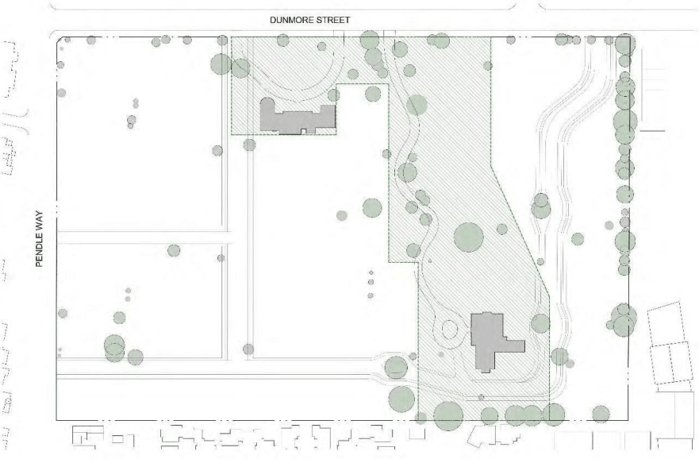

> [Picture on page 386: a picture, saved as a picture (images/part-f1-precinct-and-site-specific-development-controls-page-386-16.gif, 150 dpi).]

Figure 10: Heritage Curtilage

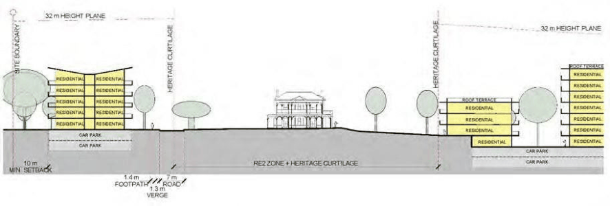

> [Picture on page 387: a picture, saved as a picture (images/part-f1-precinct-and-site-specific-development-controls-page-387-1.gif, 150 dpi).]

Figure 11: Heritage curtilage setback

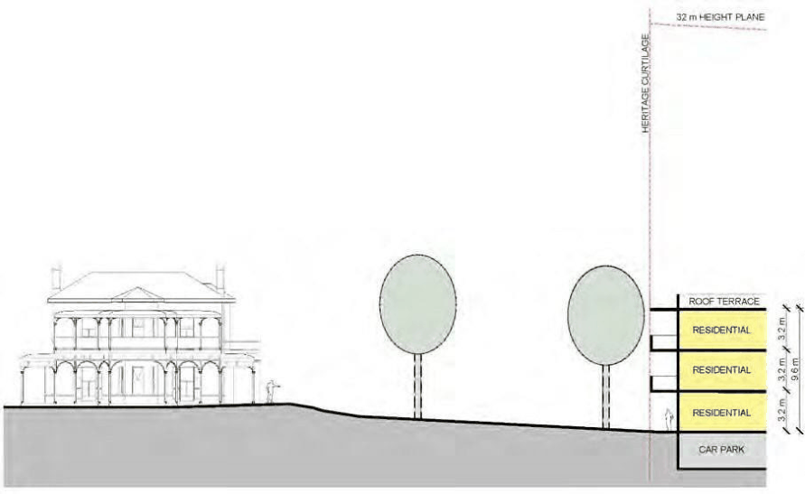

> [Picture on page 387: a picture, saved as a picture (images/part-f1-precinct-and-site-specific-development-controls-page-387-3.gif, 150 dpi).]

Figure 12: Dunmore House setback

This page has been left intentionally blank

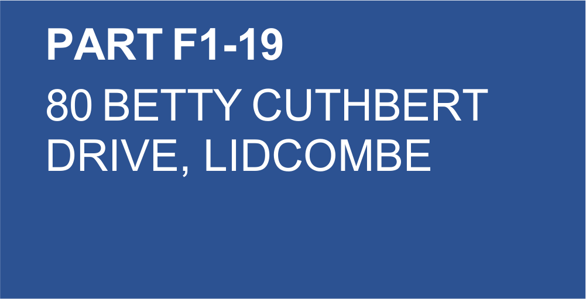

> [Picture on page 389: a picture, saved as a picture (images/part-f1-precinct-and-site-specific-development-controls-page-389-1.gif, 150 dpi).]
