### PART F1-19

## 80 BETTY CUTHBERT

### DRIVE, LIDCOMBE

## 1. Introduction

### 1.1 Purpose of this DCP

The purpose of this Development Control Plan (‘DCP’) is to outline the ‘site specific controls’ (the detailed

planning and design framework) that relates to 80 Betty Cuthbert Drive (refer to Figure 1) which is located

south of the Lidcombe town centre. Where there is inconsistency between this document and provisions

contained elsewhere in the Cumberland Development Control Plan 2021, the site-specific controls

contained in this document shall apply to the extent of the inconsistency.

### 1.2 Land to which this Part applies

This section applies to the site referred to as 80 Betty Cuthbert Drive, containing the following three (3)

lots – Lots 74 and 75 in DP 1141724 and Lot 475 in DP 45747. The site has a total area of approximately

58,818 sqm. Figure 1 Site Aerial

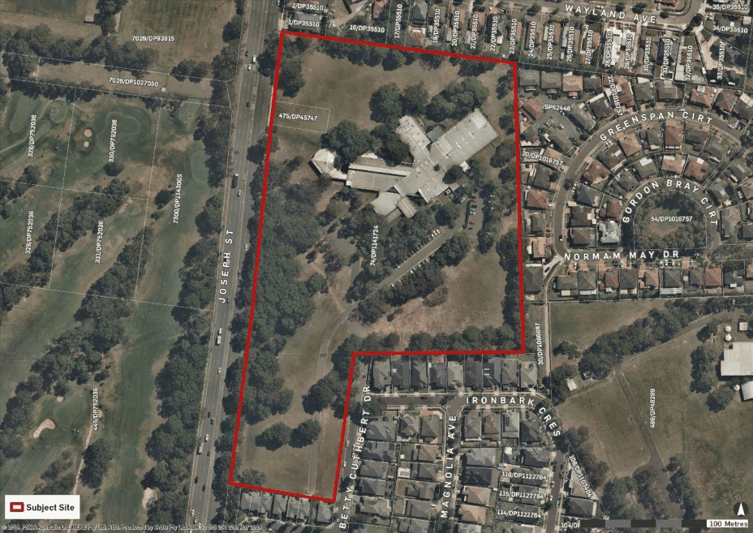

> [Picture on page 390: a picture, saved as a picture (images/part-f1-precinct-and-site-specific-development-controls-page-390-13.gif, 150 dpi).]

#### 1.3 Relationship to Cumberland Development Control Plan 2021

The controls contained in this part are supplementary to and shall be read in conjunction with the

following relevant parts of Cumberland DCP 2021. Part A – Introduction and General Controls Part B – Development in Residential zones Part C – Development in Business zones

Part E – Other land use-based development controls Part G - Miscellaneous Development Controls Where there is an inconsistency between this DCP Part and provisions contained elsewhere in

Cumberland DCP 2021, the provisions of this Part shall prevail.

## 2 Vision and general objectives

### 2.1 Vision

Provide a mix of residential, educational and health services within a landscaped setting to

complement and enhance the Lidcombe area.

### 2.2 General objectives

O1. Assist in creating a 30-minute city where residents are close to jobs, education, health

facilities and other services.

O2. Exemplify a thriving community where residents live in healthy and highly connected

neighbourhood served by well-maintained public spaces and facilities.

O3. Facilitate the opportunity for residents to choose from a variety of housing choices to

range of income levels and lifestyles.

O4. Provide a highly connected, safe and permeable network with convenient access to

public transport, public spaces and facilities, and amenities.

O5.  Provide opportunities to extend the pedestrian and cycle routes beyond the site. O6. Celebrate the natural environment through conservation of important trees and maintain

the existing landscaped character of surrounding residential areas.

O7. Prioritise healthy living, including design to mitigate and adapt to heat, and design for

active transport.

O8. Buildings are sited, positioned and designed to maximise climatic responsiveness and

provide high levels of desirable solar access and natural ventilation.

### 2.3 Indicative Master Plan

The vision and principles for the site as identified above are spatially expressed in the urban

structure for the precinct as shown in Figure 2. To ensure that development provides key

elements, where variations to the master plan are proposed, the development application is to

demonstrate how the vision and principles have been achieved.

Figure 2: Indicative Master Plan

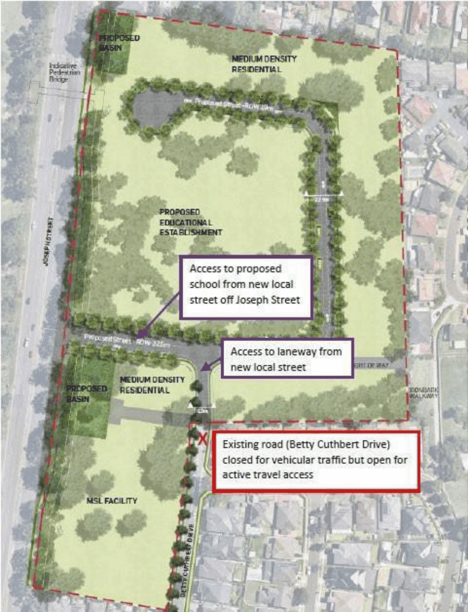

> [Picture on page 392: a picture, saved as a picture (images/part-f1-precinct-and-site-specific-development-controls-page-392-2.gif, 150 dpi).]

## 3 Specific objectives and controls

### 3.1 Land use

#### Objectives

O1.  Educational Establishment - Providing a future educational establishment on an

existing government site to meet the current educational demands of the Lidcombe area

and surrounding areas.

O2.  MSL Health Facility - Provide a fit for purpose facility for the care, support and treatment

for multiple sclerosis and other neurological conditions.

O3. Residential - Provide additional residential facilities within an existing residential area to

contribute towards housing targets set by State Government.

O4. Road Reserve - Provide efficient infrastructure to enable to possibility to accommodate

buses for the future educational facility and connect to the existing road network.

O5. Stormwater Basins - To reduce the rate of stormwater runoff discharged to the public

drainage network from development.

Figure 3 Indicative Land Uses

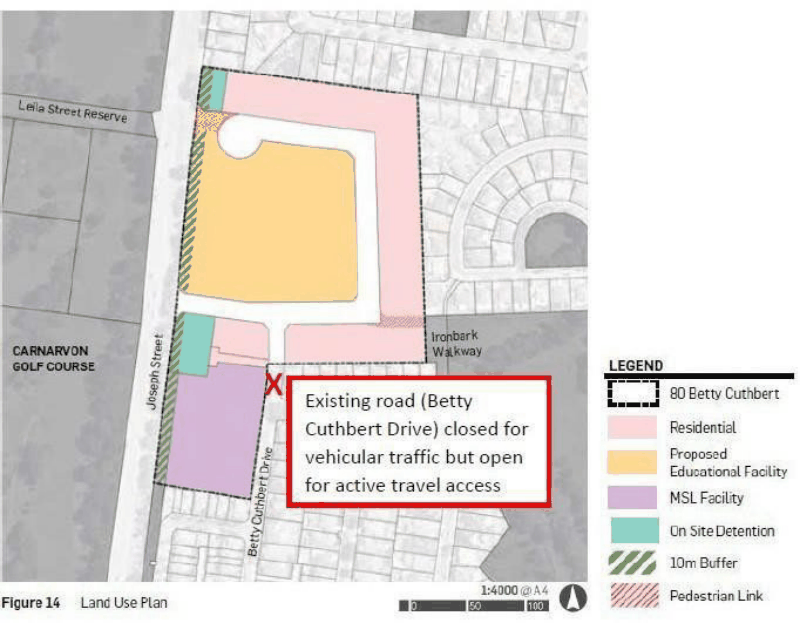

> [Picture on page 393: a picture, saved as a picture (images/part-f1-precinct-and-site-specific-development-controls-page-393-16.gif, 150 dpi).]

### 3.2 Movement Network and Street Layout

#### Objectives

O1. Create a safe and permeable road network that caters for pedestrians, cyclists and vehicles. O2. Provide opportunities to extend the pedestrian and cycle routes beyond the site boundaries.

#### Controls

Vehicular movement and directions are in accordance with the Access and Movement

Network in Figure 4 and associated indicative street sections.

C2. The new access road from Joseph Street, with a left-in left-out arrangement, is required

prior to the commencement of construction of the residential development or new school,

whichever comes first.

C3. A signalised intersection on Joseph Street is required prior to the operation of any

educational establishment on site.

C4. Betty Cuthbert Drive is to be permanently closed between the New Street and Ironbark

Crescent to separate local traffic and future development. This shall be undertaken prior

to the commencement of construction of the residential development or new school,

whichever comes first.

Figure 4 Access and Movement Network

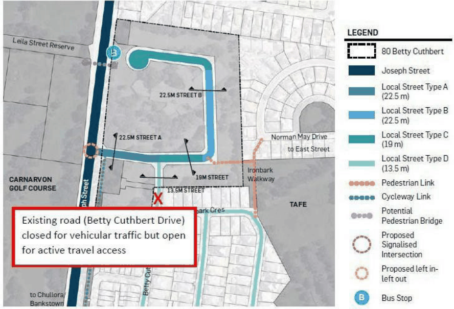

> [Picture on page 394: a picture, saved as a picture (images/part-f1-precinct-and-site-specific-development-controls-page-394-18.gif, 150 dpi).]

### 3.3 Pedestrian and cycle circulation

#### Objectives

O1. Encourage and facilitate walking and cycling within the site and the general neighbourhood. O2. Encourage use by pedestrian and cyclist use of the site by:

• providing footpaths on all streets on the site;

• providing safe and high amenity pedestrian linkages connecting all major activities

and open spaces;

• designing for safe on-street cycling conditions along residential streets;

• providing bicycle parking at key locations;

• providing new pedestrian and cycle access to adjoining housing development to

the south and east

• allowing for future pedestrian/cycle links to adjoining sites and regional routes and

integrating accessibility for the mobility impaired.

#### Controls

C1. Pedestrian and cycle routes shall be provided in accordance with the Access and

Movement Network in Figure 4.

C2. Streetscaping/public domain design shall strengthen the connection within the site and

to surrounding residential development and other local amenities.

C3. Pedestrian and cycle access is to be maintained between the existing development and the

site at the point where the road closure of Betty Cuthbert Drive is located.

### 3.4 Parking

#### Objectives

Maintain high amenity of the residential neighbourhoods by ensuring that adequate

provision is made for adequate parking is provided across the precinct.

#### Controls

C1. Parking should be consistent with the parking rates identified in Part G of the

Cumberland DCP

C2. Public parking spaces shall be provided in addition to the resident parking provided for

each dwelling.

C3. Public domain, street and landscape design shall clearly delineate parking areas.

Figure 5 Local Street A (22.5 metre road) indicative section

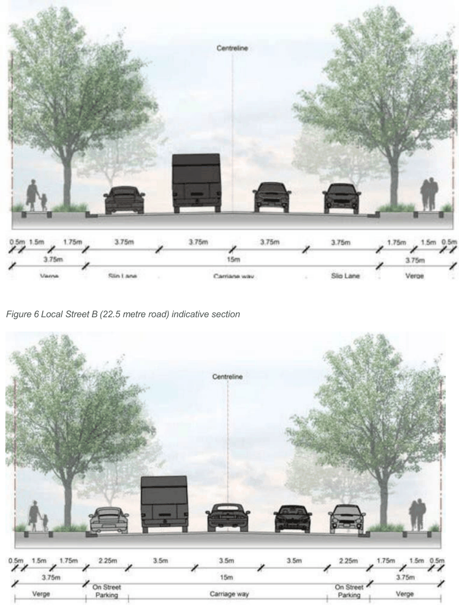

> [Picture on page 396: a picture, saved as a picture (images/part-f1-precinct-and-site-specific-development-controls-page-396-2.gif, 150 dpi).]

Figure 6 Local Street B (22.5 metre road) indicative section

Figure 7 Local Street Type C (19 metre road) indicative section

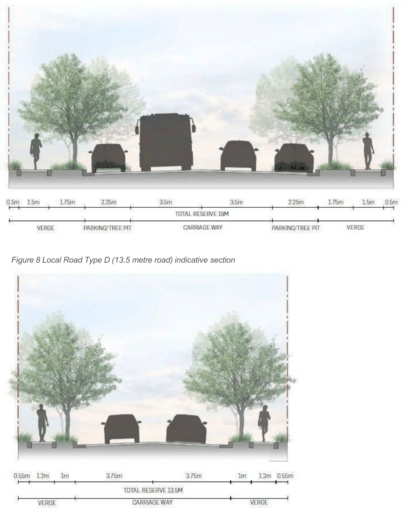

> [Picture on page 397: a picture, saved as a picture (images/part-f1-precinct-and-site-specific-development-controls-page-397-2.gif, 150 dpi).]

Figure 8 Local Road Type D (13.5 metre road) indicative section

### 3.5 Landscape and Public Domain

#### Objectives

O1. Retain high and medium value trees where possible subject to future educational

establishment, MSL and residential development.

O2. Extend streetscape character of Betty Cuthbert Drive and establish the streetscape

character to the future educational establishment perimeter street.

O3. Provide a consistent landscape buffer along Joseph Street to reflect the Botanica

interface.

O4. Maintain and enhance biodiversity on the site.

#### Controls

All development is to be consistent with the Landscape and Public Domain Strategy in

Figure 9.

Retention of trees shall consider:

• the safe useful life expectancy (assessed by a qualified arborist) and estimated future

lifespan;

• the current and future amenity and contribution to the landscape that the tree

provides;

• management and safety issues associated with retention

• preliminary tree retention mapping in Figures 10 – 15. Landscape design of private lots and retained existing trees shall contribute to the

landscape amenity of the neighbourhood and precinct landscape framework.

Based on the preliminary tree retention mapping in Figures 10 – 15.

• ‘medium retention value trees’ should be retained wherever possible but should not

be a constraint on the development.

• ‘high retention value trees’ are considered important for retention and should be

retained and protected wherever possible. All opportunities for retaining these subject

trees using design modification and tree sensitive construction techniques should be

explored. Street patterns and street tree planting shall be strong components of the landscape

framework and contribute to tree plan.

Streetscape planting shall ensure the coherence of new plantings and continuity with key

elements and themes of the existing landscape and surrounding residential

developments.

C7.  Where tree removal is proposed, a tree replacement strategy must be incorporated.

This strategy must demonstrate how a net increase in tree canopy shall be achieved, and

how tree management will be undertaken during the life of the tree.

C8. A biodiversity study which investigates threatened species and their habitats for the subject

site is to be undertaken. The outcomes of the study are to be applied during the

development of the site.

C9. Development on the site is to meet the requirements of the Biodiversity and

Conservation SEPP.

C10. All local roads proposed within the proposed master planned area must be provided with

Street tree planting that contributes to tree canopy cover through appropriate species

selection where possible.

Figure 9 Landscape and Public Domain Strategy

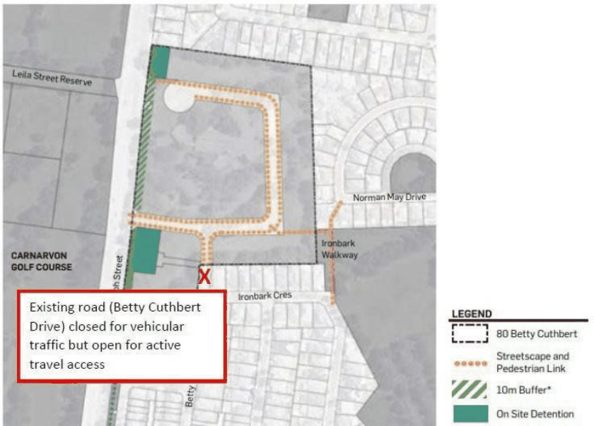

> [Picture on page 399: a picture, saved as a picture (images/part-f1-precinct-and-site-specific-development-controls-page-399-5.gif, 150 dpi).]

Figure 10 Tree Retention Value Reference Map

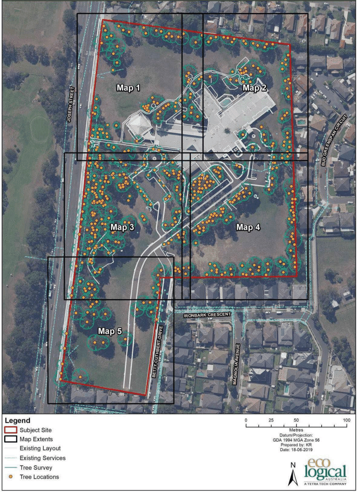

> [Picture on page 400: a picture, saved as a picture (images/part-f1-precinct-and-site-specific-development-controls-page-400-2.gif, 150 dpi).]

Figure 11 Tree Retention Values – Map 1

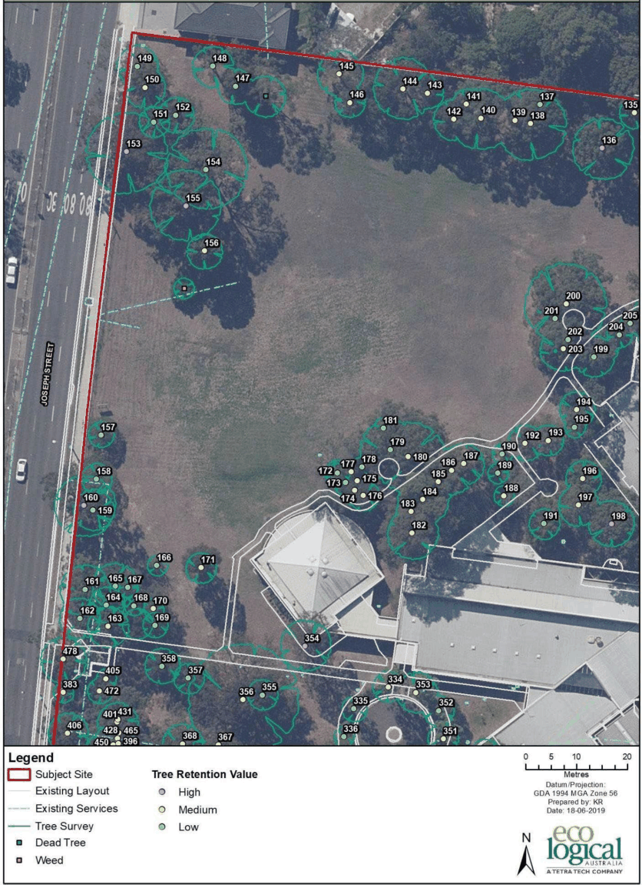

> [Picture on page 401: a picture, saved as a picture (images/part-f1-precinct-and-site-specific-development-controls-page-401-2.gif, 150 dpi).]

Figure 12 Tree Retention Values – Map 2

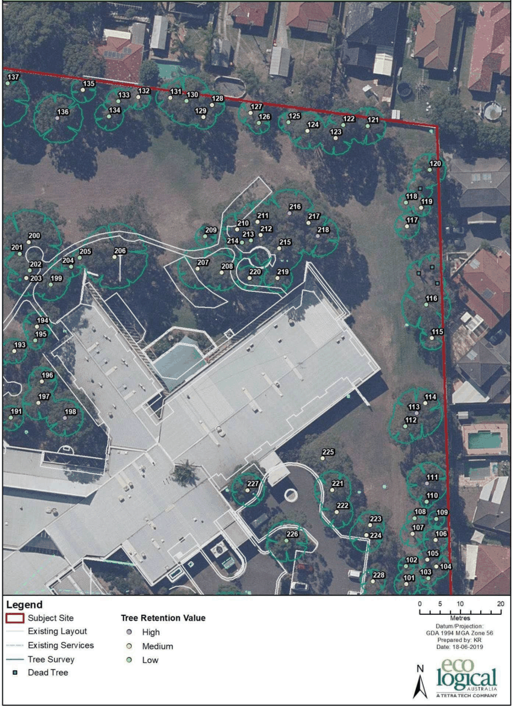

> [Picture on page 402: a picture, saved as a picture (images/part-f1-precinct-and-site-specific-development-controls-page-402-2.gif, 150 dpi).]

Figure 13 Tree Retention Values – Map 3

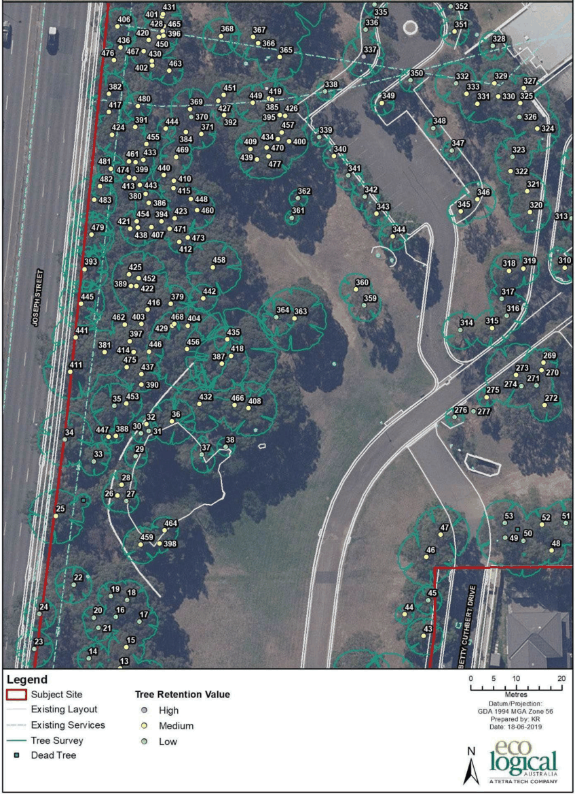

> [Picture on page 403: a picture, saved as a picture (images/part-f1-precinct-and-site-specific-development-controls-page-403-2.gif, 150 dpi).]

Figure 14 Tree Retention Values – Map 4

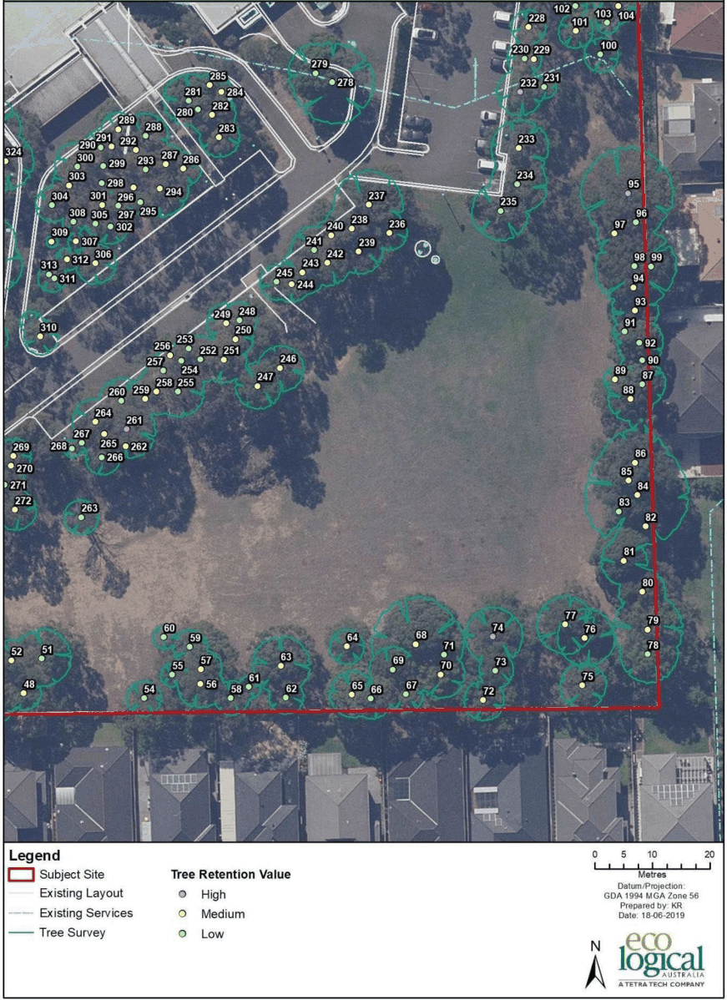

> [Picture on page 404: a picture, saved as a picture (images/part-f1-precinct-and-site-specific-development-controls-page-404-2.gif, 150 dpi).]

Figure 15 Tree Retention Values – Map 5

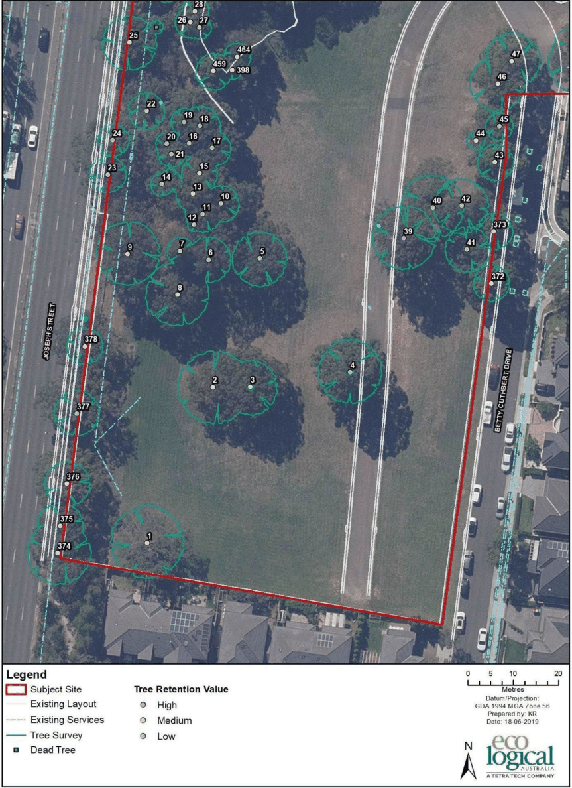

> [Picture on page 405: a picture, saved as a picture (images/part-f1-precinct-and-site-specific-development-controls-page-405-2.gif, 150 dpi).]

### 3.6 Proposed School

#### Objectives

O1. Provide a framework for service and infrastructure planning to support a new school on the

site to meet the needs of the local area.

O2. Ensure that local impacts arising from the new school on the site can be mitigated.

#### Controls

C1. A new school is to be provided on the site in accordance with the indicative masterplan. C2. The following fraemwork is to be considered for the planning, design and development of

a new school on the site:

• The applicant is to proactively consult with Council to inform the service and

infrastructure planning associated with the new school.

• The design of the school is to be consistent with relevant State policies and guidelines,

as well as provisions identified in the Cumberland Development Control Plan.

• The new school shall be designed to support up to 750 students. Teaching and

general staff numbers are to correspond to the maximum number of students

attending the school.

• The built form and scale of the new school must consider and respond sensitively to

the existing low and medium density residential scaled surrounds of Botanica

residential estate located south, R3 medium density residential proposed within the

site and low-density residential surrounds located north and east of the site. This is to

reduce any potential built form, scale, character, overshadowing and overlooking

impacts.

• The new school active play or open space areas shall be designed to provide a

minimum of 10m2 per student of open space standard at grade.

• The new school shall be up to a maximum of four storeys. The maximum height of

any structures for the school shall be located as far away as possible from the

adjoining residential areas.

• Parking shall be consistent with parking rates identified in Part G of the Cumberland

DCP.

• Traffic impacts shall be minimised by identifying infrastructure and operational

solutions to encourage access to the school by walking, cycling and public transport.

C3. Local impacts arising from the new school are to be assessed and mitigation measures

identified as part of the planning and development for the new school. This includes, but

is not limited to, the following:

• Built form and function

• Traffic, transport, parking and access

• Acoustics

• Environmental management

• Plan of Management for the operation of the site. C4. The road network identified in the indicative masterplan that supports the school is to be

provided prior to the construction of the new school.

C5. The pedestrian overpass across Joseph Street is to be provided prior to the operation of

the new school. The pedestrian overpass is to be based on the indicative design as shown

in Figure 16. A kiss and ride facility on Leila Street adjacent to Coleman Park is to be

integrated with the pedestrian overpass, providing safe access between the school and

Berala area. C6. Opportunities for open space within the new school to be shared with the local community

are to be considered as part of planning and development for the new school.

Figure 16 Indicative Layout of Pedestrian Overpass over Joseph Street, Lidcombe

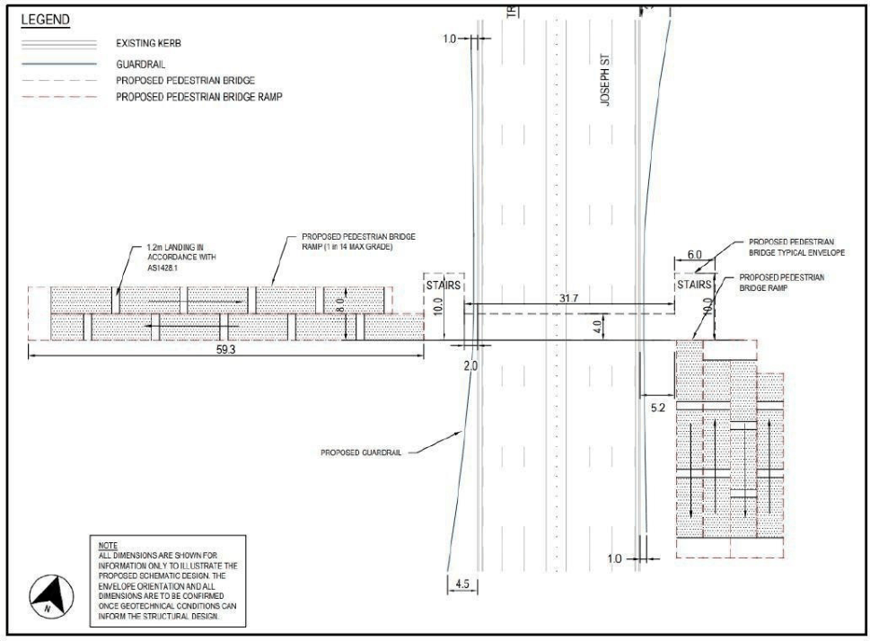

> [Picture on page 407: a picture, saved as a picture (images/part-f1-precinct-and-site-specific-development-controls-page-407-9.gif, 150 dpi).]

## 4 General Residential Controls

This section recognises that a range of densities is required to create a diverse built form that provides a wide choice of housing types. A range of densities across the site is occurring and is further anticipated, and concentration of certain

types is encouraged where it may be appropriate to create areas of distinct character where all other

urban design, built form and housing controls can be met. The private domain is to provide a high level of amenity to residents. The private domain includes private

open space as well as the interface between private open space and dwelling interiors. Adequate solar

access and privacy are fundamental qualities of the private domain. To guide the built form and character of the private domain and to ensure that a high-quality environment

is created the following principles are to be met:

• Enable flexibility in the choice of housing design and siting of a dwelling house as well as suitable

space available for other activities normally associated with the use of a dwelling house.

• Provide an appropriate level of amenity for new and existing residential areas.

• Ensure appropriate levels of service for utilities and the road network are achieved and to

optimise existing infrastructure.

• Adequately consider environmental constraints and impacts including flooding, drainage,

vegetation, erosion on a proposed subdivision.

• Ensure the proposed development lot is of sufficient size to accommodate the form of dwelling

house proposed.

### 4.1 Site Planning Controls

This section sets out the objectives, performance criteria and development standards that relate to site

planning and subdivision development.

#### Objectives

O1. The site planning and subdivision controls are to ensure that:

• interference with the topography is minimised;

• the topography can be clearly read and understood;

• the subdivision patterns set up regular rows of buildings and spaces and are suitable

for the dwelling types;

• a system of vehicular access to properties contributes to rather than dictates the

resolution of the street; and

• there are precincts/streets with a range of discrete characters.

#### Controls

C1. The street and block pattern shall:

• relate to the building types;

• minimise cut and fill;

• enable small increments of change between buildings;

• enable the street hierarchy to be reinforced by the building types;

• set up an appropriate spacing between buildings;

• create a regular pattern of driveway access from the street;

• provide views and vistas;

• reinforce the qualities of the site; and

• have the potential to provide external linkages over time.

#### 4.1.1 Subdivision, allotment planning, size and shape

#### Objectives

O1. Subdivision provides for a variety of housing types to meet a variety of housing needs

including meeting the needs of the aged and people with a disability.

O2. The allotment size and shape is adequate to contain the particular housing type, open

space and car parking (with the required amenity).

O3. The allotment size and shape sets up a regular subdivision pattern related to the

particular dwelling type, the street hierarchy and the block and street pattern.

O4. The allotment size and shape allows for buildings to align with the street system. O5. Subdivision makes provision for dwelling houses and multi dwelling housing such as:

• detached housing;

• semi-detached/zero lot line houses; and

• terrace houses.

O6. Individual allotments permit sufficient area commensurate with the dwelling type to allow

for useable outdoor open space and solar access as required elsewhere in this Part.

O7. The allotments and the location of the buildings are organised to set up regular patterns of

buildings and space.

O8. The allotments enable a range of housing types and spatial distribution. O9. The irregular shaped and sized allotments provide the opportunity for specific design

solutions.

O10. The allotments are predominantly rectangular. O11. The allotments which provide the higher density are located around the open space

system.

O12. The allotments are located so that the dwellings relate to the street hierarchy.

#### Controls

C1. Level changes along a street block shall be made incrementally with minimal cut and fill.

C2.  Housing types shall be built to a height of up to 3 storeys where it is necessary to define

and balance the spatial system.

C3. Minimum lot frontages for each of the dwelling types are set out in Table 1 below.

#### Table 1 Minimum subdivision standards for individual dwelling types

|  | Detached | Semi-detached / zero lot line houses | Terrace houses & town houses |
|---|---|---|---|
| Minimum frontage width at building line (m) | 12* | 7.5 | 6 |
| *may be reduced to 10m if the dwelling has a garage that is accessed from the rear of the property |  |  |  |

C4. Strata titling of studio accommodation shall be considered where the following outcomes

are provided:

• both the primary residence and the studio have individual frontage to a public road;

• a minimum of 1 covered off-street car parking space is provided for the studio in

addition to car parking required for the principal residence;

• the studio accommodation has a minimum habitable floor area of 45sqm;

• the studio accommodation has a balcony or private courtyard (designed to eliminate

overlooking) of minimum 8sqm and a minimum depth of 2m;

• the allotment on which the studio accommodation is located has a minimum width of

10m and a maximum area of 55sqm; and

• the privacy of the principal residence’s rear yard and adjoining allotments is not

compromised.

#### 4.1.2 Water Quantity Planning Controls

On-site detention (OSD) is required to be designed for each lot to ensure peak flow rates at any

point within the downstream drainage system do not increase as a result of development during

all storm events up to the 100-year ARI, with the following requirements:

• Permissible site discharge (PSD) - 100L/s/Ha

• Site storage requirement (SSR) - Minimum of 455m3/Ha

#### Objectives

O1. The drainage strategy takes into account a total catchment management approach such

that downstream drainage systems are not impacted adversely through alteration to

existing drainage flows from the site.

Drainage systems and ground surface areas are to be protected from pollutants and soil

erosion. Pollutant and sediment control measures are required for all subdivision

applications.

The drainage works for the site are to preserve the effectiveness of existing downstream

flood mitigation and drainage works.

Proposed development is not to increase downstream flooding or increase pollutants on

a total site performance basis. Off-site mitigation measures will be accepted as meeting

this criteria subject to satisfactory arrangements with the affected landowner.

Stormwater infrastructure is to be designed to be aesthetically pleasing and landscaped

so as to serve a dual function as a continuation of the open space and stormwater

management.

#### Controls

C1. Stormwater runoff from all new roof areas shall be routed through the OSD system. Runoff

entering the site from upstream properties shall be directed bypassing the on- site

detention system.

C2. A portion of the new impervious areas (excluding roof areas) shall discharge directly to

road drainage system if it cannot be drained to the storage facility, provided the PSD is

reduced to compensate for the smaller catchment.

C3. No more than 15% of the total site area shall be permitted to bypass the detention system.

C4.  The maximum desirable extent of impervious surfaces bypassing the detention system

is 15% of the total impervious site area.

### 4.2 Residential Dwelling Controls

#### 4.2.1 Dwelling design and form

#### Objectives

O1. Housing variation caters for a socio-economically diverse community.

O2. Ensure dwellings and garages are designed with regard to site conditions and minimise

impact on landform.

O3. Ensure dwelling and garage design has regard to the amenity of adjoining development

and surrounding properties.

O4. Ensure that dwellings have a high level of internal and external amenity.

O5. Denser housing forms are to be located around open space and on wide verges.

Dwelling groups are not composed of different dwelling types (e.g., terrace dwellings

are to stand alone as one group).

Taller or raised housing forms are to be located where land slopes away from an open

space or across the width of the street.

Where land slopes along the street, dwellings to follow the slope of the land.

Floor to ceiling heights to enable good light penetration and cross ventilation.

Ensure that groupings of similar types of dwellings create areas of a particular identity

in the built form and streetscape.

Ensure that dwelling design and types reinforce corners, the street, and open space

hierarchy.

Dwellings and garages are designed with regard to the site conditions and minimise the

impact on landform.

#### Controls

C1. A minimum of 20% of the total number of dwellings shall be detached dwellings.

C2. The building height controls and floor to ceiling controls applicable to buildings are set

out in the Table 2 below.

#### Table 2 Floor to ceiling heights

|  | Levels | Minimum | Maximum |
|---|---|---|---|
| Dwellings | Ground floor 1st and 2nd floor | 2.7m 2.4m | 3m 2.7m |

C3. The maximum building depth of any second or third storey components of dwellings

shall be 14m.

C4. Stairs, verandahs, entry features, courtyard walls, balconies, carports and porticos may

encroach within the primary building line by not more than 2m provided the design,

materials, colour and construction match the main dwelling.

C5. Dwellings shall be predominantly 2 storeys with some component of single storey. 3

storey dwellings shall be considered if they are on sites where it can be demonstrated

that it enhances the streetscape and/or legibility.

C6.  The floor level of any dwelling shall be a minimum of 500mm above the 1% AEP

level of any adjacent drainage easement or water course or OSD facility.

C7.  Garage door openings fronting a public road shall be not be more than 5m wide or

50% of the frontage width of the allotment measured at the building alignment,

whichever is the greater.

C8. Garage door fronts shall be setback a minimum of 5.5m from the street boundary and

1.5m back from the front dwelling façade.

C9. Garages, particularly doors, carports and parking areas shall be detailed to reduce their

visual impact and add interest at ground level. The materials used in the garage shall

complement those of the house.

C10.  Garage and carport design shall be in the same application as the dwelling even if it

is to be constructed at a later date.

C11. Carports shall be designed so that secondary elements do not dominate the dwelling

façade.

C12. Pitched roofs to carports shall not permitted unless compliance with the streetscape

objectives can be demonstrated and the carport structure does not dominate the

dwelling façade.

C13. Carports shall be a maximum of 3.5m in width.

C14. Carports shall be designed as open pergola type structures. This may include a flat

roof and shall not be screened on the sides or front.

C15. Carport structures shall be setback a minimum of 2m from a primary street front

boundary.

C16. Carport structures shall not exceed 3.5m in height including all elements.

#### 4.2.2 Density of dwellings

#### Objectives

O1. Density is to be optimised while allowing for:

• adequate open space;

• appropriate curtilage for landscape of exceptional and high value;

• a street and block system which suits the building typologies and enables the

reading of the landscape setting; and

• minimum intrusion on the topography.

#### 4.2.3 Site Coverage

#### Objectives

O1. Site coverage enables the proposed building type, adequate open space and the

required car parking.

O2. Site coverage varies to suit the dwelling type i.e. terrace houses require greater site

coverage than detached houses.

O3. Development achieves:

• a clear physical (bulk) relationship between each building type and its allotment

size with regard to creating neighbourhoods of some homogeneity; and

• adequate separation between dwellings particularly at the rear of the site.

#### Controls

C1.  The maximum site coverage for residential development as a percentage of the total

site area for each dwelling type shall be compliant with the requirements set out in Table

3 below.

#### Table 3 Minimum site coverage

|  | Detached | Semi-detached / zero lot line houses | Terrace houses & town houses |
|---|---|---|---|
| Maximum site coverage | 55% | 60% | 70% |

#### 4.2.4 Setbacks

Setbacks are required to protect the privacy of adjoining residents, to provide for sunlight to

adjoining dwellings and to provide a visual rhythm and coherence to the streetscape.

#### Objectives

O1. Ensure that the dwellings address the public domain and set up a spatial rhythm.

O2. Ensure there is adequate solar access and privacy

O3. The setbacks to the street need to provide:

• a clear reading of the topography;

• a clear edge to the street and/or open space system;

• a semi-private zone;

• houses which are more dominant than garages;

• reinforcement of the street hierarchy;

• reinforcement of the street block where appropriate; and

• an open streetscape with adequate areas for landscaping, fencing, and screen

planting.

O4. The setbacks to the side boundary and the rear are to ensure that there is:

• adequate solar access to neighbours;

• privacy for residents and neighbours, and minimise overshadowing; and

• an even spatial rhythm along the street so that individual building types do not

dominate.

#### Controls

C1. Table 4 below sets out the minimum setback requirements for all dwelling types on the

site.

#### Table 4 Minimum setback requirements for all dwelling types

| All Dwelling Types |  |
|---|---|
| Primary front setback | 4m to building façade of habitable rooms from the front boundary line. This setback may be reduced to 3m for dwellings fronting public open space or a corner, providing solar access and other environmental provisions are met. |
| Side and rear set back | A 1.2m side setback is required for 1 and 2 storey portions of dwellings. Garages, including those with studio accommodation above, in lanes can be located on the rear boundary provided a minimum of 7.5m is provided between the façade and opposite boundary fence or building façade. (Refer below for additional requirements). |
| Eaves/facias | 825mm for 1 or 2 storey buildings. |

C2. Garages facing a street shall be set back a minimum of 5.5m from the front boundary.

C3. Two storey, open, non-habitable structures including carports, pergolas, verandahs and

entry features shall sit within the 2m articulation zone as measured from the primary

front setback.

C4.  Adjoining building facades shall be aligned. Building facades may vary in alignment only

if a cohesive streetscape is achieved. Any variation to the alignment shall be derived

from the building type and the topography, i.e. where a lot slopes away from an area of

parkland or to achieve a more successful result by locating a building or group closer to

the street edge.

#### 4.2.5 Orientation

#### Objectives

O1. Ensure that the orientation and organisation of lots will enable dwellings to achieve the

environmental performance guidelines as set out in section 2 of this Part.

O2. The building zone for the dwelling is predominantly at the front of the lot.

O3.  The higher density areas with smaller lot frontages are predominantly east-west or north-

south where the north is at the rear.

O4.  Ensure the subdivision of allotments maximises the potential for energy efficient housing

development whilst maintaining the design integrity of the overall development.

O5. All allotments are to provide for sufficient area to allow the siting of dwellings and to allow

for adequate areas of private open space, vehicle access and parking as set out

elsewhere in this Part.

#### Controls

C1. Lots shall be oriented to facilitate the siting of dwellings to meet the Ecologically

Sustainable Development (ESD) criteria set out in this Part.

C2. The above requirements may be varied in cases where an applicant submits an integrated

subdivision and development application demonstrating that the performance criteria

have not been compromised.

#### 4.2.6 Private open space and landscaping

#### Objectives

O1. Private open space areas are to:

• relate to the living spaces, windows, access/egress points and function of the

dwelling; and

• be amenable and suitable for the intended use.

O2. All setback areas are to be landscaped to Council’s satisfaction.

O3. Ensure private open space is of a size and location suitable for the intended use.

O4. Private open spaces and living areas are protected from overlooking from public

and neighbouring areas.

O5. Private open space areas are clearly defined and screened for private use.

O6. Landscape treatment of private open space areas contribute to the master planned

themes for streetscape and public open space (where private open space is visible from

these public areas).

O7. Landscape treatments complement solar access requirements for buildings.

O8. Planting:

• is appropriate for its setting and environment;

• is provided in the public and private domain;

• complements the existing landscaping and topography, lighting and street furniture;

• is simple and robust; and

• provides privacy, screening and shading where required.

O9. All new landscaping is to be designed to be low maintenance and low water usage.

#### Controls

C1. New plantings shall contain endemic species that are of low maintenance and low water

usage.

C2. Cultural plantings shall be used where existing plantings are to be enhanced.

C3.  The minimum area of soft landscaping for residential development as a percentage of

the total site area for each dwelling type shall be as set out in Table 5 below.

C4.  Private open space shall be of a minimum size as set out in Table 5 below and be

able to contain a square measuring a minimum of 4m x 4m which is free from

obstructions such as garden beds and steps.

C5. Private open space areas associated with residences shall accommodate outdoor

recreation needs and function as an extension of interior living areas.

Planting shall be used to minimise overlooking between dwellings, and between

dwellings and public or common areas; having regard to crime prevention principles.

Planting shall be of appropriate mature heights and volumes to the space allotted to

them.

C8. The area between the front property boundary and the front building line shall not be

considered as private open space unless solar access is principally to the front garden

space and this area is suitably fenced and screened.

#### Table 5 Minimum private open space per dwelling type

|  | Detached | Semi-detached / zero lot line houses | Terrace houses & town houses |
|---|---|---|---|
| Minimum area of private open space | 70m² | 60m² | 35m² |
| Minimum landscaped area of site | 45% | 40% | 30% |

#### 4.2.7 Architectural Expression

#### Objectives

O1. Ensure that dwellings relate well to one another and contribute to the quality of each

precinct and the overall quality of the development.

O2. The architectural expression of dwellings is to ensure that:

• attached housing has clearly defined party walls which enable buildings to adjust to

the topography without large benching;

• roof forms in attached housing are to reflect the stepped changes at ground level;

• a high standard of architectural design of both individual dwellings and groups of

dwellings;

• special urban design features are reinforced such as the alignment of roads which

curve towards a spatial gateway or landscape focus;

• building entries are clear and legible;

• windows, facades and rooms are well proportioned;

• materials and detailing are appropriately used;

• roof forms are used which relate to the definition of space and do not create big

buildings such as hip roofs on runs up terrace houses are not appropriate;

• attention to both the building base and roof is required;

• roof forms in attached housing reflect the stepped changes at ground level;

• windows to main rooms are directed to the front and rear

• the head height of windows relate to the height of the ceiling; and

• there is variety but continuity between dwellings.

#### Controls

C1. Design of dwellings shall consider the following:

• Articulation of building facade using: o

material and detailing; o

legible building entrances; o

balcony and other elements; and o

well proportioned openings, window, type and size.

• corner buildings shall be articulated to reinforce the corner condition by addressing

both street frontages;

• building elements such as balconies, verandahs, pergolas, sun shading, porches

and other elements shall be used to articulate the façade;

• windows to living areas shall be directed either to the street or rear private open

space (and vehicular access ways) to provide surveillance to the street and other

open space areas;

• modulation of the facade shall be integral to the design of the building, its setting

and not arbitrary;

• level changes along a street block shall be made incremental with minimal cut and

fill; and

C2. Windows and doors, particularly those that face the street, shall be provided in a

balanced manner and respond to the orientation and internal uses.

#### 4.2.8 Adaptable Housing

#### Objectives

O1. Ensure a sufficient proportion of dwellings include accessible layouts and features to

accommodate changing environments of residents.

O2. Development to allow for dwelling adaptation that meet the changing needs of people’s

lifestyle.

#### Controls

C1. A minimum of 10% of the total number of dwellings shall be constructed so as to be

adaptable for use by aged or disabled occupants in accordance with the relevant

provisions of the Building Code of Australia and Australian Standards.

C2. Refer to the requirements for adaptable housing in Part B of this DCP.

#### 4.2.9 Building materials

#### Objectives

O1. Ensure that materials are durable and have a long life.

O2. Ensure that materials have low embodied energy.

O3.  Ensure that materials contribute to the design of the buildings in terms of aesthetics and

comfort.

O4. Materials are to:

• create a high-quality finish which is robust over time;

• be appropriate to the scale and detailing of the building;

• relate well to one another; and

• provide thermally responsive dwellings.

#### Controls Walls

C1. Exterior walls shall be predominantly masonry and/or timber. Lightweight materials

especially timber can be used to add interest and texture to the building and to break up

larger expanses of wall.

C2.  Bolder brighter shades for areas of detail shall be appropriate provided that these are in

keeping with the overall colour scheme of the house and do not detract from the general

harmony of the street.

#### Roofs

C1. Single colour tile roofs are preferred. Pre-finished metal sheeting may be used on

concealed roofs or “lean to” construction.

C2. Colours shall reinforce the character of the precinct.

#### Windows

C1.  Windows may be constructed of timber or pre-finished aluminium and shall be in a dark

colour.

#### 4.2.10 Solar Amenity

#### Objectives

O1. Ensure that housing design is energy efficient, assists in developing ecologically

sustainable residential communities and leads to a reduction in the household use of

fossil fuels.

O2. The design of buildings minimises household energy needs, utilises passive solar design

principles and ensures adequate solar access.

O3.  Shading to western walls is to be provided where not overshadowed by adjoining walls

or vegetation.

O4. Roof insulation is incorporated into all residential development.

O5. All dwellings have high levels of light penetration.

O6. Cross ventilation is provided.

O7. Buildings are to be designed with windows that are located, sized and/or shaded (including

the use of eaves) to facilitate thermal performance and minimise the use of artificial light

during daylight hours.

O8. The design of residential dwellings is to demonstrate passive design principles including:

• window placement;

• building orientation;

• shading;

• insulation;

• ventilation; and

• sensitive landscaping.

#### Controls

C1. The use of materials shall minimise energy use over their whole lifecycle.

C2. All residential buildings, where not affected by external noise sources, shall be able to be operated

in a naturally ventilated mode and achieve comfortable internal conditions.

C3. Vegetation shall be used to cool the ambient temperature within the development.

Selective use of trees shall include consideration of deciduous trees to provide shading in

summer and allow passive heat in winter.

C4. Buildings shall be designed to allow passive heating in winter. Selective shading shall

be applied so that the high angles of sunlight in summer do not penetrate the buildings.

C5. Distances between buildings shall be designed to allow natural light to dwelling living

spaces.

#### 4.2.11 Privacy and overshadowing

#### Objectives

O1. Ensure the design of buildings and position of windows respects the privacy of adjoining

residents.

O2.  Buildings are to be sited and designed to ensure provision of daylight to habitable rooms

in adjacent dwellings and neighbouring open space including the private open space

associated with dwellings.

O3. Buildings are to be designed to ensure appropriate levels of privacy.

O4. Developments are to include site planning, building design and landscaping that minimises

the overshadowing of adjoining properties.

#### Controls

C1. Windows to living areas shall face predominantly to the street and to the rear.

C2. Windows to living areas that face directly on to windows, balconies or private open space

of adjoining properties shall be appropriately screened and/or have reasonable

separation. A distance of 9m between openings of separate dwellings is required unless

other mitigating measures are adopted.

C3. First floor balconies shall not be permitted where directly overlooking living areas of

adjacent dwellings unless suitable screening is provided.

C4.  At least 50% of the ground level private open space shall receive not less than 3 hours

of sunlight between 9:00am and 3:00pm on June 21 for a minimum of 80% of all

dwellings.

C5. At least one internal living area shall have access to a minimum of 3 hours of direct sunlight

between the hours of 9:00am and 3:00pm on June 21. This shall be achieved for a

minimum of 80% of all dwellings.

#### 4.2.12 Fencing

#### Objectives

O1. Fencing is to:

• clearly demark the public, semi-public and private domains;

• complement the dwellings and the streetscape; and

• provide privacy where appropriate.

O2. All new dwellings to have side and rear boundary fences.

O3. Front fences, where appropriate, contribute to the streetscape and allow gardens to

contribute to the public domain

O4. Front fences, where appropriate, extend alongside boundaries of corner sites back to the

building line.

O5. Ensure that rear and side fencing assists in providing privacy to private open space areas.

O6. Fence height, location and design should not affect traffic sight distances at intersections.

O7. Ensure that front fences relate in proportion to the height of the building and are

appropriate to the style of residence

#### Controls

C1. Side boundary fencing constructed behind the building alignment setback shall be a maximum

height of 1.8m and be constructed from materials which complement the design of the

dwelling.

C2.  The front and side dividing fences where located within the front yard area shall not exceed

a height of 1.2m as measured above existing ground level and shall be a minimum of 50%

transparent.

C3. Front and side dividing fences where located within the front yard area shall not be constructed

of solid pre-coated metal type materials such as Colorbond or similar.

C4. Front fencing that is to provide privacy screening for external living areas shall be considered

up to a maximum height of 1.8m if complementary to the dwelling design.

C5.  Fencing to secondary road frontages and rear vehicular access shall be a maximum of 1.8m

in height at the road boundary from the rear boundary up to the line of the front of the

dwelling and must be of materials and design complementary to both the streetscape and

dwelling.

C6. Front fences shall be compatible with and sympathetic to the dwelling design.

C7. Fencing styles shall complement both the architectural design of the dwelling and the

streetscape. Front fences should not exceed 1.2m in height unless required for provision of

privacy to private open space and unless appropriately screened by landscaping and with

variations in materials and alignment.

#### 4.2.13 Waste controls

Waste requirements should be consistent with the relevant controls identified in Part G of the

Cumberland DCP.

#### 4.2.14 Parking and loading controls

Parking requirements should be consistent with the relevant controls identified in Part G of the

Cumberland DCP.

Cumberland DCP – Part F1 Residential Site Specific

> [Picture on page 423: a picture, saved as a picture (images/part-f1-precinct-and-site-specific-development-controls-page-423-2.gif, 150 dpi).]
