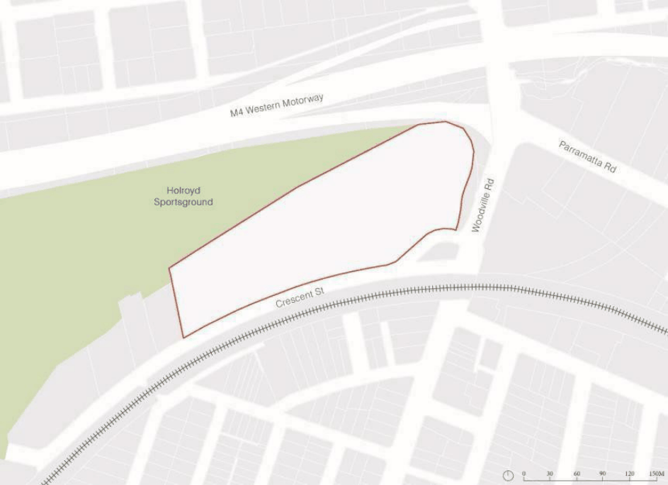
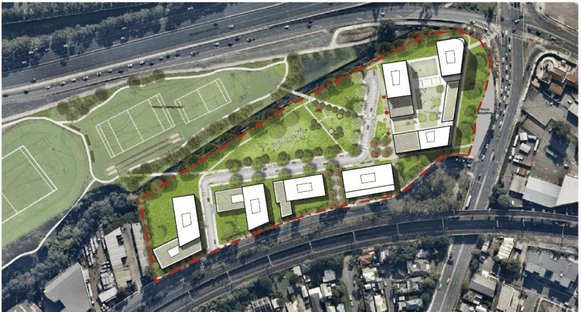
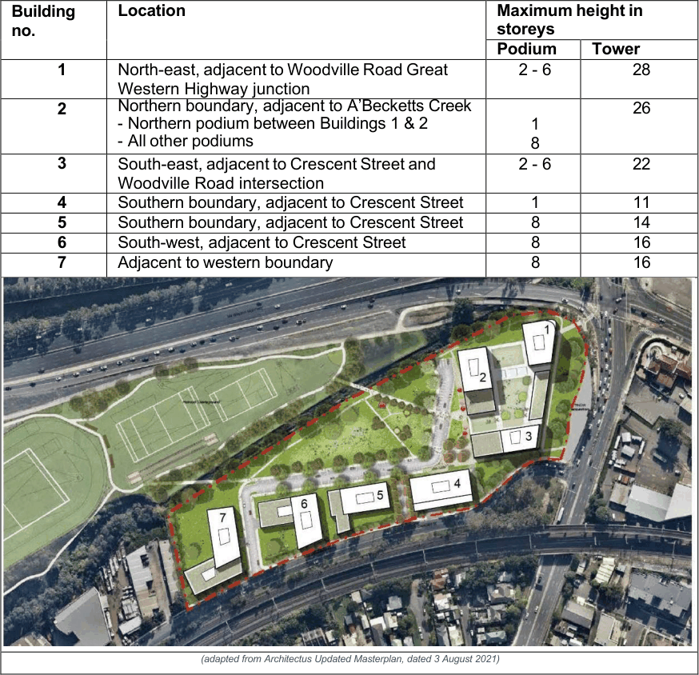
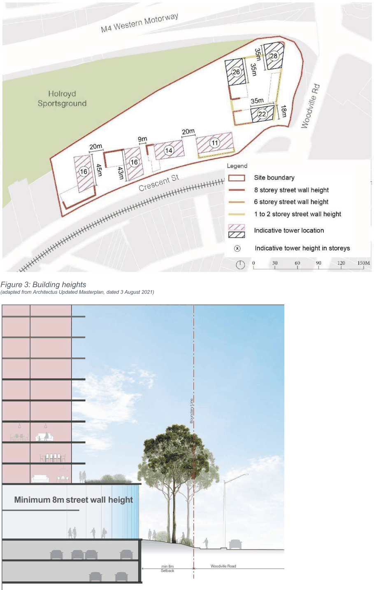
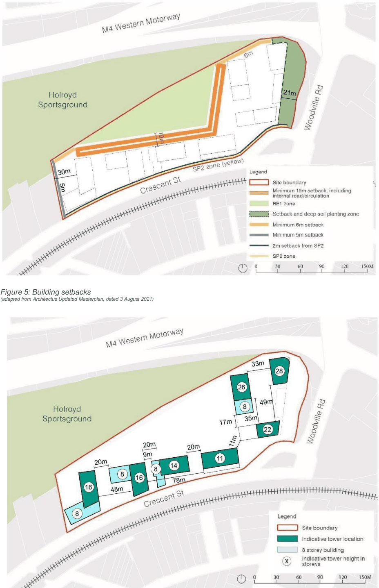
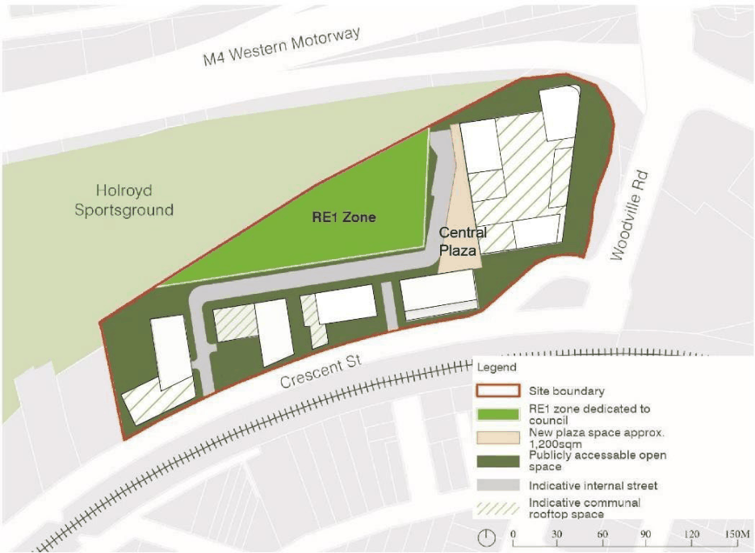
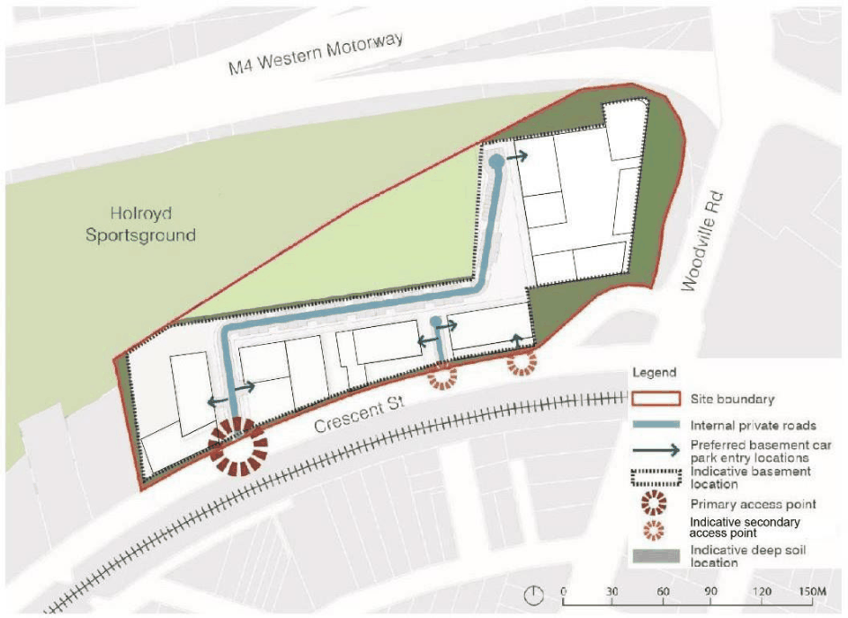
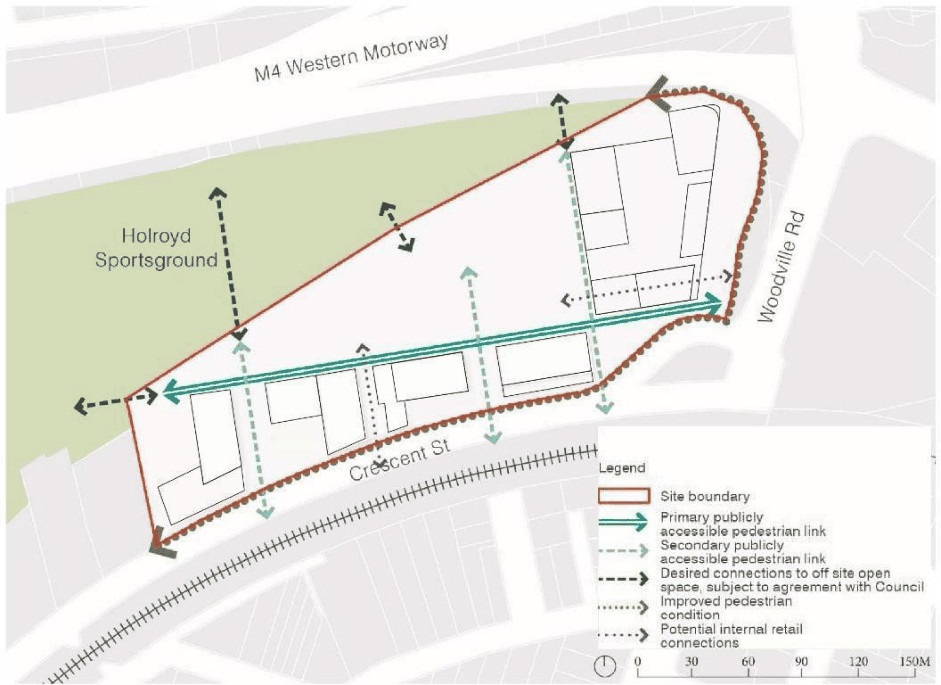
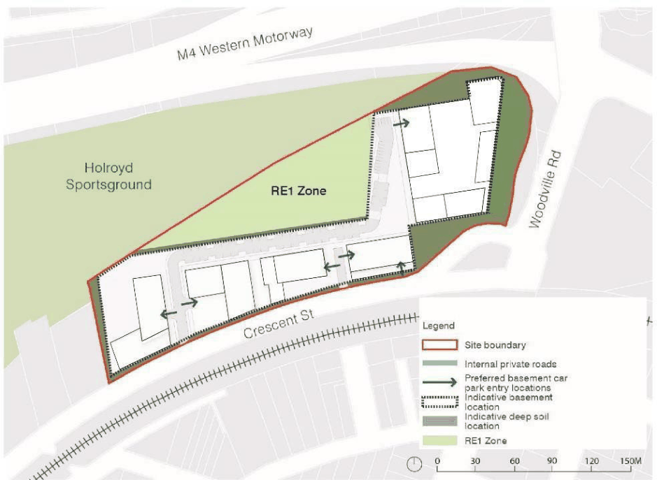
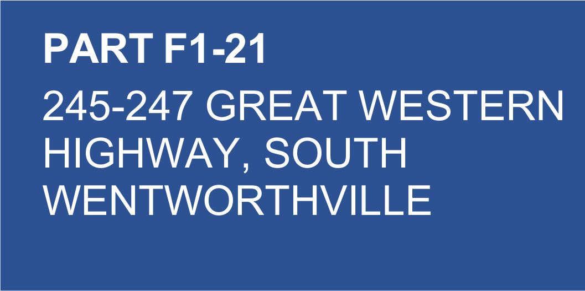

### PART F1-20

## 1 CRESCENT STREET,

### HOLROYD

Page F1-423 of F1- 454

Cumberland DCP – Part F1 Residential Site Specific

#### This page has been left intentionally blank.

Page F1-424 of F1- 454

Cumberland DCP – Part F1 Residential Site Specific

## 1. Introduction

### 1.1 Land to which this Part applies

This Part applies to land at 1 Crescent Street, Holroyd. The site is legally known as Lot 700, DP

1241836 and shown at Figure 1.

> [Picture on page 425: a picture, saved as a picture (images/part-f1-precinct-and-site-specific-development-controls-page-425-6.gif, 150 dpi).]

Figure 1: Land to which this Part applies

### 1.2 Relationship to other parts of Cumberland Development Control

#### Plan 2021

This site-specific Development Control Plan (DCP) forms part of Cumberland Development

Control Plan (Cumberland DCP) 2021. This Part should be read in conjunction with all other

parts of the Cumberland DCP which contains objectives and development controls that relate

to development in this Part.

Part A - Introduction and General Controls

Part B – Development in Residential Zones

Part C – Development in Business Zones

Part D – Development in Industrial Zones

Part E – Other Land Use Based Development Controls

Part G – Miscellaneous Development Controls

In the event of any inconsistency between this Part and other Parts of the Cumberland DCP

2021, this Part will prevail to the extent of the inconsistency.

Page F1-425 of F1- 454

Cumberland DCP – Part F1 Residential Site Specific

### 1.3 Purpose of this Part

The purpose of this DCP’ is to articulate the detailed built form controls and to outline the site-

specific controls to guide the development at 1 Crescent Street, Holroyd (the site). The DCP

shall also be considered with the site-specific provisions identified in the Cumberland Local

Environmental Plan (Cumberland LEP) 2021. No savings provisions apply to development applications that are considered for this site.

## 2. Vision and desired future character

### 2.1 Vision

The redevelopment of 1 Crescent Street, Holroyd, will support housing diversity and

affordability, and neighbourhood retail and commercial land uses with new opportunities of

publicly accessible open space for community uses and to complement and enhance the

Holroyd area and surrounds.

### 2.2 Desired future character

The objectives of this Part are to:

O1. Provide a clear vision, development principles and controls for the development of the site.

O2. Encourage high quality architectural, public domain, and landscaping outcomes that

positively contribute to the character of Holroyd.

O3. Ensure buildings are located to respond to the site’s location and the surrounding context.

O4. Ensure ample provision of publicly accessible open space with connectivity to existing

open space areas that improve environmental and amenity outcomes.

O5. Safeguard opportunities for on-site employment while also providing a diversity of new

housing to cater for a range of housing needs.

O6. Provide safe and efficient vehicle access and circulation within the development.

O7. Improve pedestrian and cycle connectivity through the site to existing cycle paths and

pedestrian networks that lead to key transport and employment nodes.

O8. Encourage sustainable transportation mode on the site through connectivity to, and

increase use of public transportation.

### 2.3 Desired future character statement

A high-quality, well designed, safe and attractive high-density development, that is focused on

new open space and local shops to provide a high amenity setting and outlook for the residents

and located near Merrylands and Granville. The Precinct will attract a range of jobs and retail

uses.

To achieve a high-quality outcome for the development of the site, the development of the site

is to demonstrate consistency with the following urban design objectives:

O1. Enhance the quality of the local area, particularly through provision of new public open

space, increased greening, and improvements to A ’Becketts Creek.

Page F1-426 of F1- 454

Cumberland DCP – Part F1 Residential Site Specific

O2. Improve public transport, pedestrian and cycleway connectivity within the local area

including through the site.

O3. Promote a ‘green and leafy’ character for the local area.

O4. Maintain a sense of spaciousness for development.

O5. Provide appropriate interfaces to surrounding uses.

O6. Ensure impacts from surrounding noise sources are appropriately mitigated through

building design and use of materials.

### 2.4 Masterplan

#### Objectives

O1. Provide a framework for the future high-quality renewal of the site.

O2. Ensure the delivery of new open space and adequate social infrastructure and services.

O3. Ensure a range of jobs are provided on the site.

O4. Ensure the development responds to the site’s location and its surrounding urban context.

O5. Ensure high amenity buildings that maximise views to open space.

O6. Minimise potential visual and amenity impacts to surrounding properties and public open

space.

O7. Minimise operational impacts to the surrounding transport network through provision of

necessary infrastructure.

#### Controls

C1. Development of the site should generally be in accordance with the masterplan identified

in Figure 2 and the key features listed in Table 1.

C2. Heights, massing and design should respond to the site’s prominent location by

concentrating the tallest buildings toward the north-east of the site to mark the important

junction of Woodville Road, Parramatta Road, Church Street and the M4 entrance ramp.

Building heights and separations towards the south-west corner of the site should

appropriately respond to the existing industrial and residential uses.

C3. The arrangement of buildings should prioritise views towards the Holroyd Sportsground

and new public open space.

C4. Provide a maximum of 5,000sqm of commercial gross floor area and a maximum of

2,500sqm of retail gross floor area within the development.

C5. Provide a range of public and communal open spaces and facilities, including:

• an embellished and dedicated public open space based on the RE1 zoning

(approximately 7,700sqm);

• publicly accessible open space across the site; and

• adequate communal open space to support residents and reduce demand on local

services.

Page F1-427 of F1- 454

Cumberland DCP – Part F1 Residential Site Specific

> [Picture on page 428: a picture, saved as a picture (images/part-f1-precinct-and-site-specific-development-controls-page-428-2.gif, 150 dpi).]

Figure 2: Indicative site masterplan

(adapted from Architectus Updated Masterplan, dated 3 August 2021)

Table 1 – Key features of the masterplan

|  | Key features |
|---|---|
| 1 | A new public open space for Holroyd with connections to existing open space to the north of the site, providing opportunities for improvements to A’Becketts Creek and the Holroyd Sportsground. |
| 2 | Pedestrian permeability throughout the site and strong pedestrian and cycle connectivity to the broader area including transport hubs. |
| 3 | Buildings are designed to respond to the site’s location as a gateway to Holroyd and the surrounding urban context through: • Increased building heights, up to 28 storeys, located towards the Woodville Road, Parramatta Road and M4 junction to the north-east. • Present suitable scale of street wall height along Woodville Road to enable appropriate commercial and retail uses in this location. • Provide sufficient building separation and stagger building heights by stepping it down towards the south-west. • Minimise overshadowing impacts through building orientation and separation. • Maximise building frontage and outlook to open space to improve solar access and natural ventilation. |
| 4 | Ground and podium level commercial and retail uses, including potential for a supermarket, child-care centre, office, gym, medical centre and other uses. |
| 5 | Provide safe and efficient internal circulation with vehicle access to the Precinct achieved from Crescent Street. |
| 6 | Develop appropriate interface with adjoining uses on the western boundary. |

Page F1-428 of F1- 454

Cumberland DCP – Part F1 Residential Site Specific

### 2.5 Provision of infrastructure and services

Future development on the site shall ensure that the provision of regional and local infrastructure

and services is adequately provided to meet the needs of future residents, visitors and workers.

This provision is in addition to infrastructure contributions that may be levied for development,

and may be provided as a monetary contribution and/or works-in-kind. This shall be addressed

through development applications on site, and be to the satisfaction of Council. It includes, but

is not limited to, the following:

• Affordable housing on the site to be dedicated in perpetuity to Council or a Community

Housing Provider, consistent with the offer provided as part of the planning proposal for

the site;

• Regional infrastructure in accordance with NSW Government and Council requirements,

and consistent with the offer provided as part of the planning proposal for the site; and

• Local infrastructure in accordance with Council requirements, such as upgrades to Holroyd

Sportsground (including connections with the site), upgrade of the Pitt Street and Walpole

Street intersection to meet future demand arising from development on the site, and

improved walking and cycling links between the site and Merrylands Town Centre.

## 3. Development Controls

### 3.1 Building heights and street wall heights

#### Objectives

O1. Provide a variety of building heights and an interesting skyline.

O2. Ensure buildings respond to the site’s urban context and views to and from surrounding

areas.

O3. Concentrate the tallest buildings toward the north-east of the site to mark the important

junction of Woodville Road, Parramatta Road, Church Street and the M4 entrance ramp.

O4. Ensure a comfortable street wall height that enhances pedestrian amenity with adequate

daylight, scale, sense of enclosure and wind mitigation.

O5. Ensure buildings are appropriately setback above the street wall height and ensure

towers provide an appropriate scale transition to the street.

O6. Ensure building heights minimise overshadowing and privacy impacts.

#### Controls

C1. Building design should utilise a ‘podium and tower’ approach with a human-scale street

wall of 1-8 storeys and tall, slender towers of 12-28 storeys.

C2. Building heights should generally be in accordance with the building heights shown in

Figure 3 and in Table 2.

Page F1-429 of F1- 454

Cumberland DCP – Part F1 Residential Site Specific

Table 2 – Building heights and locations

> [Picture on page 430: a picture, saved as a picture (images/part-f1-precinct-and-site-specific-development-controls-page-430-3.gif, 150 dpi).]
> Words printed on the picture (title and legend, copied from the PDF):
> (adapted from Architectus Updated Masterplan, dated 3 August 2021)

| Building | Location | Maximum height in |  |
|---|---|---|---|
| no. |  | storeys |  |
|  |  | Podium | Tower |
| 1 | North-east, adjacent to Woodville Road Great Western Highway junction | 2 - 6 | 28 |
| 2 | Northern boundary, adjacent to A’Becketts Creek - Northern podium between Buildings 1 & 2 - All other podiums | 1 8 | 26 |
| 3 | South-east, adjacent to Crescent Street and Woodville Road intersection | 2 - 6 | 22 |
| 4 | Southern boundary, adjacent to Crescent Street | 1 | 11 |
| 5 | Southern boundary, adjacent to Crescent Street | 8 | 14 |
| 6 | South-west, adjacent to Crescent Street | 8 | 16 |
| 7 | Adjacent to western boundary | 8 | 16 |

C3. Buildings with a frontage to Woodville Road require a minimum street wall height of 8

metres, to be used for non-residential uses to promote the prominence of the site adjacent

to the Woodville Road, Parramatta Road and M4 junction as shown in Figure 4.

C4. The ground level of all other buildings should have a minimum 3.6m floor to ceiling height

to provide flexibility for a range of uses.

C5. Variation in building height and form across the site should be used to provide visual

diversity.

C6. Building heights are to reduce impacts of overshadowing to properties to the south and

south-east.

Page F1-430 of F1- 454

Cumberland DCP – Part F1 Residential Site Specific

> [Picture on page 431: a picture, saved as a picture (images/part-f1-precinct-and-site-specific-development-controls-page-431-2.gif, 150 dpi).]

Figure 3: Building heights

(adapted from Architectus Updated Masterplan, dated 3 August 2021)

#### Minimum 8m street wall height

Figure 4: Illustrative section – minimum street wall height for buildings on Woodville Road

Page F1-431 of F1- 454

Cumberland DCP – Part F1 Residential Site Specific

### 3.2 Setbacks and building separation

#### Objectives

O1. Ensure buildings provide adequate setbacks to adjoining properties.

O2. Provide a cohesive building form that addresses and provides passive surveillance to

Crescent Street.

O3. Provide a sensitive interface along the western boundary with 20 Crescent Street, Holroyd,

to allow for existing commercial uses and potential future redevelopment of that site.

O4. Provide for landscaped setbacks that enhance the site’s setting.

O5. Ensure development results in a good level of sunlight to communal open spaces, public

spaces or neighbouring properties and minimises overlooking.

#### Controls

C1. Building setbacks should be provided in accordance with Figure 5 and Table 3.

Table 3 – Building setbacks

| Boundary | Minimum setback to building |
|---|---|
| Eastern – Woodville Road | 21m – deep soil planting (no basement) |
| Southern – Crescent Street | 2m from SP2 zone |
| Northern – RE1 zone | 19m including internal road/circulation |
| Northern - other | 6m |
| Western – 20 Crescent Street | See control C2 |

C2. Adjacent to the western boundary (20 Crescent Street, Holroyd) any proposal should

provide:

• a setback of 5m minimum to the nearest point of the development. At this location the

proposal should provide only high-level or translucent windows (apartments will not

face the boundary directly).

• a setback of 30m where apartments will face the western boundary directly.

C3. All setbacks are to be landscaped to provide a buffer to adjoining residential properties.

C4. Building separation is to be provided in accordance with Figure 6, to ensure buildings are

well- spaced, provide a sense of openness and deliver a high-quality public domain.

Buildings are to demonstrate compliance with visual privacy requirements in Part 3 of the

Apartment Design Guide.

C5. A minimum of 2 hours solar access between 9am and 3pm on 21 June, must be

provided to private open space areas of surrounding properties.

C6. All development applications must include solar access diagrams that at a minimum

demonstrates compliance with solar access requirements of the Apartment Design Guide

and these controls, including plans and elevations or sun-eye views showing the shadows

of the proposal at each hour between 9am and 3pm on 21 June.

Page F1-432 of F1- 454

Cumberland DCP – Part F1 Residential Site Specific

> [Picture on page 433: a picture, saved as a picture (images/part-f1-precinct-and-site-specific-development-controls-page-433-2.gif, 150 dpi).]

Figure 5: Building setbacks

(adapted from Architectus Updated Masterplan, dated 3 August 2021)

Figure 6: Building separation

(adapted from Architectus Updated Masterplan, dated 3 August 2021)

Page F1-433 of F1- 454

Cumberland DCP – Part F1 Residential Site Specific

### 3.3 Building design

#### Objectives

O1. Ensure building design responds to the site’s urban context.

O2. Take advantage of the site’s northerly aspect and open space views to the north.

O3. Ensure that adequate cross ventilation and sunlight access is achieved in residential

apartments.

O4. Provide for viable and functional commercial spaces.

O5. Contribute to activity and surveillance of streets and open spaces and foster a sense of

community.

#### Controls

C1. Buildings should be orientated to maximise solar access to apartments and communal

open space areas and take advantage of open space views to the north.

C2. Building design is to minimise visual impacts and overshadowing of open space

and adjoining sites to the west, south-west and south.

C3. Building frontages shall be consistent with Figure 3.

C4. Buildings should be articulated to manage the appearance of the mass and scale.

C5. Access to all buildings including lobbies should be clearly visible from internal streets,

footpaths and where possible address the street frontage.

C6. Buildings should be constructed with high quality materials.

C7. Non-residential uses are encouraged at ground floor, particularly facing the public open

space on site.

### 3.4 Noise

#### Objectives

O1. Minimise impacts of noise from surrounding noise generating land uses, such as busy road

and rail.

O2. Ensure appropriate noise mitigation measures are incorporated into development.

O3. Achieve an acceptable acoustic environment in habitable rooms, without sealing openings

and relying on air conditioning.

O4. Encourage non-residential ground floor uses to minimise noise impacts on development.

#### Controls

C1. Building design and materials should ensure the development will meet relevant internal

noise level criteria, in accordance with the Cumberland DCP 2021, AS/NZ S2107 and other

relevant State guidance.

C2. All development applications should include 3D acoustic modelling to accurately predict

the noise impact from nearby roads through building facades.

Page F1-434 of F1- 454

Cumberland DCP – Part F1 Residential Site Specific

C3. Non-residential development is not to adversely affect the amenity of adjacent residential

development as a result of noise, hours of operation and/or service deliveries.

C4. Balconies and other external building elements are to be located, designed and treated to

minimise noise infiltration.

C5. Noise mitigation treatments, such as double glazing, are to be encouraged for the buildings

to minimise impacts on residents, workers and visitors.

C6. Opportunities for flow through ventilation are to be encouraged in buildings where noise

mitigation measures are in place, to provide suitable amenity.

### 3.5 Open space

#### Objectives

O1. Provide open space to meet the needs of future residents and the surrounding Holroyd

community. O2. Ensure that public open space:

• is accessible, usable and safe;

• provides connections to and integrates with Holroyd Sportsground;

• allows for the retention of significant trees;

• supports a range of desired activities; and

• provides an attractive outlook for development.

#### Controls

C1. Open spaces are to be provided generally as shown in Figure 7 including:

• 7,700sqm of RE1 zoned land, which is to be embellished and dedicated to Council;

• a central plaza adjacent to the RE1 zone and with direct frontage to buildings and the

internal street network; and

• other setbacks and incidental areas between buildings. C2. The open spaces required under C1 are to provide for both active and passive

recreation, and include a children’s play area, informal sports activities, and picnic facilities

for families and small groups to gather.

C3. Consideration should be given to providing connections and embellishments to the Holroyd

Sportsground and improvements to the A’Becketts Creek drainage channel to better

integrate the site with the lands to the north, subject to Council approval.

C4. Communal open space is to be provided for future residents in accordance with the

Apartment Design Guide.

Page F1-435 of F1- 454

Cumberland DCP – Part F1 Residential Site Specific

> [Picture on page 436: a picture, saved as a picture (images/part-f1-precinct-and-site-specific-development-controls-page-436-2.gif, 150 dpi).]

Figure 7: Open Space (adapted from Architectus Updated Masterplan, dated 3 August 2021)

### 3.6 Landscaping and trees

#### Objectives

O1. Maximise opportunities for landscaping, including the retention of trees and deep soil areas.

O2. Ensure sufficient space for landscaping that will complement buildings and enhance the

landscape character of the site.

O3. Retain significant trees and native vegetation on the site.

O4. Ensure that the landscaping of open space areas (public, private and communal) is

functional and meets user requirements for privacy, solar access, shade and recreation.

#### Controls

C1. A minimum 35% of the site area is to be landscaped area. Landscaped area means any

part of a site, at ground level, that is permeable and consists of soft landscaping, turf or

planted areas and the like, pervious paved areas and includes building setbacks but

excludes building footprints, surfaced roads and parking.

C2. A landscaping strategy is to be submitted as part of the first development application for

the site. This strategy shall:

• be in accordance with Part G7 Tree Management and Landscaping in the

Cumberland DCP 2021;

Page F1-436 of F1- 454

Cumberland DCP – Part F1 Residential Site Specific

• demonstrate how the site will integrate with the Holroyd Sportsground and A’Becketts

Creek, including improvements, softening of the hard edge of the A’Becketts Creek

Channel, consideration of views and improved access and connectivity (subject to the

relevant authorities agreement); and

• demonstrate how deep soil planting will support large, spreading canopy trees, with a

minimum canopy cover of 15% of the site area.

C3. Significant trees (identified as Priority for Retention or Consider for Retention) are to be

retained where possible.

C4. A Tree Management Plan is to be submitted with the first development application for the

site. The Tree Management Plan is to be prepared by a suitably qualified Australian

Qualification Framework Level 5 Arborist and contain the following information:

• Identify all existing trees on the site including species, condition, height and spread;

• Identify whether trees are to be removed, replanted or retained; and

• Details of how those trees to be retained will be protected during construction.

### 3.7 Vehicular access and movement

#### Objectives

O1. Ensure development does not have an adverse impact on surrounding road network

operations.

O2. Ensure that the vehicular access and movement network promotes streetscape quality,

amenity and pedestrian safety.

O3. Provide safe and efficient access to the site.

O4. Provide improved pedestrian and cyclist connectivity through the site to land to the north.

O5. Minimise potential for pedestrian and vehicular conflict through best practice design.

#### Controls

C1. The vehicular movement and access network should generally be in accordance with Figure

8, including:

• A primary vehicular entry from Crescent Street immediately east of Building 7, which

links to an internal private, but publicly accessible street network adjacent to RE1 zoned

land; and

• Secondary vehicle access from Crescent Street that will be subject to traffic

engineering considerations and Transport for NSW advice.

Vehicular entry and exit points are not to be located on motorways and arterial roads

adjoining the site.

C2. The primary internal road is to extend along the length of the RE1 zoned land.

C3. A traffic management plan is to be submitted as part of the first development application

for the site, detailing access and staging arrangements for the redevelopment of the site.

C4. Internal streets should be designed with high quality hard landscape materials that

reinforce a low speed pedestrian focused village environment.

Page F1-437 of F1- 454

Cumberland DCP – Part F1 Residential Site Specific

C5. The first development application shall detail and commit to the provision of road upgrade

works along Crescent St, Holroyd, and at the intersection of Crescent St and Woodville

Road, Holroyd, to provide additional road and intersection capacity in response to

additional traffic generated by the site.

C6. The first development application shall detail and commit to the provision of intersection

upgrade works at the intersection of Pitt St and Walpole St, Merrylands, to provide

additional road intersection capacity in response to additional traffic generated by the site.

C7. The first development application shall detail and commit to the provision of walking and

cycling infrastructure upgrade to support continuous connections between the site and

Merrylands Station, to provide alternate transport options in response to additional demand

generated by the site.

> [Picture on page 438: a picture, saved as a picture (images/part-f1-precinct-and-site-specific-development-controls-page-438-13.gif, 150 dpi).]

Figure 8: Vehicular access and movement

(adapted from Architectus Updated Masterplan, dated 3 August 2021)

### 3.8 Connectivity

#### Objectives

O1. Improve access and connectivity to public transport.

O2. Provide for improved pedestrian connectivity through the site to Holroyd Sportsground and

Merrylands.

O3. Connect the site to existing cycle and pedestrian networks to provide convenient access to

surrounding centres of Merrylands and Granville.

Page F1-438 of F1- 454

Cumberland DCP – Part F1 Residential Site Specific

#### Controls

C1. Pedestrian access along Woodville Road and Crescent Street should be designed to

improve the pedestrian experience with landscaped setbacks and street trees to provide

shade.

C2. North-south pedestrian and cycle connections should be provided through the site,

connecting the cycle way to the north of Holroyd Sportsground and Crescent Street to the

south of the site, generally in accordance with Figure 9.

C3. Pedestrian and cycle connectivity should be provided to Holroyd Sportsground to the north

of the site and towards Merrylands Station to the south of the site.

C4. The first development application shall detail and commit to improvements for the wider

pedestrian and cycle network to improve accessibility and ensure barrier free access to

nearby rail stations for future residents and workers.

C5. The first development application shall outline the arrangements for the provision of a

shuttle service operated for the site as an ongoing basis, providing connectivity (at a

minimum) between the site and Merrylands.

> [Picture on page 439: a picture, saved as a picture (images/part-f1-precinct-and-site-specific-development-controls-page-439-17.gif, 150 dpi).]

Figure 9: Site connectivity

(adapted from Architectus Updated Masterplan, dated 3 August 2021)

### 3.9 Parking and basement access

#### Objectives

O1. Provide sufficient parking that is convenient for workers, residents and visitors.

Page F1-439 of F1- 454

Cumberland DCP – Part F1 Residential Site Specific

O2. Ensure that basement entry points and design do not impact on the quality and function of

internal streets, public open space areas and communal spaces.

O3. Ensure basement car parking and access points are integrated with the form and

arrangement of buildings on the site.

#### Controls

C1. Car parking rates shall be consistent with the provisions outlined in the Cumberland LEP

2021 for the site and the Cumberland DCP 2021.

C2. Basement entry points should generally be in accordance with Figure 10 but are subject

to detailed design.

C3. Basement entries and cross-overs should be designed to minimise impacts on streetscape,

amenity, pedestrian safety and circulation.

C4. All basements shall be interlinked to enable cars and people to travel between buildings

whilst minimising impacts on internal streets and on-street parking areas within the site.

C5. Car parking should be located below ground.

C6. Accessible car parking spaces for people with mobility impairment are to be included in the

allocation of car parking for the development and designed in accordance with the

requirements of relevant Australian Standards.

> [Picture on page 440: a picture, saved as a picture (images/part-f1-precinct-and-site-specific-development-controls-page-440-19.gif, 150 dpi).]

Figure 10: Basement location and entries (indicative)

(adapted from Architectus Updated Masterplan, dated 3 August 2021)

Page F1-440 of F1- 454

Cumberland DCP – Part F1 Residential Site Specific

### 3.10 Site contamination and remediation

#### Objectives

O1. Minimise impacts of contamination on future development and open space on the site.

O2. Ensure appropriate contamination mitigation measures are incorporated into development.

#### Controls

C1. The assessment of contamination as part of the development application shall ensure that

the development will deal with any contamination issues in accordance with the Chapter 4

Remediation of Land of State Environment Planning Policy (Resilience and Hazards)

2021, Cumberland DCP 2021 and other relevant State guidance.

C2. All appropriate reports shall be provided for development applications to demonstrate that

contamination issues are able to be adequately addressed for the safety of current and

future uses of the site.

C3. Consideration needs to be given that contamination from A’Becketts Creek can be suitably

managed and will not impact on current and future users of the site.

C4. Should any land on the site be transferred to Council in the future, the landowner or their

representative must demonstrate to Council’s satisfaction that contamination and

remediation are suitably managed and/or addressed on the relevant land.

### 3.11 A’Becketts Creek drainage channel

#### Objectives

O1. Minimise impacts of the development on the drainage channel and surrounding land.

O2. Ensure appropriate mitigation measures are incorporated into development to ensure the

safe and effective function of the drainage channel and surrounding land.

#### Controls

C1. The assessment of the A’Becketts Creek drainage channel as part of the development

application shall ensure that the development will deal with any issues in accordance with

the Cumberland DCP 2021 and other relevant guidance.

C2. All appropriate reports shall be provided for development applications to demonstrate that

works, buildings and/or structures adjoining, crossing or in close proximity of the drainage

channel and surrounding land are able to ensure the continued structural integrity and

enhanced environmental outcomes of the drainage channel for the safety and benefit of

current and future users of the site.

### 3.12 Railway Memorial

#### Objectives

O1. Avoid impacts of the development on the Railway Memorial.

Page F1-441 of F1- 454

Cumberland DCP – Part F1 Residential Site Specific

#### Controls

C1. The Railway Memorial, located at the corner of The Crescent and Woodville Road,

Holroyd, is a heritage item in the Cumberland LEP 2021 (I121). Given its significance in

representing the evolution of transport in Sydney, all development applications must

demonstrate that the development does not overshadow the heritage item in any way.

Page F1-442 of F1- 454

Cumberland DCP – Part F1 Residential Site Specific

> [Picture on page 443: a picture, saved as a picture (images/part-f1-precinct-and-site-specific-development-controls-page-443-2.gif, 150 dpi).]
