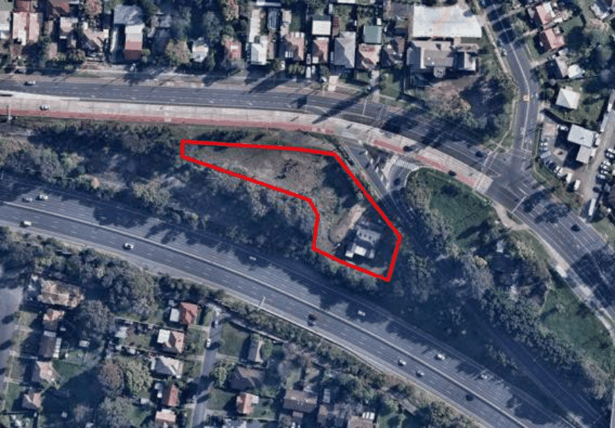
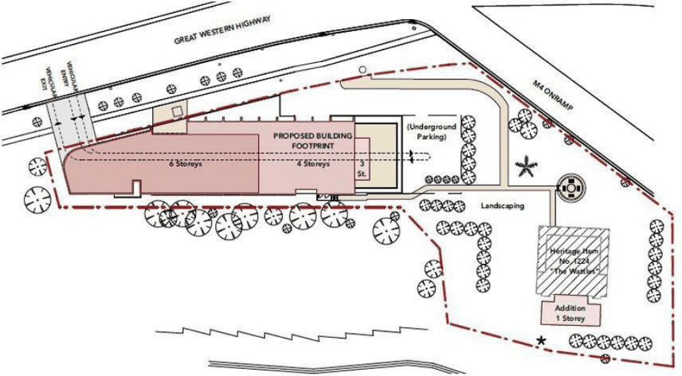
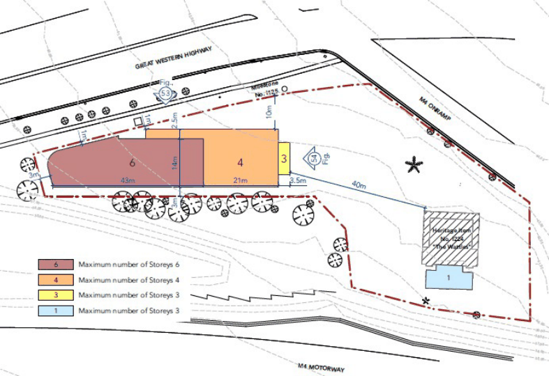
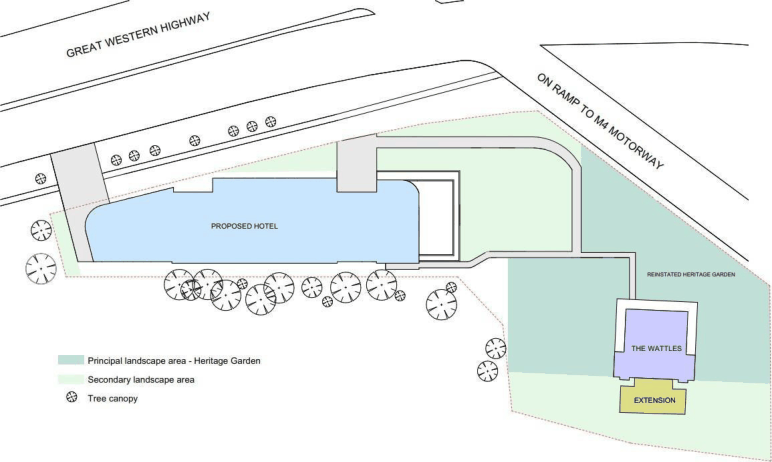
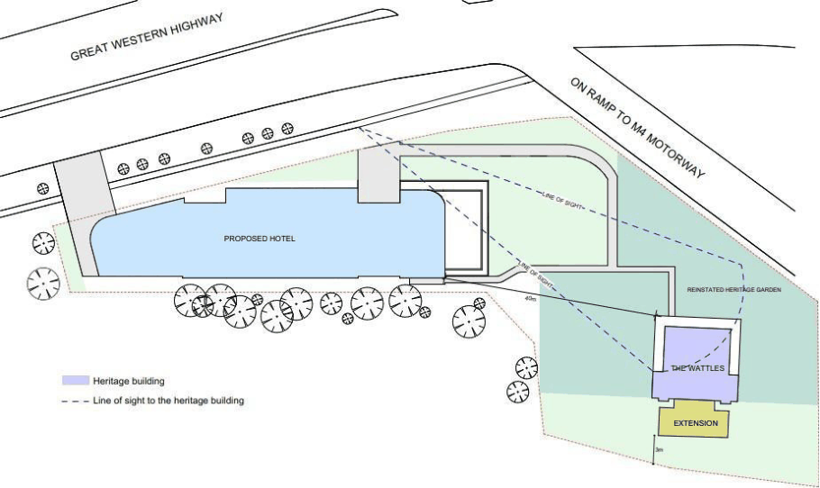

### PART F1-21

### 245-247 GREAT WESTERN

### HIGHWAY, SOUTH

### WENTWORTHVILLE

Page F1-443 of F1- 454

Cumberland DCP – Part F1 Residential Site Specific

This page has been left intentionally blank.

Page F1-444 of F1- 454

Cumberland DCP – Part F1 Residential Site Specific

## 1. Introduction

### 1.1 Purpose of this DCP

The purpose of this Development Control Plan (‘DCP’) is to outline the ‘site specific controls’ (the

detailed planning and design framework) that relates to 245-247 Great Western Highway, South

Wentworthville, commonly known as ‘The Wattles’ (refer to Figure 1). Where there is inconsistency

between this document and provisions contained elsewhere in the Cumberland Development Control

Plan 2021, the site-specific controls contained in this document shall apply to the extent of the

inconsistency.

### 1.2 Land to which this Part applies

This section applies to the site referred to as 245-247 Great Western Highway, legally identified as Lot

100 in DP 878926. The site has a total area of 4,727 sqm. Figure 1: Site Aerial

> [Picture on page 445: a picture, saved as a picture (images/part-f1-precinct-and-site-specific-development-controls-page-445-14.gif, 150 dpi).]

#### 1.3 Relationship to Cumberland Development Control Plan 2021

This section applies to the site referred to as 245-247 Great Western Highway, legally identified as Lot

100 in DP 878926. The site has a total area of 4,727 sqm. The controls contained in this part are supplementary to and shall be read in conjunction with the

following relevant parts of Cumberland DCP 2021. Part A – Introduction and General Controls Part B – Development in Residential zones Part C – Development in Business zones

Page F1-445 of F1- 454

Cumberland DCP – Part F1 Residential Site Specific

Part E - Other land use-based development controls

Part G - Miscellaneous Development Controls with regards to heritage, parking, waste and delivery vehicles,

stormwater, etc. Where there is an inconsistency between this DCP Part and provisions contained elsewhere in

Cumberland DCP 2021, the provisions of this Part shall prevail.

## 2. Introduction

### 2.1 Vision

Provide a suitable mechanism for the adaptive reuse of The Wattles whilst protecting its heritage

significance. The development of the site can incorporate hotel or motel accommodation on the western

end of the site which transitions to The Wattles at the east. Sufficient building separation and

compatibility of materials, colours and finishes will ensure a suitable development is provided and the vision for the site is upheld.

### 2.2 General objectives

O1. Assist in creating a 30-minute city where residents are close to jobs, education, health

facilities and other services.

O2. Facilitate the opportunity for investment in tourist and visitor accommodation to contribute to

the economy.

O3. Provide a highly connected, safe and permeable network with convenient access to public

transport, public spaces and facilities, and amenities.

O4. Prioritise enhancement and protection of the heritage significance of The Wattles through

redevelopment of the site and implementation of a conservation management plan.

O5. Celebrate the natural environment through conservation of important trees and maintain the

existing landscaped character of surrounding residential areas.

O6. Prioritise healthy living, including design to mitigate and adapt to heat, and design for active

transport.

O7. Buildings are sited, positioned and designed to maximise climatic responsiveness and

provide high levels of desirable solar access and natural ventilation.

### 2.3 Indicative Master Plan

The vision and principles for the site as identified above are spatially expressed in the urban structure

for the site as shown in Figure 2. To ensure that development provides key elements, where variations

to the master plan are proposed, the development application is to demonstrate how the vision and

principles have been achieved.

Page F1-446 of F1- 454

Cumberland DCP – Part F1 Residential Site Specific

Figure 2: Indicative Site Layout

> [Picture on page 447: a picture, saved as a picture (images/part-f1-precinct-and-site-specific-development-controls-page-447-3.gif, 150 dpi).]

Source (p.25 Olsson, 2022)

Page F1-447 of F1- 454

Cumberland DCP – Part F1 Residential Site Specific

## 3. Specific objectives and controls

### 3.1 Land Uses

#### Objectives

O1. Ensure the design of the building and location of uses responds appropriately to the site

circumstances, including the Great Western Highway, M4 Motorway and ‘The Wattles’

Victorian heritage building.

O2. Allow ‘active’ uses on the site that are appropriate to its high exposure location and would

encourage public to experience ‘The Wattles’ heritage building.

O3. Achieve redevelopment of the site as a viable, functional, high-quality development including

the adaptive re-use of ‘The Wattles’ building.

O4. Ensure the building interfaces positively with public areas and contributes to an attractive

public domain and desirable setting for its intended uses.

#### Controls

C1. Development is to be generally in accordance with the layout in Figure 2, with:

a. Any hotel or motel accommodation to be located on the western side of the site, and

b. Restaurant or café uses on the eastern side of the site are to be located within and

behind the heritage item.

C2.  The controls in this section of the DCP apply to use of site for the purposes of a restaurant or

café and hotel or motel development. Ancilliary uses located within the hotel will be assessed

on a merit basis.

Figure 3: Indicative Land Uses and Setbacks

> [Picture on page 448: a picture, saved as a picture (images/part-f1-precinct-and-site-specific-development-controls-page-448-23.gif, 150 dpi).]

Source: (p.36 Olsson, 2022)

Page F1-448 of F1- 454

Cumberland DCP – Part F1 Residential Site Specific

### 3.2 Building Siting, Setbacks and Separation

#### Objectives

O1. Ensure buildings are located to be compatible in form relative to the spatial chracteristics of

the site and context.

O2. Ensure building mass and form responds appropriately to visual character of the surrounds

and ‘The Wattles’ Victorian heritage building.

O3. Ensure the distribution of building height and mass preserves and enhances amenity, and

environmental features, including heritage.

#### Controls

C1. Minimum 40 metre plus separation is to be provided between The Wattles and any buildings

higher than 1m above the street level, forward or to the sides of the heritage building.

C2. Extensions joining to The Wattles building should be located at the rear and set in a

minimum 1.5m from the verandahs along the sides of the heritage building.

C3. Setbacks to boundaries and upper-level building storey setbacks are to be in accordance

with Figure 3. The 4th storey upper-level hotel/motel setback considered is to be

approximately 21m from eastern edge of the proposed hotel/motel development.

### 3.3 Building Envelope, Height and Setbacks

#### Objectives

O1. Provide buildings with articulation, and attractive composition and an appropriate address to the Great Western Highway with to increase activation, safety, and use of the road verge.

O2. Provide building separation that responds appropriately to ‘The Wattles’ Victorian heritage building and maintains an inner curtilage setting.

O3. Maintain the view line to The Wattles heritage building from the key vantage point at the entrance to the site.

O4. Achieve suitable solar access to The Wattles heritage building and principal landscaped open space area.

#### Controls

C1. Buildings are to be designed generally in accordance with the building footprints shown in Figure 3.

C2. The height of buildings is to be in accordance with Figure 3 in relation to the number of

storeys.

C3. Buildings must respond to a site analysis and consideration of overshadowing/solar access, orientation to Great Western Highway, the relationship to ‘The Wattles’ building and

constraints of the site.

C4. Where planting is provided above any basement structure extending beyond the building

footprint, a minimum soil depth of 1.0m is to be provided.

C5. The minimum floor to ceiling heights (excluding service space) should generally be 5.0m for the ground level of a hotel, 3.5m or more for hotel accommodation and restaurants or cafes.

Page F1-449 of F1- 454

Cumberland DCP – Part F1 Residential Site Specific

### 3.4 Solar Access and Overshadowing

#### Objectives

O1. Maintain suitable solar access to The Wattle heritage building at all times during winter and

summer.

O2. Provide a high level of solar access to the principal landscaped open space area to comprise a reinstated heritage garden.

O3. Minimise any overshadowing impacts to the Highway verge public domain and surrounding residential development.

#### Controls

C1. Direct sunlight access to The Wattles heritage building in mid-winter is to be maintained at all times from 9am, 12pm and 3pm during winter solstice.

C2. The landscaped areas surrounding The Wattles building is to receive a minimum of 4 hours

of direct solar access between 9am – 3pm in mid-winter.

Page F1-450 of F1- 454

Cumberland DCP – Part F1 Residential Site Specific

### 3.5 Landscape and Public Domain

#### Objectives

O1. Provide a principal landscaped area around ‘The Wattles’ heritage building to form an inner

heritage curtilage setting.

O2. Enhance the landscaped setting of The Wattles, with reinstated heritage gardens including

plant species, materials and treatments suitable to the style and era.

O3. Provide landscape planting areas along the Highway frontage of the site that complements tree plantings within the wide verge and improves the public domain.

O4. Maintain deep soil areas around the perimeter to protect adjacent trees.

#### Controls

C1. A principal landscaped area should be provided in accordance with Figure 4. C2. The principal landscaped area be readily accessible and contain manageable pathways and Victorian garden features such as bench seats and a fountain.

C3. The principal landscaped area garden setting should be at 80% soft landscaped/deep soil area capable of growing plants to match with the existing character of Wattles heritage building

setting.

C4. Existing vegetation consisting of significant heritage plantings are to be retained. C5. Secondary landscape areas should be provided generally in accordance with Figure 4 for a

series of planting areas along the Highway frontage and around the rear of The Wattles heritage

building.

C6. Deep soil areas along the western side and rear boundary should be sufficient to protect the

structural root zones of adjacent trees.

C7. Schedule landscape maintenance to ensure preservation of landscape.

Figure 4: Landscape Area Plan

> [Picture on page 451: a picture, saved as a picture (images/part-f1-precinct-and-site-specific-development-controls-page-451-26.gif, 150 dpi).]

Page F1-451 of F1- 454

Cumberland DCP – Part F1 Residential Site Specific

### 3.6 Movement, Access and Parking

#### Objectives

O1. Ensure the movement network into and within the site is functional and provides efficient and

safe movement of pedestrian, vehicles and cyclists.

O2. Provide path connections from the street, between buildings and to focal points in the heritage gardens that allow the opportunity for interaction and meeting.

O3. Locate the site pedestrian access entry to allow The Wattles heritage building to be viewed from east and manage the flow of traffic in and out of the site with separate vehicular entry and exit

points located to west.

#### Controls

C1. A combined entry and exit to the site is to be provided in accordance with the location shown in Figure 2.

C2. Provide legible pedestrian footpath connections generally in accordance with Figure 2. C3. Facilitate the provision of pedestrian footpath connections within the verge to the Coleman T-way Bus Station.

C4. Provide principal vehicle access entry and exit points from the Great Western Highway

generally in accordance with Figure 2.

C5. Provide a Traffic Impact Assessment report detailing safe vehicle access traffic management

measures to be incorporated into the design.

C6. Collaborate with Transport for NSW to confirm design treatment within the wide verge area,

including driveway crossings from the Great Western Highway, utilising the existing bus lane or

a separate deceleration lane if required.

C7. Car parking is to be provided in accordance with Cumberland DCP 2021 without discounts (refer to Part G of DCP for information).

C8. Waste collection vehicles and delivery vehicles are to enter and exit the site in a forward direction and include for turning within the basement Medium Rigid Vehicle waste truck is

recommended.

Page F1-452 of F1- 454

Cumberland DCP – Part F1 Residential Site Specific

### 3.7 Heritage Conservation and Views

The objectives and controls in this section are to be read in conjunction with Section 2.4 in Part G of

Cumberland Development Control Plan 2021.

#### Objectives

O1. Ensure that the works and uses of the heritage buildings contribute to the integration of the inner heritage curtilage setting to the development as a whole.

O2. Ensure that the use of The Wattles buildings does not compromise its heritage significance and does not expose the building to risk of damage.

O3. Ensure that the heritage buildings are economically adapted and reused. O4. Ensure the extensions and works to The Wattles cottage will not impact significantly on the heritage fabric of the building or reduce its heritage significance.

#### Controls

C1.  For adaptive reuse of The Wattles as a restaurant or café, a conservation management plan is to be prepared, with all works to be completed under the guidance of a professionally qualified

heritage architect.

C2. Facilitate the appropriate use of The Wattles building for a restaurant or café while mitigating the

impact on significant fabric, by providing for a commercial kitchen and facilities in a separate,

joined, low-scale structure.

C3. Any extension to the Wattles building is to be located at the rear of the building, set in 1.5m from

the side verandahs.

C4.  Minimise the visual impact of new structures on The Wattles through refining of the architectural form, and appropriate use of materials, colours and finishes.

C5. The line of site to the heritage building identified in Figure 5 is to be maintained and generally uninterrupted by any building or substantial structure.

C6. View lines from the Wattles House to be improved and protected to north, north-west and northeast at all times where possible.

Page F1-453 of F1- 454

Cumberland DCP – Part F1 Residential Site Specific

Figure 5: View Protection Plan

> [Picture on page 454: a picture, saved as a picture (images/part-f1-precinct-and-site-specific-development-controls-page-454-3.gif, 150 dpi).]

### 3.8 Stormwater Management

#### Objectives

O1. Ensure a total catchment management approach such that downstream drainage systems are

not impacted adversely through alteration to existing drainage flows from the site.

O2. Protect drainage systems and ground surface areas from pollutants and soil erosion. O3. Preserve the effectiveness of existing downstream flood mitigation and drainage works. O4. Ensure no increase to downstream flooding or water pollution.

#### Controls

C1. Stormwater is to be detained so that post-development discharge does not exceed present rates and so there is no increase in the rate of flow in the catchments below.

C2. Stormwater is to be collected, conveyed and discharged for storms up to a 20-year ARI

frequency, without flooding or unacceptable inconvenience.

C3. On-site detention (OSD) systems shall be designed in accordance with the Australian Rainfall and Runoff and Part G of Cumberland DCP 2021.

C4. Building design should provide for practical rainwater reuse on the site. C5. Drainage facility designs should be supported by design calculations and facilitate maintenance, cleaning and disposal of excess plant materials and other pollutants.

Page F1-454 of F1- 454
