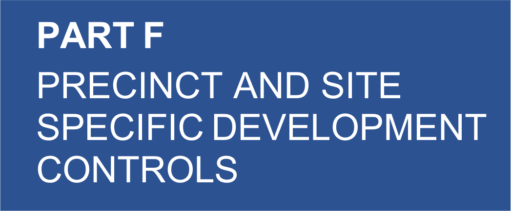
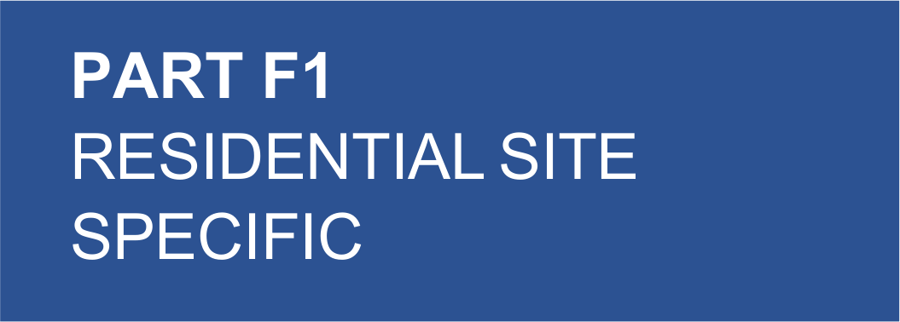
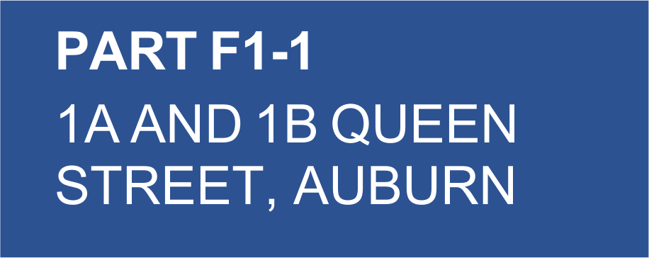

# Cumberland Development Control Plan 2021 - Part F1 Precinct and Site Specific Development Controls

> This chapter is split into 21 section file(s), one per sub-part heading, in the order they appear in the PDF.

Source PDF: [Cumberland DCP Part F1.pdf](Cumberland%20DCP%20Part%20F1.pdf)

### Part

### Precinct and Site Specific

### Development Controls

This page has been left intentionally blank

> [Picture on page 3: a picture, saved as a picture (images/part-f1-precinct-and-site-specific-development-controls-page-3-1.gif, 150 dpi).]

### PART F

### PRECINCT AND SITE

### SPECIFIC DEVELOPMENT

### CONTROLS

This page has been left intentionally blank.

> [Picture on page 5: a picture, saved as a picture (images/part-f1-precinct-and-site-specific-development-controls-page-5-1.gif, 150 dpi).]

### PART F1

### RESIDENTIAL SITE

### SPECIFIC

This page has been left intentionally blank.

### Part F1 Residential Site‐Specific Contents

| PART F1-1 1A AND 1B QUEEN STREET, AUBURN | F1-15 |
|---|---|
| 1. Introduction | F1- 17 |
| 2. Vision and general objectives | F1- 18 |
| 3. Specific objectives and controls |  |
| 3.1 Connections and access | F1- 19 |
| 3.2 Open space | F1- 19 |
| 3.3 Building form | F1- 20 |
| 3.4 Acoustic amenity | F1- 22 |
| PART F1-2 37 39 PAVESI STREET, SMITHFIELD | F1- 24 |
| 1. Introduction | F1- 26 |
| 2. Specific objectives and controls |  |
| 2.1 Amenity | F1- 27 |
| 2.2 Traffic, access and parking | F1- 27 |
| PART F1-3 190-220 DUNMORE STREET, PENDLE HILL (BONDS SPINNING MILL SITE) | F1- 30 |
| 1. Introduction | F1- 32 |
| 2. Vision and general objectives | F1- 33 |
| 3. Specific objectives and controls |  |
| 3.1 Land use | F1- 35 |
| 3.2 Building height | F1- 36 |
| 3.3 Building siting | F1- 37 |
| 3.4 Built form | F1- 38 |
| 3.5 Open space | F1- 42 |
| 3.6 Movement network | F1- 46 |
| 3.7 Managing transport demand | F1- 48 |
| 3.8 Heritage | F1- 50 |
| PART F1-4 BRADMAN STREET, GREYSTANES | F1- 53 |
| (PROPOSED DEVELOPMENT AND SUBDIVISION) |  |
| 1. Introduction | F1- 55 |
| 2. Specific Objectives and Controls | F1- 55 |

| PART F1-5 CROSBY STREET, GREYSTANES | F1- 57 |
|---|---|
| 1. Introduction | F1- 59 |
| 2. Vision | F1- 59 |
| 3. Specific objectives and controls | F1- 59 |
| PART F1-6 FOREST GUM ESTATE | F1- 63 |
| 1. Introduction | F1- 65 |
| 2. Specific objectives and controls | F1- 65 |
| PART F1-7 FORMER LIDCOMBE HOSPITAL SITE | F1- 68 |
| 1. Introduction | F1- 70 |
| 2. General objectives |  |
| 2.1 Staged development | F1- 71 |
| 2.2 Terms Unique to the Part | F1- 71 |
| 3. Specific objectives and controls |  |
| 3.1 Planning Principles | F1- 73 |
| 3.2 Heritage | F1- 77 |
| 3.3 Landscaping, public open space and public domain | F1- 79 |
| 3.4 Roads and access | F1- 81 |
| 3.5 Site planning controls | F1- 88 |
| 3.6 Residential development and subdivision controls | F1- 94 |
| 3.7 Waste controls | F1- 106 |
| 3.8 Parking and loading controls | F1- 106 |
| PART F1-8 GARY STREET, MERRYLANDS | F1- 108 |
| 1. Introduction | F1- 110 |
| 2. Specific objectives and controls | F1- 110 |
| PART F1-9 GREYSTANES CREEK | F1- 112 |
| 1. Introduction | F1- 114 |
| 2. Vision and general objectives | F1- 114 |
| 3. Specific objectives and controls |  |
| 3.1 Setback | F1- 115 |
| 3.2 Fences | F1- 115 |
| 3.3 Landscaping and site design | F1- 116 |
| 3.4 Drainage | F1- 118 |

| 3.5 Fire | F1- 119 |
|---|---|
| 4. Appendix A – Greystanes Creek | F1- 119 |
| PART F1-10 GUILDFORD PIPEHEAD PRECINCT | F1- 122 |
| 1. Introduction | F1- 124 |
| 2. Vision and general objectives | F1- 125 |
| 3. Specific Objectives and Controls |  |
| 3.1 Urban Design | F1- 126 |
| 3.2 Lot Structure | F1- 127 |
| 3.3 Built form | F1- 128 |
| 3.4 Landscape and Open Space | F1- 130 |
| 3.5 Transport and Access | F1- 133 |
| 3.6 Heritage | F1- 134 |
| PART F1-11 HEREFORD PLACE, WENTWORTHVILLE | F1- 138 |
| 1. Introduction | F1- 140 |
| 2. Vision | F1- 141 |
| 3. Objectives and Controls | F1- 142 |
| PART F1-12 HILLIER STREET, MERRYLANDS | F1- 145 |
| 1. Introduction | F1- 147 |
| 2. Specific objectives and controls | F1- 147 |
| PART F1-13 HOLROYD GARDENS | F1- 150 |
| 1. Introduction | F1- 152 |
| 2. Vision and general objectives |  |
| 2.1 Vision and context | F1- 153 |
| 2.2 General objectives | F1- 153 |
| 2.3 Access and linkages | F1- 154 |
| 2.4 Open spaces | F1- 154 |
| 2.5 Built form | F1- 155 |
| 2.6 Streetscape | F1- 155 |
| 2.7 Building envelope | F1- 155 |
| 2.8 Adaptable housing | F1- 156 |
| 2.9 Energy efficiency | F1- 156 |
| 2.10 Waste management | F1- 156 |
| 2.11 Off street parking | F1- 156 |

| 3. Specific objectives and controls |  |  |
|---|---|---|
| 3.1 | Open space | F1- 156 |
| 3.2 | Streets | F1- 162 |
| 3.3 | Built form | F1- 171 |
| 3.4 | Disabled access and adaptable housing | F1- 184 |
| 3.5 | Ancillary issues | F1- 185 |
| PART F1-14 PEMULWUY RESIDENTIAL |  | F1- 190 |
| 1. Introduction |  | F1- 192 |
| 2. Vision | and General Objectives | F1- 193 |
| 3. Specific objectives and controls |  |  |
| 3.1 | Public open space | F1- 194 |
| 3.2 | Subdivision | F1- 218 |
| 3.3 | Building and Siting Requirements for Residential Development | F1- 227 |
| 3.4 | Subprecinct Controls – Pemulwuy North | F1- 267 |
| 3.5 | Subprecinct Controls - Pemulwuy South | F1- 271 |
| 3.6 | Transport Plan | F1- 276 |
| 3.7 | Heritage | F1- 299 |
| 3.8 | Biodiversity | F1- 305 |
| 3.9 | Stormwater and Flooding Management | F1- 314 |
| 3.10 | Environmental Management | F1- 326 |
| F1-15 RAAF STORES DEPOT |  | F1- 338 |
| 1. Introduction |  | F1- 340 |
| 2. General objectives |  | F1- 341 |
| 3. Specific objectives and controls |  |  |
| 3.1 | Residential density and dwelling mix | F1- 341 |
| 3.2 | Car parking | F1- 341 |
| 3.3 | Noise | F1- 341 |
| 3.4 | Adaptable housing | F1- 341 |
| 3.5 | Stormwater management | F1- 341 |
| 3.6 | Tree preservation | F1- 341 |
| 3.7 | Public domain | F1- 341 |

| PART F1-16 SHERWOOD SCRUBS AND ADJOINING LAND | F1- 343 |
|---|---|
| 1. Introduction | F1- 345 |
| 2. Specific Objectives and Controls | F1- 345 |
| 3. Appendix A | F1- 347 |
| PART F1-17 45 BARCOM STREET, MERRYLANDS WEST | F1- 349 |
| 1. Introduction | F1- 350 |
| 2. Vision and General Objectives | F1- 351 |
| 3. Specific objectives and controls |  |
| 3.1 Land Use | F1- 354 |
| 3.2 Building height | F1- 356 |
| 3.3 Building siting and setbacks | F1- 357 |
| 3.4 Built form | F1- 360 |
| 3.5 Open space and landscaping | F1- 362 |
| 3.6 Movement network | F1- 365 |
| 3.7 Managing transport demand and parking | F1- 369 |
| 3.8 Environmental Performance | F1- 370 |
| PART F1-18 FRESH HOPE CARE, DUNMORE STREET, PENDLE HILL | F1- 372 |
| 1. Introduction | F1- 373 |
| 1.1 Land is to which this section applies | F1- 373 |
| 2. Vision and general objections | F1- 374 |
| 2.1 Vision | F1- 374 |
| 2.2 General objectives | F1- 374 |
| 2.3 Indicative Master plan | F1- 375 |
| 3. Specific objects and controls | F1- 376 |
| 3.1 Land use | F1- 376 |
| 3.2 Building height | F1- 376 |
| 3.3 Building siting and setbacks | F1- 377 |
| 3.4 Built form and building design | F1- 380 |
| 3.5 Solar access and overshadowing | F1- 381 |
| 3.6 Open space and landscaping | F1- 381 |
| 3.7 Movement network | F1- 383 |
| 3.8 Managing transport demand | F1- 385 |
| 3.9 Heritage | F1- 385 |

#### PART F1-19 80 BETTY CUTHBERT DRIVE, LIDCOMBE

#### F1- 389

1\. Introduction

| 1.1 | Purpose of this DCP | F1- 390 |
|---|---|---|
| 1.2 | Land to which this Part applies | F1- 390 |
| 1.3 | Relationship to Cumberland Development Control Plan 2021 | F1- 390 |
| 2. Vision | and general objections | F1- 391 |
| 2.1 | Vision | F1- 391 |
| 2.2 | General objectives | F1- 391 |
| 2.3 | Indicative Master Plan | F1- 391 |
| 3. Specific objectives and controls |  | F1- 393 |
| 3.1 | Land use | F1- 393 |
| 3.2 | Movement network and street layout | F1- 394 |
| 3.3 | Pedestrian and cycle circulation | F1- 394 |
| 3.4 | Parking | F1- 395 |
| 3.5 | Landscape and public domain | F1- 398 |
| 3.6 | Proposed school | F1- 406 |
| 4. General Residential Controls |  | F1- 408 |
| 4.1 | Site Planning Controls | F1- 408 |
| 4.2 | Residential Dwelling Controls | F1- 411 |
| PART F1-20 1 CRESCENT STREET, HOLROYD |  | F1- 423 |
| 1. Introduction |  |  |
| 1.1 | Land to which this Part applies | F1- 425 |
| 1.2 | Relationship to other parts of Cumberland Development Control Plan 2021 | F1- 425 |
| 1.3 | Purpose of this Part | F1- 426 |
| 2. Vision | and desired future character | F1- 426 |
| 2.1 | Vision | F1- 426 |
| 2.2 | Desired future character | F1- 426 |
| 2.3 | Desired future character statement | F1- 426 |
| 2.4 | Masterplan | F1- 427 |
| 2.5 | Provision of infrastructure services | F1- 429 |
| 3. Development controls |  | F1- 429 |
| 3.1 | Building heights and street wall heights | F1- 429 |
| 3.2 | Setbacks and building separation | F1- 432 |
| 3.3 | Building design | F1- 434 |
| 3.4 | Noise | F1- 434 |
| 3.5 | Open space | F1- 435 |
| 3.6 | Landscaping and trees | F1- 436 |
| 3.7 | Vehicular access and movement | F1- 437 |
| 3.8 | Connectivity | F1- 438 |
| 3.9 | Parking and basement access | F1- 439 |
| 3.10 | Site contamination and remediation | F1- 441 |
| 3.11 | A’Becketts Creek drainage channel | F1- 441 |
| 3.12 | Railway Memorial | F1- 441 |

Page F1-12 of F1- 12

| PART F1-21 245- 247 GREAT WESTERN HIGHWAY, SOUTH WENTWORTHVILLE |  | F2- 444 |
|---|---|---|
| 1. Introduction |  |  |
| 1.1 | Purpose of this DCP | F1- 446 |
| 1.2 | Land to which this Part applies | F1- 446 |
| 1.3 | Relationship to Cumberland Development Control Plan 2021 | F1- 446 |
| 2. Vision and General Objectives |  |  |
| 2.1 | Vision | F1- 447 |
| 2.2 | General Objectives | F1- 447 |
| 2.3 | Indicative Master Plan | F1- 447 |
| 3. Specific objectives and controls |  | F1- 449 |
| 3.1 | Land uses | F1- 449 |
| 3.2 | Building Siting. Setbacks and Separation | F1- 450 |
| 3.3 | Building Envelope, Height and Setbacks | F1- 450 |
| 3.4 | Solar Access and Overshadowing | F1- 451 |
| 3.5 | Landscape and Public Domain | F1- 452 |
| 3.6 | Movement, Access and Parking | F1- 453 |
| 3.7 | Heritage Conservation and Views | F1- 454 |
| 3.8 | Stormwater Management | F1- 455 |

This page has been left intentionally blank.

> [Picture on page 15: a picture, saved as a picture (images/part-f1-precinct-and-site-specific-development-controls-page-15-1.gif, 150 dpi).]

<!-- sections -->
## Sections

1. [Part F1-1 1A AND 1B QUEEN STREET, AUBURN](01-f1-1-1a-and-1b-queen-street-auburn.md)
2. [Part F1-2 37-39 PAVESI STREET, SMITHFIELD](02-f1-2-37-39-pavesi-street-smithfield.md)
3. [Part F1-3 190-220 DUNMORE STREET, PENDLE HILL](03-f1-3-190-220-dunmore-street-pendle-hill.md)
4. [Part F1-4 BRADMAN STREET, GREYSTANES](04-f1-4-bradman-street-greystanes.md)
5. [Part F1-5 CROSBY STREET, GREYSTANES](05-f1-5-crosby-street-greystanes.md)
6. [Part F1-6 FOREST GUM ESTATE](06-f1-6-forest-gum-estate.md)
7. [Part F1-7 FORMER LIDCOMBE HOSPITAL SITE](07-f1-7-former-lidcombe-hospital-site.md)
8. [Part F1-8 GARY STREET, MERRYLANDS](08-f1-8-gary-street-merrylands.md)
9. [Part F1-9 GREYSTANES CREEK](09-f1-9-greystanes-creek.md)
10. [Part F1-10 GUILDFORD PIPEHEAD PRECINCT](10-f1-10-guildford-pipehead-precinct.md)
11. [Part F1-11 HEREFORD PLACE, WENTWORTHVILLE](11-f1-11-hereford-place-wentworthville.md)
12. [Part F1-12 HILLIER STREET, MERRYLANDS](12-f1-12-hillier-street-merrylands.md)
13. [Part F1-13 HOLROYD GARDENS](13-f1-13-holroyd-gardens.md)
14. [Part F1-14 PEMULWUY RESIDENTIAL](14-f1-14-pemulwuy-residential.md)
15. [Part F1-15 RAAF STORES DEPOT](15-f1-15-raaf-stores-depot.md)
16. [Part F1-16 SHERWOOD SCRUBS AND ADJOINING LAND](16-f1-16-sherwood-scrubs-and-adjoining-land.md)
17. [Part F1-17 45 BARCOM STREET, MERRYLANDS WEST](17-f1-17-45-barcom-street-merrylands-west.md)
18. [Part F1-18 DUNMORE STREET, PENDLE HILL (FRESH HOPE CARE SITE)](18-f1-18-dunmore-street-pendle-hill-fresh-hope-care.md)
19. [Part F1-19 80 BETTY CUTHBERT DRIVE, LIDCOMBE](19-f1-19-80-betty-cuthbert-drive-lidcombe.md)
20. [Part F1-20 1 CRESCENT STREET, HOLROYD](20-f1-20-1-crescent-street-holroyd.md)
21. [Part F1-21 245-247 GREAT WESTERN HIGHWAY, SOUTH WENTWORTHVILLE](21-f1-21-245-247-great-western-highway-south.md)
