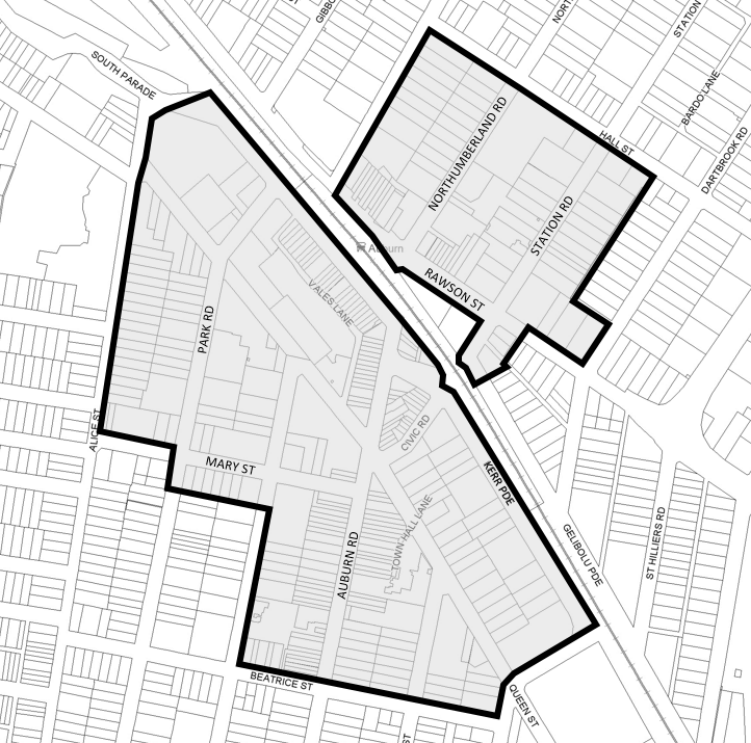
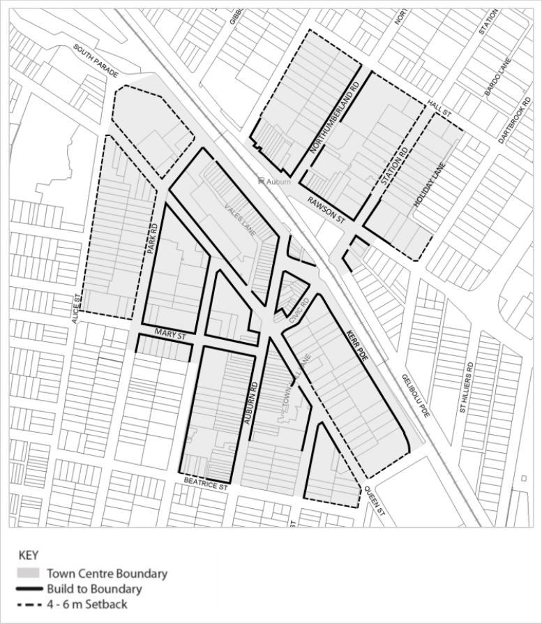
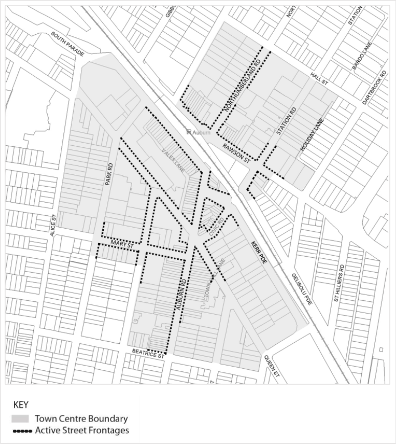
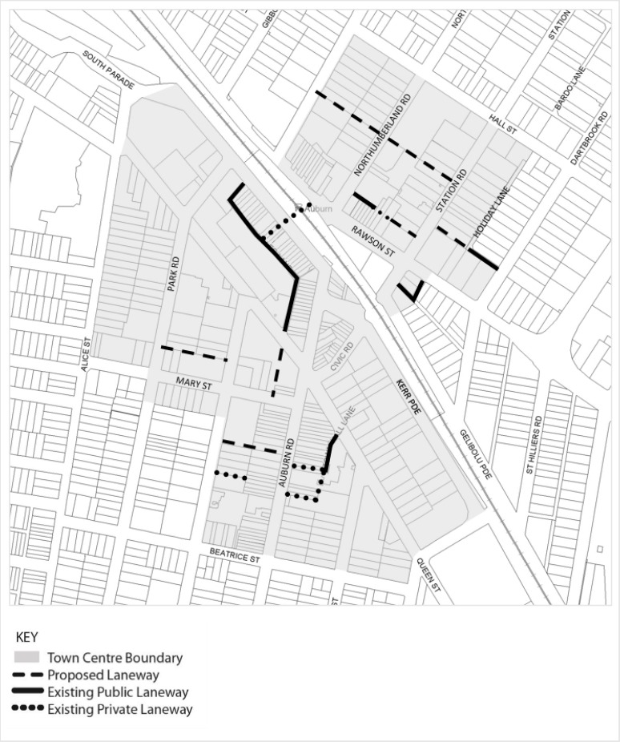
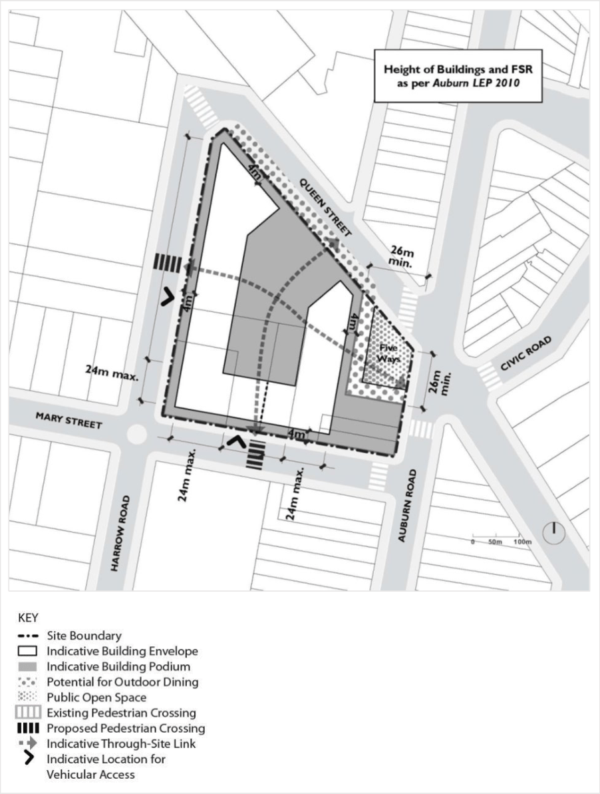

### PART F2-1

### AUBURN TOWN CENTRE

This page has been left intentionally blank.

## 1. Introduction

### 1.1 Land to which this Part applies

This Part applies to the Auburn Town Centre which is zoned B4 Mixed Use under the

Cumberland LEP 2021. Refer to Figure 1. The development controls apply in addition to the

development controls presented in previous Parts of this DCP. Where there are inconsistencies

between the controls contained within this Part and other controls within this DCP, these

controls prevail to the extent of the inconsistency.

> [Picture on page 13: a picture, saved as a picture (images/part-f2-business-site-specific-page-13-8.gif, 150 dpi).]

Figure 1: Area to which this Part applies

## 2. Objectives and controls

### 2.1 Setbacks

#### Objective

The built edge of development fronting the street contributes to a sense of enclosure,

scale and appropriate transition within the town centre.

#### Control

Setbacks within the town centre shall be consistent with Figure 2.

> [Picture on page 14: a picture, saved as a picture (images/part-f2-business-site-specific-page-14-8.gif, 150 dpi).]

Figure 2: Building setbacks within the Auburn Town Centre

### 2.2 Active frontages

#### Control

As a minimum, buildings shall provide active street frontages consistent with Figure 3.

> [Picture on page 15: a picture, saved as a picture (images/part-f2-business-site-specific-page-15-4.gif, 150 dpi).]

Figure 3: Active street frontages within the Auburn Town Centre

### 2.3 Laneways

#### Control

Redevelopment within the Auburn Town Centre shall make provision for the creation of

new laneways as shown in Figure 4.

> [Picture on page 16: a picture, saved as a picture (images/part-f2-business-site-specific-page-16-1.gif, 150 dpi).]

Figure 4: Location of laneways proposed within the Auburn Town Centre

### 2.4 Key Site – Five Ways

The Five Ways site within the Auburn Town Centre has been identified as having potential for

intensification of mixed use development, including commercial and residential uses. The site

is bounded by Auburn Road to the east, Queen Street to the north, Harrow Road to the west

and Mary Street to the south. The development controls for this site apply in addition to the development controls presented

in previous sections of this Part.

#### Objectives

Ensure architectural design recognises:

• the strategic significance of the site within the Auburn Town Centre; and

• the visual prominence of the site from public areas including the future Five Ways

open space and along Auburn Road. Reinforce Auburn Road as the main street of the southern section of the Auburn Town

Centre.

Ensure the new Five Ways open space will become a focal point of the town centre.

Extend the active frontage along Queen Street, Harrow Road and Mary Street.

Ensure development is sensitive in scale and character to the town centre.

Improve pedestrian access and circulation within the town centre.

Minimise overshadowing impact to the surrounding public domain.

#### Controls

Development should be in accordance to Figure 5.

An open space area shall be provided on the north-east corner of the site at the

intersection of Auburn Road and Queen Street with a minimum width of 26m, including

a 6m reservation as a pedestrian plaza to accommodate circulation and outdoor dining

area.

Pedestrian through-site links shall be provided to improve circulation and access to the

town centre. Where possible, these linkages shall align to existing or proposed crossing

points.

The preferred vehicular access to the site shall be via Harrow Road with secondary

access via Mary Street and Queen Street.

Outdoor dining shall be encouraged within the Five Ways open space and along Auburn

Road and Queen Street.

For residential uses, the maximum building dimensions, inclusive of balconies and

building articulation but excluding architectural features, is 24m x 60m.

Future development is to consider opportunities to reconfigure Mary Street to facilitate

one way traffic flow west bound between Auburn Road and Harrow Road, and include

90 degree parking on the northern side of Mary Street.

> [Picture on page 18: a picture, saved as a picture (images/part-f2-business-site-specific-page-18-1.gif, 150 dpi).]

Figure 5: Five Ways site - indicative development layout

This page has been left intentionally blank.

> [Picture on page 20: a picture, saved as a picture (images/part-f2-business-site-specific-page-20-1.gif, 150 dpi).]
