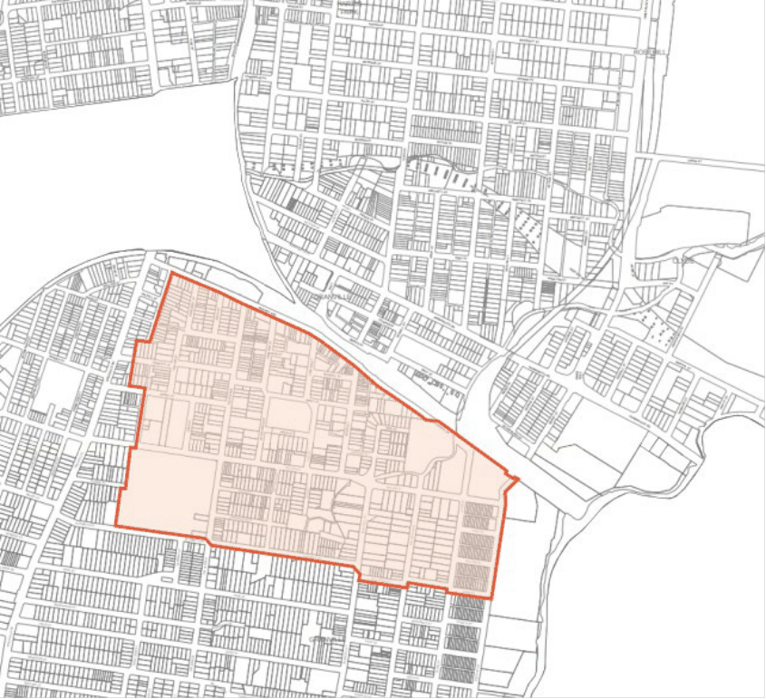
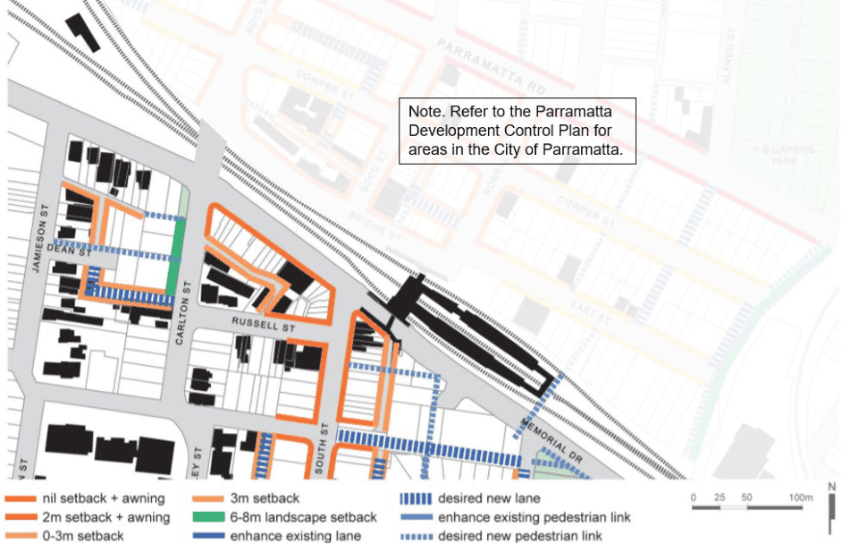
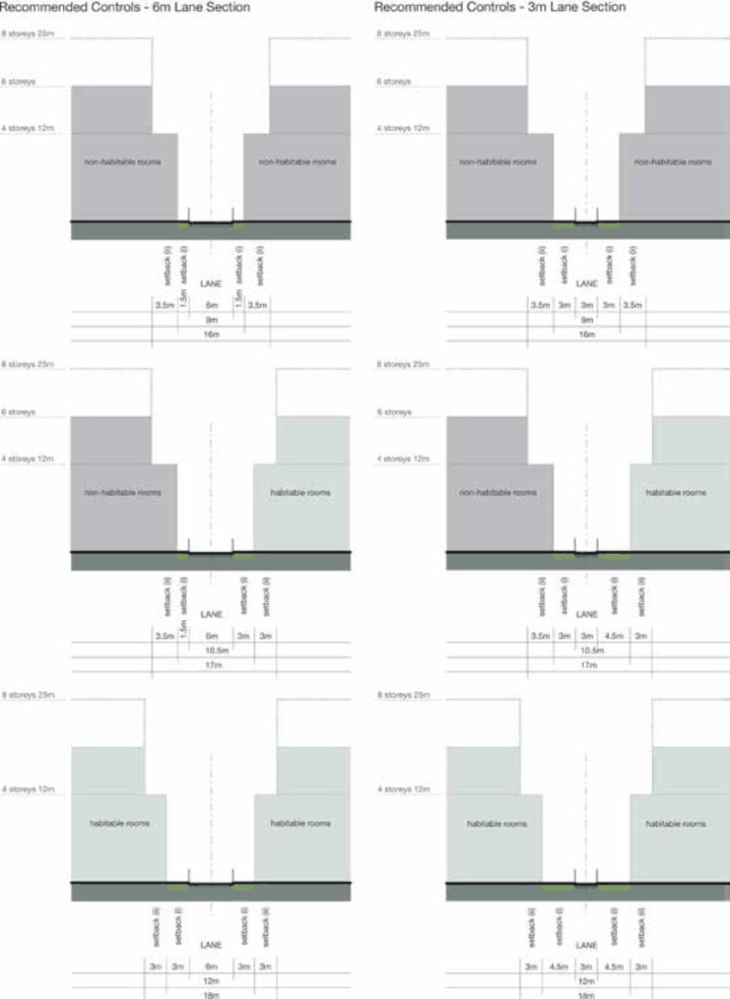
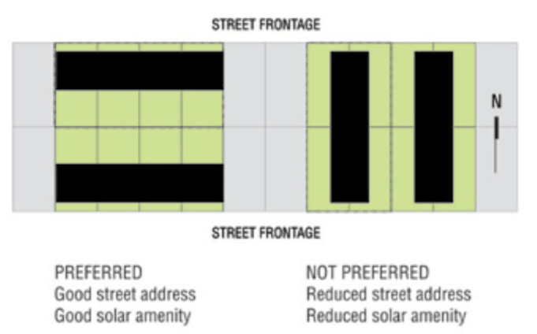

### PART F2-2

### GRANVILLE TOWN

### CENTRE

This page has been left intentionally blank.

## 1. Desired Future Character

The Granville town centre precinct will continue to be a vibrant place with a variety of activities within

and surrounding the centre. This will be achieved through a mix of uses, building heights and densities

to support the role and function of Granville. Throughout the precinct new development is to retain and

enhance the heritage character of the precinct. Specific characteristics for parts of the town centre are

detailed below. Retail Centre: New development in the main retail precincts north and south of the railway line will be

consistent with the scale and fine grain form of existing development. Active ground level frontages are

to be provided, with at grade pedestrian access. The existing street pattern, including rear lanes, will

be retained to reflect the main streets’ historical context. Shop top housing is encouraged and will be

set back from the street alignment in order to respect pedestrian scale of the existing streetscape. Residential zone: New residential development in Enid and Diamond Avenues facing Granville

Memorial Park and pool will provide a residential edge to frame the public open space. New

development is to maintain the heritage character and narrow subdivision pattern in the heritage

conservation areas, and areas south of William Street and west of Duck Creek. Investigation Areas

• As shown in Figure 2 Council will investigate the potential for redevelopment of the bus

interchange and car park to provide for a mix of community, residential and commercial uses.

• Council will investigate the block bound by Railway Parade, Mary, Carlton and Jamieson

Streets as shown in Figure 1. Development in this location will need to respect the

significance of the existing heritage items and heritage conservation areas in relation to scale,

character, form, siting, material, colour and detailing. In addition, the proportion and massing

of buildings is to relate favourably to that of existing building patterns in the street.

> [Picture on page 23: a picture, saved as a picture (images/part-f2-business-site-specific-page-23-1.gif, 150 dpi).]

Figure 1: Granville Town Centre Precinct Map

## 2. Objectives and Controls

#### Objectives

Ensure that new development provides a strong interface to Granville Railway Station,

and South Street.

Ensure that new development maintains the character and function of South Street as

a main retail/commercial street by continuing the fine grain pattern of retail and

commercial uses.

Ensure that new development responds well to existing heritage items.

Ensure new development within the mixed use area provides active ground floor uses

to increase the safety, use and interest of the area.

Ensure new buildings within the mixed use area provide articulation and an attractive

composition of building elements.

New pedestrian connections, roads and laneways should be provided in accordance

with Figure 2. Where a development provides for public access connections, a variation

to Council’s floor space ratio control may be considered, subject to the objectives of this

part.

New road connections and laneways should be provided to improve through block

connections, remove dead end streets, extend existing connections, improve

serviceability of retail development and improve the interface to the railway line.

Properties facing South Street are to form an extension of existing laneways to the rear

to provide for vehicular access and servicing needs of development in the B2 Local

Centre zone. The laneways will need to be located over or abutting the B2 Local Centre

Zone.

New street links are to match the width of the existing public road that it forms and

extension of. New laneways are to have a minimum width of 6 metres.

New pedestrian links are to improve through block connections and provide better links

to and from Granville Railway Station.

New pedestrian connections are to have a minimum width of 3 metres and are to be

consistent in width for their full length.

To enhance residential amenity through provision of landscaping and communal open

space at ground level.

To ensure an appropriate height transition of building heights to maintain amenity of

adjacent development.

### 2.1 Setbacks

#### Objectives

Refer to section 2. Objectives.

#### Controls

Front Setbacks Front building setbacks are to be in accordance with Figure 2 and any additional controls

set out below:

• for development in the B2 Local Centre zone, south of the railway line, setbacks

shown in Figure 2 apply to the first 3 storeys of development. Remaining storeys

are to be setback an additional 3 metres. Balconies are not to encroach the upper

level set back area.

• for development in the B4 Mixed Use zone, south of the railway line, setbacks

shown in Figure 2 apply to the first 2 storeys of development. Remaining storeys

are to be set back an additional 3 metres. Balconies are not to encroach the upper

level setback area.

• for development in the B4 Mixed Use Zone with frontage to Mary, Jamieson and

Carlton Streets, the front setback to be between 5 and 9 metres.

• for development in the R4 High Density Housing Zone, south of the railway line,

setbacks shown in Figure 2 apply to the first 4 storeys of development. Remaining

storeys are to be set back an additional 3 metres. Balconies may encroach the

upper level setback (levels 5 and 6 only) for a maximum depth of 1 metre. Side and rear building setbacks are to be in accordance with Figure 2 and the below

controls:

Rear Setbacks

B2 Local Centre Zone A zero rear setback is allowable for development in the B2 Local Centre Zone.

B4 Mixed Use Zone A minimum rear setback of 9 metres is required for development up to 25 metres in

height.

A minimum rear setback of 12 metres is required for development above 25 metres.

B6 Enterprise Corridor Zone A minimum rear setback of 4 metres is required.

Side Setbacks

B2 Local Centre Zone A zero side setback is allowable for development up to 4 storeys (15 metres) in height,

except where the development addresses a lane.

B4 Mixed Use Zone A zero side setback is allowable for development up to 4 storeys (15 metres) in height,

except where the development addresses a lane.

For any portion of development above 4 storeys (15 metres) in height, a minimum side

setback of 9 metres is required for habitable rooms and a minimum side setback of 6.5

metres is required for non-habitable rooms.

B6 Enterprise Corridor Zone A zero side setback is allowable for development up to 6 storeys (21 metres) in height.

Side setbacks (addressing lanes) Where lanes are indicated in Figure 2 (see Front Setbacks above), half of the width of

the lane is to be provided by each adjoining property. For passive surveillance and a

high quality public domain, continuous full length blank walls are discouraged to lanes.

Streetscape setbacks to lanes are shown in Figure 3. For visual and acoustic privacy

the following additional setbacks are required.

6 metre wide lanes Development up to 4 storeys (12 metres) in height are to be setback a minimum of 1.5

metres from the lane where there are non-habitable rooms and setback a minimum 3

metres where there are habitable rooms.

For the portion of development above 4 storeys (15 metres) but less than 25 metres, a

minimum 3.5 metre setback to the lane is required for non-habitable rooms and a

minimum 6 metre setback to the lane is required for habitable rooms.

3 metre wide lanes

For privacy of buildings up to 4 storeys a minimum 3 metre setback to the lane is

required for non-habitable rooms and a minimum 4.5 metre setback to the lane is

required for habitable rooms.

For the portion of development above 4 storeys (15 metres) but less than 25 metres, a

minimum 5 metre setback to the boundary is required for non-habitable rooms and a

minimum 7.5 metre setback for habitable rooms.

To achieve a continuous street edge development in the B2 Local Centre zone should

have a nil side setback where it will not have a detrimental impact upon adjoining

development.

Building setbacks to existing and desired laneways should be designed to activate the

laneway while still allowing for the servicing needs of development.

Where development proposes of adjoins residential development greater than 2 storeys

in height, building separation requirements prescribed by the NSW Apartment Design

Guide (ADG) should be achieved.

The building separation distances between buildings on the same site are not to be less

than those required between buildings on adjoining sites.

### 2.2 Land Amalgamation

#### Objectives

Refer to section 2. Objectives.

#### Control

The preferred pattern of land amalgamation is to be side by side to maximise lineal

street frontage and to encourage east west built form for good solar access, as shown

in Figure 4.

### 2.3 Landscaping and Deep Soil

#### Objectives

Refer to section 2. Objectives.

#### Controls

The required deep soil areas are to be predominantly located at the rear of the site to

provide a landscape corridor and visual screening between buildings.

Where a front building setback is required as shown in Figure 2, the front setback area

is to be landscaped. Provision of street trees is required in this area.

For land at 2-22 William Street communal open space and landscaping is to be provided

at ground level where possible.

> [Picture on page 27: a picture, saved as a picture (images/part-f2-business-site-specific-page-27-1.gif, 150 dpi).]

Figure 2: Building setbacks, pedestrian links and laneways

> [Picture on page 28: a picture, saved as a picture (images/part-f2-business-site-specific-page-28-1.gif, 150 dpi).]

Figure 3: Lane and Street Sections

> [Picture on page 29: a picture, saved as a picture (images/part-f2-business-site-specific-page-29-1.gif, 150 dpi).]

Figure 4: Preferred Street Frontage condition

### 2.4 Development at 2-22 William Street, Granville

#### Objectives

Refer to section 2. Objectives.

#### Controls

Storeys above the first four levels (storeys) of the proposed development shall have an

additional 3.1m upper-level rear setback and the proposed development’s rear building

setback (facing the low-density residential area) is to be a minimum of 9m (without the

rear existing laneway).

The proposed development at 2-22 William Street is to be not more than 5 storeys (Note:

This control is governed by the height of buildings controls in the LEP and NSW

Apartment Design Guide floor to ceiling height requirements).

This page has been left intentionally blank.

> [Picture on page 31: a picture, saved as a picture (images/part-f2-business-site-specific-page-31-1.gif, 150 dpi).]
