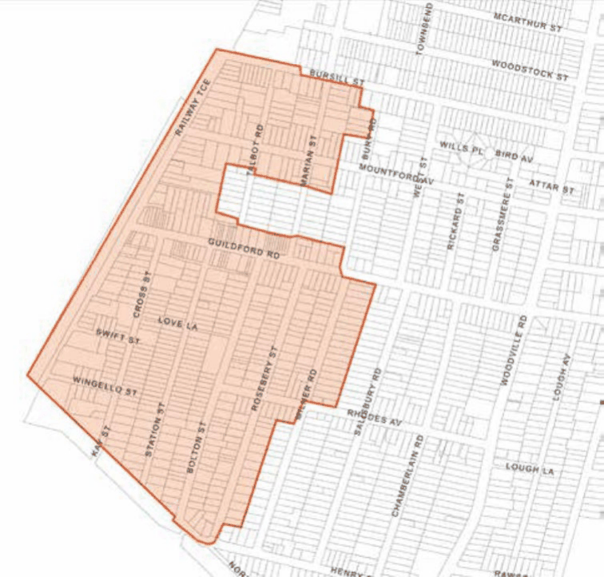
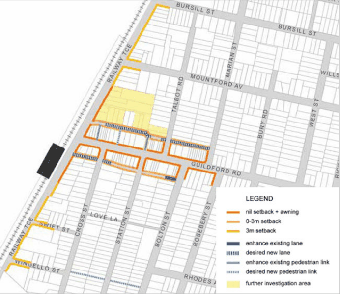
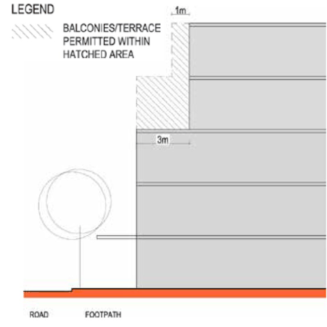

### PART F2-3

### GUILDFORD TOWN

### CENTRE (EAST)

This page has been left intentionally blank.

## 1. Desired Future Character

New development is to retain and enhance the character and function of Guildford Road as a ‘main

street’ with active ground level uses. New development will be designed to respect and preserve the

significance and contribution of heritage to the character and identity of the precinct. The design intent

is to retain the human scale of development along Guildford Road and to retain the existing street

pattern as a reflection of the main street’s historical context. New residential development in the form of residential flat buildings and multi dwelling housing will be

located on the areas surrounding the town centre and the railway station. New development adjoining

Railway Terrace should provide a strong interface to the roadway and nearby station reinforcing its role

as a pedestrian and vehicular link between the railway station, the main street and nearby public open

spaces. Development along Railway Terrace opposite the railway station is to provide an address to

the station and development is to be designed to cater for retail and business uses at ground level.

> [Picture on page 33: a picture, saved as a picture (images/part-f2-business-site-specific-page-33-13.gif, 150 dpi).]

Figure 1: Guildford Town Centre (East) Map

Investigation Areas

• Opportunities for a new area of open space area is to be investigated in proximity

to the higher density housing in the precinct, to the south of Guildford Road. This

area will provide a small local park to increase outdoor recreation opportunities for

the local community.

• Council will investigate the potential for redevelopment of land shown in Figure 2 to

make this a more active area with improved amenity, safety and accessibility whilst

maintaining and enhancing the existing community activity associated with the

library and community centre. Any redevelopment of this area should also provide

improved and increased public open space in the form of a public square or similar.

## 2. Objectives and controls

#### Objectives

Ensure that new development provides a strong interface to Guildford Road and Railway

Terrace.

Ensure that new development maintains the character and function of Guildford Road

as a main retail/business street by continuing the fine grain pattern of retail and business

uses.

Ensure that new development responds well to existing heritage items.

### 2.1 Pedestrian Connections and Laneways

#### Objectives

Refer to section 2. Objectives.

#### Controls

New pedestrian connections and laneways should be provided in accordance with

Figure 2. Where a development provides for public access connections, a variation to

Council’s floor space ratio control may be considered, subject to consistency with

objectives.

New shared pedestrian and vehicular laneway links provided to properties facing

Guildford Road are to form an extension of existing laneways and are to provide for

vehicular access and servicing needs of development in the B2 Local Centre zone. The

laneway will need to be located over or abutting the B2 Local Centre Zone.

Shared vehicular and pedestrian lanes are to have a minimum width of 6 metres.

New pedestrian links are to improve through block connections and provide links from

the main street into existing car parking areas.

New pedestrian connections are to have a minimum width of 3 metres, being consistent

in width for its full length.

### 2.2 Setbacks

#### Objectives

Refer to section 2. Objectives.

#### Controls

Building setbacks are to be in accordance with Figure 2 and any additional controls set

out below:

• the nil setback shown along Railway Terrace applies to the first 3 storeys of

development. Where taller buildings are permitted, additional storeys shall be

setback a minimum of 3 metres from the front boundary as shown in Figure 2.

• balconies may encroach the upper level setback area as shown on Figure 3 as

follows:

- an unroofed terrace area permitted to the 4th storey. Balustrade can extend from

building line of storey below.

- balconies may extend 1 metre into the setback area for the uppermost storey. Where a nil front setback is shown on Figure 2 development should have a nil side

setback where it will not have a detrimental impact upon adjoining development, to

achieve a continuous street edge.

Building setbacks to existing and desired laneways should be designed to promote

activation of the laneway while still allowing for the servicing needs of development.

### 2.3 Ground level land uses

#### Objectives

Refer to section 2. Objectives.

#### Controls

Where a nil setback is shown on Figure 2 along Railway Terrace, development with

non-residential ground level uses is desired to encourage an active street frontage.

> [Picture on page 35: a picture, saved as a picture (images/part-f2-business-site-specific-page-35-20.gif, 150 dpi).]

Figure 2: Setbacks, pedestrian links and laneways

> [Picture on page 36: a picture, saved as a picture (images/part-f2-business-site-specific-page-36-1.gif, 150 dpi).]

Figure 3: Upper level building setbacks

This page has been left intentionally blank.

> [Picture on page 38: a picture, saved as a picture (images/part-f2-business-site-specific-page-38-1.gif, 150 dpi).]
