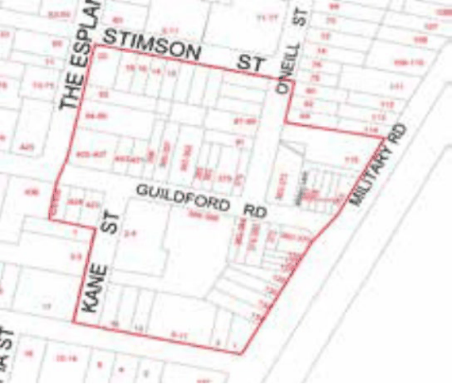
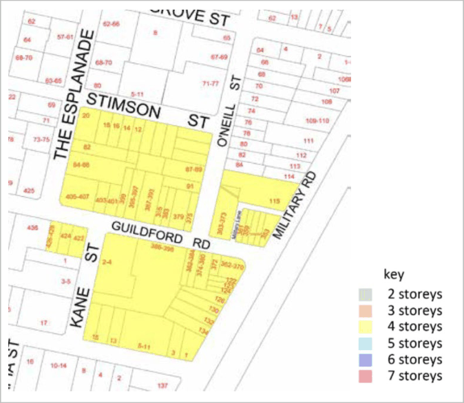
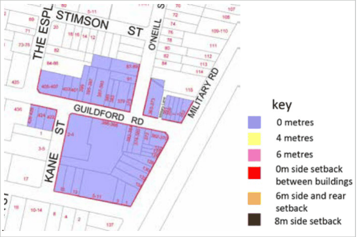

### PART F2-4

### GUILDFORD TOWN

### CENTRE (WEST)

This page has been left intentionally blank.

## 1. Introduction

### 1.1 Land to which this Part applies

This Part applies to all development on land within Guildford Town Centre (West), as shown in

Figure 1.

> [Picture on page 40: a picture, saved as a picture (images/part-f2-business-site-specific-page-40-5.gif, 150 dpi).]

Figure 1: Guildford Town Centre (West)

## 2. Objectives and controls

### 2.1 Site consolidation

#### Objectives

Ensure all sites achieve the required minimum width to adequately provide for basement

car parking.

Minimise vehicular and pedestrian conflicts throughout the town centre through the

appropriate location and number of vehicular access points.

Ensure all sites achieve the required minimum width to allow for a site configuration that

permits a consistent landscaped open space to the rear of sites.

Ensure any site amalgamation pattern does not restrict the development opportunity of

any adjoining site or the ability of adjoining sites to provide basement car parking or rear

open space.

Establish fine grain shopfronts along primary retail streets within the town centre.

Ensure new developments do not reduce the opportunity for the development of

adjoining properties to develop in accordance with this DCP and adversely impact on

the economic viability of development in accordance with s79C of the Environmental

Planning and Assessment Act 1979.

#### Controls

The minimum lot frontage requirements for all development within a Business zone is

located in Part C of this DCP.

The minimum lot frontage requirements for all development within a Residential zone is

located in Part B of this DCP.

Development within Business zones located on Military Road are to provide a fine grain

retail shopfront character.

Sites must not be left such that they are physically unable to develop in accordance with

the prescribed built form outcomes outlined in this DCP.

### 2.2 Rear laneways, land dedication, access and vehicular entries

#### Objectives

Require the provision of rear access ways on properties for private and service vehicle

access, in order to reduce vehicular and pedestrian conflict and provide greater amenity

to future residents.

Require buildings fronting primary roads to have vehicular access from the rear of the

property in order to reduce vehicular and pedestrian conflict and create a safe retail

environment.

Require all sites with existing access ways from the rear of the property to be used for

vehicular access and parking.

Mitigate any impacts of vehicular traffic on adjoining residences.

Allow improved circulation space for pedestrians and future residents within the precinct.

Limit or prohibit vehicular access from primary street frontages.

#### Control

Where new development has access available off existing or laneways, vehicular

access must be provided from the laneway.

### 2.3 Building height

#### Objectives

Require an appropriate scale relationship between building heights and street width.

Ensure the appropriate management of overshadowing, access to sunlight and privacy.

Enable flexibility of used by implementing higher floor to ceiling heights within buildings

for the ground and first floors.

Allow activation of the street edge on primary roads.

Allow for reasonable daylight access to other development and the public domain.

#### Controls

The maximum height for development within the Guildford Town Centre (West) is

detailed within Cumberland LEP 2021 as a written statement and associated maps.

The maximum building height in storeys within the Guildford Town Centre (West) is

detailed in Figure 2.

The minimum floor to ceiling height requirement are located in Part B and C of this DCP.

The prominence of street corners shall be reinforced by concentrating the tallest portion

of the building on the corner in relation to the overall building height and predominant

street wall height.

> [Picture on page 42: a picture, saved as a picture (images/part-f2-business-site-specific-page-42-10.gif, 150 dpi).]

Figure 2: Building height

### 2.4 Building setbacks, separation and street presentation

#### Objectives

Require suitable definition of the public domain and public spaces.

Require a continuous built edge within commercial and mixed use development for

activation of the street edge.

Retain a landscaped setback character for residential development.

Ensure setbacks respond to the building separation requirements.

Reduce the visual impact of buildings on the public domain.

#### Controls

All building setbacks shall be in accordance with Figure 3.

Where a 0 metre setback is permitted, buildings shall form a continuous street edge.

Side setbacks (unless indicated otherwise in Figure 3) are to be in accordance with

setbacks indicated in Part B or Part C of this DCP.

Rear setbacks for development within business zones shall correspond to building depth

and separation requirements in this Section.

Rear setbacks for development within residential zones shall be in accordance with

development controls within Part B of this DCP.

Developments shall present and address the street.

Sites with corner lots shall present and articulate to both street frontages.

> [Picture on page 43: a picture, saved as a picture (images/part-f2-business-site-specific-page-43-12.gif, 150 dpi).]
> Words printed on the picture (title and legend, copied from the PDF):
> .

Figure 3: Setbacks

This page has been left intentionally blank.

> [Picture on page 45: a picture, saved as a picture (images/part-f2-business-site-specific-page-45-1.gif, 150 dpi).]
