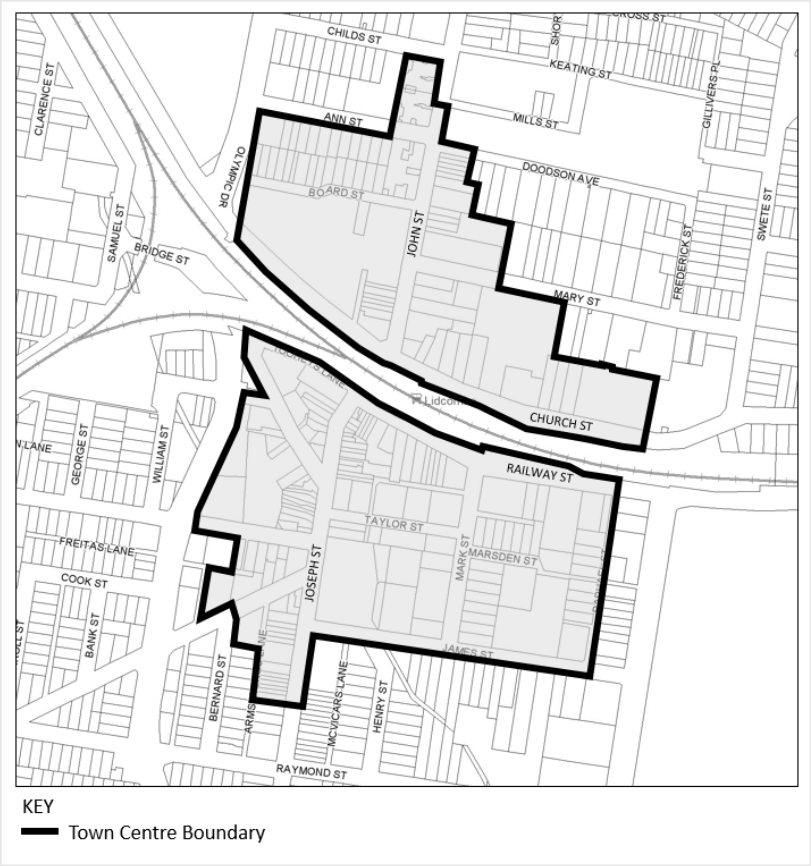
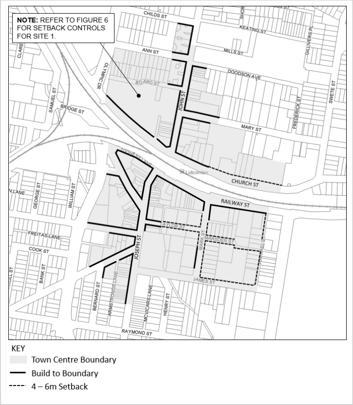
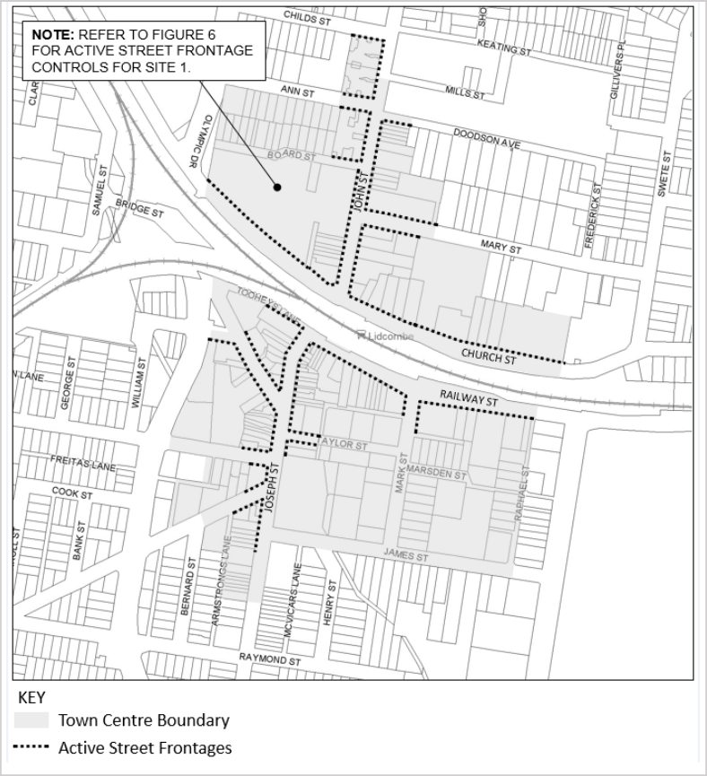
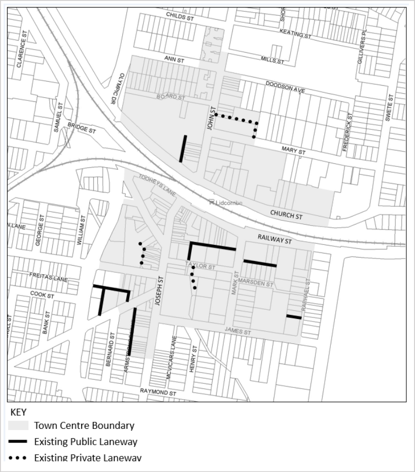
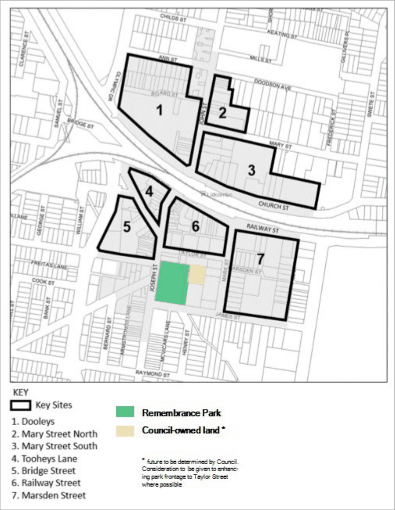
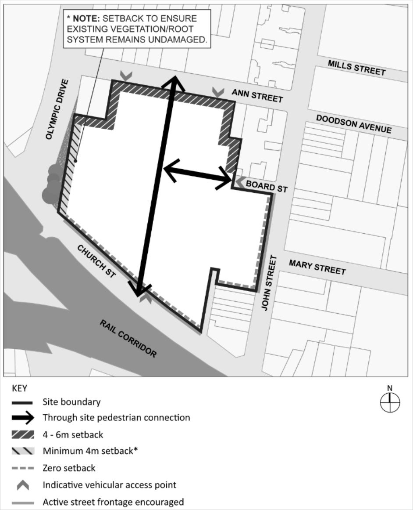
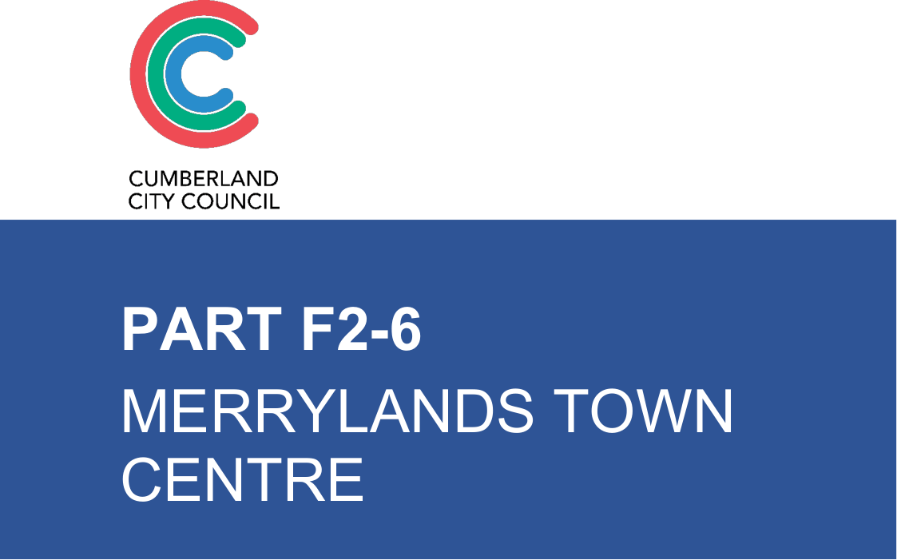

### PART F2-5

### LIDCOMBE TOWN

### CENTRE

This page has been left intentionally blank.

## 1. Introduction

### 1.1 Land to which this Part applies

This Part applies to the Lidcombe Town Centre which is zoned B4 Mixed Use, RE1 Public

Recreation and RE2 Private Recreation under the Cumberland Local Environmental Plan 2021

(refer to Figure 1). Where there are inconsistencies between the controls contained within this

Part and other controls within this DCP, these controls prevail to the extent of the inconsistency.

> [Picture on page 47: a picture, saved as a picture (images/part-f2-business-site-specific-page-47-7.gif, 150 dpi).]

Figure 1: Lidcombe Town Centre - Area to which this Part applies

## 2. Objectives and controls

### 2.1 Setbacks

#### Objective

The built edge of development fronting the street contributes to a sense of enclosure,

scale and appropriate transition within the town centre.

#### Control

Setbacks within the town centre shall be consistent with Figure 2.

> [Picture on page 48: a picture, saved as a picture (images/part-f2-business-site-specific-page-48-8.gif, 150 dpi).]

Figure 2: Building setbacks within Lidcombe Town Centre.

### 2.2 Active frontages

#### Control

As a minimum, buildings shall provide active street frontages consistent with Figure 3.

> [Picture on page 49: a picture, saved as a picture (images/part-f2-business-site-specific-page-49-4.gif, 150 dpi).]

Figure 3: Active street frontages within the Lidcombe Town Centre

### 2.3 Laneways

#### Control

Redevelopment within the Lidcombe Town Centre shall make provision for the creation

of new laneways as shown in Figure 4.

> [Picture on page 50: a picture, saved as a picture (images/part-f2-business-site-specific-page-50-5.gif, 150 dpi).]

Figure 4: Location of laneways proposed within the Lidcombe Town Centre.

### 2.4 Key Sites

Several sites within the Lidcombe Town Centre have been identified as having the greatest

potential for intensification with commercial, residential and mixed use development, as shown

in Figure 5. Each site has an inherent capacity to contribute to the transformation of the urban

form into one which will generate more activity and lead the development of the town centre.

The development controls for these sites apply in addition to the development controls

presented in previous sections of this Part.

> [Picture on page 51: a picture, saved as a picture (images/part-f2-business-site-specific-page-51-8.gif, 150 dpi).]

Figure 5: Key sites within the Lidcombe Town Centre

Site 1 – Dooleys

#### Objectives

Ensure architectural design recognises:

• the strategic significance of the site within the Lidcombe Town Centre; and

• the visual prominence of the site from public areas including the train station and

the approach towards the site from the northern end of John Street. Reinforce John Street as the main street of the northern area of the Lidcombe Town

Centre.

Ensure development is sensitive in scale and character to the heritage item within the

site.

Provide an appropriate transition to the residential area to the north of the site.

Improve pedestrian access and circulation within the town centre.

#### Controls

Development shall be designed in accordance with the principles identified in Figure 6,

particularly opportunities to enhance through-site pedestrian links, and integration with

existing streetscapes.

Development shall be designed to address all street frontages, including Olympic Drive,

and to provide an active street frontage to Church Street and John Street as a minimum.

Development shall provide a new pedestrian through-site link, shared way or street

between Church Street and Ann Street, as well as a link to John Street via Board Street,

with a minimum width of 12m.

The preferred access to the site shall be via Church Street, with secondary access via

Board Street and Ann Street.

Outdoor dining is encouraged along John Street.

Levels above the podium are to be setback by a minimum of 4-6m from the boundary

of adjoining commercial or residential uses.

> [Picture on page 53: a picture, saved as a picture (images/part-f2-business-site-specific-page-53-1.gif, 150 dpi).]

Figure 6: Dooleys site - indicative development layout

Site 2 – Mary Street North Ensure architectural design recognises:

• the strategic significance of the site within the Lidcombe Town Centre; and

• the visual prominence of the site from public areas, including the approach towards

the site from the northern end of John Street. Provide a transition in scale from the proposed taller buildings on John Street to the

adjacent residential zone.

Provide development that is sensitive in scale and character to the heritage item within

the site.

Enhance the public domain and increase accessibility to public open space.

Improve pedestrian access and circulation within the town centre.

#### Controls

Public open space shall be provided at the intersection of John and Mary Streets, or

within close proximity to this intersection.

Retail frontages shall be provided at street level on John Street.

Outdoor dining is encouraged along John Street.

Site 3 – Mary Street South

#### Objectives

Ensure architectural design recognises the strategic significance of the site within the

Lidcombe Town Centre and the visual prominence of the site from public areas,

particularly the Lidcombe train station.

Protect the amenity of the adjacent school and ensure appropriate transitions in scale

from the proposed taller buildings on John Street.

Encourage development that is sensitive in scale and character to the heritage items

within the site.

Enhance the public domain and increase accessibility to public open space.

#### Controls

Public open space shall be provided at the intersection of John and Mary Streets, or

within close proximity to this intersection.

Through-site linkages shall be provided for pedestrians within the site to improve

circulation and access to the town centre. The linkages shall enable connection between

Church Street and Mary Street.

Outdoor dining is encouraged along John Street and Church Street.

Site 4 – Tooheys Lane

#### Objectives

Encourage a mix of uses within the retail core.

Reinforce Joseph Street as the main street of the southern area of the Lidcombe Town

Centre.

Improve the amenity and safety of Tooheys Lane.

Ensure development is sensitive in scale and character to the heritage item within the

site.

Improve access to the Lidcombe Town Centre by the upgrading and widening of

Tooheys Lane.

#### Controls

Outdoor dining shall be encouraged along Joseph Street and Bridge Street.

The preferred primary access to the site shall be provided via Bridge Street.

Consultation with Council shall be undertaken to investigate opportunities to integrate

the upgrading and widening of Tooheys Lane as part of the site’s redevelopment.

Site 5 – Bridge Street

#### Objectives

Encourage a mix of commercial, entertainment and residential uses in the retail core.

Continue the main street character of Joseph Street and connect to the existing retail

shops area on the southern end of the Lidcombe Town Centre.

Encourage development that responds to the heritage significance of Remembrance

Park.

Improve pedestrian access and circulation within the town centre.

#### Controls

Building separation distances shall be determined by having regard to the State

Environmental Planning No. 65 – Design Quality of Residential Flat Development and

accompanying Residential Flat Design Code.

On the Olympic Drive frontage, development shall be designed to:

• address Olympic Drive; and

• provide an appropriately landscaped setback with a minimum depth of 6m. A double

row of street trees shall be planted along the property boundary. Preferred primary access to the site shall be provided via Vaughan Street with a

secondary access via Bridge Street.

Through-site linkages shall be provided for pedestrians within the site to improve

circulation and access to the town centre. The linkages shall enable connection between

Vaughan Street and Bridge Street and Olympic drive and Bridge Street.

New development shall maintain and enhance pedestrian linkages and view corridors

to Remembrance Park.

Outdoor dining shall be encouraged along Joseph Street and Bridge Street.

Site 6 – Railway Street

#### Objectives

Encourage a mix of uses within the retail core.

Reinforce Joseph Street as the main street of the southern area of the Lidcombe Town

Centre.

Ensure architectural design recognises the strategic significance of the site within the

Lidcombe Town Centre and the visual prominence of the site from public areas,

particularly the Lidcombe train station.

Ensure development is sensitive in scale and character to the heritage items within the

site.

Improve pedestrian access and circulation within the town centre.

Improve the amenity and safety of Taylor Street.

#### Controls

The lane between Taylor Street and Railway Street shall be retained to provide access

to parking and loading areas and for waste removal.

Outdoor dining shall be encouraged along Joseph Street and Railway Street.

Through-site linkages shall be provided for pedestrians within the site to improve

circulation and access to the town centre and Remembrance Park. The linkages shall

enable connection between the lane and Joseph Street and/or the lane and Railway

Street.

Site 7 – Marsden Street Precinct

#### Objectives

Ensure architectural design recognises:

• the strategic significance of the site within the Lidcombe Town Centre; and

• the visual prominence of the site from public areas including Lidcombe train station

and Railway Street/Church Street railway bridge. Provide an appropriate transition to the industrial area to the east of the site.

Improve pedestrian access and circulation within the town centre, by upgrading and

widening Davey and Raphael Street to improve their amenity and safety.

Ensure development is sensitive in scale and character to all public open space in the

precinct, including Friends Park and the Jewish Reserve.

Enhance the public domain, and increase accessibility and safety to public open space.

#### Controls

Development shall be designed to address Railway, Mark, James, Marsden, Davey and

Raphael Streets.

Vehicular access to new developments shall not be permitted to or from Davey Street,

to permit the pedestrianisation of the street.

Development along Davey Streets shall dedicate to Council sufficient land of a minimum

width of 2m to provide a pedestrian footpath on the south side of the street.

Development along Raphael Streets shall dedicate to Council sufficient land of a

minimum width of 2.5m to provide a pedestrian footpath and widened carriageway on

the west side of the street.

New buildings are to be setback a minimum of 4m from all open space uses and the

new boundaries of Davey Street and Raphael Street created after the dedication

described in control C29 and C30 above.

New buildings to the north of the central open spaces shall be designed to minimise the

loss of solar access to the open spaces.

Outdoor dining and active uses shall be encouraged facing onto the proposed park on

the corner of Railway and Mark Streets, to provide casual surveillance of the park and

improve safety.

Development adjacent to the existing and proposed public open spaces shall be

designed to provide overlooking and casual surveillance of the park spaces to improve

safety.

Site 7A – 4-12 Railway Street These are additional provisions for 4-12 Railway Street. These apply to this site in addition to those provisions for site 7 - Marsden Street. References to Friends Park/the Park means both the existing Friends Park (as at 2018) and the extension to the east.

#### Objectives

To ensure adequate solar access to the Park for the amenity and enjoyment of this place

by users throughout the year and for the health of the environment.

To improve the amenity for users of the Park by minimising sun reflection, provide visual

interest, and by softening the appearance, of the building walls that face the Park.

To protect the amenity of the Park through provision of a landscaped (vegetated)

transition that will provide privacy, a visual and noise interruption, and improve the

interface and visual outcomes, between the Site (buildings) and the Park.

To encourage the ‘greening’ of the site and improved amenity for Park users through

vegetation planting of the buildings’ external walls facing the Park and of the rooftop of

the building/s in the southern portion of the Site.

To enhance local biodiversity through the planting of diverse native plant species.

To ensure building massing is designed to maximise solar access to Friend Park all year

round.

#### Controls

The maximum height of the building in the south-western corner of the site is not to

exceed 3 storeys.

Building setbacks, build to lines, and street wall heights:

A. Setbacks and Built-to Lines Minimum setbacks and built-to lines must be provided as follows:

i. Zero setbacks / build-to lines to Railway Street.

ii. A 0m setback, for the full wall height, is to be provided for the building/s located on the western boundary of the site.

B. Street Wall Height

i. A maximum two storey street wall height is to be maintained along Railway Street and Raphael Street with upper level setbacks.

C. Upper Level Setbacks.

i. The building above the street wall is to provide a minimum 2m setback along Railway Street.

ii. The third storey of the building in the south-western corner of the site is to have a minimum 4m setback from the southern edge of the building below.

iii. The residential component along Railway Street, Raphael Street, southern and western boundaries must comply with the building separation recommendations in the NSW Apartment Design Guide (ADG).

Buildings are to be designed to minimise the loss of solar access to Friend Park, with

reference to site characteristics and interface with approved future development in this

location.

To utilise roof space for developing roof gardens (green roof) for those building/s on the

southern portion of the Site. Where possible incorporate exterior green walls into the

building/s for those walls facing the Park.

The land within the rear setback (ie the land between the building and the Park) is to

include landscaping and deep soil planting. This landscaped rear setback is to have a

minimum width of 6m measured from the rear property boundary. The rear setback area

is to be landscaped using native species of trees (minimum pot size 200L) and/or large

shrubs (minimum 2m height when mature) which are robust and drought tolerant.

To use variation in appropriate materials and neutral/subdued colours for those building

walls facing the Park.

This page has been left intentionally blank.

> [Picture on page 60: a picture, saved as a picture (images/part-f2-business-site-specific-page-60-1.gif, 150 dpi).]
