### PART F2-6

### MERRYLANDS TOWN

### CENTRE

This page has been left intentionally blank.

## 1. Introduction

### 1.1 Land to which this Part applies

This Part applies to all development within the Merrylands Centre, including land within the Neil

Street Precinct as shown in Figure 1.

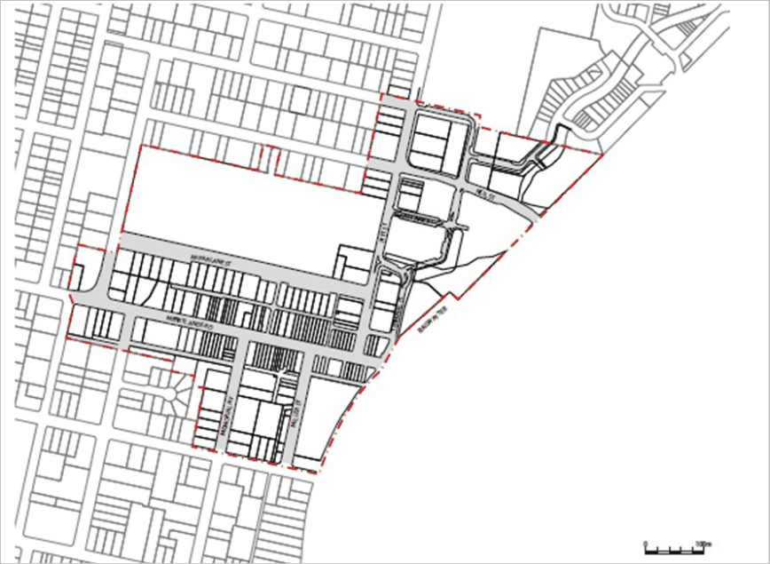

> [Picture on page 62: a picture, saved as a picture (images/part-f2-business-site-specific-page-62-5.gif, 150 dpi).]

Figure 1: Precinct Plan

## 2. Vision

### 2.1 Vision

#### Aims of the plan

• Renew and revitalise the Merrylands Centre.

• Provide increased growth capacity with Merrylands.

• Provide greater housing sustainability.

• Promote steady local economic growth over the next 20 years.

#### Objectives

Strengthen the economic and employment role of Merrylands.

Provide for an active and vibrant centre.

Ensure buildings are designed to maximise appropriate amenity outcomes for the

centre.

Ensure development design promotes the principles of ecologically sustainable

development.

Create a centre for a diverse community.

Promote public transport use, cycling and walking and reduce reliance on private car

travel.

Improve pedestrian and vehicular traffic movement within the centre.

Achieve urban design strategies that acknowledge the role of Merrylands within

Cumberland City and the subregion.

Maintain and create clear linkages within the centre and with adjoining residential

precincts.

## 3. Objectives and Controls

### 3.1 Urban design strategies

In order to achieve the objectives for the redevelopment of the Merrylands Centre, the following

urban design strategies have been established. These have been implemented through

development controls in this plan. The success of the centre plan is reliant on the achievement

of these strategies. Strengthen the economic and employment role of Merrylands.

• create an active centre for opportunities to live, work and play;

• facilitate the development of commercial, office and retail development at grade, with

commercial and/or ancillary residential development above;

• facilitate the growth of retail, and commercial development within the Town Centre, with

ancillary residential development;

• become a destination through additional retail, commercial and entertainment uses;

and

• ensuring interim development does not hinder or detract from the attainment of

commercial or mixed use development in the town centre.

#### Provide for an active and vibrant centre

• ensure buildings address the street and the public domain by providing a consistent

built edge and street frontage height;

• facilitate of mixed use development with retail and commercial at grade and first floor,

residential or commercial development above;

• maintain Merrylands Road as the main street within the precinct;

• improve the landscaping and public domain spaces along McFarlane Street;

• create an active town centre where walking is encouraged by requiring future

development to activate the street with quality design and provide for at grade

pedestrian connectivity;

• enable McFarlane Street to become an ‘eat street’ restaurant space; and

• requiring development to activate the street and enhance at grade pedestrian

connectivity.

Ensure buildings are designed to maximise appropriate amenity outcomes for the centre.

• provide setbacks and separation on upper storeys to lessen overshadowing impact;

• provide height transition from the lower scale residential buildings to the higher scale

buildings on Merrylands Road and McFarlane Street in order to lessen overshadowing

impacts;

• maintain the amenity of the Centre by maximising solar access to the street;

• require appropriate building setbacks and separation to allow for solar access and

privacy;

• require the design of buildings to implement ‘safer by design’ principles;

• create a centre where pedestrians can feel safe during the day and night; and

• provide public open space and landscaping for amenity and passive recreation

opportunities.

Ensure development design promotes the principles of ecologically sustainable development

• respond to the opportunities and constraints of the site; the hierarchy and proposed

uses of streets and laneways; flood hazard and the need for high quality public spaces

and public and private amenity;

• ensure that redevelopment within the Centre does not increase the impact of flood

inundation on property or person (or both), within or beyond the Centre’s boundaries;

• provide an overland flow path across which reduces flood levels while also serving as

a pedestrian thoroughfare and focus for shopfronts and activity;

• minimise the impacts of development on the environment;

• create a centre for a diverse community;

• facilitate the provision of a variety of dwelling sizes within the residential component of

buildings;

• promote a variety of uses within the centre; and

• provide public spaces for the community to meet and congregate. Promote public transport use, cycling and walking and reduce reliance on private car travel

• create a safe, pedestrian friendly environment through the activation of streets and

public places

• create clear linkages within the centre and to adjoining residential precincts;

• contribute to a mix of residential, business, commercial and entertainment uses in the

centre to maximise public transport use;

• improve pedestrian connectivity through providing designated pedestrian linkages;

• improve pedestrian and vehicular traffic movement within the centre;

• restrict egress and ingress of vehicular traffic onto Merrylands Road from private

properties;

• facilitate the creation of laneways and rear private access ways for key sites within the

centre; and

• provide new roads and infrastructure to improve accessibility and circulation in the Neil

Street Precinct.

Achieve urban design that acknowledge the role of Merrylands within Cumberland City

• provide a transition in building heights through increasing height when approaching

from the west and north east to enable the built form to signal the presence of the town

centre;

• maintain the amenity of surrounding lower scale development;

• comply with site requirements to enable better amenity outcomes for taller buildings;

• development responds to site opportunities and constraints and the need for high

quality public spaces;

• facilitate the location of civic and public uses within the centre;

• provide appropriate public open spaces within the core of the centre and with the Neil

Street Precinct; and

• deliver quality designed buildings that reflect the role of the centre. Maintain and create clear linkages within the centre and with adjoining residential precincts

• provide clear vehicular and pedestrian linkages with Neil Street Precinct, Holroyd

Gardens and surrounding residential areas;

• maintain and enhance a primary north-south pedestrian corridor from Memorial Avenue

to Neil Street;

• provide suitable crossings and infrastructure for pedestrians and cyclists; and

• create of pedestrian linkages that provide connections within the centre.

### 3.2 Public domain

#### 3.2.1 Roads and circulation

A number of new intersections, roads, laneways and accessways are proposed under this plan,

as indicated in the tables below and in Figure 2 Road widening along Merrylands Road will be

required to enable a greater footpath area for street tree planting and pedestrian movement.

Points where vehicular entry is not permitted are also identified. Indicative street sections are

provided in Section 2.3.4. Urban design strategies achieved:

• create clear linkages within the centre and to adjoining residential precincts;

• improve pedestrian connectivity through providing designated pedestrian linkages;

• restrict egress and ingress of vehicular traffic onto Merrylands Road from private

properties;

• facilitate the creation of laneways and rear private access ways for key sites within

the centre;

• provide new roads and infrastructure to improve accessibility and circulation in the

Neil Street Precinct;

• provide clear vehicular and pedestrian linkages with Neil Street Precinct, Holroyd

Gardens and surrounding residential areas;

• create of pedestrian linkages that provide connections within the centre;

• maintain Merrylands Road as the main street within the precinct; and

• create a safe, pedestrian friendly environment through the activation of streets and

public place.

Table 1: New Roads, laneways, accessways in Merrylands Centre

| New Roads, laneways, accessways in Merrylands Centre |  |
|---|---|
| New Roads |  |
| Extension of Sheffield Street |  |
| Extension of Gladstone Street |  |
| New Road 1- between Terminal Place and Sheffield Street Extension |  |
| New Road 2- between Dressler Court and New Road 1 |  |
| Signalised intersections |  |
| Neil Street and New Road 1 |  |
| Gladstone Street and Pitt Street |  |
| Laneways (Public) |  |
| Extension of Main Lane (as part of redevelopment of 242-252 Pitt St | Merrylands) |
| Laneway 1- between Merrylands Road and McFarlane Street (“eat street” part pedestrians only) |  |
| Laneway 2- between Memorial Avenue and Addlestone Road |  |
| Accessways (public or private) |  |
| Accessway 1- between Military Road and Miller Street |  |
| Accessway 2- between Addlestone Road and Burford Street |  |
| Accessway 3- between Neil Street and Sheffield Street |  |
|  | May be closed, partially closed or a shared space in the future Eat Street |

Figure 2: Road Widening

#### 3.2.2 Pedestrian and Bicycle Network

Figure 3 includes footpaths, required new pedestrian access and crossings and bicycle access. Pedestrian accessways create linkages to key locations in the centre. The proposed cycleway

links to Holroyd Gardens, which is part of the regional cycle network. Urban design strategies achieved:

• create an active town centre where walking is encouraged by requiring future

development to activate the street with quality design and provide for at grade

pedestrian connectivity;

• create a safe, pedestrian friendly environment through the activation of streets and

public places;

• create clear linkages within the centre and to adjoining residential precincts;

• improve pedestrian connectivity through providing designated pedestrian linkages;

• provide clear vehicular and pedestrian linkages with Neil Street Precinct, Holroyd

Gardens and surrounding residential areas;

• provide suitable crossings and infrastructure for pedestrians and cyclists; and

• create of pedestrian linkages that provide connections within the centre.

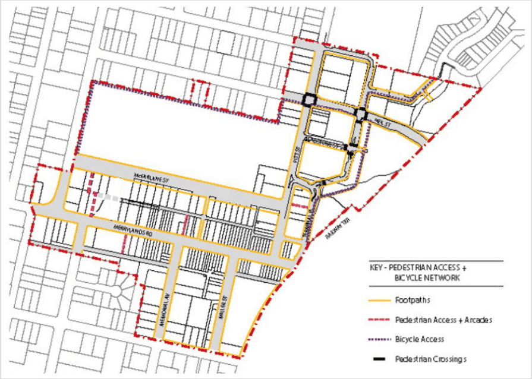

> [Picture on page 67: a picture, saved as a picture (images/part-f2-business-site-specific-page-67-17.gif, 150 dpi).]

Figure 3: Pedestrian and bicycle network

#### 3.2.3 Landscaping and open space

The Centre proposes public and private open spaces, including deep soil zones, swales and

planting on structures. Parks in Neil Street are located adjacent to roads to provide overland

flow paths and to increase the visibility and safety. They also provide connectivity within the

precinct. A town square between Merrylands Road and McFarlane Street is to provide focus for

the city. Opportunity to provide deep soil zones within the centre is limited therefore opportunities for

planting on structures (i.e roof gardens) is promoted. Trees planting will be important to the centre in providing streetscape character and providing

amenity. Figure 4 indicates locations for open spaces and landscaping, including indicative

locations for existing and proposed street tree planting. Urban design strategies achieved:

• create an active centre for opportunities to live, work and play;

• improve the landscaping and public domain spaces along McFarlane Street;

• provide public open space and landscaping for amenity and passive recreation

opportunities;

• respond to the opportunities and constraints of the site; the hierarchy and proposed

uses of streets and laneways; flood hazard and the need for high quality public

spaces and public and private amenity;

• ensure that redevelopment within the Centre does not increase the impact of flood

inundation on property or person (or both), within or beyond the Centre’s

boundaries;

• provide an overland flow path across which reduces flood levels while also serving

as a pedestrian thoroughfare and focus for shopfronts and activity;

• minimise the impacts of development on the environment;

• provide public spaces for the community to meet and congregate; and

• provide appropriate public open spaces within the core of the centre and with the

Neil Street Precinct.

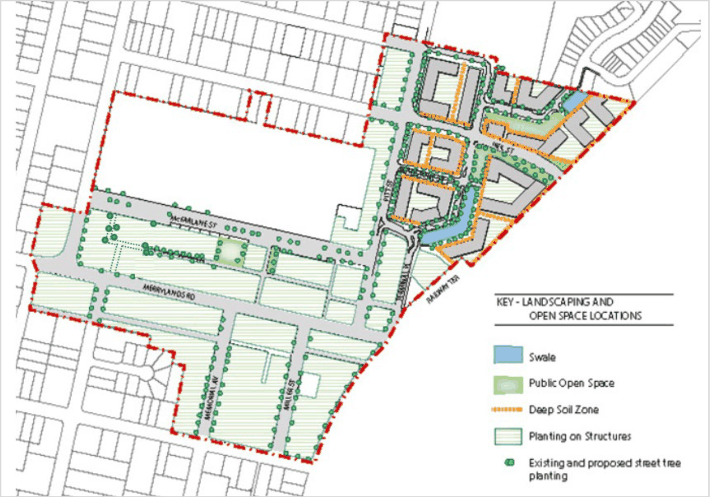

> [Picture on page 68: a picture, saved as a picture (images/part-f2-business-site-specific-page-68-29.gif, 150 dpi).]

Figure 4: Landscape and open space

#### 3.2.4 Indicative Street Section

The key map below shows a number of street sections within the centre. Indicative street

sections have been provided on the following pages to indicate carriageway, footpath, verge

widths and setbacks.

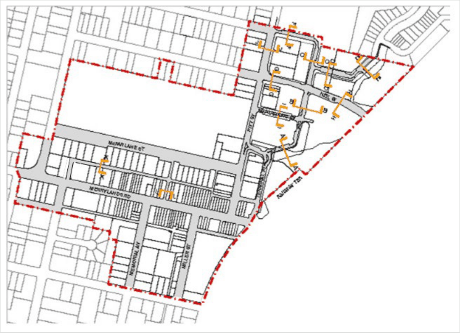

> [Picture on page 69: a picture, saved as a picture (images/part-f2-business-site-specific-page-69-5.gif, 150 dpi).]

Figure 5: Key street sections

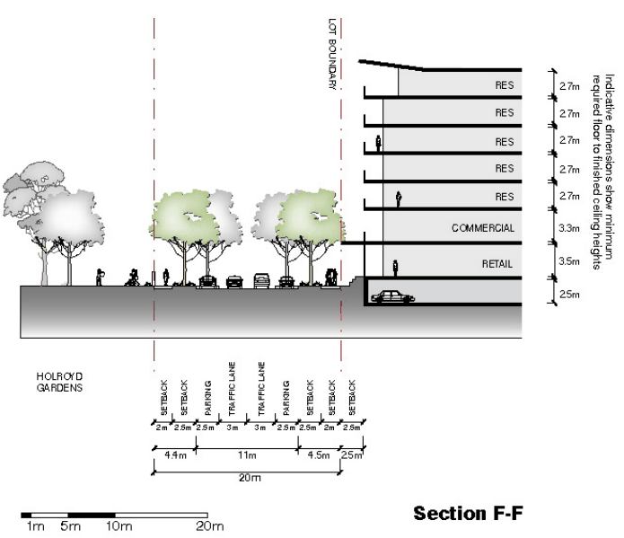

> [Picture on page 70: a picture, saved as a picture (images/part-f2-business-site-specific-page-70-1.gif, 150 dpi).]

Figure 6: Section F-F

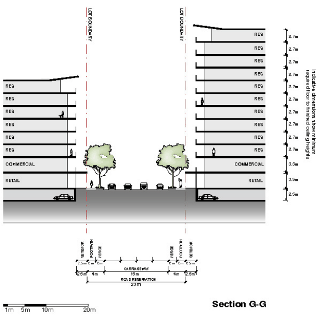

> [Picture on page 70: a picture, saved as a picture (images/part-f2-business-site-specific-page-70-3.gif, 150 dpi).]

Figure 7: Section G-G

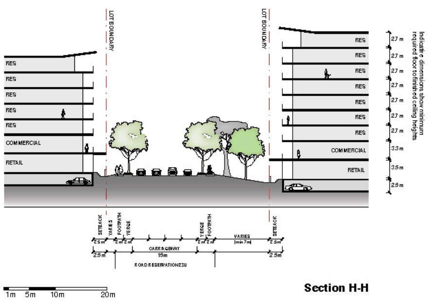

> [Picture on page 71: a picture, saved as a picture (images/part-f2-business-site-specific-page-71-1.gif, 150 dpi).]

Figure 8: Section H-H

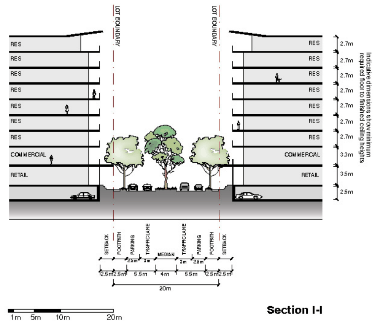

> [Picture on page 72: a picture, saved as a picture (images/part-f2-business-site-specific-page-72-1.gif, 150 dpi).]

Figure 9: Section I-I

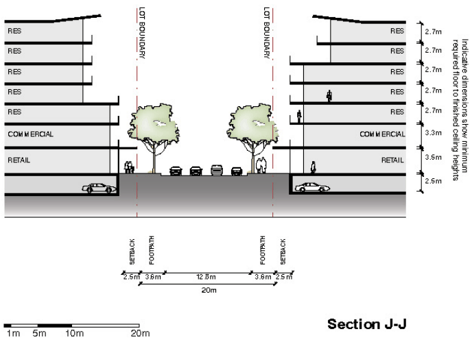

> [Picture on page 72: a picture, saved as a picture (images/part-f2-business-site-specific-page-72-3.gif, 150 dpi).]

Figure 10: Section J-J

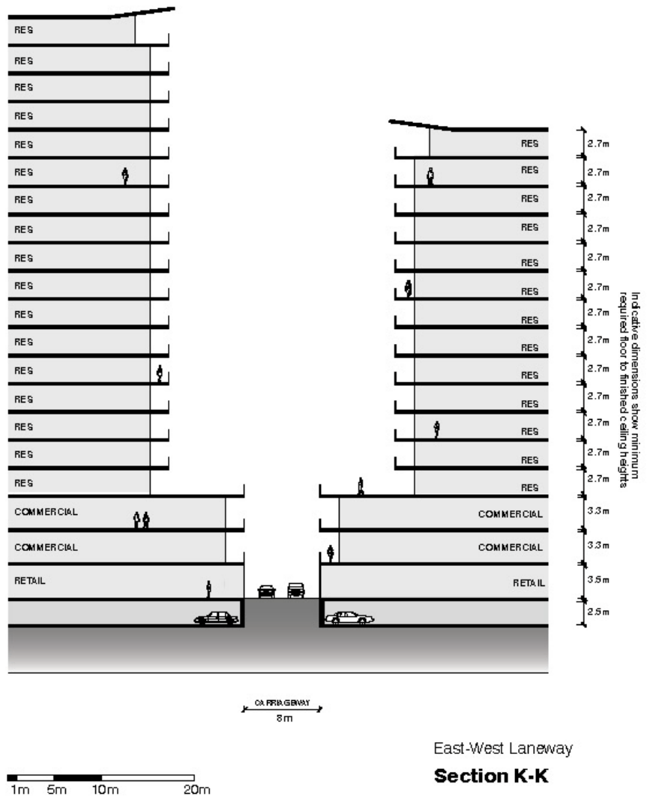

> [Picture on page 73: a picture, saved as a picture (images/part-f2-business-site-specific-page-73-1.gif, 150 dpi).]

Figure 11: Section K-K

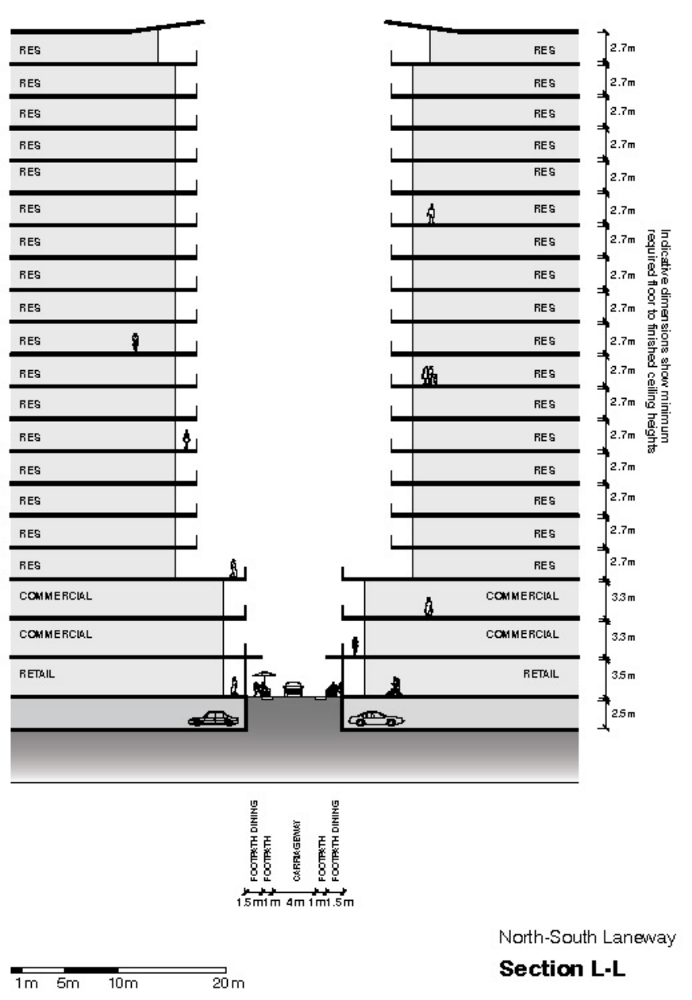

> [Picture on page 74: a picture, saved as a picture (images/part-f2-business-site-specific-page-74-1.gif, 150 dpi).]

Figure 12: Section L-L

### 3.3 Building Envelope

#### 3.3.1 Site amalgamation and minimum frontage

In order for taller buildings to achieve suitable building amenity outcomes and to ensure building

sites can accommodate appropriate vehicular access and car parking facilities, a suitable

minimum site frontage needs to be obtained for all developments. In some instances specific site amalgamations will be required, this may be where the provision

of a laneway is required, where vehicular entry points are required in a certain location or where

a specific building footprint is required due to flood conditions.

#### Objectives

Ensure the achievement of laneways and private accessways in order to require

development fronting Merrylands Road to have rear vehicular access.

Ensure vehicular access can be obtained from secondary streets and laneways.

Ensure sites are sufficient in frontage in order to provide adequate vehicular access and

basement car parking.

Ensure site dimensions allow for the achievement of appropriate building setbacks and

separation.

For new development not to reduce the reasonable development opportunity of

adjoining lots.

#### Controls

Amalgamation of lots in accordance with Figure 13 is required for redevelopment.

Where amalgamation is not required by this plan, the minimum site width for

redevelopment is 20m.

The minimum site width achieved shall determine the height of buildings (in storeys) in

accordance with the table below. Site width shall be measured at the primary frontage.

| Site Width (m) | Permitted Height (Storeys) |
|---|---|
| 20m | Maximum 3 storeys |
| 26m | Maximum 8 storeys |
| 32m | Maximum 20 storeys |

Sites must not be left such that they are physically unable to reasonably develop a three

storey building in accordance with the controls in Sections 2 and 3 of this Part.

Development must not prevent the provision of laneways, accessways or vehicular

access locations is prevented, or cannot be achieved in accordance with this plan.

Where required amalgamations cannot be achieved:

• Applicants are to negotiate with all affected property owners prior to the lodgement

of a development application, in an attempt to achieve the preferred development

outcome.

• In instances where amalgamation cannot be achieve (because a landowner

chooses not to take-up a reasonable offer) the following information must be

submitted with any development application:

- two (2) written valuations indicating the value of the remaining sites that were to

be developed in conjunction with the applicant’s properties. These are to be

undertaken by two independent Valuers registered with the Australian Institute of

Valuers, and

- evidence that a reasonable offer has been made to the owner(s) of the affected

sites to purchase and valuation reports Where amalgamation (as required) is not achieved the applicants must show that the

remaining sites, which are not included in the consolidation will still be able to achieve

the development outcome prescribed in this DCP (i.e. minimum site frontage of 20m).

This includes achieving the required vehicular access, basement parking and built form.

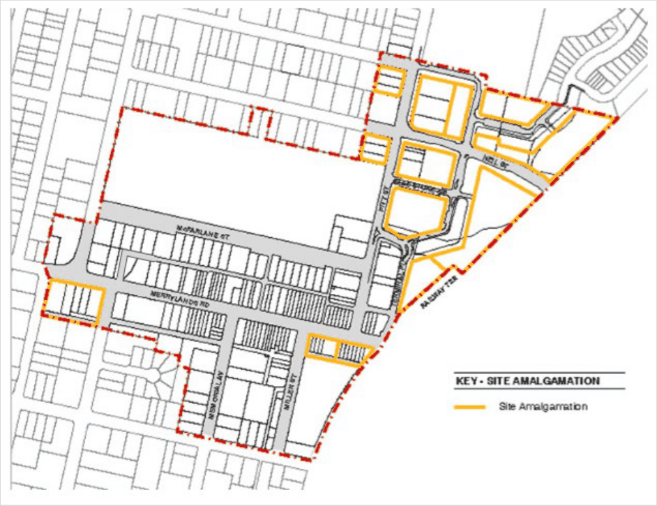

> [Picture on page 76: a picture, saved as a picture (images/part-f2-business-site-specific-page-76-14.gif, 150 dpi).]

Figure 13: Key site amalgamation

#### 3.3.2 Building and Ceiling Height

Built form scale is important in establishing the role and character of a centre. It can provide

visual cues to signal the presence of the town centre and also provide legibility within the centre

itself. The built form of Merrylands centre will reflect its role as a town centre, whilst having

regard for surrounding lower density development. The built form scale established for Merrylands provides a height transition, from lower scale

when approaching from the west, north-east and surrounding lower scale residential buildings

to towers in the core of the centre. The scale has been specifically developed to ensure that an

appropriate level of daylight access is achievable for dwellings within and immediately outside

of the centre and that the scale of building reflects its proximity to the core of the centre.

#### Objectives

Achieve appropriate management of overshadowing, access to sunlight and privacy

Deliver a built form that provides a height transition, from lower scale on the edges of

the centre to higher scale in the core of the centre.

Ensure the scale of the built form provides for a legible centre.

Provide appropriate transition in building heights from public spaces.

#### Controls

Maximum permitted building height in storeys* shall be in accordance with the table

below.

| Permitted Height (storeys) |  |
|---|---|
| Height (m) | Storeys |
| 10 | 1 |
| 12.5 | 2 |
| 14 | 3 |
| 17 | 4 |
| 20 | 5 |
| 23 | 6 |
| 26 | 7 |
| 29 | 8 |
| 32 | 9 |
| 38 | 11 |
| 41 | 12 |
| 50 | 15 |
| 53 | 16 |
| 65 | 20 |

Each storey shall have the following minimum floor to ceiling heights:

• ground floor - 3.5m;

• first floor (regardless of use) - 3.3m; and

• all other floors - 2.7m. Development in the centre shall establish a consistent building height transition, from

the edges of the centre, to the core of the centre.

Ensure the achievement of daylight access to public open spaces in accordance with

Section 2.6.

#### 3.3.3 Street setbacks, road widening and street frontage heights

The street setback and frontage height of buildings establishes different character areas and

spaces, through the definition of streets. Consistent street alignment provides continuity of

street facades and enhances the character of the area. Street frontage height determines the

scale of buildings on the street and reflects the role of the centre and the intended experiences

for pedestrians. The street setbacks in Merrylands reflect the retail and commercial uses within the core, civic

streets and the transition to lower scale residential areas. Street frontage heights provide a

human scale to the centre, to optimize pedestrian experience and allow for the achievement of

sunlight access.

#### Objective

Provide street edges that reinforce and reflect the various uses and characters within

the centre.

Ensure the location of shop fronts are adjacent to pedestrian activity.

Create a pleasant environment and amenity for residents and visitors through the

provision of street trees and wider footpaths on Merrylands Road.

Encourage the establishment of active laneway uses through street setbacks.

Enhance the character of the centre through consistent and continuous street facades.

Ensure building heights at street level are at a human scale.

Ensure the pedestrian environment is pleasant and inviting through access to sunlight,

appropriate scale and massing of buildings and wind mitigation.

#### Controls

Street setbacks in accordance with Figure 14 are required for redevelopment.

0.5m road widening is required for both sides of Merrylands Road in accordance with

Figure 2.

On Pitt Street a 0.65m road widening is required for 185 Pitt Street, to enable the cycle

path connection.

A 3m x 3m splay corner is required at the south-western corner of the Neil Street/Pitt

Street intersection.

On Neil Street, road widening is required at 185 and 208 Pitt Street; and on Pitt Street,

road widening is required at 208 and 212 Pitt Street and 8 Gladstone Street.

Street wall height of buildings (podium) shall be 3 storeys, with a minimum height of

11m and maximum height of 14m.

Upper level (above street wall) street frontage setbacks for Merrylands Road, McFarlane

Street and Pitt Street will be based on storey height, in accordance with the table below

and Figure 15:

| Storeys | Street frontage setback (m) |
|---|---|
| 4-8 | 4m |
| 9-12 | 5m |
| 13-20 | 6m |

Upper level street frontage setbacks for Memorial Avenue shall be in accordance with

Figure 16

Minor projections into the street setback will be accepted for sites where 0m setback is

required, in accordance with the table below:

| Permitted projection | Permitted length of projection |
|---|---|
| Awnings | 3m |
| Awnings (laneways) | Maximum 1.5m |
| Balconies (above 3rd storey) | 600mm |

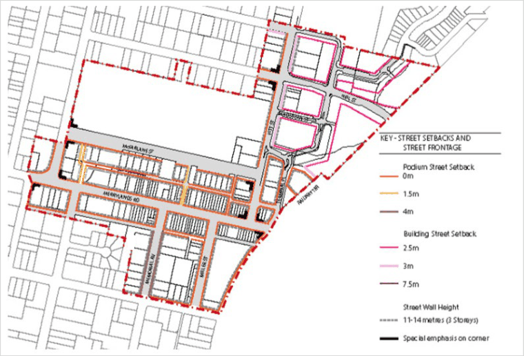

> [Picture on page 79: a picture, saved as a picture (images/part-f2-business-site-specific-page-79-14.gif, 150 dpi).]

Figure 14: Setbacks and street frontages

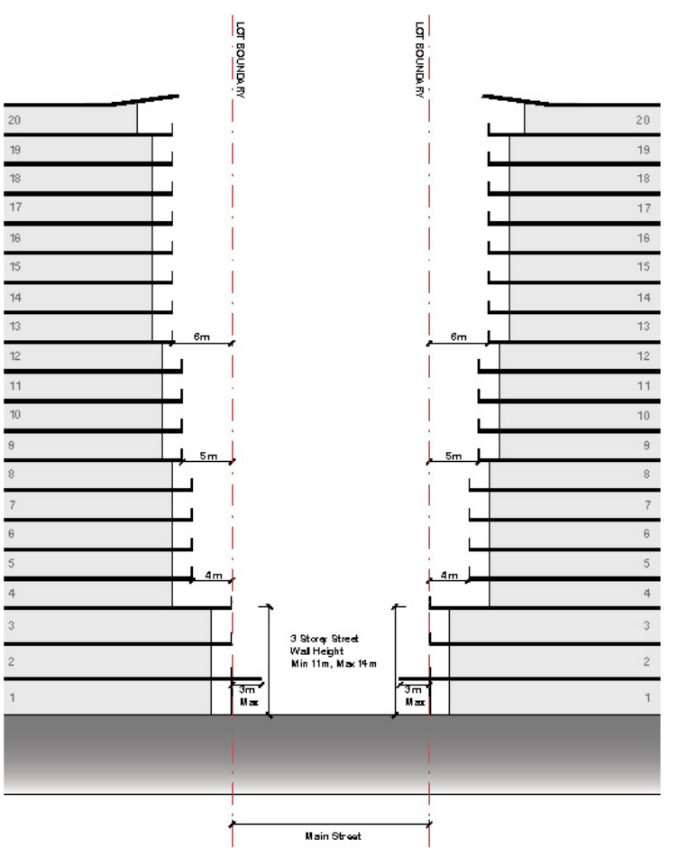

> [Picture on page 80: a picture, saved as a picture (images/part-f2-business-site-specific-page-80-1.gif, 150 dpi).]

Figure 15: Main street setbacks

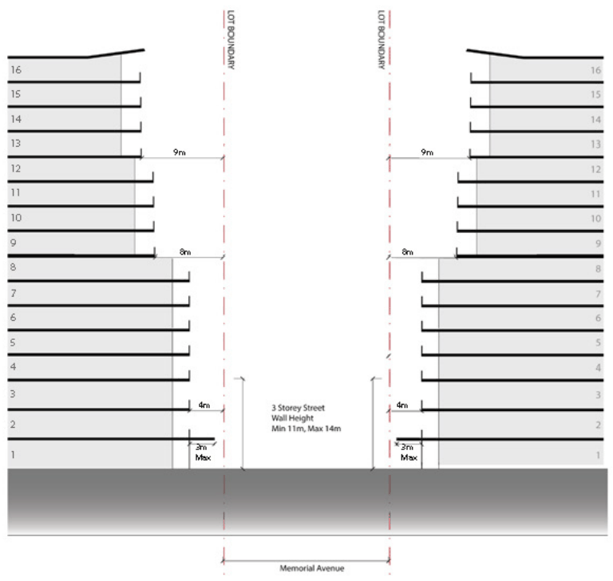

> [Picture on page 81: a picture, saved as a picture (images/part-f2-business-site-specific-page-81-1.gif, 150 dpi).]

Figure 16: Memorial Avenue setbacks

#### 3.3.4 Building depth and length

Building depths directly impact the residential amenity for dwelling occupants. Achieving

adequate building depths can ensure access to natural ventilation and sunlight, which provides

amenity and energy savings. Limiting building depth and length also reduces the bulk of a

building, which provides benefits to the public domain of sunlight access and streetscape

amenity. Building depth is related to building use and different site conditions such as size, orientation

and density which may require different design solutions. Building depth will be calculated as Building plan (glass line to glass line) + articulation zone

(including balconies).

#### Objectives

Promote sustainable building design and development and reduce reliance on artificial

heating, cooling and lighting.

Ensure that adequate cross ventilation and sunlight access is achieved in residential

apartments within the high density centre.

Provide for viable and functional commercial spaces.

Consider the amenity of future residents and workers through building design.

Provide sunlight access and streetscape amenity to the public domain

#### Controls

There is no maximum building depth requirement for floors used as commercial

premises.

The maximum permissible building plan depth for residential accommodation is 18m.

The maximum permissible building envelope depth for residential accommodation is

22m.

Residential apartments on the 2nd and 3rd storey levels are limited in depth to 8m from

the glassline and 11m from the outer edge of the building envelope.

Where office premises are proposed, all points on an office floor should be no more than

15m from a source of daylight.

The maximum horizontal length of any building above the podium shall not exceed 50m.

All residential and mixed use developments shall be, or substantially contain, dual

aspect apartments.

#### 3.3.5 Setbacks and separation

Building setbacks and separation is significant in establishing and maintaining residential and

pedestrian amenity within and outside of the centre. Sunlight access, privacy and airflow to both

buildings and public spaces can only be achieved through the adequate separation of buildings. Sufficient building separation can reduce the appearance of building bulk and allows for the

definition of public space, including laneways, open space and landscaping. Providing spaces

between buildings also contributes in creating legibility within the centre. Setbacks and separation proposed for Merrylands responds to the future role of the centre, in

order to provide a balance between the future density of the centre and the amenity for residents

and pedestrians.

#### Objectives

Ensure residents within buildings and adjoining buildings have adequate access to

sunlight, airflow and visual and acoustic privacy.

Provide visual legibility and a pleasant public domain through breaks in the built form.

Mitigate the impacts of wind within the centre.

Create a consistent streetscape character.

#### Controls

Where the street setback is 0m, a continuous built edge shall be provided up to the 3rd

storey, regardless of use.

Where a laneway or accessway is required the minimum rear setback shall be 8m,

unless shown otherwise.

Setbacks to secondary streets (above podium) to the property line shall be provided as

below:

| Storeys | Setback (m) |
|---|---|
| 4-8 | 3m |
| 9-20 | 6m |

0m side setback to Terminal Place and or Milne Lane will be accepted for properties

266 Pitt Street and 135-137 Merrylands Road.

Minimum setbacks to side boundaries shall be provided in accordance with the table

below:

| Building uses | Storeys | Side setbacks (metres) |
|---|---|---|
| Non habitable rooms and commercial with no windows | 1-3 4-8 9-20 | 0 3 6 |
| Habitable rooms/balconies | 4 5-8 9-20 | 6 9 12 |
| Habitable rooms/balconies and non-habitable rooms | 4 5-8 9-20 | 4.5 6.5 9 |

Minimum rear setbacks to buildings with a common boundary to a business zone:

| Building use | Storeys | Rear Setback (metres) |
|---|---|---|
| Ground floor | 0-3 | 0 |
| Non habitable rooms (including commercial) | 4-8 9-20 | 3 6 |
| Habitable rooms/balconies | 4 5-8 9-20 | 6 9 12 |
| Habitable rooms/balconies and non-habitable rooms | 4 5-8 9-20 | 4.5 6.5 9 |
| Where rear laneway or accessway is required |  | 8 |

Minimum rear setbacks to a common boundary with a residential zone:

| Building use | Storeys | Rear Setback (metres) |
|---|---|---|
| Non habitable rooms (including commercial) | 0-8 9-12 13-20 | 6 9 12 |
| Habitable rooms/balconies | 4 5-8 9-20 | 6 9 12 |
| Habitable rooms/balconies and non-habitable rooms | Up to 4 5-8 9-20 | 4.5 6.5 9 |
| Where a rear laneway or accessway is required |  | 8 |

Minimum separation between upper levels (above podium) on one site:

| Building uses | Storeys | Side Separation (metres) |
|---|---|---|
| Non habitable rooms (including commercial) | 4-8 9-20 | 6 12 |
| Habitable rooms/balconies | 4 5-8 9-20 | 12 18 24 |
| Habitable rooms/balconies and non- habitable rooms | 4 5-8 9-20 | 9 12 18 |

#### 3.3.6 Active frontages, street address and building use

Building frontages that contribute positively to the public domain through activity and design not

only encourage pedestrian activity, which can bring vitality and vibrancy to a centre, but also

provides pedestrians with amenity and a safer environment. Entrances to buildings define the private and public domain and need to be legible and free of

barriers. Frontages should also enable accessibility for the entire community

#### Objectives

Provide for a vibrant, pedestrian focused centre through the orientation and design of

ground floor entries and shop fronts.

Require activation of the street through the reinforcement of activities along the main

streets and some laneways.

Maintain the established character of fine grain frontages at ground level.

Provide well designed building facades and entrances.

Contribute to a safe environment for pedestrians and residents through both passive

and active surveillance.

Ensure the accessibility of the centre for the entire community.

#### Controls

Active frontages Provide Active frontages at street level, orientating onto streets, laneways and public

places, as identified on Figure 17.

Active frontages consist of the following:

• shopfront;

• food and Drink premises such as Restaurant or Café;

• entrance to public buildings or commercial building foyers; and

• customer service areas and receptions (where visible from the street).

At least 70% of street level frontages shall be transparent glazing. Blank or solid walls

and the use of dark or obscured glass on active frontages are prohibited.

Restaurants, cafes and the like are to consider providing openable shop fronts.

Active frontages located on Merrylands Road (to Addlestone Street) and McFarlane

Street should aim to provide at least 10-14 separate tenancy entries per 100m.

Large developments shall provide multiple entrances.

Solid roller shutters or the like that obscure windows and entrances are not permitted.

Security grilles which are fixed internally to the shop front, fully retractable and are at

least 50% transparent when closed, are acceptable.

The ground floor level of active frontages shall be at the same level as the footpath,

unless otherwise required by this plan.

The location of fire escapes, service doors, plant equipment and the like are to be

minimised on active streets.

Street address Street address in the form of entries, lobbies and/or habitable rooms with clear glazing

are required at ground level, in accordance with Figure 17.

Direct pedestrian access off the primary street front shall be provided.

Direct ‘front door’ access to residential units is encouraged.

Open space should be oriented to overlook pedestrian access points.

Blank walls or dark or obscured glass is not permitted.

Building use Retail and commercial uses are to be located on at the ground floor level for all

development within the B4 zone.

Residential development is not permitted to be located at the ground floor level of any

development within the B4 zone.

Commercial office space or other suitable non residential uses must be provided at the

first floor level of development for the entire premises street frontage.

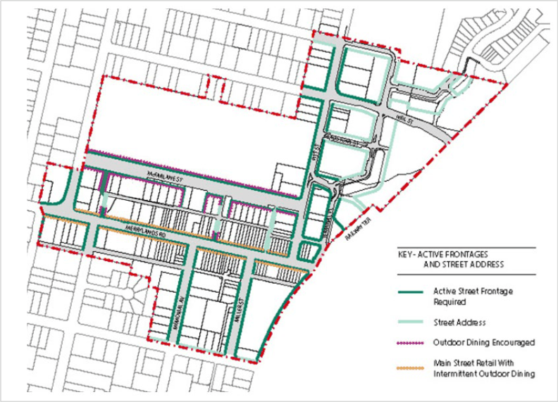

> [Picture on page 87: a picture, saved as a picture (images/part-f2-business-site-specific-page-87-1.gif, 150 dpi).]

Figure 17: Active frontages and street address

#### 3.3.7 Landscaping and open space

Landscaping should build on a site’s existing natural and cultural features to contribute to a

developments positive relationship to its context and site. Landscape design should optimize

usability, privacy, social opportunity, equitable access and respect for neighbours’ amenity. It

plays a significant role in improving the amenity of open space and the visual quality for

residents and visitors to the centre. Together, landscape and buildings operate as an integrated and sustainable system, resulting

in greater aesthetic quality and amenity for occupants and the adjoining public domain. As such,

it should not be generated by left over spaces resulting from building siting and location.

#### Objectives

Enhance the amenity and liveability for residents, workers and visitors to the centre

through integrated landscape design, improvements to the public domain and the

provision of passive and recreational opportunities.

Provide a pleasant and enhanced streetscape character and amenity through the

retention and/ or planting of trees.

Provide for pleasant and safe public open spaces through designing for accessibility

and surveillance.

Assist the management of the water table, stormwater and water quality through

maximising site infiltration through deep soil and permeable surfaces.

Require communal open space that is assessable, functional and attractive and

provides for passive recreation and landscaping.

Enhance liveability for residents by requiring every dwelling to have access to a private,

useable and functional private open space directly adjacent to living areas and providing

an extension of the living spaces.

Provide balconies and terraces of sufficient size and proportion, which are functional

and allow for outdoor living and planter opportunities.

Require balconies and terraces to be integrated into the overall architectural form of the

building and to contribute to the articulation and modulation of the building façade.

Contribute to the safety and liveliness of the street by allowing for casual overlooking

and address.

Ensure private and communal open space areas are adequately landscaped and able

to accommodate a range of plant species.

Provide appropriate soil conditions, drainage and irrigation measures that encourage

plant growth.

#### Controls

Public open space Public open spaces for passive recreation and for overland flow paths shall be provide

as identified in Figure 4.

Streetscape planting and public domain works Streetscape planting shall be provided in accordance with Figure 4.

Planting and public domain works shall be in accordance with Council’s Landscape

Masterplan.

Deep soil zones Deep soil zones shall be provided in accordance with Figure 4.

Where there is limited capacity for water infiltration, stormwater treatment measures are

to be integrated with the design of the buildings.

### 3.4 Movement

#### 3.4.1 Rear laneways and private accessways

Good vehicular circulation in the centre is important for pedestrians and residents. Vehicular

crossings over footpaths not only can restrict vehicle and pedestrian movement, it can be

dangerous within a town centre environment. Enabling access to developments through a

secondary street or accessway will improve movement in the centre whilst making it a safer

place. The addition of laneways can also add to the vibrancy of the centre, providing opportunities for

retail uses at grade.

#### Objectives

Make vehicular access to buildings more compatible with pedestrian movements and

the public domain.

Require buildings fronting primary roads to gain vehicular access from the rear of the

property.

Enable the maintenance of continuous retail frontages.

#### Controls

Rear laneways and private accessways are to be provided in accordance with Figure 2.

Where buildings front Merrylands Road, McFarlane Road or Pitt Street, vehicular access

must be provided from the rear via laneways or private accessways, as indicated in

Figure 2. No vehicle entrances are permitted from primary roads, as indicated in Figure

2.

Where other buildings have access to existing laneways, vehicular access must be

provided from the laneway.

#### 3.4.2 Pedestrian access

Pedestrian accessibility is critical to establishing a vibrant and safe centre. Designing for

pedestrians within the centre focuses on delivering high quality, safe and pleasant walking

environments, which is person centred, rather than vehicular centred. Pedestrian access should

be equitable, barrier free where all people who live, work and visit can enjoy the public domain

and access communal use areas and apartments.

#### Objectives

Ensure access to workspaces, retail areas, apartments and to the public domain is direct

and efficient for the entire community, regardless of age, physical condition or mobility

restriction.

Require development to be well connected to the street and contributes to the

accessibility of the public domain.

Provide an environment which is permeable for pedestrians.

Create a safe environment for all pedestrians.

#### Controls

Pedestrian site through links shall be provided in accordance with Figures 2 and 3.

Required pedestrian access identified at 246 Pitt Street, between Terminal Place and

Pitt Street, is for an overland flow path and shall be a minimum of 15m wide and 4m

high. This may be designed as an arcade.

#### 3.4.3 Vehicle access

The location, type and design of vehicular access points for a development can have impacts

on the streetscape, building design and function of the centre. It is important that vehicular

access is located to ensure the maintenance of a safe pedestrian environment, viability and

vitality of the centre.

#### Objectives

Minimise the impact of vehicle access on streetscape amenity, pedestrian safety and

circulation within the centre.

Enable active frontages.

Differentiate between primary and secondary roads and their uses.

Integrate vehicular access and service areas into building design and streetscape

character.

#### Controls

Driveways shall be provided from laneways (existing or proposed), private accessways

and secondary streets (as indicated in Figure 2).

Vehicular access in the Neil Street precinct shall comply with Figure 2.

#### 3.4.4 Parking

On- site parking includes both underground (basement), surface (on grade) and above ground,

and can include parking stations. It is important that car parking does not visually dominate the streetscape or impact on

stormwater management. Car parking that is well designed and located should make efficient

use of the site, reduce its visual impact and enables the maintenance of active frontages.

#### Objectives

Minimise car dependency for commuting and recreational transport use and to promote

alternative means of transport such as public transport, bicycling and walking.

Maintain a positive streetscape character by designing and treating car parking to

reduce its visual impact.

Ensure parking does not impact on the character and function of active frontages.

#### Controls

On-site parking is to be accommodated underground wherever possible.

On street parking within Neil Street shall be provided as indicated Section 2.5.

### 3.5 Design and building amenity

#### 3.5.1 Laneway and arcade design

Site links in the form of laneways and arcades provide permeability within the centre for

pedestrians and vehicular traffic which enhances movement, safety and streetscape vibrancy

and functionality. It is important that the design of these links consider the safety and security

of pedestrians and how they may contribute to the vibrancy of the centre.

#### Objectives

Ensure the design of laneways and arcades provides for pedestrian safety and amenity.

Assist in creating a vibrant centre through active frontages.

Promote permeability in the redevelopment of large sites.

#### Controls

Laneway Laneways identified in Figure 9 shall have active ground floor frontages.

Arcades Arcades shall be provided in accordance with Figure 3.

#### 3.5.2 Managing external noise and vibration

Buildings in close proximity to the railways need to consider the impact of external noise and

vibration on development proposals.

#### Objectives

Ensure consent is not grant to development on land affected by external noise, if, in the

opinion of Council, will be affected by noise and vibration, unless the development will

incorporate attenuation measure to the satisfaction of Council.

#### Controls

Development proposals within 60m of the south western railway line and/or adjacent to

Neil Street or Pitt Street must provide a report, to be submitted with the development

application, demonstrating that the development will comply with the following criteria.

The following Australian Standards are to be complied with:

• AS 1055-1997 Acoustics - Description and Measurement of Environmental Noise.

• AS 1259-1990 Acoustics – Sound Level Meters Part 2 Integrating – Averaging.

• AS 1633-1985 Acoustics - Glossary of Terms and Related Symbols.

• AS 2107-2000 Acoustics - Recommended Design Sound Levels and Reverberation

Times for Building Interiors. The report shall be prepared by an acoustic consultant having the technical eligibility

criteria required for membership of the Association of Australian Acoustical Consultants

(AAAC) and/ or grade membership of the Australian Acoustical Society (MAAS).

Prior to the issues of an Occupation Certificate, a noise compliance report shall be

submitted to the Principal Certifying Authority (PCA) confirming that the building/s

comply with the noise criteria following. The report shall be prepared by an acoustic

consultant, other than the consultant responsible for the preliminary/design report,

having the technical eligibility criteria required for membership of the Association of

Australian Acoustical Consultants (AAAC) and/ or grad membership of the Australian

Acoustical Society (MAAS).

Acoustic reports prepared under this Plan must be prepared in accordance with the

specified methodology provided in the Appendix.

Floor vibration levels in habitable rooms should comply with the criteria in British

Standard BS6472: 1992 Evaluation of Human Exposure to Vibration in Buildings (1 Hz

to 80 Hz). This is the vibration standard recommended by the Department of

Infrastructure Planning and Natural Resources (DIPNR) and the Department of

Environment and Conservation (DEC). It is similar to AS2670.2 – 1990 but includes

additional guidance in relation to intermittent vibration such as that emitted by trains.

#### 3.5.3 Awnings

The provision of awnings within a centre increases the usability of amenity of the footpath,

encouraging active environments through greater pedestrian movement and activity. Awnings

like building entries, provide a public presence and interface with the public domain contributing

to the identity of an environment.

#### Objectives

Ensure the amenity of pedestrians through weather protection.

Maintain a consistent streetscape and provide visual interest through a continuous

awning theme.

Locate awnings to provide for the safety and security of pedestrians.

Enable the provision of street tree planting and furniture location.

#### Controls

Continuous awnings are required to be provided to all active street frontages (except

laneways).

Awnings on Merrylands road shall be 2.5m deep.

Awnings are permitted on laneways where active frontages are required and shall be

retractable and only used in hours of operation.

#### 3.5.4 Adaptable housing

#### Objectives

Ensure the design of apartments meet the broadest range of occupants needs possible.

Promote buildings that can accommodate whole or partial changes of use.

Provide a diversity of apartments types, which cater for different household

requirements now and in the future.

Maintain equitable access to new housing by cultural and socio-economic groups.

#### Controls

Provide a total of 20% of dwellings as adaptable housing by ensuring that:

• a minimum of 10% of all apartments within a development comply with AS4299-1995

Adaptable House Class A; and

• a minimum of 10% of all apartments within a development comply with AS4299-1995

Adaptable House Class C.

#### 3.5.5 Corner buildings

Corner site buildings play an important role within a town centre in providing legibility,

reinforcing the road layout and can assist in creating a visually interesting streetscape.

#### Objectives

Promote a strong and legible streetscape character by ensuring corner sites are visually

significant elements.

Require buildings at visually significant locations are well designed and respond to the

different characteristics of the streets the address.

Reinforce and clarify spatial relationships and street hierarchy in the centre and

accentuate the topography.

#### Controls

Generally, Corner building shall be designed to:

• articulate street corners by massing and building articulation;

• to add variety and interest to the street;

• present each frontage of a corner building as a main street frontage;

• reflect the architecture, hierarchy and characteristics of the streets they address;

and

• align and reflect the corner conditions. Corners identified in Figure 6 shall be emphasised through architectural design and

materials.

### 3.6 Environmental

#### 3.6.1 Flood and stormwater management

Much of the Merrylands centre is affected by the 1 in 100 year flood. The location, requirements

and layouts of roads, infrastructure, open space and buildings within the Neil Street Precinct

have been specifically designed in response to the site constraints in order to manage the

impact of flooding. Some roads within the centre are the overland flow paths and development along those streets

will need to be designed to be flood compatible. Merrylands centre was built along one of the major watercourses that drains towards A’Becketts

Creek and much of the centre is subject to flooding. It is important that the design of

development incorporates measures to manage the impact of development to natural

waterways

#### Objectives

Ensure appropriate flood management and protection of overland flow paths.

Require buildings within the flood affected areas are designed to ensure minimal

damage in the event of a flood.

Balance the need for active frontages and flood mitigation from flood proofing and

design.

Ensure that redevelopment of the site can occur.

Minimise stormwater runoff.

Control the quality and quantity of stormwater, and to reduce impacts on adjoining

properties.

Minimise the impacts of development and associated infrastructure on the health and

amenity of natural waterways.

Preserve existing topographic and natural features, including watercourses, creeks and

wetlands.

#### Controls

Commercial and retail On street frontages to Merrylands Road, McFarlane Street and Pitt Street where it is not

practical or desirable to achieve floor levels 500mm above the 100-year ARI floor levels,

alternative flood management measures (such as flood proofing) must be undertaken.

Neil Street Precinct Management of the redevelopment of the Neil Street Precinct must be undertaken in a

whole-of-site approach. Site amalgamation and re-subdivision under this DCP is

required to manage redirection of the floodway.

Building footprints are to be placed to allow best movement of flood waters (eg. 30m

separation between buildings on the southern end of New Road (1) north)

Provide a 40m floodway through Neil Street Precinct, comprising roads, parks, swales

and a natural creek system.

Stormwater The peak/volume impact of stormwater on infrastructure is to be reduced by

detaining/retarding it on site. Design solutions may include:

• minimising impervious areas by using pervious or open pavement materials;

• retaining runoff from roofs and balconies in water features as part of landscape

design or for reuse or activities such as toilet flushing, car washing and garden

watering;

• landscape design incorporating appropriate vegetation;

• minimising formal drainage systems (pipes) with vegetated flowpaths (grass

swales);

• infiltration or biofiltration trenches and subsoil collection systems in saline areas;

• water pollution control ponds or constructed wetlands on larger developments; and

• developments shall optimise the amount of deep soil zones within the site, in

accordance with Figure 4. Stormwater quality shall be maintained through the use of the following:

• litter or gross pollutant traps to capture leaves, sediment and litter should be used;

• sediment filters, traps or basins for hard surfaces; and

• treatment of stormwater collected in sediment traps on soils containing dispersive

clays. Where sites are next to the rail corridor, adequately dispose of or manage drainage from

the development such that it is not distributed into the rail corridor unless prior approval

has been obtained from Sydney Trains.

Existing and post development flood contours are shown in Figures 18 and 19.

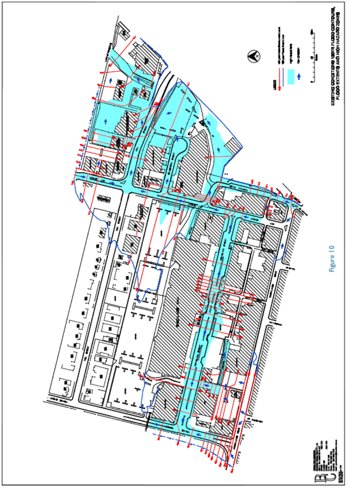

> [Picture on page 96: a picture, saved as a picture (images/part-f2-business-site-specific-page-96-1.gif, 150 dpi).]

Figure 18: Existing development flood contours

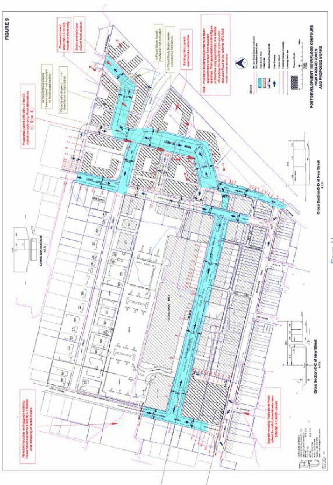

> [Picture on page 97: a picture, saved as a picture (images/part-f2-business-site-specific-page-97-1.gif, 150 dpi).]

Figure 19: Post development flood contours

### 3.7 General

#### 3.7.1 Public art

#### Objectives

Provide art works which are integrated into broader development and planning of

Merrylands Centre.

Avoid standalone public art projects that fail to address the locality and its culture.

#### Controls

Public Art is encouraged to be provided within the centre, in accordance with Council’s

Public Art Policy.

Public Art provided shall develop the cultural identity of the community and reflect the

culture of the community.

Artworks shall be integrated into the design of buildings and the landscape.

Within the Neil Street Precinct, the following thematic areas are to be considered in the

public art/design:

• industrial heritage of the locality including the grain mills, brick works and railway; and

• A’Becketts Creek and the natural environment.

#### 3.7.2 Interim development

Through the process of implementing this plan it is expected that development applications

associated with existing uses will continue to be received. Acceptable design outcomes of the

application for minor development, must comply with the vision and objectives of the DCP.

#### Objectives

Enable ongoing development works in the centre that are associated with existing uses,

without compromising the implementation of the longer term vision and objectives as

outline in this DCP.

Permit a reasonable amount of interim development while maintaining the viability of

implementing this plan as an attractive future option.

Ensure any development works provides a positive design outcomes that contributes to

the urban character of the centre.

#### Controls

All minor development associated with existing buildings including but not limited to

alteration and additions, change of use, outdoor dining, subdivision and signage must

not restrict or prohibit an adjoining landowner from developing their site in accordance

with this DCP.

Development is to ensure activation of the streetscape and high urban design outcomes.

Alterations and additions must not exceed 60m2 of additional floor space on to or

associated with an existing building. Only 1 application for this addition, per lot, is

permissible, as from the date of adoption of this DCP.

This page has been left intentionally blank.

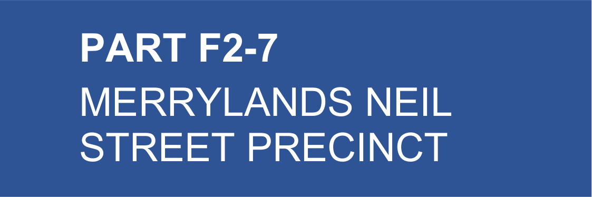

> [Picture on page 100: a picture, saved as a picture (images/part-f2-business-site-specific-page-100-1.gif, 150 dpi).]
